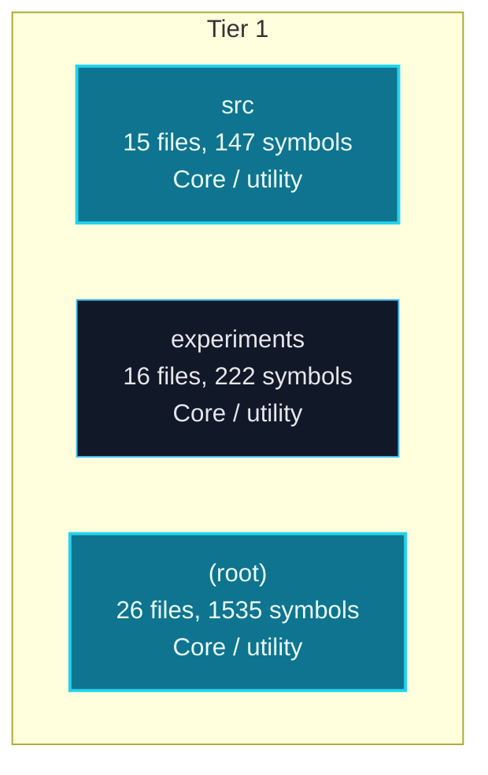
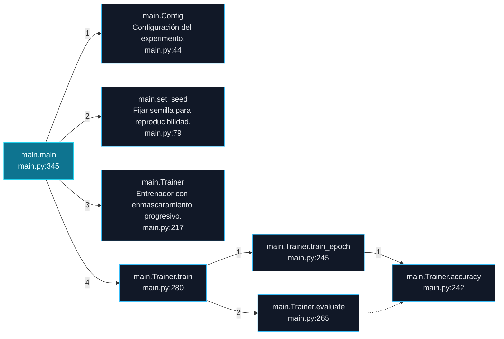
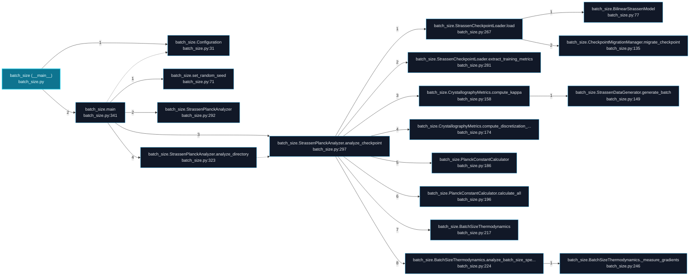

```mermaid
flowchart LR
    classDef default fill:#111827,stroke:#38bdf8,color:#e5e7eb;
    classDef entry fill:#0e7490,stroke:#22d3ee,color:#ecfeff,stroke-width:2px;
    n_boltzmann_experiments_py___main_["boltzmann_experiments (__main__)<br/>boltzmann_experiments.py"]:::entry
    n_boltzmann_experiments_py__main["boltzmann_experiments.main<br/>boltzmann_experiments.py:935"]:::default
    n_boltzmann_experiments_py__set_seed["boltzmann_experiments.set_seed<br/>boltzmann_experiments.py:30"]:::default
    n_boltzmann_experiments_py__DLProgram["boltzmann_experiments.DLProgram<br/>boltzmann_experiments.py:199"]:::default
    n_boltzmann_experiments_py__run_full_boltzmann_program["boltzmann_experiments.DLProgram.run_full_boltzmann_program<br/>boltzmann_experiments.py:247"]:::default
    n_boltzmann_experiments_py__phase1_molecular_hypothesis["boltzmann_experiments.DLProgram.phase1_molecular_hypothesis<br/>boltzmann_experiments.py:328"]:::default
    n_boltzmann_experiments_py___compute_entropy_simple["boltzmann_experiments.DLProgram._compute_entropy_simple<br/>Entropía simple sin KDE para datos de baja va...<br/>boltzmann_experiments.py:435"]:::default
    n_boltzmann_experiments_py___compute_entropy["boltzmann_experiments.DLProgram._compute_entropy<br/>Entropía con manejo robusto de covarianza<br/>boltzmann_experiments.py:446"]:::default
    n_boltzmann_experiments_py___compute_effective_volume["boltzmann_experiments.DLProgram._compute_effective_volume<br/>boltzmann_experiments.py:466"]:::default
    n_boltzmann_experiments_py___plot_parameter_distribution["boltzmann_experiments.DLProgram._plot_parameter_distribution<br/>boltzmann_experiments.py:475"]:::default
    n_boltzmann_experiments_py___save_results["boltzmann_experiments.DLProgram._save_results<br/>boltzmann_experiments.py:307"]:::default
    n_boltzmann_experiments_py__phase2_entropy_production["boltzmann_experiments.DLProgram.phase2_entropy_production<br/>boltzmann_experiments.py:506"]:::default
    n_boltzmann_experiments_py___simulate_training_trajectory["boltzmann_experiments.DLProgram._simulate_training_trajec...<br/>boltzmann_experiments.py:592"]:::default
    n_boltzmann_experiments_py___compute_generalization_entropy["boltzmann_experiments.DLProgram._compute_generalization_e...<br/>Entropía de generalización con manejo robusto...<br/>boltzmann_experiments.py:604"]:::default
    n_boltzmann_experiments_py___fit_timescale["boltzmann_experiments.DLProgram._fit_timescale<br/>boltzmann_experiments.py:691"]:::default
    n_boltzmann_experiments_py___plot_entropy_production["boltzmann_experiments.DLProgram._plot_entropy_production<br/>boltzmann_experiments.py:701"]:::default
    n_boltzmann_experiments_py__phase3_extensivity_law["boltzmann_experiments.DLProgram.phase3_extensivity_law<br/>boltzmann_experiments.py:719"]:::default
    n_boltzmann_experiments_py___verify_scaling["boltzmann_experiments.DLProgram._verify_scaling<br/>boltzmann_experiments.py:773"]:::default
    n_boltzmann_experiments_py___fit_extensivity["boltzmann_experiments.DLProgram._fit_extensivity<br/>boltzmann_experiments.py:812"]:::default
    n_boltzmann_experiments_py___plot_extensivity["boltzmann_experiments.DLProgram._plot_extensivity<br/>boltzmann_experiments.py:828"]:::default
    n_boltzmann_experiments_py___verify_extensivity_universality["boltzmann_experiments.DLProgram._verify_extensivity_unive...<br/>boltzmann_experiments.py:824"]:::default
    n_boltzmann_experiments_py__phase4_quantum_basis_transform["boltzmann_experiments.DLProgram.phase4_quantum_basis_tran...<br/>boltzmann_experiments.py:841"]:::default
    n_boltzmann_experiments_py___find_broken_symmetries["boltzmann_experiments.DLProgram._find_broken_symmetries<br/>boltzmann_experiments.py:895"]:::default
    n_boltzmann_experiments_py___measure_uncertainty["boltzmann_experiments.DLProgram._measure_uncertainty<br/>boltzmann_experiments.py:903"]:::default
    n_boltzmann_experiments_py___plot_uncertainty_distribution["boltzmann_experiments.DLProgram._plot_uncertainty_distrib...<br/>boltzmann_experiments.py:914"]:::default
    n_boltzmann_experiments_py__convert_to_serializable["boltzmann_experiments.DLProgram.convert_to_serializable<br/>boltzmann_experiments.py:310"]:::default
    n_boltzmann_experiments_py___print_executive_summary["boltzmann_experiments.DLProgram._print_executive_summary<br/>boltzmann_experiments.py:267"]:::default
    n_boltzmann_experiments_py___main_ -->|"1"| n_boltzmann_experiments_py__main
    n_boltzmann_experiments_py__main -->|"1"| n_boltzmann_experiments_py__set_seed
    n_boltzmann_experiments_py__main -->|"2"| n_boltzmann_experiments_py__DLProgram
    n_boltzmann_experiments_py__main -->|"3"| n_boltzmann_experiments_py__run_full_boltzmann_program
    n_boltzmann_experiments_py__run_full_boltzmann_program -->|"1"| n_boltzmann_experiments_py__phase1_molecular_hypothesis
    n_boltzmann_experiments_py__phase1_molecular_hypothesis -->|"1"| n_boltzmann_experiments_py___compute_entropy_simple
    n_boltzmann_experiments_py__phase1_molecular_hypothesis -->|"2"| n_boltzmann_experiments_py___compute_entropy
    n_boltzmann_experiments_py__phase1_molecular_hypothesis -->|"3"| n_boltzmann_experiments_py___compute_effective_volume
    n_boltzmann_experiments_py__phase1_molecular_hypothesis -->|"4"| n_boltzmann_experiments_py___plot_parameter_distribution
    n_boltzmann_experiments_py__phase1_molecular_hypothesis -->|"5"| n_boltzmann_experiments_py___save_results
    n_boltzmann_experiments_py__run_full_boltzmann_program -->|"2"| n_boltzmann_experiments_py__phase2_entropy_production
    n_boltzmann_experiments_py__phase2_entropy_production -->|"1"| n_boltzmann_experiments_py___simulate_training_trajectory
    n_boltzmann_experiments_py__phase2_entropy_production -->|"2"| n_boltzmann_experiments_py___compute_generalization_entropy
    n_boltzmann_experiments_py__phase2_entropy_production -->|"3"| n_boltzmann_experiments_py___fit_timescale
    n_boltzmann_experiments_py__phase2_entropy_production -->|"4"| n_boltzmann_experiments_py___plot_entropy_production
    n_boltzmann_experiments_py__phase2_entropy_production -->|"5"| n_boltzmann_experiments_py___save_results
    n_boltzmann_experiments_py__run_full_boltzmann_program -->|"3"| n_boltzmann_experiments_py__phase3_extensivity_law
    n_boltzmann_experiments_py__phase3_extensivity_law -->|"1"| n_boltzmann_experiments_py___verify_scaling
    n_boltzmann_experiments_py__phase3_extensivity_law -->|"2"| n_boltzmann_experiments_py___fit_extensivity
    n_boltzmann_experiments_py__phase3_extensivity_law -->|"3"| n_boltzmann_experiments_py___plot_extensivity
    n_boltzmann_experiments_py__phase3_extensivity_law -->|"4"| n_boltzmann_experiments_py___verify_extensivity_universality
    n_boltzmann_experiments_py__phase3_extensivity_law -->|"5"| n_boltzmann_experiments_py___save_results
    n_boltzmann_experiments_py__run_full_boltzmann_program -->|"4"| n_boltzmann_experiments_py__phase4_quantum_basis_transform
    n_boltzmann_experiments_py__phase4_quantum_basis_transform -->|"1"| n_boltzmann_experiments_py___find_broken_symmetries
    n_boltzmann_experiments_py__phase4_quantum_basis_transform -->|"2"| n_boltzmann_experiments_py___measure_uncertainty
    n_boltzmann_experiments_py__phase4_quantum_basis_transform -->|"3"| n_boltzmann_experiments_py___plot_uncertainty_distribution
    n_boltzmann_experiments_py__phase4_quantum_basis_transform -->|"4"| n_boltzmann_experiments_py___save_results
    n_boltzmann_experiments_py__run_full_boltzmann_program -->|"5"| n_boltzmann_experiments_py___save_results
    n_boltzmann_experiments_py___save_results -->|"1"| n_boltzmann_experiments_py__convert_to_serializable
    n_boltzmann_experiments_py__run_full_boltzmann_program -->|"6"| n_boltzmann_experiments_py___print_executive_summary
```

# strass_strassen Architecture and Execution Flows

[Back to index](index.md)

## Architecture Overview

3 components stacked in 1 dependency tiers (weighted Eades-Lin-Smyth ordering: arrows point from dependent to dependency, top to bottom). Labels are import counts, thick arrows the top quartile; 0 transitively implied edges are omitted. Dashed red arrows are upward dependencies: the smallest set of imports that closes every cycle and breaks the layering. Cyan components hold entry points. Interactive version: `readmenator-apidocs/index.html#/flows`.

---

## Execution Flows

Entry points are scored from `__main__` guards, `main` functions, entry-style names and files, and call-graph sources. Each flow walks resolved calls in call-site order (depth <= 4, <= 40 steps); numbers give the call order, dashed arrows revisit an already expanded callee, red arrows are recursion. Interactive version with zoom and per-node docs: `readmenator-apidocs/index.html#/flows`.

### `main.main`

`src/training/main.py:345`, score 9: entry-style name `main`; defined in entry file `main.py`; called from the `__main__` guard.

Call tree:

### `batch_size (__main__)`

`batch_size.py:371`, score 8: `if __name__ == "__main__"` guard.

Call tree:

### `boltzmann_experiments (__main__)`

`boltzmann_experiments.py:1097`, score 8: `if __name__ == "__main__"` guard.

Call tree:

---
