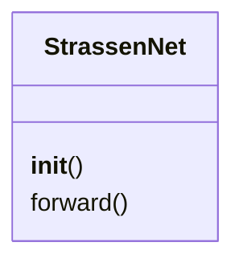

# `app`

> Source: [app.py:1](../../app.py#L1) | language `py` | coverage 25.0% | [API index](../index.md)

app.py

Autor: Gris Iscomeback
Correo electrónico: grisiscomeback[at]gmail[dot]com
Fecha de creación: xx/xx/xxxx
Licencia: GPL v3

Descripción:

## Contents

- **Classes:** [`StrassenNet`](#strassennet)

## Type Diagram



## Classes

<a id="strassennet"></a>

### `StrassenNet`

`class` | [app.py:24](../../app.py#L24)

```python
class StrassenNet(nn.Module)
```

Bases: `nn.Module`

**Members**

| Member | Kind | Summary |
|---|---|---|
| [`__init__`](#strassennet-__init__) | constructor |  |
| [`forward`](#strassennet-forward) | method |  |

<a id="strassennet-__init__"></a>

#### `StrassenNet.__init__`

`constructor` | [app.py:25](../../app.py#L25)

```python
def __init__(self, rank=7)
```

**Parameters**

| Name | Type | Default | Description |
|---|---|---|---|
| `rank` |  | `7` |  |

<a id="strassennet-forward"></a>

#### `StrassenNet.forward`

`method` | [app.py:31](../../app.py#L31)

```python
def forward(self, A, B)
```

**Parameters**

| Name | Type | Default | Description |
|---|---|---|---|
| `A` |  |  |  |
| `B` |  |  |  |

---
