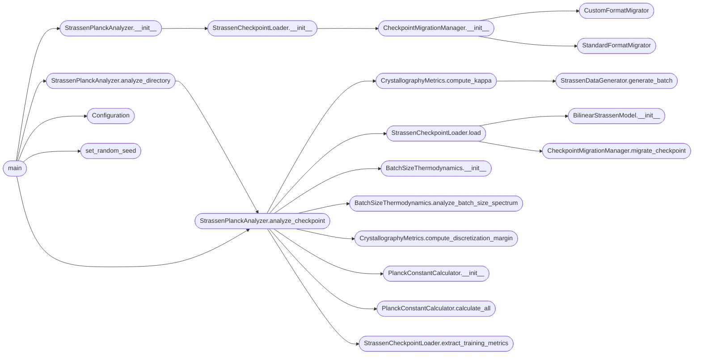

# `batch_size`

> Source: [batch_size.py:1](../../batch_size.py#L1) | language `py` | coverage 2.4% | [API index](../index.md)

StrassenPlanckCalculator - Extended with Batch Size Thermodynamics

Calculates effective Planck constant (h_bar) from Strassen model checkpoints and
derives optimal batch size from quantum-thermodynamic principles.

Physics implemented:
- Batch size as inverse temperature: Var(∇L) ∝ 1/B
- Quantum noise quantization: ⟨(δ∇L)²⟩ ∼ ℏ_eff/B
- Saturation condition: B_sat ≈ ℏ_eff/Δ_struct
- Optimal batch size: B_opt ≈ ℏ_eff/‖∇L‖²_det

## Contents

- **Classes:** [`Configuration`](#configuration), [`BilinearStrassenModel`](#bilinearstrassenmodel), [`CheckpointMigrator`](#checkpointmigrator), [`CustomFormatMigrator`](#customformatmigrator), [`StandardFormatMigrator`](#standardformatmigrator), [`CheckpointMigrationManager`](#checkpointmigrationmanager), [`StrassenDataGenerator`](#strassendatagenerator), [`CrystallographyMetrics`](#crystallographymetrics), [`PlanckConstantCalculator`](#planckconstantcalculator), [`BatchSizeThermodynamics`](#batchsizethermodynamics), [`StrassenCheckpointLoader`](#strassencheckpointloader), [`StrassenPlanckAnalyzer`](#strassenplanckanalyzer)
- **Functions:** [`set_random_seed`](#set_random_seed), [`main`](#main)
- **Constants:** [`CONFIG`](#config)

## Type Diagram

```mermaid
classDiagram
    direction LR
    class Configuration
    Configuration : int BATCH_SIZE
    Configuration : int HIDDEN_SLOTS
    Configuration : int TARGET_SLOTS
    Configuration : int MATRIX_SIZE
    Configuration : int INPUT_DIM
    Configuration : int OUTPUT_DIM
    Configuration : float WEIGHT_DECAY
    Configuration : float LEARNING_RATE
    Configuration : int EPOCHS
    Configuration : int RANDOM_SEED
    Configuration : float DISCRETIZATION_MARGIN
    Configuration : float OPTIMAL_DELTA_THRESHOLD
    Configuration : float INDUSTRIAL_DELTA_THRESHOLD
    Configuration : float PLANCK_SI
    Configuration : float SPEED_OF_LIGHT
    Configuration : float GRAVITATIONAL_CONSTANT
    Configuration : float SOLAR_MASS
    Configuration : float BOLTZMANN_CONSTANT
    Configuration : List[int] BATCH_SIZE_RANGE
    Configuration : int GRADIENT_ESTIMATION_BATCHES
    Configuration : float STRUCTURAL_GAP_EPSILON
    Configuration : List[float] NOISE_LEVELS
    Configuration : int RESILIENCE_TRIALS
    Configuration : int RESILIENCE_EPOCHS
    class BilinearStrassenModel
    BilinearStrassenModel : __init__()
    BilinearStrassenModel : forward()
    BilinearStrassenModel : get_coefficients()
    BilinearStrassenModel : compute_lambda_effective()
    class CheckpointMigrator
    CheckpointMigrator : can_migrate()
    CheckpointMigrator : migrate()
    class CustomFormatMigrator
    CustomFormatMigrator : can_migrate()
    CustomFormatMigrator : migrate()
    class StandardFormatMigrator
    StandardFormatMigrator : can_migrate()
    StandardFormatMigrator : migrate()
    class CheckpointMigrationManager
    CheckpointMigrationManager : __init__()
    CheckpointMigrationManager : migrate_checkpoint()
    class StrassenDataGenerator
    StrassenDataGenerator : generate_batch()
    class CrystallographyMetrics
    CrystallographyMetrics : compute_kappa()
    CrystallographyMetrics : compute_discretization_margin()
    CrystallographyMetrics : compute_local_complexity()
    class PlanckConstantCalculator
    PlanckConstantCalculator : __init__()
    PlanckConstantCalculator : calculate_all()
    class BatchSizeThermodynamics
    BatchSizeThermodynamics : __init__()
    BatchSizeThermodynamics : analyze_batch_size_spectrum()
    class StrassenCheckpointLoader
    StrassenCheckpointLoader : __init__()
    StrassenCheckpointLoader : load()
    StrassenCheckpointLoader : extract_training_metrics()
    class StrassenPlanckAnalyzer
    StrassenPlanckAnalyzer : __init__()
    StrassenPlanckAnalyzer : analyze_checkpoint()
    StrassenPlanckAnalyzer : analyze_directory()
    CheckpointMigrator <|-- CustomFormatMigrator
    CheckpointMigrator <|-- StandardFormatMigrator
```



## Call Graph

Solid arrows stay in this module, dashed arrows leave it.



## Classes

<a id="configuration"></a>

### `Configuration`

`class` `dataclass` | [batch_size.py:31](../../batch_size.py#L31)

Decorators: `@dataclass(frozen=True)`

```python
class Configuration
```

**Attributes**

| Name | Type | Default | Description |
|---|---|---|---|
| [`BATCH_SIZE`](#configuration-batch_size) | `int` | `32` |  |
| [`HIDDEN_SLOTS`](#configuration-hidden_slots) | `int` | `8` |  |
| [`TARGET_SLOTS`](#configuration-target_slots) | `int` | `7` |  |
| [`MATRIX_SIZE`](#configuration-matrix_size) | `int` | `2` |  |
| [`INPUT_DIM`](#configuration-input_dim) | `int` | `4` |  |
| [`OUTPUT_DIM`](#configuration-output_dim) | `int` | `4` |  |
| [`WEIGHT_DECAY`](#configuration-weight_decay) | `float` | `0.0001` |  |
| [`LEARNING_RATE`](#configuration-learning_rate) | `float` | `0.001` |  |
| [`EPOCHS`](#configuration-epochs) | `int` | `3000` |  |
| [`RANDOM_SEED`](#configuration-random_seed) | `int` | `42` |  |
| [`DISCRETIZATION_MARGIN`](#configuration-discretization_margin) | `float` | `0.1` |  |
| [`OPTIMAL_DELTA_THRESHOLD`](#configuration-optimal_delta_threshold) | `float` | `0.01` |  |
| [`INDUSTRIAL_DELTA_THRESHOLD`](#configuration-industrial_delta_threshold) | `float` | `0.1` |  |
| [`PLANCK_SI`](#configuration-planck_si) | `float` | `1.054571817e-34` |  |
| [`SPEED_OF_LIGHT`](#configuration-speed_of_light) | `float` | `299792458` |  |
| [`GRAVITATIONAL_CONSTANT`](#configuration-gravitational_constant) | `float` | `6.6743e-11` |  |
| [`SOLAR_MASS`](#configuration-solar_mass) | `float` | `1.98847e+30` |  |
| [`BOLTZMANN_CONSTANT`](#configuration-boltzmann_constant) | `float` | `1.380649e-23` |  |
| [`BATCH_SIZE_RANGE`](#configuration-batch_size_range) | `List[int]` | `field(default_factory=lambda: [8, 16, 24, 32, 64, 96, 128, 256, 512])` |  |
| [`GRADIENT_ESTIMATION_BATCHES`](#configuration-gradient_estimation_batches) | `int` | `10` |  |
| [`STRUCTURAL_GAP_EPSILON`](#configuration-structural_gap_epsilon) | `float` | `1e-06` |  |
| [`NOISE_LEVELS`](#configuration-noise_levels) | `List[float]` | `field(default_factory=lambda: [1e-05, 5e-05, 0.0001, 0.0005, 0.001, 0.005, 0.01])` |  |
| [`RESILIENCE_TRIALS`](#configuration-resilience_trials) | `int` | `5` |  |
| [`RESILIENCE_EPOCHS`](#configuration-resilience_epochs) | `int` | `30` |  |
| [`GAUGE_SAMPLES`](#configuration-gauge_samples) | `int` | `50` |  |
| [`KAPPA_BATCHES`](#configuration-kappa_batches) | `int` | `5` |  |
| [`LC_PERCENTILE`](#configuration-lc_percentile) | `float` | `0.95` |  |
| [`ULTRA_STRONG_WEIGHTS`](#configuration-ultra_strong_weights) | `Tuple[float, float, float, float]` | `(0.6, 0.25, 0.1, 0.05)` |  |
| [`STRONG_WEIGHTS`](#configuration-strong_weights) | `Tuple[float, float, float, float]` | `(0.5, 0.3, 0.15, 0.05)` |  |
| [`WEAK_WEIGHTS`](#configuration-weak_weights) | `Tuple[float, float, float, float]` | `(0.25, 0.25, 0.25, 0.25)` |  |
| [`ULTRA_STRONG_LAMBDA`](#configuration-ultra_strong_lambda) | `float` | `1e+30` |  |
| [`STRONG_LAMBDA`](#configuration-strong_lambda) | `float` | `10000000000.0` |  |
| [`EFFECTIVE_MODES`](#configuration-effective_modes) | `int` | `31` |  |
| [`OUTPUT_DIRECTORY`](#configuration-output_directory) | `str` | `'planck_analysis_reports'` |  |

---

<a id="bilinearstrassenmodel"></a>

### `BilinearStrassenModel`

`class` | [batch_size.py:77](../../batch_size.py#L77)

```python
class BilinearStrassenModel(nn.Module)
```

Bases: `nn.Module`

**Members**

| Member | Kind | Summary |
|---|---|---|
| [`__init__`](#bilinearstrassenmodel-__init__) | constructor |  |
| [`forward`](#bilinearstrassenmodel-forward) | method |  |
| [`get_coefficients`](#bilinearstrassenmodel-get_coefficients) | method |  |
| [`compute_lambda_effective`](#bilinearstrassenmodel-compute_lambda_effective) | method |  |

<a id="bilinearstrassenmodel-__init__"></a>

#### `BilinearStrassenModel.__init__`

`constructor` | [batch_size.py:78](../../batch_size.py#L78)

```python
def __init__(self, config: Configuration = CONFIG)
```

**Parameters**

| Name | Type | Default | Description |
|---|---|---|---|
| `config` | `Configuration` | `CONFIG` |  |

*Called by:* [`StrassenCheckpointLoader.load`](#strassencheckpointloader-load), [`BilinearStrassenModel.__init__`](boltzmann_experiments.py.md#bilinearstrassenmodel-__init__), [`BilinearStrassenModel.__init__`](crystallography.py.md#bilinearstrassenmodel-__init__), [`BilinearStrassenModel.__init__`](grain.py.md#bilinearstrassenmodel-__init__), [`BilinearStrassenModel.__init__`](grigori_perelmans_ricci_flow.py.md#bilinearstrassenmodel-__init__), [`BilinearStrassenModel.__init__`](hawking_radiation.py.md#bilinearstrassenmodel-__init__), [`BilinearStrassenModel.__init__`](maxwell_strassen_analysis.py.md#bilinearstrassenmodel-__init__), [`BilinearStrassenModel.__init__`](mbl_analyzer.py.md#bilinearstrassenmodel-__init__), [`BilinearStrassenModel.__init__`](plank.py.md#bilinearstrassenmodel-__init__), [`BilinearStrassenModel.__init__`](superposition.py.md#bilinearstrassenmodel-__init__), [`BilinearStrassenModel.__init__`](xray_tensor_diffractometer.py.md#bilinearstrassenmodel-__init__)

<a id="bilinearstrassenmodel-forward"></a>

#### `BilinearStrassenModel.forward`

`method` | [batch_size.py:88](../../batch_size.py#L88)

```python
def forward(self, a, b)
```

**Parameters**

| Name | Type | Default | Description |
|---|---|---|---|
| `a` |  |  |  |
| `b` |  |  |  |

<a id="bilinearstrassenmodel-get_coefficients"></a>

#### `BilinearStrassenModel.get_coefficients`

`method` | [batch_size.py:91](../../batch_size.py#L91)

```python
def get_coefficients(self)
```

*Called by:* [`BilinearStrassenModel.construct_hessian_approximation`](mbl_analyzer.py.md#bilinearstrassenmodel-construct_hessian_approximation), [`EpitaxialGrowthEngine.anneal_crystal`](xray_tensor_diffractometer.py.md#epitaxialgrowthengine-anneal_crystal)

<a id="bilinearstrassenmodel-compute_lambda_effective"></a>

#### `BilinearStrassenModel.compute_lambda_effective`

`method` | [batch_size.py:94](../../batch_size.py#L94)

```python
def compute_lambda_effective(self)
```

---

<a id="checkpointmigrator"></a>

### `CheckpointMigrator`

`class` `abstract` | [batch_size.py:100](../../batch_size.py#L100)

```python
class CheckpointMigrator(ABC)
```

Bases: `ABC`

Subclasses: [`CustomFormatMigrator`](#customformatmigrator), [`StandardFormatMigrator`](#standardformatmigrator)

**Members**

| Member | Kind | Summary |
|---|---|---|
| [`can_migrate`](#checkpointmigrator-can_migrate) | method |  |
| [`migrate`](#checkpointmigrator-migrate) | method |  |

<a id="checkpointmigrator-can_migrate"></a>

#### `CheckpointMigrator.can_migrate`

`method` `abstract` | [batch_size.py:102](../../batch_size.py#L102)

Decorators: `@abstractmethod`

```python
def can_migrate(self, state_dict)
```

**Parameters**

| Name | Type | Default | Description |
|---|---|---|---|
| `state_dict` |  |  |  |

<a id="checkpointmigrator-migrate"></a>

#### `CheckpointMigrator.migrate`

`method` `abstract` | [batch_size.py:106](../../batch_size.py#L106)

Decorators: `@abstractmethod`

```python
def migrate(self, state_dict)
```

**Parameters**

| Name | Type | Default | Description |
|---|---|---|---|
| `state_dict` |  |  |  |

*Called by:* [`MaxwellAnalyzer.analyze_checkpoint`](maxwell_strassen_analysis.py.md#maxwellanalyzer-analyze_checkpoint), [`CheckpointMigrator.migrate`](percolation_analysis.py.md#checkpointmigrator-migrate)

---

<a id="customformatmigrator"></a>

### `CustomFormatMigrator`

`class` | [batch_size.py:110](../../batch_size.py#L110)

```python
class CustomFormatMigrator(CheckpointMigrator)
```

Bases: [`CheckpointMigrator`](#checkpointmigrator)

**Members**

| Member | Kind | Summary |
|---|---|---|
| [`can_migrate`](#customformatmigrator-can_migrate) | method |  |
| [`migrate`](#customformatmigrator-migrate) | method |  |

<a id="customformatmigrator-can_migrate"></a>

#### `CustomFormatMigrator.can_migrate`

`method` | [batch_size.py:111](../../batch_size.py#L111)

```python
def can_migrate(self, state_dict)
```

**Parameters**

| Name | Type | Default | Description |
|---|---|---|---|
| `state_dict` |  |  |  |

<a id="customformatmigrator-migrate"></a>

#### `CustomFormatMigrator.migrate`

`method` | [batch_size.py:114](../../batch_size.py#L114)

```python
def migrate(self, state_dict)
```

**Parameters**

| Name | Type | Default | Description |
|---|---|---|---|
| `state_dict` |  |  |  |

---

<a id="standardformatmigrator"></a>

### `StandardFormatMigrator`

`class` | [batch_size.py:122](../../batch_size.py#L122)

```python
class StandardFormatMigrator(CheckpointMigrator)
```

Bases: [`CheckpointMigrator`](#checkpointmigrator)

**Members**

| Member | Kind | Summary |
|---|---|---|
| [`can_migrate`](#standardformatmigrator-can_migrate) | method |  |
| [`migrate`](#standardformatmigrator-migrate) | method |  |

<a id="standardformatmigrator-can_migrate"></a>

#### `StandardFormatMigrator.can_migrate`

`method` | [batch_size.py:123](../../batch_size.py#L123)

```python
def can_migrate(self, state_dict)
```

**Parameters**

| Name | Type | Default | Description |
|---|---|---|---|
| `state_dict` |  |  |  |

<a id="standardformatmigrator-migrate"></a>

#### `StandardFormatMigrator.migrate`

`method` | [batch_size.py:126](../../batch_size.py#L126)

```python
def migrate(self, state_dict)
```

**Parameters**

| Name | Type | Default | Description |
|---|---|---|---|
| `state_dict` |  |  |  |

---

<a id="checkpointmigrationmanager"></a>

### `CheckpointMigrationManager`

`class` | [batch_size.py:131](../../batch_size.py#L131)

```python
class CheckpointMigrationManager
```

**Members**

| Member | Kind | Summary |
|---|---|---|
| [`__init__`](#checkpointmigrationmanager-__init__) | constructor |  |
| [`migrate_checkpoint`](#checkpointmigrationmanager-migrate_checkpoint) | method |  |

<a id="checkpointmigrationmanager-__init__"></a>

#### `CheckpointMigrationManager.__init__`

`constructor` | [batch_size.py:132](../../batch_size.py#L132)

```python
def __init__(self)
```

*Calls:* [`CustomFormatMigrator`](#customformatmigrator), [`StandardFormatMigrator`](#standardformatmigrator)

*Called by:* [`StrassenCheckpointLoader.__init__`](#strassencheckpointloader-__init__)

<a id="checkpointmigrationmanager-migrate_checkpoint"></a>

#### `CheckpointMigrationManager.migrate_checkpoint`

`method` | [batch_size.py:135](../../batch_size.py#L135)

```python
def migrate_checkpoint(self, path, device='cpu')
```

**Parameters**

| Name | Type | Default | Description |
|---|---|---|---|
| `path` |  |  |  |
| `device` |  | `'cpu'` |  |

*Called by:* [`StrassenCheckpointLoader.load`](#strassencheckpointloader-load), [`RicciFlowAnalyzerPipeline.analyze_checkpoint`](grigori_perelmans_ricci_flow.py.md#ricciflowanalyzerpipeline-analyze_checkpoint), [`StrassenCheckpointLoader.load`](plank.py.md#strassencheckpointloader-load)

---

<a id="strassendatagenerator"></a>

### `StrassenDataGenerator`

`class` | [batch_size.py:147](../../batch_size.py#L147)

```python
class StrassenDataGenerator
```

**Members**

| Member | Kind | Summary |
|---|---|---|
| [`generate_batch`](#strassendatagenerator-generate_batch) | staticmethod |  |

<a id="strassendatagenerator-generate_batch"></a>

#### `StrassenDataGenerator.generate_batch`

`staticmethod` | [batch_size.py:149](../../batch_size.py#L149)

Decorators: `@staticmethod`

```python
def generate_batch(batch_size=CONFIG.BATCH_SIZE, config=CONFIG)
```

**Parameters**

| Name | Type | Default | Description |
|---|---|---|---|
| `batch_size` |  | `CONFIG.BATCH_SIZE` |  |
| `config` |  | `CONFIG` |  |

*Called by:* [`CrystallographyMetrics.compute_kappa`](#crystallographymetrics-compute_kappa), [`estimate_gns`](compute_gns_checkpoints.py.md#estimate_gns), [`StrassenCrystallographer.run_full_analysis`](crystallography.py.md#strassencrystallographer-run_full_analysis), [`SuperpositionMetricCalculator.calculate`](experimetn2.py.md#superpositionmetriccalculator-calculate), [`RicciFlowAnalyzerPipeline.analyze_checkpoint`](grigori_perelmans_ricci_flow.py.md#ricciflowanalyzerpipeline-analyze_checkpoint), [`CrystallographyMetrics.compute_kappa`](plank.py.md#crystallographymetrics-compute_kappa), [`StrassenDataGenerator.generate_dataset`](superposition.py.md#strassendatagenerator-generate_dataset), [`train_for_batch_size`](train_batch_sweep.py.md#train_for_batch_size), [`BoltzmannAnalysisProgram.phase5_thermodynamic_analysis`](xray_tensor_diffractometer.py.md#boltzmannanalysisprogram-phase5_thermodynamic_analysis), [`BoltzmannAnalysisProgram.phase6_spectroscopic_analysis`](xray_tensor_diffractometer.py.md#boltzmannanalysisprogram-phase6_spectroscopic_analysis), [`GreenCowExperiment.train_with_green_cow`](xray_tensor_diffractometer.py.md#greencowexperiment-train_with_green_cow), [`StrassenCrystallographer.run_full_analysis`](xray_tensor_diffractometer.py.md#strassencrystallographer-run_full_analysis)

---

<a id="crystallographymetrics"></a>

### `CrystallographyMetrics`

`class` | [batch_size.py:156](../../batch_size.py#L156)

```python
class CrystallographyMetrics
```

**Members**

| Member | Kind | Summary |
|---|---|---|
| [`compute_kappa`](#crystallographymetrics-compute_kappa) | staticmethod |  |
| [`compute_discretization_margin`](#crystallographymetrics-compute_discretization_margin) | staticmethod |  |
| [`compute_local_complexity`](#crystallographymetrics-compute_local_complexity) | staticmethod |  |

<a id="crystallographymetrics-compute_kappa"></a>

#### `CrystallographyMetrics.compute_kappa`

`staticmethod` | [batch_size.py:158](../../batch_size.py#L158)

Decorators: `@staticmethod`

```python
def compute_kappa(model, num_batches=CONFIG.KAPPA_BATCHES, config=CONFIG)
```

**Parameters**

| Name | Type | Default | Description |
|---|---|---|---|
| `model` |  |  |  |
| `num_batches` |  | `CONFIG.KAPPA_BATCHES` |  |
| `config` |  | `CONFIG` |  |

*Calls:* [`StrassenDataGenerator.generate_batch`](#strassendatagenerator-generate_batch)

*Called by:* [`StrassenPlanckAnalyzer.analyze_checkpoint`](#strassenplanckanalyzer-analyze_checkpoint), [`StrassenCrystallographer.run_full_analysis`](crystallography.py.md#strassencrystallographer-run_full_analysis), [`CrystallographyMetrics.compute_all_metrics`](plank.py.md#crystallographymetrics-compute_all_metrics), [`CrystallographyMetrics.compute_all_metrics`](xray_tensor_diffractometer.py.md#crystallographymetrics-compute_all_metrics)

<a id="crystallographymetrics-compute_discretization_margin"></a>

#### `CrystallographyMetrics.compute_discretization_margin`

`staticmethod` | [batch_size.py:174](../../batch_size.py#L174)

Decorators: `@staticmethod`

```python
def compute_discretization_margin(coeffs)
```

**Parameters**

| Name | Type | Default | Description |
|---|---|---|---|
| `coeffs` |  |  |  |

*Called by:* [`StrassenPlanckAnalyzer.analyze_checkpoint`](#strassenplanckanalyzer-analyze_checkpoint), [`CrystalPurityIndex.__init__`](crystallography.py.md#crystalpurityindex-__init__), [`SparsificationProtocol.discretize_weights`](crystallography.py.md#sparsificationprotocol-discretize_weights), [`StrassenCrystallographer.run_full_analysis`](crystallography.py.md#strassencrystallographer-run_full_analysis), [`StrassenDataGenerator.verify_structure`](crystallography.py.md#strassendatagenerator-verify_structure), [`CrystallographyMetrics.compute_all_metrics`](plank.py.md#crystallographymetrics-compute_all_metrics), [`StrassenDataGenerator.verify_structure`](plank.py.md#strassendatagenerator-verify_structure), [`CrystallographyMetrics.compute_all_metrics`](xray_tensor_diffractometer.py.md#crystallographymetrics-compute_all_metrics), [`CrystallographyMetrics.compute_alpha_purity`](xray_tensor_diffractometer.py.md#crystallographymetrics-compute_alpha_purity), [`EpitaxialGrowthEngine.anneal_crystal`](xray_tensor_diffractometer.py.md#epitaxialgrowthengine-anneal_crystal), [`StrassenDataGenerator.verify_structure`](xray_tensor_diffractometer.py.md#strassendatagenerator-verify_structure), [`run_epitaxy_from_best_crystal`](xray_tensor_diffractometer.py.md#run_epitaxy_from_best_crystal)

<a id="crystallographymetrics-compute_local_complexity"></a>

#### `CrystallographyMetrics.compute_local_complexity`

`staticmethod` | [batch_size.py:178](../../batch_size.py#L178)

Decorators: `@staticmethod`

```python
def compute_local_complexity(model, config=CONFIG)
```

**Parameters**

| Name | Type | Default | Description |
|---|---|---|---|
| `model` |  |  |  |
| `config` |  | `CONFIG` |  |

*Called by:* [`StrassenCrystallographer.run_full_analysis`](crystallography.py.md#strassencrystallographer-run_full_analysis), [`CrystallographyMetrics.compute_all_metrics`](plank.py.md#crystallographymetrics-compute_all_metrics), [`CrystallographyMetrics.compute_all_metrics`](xray_tensor_diffractometer.py.md#crystallographymetrics-compute_all_metrics)

---

<a id="planckconstantcalculator"></a>

### `PlanckConstantCalculator`

`class` | [batch_size.py:186](../../batch_size.py#L186)

```python
class PlanckConstantCalculator
```

**Members**

| Member | Kind | Summary |
|---|---|---|
| [`__init__`](#planckconstantcalculator-__init__) | constructor |  |
| [`calculate_all`](#planckconstantcalculator-calculate_all) | method |  |

<a id="planckconstantcalculator-__init__"></a>

#### `PlanckConstantCalculator.__init__`

`constructor` | [batch_size.py:187](../../batch_size.py#L187)

```python
def __init__(self, metrics, training_metrics, config=CONFIG)
```

**Parameters**

| Name | Type | Default | Description |
|---|---|---|---|
| `metrics` |  |  |  |
| `training_metrics` |  |  |  |
| `config` |  | `CONFIG` |  |

*Called by:* [`StrassenPlanckAnalyzer.analyze_checkpoint`](#strassenplanckanalyzer-analyze_checkpoint)

<a id="planckconstantcalculator-calculate_all"></a>

#### `PlanckConstantCalculator.calculate_all`

`method` | [batch_size.py:196](../../batch_size.py#L196)

```python
def calculate_all(self)
```

*Called by:* [`StrassenPlanckAnalyzer.analyze_checkpoint`](#strassenplanckanalyzer-analyze_checkpoint), [`StrassenPlanckAnalyzer.analyze_checkpoint`](plank.py.md#strassenplanckanalyzer-analyze_checkpoint)

---

<a id="batchsizethermodynamics"></a>

### `BatchSizeThermodynamics`

`class` | [batch_size.py:217](../../batch_size.py#L217)

```python
class BatchSizeThermodynamics
```

**Members**

| Member | Kind | Summary |
|---|---|---|
| [`__init__`](#batchsizethermodynamics-__init__) | constructor |  |
| [`analyze_batch_size_spectrum`](#batchsizethermodynamics-analyze_batch_size_spectrum) | method |  |

<a id="batchsizethermodynamics-__init__"></a>

#### `BatchSizeThermodynamics.__init__`

`constructor` | [batch_size.py:218](../../batch_size.py#L218)

```python
def __init__(self, model, h_bar, delta_struct, config=CONFIG)
```

**Parameters**

| Name | Type | Default | Description |
|---|---|---|---|
| `model` |  |  |  |
| `h_bar` |  |  |  |
| `delta_struct` |  |  |  |
| `config` |  | `CONFIG` |  |

*Called by:* [`StrassenPlanckAnalyzer.analyze_checkpoint`](#strassenplanckanalyzer-analyze_checkpoint)

<a id="batchsizethermodynamics-analyze_batch_size_spectrum"></a>

#### `BatchSizeThermodynamics.analyze_batch_size_spectrum`

`method` | [batch_size.py:224](../../batch_size.py#L224)

```python
def analyze_batch_size_spectrum(self)
```

*Called by:* [`StrassenPlanckAnalyzer.analyze_checkpoint`](#strassenplanckanalyzer-analyze_checkpoint)

---

<a id="strassencheckpointloader"></a>

### `StrassenCheckpointLoader`

`class` | [batch_size.py:262](../../batch_size.py#L262)

```python
class StrassenCheckpointLoader
```

**Members**

| Member | Kind | Summary |
|---|---|---|
| [`__init__`](#strassencheckpointloader-__init__) | constructor |  |
| [`load`](#strassencheckpointloader-load) | method |  |
| [`extract_training_metrics`](#strassencheckpointloader-extract_training_metrics) | method |  |

<a id="strassencheckpointloader-__init__"></a>

#### `StrassenCheckpointLoader.__init__`

`constructor` | [batch_size.py:263](../../batch_size.py#L263)

```python
def __init__(self, config=CONFIG)
```

**Parameters**

| Name | Type | Default | Description |
|---|---|---|---|
| `config` |  | `CONFIG` |  |

*Calls:* [`CheckpointMigrationManager.__init__`](#checkpointmigrationmanager-__init__)

*Called by:* [`StrassenPlanckAnalyzer.__init__`](#strassenplanckanalyzer-__init__)

<a id="strassencheckpointloader-load"></a>

#### `StrassenCheckpointLoader.load`

`method` | [batch_size.py:267](../../batch_size.py#L267)

```python
def load(self, path, device='cpu')
```

**Parameters**

| Name | Type | Default | Description |
|---|---|---|---|
| `path` |  |  |  |
| `device` |  | `'cpu'` |  |

*Calls:* [`BilinearStrassenModel.__init__`](#bilinearstrassenmodel-__init__), [`CheckpointMigrationManager.migrate_checkpoint`](#checkpointmigrationmanager-migrate_checkpoint)

*Called by:* [`StrassenPlanckAnalyzer.analyze_checkpoint`](#strassenplanckanalyzer-analyze_checkpoint), [`StrassenPlanckAnalyzer.analyze_checkpoint`](plank.py.md#strassenplanckanalyzer-analyze_checkpoint)

<a id="strassencheckpointloader-extract_training_metrics"></a>

#### `StrassenCheckpointLoader.extract_training_metrics`

`method` | [batch_size.py:281](../../batch_size.py#L281)

```python
def extract_training_metrics(self, path)
```

**Parameters**

| Name | Type | Default | Description |
|---|---|---|---|
| `path` |  |  |  |

*Called by:* [`StrassenPlanckAnalyzer.analyze_checkpoint`](#strassenplanckanalyzer-analyze_checkpoint), [`StrassenPlanckAnalyzer.analyze_checkpoint`](plank.py.md#strassenplanckanalyzer-analyze_checkpoint)

---

<a id="strassenplanckanalyzer"></a>

### `StrassenPlanckAnalyzer`

`class` | [batch_size.py:292](../../batch_size.py#L292)

```python
class StrassenPlanckAnalyzer
```

**Members**

| Member | Kind | Summary |
|---|---|---|
| [`__init__`](#strassenplanckanalyzer-__init__) | constructor |  |
| [`analyze_checkpoint`](#strassenplanckanalyzer-analyze_checkpoint) | method |  |
| [`analyze_directory`](#strassenplanckanalyzer-analyze_directory) | method |  |

<a id="strassenplanckanalyzer-__init__"></a>

#### `StrassenPlanckAnalyzer.__init__`

`constructor` | [batch_size.py:293](../../batch_size.py#L293)

```python
def __init__(self, config=CONFIG)
```

**Parameters**

| Name | Type | Default | Description |
|---|---|---|---|
| `config` |  | `CONFIG` |  |

*Calls:* [`StrassenCheckpointLoader.__init__`](#strassencheckpointloader-__init__)

*Called by:* [`main`](#main)

<a id="strassenplanckanalyzer-analyze_checkpoint"></a>

#### `StrassenPlanckAnalyzer.analyze_checkpoint`

`method` | [batch_size.py:297](../../batch_size.py#L297)

```python
def analyze_checkpoint(self, path, device='cpu')
```

**Parameters**

| Name | Type | Default | Description |
|---|---|---|---|
| `path` |  |  |  |
| `device` |  | `'cpu'` |  |

**Raises**

- `ValueError`: (raised in the body, not documented)

*Calls:* [`BatchSizeThermodynamics.__init__`](#batchsizethermodynamics-__init__), [`BatchSizeThermodynamics.analyze_batch_size_spectrum`](#batchsizethermodynamics-analyze_batch_size_spectrum), [`CrystallographyMetrics.compute_discretization_margin`](#crystallographymetrics-compute_discretization_margin), [`CrystallographyMetrics.compute_kappa`](#crystallographymetrics-compute_kappa), [`PlanckConstantCalculator.__init__`](#planckconstantcalculator-__init__), [`PlanckConstantCalculator.calculate_all`](#planckconstantcalculator-calculate_all), [`StrassenCheckpointLoader.extract_training_metrics`](#strassencheckpointloader-extract_training_metrics), [`StrassenCheckpointLoader.load`](#strassencheckpointloader-load)

*Called by:* [`StrassenPlanckAnalyzer.analyze_directory`](#strassenplanckanalyzer-analyze_directory), [`main`](#main), [`StrassenPlanckAnalyzer.analyze_directory`](plank.py.md#strassenplanckanalyzer-analyze_directory), [`main`](plank.py.md#main)

<a id="strassenplanckanalyzer-analyze_directory"></a>

#### `StrassenPlanckAnalyzer.analyze_directory`

`method` | [batch_size.py:323](../../batch_size.py#L323)

```python
def analyze_directory(self, directory, device='cpu', pattern='*.pt')
```

**Parameters**

| Name | Type | Default | Description |
|---|---|---|---|
| `directory` |  |  |  |
| `device` |  | `'cpu'` |  |
| `pattern` |  | `'*.pt'` |  |

**Raises**

- `ValueError`: (raised in the body, not documented)

*Calls:* [`StrassenPlanckAnalyzer.analyze_checkpoint`](#strassenplanckanalyzer-analyze_checkpoint)

*Called by:* [`main`](#main), [`main`](plank.py.md#main)

---

## Functions

<a id="set_random_seed"></a>

### `set_random_seed`

`function` | [batch_size.py:71](../../batch_size.py#L71)

```python
def set_random_seed(seed: int = CONFIG.RANDOM_SEED) -> None
```

**Parameters**

| Name | Type | Default | Description |
|---|---|---|---|
| `seed` | `int` | `CONFIG.RANDOM_SEED` |  |

*Called by:* [`main`](#main)

---

<a id="main"></a>

### `main`

`function` | [batch_size.py:341](../../batch_size.py#L341)

```python
def main()
```

*Calls:* [`Configuration`](#configuration), [`StrassenPlanckAnalyzer.__init__`](#strassenplanckanalyzer-__init__), [`StrassenPlanckAnalyzer.analyze_checkpoint`](#strassenplanckanalyzer-analyze_checkpoint), [`StrassenPlanckAnalyzer.analyze_directory`](#strassenplanckanalyzer-analyze_directory), [`set_random_seed`](#set_random_seed)

---

## Constants

<a id="config"></a>

### `CONFIG`

`constant` | [batch_size.py:68](../../batch_size.py#L68)

```python
CONFIG = Configuration()
```

---
