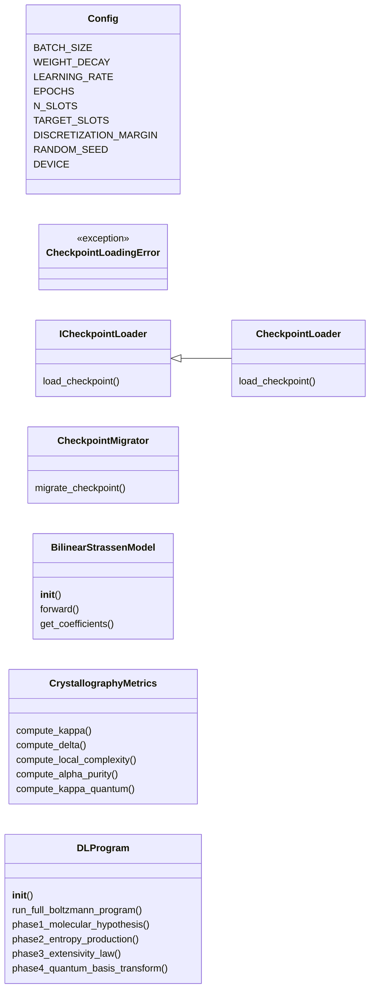
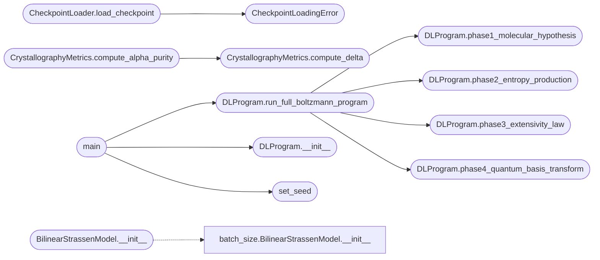

# `boltzmann_experiments`

> Source: [boltzmann_experiments.py:1](../../boltzmann_experiments.py#L1) | language `py` | coverage 13.8% | [API index](../index.md)

## Contents

- **Classes:** [`Config`](#config), [`ICheckpointLoader`](#icheckpointloader), [`CheckpointLoader`](#checkpointloader), [`CheckpointMigrator`](#checkpointmigrator), [`BilinearStrassenModel`](#bilinearstrassenmodel), [`CrystallographyMetrics`](#crystallographymetrics), [`DLProgram`](#dlprogram)
- **Exceptions:** [`CheckpointLoadingError`](#checkpointloadingerror)
- **Functions:** [`set_seed`](#set_seed), [`main`](#main), [`phase3_extensivity_law`](#phase3_extensivity_law)

## Type Diagram



## Call Graph

Solid arrows stay in this module, dashed arrows leave it.



## Classes

<a id="config"></a>

### `Config`

`class` | [boltzmann_experiments.py:19](../../boltzmann_experiments.py#L19)

```python
class Config
```

**Attributes**

| Name | Type | Default | Description |
|---|---|---|---|
| [`BATCH_SIZE`](#config-batch_size) |  | `32` |  |
| [`WEIGHT_DECAY`](#config-weight_decay) |  | `0.0001` |  |
| [`LEARNING_RATE`](#config-learning_rate) |  | `0.001` |  |
| [`EPOCHS`](#config-epochs) |  | `3000` |  |
| [`N_SLOTS`](#config-n_slots) |  | `8` |  |
| [`TARGET_SLOTS`](#config-target_slots) |  | `7` |  |
| [`DISCRETIZATION_MARGIN`](#config-discretization_margin) |  | `0.1` |  |
| [`RANDOM_SEED`](#config-random_seed) |  | `42` |  |
| [`DEVICE`](#config-device) |  | `'cuda' if torch.cuda.is_available() else 'cpu'` |  |

---

<a id="icheckpointloader"></a>

### `ICheckpointLoader`

`class` `abstract` | [boltzmann_experiments.py:40](../../boltzmann_experiments.py#L40)

```python
class ICheckpointLoader(ABC)
```

Bases: `ABC`

Subclasses: [`CheckpointLoader`](#checkpointloader)

**Members**

| Member | Kind | Summary |
|---|---|---|
| [`load_checkpoint`](#icheckpointloader-load_checkpoint) | method |  |

<a id="icheckpointloader-load_checkpoint"></a>

#### `ICheckpointLoader.load_checkpoint`

`method` `abstract` | [boltzmann_experiments.py:42](../../boltzmann_experiments.py#L42)

Decorators: `@abstractmethod`

```python
def load_checkpoint(self, path: str, device: str) -> Any
```

**Parameters**

| Name | Type | Default | Description |
|---|---|---|---|
| `path` | `str` |  |  |
| `device` | `str` |  |  |

**Returns:** `Any`

---

<a id="checkpointloader"></a>

### `CheckpointLoader`

`class` | [boltzmann_experiments.py:45](../../boltzmann_experiments.py#L45)

```python
class CheckpointLoader(ICheckpointLoader)
```

Bases: [`ICheckpointLoader`](#icheckpointloader)

**Members**

| Member | Kind | Summary |
|---|---|---|
| [`load_checkpoint`](#checkpointloader-load_checkpoint) | method |  |

<a id="checkpointloader-load_checkpoint"></a>

#### `CheckpointLoader.load_checkpoint`

`method` | [boltzmann_experiments.py:46](../../boltzmann_experiments.py#L46)

```python
def load_checkpoint(self, path: str, device: str) -> Any
```

**Parameters**

| Name | Type | Default | Description |
|---|---|---|---|
| `path` | `str` |  |  |
| `device` | `str` |  |  |

**Returns:** `Any`

**Raises**

- [`CheckpointLoadingError`](#checkpointloadingerror): (raised in the body, not documented)

*Calls:* [`CheckpointLoadingError`](#checkpointloadingerror)

*Called by:* [`main`](compute_gns_checkpoints.py.md#main), [`StrassenCheckpointAnalyzer.load_model`](superposition.py.md#strassencheckpointanalyzer-load_model), [`run_epitaxy_from_best_crystal`](xray_tensor_diffractometer.py.md#run_epitaxy_from_best_crystal)

---

<a id="checkpointmigrator"></a>

### `CheckpointMigrator`

`class` | [boltzmann_experiments.py:52](../../boltzmann_experiments.py#L52)

```python
class CheckpointMigrator
```

**Members**

| Member | Kind | Summary |
|---|---|---|
| [`migrate_checkpoint`](#checkpointmigrator-migrate_checkpoint) | staticmethod |  |

<a id="checkpointmigrator-migrate_checkpoint"></a>

#### `CheckpointMigrator.migrate_checkpoint`

`staticmethod` | [boltzmann_experiments.py:54](../../boltzmann_experiments.py#L54)

Decorators: `@staticmethod`

```python
def migrate_checkpoint(raw_data: Any) -> Optional[Dict[str, torch.Tensor]]
```

**Parameters**

| Name | Type | Default | Description |
|---|---|---|---|
| `raw_data` | `Any` |  |  |

**Returns:** `Optional[Dict[str, torch.Tensor]]`

*Called by:* [`main`](compute_gns_checkpoints.py.md#main), [`StrassenCrystallographer.__init__`](crystallography.py.md#strassencrystallographer-__init__), [`StrassenCheckpointAnalyzer.load_model`](superposition.py.md#strassencheckpointanalyzer-load_model), [`run_epitaxy_from_best_crystal`](xray_tensor_diffractometer.py.md#run_epitaxy_from_best_crystal)

---

<a id="bilinearstrassenmodel"></a>

### `BilinearStrassenModel`

`class` | [boltzmann_experiments.py:118](../../boltzmann_experiments.py#L118)

```python
class BilinearStrassenModel(nn.Module)
```

Bases: `nn.Module`

**Members**

| Member | Kind | Summary |
|---|---|---|
| [`__init__`](#bilinearstrassenmodel-__init__) | constructor |  |
| [`forward`](#bilinearstrassenmodel-forward) | method |  |
| [`get_coefficients`](#bilinearstrassenmodel-get_coefficients) | method |  |

<a id="bilinearstrassenmodel-__init__"></a>

#### `BilinearStrassenModel.__init__`

`constructor` | [boltzmann_experiments.py:119](../../boltzmann_experiments.py#L119)

```python
def __init__(self, n_slots=Config.N_SLOTS)
```

**Parameters**

| Name | Type | Default | Description |
|---|---|---|---|
| `n_slots` |  | `Config.N_SLOTS` |  |

*Calls:* [`BilinearStrassenModel.__init__`](batch_size.py.md#bilinearstrassenmodel-__init__)

<a id="bilinearstrassenmodel-forward"></a>

#### `BilinearStrassenModel.forward`

`method` | [boltzmann_experiments.py:131](../../boltzmann_experiments.py#L131)

```python
def forward(self, a, b)
```

**Parameters**

| Name | Type | Default | Description |
|---|---|---|---|
| `a` |  |  |  |
| `b` |  |  |  |

<a id="bilinearstrassenmodel-get_coefficients"></a>

#### `BilinearStrassenModel.get_coefficients`

`method` | [boltzmann_experiments.py:134](../../boltzmann_experiments.py#L134)

```python
def get_coefficients(self) -> Dict[str, torch.Tensor]
```

**Returns:** `Dict[str, torch.Tensor]`

---

<a id="crystallographymetrics"></a>

### `CrystallographyMetrics`

`class` | [boltzmann_experiments.py:137](../../boltzmann_experiments.py#L137)

```python
class CrystallographyMetrics
```

**Members**

| Member | Kind | Summary |
|---|---|---|
| [`compute_kappa`](#crystallographymetrics-compute_kappa) | staticmethod | Classical kappa - will be inf for discrete states |
| [`compute_delta`](#crystallographymetrics-compute_delta) | staticmethod | Discretization error δ |
| [`compute_local_complexity`](#crystallographymetrics-compute_local_complexity) | staticmethod |  |
| [`compute_alpha_purity`](#crystallographymetrics-compute_alpha_purity) | staticmethod | Alpha purity: α = -log(δ), inverse temperature metric for discrete states |
| [`compute_kappa_quantum`](#crystallographymetrics-compute_kappa_quantum) | staticmethod | Quantum-regularized kappa for singular covariance states |

<a id="crystallographymetrics-compute_kappa"></a>

#### `CrystallographyMetrics.compute_kappa`

`staticmethod` | [boltzmann_experiments.py:139](../../boltzmann_experiments.py#L139)

Decorators: `@staticmethod`

```python
def compute_kappa(coeffs: Dict[str, torch.Tensor]) -> float
```

Classical kappa - will be inf for discrete states

**Parameters**

| Name | Type | Default | Description |
|---|---|---|---|
| `coeffs` | `Dict[str, torch.Tensor]` |  |  |

**Returns:** `float`

<a id="crystallographymetrics-compute_delta"></a>

#### `CrystallographyMetrics.compute_delta`

`staticmethod` | [boltzmann_experiments.py:156](../../boltzmann_experiments.py#L156)

Decorators: `@staticmethod`

```python
def compute_delta(coeffs: Dict[str, torch.Tensor]) -> float
```

Discretization error δ

**Parameters**

| Name | Type | Default | Description |
|---|---|---|---|
| `coeffs` | `Dict[str, torch.Tensor]` |  |  |

**Returns:** `float`

*Called by:* [`CrystallographyMetrics.compute_alpha_purity`](#crystallographymetrics-compute_alpha_purity)

<a id="crystallographymetrics-compute_local_complexity"></a>

#### `CrystallographyMetrics.compute_local_complexity`

`staticmethod` | [boltzmann_experiments.py:161](../../boltzmann_experiments.py#L161)

Decorators: `@staticmethod`

```python
def compute_local_complexity(coeffs: Dict[str, torch.Tensor]) -> float
```

**Parameters**

| Name | Type | Default | Description |
|---|---|---|---|
| `coeffs` | `Dict[str, torch.Tensor]` |  |  |

**Returns:** `float`

<a id="crystallographymetrics-compute_alpha_purity"></a>

#### `CrystallographyMetrics.compute_alpha_purity`

`staticmethod` | [boltzmann_experiments.py:169](../../boltzmann_experiments.py#L169)

Decorators: `@staticmethod`

```python
def compute_alpha_purity(coeffs: Dict[str, torch.Tensor]) -> float
```

Alpha purity: α = -log(δ), inverse temperature metric for discrete states

**Parameters**

| Name | Type | Default | Description |
|---|---|---|---|
| `coeffs` | `Dict[str, torch.Tensor]` |  |  |

**Returns:** `float`

*Calls:* [`CrystallographyMetrics.compute_delta`](#crystallographymetrics-compute_delta)

*Called by:* [`CrystallographyMetrics.compute_all_metrics`](xray_tensor_diffractometer.py.md#crystallographymetrics-compute_all_metrics), [`EpitaxialGrowthEngine.anneal_crystal`](xray_tensor_diffractometer.py.md#epitaxialgrowthengine-anneal_crystal), [`GreenCowExperiment.train_with_green_cow`](xray_tensor_diffractometer.py.md#greencowexperiment-train_with_green_cow), [`run_epitaxy_from_best_crystal`](xray_tensor_diffractometer.py.md#run_epitaxy_from_best_crystal)

<a id="crystallographymetrics-compute_kappa_quantum"></a>

#### `CrystallographyMetrics.compute_kappa_quantum`

`staticmethod` | [boltzmann_experiments.py:178](../../boltzmann_experiments.py#L178)

Decorators: `@staticmethod`

```python
def compute_kappa_quantum(coeffs: Dict[str, torch.Tensor], hbar: float = 1e-06) -> float
```

Quantum-regularized kappa for singular covariance states

**Parameters**

| Name | Type | Default | Description |
|---|---|---|---|
| `coeffs` | `Dict[str, torch.Tensor]` |  |  |
| `hbar` | `float` | `1e-06` |  |

**Returns:** `float`

*Called by:* [`CrystallographyMetrics.compute_all_metrics`](xray_tensor_diffractometer.py.md#crystallographymetrics-compute_all_metrics)

---

<a id="dlprogram"></a>

### `DLProgram`

`class` | [boltzmann_experiments.py:199](../../boltzmann_experiments.py#L199)

```python
class DLProgram
```

**Members**

| Member | Kind | Summary |
|---|---|---|
| [`__init__`](#dlprogram-__init__) | constructor |  |
| [`run_full_boltzmann_program`](#dlprogram-run_full_boltzmann_program) | method |  |
| [`phase1_molecular_hypothesis`](#dlprogram-phase1_molecular_hypothesis) | method |  |
| [`phase2_entropy_production`](#dlprogram-phase2_entropy_production) | method |  |
| [`phase3_extensivity_law`](#dlprogram-phase3_extensivity_law) | method |  |
| [`phase4_quantum_basis_transform`](#dlprogram-phase4_quantum_basis_transform) | method |  |

<a id="dlprogram-__init__"></a>

#### `DLProgram.__init__`

`constructor` | [boltzmann_experiments.py:200](../../boltzmann_experiments.py#L200)

```python
def __init__(self, checkpoint_dir: str, results_dir: str = 'boltzmann_results')
```

**Parameters**

| Name | Type | Default | Description |
|---|---|---|---|
| `checkpoint_dir` | `str` |  |  |
| `results_dir` | `str` | `'boltzmann_results'` |  |

*Called by:* [`main`](#main)

<a id="dlprogram-run_full_boltzmann_program"></a>

#### `DLProgram.run_full_boltzmann_program`

`method` | [boltzmann_experiments.py:247](../../boltzmann_experiments.py#L247)

```python
def run_full_boltzmann_program(self)
```

*Calls:* [`DLProgram.phase1_molecular_hypothesis`](#dlprogram-phase1_molecular_hypothesis), [`DLProgram.phase2_entropy_production`](#dlprogram-phase2_entropy_production), [`DLProgram.phase3_extensivity_law`](#dlprogram-phase3_extensivity_law), [`DLProgram.phase4_quantum_basis_transform`](#dlprogram-phase4_quantum_basis_transform)

*Called by:* [`main`](#main)

<a id="dlprogram-phase1_molecular_hypothesis"></a>

#### `DLProgram.phase1_molecular_hypothesis`

`method` | [boltzmann_experiments.py:328](../../boltzmann_experiments.py#L328)

```python
def phase1_molecular_hypothesis(self) -> Dict[str, Any]
```

**Returns:** `Dict[str, Any]`

*Called by:* [`DLProgram.run_full_boltzmann_program`](#dlprogram-run_full_boltzmann_program)

<a id="dlprogram-phase2_entropy_production"></a>

#### `DLProgram.phase2_entropy_production`

`method` | [boltzmann_experiments.py:506](../../boltzmann_experiments.py#L506)

```python
def phase2_entropy_production(self) -> Dict[str, Any]
```

**Returns:** `Dict[str, Any]`

*Called by:* [`DLProgram.run_full_boltzmann_program`](#dlprogram-run_full_boltzmann_program)

<a id="dlprogram-phase3_extensivity_law"></a>

#### `DLProgram.phase3_extensivity_law`

`method` | [boltzmann_experiments.py:719](../../boltzmann_experiments.py#L719)

```python
def phase3_extensivity_law(self) -> Dict[str, Any]
```

**Returns:** `Dict[str, Any]`

*Called by:* [`DLProgram.run_full_boltzmann_program`](#dlprogram-run_full_boltzmann_program)

<a id="dlprogram-phase4_quantum_basis_transform"></a>

#### `DLProgram.phase4_quantum_basis_transform`

`method` | [boltzmann_experiments.py:841](../../boltzmann_experiments.py#L841)

```python
def phase4_quantum_basis_transform(self) -> Dict[str, Any]
```

**Returns:** `Dict[str, Any]`

*Called by:* [`DLProgram.run_full_boltzmann_program`](#dlprogram-run_full_boltzmann_program)

---

## Exceptions

<a id="checkpointloadingerror"></a>

### `CheckpointLoadingError`

`exception` | [boltzmann_experiments.py:37](../../boltzmann_experiments.py#L37)

```python
class CheckpointLoadingError(Exception)
```

Bases: `Exception`

---

## Functions

<a id="set_seed"></a>

### `set_seed`

`function` | [boltzmann_experiments.py:30](../../boltzmann_experiments.py#L30)

```python
def set_seed(seed=Config.RANDOM_SEED)
```

**Parameters**

| Name | Type | Default | Description |
|---|---|---|---|
| `seed` |  | `Config.RANDOM_SEED` |  |

*Called by:* [`main`](#main)

---

<a id="main"></a>

### `main`

`function` | [boltzmann_experiments.py:935](../../boltzmann_experiments.py#L935)

```python
def main()
```

*Calls:* [`DLProgram.__init__`](#dlprogram-__init__), [`DLProgram.run_full_boltzmann_program`](#dlprogram-run_full_boltzmann_program), [`set_seed`](#set_seed)

---

<a id="phase3_extensivity_law"></a>

### `phase3_extensivity_law`

`function` | [boltzmann_experiments.py:1044](../../boltzmann_experiments.py#L1044)

```python
def phase3_extensivity_law(self) -> Dict[str, Any]
```

**Parameters**

| Name | Type | Default | Description |
|---|---|---|---|
| `self` |  |  |  |

**Returns:** `Dict[str, Any]`

---
