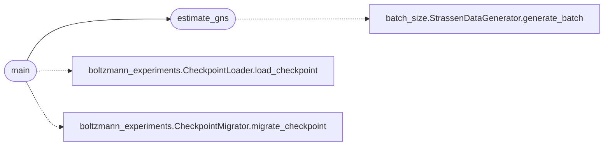

# `compute_gns_checkpoints`

> Source: [compute_gns_checkpoints.py:1](../../compute_gns_checkpoints.py#L1) | language `py` | coverage 33.3% | [API index](../index.md)

compute_gns_by_batch.py

## Contents

- **Functions:** [`estimate_gns`](#estimate_gns), [`main`](#main)

## Call Graph

Solid arrows stay in this module, dashed arrows leave it.



## Functions

<a id="estimate_gns"></a>

### `estimate_gns`

`function` | [compute_gns_checkpoints.py:11](../../compute_gns_checkpoints.py#L11)

```python
def estimate_gns(model, batch_size, num_batches=20)
```

**Parameters**

| Name | Type | Default | Description |
|---|---|---|---|
| `model` |  |  |  |
| `batch_size` |  |  |  |
| `num_batches` |  | `20` |  |

*Calls:* [`StrassenDataGenerator.generate_batch`](batch_size.py.md#strassendatagenerator-generate_batch)

*Called by:* [`main`](#main)

---

<a id="main"></a>

### `main`

`function` | [compute_gns_checkpoints.py:37](../../compute_gns_checkpoints.py#L37)

```python
def main()
```

*Calls:* [`CheckpointLoader.load_checkpoint`](boltzmann_experiments.py.md#checkpointloader-load_checkpoint), [`CheckpointMigrator.migrate_checkpoint`](boltzmann_experiments.py.md#checkpointmigrator-migrate_checkpoint), [`estimate_gns`](#estimate_gns)

---
