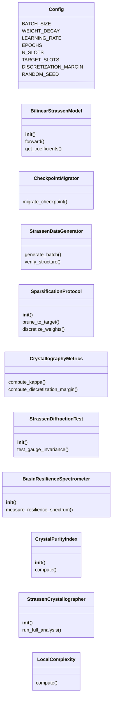
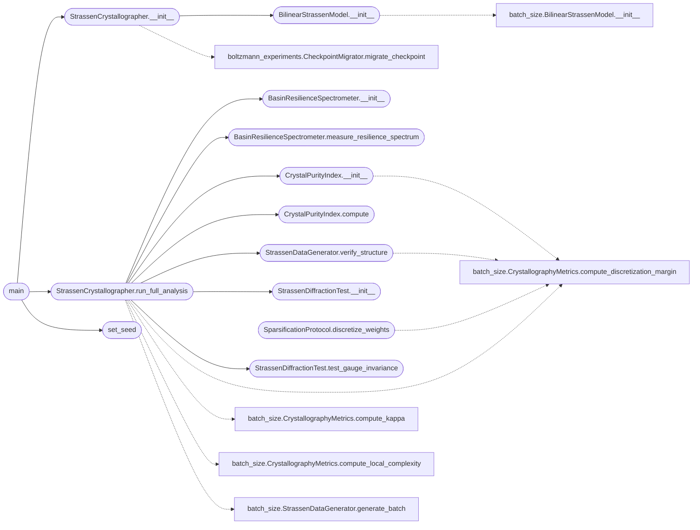

# `crystallography`

> Source: [crystallography.py:1](../../crystallography.py#L1) | language `py` | coverage 5.9% | [API index](../index.md)

Cristalografo para Strassen - VERSIÓN DEFINITIVA CORREGIDA - Índice normalizado a [0,1] - Manejo de κ=inf como caso especial - Umbrales de grado basados en δ - Visualización mejorada

## Contents

- **Classes:** [`Config`](#config), [`BilinearStrassenModel`](#bilinearstrassenmodel), [`CheckpointMigrator`](#checkpointmigrator), [`StrassenDataGenerator`](#strassendatagenerator), [`SparsificationProtocol`](#sparsificationprotocol), [`CrystallographyMetrics`](#crystallographymetrics), [`StrassenDiffractionTest`](#strassendiffractiontest), [`BasinResilienceSpectrometer`](#basinresiliencespectrometer), [`CrystalPurityIndex`](#crystalpurityindex), [`StrassenCrystallographer`](#strassencrystallographer), [`LocalComplexity`](#localcomplexity)
- **Functions:** [`set_seed`](#set_seed), [`main`](#main)

## Type Diagram



## Call Graph

Solid arrows stay in this module, dashed arrows leave it.



## Classes

<a id="config"></a>

### `Config`

`class` | [crystallography.py:25](../../crystallography.py#L25)

```python
class Config
```

**Attributes**

| Name | Type | Default | Description |
|---|---|---|---|
| [`BATCH_SIZE`](#config-batch_size) |  | `32` |  |
| [`WEIGHT_DECAY`](#config-weight_decay) |  | `0.0001` |  |
| [`LEARNING_RATE`](#config-learning_rate) |  | `0.001` |  |
| [`EPOCHS`](#config-epochs) |  | `3000` |  |
| [`N_SLOTS`](#config-n_slots) |  | `8` |  |
| [`TARGET_SLOTS`](#config-target_slots) |  | `7` |  |
| [`DISCRETIZATION_MARGIN`](#config-discretization_margin) |  | `0.1` |  |
| [`RANDOM_SEED`](#config-random_seed) |  | `42` |  |

---

<a id="bilinearstrassenmodel"></a>

### `BilinearStrassenModel`

`class` | [crystallography.py:44](../../crystallography.py#L44)

```python
class BilinearStrassenModel(nn.Module)
```

Bases: `nn.Module`

**Members**

| Member | Kind | Summary |
|---|---|---|
| [`__init__`](#bilinearstrassenmodel-__init__) | constructor |  |
| [`forward`](#bilinearstrassenmodel-forward) | method |  |
| [`get_coefficients`](#bilinearstrassenmodel-get_coefficients) | method |  |

<a id="bilinearstrassenmodel-__init__"></a>

#### `BilinearStrassenModel.__init__`

`constructor` | [crystallography.py:45](../../crystallography.py#L45)

```python
def __init__(self, n_slots=Config.N_SLOTS)
```

**Parameters**

| Name | Type | Default | Description |
|---|---|---|---|
| `n_slots` |  | `Config.N_SLOTS` |  |

*Calls:* [`BilinearStrassenModel.__init__`](batch_size.py.md#bilinearstrassenmodel-__init__)

*Called by:* [`StrassenCrystallographer.__init__`](#strassencrystallographer-__init__)

<a id="bilinearstrassenmodel-forward"></a>

#### `BilinearStrassenModel.forward`

`method` | [crystallography.py:57](../../crystallography.py#L57)

```python
def forward(self, a, b)
```

**Parameters**

| Name | Type | Default | Description |
|---|---|---|---|
| `a` |  |  |  |
| `b` |  |  |  |

<a id="bilinearstrassenmodel-get_coefficients"></a>

#### `BilinearStrassenModel.get_coefficients`

`method` | [crystallography.py:60](../../crystallography.py#L60)

```python
def get_coefficients(self)
```

---

<a id="checkpointmigrator"></a>

### `CheckpointMigrator`

`class` | [crystallography.py:71](../../crystallography.py#L71)

```python
class CheckpointMigrator
```

**Members**

| Member | Kind | Summary |
|---|---|---|
| [`migrate_checkpoint`](#checkpointmigrator-migrate_checkpoint) | staticmethod |  |

<a id="checkpointmigrator-migrate_checkpoint"></a>

#### `CheckpointMigrator.migrate_checkpoint`

`staticmethod` | [crystallography.py:73](../../crystallography.py#L73)

Decorators: `@staticmethod`

```python
def migrate_checkpoint(path: str, device: str = 'cpu') -> Optional[Dict[str, torch.Tensor]]
```

**Parameters**

| Name | Type | Default | Description |
|---|---|---|---|
| `path` | `str` |  |  |
| `device` | `str` | `'cpu'` |  |

**Returns:** `Optional[Dict[str, torch.Tensor]]`

---

<a id="strassendatagenerator"></a>

### `StrassenDataGenerator`

`class` | [crystallography.py:155](../../crystallography.py#L155)

```python
class StrassenDataGenerator
```

**Members**

| Member | Kind | Summary |
|---|---|---|
| [`generate_batch`](#strassendatagenerator-generate_batch) | staticmethod |  |
| [`verify_structure`](#strassendatagenerator-verify_structure) | staticmethod |  |

<a id="strassendatagenerator-generate_batch"></a>

#### `StrassenDataGenerator.generate_batch`

`staticmethod` | [crystallography.py:157](../../crystallography.py#L157)

Decorators: `@staticmethod`

```python
def generate_batch(batch_size=Config.BATCH_SIZE)
```

**Parameters**

| Name | Type | Default | Description |
|---|---|---|---|
| `batch_size` |  | `Config.BATCH_SIZE` |  |

<a id="strassendatagenerator-verify_structure"></a>

#### `StrassenDataGenerator.verify_structure`

`staticmethod` | [crystallography.py:164](../../crystallography.py#L164)

Decorators: `@staticmethod`

```python
def verify_structure(coeffs)
```

**Parameters**

| Name | Type | Default | Description |
|---|---|---|---|
| `coeffs` |  |  |  |

*Calls:* [`CrystallographyMetrics.compute_discretization_margin`](batch_size.py.md#crystallographymetrics-compute_discretization_margin)

*Called by:* [`StrassenCrystallographer.run_full_analysis`](#strassencrystallographer-run_full_analysis), [`EpitaxyExperiment.run_epitaxial_growth_experiment`](xray_tensor_diffractometer.py.md#epitaxyexperiment-run_epitaxial_growth_experiment), [`StrassenCrystallographer.run_full_analysis`](xray_tensor_diffractometer.py.md#strassencrystallographer-run_full_analysis)

---

<a id="sparsificationprotocol"></a>

### `SparsificationProtocol`

`class` | [crystallography.py:172](../../crystallography.py#L172)

```python
class SparsificationProtocol
```

**Members**

| Member | Kind | Summary |
|---|---|---|
| [`__init__`](#sparsificationprotocol-__init__) | constructor |  |
| [`prune_to_target`](#sparsificationprotocol-prune_to_target) | method |  |
| [`discretize_weights`](#sparsificationprotocol-discretize_weights) | method |  |

<a id="sparsificationprotocol-__init__"></a>

#### `SparsificationProtocol.__init__`

`constructor` | [crystallography.py:173](../../crystallography.py#L173)

```python
def __init__(self, model)
```

**Parameters**

| Name | Type | Default | Description |
|---|---|---|---|
| `model` |  |  |  |

<a id="sparsificationprotocol-prune_to_target"></a>

#### `SparsificationProtocol.prune_to_target`

`method` | [crystallography.py:176](../../crystallography.py#L176)

```python
def prune_to_target(self, target=Config.TARGET_SLOTS)
```

**Parameters**

| Name | Type | Default | Description |
|---|---|---|---|
| `target` |  | `Config.TARGET_SLOTS` |  |

<a id="sparsificationprotocol-discretize_weights"></a>

#### `SparsificationProtocol.discretize_weights`

`method` | [crystallography.py:192](../../crystallography.py#L192)

```python
def discretize_weights(self, margin=Config.DISCRETIZATION_MARGIN)
```

**Parameters**

| Name | Type | Default | Description |
|---|---|---|---|
| `margin` |  | `Config.DISCRETIZATION_MARGIN` |  |

*Calls:* [`CrystallographyMetrics.compute_discretization_margin`](batch_size.py.md#crystallographymetrics-compute_discretization_margin)

---

<a id="crystallographymetrics"></a>

### `CrystallographyMetrics`

`class` | [crystallography.py:206](../../crystallography.py#L206)

```python
class CrystallographyMetrics
```

**Members**

| Member | Kind | Summary |
|---|---|---|
| [`compute_kappa`](#crystallographymetrics-compute_kappa) | staticmethod |  |
| [`compute_discretization_margin`](#crystallographymetrics-compute_discretization_margin) | staticmethod |  |

<a id="crystallographymetrics-compute_kappa"></a>

#### `CrystallographyMetrics.compute_kappa`

`staticmethod` | [crystallography.py:208](../../crystallography.py#L208)

Decorators: `@staticmethod`

```python
def compute_kappa(model, dataloader, num_batches=5)
```

**Parameters**

| Name | Type | Default | Description |
|---|---|---|---|
| `model` |  |  |  |
| `dataloader` |  |  |  |
| `num_batches` |  | `5` |  |

<a id="crystallographymetrics-compute_discretization_margin"></a>

#### `CrystallographyMetrics.compute_discretization_margin`

`staticmethod` | [crystallography.py:225](../../crystallography.py#L225)

Decorators: `@staticmethod`

```python
def compute_discretization_margin(coeffs)
```

**Parameters**

| Name | Type | Default | Description |
|---|---|---|---|
| `coeffs` |  |  |  |

---

<a id="strassendiffractiontest"></a>

### `StrassenDiffractionTest`

`class` | [crystallography.py:232](../../crystallography.py#L232)

```python
class StrassenDiffractionTest
```

**Members**

| Member | Kind | Summary |
|---|---|---|
| [`__init__`](#strassendiffractiontest-__init__) | constructor |  |
| [`test_gauge_invariance`](#strassendiffractiontest-test_gauge_invariance) | method |  |

<a id="strassendiffractiontest-__init__"></a>

#### `StrassenDiffractionTest.__init__`

`constructor` | [crystallography.py:233](../../crystallography.py#L233)

```python
def __init__(self, model)
```

**Parameters**

| Name | Type | Default | Description |
|---|---|---|---|
| `model` |  |  |  |

*Called by:* [`StrassenCrystallographer.run_full_analysis`](#strassencrystallographer-run_full_analysis)

<a id="strassendiffractiontest-test_gauge_invariance"></a>

#### `StrassenDiffractionTest.test_gauge_invariance`

`method` | [crystallography.py:236](../../crystallography.py#L236)

```python
def test_gauge_invariance(self, n_samples=50)
```

**Parameters**

| Name | Type | Default | Description |
|---|---|---|---|
| `n_samples` |  | `50` |  |

*Called by:* [`StrassenCrystallographer.run_full_analysis`](#strassencrystallographer-run_full_analysis), [`StrassenPlanckAnalyzer.analyze_checkpoint`](plank.py.md#strassenplanckanalyzer-analyze_checkpoint)

---

<a id="basinresiliencespectrometer"></a>

### `BasinResilienceSpectrometer`

`class` | [crystallography.py:277](../../crystallography.py#L277)

```python
class BasinResilienceSpectrometer
```

**Members**

| Member | Kind | Summary |
|---|---|---|
| [`__init__`](#basinresiliencespectrometer-__init__) | constructor |  |
| [`measure_resilience_spectrum`](#basinresiliencespectrometer-measure_resilience_spectrum) | method |  |

<a id="basinresiliencespectrometer-__init__"></a>

#### `BasinResilienceSpectrometer.__init__`

`constructor` | [crystallography.py:278](../../crystallography.py#L278)

```python
def __init__(self, model)
```

**Parameters**

| Name | Type | Default | Description |
|---|---|---|---|
| `model` |  |  |  |

*Called by:* [`StrassenCrystallographer.run_full_analysis`](#strassencrystallographer-run_full_analysis)

<a id="basinresiliencespectrometer-measure_resilience_spectrum"></a>

#### `BasinResilienceSpectrometer.measure_resilience_spectrum`

`method` | [crystallography.py:282](../../crystallography.py#L282)

```python
def measure_resilience_spectrum(self, noise_levels=None)
```

**Parameters**

| Name | Type | Default | Description |
|---|---|---|---|
| `noise_levels` |  | `None` |  |

*Called by:* [`StrassenCrystallographer.run_full_analysis`](#strassencrystallographer-run_full_analysis), [`StrassenPlanckAnalyzer.analyze_checkpoint`](plank.py.md#strassenplanckanalyzer-analyze_checkpoint)

---

<a id="crystalpurityindex"></a>

### `CrystalPurityIndex`

`class` | [crystallography.py:345](../../crystallography.py#L345)

```python
class CrystalPurityIndex
```

**Members**

| Member | Kind | Summary |
|---|---|---|
| [`__init__`](#crystalpurityindex-__init__) | constructor |  |
| [`compute`](#crystalpurityindex-compute) | method |  |

<a id="crystalpurityindex-__init__"></a>

#### `CrystalPurityIndex.__init__`

`constructor` | [crystallography.py:346](../../crystallography.py#L346)

```python
def __init__(self, model: nn.Module, diffraction_results: Dict, resilience_results: Dict, metrics_results: Dict)
```

**Parameters**

| Name | Type | Default | Description |
|---|---|---|---|
| `model` | `nn.Module` |  |  |
| `diffraction_results` | `Dict` |  |  |
| `resilience_results` | `Dict` |  |  |
| `metrics_results` | `Dict` |  |  |

*Calls:* [`CrystallographyMetrics.compute_discretization_margin`](batch_size.py.md#crystallographymetrics-compute_discretization_margin)

*Called by:* [`StrassenCrystallographer.run_full_analysis`](#strassencrystallographer-run_full_analysis)

<a id="crystalpurityindex-compute"></a>

#### `CrystalPurityIndex.compute`

`method` | [crystallography.py:359](../../crystallography.py#L359)

```python
def compute(self) -> Dict
```

**Returns:** `Dict`

*Called by:* [`StrassenCrystallographer.run_full_analysis`](#strassencrystallographer-run_full_analysis), [`StrassenPlanckAnalyzer.analyze_checkpoint`](plank.py.md#strassenplanckanalyzer-analyze_checkpoint)

---

<a id="strassencrystallographer"></a>

### `StrassenCrystallographer`

`class` | [crystallography.py:416](../../crystallography.py#L416)

```python
class StrassenCrystallographer
```

**Members**

| Member | Kind | Summary |
|---|---|---|
| [`__init__`](#strassencrystallographer-__init__) | constructor |  |
| [`run_full_analysis`](#strassencrystallographer-run_full_analysis) | method |  |

<a id="strassencrystallographer-__init__"></a>

#### `StrassenCrystallographer.__init__`

`constructor` | [crystallography.py:417](../../crystallography.py#L417)

```python
def __init__(self, checkpoint_path: str, device: str = 'cpu')
```

**Parameters**

| Name | Type | Default | Description |
|---|---|---|---|
| `checkpoint_path` | `str` |  |  |
| `device` | `str` | `'cpu'` |  |

*Calls:* [`CheckpointMigrator.migrate_checkpoint`](boltzmann_experiments.py.md#checkpointmigrator-migrate_checkpoint), [`BilinearStrassenModel.__init__`](#bilinearstrassenmodel-__init__)

*Called by:* [`main`](#main)

<a id="strassencrystallographer-run_full_analysis"></a>

#### `StrassenCrystallographer.run_full_analysis`

`method` | [crystallography.py:445](../../crystallography.py#L445)

```python
def run_full_analysis(self) -> Dict
```

**Returns:** `Dict`

*Calls:* [`CrystallographyMetrics.compute_discretization_margin`](batch_size.py.md#crystallographymetrics-compute_discretization_margin), [`CrystallographyMetrics.compute_kappa`](batch_size.py.md#crystallographymetrics-compute_kappa), [`CrystallographyMetrics.compute_local_complexity`](batch_size.py.md#crystallographymetrics-compute_local_complexity), [`StrassenDataGenerator.generate_batch`](batch_size.py.md#strassendatagenerator-generate_batch), [`BasinResilienceSpectrometer.__init__`](#basinresiliencespectrometer-__init__), [`BasinResilienceSpectrometer.measure_resilience_spectrum`](#basinresiliencespectrometer-measure_resilience_spectrum), [`CrystalPurityIndex.__init__`](#crystalpurityindex-__init__), [`CrystalPurityIndex.compute`](#crystalpurityindex-compute), [`StrassenDataGenerator.verify_structure`](#strassendatagenerator-verify_structure), [`StrassenDiffractionTest.__init__`](#strassendiffractiontest-__init__), [`StrassenDiffractionTest.test_gauge_invariance`](#strassendiffractiontest-test_gauge_invariance)

*Called by:* [`main`](#main), [`main`](xray_tensor_diffractometer.py.md#main)

---

<a id="localcomplexity"></a>

### `LocalComplexity`

`class` | [crystallography.py:523](../../crystallography.py#L523)

```python
class LocalComplexity
```

**Members**

| Member | Kind | Summary |
|---|---|---|
| [`compute`](#localcomplexity-compute) | staticmethod | Computa LC basado en Can't Stop Won't Stop paper |

<a id="localcomplexity-compute"></a>

#### `LocalComplexity.compute`

`staticmethod` | [crystallography.py:525](../../crystallography.py#L525)

Decorators: `@staticmethod`

```python
def compute(model: nn.Module) -> float
```

Computa LC basado en Can't Stop Won't Stop paper

**Parameters**

| Name | Type | Default | Description |
|---|---|---|---|
| `model` | `nn.Module` |  |  |

**Returns:** `float`

---

## Functions

<a id="set_seed"></a>

### `set_seed`

`function` | [crystallography.py:35](../../crystallography.py#L35)

```python
def set_seed(seed=Config.RANDOM_SEED)
```

**Parameters**

| Name | Type | Default | Description |
|---|---|---|---|
| `seed` |  | `Config.RANDOM_SEED` |  |

*Called by:* [`main`](#main)

---

<a id="main"></a>

### `main`

`function` | [crystallography.py:542](../../crystallography.py#L542)

```python
def main()
```

*Calls:* [`StrassenCrystallographer.__init__`](#strassencrystallographer-__init__), [`StrassenCrystallographer.run_full_analysis`](#strassencrystallographer-run_full_analysis), [`set_seed`](#set_seed)

---
