# `dirac_polos_zeros`

> Source: [dirac_polos_zeros.py:1](../../dirac_polos_zeros.py#L1) | language `py` | coverage 0.0% | [API index](../index.md)

## Contents

- **Classes:** [`AnalysisConfig`](#analysisconfig), [`BilinearModel`](#bilinearmodel), [`ChargeDistributionExtractor`](#chargedistributionextractor), [`DiracDeltaAnalyzer`](#diracdeltaanalyzer), [`ElectricFieldCalculator`](#electricfieldcalculator), [`ElectricFluxCalculator`](#electricfluxcalculator), [`DivergenceCalculator`](#divergencecalculator), [`GaussLawVerifier`](#gausslawverifier), [`StateSpaceExtractor`](#statespaceextractor), [`TransferFunctionComputer`](#transferfunctioncomputer), [`PoleZeroAnalyzer`](#polezeroanalyzer), [`FrequencyResponseAnalyzer`](#frequencyresponseanalyzer), [`TimeResponseAnalyzer`](#timeresponseanalyzer), [`CheckpointLoader`](#checkpointloader), [`CheckpointMigrator`](#checkpointmigrator), [`ChargeDistributionVisualizer`](#chargedistributionvisualizer), [`ElectricFieldVisualizer`](#electricfieldvisualizer), [`DivergenceVisualizer`](#divergencevisualizer), [`PoleZeroVisualizer`](#polezerovisualizer), [`BodeVisualizer`](#bodevisualizer), [`NyquistVisualizer`](#nyquistvisualizer), [`TimeResponseVisualizer`](#timeresponsevisualizer), [`CombinedVisualizer`](#combinedvisualizer), [`SystemAnalyzer`](#systemanalyzer), [`AnalysisPipeline`](#analysispipeline)
- **Protocols:** [`IModel`](#imodel), [`IChargeDistributionExtractor`](#ichargedistributionextractor), [`IDiracAnalyzer`](#idiracanalyzer), [`IFieldCalculator`](#ifieldcalculator), [`IFluxCalculator`](#ifluxcalculator), [`IStateSpaceExtractor`](#istatespaceextractor), [`ITransferFunctionComputer`](#itransferfunctioncomputer), [`IPoleZeroAnalyzer`](#ipolezeroanalyzer), [`IFrequencyAnalyzer`](#ifrequencyanalyzer), [`ITimeResponseAnalyzer`](#itimeresponseanalyzer), [`ICheckpointLoader`](#icheckpointloader), [`ICheckpointMigrator`](#icheckpointmigrator), [`IVisualizer`](#ivisualizer)
- **Functions:** [`main`](#main)

## Type Diagram

```mermaid
classDiagram
    direction LR
    class AnalysisConfig
    AnalysisConfig : int BATCH_SIZE
    AnalysisConfig : int HIDDEN_DIM
    AnalysisConfig : int MATRIX_SIZE
    AnalysisConfig : float WEIGHT_DECAY
    AnalysisConfig : float LEARNING_RATE
    AnalysisConfig : float EPSILON_0
    AnalysisConfig : float DELTA_THRESHOLD
    AnalysisConfig : float GAUSSIAN_SIGMA
    AnalysisConfig : int SPATIAL_RESOLUTION
    AnalysisConfig : int FLUX_INTEGRATION_SAMPLES
    AnalysisConfig : float POLE_ZERO_TOLERANCE
    AnalysisConfig : float STABILITY_MARGIN
    AnalysisConfig : int FREQUENCY_SAMPLES
    AnalysisConfig : float FREQUENCY_MIN
    AnalysisConfig : float FREQUENCY_MAX
    AnalysisConfig : int TIME_SAMPLES
    AnalysisConfig : float TIME_MAX
    AnalysisConfig : str COLORMAP
    AnalysisConfig : int FIGURE_DPI
    AnalysisConfig : str SAVE_FORMAT
    AnalysisConfig : str DEVICE
    class IModel
    <<protocol>> IModel
    IModel : forward()
    IModel : get_coefficients()
    class IChargeDistributionExtractor
    <<protocol>> IChargeDistributionExtractor
    IChargeDistributionExtractor : extract()
    class IDiracAnalyzer
    <<protocol>> IDiracAnalyzer
    IDiracAnalyzer : analyze()
    class IFieldCalculator
    <<protocol>> IFieldCalculator
    IFieldCalculator : calculate()
    class IFluxCalculator
    <<protocol>> IFluxCalculator
    IFluxCalculator : calculate()
    class IStateSpaceExtractor
    <<protocol>> IStateSpaceExtractor
    IStateSpaceExtractor : extract()
    class ITransferFunctionComputer
    <<protocol>> ITransferFunctionComputer
    ITransferFunctionComputer : compute()
    class IPoleZeroAnalyzer
    <<protocol>> IPoleZeroAnalyzer
    IPoleZeroAnalyzer : analyze_stability()
    IPoleZeroAnalyzer : get_poles()
    IPoleZeroAnalyzer : get_zeros()
    class IFrequencyAnalyzer
    <<protocol>> IFrequencyAnalyzer
    IFrequencyAnalyzer : compute_bode()
    IFrequencyAnalyzer : compute_margins()
    IFrequencyAnalyzer : compute_nyquist()
    class ITimeResponseAnalyzer
    <<protocol>> ITimeResponseAnalyzer
    ITimeResponseAnalyzer : compute_step()
    ITimeResponseAnalyzer : compute_impulse()
    class ICheckpointLoader
    <<protocol>> ICheckpointLoader
    ICheckpointLoader : load()
    class ICheckpointMigrator
    <<protocol>> ICheckpointMigrator
    ICheckpointMigrator : migrate()
    class IVisualizer
    <<protocol>> IVisualizer
    IVisualizer : visualize()
    class BilinearModel
    BilinearModel : __init__()
    BilinearModel : forward()
    BilinearModel : get_coefficients()
    class ChargeDistributionExtractor
    ChargeDistributionExtractor : extract()
    class DiracDeltaAnalyzer
    DiracDeltaAnalyzer : __init__()
    DiracDeltaAnalyzer : analyze()
    class ElectricFieldCalculator
    ElectricFieldCalculator : __init__()
    ElectricFieldCalculator : calculate()
    class ElectricFluxCalculator
    ElectricFluxCalculator : __init__()
    ElectricFluxCalculator : calculate()
    class DivergenceCalculator
    DivergenceCalculator : calculate()
    class GaussLawVerifier
    GaussLawVerifier : __init__()
    GaussLawVerifier : verify()
    class StateSpaceExtractor
    StateSpaceExtractor : extract()
    class TransferFunctionComputer
    TransferFunctionComputer : compute()
    class PoleZeroAnalyzer
    PoleZeroAnalyzer : __init__()
    PoleZeroAnalyzer : get_poles()
    PoleZeroAnalyzer : get_zeros()
    PoleZeroAnalyzer : analyze_stability()
    PoleZeroAnalyzer : classify_poles()
    PoleZeroAnalyzer : compute_damping()
    PoleZeroAnalyzer : compute_time_constants()
```



## Call Graph

Solid arrows stay in this module, dashed arrows leave it.

```mermaid
flowchart LR
    n_dirac_polos_zeros_py__ChargeDistributionExtractor_extract(["ChargeDistributionExtractor.extract"])
    n_dirac_polos_zeros_py__IModel_get_coefficients(["IModel.get_coefficients"])
    n_dirac_polos_zeros_py__DiracDeltaAnalyzer___init__(["DiracDeltaAnalyzer.__init__"])
    n_dirac_polos_zeros_py__AnalysisConfig(["AnalysisConfig"])
    n_dirac_polos_zeros_py__ElectricFieldCalculator___init__(["ElectricFieldCalculator.__init__"])
    n_dirac_polos_zeros_py__ElectricFluxCalculator___init__(["ElectricFluxCalculator.__init__"])
    n_dirac_polos_zeros_py__GaussLawVerifier___init__(["GaussLawVerifier.__init__"])
    n_dirac_polos_zeros_py__StateSpaceExtractor_extract(["StateSpaceExtractor.extract"])
    n_dirac_polos_zeros_py__PoleZeroAnalyzer___init__(["PoleZeroAnalyzer.__init__"])
    n_dirac_polos_zeros_py__FrequencyResponseAnalyzer___init__(["FrequencyResponseAnalyzer.__init__"])
    n_dirac_polos_zeros_py__TimeResponseAnalyzer___init__(["TimeResponseAnalyzer.__init__"])
    n_dirac_polos_zeros_py__ChargeDistributionVisualizer___init__(["ChargeDistributionVisualizer.__init__"])
    n_dirac_polos_zeros_py__ElectricFieldVisualizer___init__(["ElectricFieldVisualizer.__init__"])
    n_dirac_polos_zeros_py__DivergenceVisualizer___init__(["DivergenceVisualizer.__init__"])
    n_dirac_polos_zeros_py__PoleZeroVisualizer___init__(["PoleZeroVisualizer.__init__"])
    n_dirac_polos_zeros_py__BodeVisualizer___init__(["BodeVisualizer.__init__"])
    n_dirac_polos_zeros_py__NyquistVisualizer___init__(["NyquistVisualizer.__init__"])
    n_dirac_polos_zeros_py__TimeResponseVisualizer___init__(["TimeResponseVisualizer.__init__"])
    n_dirac_polos_zeros_py__CombinedVisualizer___init__(["CombinedVisualizer.__init__"])
    n_dirac_polos_zeros_py__SystemAnalyzer___init__(["SystemAnalyzer.__init__"])
    n_dirac_polos_zeros_py__ChargeDistributionExtractor(["ChargeDistributionExtractor"])
    n_dirac_polos_zeros_py__CheckpointLoader(["CheckpointLoader"])
    n_dirac_polos_zeros_py__CheckpointMigrator(["CheckpointMigrator"])
    n_dirac_polos_zeros_py__DivergenceCalculator(["DivergenceCalculator"])
    n_dirac_polos_zeros_py__ChargeDistributionExtractor_extract --> n_dirac_polos_zeros_py__IModel_get_coefficients
    n_dirac_polos_zeros_py__DiracDeltaAnalyzer___init__ --> n_dirac_polos_zeros_py__AnalysisConfig
    n_dirac_polos_zeros_py__ElectricFieldCalculator___init__ --> n_dirac_polos_zeros_py__AnalysisConfig
    n_dirac_polos_zeros_py__ElectricFluxCalculator___init__ --> n_dirac_polos_zeros_py__AnalysisConfig
    n_dirac_polos_zeros_py__GaussLawVerifier___init__ --> n_dirac_polos_zeros_py__AnalysisConfig
    n_dirac_polos_zeros_py__StateSpaceExtractor_extract --> n_dirac_polos_zeros_py__IModel_get_coefficients
    n_dirac_polos_zeros_py__PoleZeroAnalyzer___init__ --> n_dirac_polos_zeros_py__AnalysisConfig
    n_dirac_polos_zeros_py__FrequencyResponseAnalyzer___init__ --> n_dirac_polos_zeros_py__AnalysisConfig
    n_dirac_polos_zeros_py__TimeResponseAnalyzer___init__ --> n_dirac_polos_zeros_py__AnalysisConfig
    n_dirac_polos_zeros_py__ChargeDistributionVisualizer___init__ --> n_dirac_polos_zeros_py__AnalysisConfig
    n_dirac_polos_zeros_py__ElectricFieldVisualizer___init__ --> n_dirac_polos_zeros_py__AnalysisConfig
    n_dirac_polos_zeros_py__DivergenceVisualizer___init__ --> n_dirac_polos_zeros_py__AnalysisConfig
    n_dirac_polos_zeros_py__PoleZeroVisualizer___init__ --> n_dirac_polos_zeros_py__AnalysisConfig
    n_dirac_polos_zeros_py__BodeVisualizer___init__ --> n_dirac_polos_zeros_py__AnalysisConfig
    n_dirac_polos_zeros_py__NyquistVisualizer___init__ --> n_dirac_polos_zeros_py__AnalysisConfig
    n_dirac_polos_zeros_py__TimeResponseVisualizer___init__ --> n_dirac_polos_zeros_py__AnalysisConfig
    n_dirac_polos_zeros_py__CombinedVisualizer___init__ --> n_dirac_polos_zeros_py__AnalysisConfig
    n_dirac_polos_zeros_py__SystemAnalyzer___init__ --> n_dirac_polos_zeros_py__AnalysisConfig
    n_dirac_polos_zeros_py__SystemAnalyzer___init__ --> n_dirac_polos_zeros_py__ChargeDistributionExtractor
    n_dirac_polos_zeros_py__SystemAnalyzer___init__ --> n_dirac_polos_zeros_py__CheckpointLoader
    n_dirac_polos_zeros_py__SystemAnalyzer___init__ --> n_dirac_polos_zeros_py__CheckpointMigrator
    n_dirac_polos_zeros_py__SystemAnalyzer___init__ --> n_dirac_polos_zeros_py__DiracDeltaAnalyzer___init__
    n_dirac_polos_zeros_py__SystemAnalyzer___init__ --> n_dirac_polos_zeros_py__DivergenceCalculator
    n_dirac_polos_zeros_py__SystemAnalyzer___init__ --> n_dirac_polos_zeros_py__ElectricFieldCalculator___init__
```



## Classes

<a id="analysisconfig"></a>

### `AnalysisConfig`

`class` `dataclass` | [dirac_polos_zeros.py:24](../../dirac_polos_zeros.py#L24)

Decorators: `@dataclass(frozen=True)`

```python
class AnalysisConfig
```

**Attributes**

| Name | Type | Default | Description |
|---|---|---|---|
| [`BATCH_SIZE`](#analysisconfig-batch_size) | `int` | `32` |  |
| [`HIDDEN_DIM`](#analysisconfig-hidden_dim) | `int` | `8` |  |
| [`MATRIX_SIZE`](#analysisconfig-matrix_size) | `int` | `2` |  |
| [`WEIGHT_DECAY`](#analysisconfig-weight_decay) | `float` | `0.0001` |  |
| [`LEARNING_RATE`](#analysisconfig-learning_rate) | `float` | `0.001` |  |
| [`EPSILON_0`](#analysisconfig-epsilon_0) | `float` | `8.854187817e-12` |  |
| [`DELTA_THRESHOLD`](#analysisconfig-delta_threshold) | `float` | `1e-06` |  |
| [`GAUSSIAN_SIGMA`](#analysisconfig-gaussian_sigma) | `float` | `0.1` |  |
| [`SPATIAL_RESOLUTION`](#analysisconfig-spatial_resolution) | `int` | `100` |  |
| [`FLUX_INTEGRATION_SAMPLES`](#analysisconfig-flux_integration_samples) | `int` | `1000` |  |
| [`POLE_ZERO_TOLERANCE`](#analysisconfig-pole_zero_tolerance) | `float` | `1e-06` |  |
| [`STABILITY_MARGIN`](#analysisconfig-stability_margin) | `float` | `0.01` |  |
| [`FREQUENCY_SAMPLES`](#analysisconfig-frequency_samples) | `int` | `1000` |  |
| [`FREQUENCY_MIN`](#analysisconfig-frequency_min) | `float` | `0.001` |  |
| [`FREQUENCY_MAX`](#analysisconfig-frequency_max) | `float` | `1000.0` |  |
| [`TIME_SAMPLES`](#analysisconfig-time_samples) | `int` | `500` |  |
| [`TIME_MAX`](#analysisconfig-time_max) | `float` | `10.0` |  |
| [`COLORMAP`](#analysisconfig-colormap) | `str` | `'viridis'` |  |
| [`FIGURE_DPI`](#analysisconfig-figure_dpi) | `int` | `150` |  |
| [`SAVE_FORMAT`](#analysisconfig-save_format) | `str` | `'png'` |  |
| [`DEVICE`](#analysisconfig-device) | `str` | `'cuda' if torch.cuda.is_available() else 'cpu'` |  |

---

<a id="bilinearmodel"></a>

### `BilinearModel`

`class` | [dirac_polos_zeros.py:124](../../dirac_polos_zeros.py#L124)

```python
class BilinearModel(nn.Module)
```

Bases: `nn.Module`

**Members**

| Member | Kind | Summary |
|---|---|---|
| [`__init__`](#bilinearmodel-__init__) | constructor |  |
| [`forward`](#bilinearmodel-forward) | method |  |
| [`get_coefficients`](#bilinearmodel-get_coefficients) | method |  |

<a id="bilinearmodel-__init__"></a>

#### `BilinearModel.__init__`

`constructor` | [dirac_polos_zeros.py:125](../../dirac_polos_zeros.py#L125)

```python
def __init__(self, hidden_dim: int = AnalysisConfig.HIDDEN_DIM, matrix_size: int = AnalysisConfig.MATRIX_SIZE)
```

**Parameters**

| Name | Type | Default | Description |
|---|---|---|---|
| `hidden_dim` | `int` | `AnalysisConfig.HIDDEN_DIM` |  |
| `matrix_size` | `int` | `AnalysisConfig.MATRIX_SIZE` |  |

*Called by:* [`BilinearModel.__init__`](fermi.py.md#bilinearmodel-__init__), [`BilinearModel.__init__`](gravity.py.md#bilinearmodel-__init__), [`BilinearModel.__init__`](purity_index.py.md#bilinearmodel-__init__), [`BilinearModel.__init__`](scrodingger.py.md#bilinearmodel-__init__)

<a id="bilinearmodel-forward"></a>

#### `BilinearModel.forward`

`method` | [dirac_polos_zeros.py:141](../../dirac_polos_zeros.py#L141)

```python
def forward(self, a: torch.Tensor, b: torch.Tensor) -> torch.Tensor
```

**Parameters**

| Name | Type | Default | Description |
|---|---|---|---|
| `a` | `torch.Tensor` |  |  |
| `b` | `torch.Tensor` |  |  |

**Returns:** `torch.Tensor`

<a id="bilinearmodel-get_coefficients"></a>

#### `BilinearModel.get_coefficients`

`method` | [dirac_polos_zeros.py:144](../../dirac_polos_zeros.py#L144)

```python
def get_coefficients(self) -> Dict[str, torch.Tensor]
```

**Returns:** `Dict[str, torch.Tensor]`

---

<a id="chargedistributionextractor"></a>

### `ChargeDistributionExtractor`

`class` | [dirac_polos_zeros.py:152](../../dirac_polos_zeros.py#L152)

```python
class ChargeDistributionExtractor
```

**Members**

| Member | Kind | Summary |
|---|---|---|
| [`extract`](#chargedistributionextractor-extract) | method |  |

<a id="chargedistributionextractor-extract"></a>

#### `ChargeDistributionExtractor.extract`

`method` | [dirac_polos_zeros.py:153](../../dirac_polos_zeros.py#L153)

```python
def extract(self, model: IModel) -> torch.Tensor
```

**Parameters**

| Name | Type | Default | Description |
|---|---|---|---|
| `model` | `IModel` |  |  |

**Returns:** `torch.Tensor`

*Calls:* [`IModel.get_coefficients`](#imodel-get_coefficients)

*Called by:* [`SystemAnalyzer.analyze`](#systemanalyzer-analyze)

---

<a id="diracdeltaanalyzer"></a>

### `DiracDeltaAnalyzer`

`class` | [dirac_polos_zeros.py:160](../../dirac_polos_zeros.py#L160)

```python
class DiracDeltaAnalyzer
```

**Members**

| Member | Kind | Summary |
|---|---|---|
| [`__init__`](#diracdeltaanalyzer-__init__) | constructor |  |
| [`analyze`](#diracdeltaanalyzer-analyze) | method |  |

<a id="diracdeltaanalyzer-__init__"></a>

#### `DiracDeltaAnalyzer.__init__`

`constructor` | [dirac_polos_zeros.py:161](../../dirac_polos_zeros.py#L161)

```python
def __init__(self, config: AnalysisConfig = AnalysisConfig())
```

**Parameters**

| Name | Type | Default | Description |
|---|---|---|---|
| `config` | `AnalysisConfig` | `AnalysisConfig()` |  |

*Calls:* [`AnalysisConfig`](#analysisconfig)

*Called by:* [`SystemAnalyzer.__init__`](#systemanalyzer-__init__)

<a id="diracdeltaanalyzer-analyze"></a>

#### `DiracDeltaAnalyzer.analyze`

`method` | [dirac_polos_zeros.py:164](../../dirac_polos_zeros.py#L164)

```python
def analyze(self, charge_density: torch.Tensor) -> Dict[str, Any]
```

**Parameters**

| Name | Type | Default | Description |
|---|---|---|---|
| `charge_density` | `torch.Tensor` |  |  |

**Returns:** `Dict[str, Any]`

*Called by:* [`SystemAnalyzer.analyze`](#systemanalyzer-analyze)

---

<a id="electricfieldcalculator"></a>

### `ElectricFieldCalculator`

`class` | [dirac_polos_zeros.py:192](../../dirac_polos_zeros.py#L192)

```python
class ElectricFieldCalculator
```

**Members**

| Member | Kind | Summary |
|---|---|---|
| [`__init__`](#electricfieldcalculator-__init__) | constructor |  |
| [`calculate`](#electricfieldcalculator-calculate) | method |  |

<a id="electricfieldcalculator-__init__"></a>

#### `ElectricFieldCalculator.__init__`

`constructor` | [dirac_polos_zeros.py:193](../../dirac_polos_zeros.py#L193)

```python
def __init__(self, config: AnalysisConfig = AnalysisConfig())
```

**Parameters**

| Name | Type | Default | Description |
|---|---|---|---|
| `config` | `AnalysisConfig` | `AnalysisConfig()` |  |

*Calls:* [`AnalysisConfig`](#analysisconfig)

*Called by:* [`SystemAnalyzer.__init__`](#systemanalyzer-__init__)

<a id="electricfieldcalculator-calculate"></a>

#### `ElectricFieldCalculator.calculate`

`method` | [dirac_polos_zeros.py:196](../../dirac_polos_zeros.py#L196)

```python
def calculate(self, dirac_data: Dict[str, Any], eval_points: Optional[np.ndarray] = None) -> np.ndarray
```

**Parameters**

| Name | Type | Default | Description |
|---|---|---|---|
| `dirac_data` | `Dict[str, Any]` |  |  |
| `eval_points` | `Optional[np.ndarray]` | `None` |  |

**Returns:** `np.ndarray`

*Called by:* [`SystemAnalyzer.analyze`](#systemanalyzer-analyze)

---

<a id="electricfluxcalculator"></a>

### `ElectricFluxCalculator`

`class` | [dirac_polos_zeros.py:225](../../dirac_polos_zeros.py#L225)

```python
class ElectricFluxCalculator
```

**Members**

| Member | Kind | Summary |
|---|---|---|
| [`__init__`](#electricfluxcalculator-__init__) | constructor |  |
| [`calculate`](#electricfluxcalculator-calculate) | method |  |

<a id="electricfluxcalculator-__init__"></a>

#### `ElectricFluxCalculator.__init__`

`constructor` | [dirac_polos_zeros.py:226](../../dirac_polos_zeros.py#L226)

```python
def __init__(self, config: AnalysisConfig = AnalysisConfig())
```

**Parameters**

| Name | Type | Default | Description |
|---|---|---|---|
| `config` | `AnalysisConfig` | `AnalysisConfig()` |  |

*Calls:* [`AnalysisConfig`](#analysisconfig)

*Called by:* [`SystemAnalyzer.__init__`](#systemanalyzer-__init__)

<a id="electricfluxcalculator-calculate"></a>

#### `ElectricFluxCalculator.calculate`

`method` | [dirac_polos_zeros.py:229](../../dirac_polos_zeros.py#L229)

```python
def calculate(self, electric_field: np.ndarray, surface_points: Optional[np.ndarray] = None) -> Dict[str, float]
```

**Parameters**

| Name | Type | Default | Description |
|---|---|---|---|
| `electric_field` | `np.ndarray` |  |  |
| `surface_points` | `Optional[np.ndarray]` | `None` |  |

**Returns:** `Dict[str, float]`

*Called by:* [`SystemAnalyzer.analyze`](#systemanalyzer-analyze)

---

<a id="divergencecalculator"></a>

### `DivergenceCalculator`

`class` | [dirac_polos_zeros.py:248](../../dirac_polos_zeros.py#L248)

```python
class DivergenceCalculator
```

**Members**

| Member | Kind | Summary |
|---|---|---|
| [`calculate`](#divergencecalculator-calculate) | method |  |

<a id="divergencecalculator-calculate"></a>

#### `DivergenceCalculator.calculate`

`method` | [dirac_polos_zeros.py:249](../../dirac_polos_zeros.py#L249)

```python
def calculate(self, electric_field: np.ndarray) -> np.ndarray
```

**Parameters**

| Name | Type | Default | Description |
|---|---|---|---|
| `electric_field` | `np.ndarray` |  |  |

**Returns:** `np.ndarray`

*Called by:* [`SystemAnalyzer.analyze`](#systemanalyzer-analyze)

---

<a id="gausslawverifier"></a>

### `GaussLawVerifier`

`class` | [dirac_polos_zeros.py:253](../../dirac_polos_zeros.py#L253)

```python
class GaussLawVerifier
```

**Members**

| Member | Kind | Summary |
|---|---|---|
| [`__init__`](#gausslawverifier-__init__) | constructor |  |
| [`verify`](#gausslawverifier-verify) | method |  |

<a id="gausslawverifier-__init__"></a>

#### `GaussLawVerifier.__init__`

`constructor` | [dirac_polos_zeros.py:254](../../dirac_polos_zeros.py#L254)

```python
def __init__(self, config: AnalysisConfig = AnalysisConfig())
```

**Parameters**

| Name | Type | Default | Description |
|---|---|---|---|
| `config` | `AnalysisConfig` | `AnalysisConfig()` |  |

*Calls:* [`AnalysisConfig`](#analysisconfig)

*Called by:* [`SystemAnalyzer.__init__`](#systemanalyzer-__init__)

<a id="gausslawverifier-verify"></a>

#### `GaussLawVerifier.verify`

`method` | [dirac_polos_zeros.py:257](../../dirac_polos_zeros.py#L257)

```python
def verify(self, dirac_data: Dict[str, Any], flux_data: Dict[str, float]) -> Dict[str, Any]
```

**Parameters**

| Name | Type | Default | Description |
|---|---|---|---|
| `dirac_data` | `Dict[str, Any]` |  |  |
| `flux_data` | `Dict[str, float]` |  |  |

**Returns:** `Dict[str, Any]`

*Called by:* [`SystemAnalyzer.analyze`](#systemanalyzer-analyze)

---

<a id="statespaceextractor"></a>

### `StateSpaceExtractor`

`class` | [dirac_polos_zeros.py:271](../../dirac_polos_zeros.py#L271)

```python
class StateSpaceExtractor
```

**Members**

| Member | Kind | Summary |
|---|---|---|
| [`extract`](#statespaceextractor-extract) | method |  |

<a id="statespaceextractor-extract"></a>

#### `StateSpaceExtractor.extract`

`method` | [dirac_polos_zeros.py:272](../../dirac_polos_zeros.py#L272)

```python
def extract(self, model: IModel) -> Tuple[np.ndarray, np.ndarray, np.ndarray, np.ndarray]
```

**Parameters**

| Name | Type | Default | Description |
|---|---|---|---|
| `model` | `IModel` |  |  |

**Returns:** `Tuple[np.ndarray, np.ndarray, np.ndarray, np.ndarray]`

*Calls:* [`IModel.get_coefficients`](#imodel-get_coefficients)

*Called by:* [`SystemAnalyzer.analyze`](#systemanalyzer-analyze)

---

<a id="transferfunctioncomputer"></a>

### `TransferFunctionComputer`

`class` | [dirac_polos_zeros.py:298](../../dirac_polos_zeros.py#L298)

```python
class TransferFunctionComputer
```

**Members**

| Member | Kind | Summary |
|---|---|---|
| [`compute`](#transferfunctioncomputer-compute) | method |  |

<a id="transferfunctioncomputer-compute"></a>

#### `TransferFunctionComputer.compute`

`method` | [dirac_polos_zeros.py:299](../../dirac_polos_zeros.py#L299)

```python
def compute(self, A: np.ndarray, B: np.ndarray, C: np.ndarray, D: np.ndarray) -> Tuple[np.ndarray, np.ndarray]
```

**Parameters**

| Name | Type | Default | Description |
|---|---|---|---|
| `A` | `np.ndarray` |  |  |
| `B` | `np.ndarray` |  |  |
| `C` | `np.ndarray` |  |  |
| `D` | `np.ndarray` |  |  |

**Returns:** `Tuple[np.ndarray, np.ndarray]`

*Called by:* [`SystemAnalyzer.analyze`](#systemanalyzer-analyze)

---

<a id="polezeroanalyzer"></a>

### `PoleZeroAnalyzer`

`class` | [dirac_polos_zeros.py:313](../../dirac_polos_zeros.py#L313)

```python
class PoleZeroAnalyzer
```

**Members**

| Member | Kind | Summary |
|---|---|---|
| [`__init__`](#polezeroanalyzer-__init__) | constructor |  |
| [`get_poles`](#polezeroanalyzer-get_poles) | method |  |
| [`get_zeros`](#polezeroanalyzer-get_zeros) | method |  |
| [`analyze_stability`](#polezeroanalyzer-analyze_stability) | method |  |
| [`classify_poles`](#polezeroanalyzer-classify_poles) | method |  |
| [`compute_damping`](#polezeroanalyzer-compute_damping) | method |  |
| [`compute_time_constants`](#polezeroanalyzer-compute_time_constants) | method |  |

<a id="polezeroanalyzer-__init__"></a>

#### `PoleZeroAnalyzer.__init__`

`constructor` | [dirac_polos_zeros.py:314](../../dirac_polos_zeros.py#L314)

```python
def __init__(self, numerator: np.ndarray, denominator: np.ndarray, config: AnalysisConfig = AnalysisConfig())
```

**Parameters**

| Name | Type | Default | Description |
|---|---|---|---|
| `numerator` | `np.ndarray` |  |  |
| `denominator` | `np.ndarray` |  |  |
| `config` | `AnalysisConfig` | `AnalysisConfig()` |  |

*Calls:* [`AnalysisConfig`](#analysisconfig)

*Called by:* [`SystemAnalyzer.analyze`](#systemanalyzer-analyze)

<a id="polezeroanalyzer-get_poles"></a>

#### `PoleZeroAnalyzer.get_poles`

`method` | [dirac_polos_zeros.py:334](../../dirac_polos_zeros.py#L334)

```python
def get_poles(self) -> np.ndarray
```

**Returns:** `np.ndarray`

*Called by:* [`SystemAnalyzer.analyze`](#systemanalyzer-analyze)

<a id="polezeroanalyzer-get_zeros"></a>

#### `PoleZeroAnalyzer.get_zeros`

`method` | [dirac_polos_zeros.py:337](../../dirac_polos_zeros.py#L337)

```python
def get_zeros(self) -> np.ndarray
```

**Returns:** `np.ndarray`

*Called by:* [`SystemAnalyzer.analyze`](#systemanalyzer-analyze)

<a id="polezeroanalyzer-analyze_stability"></a>

#### `PoleZeroAnalyzer.analyze_stability`

`method` | [dirac_polos_zeros.py:340](../../dirac_polos_zeros.py#L340)

```python
def analyze_stability(self) -> Dict[str, Any]
```

**Returns:** `Dict[str, Any]`

*Called by:* [`SystemAnalyzer.analyze`](#systemanalyzer-analyze)

<a id="polezeroanalyzer-classify_poles"></a>

#### `PoleZeroAnalyzer.classify_poles`

`method` | [dirac_polos_zeros.py:378](../../dirac_polos_zeros.py#L378)

```python
def classify_poles(self) -> Dict[str, List[complex]]
```

**Returns:** `Dict[str, List[complex]]`

*Called by:* [`SystemAnalyzer.analyze`](#systemanalyzer-analyze)

<a id="polezeroanalyzer-compute_damping"></a>

#### `PoleZeroAnalyzer.compute_damping`

`method` | [dirac_polos_zeros.py:406](../../dirac_polos_zeros.py#L406)

```python
def compute_damping(self) -> List[Dict[str, float]]
```

**Returns:** `List[Dict[str, float]]`

*Called by:* [`SystemAnalyzer.analyze`](#systemanalyzer-analyze)

<a id="polezeroanalyzer-compute_time_constants"></a>

#### `PoleZeroAnalyzer.compute_time_constants`

`method` | [dirac_polos_zeros.py:445](../../dirac_polos_zeros.py#L445)

```python
def compute_time_constants(self) -> List[Dict[str, float]]
```

**Returns:** `List[Dict[str, float]]`

*Called by:* [`SystemAnalyzer.analyze`](#systemanalyzer-analyze)

---

<a id="frequencyresponseanalyzer"></a>

### `FrequencyResponseAnalyzer`

`class` | [dirac_polos_zeros.py:463](../../dirac_polos_zeros.py#L463)

```python
class FrequencyResponseAnalyzer
```

**Members**

| Member | Kind | Summary |
|---|---|---|
| [`__init__`](#frequencyresponseanalyzer-__init__) | constructor |  |
| [`compute_bode`](#frequencyresponseanalyzer-compute_bode) | method |  |
| [`compute_margins`](#frequencyresponseanalyzer-compute_margins) | method |  |
| [`compute_nyquist`](#frequencyresponseanalyzer-compute_nyquist) | method |  |
| [`evaluate_nyquist_stability`](#frequencyresponseanalyzer-evaluate_nyquist_stability) | method |  |

<a id="frequencyresponseanalyzer-__init__"></a>

#### `FrequencyResponseAnalyzer.__init__`

`constructor` | [dirac_polos_zeros.py:464](../../dirac_polos_zeros.py#L464)

```python
def __init__(self, numerator: np.ndarray, denominator: np.ndarray, config: AnalysisConfig = AnalysisConfig())
```

**Parameters**

| Name | Type | Default | Description |
|---|---|---|---|
| `numerator` | `np.ndarray` |  |  |
| `denominator` | `np.ndarray` |  |  |
| `config` | `AnalysisConfig` | `AnalysisConfig()` |  |

*Calls:* [`AnalysisConfig`](#analysisconfig)

*Called by:* [`SystemAnalyzer.analyze`](#systemanalyzer-analyze)

<a id="frequencyresponseanalyzer-compute_bode"></a>

#### `FrequencyResponseAnalyzer.compute_bode`

`method` | [dirac_polos_zeros.py:474](../../dirac_polos_zeros.py#L474)

```python
def compute_bode(self) -> Dict[str, np.ndarray]
```

**Returns:** `Dict[str, np.ndarray]`

*Called by:* [`SystemAnalyzer.analyze`](#systemanalyzer-analyze)

<a id="frequencyresponseanalyzer-compute_margins"></a>

#### `FrequencyResponseAnalyzer.compute_margins`

`method` | [dirac_polos_zeros.py:490](../../dirac_polos_zeros.py#L490)

```python
def compute_margins(self) -> Dict[str, float]
```

**Returns:** `Dict[str, float]`

*Called by:* [`SystemAnalyzer.analyze`](#systemanalyzer-analyze)

<a id="frequencyresponseanalyzer-compute_nyquist"></a>

#### `FrequencyResponseAnalyzer.compute_nyquist`

`method` | [dirac_polos_zeros.py:516](../../dirac_polos_zeros.py#L516)

```python
def compute_nyquist(self) -> Dict[str, np.ndarray]
```

**Returns:** `Dict[str, np.ndarray]`

*Called by:* [`SystemAnalyzer.analyze`](#systemanalyzer-analyze)

<a id="frequencyresponseanalyzer-evaluate_nyquist_stability"></a>

#### `FrequencyResponseAnalyzer.evaluate_nyquist_stability`

`method` | [dirac_polos_zeros.py:535](../../dirac_polos_zeros.py#L535)

```python
def evaluate_nyquist_stability(self, nyquist_data: Dict[str, np.ndarray]) -> Dict[str, Any]
```

**Parameters**

| Name | Type | Default | Description |
|---|---|---|---|
| `nyquist_data` | `Dict[str, np.ndarray]` |  |  |

**Returns:** `Dict[str, Any]`

*Called by:* [`SystemAnalyzer.analyze`](#systemanalyzer-analyze)

---

<a id="timeresponseanalyzer"></a>

### `TimeResponseAnalyzer`

`class` | [dirac_polos_zeros.py:566](../../dirac_polos_zeros.py#L566)

```python
class TimeResponseAnalyzer
```

**Members**

| Member | Kind | Summary |
|---|---|---|
| [`__init__`](#timeresponseanalyzer-__init__) | constructor |  |
| [`compute_step`](#timeresponseanalyzer-compute_step) | method |  |
| [`compute_impulse`](#timeresponseanalyzer-compute_impulse) | method |  |
| [`analyze_step_characteristics`](#timeresponseanalyzer-analyze_step_characteristics) | method |  |

<a id="timeresponseanalyzer-__init__"></a>

#### `TimeResponseAnalyzer.__init__`

`constructor` | [dirac_polos_zeros.py:567](../../dirac_polos_zeros.py#L567)

```python
def __init__(self, numerator: np.ndarray, denominator: np.ndarray, config: AnalysisConfig = AnalysisConfig())
```

**Parameters**

| Name | Type | Default | Description |
|---|---|---|---|
| `numerator` | `np.ndarray` |  |  |
| `denominator` | `np.ndarray` |  |  |
| `config` | `AnalysisConfig` | `AnalysisConfig()` |  |

*Calls:* [`AnalysisConfig`](#analysisconfig)

*Called by:* [`SystemAnalyzer.analyze`](#systemanalyzer-analyze)

<a id="timeresponseanalyzer-compute_step"></a>

#### `TimeResponseAnalyzer.compute_step`

`method` | [dirac_polos_zeros.py:577](../../dirac_polos_zeros.py#L577)

```python
def compute_step(self) -> Dict[str, np.ndarray]
```

**Returns:** `Dict[str, np.ndarray]`

*Called by:* [`SystemAnalyzer.analyze`](#systemanalyzer-analyze)

<a id="timeresponseanalyzer-compute_impulse"></a>

#### `TimeResponseAnalyzer.compute_impulse`

`method` | [dirac_polos_zeros.py:589](../../dirac_polos_zeros.py#L589)

```python
def compute_impulse(self) -> Dict[str, np.ndarray]
```

**Returns:** `Dict[str, np.ndarray]`

*Called by:* [`SystemAnalyzer.analyze`](#systemanalyzer-analyze)

<a id="timeresponseanalyzer-analyze_step_characteristics"></a>

#### `TimeResponseAnalyzer.analyze_step_characteristics`

`method` | [dirac_polos_zeros.py:601](../../dirac_polos_zeros.py#L601)

```python
def analyze_step_characteristics(self, step_data: Dict[str, np.ndarray]) -> Dict[str, float]
```

**Parameters**

| Name | Type | Default | Description |
|---|---|---|---|
| `step_data` | `Dict[str, np.ndarray]` |  |  |

**Returns:** `Dict[str, float]`

*Called by:* [`SystemAnalyzer.analyze`](#systemanalyzer-analyze)

---

<a id="checkpointloader"></a>

### `CheckpointLoader`

`class` | [dirac_polos_zeros.py:653](../../dirac_polos_zeros.py#L653)

```python
class CheckpointLoader
```

**Members**

| Member | Kind | Summary |
|---|---|---|
| [`load`](#checkpointloader-load) | method |  |

<a id="checkpointloader-load"></a>

#### `CheckpointLoader.load`

`method` | [dirac_polos_zeros.py:654](../../dirac_polos_zeros.py#L654)

```python
def load(self, path: str, device: str) -> Any
```

**Parameters**

| Name | Type | Default | Description |
|---|---|---|---|
| `path` | `str` |  |  |
| `device` | `str` |  |  |

**Returns:** `Any`

**Raises**

- `RuntimeError`: (raised in the body, not documented)

---

<a id="checkpointmigrator"></a>

### `CheckpointMigrator`

`class` | [dirac_polos_zeros.py:661](../../dirac_polos_zeros.py#L661)

```python
class CheckpointMigrator
```

**Members**

| Member | Kind | Summary |
|---|---|---|
| [`migrate`](#checkpointmigrator-migrate) | method |  |

<a id="checkpointmigrator-migrate"></a>

#### `CheckpointMigrator.migrate`

`method` | [dirac_polos_zeros.py:662](../../dirac_polos_zeros.py#L662)

```python
def migrate(self, raw_data: Any) -> Optional[Dict[str, torch.Tensor]]
```

**Parameters**

| Name | Type | Default | Description |
|---|---|---|---|
| `raw_data` | `Any` |  |  |

**Returns:** `Optional[Dict[str, torch.Tensor]]`

---

<a id="chargedistributionvisualizer"></a>

### `ChargeDistributionVisualizer`

`class` | [dirac_polos_zeros.py:710](../../dirac_polos_zeros.py#L710)

```python
class ChargeDistributionVisualizer
```

**Members**

| Member | Kind | Summary |
|---|---|---|
| [`__init__`](#chargedistributionvisualizer-__init__) | constructor |  |
| [`visualize`](#chargedistributionvisualizer-visualize) | method |  |

<a id="chargedistributionvisualizer-__init__"></a>

#### `ChargeDistributionVisualizer.__init__`

`constructor` | [dirac_polos_zeros.py:711](../../dirac_polos_zeros.py#L711)

```python
def __init__(self, config: AnalysisConfig = AnalysisConfig())
```

**Parameters**

| Name | Type | Default | Description |
|---|---|---|---|
| `config` | `AnalysisConfig` | `AnalysisConfig()` |  |

*Calls:* [`AnalysisConfig`](#analysisconfig)

*Called by:* [`AnalysisPipeline.__init__`](#analysispipeline-__init__)

<a id="chargedistributionvisualizer-visualize"></a>

#### `ChargeDistributionVisualizer.visualize`

`method` | [dirac_polos_zeros.py:714](../../dirac_polos_zeros.py#L714)

```python
def visualize(self, data: Dict[str, Any], output_path: str) -> None
```

**Parameters**

| Name | Type | Default | Description |
|---|---|---|---|
| `data` | `Dict[str, Any]` |  |  |
| `output_path` | `str` |  |  |

*Called by:* [`AnalysisPipeline.process_checkpoint`](#analysispipeline-process_checkpoint)

---

<a id="electricfieldvisualizer"></a>

### `ElectricFieldVisualizer`

`class` | [dirac_polos_zeros.py:738](../../dirac_polos_zeros.py#L738)

```python
class ElectricFieldVisualizer
```

**Members**

| Member | Kind | Summary |
|---|---|---|
| [`__init__`](#electricfieldvisualizer-__init__) | constructor |  |
| [`visualize`](#electricfieldvisualizer-visualize) | method |  |

<a id="electricfieldvisualizer-__init__"></a>

#### `ElectricFieldVisualizer.__init__`

`constructor` | [dirac_polos_zeros.py:739](../../dirac_polos_zeros.py#L739)

```python
def __init__(self, config: AnalysisConfig = AnalysisConfig())
```

**Parameters**

| Name | Type | Default | Description |
|---|---|---|---|
| `config` | `AnalysisConfig` | `AnalysisConfig()` |  |

*Calls:* [`AnalysisConfig`](#analysisconfig)

*Called by:* [`AnalysisPipeline.__init__`](#analysispipeline-__init__)

<a id="electricfieldvisualizer-visualize"></a>

#### `ElectricFieldVisualizer.visualize`

`method` | [dirac_polos_zeros.py:742](../../dirac_polos_zeros.py#L742)

```python
def visualize(self, data: Dict[str, Any], output_path: str) -> None
```

**Parameters**

| Name | Type | Default | Description |
|---|---|---|---|
| `data` | `Dict[str, Any]` |  |  |
| `output_path` | `str` |  |  |

*Called by:* [`AnalysisPipeline.process_checkpoint`](#analysispipeline-process_checkpoint)

---

<a id="divergencevisualizer"></a>

### `DivergenceVisualizer`

`class` | [dirac_polos_zeros.py:780](../../dirac_polos_zeros.py#L780)

```python
class DivergenceVisualizer
```

**Members**

| Member | Kind | Summary |
|---|---|---|
| [`__init__`](#divergencevisualizer-__init__) | constructor |  |
| [`visualize`](#divergencevisualizer-visualize) | method |  |

<a id="divergencevisualizer-__init__"></a>

#### `DivergenceVisualizer.__init__`

`constructor` | [dirac_polos_zeros.py:781](../../dirac_polos_zeros.py#L781)

```python
def __init__(self, config: AnalysisConfig = AnalysisConfig())
```

**Parameters**

| Name | Type | Default | Description |
|---|---|---|---|
| `config` | `AnalysisConfig` | `AnalysisConfig()` |  |

*Calls:* [`AnalysisConfig`](#analysisconfig)

*Called by:* [`AnalysisPipeline.__init__`](#analysispipeline-__init__)

<a id="divergencevisualizer-visualize"></a>

#### `DivergenceVisualizer.visualize`

`method` | [dirac_polos_zeros.py:784](../../dirac_polos_zeros.py#L784)

```python
def visualize(self, data: Dict[str, Any], output_path: str) -> None
```

**Parameters**

| Name | Type | Default | Description |
|---|---|---|---|
| `data` | `Dict[str, Any]` |  |  |
| `output_path` | `str` |  |  |

*Called by:* [`AnalysisPipeline.process_checkpoint`](#analysispipeline-process_checkpoint)

---

<a id="polezerovisualizer"></a>

### `PoleZeroVisualizer`

`class` | [dirac_polos_zeros.py:809](../../dirac_polos_zeros.py#L809)

```python
class PoleZeroVisualizer
```

**Members**

| Member | Kind | Summary |
|---|---|---|
| [`__init__`](#polezerovisualizer-__init__) | constructor |  |
| [`visualize`](#polezerovisualizer-visualize) | method |  |

<a id="polezerovisualizer-__init__"></a>

#### `PoleZeroVisualizer.__init__`

`constructor` | [dirac_polos_zeros.py:810](../../dirac_polos_zeros.py#L810)

```python
def __init__(self, config: AnalysisConfig = AnalysisConfig())
```

**Parameters**

| Name | Type | Default | Description |
|---|---|---|---|
| `config` | `AnalysisConfig` | `AnalysisConfig()` |  |

*Calls:* [`AnalysisConfig`](#analysisconfig)

*Called by:* [`AnalysisPipeline.__init__`](#analysispipeline-__init__)

<a id="polezerovisualizer-visualize"></a>

#### `PoleZeroVisualizer.visualize`

`method` | [dirac_polos_zeros.py:813](../../dirac_polos_zeros.py#L813)

```python
def visualize(self, data: Dict[str, Any], output_path: str) -> None
```

**Parameters**

| Name | Type | Default | Description |
|---|---|---|---|
| `data` | `Dict[str, Any]` |  |  |
| `output_path` | `str` |  |  |

*Called by:* [`AnalysisPipeline.process_checkpoint`](#analysispipeline-process_checkpoint)

---

<a id="bodevisualizer"></a>

### `BodeVisualizer`

`class` | [dirac_polos_zeros.py:848](../../dirac_polos_zeros.py#L848)

```python
class BodeVisualizer
```

**Members**

| Member | Kind | Summary |
|---|---|---|
| [`__init__`](#bodevisualizer-__init__) | constructor |  |
| [`visualize`](#bodevisualizer-visualize) | method |  |

<a id="bodevisualizer-__init__"></a>

#### `BodeVisualizer.__init__`

`constructor` | [dirac_polos_zeros.py:849](../../dirac_polos_zeros.py#L849)

```python
def __init__(self, config: AnalysisConfig = AnalysisConfig())
```

**Parameters**

| Name | Type | Default | Description |
|---|---|---|---|
| `config` | `AnalysisConfig` | `AnalysisConfig()` |  |

*Calls:* [`AnalysisConfig`](#analysisconfig)

*Called by:* [`AnalysisPipeline.__init__`](#analysispipeline-__init__)

<a id="bodevisualizer-visualize"></a>

#### `BodeVisualizer.visualize`

`method` | [dirac_polos_zeros.py:852](../../dirac_polos_zeros.py#L852)

```python
def visualize(self, data: Dict[str, Any], output_path: str) -> None
```

**Parameters**

| Name | Type | Default | Description |
|---|---|---|---|
| `data` | `Dict[str, Any]` |  |  |
| `output_path` | `str` |  |  |

*Called by:* [`AnalysisPipeline.process_checkpoint`](#analysispipeline-process_checkpoint)

---

<a id="nyquistvisualizer"></a>

### `NyquistVisualizer`

`class` | [dirac_polos_zeros.py:899](../../dirac_polos_zeros.py#L899)

```python
class NyquistVisualizer
```

**Members**

| Member | Kind | Summary |
|---|---|---|
| [`__init__`](#nyquistvisualizer-__init__) | constructor |  |
| [`visualize`](#nyquistvisualizer-visualize) | method |  |

<a id="nyquistvisualizer-__init__"></a>

#### `NyquistVisualizer.__init__`

`constructor` | [dirac_polos_zeros.py:900](../../dirac_polos_zeros.py#L900)

```python
def __init__(self, config: AnalysisConfig = AnalysisConfig())
```

**Parameters**

| Name | Type | Default | Description |
|---|---|---|---|
| `config` | `AnalysisConfig` | `AnalysisConfig()` |  |

*Calls:* [`AnalysisConfig`](#analysisconfig)

*Called by:* [`AnalysisPipeline.__init__`](#analysispipeline-__init__)

<a id="nyquistvisualizer-visualize"></a>

#### `NyquistVisualizer.visualize`

`method` | [dirac_polos_zeros.py:903](../../dirac_polos_zeros.py#L903)

```python
def visualize(self, data: Dict[str, Any], output_path: str) -> None
```

**Parameters**

| Name | Type | Default | Description |
|---|---|---|---|
| `data` | `Dict[str, Any]` |  |  |
| `output_path` | `str` |  |  |

*Called by:* [`AnalysisPipeline.process_checkpoint`](#analysispipeline-process_checkpoint)

---

<a id="timeresponsevisualizer"></a>

### `TimeResponseVisualizer`

`class` | [dirac_polos_zeros.py:936](../../dirac_polos_zeros.py#L936)

```python
class TimeResponseVisualizer
```

**Members**

| Member | Kind | Summary |
|---|---|---|
| [`__init__`](#timeresponsevisualizer-__init__) | constructor |  |
| [`visualize`](#timeresponsevisualizer-visualize) | method |  |

<a id="timeresponsevisualizer-__init__"></a>

#### `TimeResponseVisualizer.__init__`

`constructor` | [dirac_polos_zeros.py:937](../../dirac_polos_zeros.py#L937)

```python
def __init__(self, config: AnalysisConfig = AnalysisConfig())
```

**Parameters**

| Name | Type | Default | Description |
|---|---|---|---|
| `config` | `AnalysisConfig` | `AnalysisConfig()` |  |

*Calls:* [`AnalysisConfig`](#analysisconfig)

*Called by:* [`AnalysisPipeline.__init__`](#analysispipeline-__init__)

<a id="timeresponsevisualizer-visualize"></a>

#### `TimeResponseVisualizer.visualize`

`method` | [dirac_polos_zeros.py:940](../../dirac_polos_zeros.py#L940)

```python
def visualize(self, data: Dict[str, Any], output_path: str) -> None
```

**Parameters**

| Name | Type | Default | Description |
|---|---|---|---|
| `data` | `Dict[str, Any]` |  |  |
| `output_path` | `str` |  |  |

*Called by:* [`AnalysisPipeline.process_checkpoint`](#analysispipeline-process_checkpoint)

---

<a id="combinedvisualizer"></a>

### `CombinedVisualizer`

`class` | [dirac_polos_zeros.py:966](../../dirac_polos_zeros.py#L966)

```python
class CombinedVisualizer
```

**Members**

| Member | Kind | Summary |
|---|---|---|
| [`__init__`](#combinedvisualizer-__init__) | constructor |  |
| [`visualize`](#combinedvisualizer-visualize) | method |  |

<a id="combinedvisualizer-__init__"></a>

#### `CombinedVisualizer.__init__`

`constructor` | [dirac_polos_zeros.py:967](../../dirac_polos_zeros.py#L967)

```python
def __init__(self, config: AnalysisConfig = AnalysisConfig())
```

**Parameters**

| Name | Type | Default | Description |
|---|---|---|---|
| `config` | `AnalysisConfig` | `AnalysisConfig()` |  |

*Calls:* [`AnalysisConfig`](#analysisconfig)

*Called by:* [`AnalysisPipeline.__init__`](#analysispipeline-__init__)

<a id="combinedvisualizer-visualize"></a>

#### `CombinedVisualizer.visualize`

`method` | [dirac_polos_zeros.py:970](../../dirac_polos_zeros.py#L970)

```python
def visualize(self, data: Dict[str, Any], output_path: str) -> None
```

**Parameters**

| Name | Type | Default | Description |
|---|---|---|---|
| `data` | `Dict[str, Any]` |  |  |
| `output_path` | `str` |  |  |

*Called by:* [`AnalysisPipeline.process_checkpoint`](#analysispipeline-process_checkpoint)

---

<a id="systemanalyzer"></a>

### `SystemAnalyzer`

`class` | [dirac_polos_zeros.py:1070](../../dirac_polos_zeros.py#L1070)

```python
class SystemAnalyzer
```

**Members**

| Member | Kind | Summary |
|---|---|---|
| [`__init__`](#systemanalyzer-__init__) | constructor |  |
| [`analyze`](#systemanalyzer-analyze) | method |  |

<a id="systemanalyzer-__init__"></a>

#### `SystemAnalyzer.__init__`

`constructor` | [dirac_polos_zeros.py:1071](../../dirac_polos_zeros.py#L1071)

```python
def __init__(self, checkpoint_path: str, config: AnalysisConfig = AnalysisConfig())
```

**Parameters**

| Name | Type | Default | Description |
|---|---|---|---|
| `checkpoint_path` | `str` |  |  |
| `config` | `AnalysisConfig` | `AnalysisConfig()` |  |

*Calls:* [`AnalysisConfig`](#analysisconfig), [`ChargeDistributionExtractor`](#chargedistributionextractor), [`CheckpointLoader`](#checkpointloader), [`CheckpointMigrator`](#checkpointmigrator), [`DiracDeltaAnalyzer.__init__`](#diracdeltaanalyzer-__init__), [`DivergenceCalculator`](#divergencecalculator), [`ElectricFieldCalculator.__init__`](#electricfieldcalculator-__init__), [`ElectricFluxCalculator.__init__`](#electricfluxcalculator-__init__), [`GaussLawVerifier.__init__`](#gausslawverifier-__init__), [`StateSpaceExtractor`](#statespaceextractor), [`TransferFunctionComputer`](#transferfunctioncomputer)

*Called by:* [`AnalysisPipeline.process_checkpoint`](#analysispipeline-process_checkpoint)

<a id="systemanalyzer-analyze"></a>

#### `SystemAnalyzer.analyze`

`method` | [dirac_polos_zeros.py:1104](../../dirac_polos_zeros.py#L1104)

```python
def analyze(self) -> Tuple[Dict[str, Any], Dict[str, Any]]
```

**Returns:** `Tuple[Dict[str, Any], Dict[str, Any]]`

*Calls:* [`ChargeDistributionExtractor.extract`](#chargedistributionextractor-extract), [`DiracDeltaAnalyzer.analyze`](#diracdeltaanalyzer-analyze), [`DivergenceCalculator.calculate`](#divergencecalculator-calculate), [`ElectricFieldCalculator.calculate`](#electricfieldcalculator-calculate), [`ElectricFluxCalculator.calculate`](#electricfluxcalculator-calculate), [`FrequencyResponseAnalyzer.__init__`](#frequencyresponseanalyzer-__init__), [`FrequencyResponseAnalyzer.compute_bode`](#frequencyresponseanalyzer-compute_bode), [`FrequencyResponseAnalyzer.compute_margins`](#frequencyresponseanalyzer-compute_margins), [`FrequencyResponseAnalyzer.compute_nyquist`](#frequencyresponseanalyzer-compute_nyquist), [`FrequencyResponseAnalyzer.evaluate_nyquist_stability`](#frequencyresponseanalyzer-evaluate_nyquist_stability), [`GaussLawVerifier.verify`](#gausslawverifier-verify), [`PoleZeroAnalyzer.__init__`](#polezeroanalyzer-__init__) and 12 more

*Called by:* [`AnalysisPipeline.process_checkpoint`](#analysispipeline-process_checkpoint)

---

<a id="analysispipeline"></a>

### `AnalysisPipeline`

`class` | [dirac_polos_zeros.py:1288](../../dirac_polos_zeros.py#L1288)

```python
class AnalysisPipeline
```

**Members**

| Member | Kind | Summary |
|---|---|---|
| [`__init__`](#analysispipeline-__init__) | constructor |  |
| [`process_checkpoint`](#analysispipeline-process_checkpoint) | method |  |
| [`process_directory`](#analysispipeline-process_directory) | method |  |
| [`generate_summary`](#analysispipeline-generate_summary) | method |  |

<a id="analysispipeline-__init__"></a>

#### `AnalysisPipeline.__init__`

`constructor` | [dirac_polos_zeros.py:1289](../../dirac_polos_zeros.py#L1289)

```python
def __init__(self, config: AnalysisConfig = AnalysisConfig())
```

**Parameters**

| Name | Type | Default | Description |
|---|---|---|---|
| `config` | `AnalysisConfig` | `AnalysisConfig()` |  |

*Calls:* [`AnalysisConfig`](#analysisconfig), [`BodeVisualizer.__init__`](#bodevisualizer-__init__), [`ChargeDistributionVisualizer.__init__`](#chargedistributionvisualizer-__init__), [`CombinedVisualizer.__init__`](#combinedvisualizer-__init__), [`DivergenceVisualizer.__init__`](#divergencevisualizer-__init__), [`ElectricFieldVisualizer.__init__`](#electricfieldvisualizer-__init__), [`NyquistVisualizer.__init__`](#nyquistvisualizer-__init__), [`PoleZeroVisualizer.__init__`](#polezerovisualizer-__init__), [`TimeResponseVisualizer.__init__`](#timeresponsevisualizer-__init__)

*Called by:* [`main`](#main)

<a id="analysispipeline-process_checkpoint"></a>

#### `AnalysisPipeline.process_checkpoint`

`method` | [dirac_polos_zeros.py:1300](../../dirac_polos_zeros.py#L1300)

```python
def process_checkpoint(self, checkpoint_path: str, output_dir: str) -> Dict[str, Any]
```

**Parameters**

| Name | Type | Default | Description |
|---|---|---|---|
| `checkpoint_path` | `str` |  |  |
| `output_dir` | `str` |  |  |

**Returns:** `Dict[str, Any]`

*Calls:* [`BodeVisualizer.visualize`](#bodevisualizer-visualize), [`ChargeDistributionVisualizer.visualize`](#chargedistributionvisualizer-visualize), [`CombinedVisualizer.visualize`](#combinedvisualizer-visualize), [`DivergenceVisualizer.visualize`](#divergencevisualizer-visualize), [`ElectricFieldVisualizer.visualize`](#electricfieldvisualizer-visualize), [`NyquistVisualizer.visualize`](#nyquistvisualizer-visualize), [`PoleZeroVisualizer.visualize`](#polezerovisualizer-visualize), [`SystemAnalyzer.__init__`](#systemanalyzer-__init__), [`SystemAnalyzer.analyze`](#systemanalyzer-analyze), [`TimeResponseVisualizer.visualize`](#timeresponsevisualizer-visualize)

*Called by:* [`AnalysisPipeline.process_directory`](#analysispipeline-process_directory), [`main`](#main)

<a id="analysispipeline-process_directory"></a>

#### `AnalysisPipeline.process_directory`

`method` | [dirac_polos_zeros.py:1357](../../dirac_polos_zeros.py#L1357)

```python
def process_directory(self, checkpoint_dir: str, n_latest: Optional[int], output_dir: str) -> List[Dict[str, Any]]
```

**Parameters**

| Name | Type | Default | Description |
|---|---|---|---|
| `checkpoint_dir` | `str` |  |  |
| `n_latest` | `Optional[int]` |  |  |
| `output_dir` | `str` |  |  |

**Returns:** `List[Dict[str, Any]]`

*Calls:* [`AnalysisPipeline.process_checkpoint`](#analysispipeline-process_checkpoint)

*Called by:* [`main`](#main)

<a id="analysispipeline-generate_summary"></a>

#### `AnalysisPipeline.generate_summary`

`method` | [dirac_polos_zeros.py:1385](../../dirac_polos_zeros.py#L1385)

```python
def generate_summary(self, all_results: List[Dict[str, Any]], output_dir: str) -> None
```

**Parameters**

| Name | Type | Default | Description |
|---|---|---|---|
| `all_results` | `List[Dict[str, Any]]` |  |  |
| `output_dir` | `str` |  |  |

*Called by:* [`main`](#main)

---

## Protocols

<a id="imodel"></a>

### `IModel`

`protocol` | [dirac_polos_zeros.py:54](../../dirac_polos_zeros.py#L54)

Decorators: `@runtime_checkable`

```python
class IModel(Protocol)
```

Bases: `Protocol`

**Members**

| Member | Kind | Summary |
|---|---|---|
| [`forward`](#imodel-forward) | method |  |
| [`get_coefficients`](#imodel-get_coefficients) | method |  |

<a id="imodel-forward"></a>

#### `IModel.forward`

`method` | [dirac_polos_zeros.py:55](../../dirac_polos_zeros.py#L55)

```python
def forward(self, a: torch.Tensor, b: torch.Tensor) -> torch.Tensor
```

**Parameters**

| Name | Type | Default | Description |
|---|---|---|---|
| `a` | `torch.Tensor` |  |  |
| `b` | `torch.Tensor` |  |  |

**Returns:** `torch.Tensor`

<a id="imodel-get_coefficients"></a>

#### `IModel.get_coefficients`

`method` | [dirac_polos_zeros.py:56](../../dirac_polos_zeros.py#L56)

```python
def get_coefficients(self) -> Dict[str, torch.Tensor]
```

**Returns:** `Dict[str, torch.Tensor]`

*Called by:* [`ChargeDistributionExtractor.extract`](#chargedistributionextractor-extract), [`StateSpaceExtractor.extract`](#statespaceextractor-extract), [`BandStructureCalculator.calculate`](fermi.py.md#bandstructurecalculator-calculate), [`GrainBoundaryDetector.detect`](grain.py.md#grainboundarydetector-detect), [`TrainingMetricsTracker.update`](grain.py.md#trainingmetricstracker-update), [`ConfigurationEntropyCalculator.calculate`](gravity.py.md#configurationentropycalculator-calculate), [`GravitationalConstantCalculator.calculate`](gravity.py.md#gravitationalconstantcalculator-calculate), [`HeisenbergUncertaintyCalculator.calculate`](gravity.py.md#heisenberguncertaintycalculator-calculate), [`LocalComplexityCalculator.calculate`](gravity.py.md#localcomplexitycalculator-calculate), [`OrderParameterCalculator.calculate`](gravity.py.md#orderparametercalculator-calculate), [`ZeroShotTransferCalculator.calculate`](gravity.py.md#zeroshottransfercalculator-calculate), [`BoltzmannConstantCalculator.calculate`](hawking_radiation.py.md#boltzmannconstantcalculator-calculate) and 10 more

---

<a id="ichargedistributionextractor"></a>

### `IChargeDistributionExtractor`

`protocol` | [dirac_polos_zeros.py:60](../../dirac_polos_zeros.py#L60)

Decorators: `@runtime_checkable`

```python
class IChargeDistributionExtractor(Protocol)
```

Bases: `Protocol`

**Members**

| Member | Kind | Summary |
|---|---|---|
| [`extract`](#ichargedistributionextractor-extract) | method |  |

<a id="ichargedistributionextractor-extract"></a>

#### `IChargeDistributionExtractor.extract`

`method` | [dirac_polos_zeros.py:61](../../dirac_polos_zeros.py#L61)

```python
def extract(self, model: IModel) -> torch.Tensor
```

**Parameters**

| Name | Type | Default | Description |
|---|---|---|---|
| `model` | `IModel` |  |  |

**Returns:** `torch.Tensor`

---

<a id="idiracanalyzer"></a>

### `IDiracAnalyzer`

`protocol` | [dirac_polos_zeros.py:65](../../dirac_polos_zeros.py#L65)

Decorators: `@runtime_checkable`

```python
class IDiracAnalyzer(Protocol)
```

Bases: `Protocol`

**Members**

| Member | Kind | Summary |
|---|---|---|
| [`analyze`](#idiracanalyzer-analyze) | method |  |

<a id="idiracanalyzer-analyze"></a>

#### `IDiracAnalyzer.analyze`

`method` | [dirac_polos_zeros.py:66](../../dirac_polos_zeros.py#L66)

```python
def analyze(self, charge_density: torch.Tensor) -> Dict[str, Any]
```

**Parameters**

| Name | Type | Default | Description |
|---|---|---|---|
| `charge_density` | `torch.Tensor` |  |  |

**Returns:** `Dict[str, Any]`

---

<a id="ifieldcalculator"></a>

### `IFieldCalculator`

`protocol` | [dirac_polos_zeros.py:70](../../dirac_polos_zeros.py#L70)

Decorators: `@runtime_checkable`

```python
class IFieldCalculator(Protocol)
```

Bases: `Protocol`

**Members**

| Member | Kind | Summary |
|---|---|---|
| [`calculate`](#ifieldcalculator-calculate) | method |  |

<a id="ifieldcalculator-calculate"></a>

#### `IFieldCalculator.calculate`

`method` | [dirac_polos_zeros.py:71](../../dirac_polos_zeros.py#L71)

```python
def calculate(self, dirac_data: Dict[str, Any], eval_points: Optional[np.ndarray]) -> np.ndarray
```

**Parameters**

| Name | Type | Default | Description |
|---|---|---|---|
| `dirac_data` | `Dict[str, Any]` |  |  |
| `eval_points` | `Optional[np.ndarray]` |  |  |

**Returns:** `np.ndarray`

---

<a id="ifluxcalculator"></a>

### `IFluxCalculator`

`protocol` | [dirac_polos_zeros.py:75](../../dirac_polos_zeros.py#L75)

Decorators: `@runtime_checkable`

```python
class IFluxCalculator(Protocol)
```

Bases: `Protocol`

**Members**

| Member | Kind | Summary |
|---|---|---|
| [`calculate`](#ifluxcalculator-calculate) | method |  |

<a id="ifluxcalculator-calculate"></a>

#### `IFluxCalculator.calculate`

`method` | [dirac_polos_zeros.py:76](../../dirac_polos_zeros.py#L76)

```python
def calculate(self, electric_field: np.ndarray, surface_points: Optional[np.ndarray]) -> Dict[str, float]
```

**Parameters**

| Name | Type | Default | Description |
|---|---|---|---|
| `electric_field` | `np.ndarray` |  |  |
| `surface_points` | `Optional[np.ndarray]` |  |  |

**Returns:** `Dict[str, float]`

---

<a id="istatespaceextractor"></a>

### `IStateSpaceExtractor`

`protocol` | [dirac_polos_zeros.py:80](../../dirac_polos_zeros.py#L80)

Decorators: `@runtime_checkable`

```python
class IStateSpaceExtractor(Protocol)
```

Bases: `Protocol`

**Members**

| Member | Kind | Summary |
|---|---|---|
| [`extract`](#istatespaceextractor-extract) | method |  |

<a id="istatespaceextractor-extract"></a>

#### `IStateSpaceExtractor.extract`

`method` | [dirac_polos_zeros.py:81](../../dirac_polos_zeros.py#L81)

```python
def extract(self, model: IModel) -> Tuple[np.ndarray, np.ndarray, np.ndarray, np.ndarray]
```

**Parameters**

| Name | Type | Default | Description |
|---|---|---|---|
| `model` | `IModel` |  |  |

**Returns:** `Tuple[np.ndarray, np.ndarray, np.ndarray, np.ndarray]`

---

<a id="itransferfunctioncomputer"></a>

### `ITransferFunctionComputer`

`protocol` | [dirac_polos_zeros.py:85](../../dirac_polos_zeros.py#L85)

Decorators: `@runtime_checkable`

```python
class ITransferFunctionComputer(Protocol)
```

Bases: `Protocol`

**Members**

| Member | Kind | Summary |
|---|---|---|
| [`compute`](#itransferfunctioncomputer-compute) | method |  |

<a id="itransferfunctioncomputer-compute"></a>

#### `ITransferFunctionComputer.compute`

`method` | [dirac_polos_zeros.py:86](../../dirac_polos_zeros.py#L86)

```python
def compute(self, A: np.ndarray, B: np.ndarray, C: np.ndarray, D: np.ndarray) -> Tuple[np.ndarray, np.ndarray]
```

**Parameters**

| Name | Type | Default | Description |
|---|---|---|---|
| `A` | `np.ndarray` |  |  |
| `B` | `np.ndarray` |  |  |
| `C` | `np.ndarray` |  |  |
| `D` | `np.ndarray` |  |  |

**Returns:** `Tuple[np.ndarray, np.ndarray]`

---

<a id="ipolezeroanalyzer"></a>

### `IPoleZeroAnalyzer`

`protocol` | [dirac_polos_zeros.py:90](../../dirac_polos_zeros.py#L90)

Decorators: `@runtime_checkable`

```python
class IPoleZeroAnalyzer(Protocol)
```

Bases: `Protocol`

**Members**

| Member | Kind | Summary |
|---|---|---|
| [`analyze_stability`](#ipolezeroanalyzer-analyze_stability) | method |  |
| [`get_poles`](#ipolezeroanalyzer-get_poles) | method |  |
| [`get_zeros`](#ipolezeroanalyzer-get_zeros) | method |  |

<a id="ipolezeroanalyzer-analyze_stability"></a>

#### `IPoleZeroAnalyzer.analyze_stability`

`method` | [dirac_polos_zeros.py:91](../../dirac_polos_zeros.py#L91)

```python
def analyze_stability(self) -> Dict[str, Any]
```

**Returns:** `Dict[str, Any]`

<a id="ipolezeroanalyzer-get_poles"></a>

#### `IPoleZeroAnalyzer.get_poles`

`method` | [dirac_polos_zeros.py:92](../../dirac_polos_zeros.py#L92)

```python
def get_poles(self) -> np.ndarray
```

**Returns:** `np.ndarray`

<a id="ipolezeroanalyzer-get_zeros"></a>

#### `IPoleZeroAnalyzer.get_zeros`

`method` | [dirac_polos_zeros.py:93](../../dirac_polos_zeros.py#L93)

```python
def get_zeros(self) -> np.ndarray
```

**Returns:** `np.ndarray`

---

<a id="ifrequencyanalyzer"></a>

### `IFrequencyAnalyzer`

`protocol` | [dirac_polos_zeros.py:97](../../dirac_polos_zeros.py#L97)

Decorators: `@runtime_checkable`

```python
class IFrequencyAnalyzer(Protocol)
```

Bases: `Protocol`

**Members**

| Member | Kind | Summary |
|---|---|---|
| [`compute_bode`](#ifrequencyanalyzer-compute_bode) | method |  |
| [`compute_margins`](#ifrequencyanalyzer-compute_margins) | method |  |
| [`compute_nyquist`](#ifrequencyanalyzer-compute_nyquist) | method |  |

<a id="ifrequencyanalyzer-compute_bode"></a>

#### `IFrequencyAnalyzer.compute_bode`

`method` | [dirac_polos_zeros.py:98](../../dirac_polos_zeros.py#L98)

```python
def compute_bode(self) -> Dict[str, np.ndarray]
```

**Returns:** `Dict[str, np.ndarray]`

<a id="ifrequencyanalyzer-compute_margins"></a>

#### `IFrequencyAnalyzer.compute_margins`

`method` | [dirac_polos_zeros.py:99](../../dirac_polos_zeros.py#L99)

```python
def compute_margins(self) -> Dict[str, float]
```

**Returns:** `Dict[str, float]`

<a id="ifrequencyanalyzer-compute_nyquist"></a>

#### `IFrequencyAnalyzer.compute_nyquist`

`method` | [dirac_polos_zeros.py:100](../../dirac_polos_zeros.py#L100)

```python
def compute_nyquist(self) -> Dict[str, np.ndarray]
```

**Returns:** `Dict[str, np.ndarray]`

---

<a id="itimeresponseanalyzer"></a>

### `ITimeResponseAnalyzer`

`protocol` | [dirac_polos_zeros.py:104](../../dirac_polos_zeros.py#L104)

Decorators: `@runtime_checkable`

```python
class ITimeResponseAnalyzer(Protocol)
```

Bases: `Protocol`

**Members**

| Member | Kind | Summary |
|---|---|---|
| [`compute_step`](#itimeresponseanalyzer-compute_step) | method |  |
| [`compute_impulse`](#itimeresponseanalyzer-compute_impulse) | method |  |

<a id="itimeresponseanalyzer-compute_step"></a>

#### `ITimeResponseAnalyzer.compute_step`

`method` | [dirac_polos_zeros.py:105](../../dirac_polos_zeros.py#L105)

```python
def compute_step(self) -> Dict[str, np.ndarray]
```

**Returns:** `Dict[str, np.ndarray]`

<a id="itimeresponseanalyzer-compute_impulse"></a>

#### `ITimeResponseAnalyzer.compute_impulse`

`method` | [dirac_polos_zeros.py:106](../../dirac_polos_zeros.py#L106)

```python
def compute_impulse(self) -> Dict[str, np.ndarray]
```

**Returns:** `Dict[str, np.ndarray]`

---

<a id="icheckpointloader"></a>

### `ICheckpointLoader`

`protocol` | [dirac_polos_zeros.py:110](../../dirac_polos_zeros.py#L110)

Decorators: `@runtime_checkable`

```python
class ICheckpointLoader(Protocol)
```

Bases: `Protocol`

**Members**

| Member | Kind | Summary |
|---|---|---|
| [`load`](#icheckpointloader-load) | method |  |

<a id="icheckpointloader-load"></a>

#### `ICheckpointLoader.load`

`method` | [dirac_polos_zeros.py:111](../../dirac_polos_zeros.py#L111)

```python
def load(self, path: str, device: str) -> Any
```

**Parameters**

| Name | Type | Default | Description |
|---|---|---|---|
| `path` | `str` |  |  |
| `device` | `str` |  |  |

**Returns:** `Any`

---

<a id="icheckpointmigrator"></a>

### `ICheckpointMigrator`

`protocol` | [dirac_polos_zeros.py:115](../../dirac_polos_zeros.py#L115)

Decorators: `@runtime_checkable`

```python
class ICheckpointMigrator(Protocol)
```

Bases: `Protocol`

**Members**

| Member | Kind | Summary |
|---|---|---|
| [`migrate`](#icheckpointmigrator-migrate) | method |  |

<a id="icheckpointmigrator-migrate"></a>

#### `ICheckpointMigrator.migrate`

`method` | [dirac_polos_zeros.py:116](../../dirac_polos_zeros.py#L116)

```python
def migrate(self, raw_data: Any) -> Optional[Dict[str, torch.Tensor]]
```

**Parameters**

| Name | Type | Default | Description |
|---|---|---|---|
| `raw_data` | `Any` |  |  |

**Returns:** `Optional[Dict[str, torch.Tensor]]`

---

<a id="ivisualizer"></a>

### `IVisualizer`

`protocol` | [dirac_polos_zeros.py:120](../../dirac_polos_zeros.py#L120)

Decorators: `@runtime_checkable`

```python
class IVisualizer(Protocol)
```

Bases: `Protocol`

**Members**

| Member | Kind | Summary |
|---|---|---|
| [`visualize`](#ivisualizer-visualize) | method |  |

<a id="ivisualizer-visualize"></a>

#### `IVisualizer.visualize`

`method` | [dirac_polos_zeros.py:121](../../dirac_polos_zeros.py#L121)

```python
def visualize(self, data: Dict[str, Any], output_path: str) -> None
```

**Parameters**

| Name | Type | Default | Description |
|---|---|---|---|
| `data` | `Dict[str, Any]` |  |  |
| `output_path` | `str` |  |  |

---

## Functions

<a id="main"></a>

### `main`

`function` | [dirac_polos_zeros.py:1545](../../dirac_polos_zeros.py#L1545)

```python
def main()
```

*Calls:* [`AnalysisConfig`](#analysisconfig), [`AnalysisPipeline.__init__`](#analysispipeline-__init__), [`AnalysisPipeline.generate_summary`](#analysispipeline-generate_summary), [`AnalysisPipeline.process_checkpoint`](#analysispipeline-process_checkpoint), [`AnalysisPipeline.process_directory`](#analysispipeline-process_directory)

---
