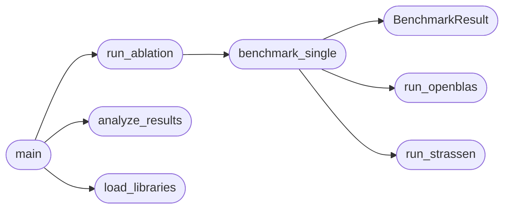

# `experiments.ablation.ablation_study`

> Source: [experiments/ablation/ablation_study.py:1](../../experiments/ablation/ablation_study.py#L1) | language `py` | coverage 50.0% | [API index](../index.md)

ABLACIÓN RIGUROSA - Strassen vs OpenBLAS ========================================= Protocolo científico: 1.

Múltiples runs por configuración (N_RUNS = 5) 2. Warm-up runs descartados 3. Estadísticas: media, std, min, max 4. Control de variables: mismas matrices, misma seed 5. Medición de error numérico

## Contents

- **Classes:** [`BenchmarkResult`](#benchmarkresult)
- **Functions:** [`load_libraries`](#load_libraries), [`run_openblas`](#run_openblas), [`run_strassen`](#run_strassen), [`benchmark_single`](#benchmark_single), [`run_ablation`](#run_ablation), [`analyze_results`](#analyze_results), [`main`](#main)
- **Constants:** [`N_RUNS`](#n_runs), [`WARMUP_RUNS`](#warmup_runs), [`SIZES`](#sizes)

## Call Graph

Solid arrows stay in this module, dashed arrows leave it.



## Classes

<a id="benchmarkresult"></a>

### `BenchmarkResult`

`class` `dataclass` | [experiments/ablation/ablation_study.py:27](../../experiments/ablation/ablation_study.py#L27)

Decorators: `@dataclass`

```python
class BenchmarkResult
```

**Attributes**

| Name | Type | Default | Description |
|---|---|---|---|
| [`name`](#benchmarkresult-name) | `str` |  |  |
| [`size`](#benchmarkresult-size) | `int` |  |  |
| [`times`](#benchmarkresult-times) | `List[float]` |  |  |
| [`gflops`](#benchmarkresult-gflops) | `List[float]` |  |  |
| [`error`](#benchmarkresult-error) | `float` |  |  |

**Members**

| Member | Kind | Summary |
|---|---|---|
| [`mean_time`](#benchmarkresult-mean_time) | property |  |
| [`std_time`](#benchmarkresult-std_time) | property |  |
| [`min_time`](#benchmarkresult-min_time) | property |  |
| [`max_time`](#benchmarkresult-max_time) | property |  |
| [`mean_gflops`](#benchmarkresult-mean_gflops) | property |  |

<a id="benchmarkresult-mean_time"></a>

#### `BenchmarkResult.mean_time`

`property` | [experiments/ablation/ablation_study.py:35](../../experiments/ablation/ablation_study.py#L35)

Decorators: `@property`

```python
def mean_time(self) -> float
```

**Returns:** `float`

<a id="benchmarkresult-std_time"></a>

#### `BenchmarkResult.std_time`

`property` | [experiments/ablation/ablation_study.py:39](../../experiments/ablation/ablation_study.py#L39)

Decorators: `@property`

```python
def std_time(self) -> float
```

**Returns:** `float`

<a id="benchmarkresult-min_time"></a>

#### `BenchmarkResult.min_time`

`property` | [experiments/ablation/ablation_study.py:43](../../experiments/ablation/ablation_study.py#L43)

Decorators: `@property`

```python
def min_time(self) -> float
```

**Returns:** `float`

<a id="benchmarkresult-max_time"></a>

#### `BenchmarkResult.max_time`

`property` | [experiments/ablation/ablation_study.py:47](../../experiments/ablation/ablation_study.py#L47)

Decorators: `@property`

```python
def max_time(self) -> float
```

**Returns:** `float`

<a id="benchmarkresult-mean_gflops"></a>

#### `BenchmarkResult.mean_gflops`

`property` | [experiments/ablation/ablation_study.py:51](../../experiments/ablation/ablation_study.py#L51)

Decorators: `@property`

```python
def mean_gflops(self) -> float
```

**Returns:** `float`

---

## Functions

<a id="load_libraries"></a>

### `load_libraries`

`function` | [experiments/ablation/ablation_study.py:54](../../experiments/ablation/ablation_study.py#L54)

```python
def load_libraries()
```

Cargar bibliotecas con manejo de errores

*Called by:* [`main`](#main)

---

<a id="run_openblas"></a>

### `run_openblas`

`function` | [experiments/ablation/ablation_study.py:111](../../experiments/ablation/ablation_study.py#L111)

```python
def run_openblas(libs, A, B, C, n)
```

Ejecutar multiplicación con OpenBLAS

**Parameters**

| Name | Type | Default | Description |
|---|---|---|---|
| `libs` |  |  |  |
| `A` |  |  |  |
| `B` |  |  |  |
| `C` |  |  |  |
| `n` |  |  |  |

*Called by:* [`benchmark_single`](#benchmark_single)

---

<a id="run_strassen"></a>

### `run_strassen`

`function` | [experiments/ablation/ablation_study.py:122](../../experiments/ablation/ablation_study.py#L122)

```python
def run_strassen(libs, name, func_name, A, B, C, n)
```

Ejecutar multiplicación con Strassen

**Parameters**

| Name | Type | Default | Description |
|---|---|---|---|
| `libs` |  |  |  |
| `name` |  |  |  |
| `func_name` |  |  |  |
| `A` |  |  |  |
| `B` |  |  |  |
| `C` |  |  |  |
| `n` |  |  |  |

*Called by:* [`benchmark_single`](#benchmark_single)

---

<a id="benchmark_single"></a>

### `benchmark_single`

`function` | [experiments/ablation/ablation_study.py:132](../../experiments/ablation/ablation_study.py#L132)

```python
def benchmark_single(libs, algo_name, func_name, A, B, C, C_ref, n, n_runs, warmup)
```

Benchmark una implementación

**Parameters**

| Name | Type | Default | Description |
|---|---|---|---|
| `libs` |  |  |  |
| `algo_name` |  |  |  |
| `func_name` |  |  |  |
| `A` |  |  |  |
| `B` |  |  |  |
| `C` |  |  |  |
| `C_ref` |  |  |  |
| `n` |  |  |  |
| `n_runs` |  |  |  |
| `warmup` |  |  |  |

*Calls:* [`BenchmarkResult`](#benchmarkresult), [`run_openblas`](#run_openblas), [`run_strassen`](#run_strassen)

*Called by:* [`run_ablation`](#run_ablation)

---

<a id="run_ablation"></a>

### `run_ablation`

`function` | [experiments/ablation/ablation_study.py:180](../../experiments/ablation/ablation_study.py#L180)

```python
def run_ablation(libs, sizes, n_runs, warmup)
```

Ejecutar ablación completa

**Parameters**

| Name | Type | Default | Description |
|---|---|---|---|
| `libs` |  |  |  |
| `sizes` |  |  |  |
| `n_runs` |  |  |  |
| `warmup` |  |  |  |

*Calls:* [`benchmark_single`](#benchmark_single)

*Called by:* [`main`](#main)

---

<a id="analyze_results"></a>

### `analyze_results`

`function` | [experiments/ablation/ablation_study.py:233](../../experiments/ablation/ablation_study.py#L233)

```python
def analyze_results(results)
```

Analizar y presentar resultados

**Parameters**

| Name | Type | Default | Description |
|---|---|---|---|
| `results` |  |  |  |

*Called by:* [`main`](#main)

---

<a id="main"></a>

### `main`

`function` | [experiments/ablation/ablation_study.py:273](../../experiments/ablation/ablation_study.py#L273)

```python
def main()
```

*Calls:* [`analyze_results`](#analyze_results), [`load_libraries`](#load_libraries), [`run_ablation`](#run_ablation)

---

## Constants

<a id="n_runs"></a>

### `N_RUNS`

`constant` | [experiments/ablation/ablation_study.py:22](../../experiments/ablation/ablation_study.py#L22)

```python
N_RUNS = 5
```

---

<a id="warmup_runs"></a>

### `WARMUP_RUNS`

`constant` | [experiments/ablation/ablation_study.py:23](../../experiments/ablation/ablation_study.py#L23)

```python
WARMUP_RUNS = 2
```

---

<a id="sizes"></a>

### `SIZES`

`constant` | [experiments/ablation/ablation_study.py:24](../../experiments/ablation/ablation_study.py#L24)

```python
SIZES = [2048, 4096, 8192]
```

---
