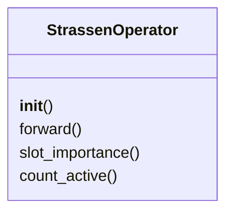

# `experiments.apendix_experiments`

> Source: [experiments/apendix_experiments.py:1](../../experiments/apendix_experiments.py#L1) | language `py` | coverage 5.6% | [API index](../index.md)

Experiments for Paper Validation =================================

This script runs the experiments described in the paper:
1. Phase Diagram: S(theta) success rate vs (Batch Size, Epochs)
2. Grokking Curves: Train/Test loss dynamics
3. Gradient Covariance: kappa(Sigma) vs Batch Size
4. Batch Size Effect: Statistical analysis across seeds

Metrics:
    S(theta) in {0,1}: Discretization success
    delta(theta): Distance to integers
    kappa(Sigma): Gradient covariance condition number

Author: grisun0
License: AGPL v3

## Contents

- **Classes:** [`StrassenOperator`](#strassenoperator)
- **Functions:** [`setup_matplotlib`](#setup_matplotlib), [`generate_batch`](#generate_batch), [`generate_test_set`](#generate_test_set), [`compute_delta`](#compute_delta), [`verify_strassen_structure`](#verify_strassen_structure), [`compute_S_theta`](#compute_s_theta), [`compute_gradient_covariance`](#compute_gradient_covariance), [`train_with_logging`](#train_with_logging), [`sparsify_and_discretize`](#sparsify_and_discretize), [`run_phase_diagram`](#run_phase_diagram), [`run_batch_size_effect`](#run_batch_size_effect), [`main`](#main)
- **Constants:** [`DEVICE`](#device)

## Type Diagram



## Call Graph

Solid arrows stay in this module, dashed arrows leave it.

```mermaid
flowchart LR
    n_experiments_apendix_experiments_py__StrassenOperator_count_active(["StrassenOperator.count_active"])
    n_experiments_apendix_experiments_py__StrassenOperator_slot_importance(["StrassenOperator.slot_importance"])
    n_experiments_apendix_experiments_py__compute_S_theta(["compute_S_theta"])
    n_experiments_apendix_experiments_py__compute_delta(["compute_delta"])
    n_experiments_apendix_experiments_py__verify_strassen_structure(["verify_strassen_structure"])
    n_experiments_apendix_experiments_py__compute_gradient_covariance(["compute_gradient_covariance"])
    n_experiments_apendix_experiments_py__generate_batch(["generate_batch"])
    n_experiments_apendix_experiments_py__train_with_logging(["train_with_logging"])
    n_experiments_apendix_experiments_py__StrassenOperator___init__(["StrassenOperator.__init__"])
    n_experiments_apendix_experiments_py__generate_test_set(["generate_test_set"])
    n_experiments_apendix_experiments_py__sparsify_and_discretize(["sparsify_and_discretize"])
    n_experiments_apendix_experiments_py__run_phase_diagram(["run_phase_diagram"])
    n_experiments_apendix_experiments_py__run_batch_size_effect(["run_batch_size_effect"])
    n_experiments_apendix_experiments_py__main(["main"])
    n_experiments_apendix_experiments_py__StrassenOperator_count_active --> n_experiments_apendix_experiments_py__StrassenOperator_slot_importance
    n_experiments_apendix_experiments_py__compute_S_theta --> n_experiments_apendix_experiments_py__compute_delta
    n_experiments_apendix_experiments_py__compute_S_theta --> n_experiments_apendix_experiments_py__verify_strassen_structure
    n_experiments_apendix_experiments_py__compute_gradient_covariance --> n_experiments_apendix_experiments_py__generate_batch
    n_experiments_apendix_experiments_py__train_with_logging --> n_experiments_apendix_experiments_py__StrassenOperator___init__
    n_experiments_apendix_experiments_py__train_with_logging --> n_experiments_apendix_experiments_py__compute_S_theta
    n_experiments_apendix_experiments_py__train_with_logging --> n_experiments_apendix_experiments_py__compute_delta
    n_experiments_apendix_experiments_py__train_with_logging --> n_experiments_apendix_experiments_py__compute_gradient_covariance
    n_experiments_apendix_experiments_py__train_with_logging --> n_experiments_apendix_experiments_py__generate_batch
    n_experiments_apendix_experiments_py__train_with_logging --> n_experiments_apendix_experiments_py__generate_test_set
    n_experiments_apendix_experiments_py__train_with_logging --> n_experiments_apendix_experiments_py__sparsify_and_discretize
    n_experiments_apendix_experiments_py__sparsify_and_discretize --> n_experiments_apendix_experiments_py__compute_S_theta
    n_experiments_apendix_experiments_py__sparsify_and_discretize --> n_experiments_apendix_experiments_py__generate_batch
    n_experiments_apendix_experiments_py__run_phase_diagram --> n_experiments_apendix_experiments_py__train_with_logging
    n_experiments_apendix_experiments_py__run_batch_size_effect --> n_experiments_apendix_experiments_py__train_with_logging
    n_experiments_apendix_experiments_py__main --> n_experiments_apendix_experiments_py__run_batch_size_effect
    n_experiments_apendix_experiments_py__main --> n_experiments_apendix_experiments_py__run_phase_diagram
```



## Classes

<a id="strassenoperator"></a>

### `StrassenOperator`

`class` | [experiments/apendix_experiments.py:51](../../experiments/apendix_experiments.py#L51)

```python
class StrassenOperator(nn.Module)
```

Bases: `nn.Module`

**Members**

| Member | Kind | Summary |
|---|---|---|
| [`__init__`](#strassenoperator-__init__) | constructor |  |
| [`forward`](#strassenoperator-forward) | method |  |
| [`slot_importance`](#strassenoperator-slot_importance) | method |  |
| [`count_active`](#strassenoperator-count_active) | method |  |

<a id="strassenoperator-__init__"></a>

#### `StrassenOperator.__init__`

`constructor` | [experiments/apendix_experiments.py:53](../../experiments/apendix_experiments.py#L53)

```python
def __init__(self, rank=8, symmetric_init=True)
```

**Parameters**

| Name | Type | Default | Description |
|---|---|---|---|
| `rank` |  | `8` |  |
| `symmetric_init` |  | `True` |  |

*Called by:* [`train_with_logging`](#train_with_logging), [`StrassenOperator.__init__`](experiments.extended_experiments.exp1_covariance_spectrometry.py.md#strassenoperator-__init__), [`StrassenOperator.__init__`](experiments.extended_experiments.exp2_noise_ablation.py.md#strassenoperator-__init__), [`StrassenOperator.__init__`](experiments.extended_experiments.exp3_prospective_prediction.py.md#strassenoperator-__init__), [`StrassenOperator.__init__`](experiments.extended_experiments.exp4_trajectory_perturbation.py.md#strassenoperator-__init__), [`StrassenOperator.__init__`](experiments.extended_experiments.run_all_experiments.py.md#strassenoperator-__init__), [`StrassenOperator.__init__`](experiments.extended_experiments.validate2.py.md#strassenoperator-__init__), [`StrassenOperator.__init__`](full_seed_prospector.py.md#strassenoperator-__init__), [`StrassenOperator.__init__`](src.training.strassen_grokkit.py.md#strassenoperator-__init__), [`StrassenOperator.__init__`](src.training.train_strassen.py.md#strassenoperator-__init__)

<a id="strassenoperator-forward"></a>

#### `StrassenOperator.forward`

`method` | [experiments/apendix_experiments.py:67](../../experiments/apendix_experiments.py#L67)

```python
def forward(self, A, B)
```

**Parameters**

| Name | Type | Default | Description |
|---|---|---|---|
| `A` |  |  |  |
| `B` |  |  |  |

<a id="strassenoperator-slot_importance"></a>

#### `StrassenOperator.slot_importance`

`method` | [experiments/apendix_experiments.py:77](../../experiments/apendix_experiments.py#L77)

```python
def slot_importance(self)
```

*Called by:* [`StrassenOperator.count_active`](#strassenoperator-count_active), [`StrassenOperator.compute_SP`](experiments.extended_experiments.validate2.py.md#strassenoperator-compute_sp), [`StrassenOperator.count_active`](experiments.extended_experiments.validate2.py.md#strassenoperator-count_active), [`ProgressiveSparsificationPhase.execute`](full_seed_prospector.py.md#progressivesparsificationphase-execute), [`StrassenOperator.count_active`](full_seed_prospector.py.md#strassenoperator-count_active), [`StrassenOperator.compute_SP`](src.training.strassen_grokkit.py.md#strassenoperator-compute_sp), [`StrassenOperator.count_active`](src.training.strassen_grokkit.py.md#strassenoperator-count_active), [`StrassenOperator.count_active`](src.training.train_strassen.py.md#strassenoperator-count_active)

<a id="strassenoperator-count_active"></a>

#### `StrassenOperator.count_active`

`method` | [experiments/apendix_experiments.py:83](../../experiments/apendix_experiments.py#L83)

```python
def count_active(self, threshold=0.1)
```

**Parameters**

| Name | Type | Default | Description |
|---|---|---|---|
| `threshold` |  | `0.1` |  |

*Calls:* [`StrassenOperator.slot_importance`](#strassenoperator-slot_importance)

*Called by:* [`ProgressiveSparsificationPhase.execute`](full_seed_prospector.py.md#progressivesparsificationphase-execute), [`SparsityCalculator.calculate`](full_seed_prospector.py.md#sparsitycalculator-calculate)

---

## Functions

<a id="setup_matplotlib"></a>

### `setup_matplotlib`

`function` | [experiments/apendix_experiments.py:34](../../experiments/apendix_experiments.py#L34)

```python
def setup_matplotlib()
```

---

<a id="generate_batch"></a>

### `generate_batch`

`function` | [experiments/apendix_experiments.py:87](../../experiments/apendix_experiments.py#L87)

```python
def generate_batch(n, device=DEVICE)
```

**Parameters**

| Name | Type | Default | Description |
|---|---|---|---|
| `n` |  |  |  |
| `device` |  | `DEVICE` |  |

*Called by:* [`compute_gradient_covariance`](#compute_gradient_covariance), [`sparsify_and_discretize`](#sparsify_and_discretize), [`train_with_logging`](#train_with_logging)

---

<a id="generate_test_set"></a>

### `generate_test_set`

`function` | [experiments/apendix_experiments.py:93](../../experiments/apendix_experiments.py#L93)

```python
def generate_test_set(n=1000, device=DEVICE)
```

**Parameters**

| Name | Type | Default | Description |
|---|---|---|---|
| `n` |  | `1000` |  |
| `device` |  | `DEVICE` |  |

*Called by:* [`train_with_logging`](#train_with_logging)

---

<a id="compute_delta"></a>

### `compute_delta`

`function` | [experiments/apendix_experiments.py:100](../../experiments/apendix_experiments.py#L100)

```python
def compute_delta(model)
```

**Parameters**

| Name | Type | Default | Description |
|---|---|---|---|
| `model` |  |  |  |

*Called by:* [`compute_S_theta`](#compute_s_theta), [`train_with_logging`](#train_with_logging)

---

<a id="verify_strassen_structure"></a>

### `verify_strassen_structure`

`function` | [experiments/apendix_experiments.py:117](../../experiments/apendix_experiments.py#L117)

```python
def verify_strassen_structure(U_disc, V_disc, W_disc, tolerance=1e-05)
```

**Parameters**

| Name | Type | Default | Description |
|---|---|---|---|
| `U_disc` |  |  |  |
| `V_disc` |  |  |  |
| `W_disc` |  |  |  |
| `tolerance` |  | `1e-05` |  |

*Called by:* [`compute_S_theta`](#compute_s_theta)

---

<a id="compute_s_theta"></a>

### `compute_S_theta`

`function` | [experiments/apendix_experiments.py:138](../../experiments/apendix_experiments.py#L138)

```python
def compute_S_theta(model)
```

**Parameters**

| Name | Type | Default | Description |
|---|---|---|---|
| `model` |  |  |  |

*Calls:* [`compute_delta`](#compute_delta), [`verify_strassen_structure`](#verify_strassen_structure)

*Called by:* [`sparsify_and_discretize`](#sparsify_and_discretize), [`train_with_logging`](#train_with_logging)

---

<a id="compute_gradient_covariance"></a>

### `compute_gradient_covariance`

`function` | [experiments/apendix_experiments.py:154](../../experiments/apendix_experiments.py#L154)

```python
def compute_gradient_covariance(model, batch_size, n_samples=50)
```

**Parameters**

| Name | Type | Default | Description |
|---|---|---|---|
| `model` |  |  |  |
| `batch_size` |  |  |  |
| `n_samples` |  | `50` |  |

*Calls:* [`generate_batch`](#generate_batch)

*Called by:* [`train_with_logging`](#train_with_logging)

---

<a id="train_with_logging"></a>

### `train_with_logging`

`function` | [experiments/apendix_experiments.py:187](../../experiments/apendix_experiments.py#L187)

```python
def train_with_logging(batch_size, total_epochs, lr=0.02, wd=0.0001, symmetric_init=True, seed=42, log_interval=50)
```

**Parameters**

| Name | Type | Default | Description |
|---|---|---|---|
| `batch_size` |  |  |  |
| `total_epochs` |  |  |  |
| `lr` |  | `0.02` |  |
| `wd` |  | `0.0001` |  |
| `symmetric_init` |  | `True` |  |
| `seed` |  | `42` |  |
| `log_interval` |  | `50` |  |

*Calls:* [`StrassenOperator.__init__`](#strassenoperator-__init__), [`compute_S_theta`](#compute_s_theta), [`compute_delta`](#compute_delta), [`compute_gradient_covariance`](#compute_gradient_covariance), [`generate_batch`](#generate_batch), [`generate_test_set`](#generate_test_set), [`sparsify_and_discretize`](#sparsify_and_discretize)

*Called by:* [`run_batch_size_effect`](#run_batch_size_effect), [`run_phase_diagram`](#run_phase_diagram)

---

<a id="sparsify_and_discretize"></a>

### `sparsify_and_discretize`

`function` | [experiments/apendix_experiments.py:274](../../experiments/apendix_experiments.py#L274)

```python
def sparsify_and_discretize(model, batch_size)
```

**Parameters**

| Name | Type | Default | Description |
|---|---|---|---|
| `model` |  |  |  |
| `batch_size` |  |  |  |

*Calls:* [`compute_S_theta`](#compute_s_theta), [`generate_batch`](#generate_batch)

*Called by:* [`train_with_logging`](#train_with_logging)

---

<a id="run_phase_diagram"></a>

### `run_phase_diagram`

`function` | [experiments/apendix_experiments.py:327](../../experiments/apendix_experiments.py#L327)

```python
def run_phase_diagram()
```

*Calls:* [`train_with_logging`](#train_with_logging)

*Called by:* [`main`](#main)

---

<a id="run_batch_size_effect"></a>

### `run_batch_size_effect`

`function` | [experiments/apendix_experiments.py:429](../../experiments/apendix_experiments.py#L429)

```python
def run_batch_size_effect()
```

*Calls:* [`train_with_logging`](#train_with_logging)

*Called by:* [`main`](#main)

---

<a id="main"></a>

### `main`

`function` | [experiments/apendix_experiments.py:526](../../experiments/apendix_experiments.py#L526)

```python
def main()
```

*Calls:* [`run_batch_size_effect`](#run_batch_size_effect), [`run_phase_diagram`](#run_phase_diagram)

---

## Constants

<a id="device"></a>

### `DEVICE`

`constant` | [experiments/apendix_experiments.py:48](../../experiments/apendix_experiments.py#L48)

```python
DEVICE = torch.device('cuda' if torch.cuda.is_available() else 'cpu')
```

---
