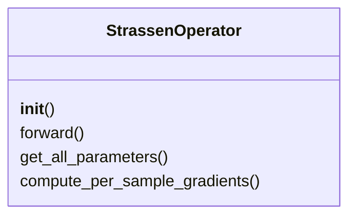

# `experiments.extended_experiments.exp1_covariance_spectrometry`

> Source: [experiments/extended_experiments/exp1_covariance_spectrometry.py:1](../../experiments/extended_experiments/exp1_covariance_spectrometry.py#L1) | language `py` | coverage 76.9% | [API index](../index.md)

EXPERIMENT 1: Gradient Covariance Spectrometry (CRITICAL) ========================================================== Measures κ(Σₜ) = λ_max / λ_min of gradient covariance matrix across training time.

This is the KEY experiment to validate the Gradient Covariance Hypothesis.

Author: MiniMax Agent

## Contents

- **Classes:** [`StrassenOperator`](#strassenoperator)
- **Functions:** [`setup_matplotlib`](#setup_matplotlib), [`generate_batch`](#generate_batch), [`compute_gradient_covariance`](#compute_gradient_covariance), [`load_checkpoint`](#load_checkpoint), [`analyze_checkpoint`](#analyze_checkpoint), [`main`](#main), [`generate_visualization`](#generate_visualization)
- **Constants:** [`BASE_DIR`](#base_dir), [`CHECKPOINTS_DIR`](#checkpoints_dir), [`TRAINING_DIR`](#training_dir), [`OUTPUT_DIR`](#output_dir)

## Type Diagram



## Call Graph

Solid arrows stay in this module, dashed arrows leave it.

```mermaid
flowchart LR
    n_experiments_extended_experiments_exp1_covariance_spectrometry_py__StrassenOperator_compute_per_sample_gradients(["StrassenOperator.compute_per_sample_gradients"])
    n_experiments_extended_experiments_exp1_covariance_spectrometry_py__StrassenOperator_get_all_parameters(["StrassenOperator.get_all_parameters"])
    n_experiments_extended_experiments_exp1_covariance_spectrometry_py__compute_gradient_covariance(["compute_gradient_covariance"])
    n_experiments_extended_experiments_exp1_covariance_spectrometry_py__generate_batch(["generate_batch"])
    n_experiments_extended_experiments_exp1_covariance_spectrometry_py__load_checkpoint(["load_checkpoint"])
    n_experiments_extended_experiments_exp1_covariance_spectrometry_py__StrassenOperator___init__(["StrassenOperator.__init__"])
    n_experiments_extended_experiments_exp1_covariance_spectrometry_py__analyze_checkpoint(["analyze_checkpoint"])
    n_experiments_extended_experiments_exp1_covariance_spectrometry_py__main(["main"])
    n_experiments_extended_experiments_exp1_covariance_spectrometry_py__generate_visualization(["generate_visualization"])
    n_experiments_apendix_experiments_py__StrassenOperator___init__["apendix_experiments.StrassenOperator.__init__"]
    n_experiments_extended_experiments_exp1_covariance_spectrometry_py__StrassenOperator_compute_per_sample_gradients --> n_experiments_extended_experiments_exp1_covariance_spectrometry_py__StrassenOperator_get_all_parameters
    n_experiments_extended_experiments_exp1_covariance_spectrometry_py__compute_gradient_covariance --> n_experiments_extended_experiments_exp1_covariance_spectrometry_py__generate_batch
    n_experiments_extended_experiments_exp1_covariance_spectrometry_py__load_checkpoint --> n_experiments_extended_experiments_exp1_covariance_spectrometry_py__StrassenOperator___init__
    n_experiments_extended_experiments_exp1_covariance_spectrometry_py__analyze_checkpoint --> n_experiments_extended_experiments_exp1_covariance_spectrometry_py__compute_gradient_covariance
    n_experiments_extended_experiments_exp1_covariance_spectrometry_py__analyze_checkpoint --> n_experiments_extended_experiments_exp1_covariance_spectrometry_py__load_checkpoint
    n_experiments_extended_experiments_exp1_covariance_spectrometry_py__main --> n_experiments_extended_experiments_exp1_covariance_spectrometry_py__analyze_checkpoint
    n_experiments_extended_experiments_exp1_covariance_spectrometry_py__main --> n_experiments_extended_experiments_exp1_covariance_spectrometry_py__generate_visualization
    n_experiments_extended_experiments_exp1_covariance_spectrometry_py__StrassenOperator___init__ -.-> n_experiments_apendix_experiments_py__StrassenOperator___init__
```



## Classes

<a id="strassenoperator"></a>

### `StrassenOperator`

`class` | [experiments/extended_experiments/exp1_covariance_spectrometry.py:48](../../experiments/extended_experiments/exp1_covariance_spectrometry.py#L48)

```python
class StrassenOperator(nn.Module)
```

Bases: `nn.Module`

Spectral operator for 2x2 matrix multiplication.

Tensor decomposition: C_ij = sum_r W[ij,r] * (U[r,:] . a) * (V[r,:] . b)

**Members**

| Member | Kind | Summary |
|---|---|---|
| [`__init__`](#strassenoperator-__init__) | constructor |  |
| [`forward`](#strassenoperator-forward) | method |  |
| [`get_all_parameters`](#strassenoperator-get_all_parameters) | method | Get all parameters as a single flattened vector. |
| [`compute_per_sample_gradients`](#strassenoperator-compute_per_sample_gradients) | method | Compute per-sample gradients for covariance estimation. |

<a id="strassenoperator-__init__"></a>

#### `StrassenOperator.__init__`

`constructor` | [experiments/extended_experiments/exp1_covariance_spectrometry.py:54](../../experiments/extended_experiments/exp1_covariance_spectrometry.py#L54)

```python
def __init__(self, rank=8)
```

**Parameters**

| Name | Type | Default | Description |
|---|---|---|---|
| `rank` |  | `8` |  |

*Calls:* [`StrassenOperator.__init__`](experiments.apendix_experiments.py.md#strassenoperator-__init__)

*Called by:* [`load_checkpoint`](#load_checkpoint)

<a id="strassenoperator-forward"></a>

#### `StrassenOperator.forward`

`method` | [experiments/extended_experiments/exp1_covariance_spectrometry.py:61](../../experiments/extended_experiments/exp1_covariance_spectrometry.py#L61)

```python
def forward(self, A, B)
```

**Parameters**

| Name | Type | Default | Description |
|---|---|---|---|
| `A` |  |  |  |
| `B` |  |  |  |

<a id="strassenoperator-get_all_parameters"></a>

#### `StrassenOperator.get_all_parameters`

`method` | [experiments/extended_experiments/exp1_covariance_spectrometry.py:71](../../experiments/extended_experiments/exp1_covariance_spectrometry.py#L71)

```python
def get_all_parameters(self)
```

Get all parameters as a single flattened vector.

*Called by:* [`StrassenOperator.compute_per_sample_gradients`](#strassenoperator-compute_per_sample_gradients), [`StrassenOperator.compute_discretization_margin`](experiments.extended_experiments.exp3_prospective_prediction.py.md#strassenoperator-compute_discretization_margin), [`StrassenOperator.get_weight_direction`](experiments.extended_experiments.exp4_trajectory_perturbation.py.md#strassenoperator-get_weight_direction), [`StrassenOperator.compute_discretization_margin`](experiments.extended_experiments.run_all_experiments.py.md#strassenoperator-compute_discretization_margin), [`run_all_experiments`](experiments.extended_experiments.run_all_experiments.py.md#run_all_experiments)

<a id="strassenoperator-compute_per_sample_gradients"></a>

#### `StrassenOperator.compute_per_sample_gradients`

`method` | [experiments/extended_experiments/exp1_covariance_spectrometry.py:78](../../experiments/extended_experiments/exp1_covariance_spectrometry.py#L78)

```python
def compute_per_sample_gradients(self, A, B, C_true)
```

Compute per-sample gradients for covariance estimation.

Returns: gradients shape [batch_size, num_parameters]

**Parameters**

| Name | Type | Default | Description |
|---|---|---|---|
| `A` |  |  |  |
| `B` |  |  |  |
| `C_true` |  |  |  |

*Calls:* [`StrassenOperator.get_all_parameters`](#strassenoperator-get_all_parameters)

---

## Functions

<a id="setup_matplotlib"></a>

### `setup_matplotlib`

`function` | [experiments/extended_experiments/exp1_covariance_spectrometry.py:22](../../experiments/extended_experiments/exp1_covariance_spectrometry.py#L22)

```python
def setup_matplotlib()
```

---

<a id="generate_batch"></a>

### `generate_batch`

`function` | [experiments/extended_experiments/exp1_covariance_spectrometry.py:112](../../experiments/extended_experiments/exp1_covariance_spectrometry.py#L112)

```python
def generate_batch(n, scale=1.0)
```

Generate batch of matrices.

**Parameters**

| Name | Type | Default | Description |
|---|---|---|---|
| `n` |  |  |  |
| `scale` |  | `1.0` |  |

*Called by:* [`compute_gradient_covariance`](#compute_gradient_covariance)

---

<a id="compute_gradient_covariance"></a>

### `compute_gradient_covariance`

`function` | [experiments/extended_experiments/exp1_covariance_spectrometry.py:120](../../experiments/extended_experiments/exp1_covariance_spectrometry.py#L120)

```python
def compute_gradient_covariance(model, batch_size=64, n_samples=100)
```

Compute the gradient covariance matrix Σₜ and its eigenvalues.

**Parameters**

| Name | Type | Default | Description |
|---|---|---|---|
| `model` |  |  |  |
| `batch_size` |  | `64` |  |
| `n_samples` |  | `100` |  |

**Returns:** `kappa` - condition number λ_max / λ_min
lambda_max: maximum eigenvalue
lambda_min: minimum eigenvalue
trace: trace of covariance (total gradient energy)
frobenius_norm: Frobenius norm of covariance

*Calls:* [`generate_batch`](#generate_batch)

*Called by:* [`analyze_checkpoint`](#analyze_checkpoint)

---

<a id="load_checkpoint"></a>

### `load_checkpoint`

`function` | [experiments/extended_experiments/exp1_covariance_spectrometry.py:196](../../experiments/extended_experiments/exp1_covariance_spectrometry.py#L196)

```python
def load_checkpoint(checkpoint_path)
```

Load model from checkpoint file.

**Parameters**

| Name | Type | Default | Description |
|---|---|---|---|
| `checkpoint_path` |  |  |  |

*Calls:* [`StrassenOperator.__init__`](#strassenoperator-__init__)

*Called by:* [`analyze_checkpoint`](#analyze_checkpoint)

---

<a id="analyze_checkpoint"></a>

### `analyze_checkpoint`

`function` | [experiments/extended_experiments/exp1_covariance_spectrometry.py:222](../../experiments/extended_experiments/exp1_covariance_spectrometry.py#L222)

```python
def analyze_checkpoint(checkpoint_path, batch_sizes=[8, 16, 24, 32, 64, 128, 256], n_samples=100, n_runs=3)
```

Analyze a single checkpoint with multiple batch sizes.

**Parameters**

| Name | Type | Default | Description |
|---|---|---|---|
| `checkpoint_path` |  |  |  |
| `batch_sizes` |  | `[8, 16, 24, 32, 64, 128, 256]` |  |
| `n_samples` |  | `100` |  |
| `n_runs` |  | `3` |  |

*Calls:* [`compute_gradient_covariance`](#compute_gradient_covariance), [`load_checkpoint`](#load_checkpoint)

*Called by:* [`main`](#main)

---

<a id="main"></a>

### `main`

`function` | [experiments/extended_experiments/exp1_covariance_spectrometry.py:277](../../experiments/extended_experiments/exp1_covariance_spectrometry.py#L277)

```python
def main()
```

Main execution for Experiment 1.

*Calls:* [`analyze_checkpoint`](#analyze_checkpoint), [`generate_visualization`](#generate_visualization)

---

<a id="generate_visualization"></a>

### `generate_visualization`

`function` | [experiments/extended_experiments/exp1_covariance_spectrometry.py:380](../../experiments/extended_experiments/exp1_covariance_spectrometry.py#L380)

```python
def generate_visualization(results, output_dir)
```

Generate publication-quality figures.

**Parameters**

| Name | Type | Default | Description |
|---|---|---|---|
| `results` |  |  |  |
| `output_dir` |  |  |  |

*Called by:* [`main`](#main)

---

## Constants

<a id="base_dir"></a>

### `BASE_DIR`

`constant` | [experiments/extended_experiments/exp1_covariance_spectrometry.py:41](../../experiments/extended_experiments/exp1_covariance_spectrometry.py#L41)

```python
BASE_DIR = Path(__file__).parent.parent
```

---

<a id="checkpoints_dir"></a>

### `CHECKPOINTS_DIR`

`constant` | [experiments/extended_experiments/exp1_covariance_spectrometry.py:42](../../experiments/extended_experiments/exp1_covariance_spectrometry.py#L42)

```python
CHECKPOINTS_DIR = BASE_DIR / 'checkpoints'
```

---

<a id="training_dir"></a>

### `TRAINING_DIR`

`constant` | [experiments/extended_experiments/exp1_covariance_spectrometry.py:43](../../experiments/extended_experiments/exp1_covariance_spectrometry.py#L43)

```python
TRAINING_DIR = BASE_DIR / 'src' / 'training'
```

---

<a id="output_dir"></a>

### `OUTPUT_DIR`

`constant` | [experiments/extended_experiments/exp1_covariance_spectrometry.py:44](../../experiments/extended_experiments/exp1_covariance_spectrometry.py#L44)

```python
OUTPUT_DIR
```

---
