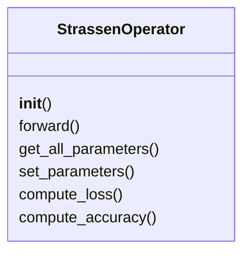

# `experiments.extended_experiments.exp2_noise_ablation`

> Source: [experiments/extended_experiments/exp2_noise_ablation.py:1](../../experiments/extended_experiments/exp2_noise_ablation.py#L1) | language `py` | coverage 78.9% | [API index](../index.md)

EXPERIMENT 2: Gradient Noise Injection (Robustness Ablation) ============================================================== Tests whether the "Grokking" phase corresponds to increased robustness against gradient noise vs weight noise.

Treatments:
A: Gradient noise during training (ε ~ N(0, σ²) added to gradients)
B: Weight noise before discretization (perturbation before evaluation)
C: Structured noise (by eigenvectors of Σ)

Author: MiniMax Agent

## Contents

- **Classes:** [`StrassenOperator`](#strassenoperator)
- **Functions:** [`setup_matplotlib`](#setup_matplotlib), [`generate_batch`](#generate_batch), [`compute_gradient_covariance_matrix`](#compute_gradient_covariance_matrix), [`get_eigenbasis`](#get_eigenbasis), [`load_checkpoint`](#load_checkpoint), [`experiment_treatment_a_gradient_noise`](#experiment_treatment_a_gradient_noise), [`experiment_treatment_b_weight_noise`](#experiment_treatment_b_weight_noise), [`experiment_treatment_c_structured_noise`](#experiment_treatment_c_structured_noise), [`run_noise_ablation`](#run_noise_ablation), [`main`](#main), [`generate_visualization`](#generate_visualization)
- **Constants:** [`BASE_DIR`](#base_dir), [`CHECKPOINTS_DIR`](#checkpoints_dir), [`TRAINING_DIR`](#training_dir), [`OUTPUT_DIR`](#output_dir)

## Type Diagram



## Call Graph

Solid arrows stay in this module, dashed arrows leave it.

```mermaid
flowchart LR
    n_experiments_extended_experiments_exp2_noise_ablation_py__compute_gradient_covariance_matrix(["compute_gradient_covariance_matrix"])
    n_experiments_extended_experiments_exp2_noise_ablation_py__generate_batch(["generate_batch"])
    n_experiments_extended_experiments_exp2_noise_ablation_py__load_checkpoint(["load_checkpoint"])
    n_experiments_extended_experiments_exp2_noise_ablation_py__StrassenOperator___init__(["StrassenOperator.__init__"])
    n_experiments_extended_experiments_exp2_noise_ablation_py__experiment_treatment_a_gradient_noise(["experiment_treatment_a_gradient_noise"])
    n_experiments_extended_experiments_exp2_noise_ablation_py__experiment_treatment_b_weight_noise(["experiment_treatment_b_weight_noise"])
    n_experiments_extended_experiments_exp2_noise_ablation_py__experiment_treatment_c_structured_noise(["experiment_treatment_c_structured_noise"])
    n_experiments_extended_experiments_exp2_noise_ablation_py__get_eigenbasis(["get_eigenbasis"])
    n_experiments_extended_experiments_exp2_noise_ablation_py__run_noise_ablation(["run_noise_ablation"])
    n_experiments_extended_experiments_exp2_noise_ablation_py__main(["main"])
    n_experiments_extended_experiments_exp2_noise_ablation_py__generate_visualization(["generate_visualization"])
    n_experiments_apendix_experiments_py__StrassenOperator___init__["apendix_experiments.StrassenOperator.__init__"]
    n_experiments_extended_experiments_exp2_noise_ablation_py__compute_gradient_covariance_matrix --> n_experiments_extended_experiments_exp2_noise_ablation_py__generate_batch
    n_experiments_extended_experiments_exp2_noise_ablation_py__load_checkpoint --> n_experiments_extended_experiments_exp2_noise_ablation_py__StrassenOperator___init__
    n_experiments_extended_experiments_exp2_noise_ablation_py__experiment_treatment_a_gradient_noise --> n_experiments_extended_experiments_exp2_noise_ablation_py__generate_batch
    n_experiments_extended_experiments_exp2_noise_ablation_py__experiment_treatment_b_weight_noise --> n_experiments_extended_experiments_exp2_noise_ablation_py__generate_batch
    n_experiments_extended_experiments_exp2_noise_ablation_py__experiment_treatment_c_structured_noise --> n_experiments_extended_experiments_exp2_noise_ablation_py__generate_batch
    n_experiments_extended_experiments_exp2_noise_ablation_py__experiment_treatment_c_structured_noise --> n_experiments_extended_experiments_exp2_noise_ablation_py__get_eigenbasis
    n_experiments_extended_experiments_exp2_noise_ablation_py__run_noise_ablation --> n_experiments_extended_experiments_exp2_noise_ablation_py__compute_gradient_covariance_matrix
    n_experiments_extended_experiments_exp2_noise_ablation_py__run_noise_ablation --> n_experiments_extended_experiments_exp2_noise_ablation_py__experiment_treatment_a_gradient_noise
    n_experiments_extended_experiments_exp2_noise_ablation_py__run_noise_ablation --> n_experiments_extended_experiments_exp2_noise_ablation_py__experiment_treatment_b_weight_noise
    n_experiments_extended_experiments_exp2_noise_ablation_py__run_noise_ablation --> n_experiments_extended_experiments_exp2_noise_ablation_py__experiment_treatment_c_structured_noise
    n_experiments_extended_experiments_exp2_noise_ablation_py__run_noise_ablation --> n_experiments_extended_experiments_exp2_noise_ablation_py__load_checkpoint
    n_experiments_extended_experiments_exp2_noise_ablation_py__main --> n_experiments_extended_experiments_exp2_noise_ablation_py__generate_visualization
    n_experiments_extended_experiments_exp2_noise_ablation_py__main --> n_experiments_extended_experiments_exp2_noise_ablation_py__run_noise_ablation
    n_experiments_extended_experiments_exp2_noise_ablation_py__StrassenOperator___init__ -.-> n_experiments_apendix_experiments_py__StrassenOperator___init__
```



## Classes

<a id="strassenoperator"></a>

### `StrassenOperator`

`class` | [experiments/extended_experiments/exp2_noise_ablation.py:49](../../experiments/extended_experiments/exp2_noise_ablation.py#L49)

```python
class StrassenOperator(nn.Module)
```

Bases: `nn.Module`

Spectral operator for 2x2 matrix multiplication.

**Members**

| Member | Kind | Summary |
|---|---|---|
| [`__init__`](#strassenoperator-__init__) | constructor |  |
| [`forward`](#strassenoperator-forward) | method |  |
| [`get_all_parameters`](#strassenoperator-get_all_parameters) | method |  |
| [`set_parameters`](#strassenoperator-set_parameters) | method | Set parameters from a flattened tensor. |
| [`compute_loss`](#strassenoperator-compute_loss) | method | Compute MSE loss. |
| [`compute_accuracy`](#strassenoperator-compute_accuracy) | method | Compute accuracy (proportion of predictions within threshold). |

<a id="strassenoperator-__init__"></a>

#### `StrassenOperator.__init__`

`constructor` | [experiments/extended_experiments/exp2_noise_ablation.py:54](../../experiments/extended_experiments/exp2_noise_ablation.py#L54)

```python
def __init__(self, rank=8)
```

**Parameters**

| Name | Type | Default | Description |
|---|---|---|---|
| `rank` |  | `8` |  |

*Calls:* [`StrassenOperator.__init__`](experiments.apendix_experiments.py.md#strassenoperator-__init__)

*Called by:* [`load_checkpoint`](#load_checkpoint)

<a id="strassenoperator-forward"></a>

#### `StrassenOperator.forward`

`method` | [experiments/extended_experiments/exp2_noise_ablation.py:61](../../experiments/extended_experiments/exp2_noise_ablation.py#L61)

```python
def forward(self, A, B)
```

**Parameters**

| Name | Type | Default | Description |
|---|---|---|---|
| `A` |  |  |  |
| `B` |  |  |  |

<a id="strassenoperator-get_all_parameters"></a>

#### `StrassenOperator.get_all_parameters`

`method` | [experiments/extended_experiments/exp2_noise_ablation.py:71](../../experiments/extended_experiments/exp2_noise_ablation.py#L71)

```python
def get_all_parameters(self)
```

<a id="strassenoperator-set_parameters"></a>

#### `StrassenOperator.set_parameters`

`method` | [experiments/extended_experiments/exp2_noise_ablation.py:77](../../experiments/extended_experiments/exp2_noise_ablation.py#L77)

```python
def set_parameters(self, new_params)
```

Set parameters from a flattened tensor.

**Parameters**

| Name | Type | Default | Description |
|---|---|---|---|
| `new_params` |  |  |  |

*Called by:* [`run_all_experiments`](experiments.extended_experiments.run_all_experiments.py.md#run_all_experiments)

<a id="strassenoperator-compute_loss"></a>

#### `StrassenOperator.compute_loss`

`method` | [experiments/extended_experiments/exp2_noise_ablation.py:85](../../experiments/extended_experiments/exp2_noise_ablation.py#L85)

```python
def compute_loss(self, A, B)
```

Compute MSE loss.

**Parameters**

| Name | Type | Default | Description |
|---|---|---|---|
| `A` |  |  |  |
| `B` |  |  |  |

<a id="strassenoperator-compute_accuracy"></a>

#### `StrassenOperator.compute_accuracy`

`method` | [experiments/extended_experiments/exp2_noise_ablation.py:91](../../experiments/extended_experiments/exp2_noise_ablation.py#L91)

```python
def compute_accuracy(self, A, B, threshold=0.001)
```

Compute accuracy (proportion of predictions within threshold).

**Parameters**

| Name | Type | Default | Description |
|---|---|---|---|
| `A` |  |  |  |
| `B` |  |  |  |
| `threshold` |  | `0.001` |  |

*Called by:* [`run_all_experiments`](experiments.extended_experiments.run_all_experiments.py.md#run_all_experiments)

---

## Functions

<a id="setup_matplotlib"></a>

### `setup_matplotlib`

`function` | [experiments/extended_experiments/exp2_noise_ablation.py:25](../../experiments/extended_experiments/exp2_noise_ablation.py#L25)

```python
def setup_matplotlib()
```

---

<a id="generate_batch"></a>

### `generate_batch`

`function` | [experiments/extended_experiments/exp2_noise_ablation.py:99](../../experiments/extended_experiments/exp2_noise_ablation.py#L99)

```python
def generate_batch(n, scale=1.0)
```

Generate batch of matrices.

**Parameters**

| Name | Type | Default | Description |
|---|---|---|---|
| `n` |  |  |  |
| `scale` |  | `1.0` |  |

*Called by:* [`compute_gradient_covariance_matrix`](#compute_gradient_covariance_matrix), [`experiment_treatment_a_gradient_noise`](#experiment_treatment_a_gradient_noise), [`experiment_treatment_b_weight_noise`](#experiment_treatment_b_weight_noise), [`experiment_treatment_c_structured_noise`](#experiment_treatment_c_structured_noise)

---

<a id="compute_gradient_covariance_matrix"></a>

### `compute_gradient_covariance_matrix`

`function` | [experiments/extended_experiments/exp2_noise_ablation.py:107](../../experiments/extended_experiments/exp2_noise_ablation.py#L107)

```python
def compute_gradient_covariance_matrix(model, n_samples=64, batch_size=32)
```

Compute the gradient covariance matrix Σ.

**Parameters**

| Name | Type | Default | Description |
|---|---|---|---|
| `model` |  |  |  |
| `n_samples` |  | `64` |  |
| `batch_size` |  | `32` |  |

*Calls:* [`generate_batch`](#generate_batch)

*Called by:* [`run_noise_ablation`](#run_noise_ablation)

---

<a id="get_eigenbasis"></a>

### `get_eigenbasis`

`function` | [experiments/extended_experiments/exp2_noise_ablation.py:139](../../experiments/extended_experiments/exp2_noise_ablation.py#L139)

```python
def get_eigenbasis(covariance)
```

Get eigenvectors and eigenvalues of covariance matrix.

**Parameters**

| Name | Type | Default | Description |
|---|---|---|---|
| `covariance` |  |  |  |

*Called by:* [`experiment_treatment_c_structured_noise`](#experiment_treatment_c_structured_noise)

---

<a id="load_checkpoint"></a>

### `load_checkpoint`

`function` | [experiments/extended_experiments/exp2_noise_ablation.py:150](../../experiments/extended_experiments/exp2_noise_ablation.py#L150)

```python
def load_checkpoint(checkpoint_path)
```

Load model from checkpoint file.

**Parameters**

| Name | Type | Default | Description |
|---|---|---|---|
| `checkpoint_path` |  |  |  |

*Calls:* [`StrassenOperator.__init__`](#strassenoperator-__init__)

*Called by:* [`run_noise_ablation`](#run_noise_ablation)

---

<a id="experiment_treatment_a_gradient_noise"></a>

### `experiment_treatment_a_gradient_noise`

`function` | [experiments/extended_experiments/exp2_noise_ablation.py:172](../../experiments/extended_experiments/exp2_noise_ablation.py#L172)

```python
def experiment_treatment_a_gradient_noise(model, noise_std, n_test=1000)
```

Treatment A: Add noise to gradients DURING forward/backward pass.

This simulates the effect of gradient noise during training without actual retraining.

**Parameters**

| Name | Type | Default | Description |
|---|---|---|---|
| `model` |  |  |  |
| `noise_std` |  |  |  |
| `n_test` |  | `1000` |  |

*Calls:* [`generate_batch`](#generate_batch)

*Called by:* [`run_noise_ablation`](#run_noise_ablation)

---

<a id="experiment_treatment_b_weight_noise"></a>

### `experiment_treatment_b_weight_noise`

`function` | [experiments/extended_experiments/exp2_noise_ablation.py:212](../../experiments/extended_experiments/exp2_noise_ablation.py#L212)

```python
def experiment_treatment_b_weight_noise(model, noise_std, n_test=1000)
```

Treatment B: Noise on weights BEFORE evaluation (already done in paper).

This is the fallback mechanism test.

**Parameters**

| Name | Type | Default | Description |
|---|---|---|---|
| `model` |  |  |  |
| `noise_std` |  |  |  |
| `n_test` |  | `1000` |  |

*Calls:* [`generate_batch`](#generate_batch)

*Called by:* [`run_noise_ablation`](#run_noise_ablation)

---

<a id="experiment_treatment_c_structured_noise"></a>

### `experiment_treatment_c_structured_noise`

`function` | [experiments/extended_experiments/exp2_noise_ablation.py:246](../../experiments/extended_experiments/exp2_noise_ablation.py#L246)

```python
def experiment_treatment_c_structured_noise(model, covariance, noise_std, n_test=1000)
```

Treatment C: Structured noise by eigenvectors of Σ.

Tests whether damage is isotropic or aligned with gradient covariance directions.

**Parameters**

| Name | Type | Default | Description |
|---|---|---|---|
| `model` |  |  |  |
| `covariance` |  |  |  |
| `noise_std` |  |  |  |
| `n_test` |  | `1000` |  |

*Calls:* [`generate_batch`](#generate_batch), [`get_eigenbasis`](#get_eigenbasis)

*Called by:* [`run_noise_ablation`](#run_noise_ablation)

---

<a id="run_noise_ablation"></a>

### `run_noise_ablation`

`function` | [experiments/extended_experiments/exp2_noise_ablation.py:315](../../experiments/extended_experiments/exp2_noise_ablation.py#L315)

```python
def run_noise_ablation(checkpoint_path, noise_levels=[0.0001, 0.0005, 0.001, 0.005, 0.01])
```

Run complete noise ablation experiment on a checkpoint.

**Parameters**

| Name | Type | Default | Description |
|---|---|---|---|
| `checkpoint_path` |  |  |  |
| `noise_levels` |  | `[0.0001, 0.0005, 0.001, 0.005, 0.01]` |  |

*Calls:* [`compute_gradient_covariance_matrix`](#compute_gradient_covariance_matrix), [`experiment_treatment_a_gradient_noise`](#experiment_treatment_a_gradient_noise), [`experiment_treatment_b_weight_noise`](#experiment_treatment_b_weight_noise), [`experiment_treatment_c_structured_noise`](#experiment_treatment_c_structured_noise), [`load_checkpoint`](#load_checkpoint)

*Called by:* [`main`](#main)

---

<a id="main"></a>

### `main`

`function` | [experiments/extended_experiments/exp2_noise_ablation.py:348](../../experiments/extended_experiments/exp2_noise_ablation.py#L348)

```python
def main()
```

Main execution for Experiment 2.

*Calls:* [`generate_visualization`](#generate_visualization), [`run_noise_ablation`](#run_noise_ablation)

---

<a id="generate_visualization"></a>

### `generate_visualization`

`function` | [experiments/extended_experiments/exp2_noise_ablation.py:433](../../experiments/extended_experiments/exp2_noise_ablation.py#L433)

```python
def generate_visualization(results, output_dir)
```

Generate publication-quality figures.

**Parameters**

| Name | Type | Default | Description |
|---|---|---|---|
| `results` |  |  |  |
| `output_dir` |  |  |  |

*Called by:* [`main`](#main)

---

## Constants

<a id="base_dir"></a>

### `BASE_DIR`

`constant` | [experiments/extended_experiments/exp2_noise_ablation.py:42](../../experiments/extended_experiments/exp2_noise_ablation.py#L42)

```python
BASE_DIR = Path(__file__).parent.parent.parent
```

---

<a id="checkpoints_dir"></a>

### `CHECKPOINTS_DIR`

`constant` | [experiments/extended_experiments/exp2_noise_ablation.py:43](../../experiments/extended_experiments/exp2_noise_ablation.py#L43)

```python
CHECKPOINTS_DIR = BASE_DIR / 'checkpoints'
```

---

<a id="training_dir"></a>

### `TRAINING_DIR`

`constant` | [experiments/extended_experiments/exp2_noise_ablation.py:44](../../experiments/extended_experiments/exp2_noise_ablation.py#L44)

```python
TRAINING_DIR = BASE_DIR / 'src' / 'training'
```

---

<a id="output_dir"></a>

### `OUTPUT_DIR`

`constant` | [experiments/extended_experiments/exp2_noise_ablation.py:45](../../experiments/extended_experiments/exp2_noise_ablation.py#L45)

```python
OUTPUT_DIR = BASE_DIR / 'experiments' / 'reviewer_experiments' / 'exp2_noise_ablation'
```

---
