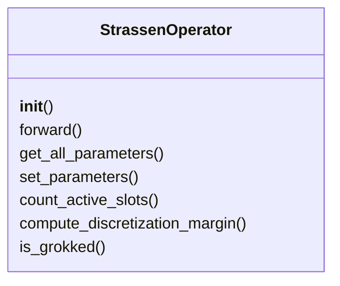

# `experiments.extended_experiments.exp3_prospective_prediction`

> Source: [experiments/extended_experiments/exp3_prospective_prediction.py:1](../../experiments/extended_experiments/exp3_prospective_prediction.py#L1) | language `py` | coverage 72.2% | [API index](../index.md)

EXPERIMENT 3: Prospective κ Prediction (Causality Test) ======================================================== Tests whether κ(Σₜ) measured EARLY in training predicts FINAL success.

This is the STRONGEST test of the Gradient Covariance Hypothesis:
- If κ low at epoch 50 → trajectory → discretization probable
- If κ is just a correlate → no predictive power

Protocol:
1. Measure κ at epoch T (e.g., 50-100)
2. PREDICT which runs will discretize (before seeing final result)
3. Complete training
4. Verify if prediction was correct
5. Compute ROC/AUC of κ as predictor

Author: MiniMax Agent

## Contents

- **Classes:** [`StrassenOperator`](#strassenoperator)
- **Functions:** [`setup_matplotlib`](#setup_matplotlib), [`generate_batch`](#generate_batch), [`compute_kappa`](#compute_kappa), [`load_checkpoint`](#load_checkpoint), [`simulate_early_prediction`](#simulate_early_prediction), [`run_prospective_prediction_experiment`](#run_prospective_prediction_experiment), [`compute_roc_analysis`](#compute_roc_analysis), [`main`](#main), [`generate_visualization`](#generate_visualization)
- **Constants:** [`BASE_DIR`](#base_dir), [`CHECKPOINTS_DIR`](#checkpoints_dir), [`TRAINING_DIR`](#training_dir), [`OUTPUT_DIR`](#output_dir)

## Type Diagram



## Call Graph

Solid arrows stay in this module, dashed arrows leave it.

```mermaid
flowchart LR
    n_experiments_extended_experiments_exp3_prospective_prediction_py__StrassenOperator_is_grokked(["StrassenOperator.is_grokked"])
    n_experiments_extended_experiments_exp3_prospective_prediction_py__StrassenOperator_compute_discretization_margin(["StrassenOperator.compute_discretization_margin"])
    n_experiments_extended_experiments_exp3_prospective_prediction_py__StrassenOperator_count_active_slots(["StrassenOperator.count_active_slots"])
    n_experiments_extended_experiments_exp3_prospective_prediction_py__compute_kappa(["compute_kappa"])
    n_experiments_extended_experiments_exp3_prospective_prediction_py__generate_batch(["generate_batch"])
    n_experiments_extended_experiments_exp3_prospective_prediction_py__load_checkpoint(["load_checkpoint"])
    n_experiments_extended_experiments_exp3_prospective_prediction_py__StrassenOperator___init__(["StrassenOperator.__init__"])
    n_experiments_extended_experiments_exp3_prospective_prediction_py__simulate_early_prediction(["simulate_early_prediction"])
    n_experiments_extended_experiments_exp3_prospective_prediction_py__run_prospective_prediction_experiment(["run_prospective_prediction_experiment"])
    n_experiments_extended_experiments_exp3_prospective_prediction_py__main(["main"])
    n_experiments_extended_experiments_exp3_prospective_prediction_py__compute_roc_analysis(["compute_roc_analysis"])
    n_experiments_extended_experiments_exp3_prospective_prediction_py__generate_visualization(["generate_visualization"])
    n_experiments_apendix_experiments_py__StrassenOperator___init__["apendix_experiments.StrassenOperator.__init__"]
    n_experiments_extended_experiments_exp1_covariance_spectrometry_py__StrassenOperator_get_all_parameters["exp1_covariance_spectrometry.StrassenOperator.get_all_parameters"]
    n_experiments_extended_experiments_exp3_prospective_prediction_py__StrassenOperator_is_grokked --> n_experiments_extended_experiments_exp3_prospective_prediction_py__StrassenOperator_compute_discretization_margin
    n_experiments_extended_experiments_exp3_prospective_prediction_py__StrassenOperator_is_grokked --> n_experiments_extended_experiments_exp3_prospective_prediction_py__StrassenOperator_count_active_slots
    n_experiments_extended_experiments_exp3_prospective_prediction_py__compute_kappa --> n_experiments_extended_experiments_exp3_prospective_prediction_py__generate_batch
    n_experiments_extended_experiments_exp3_prospective_prediction_py__load_checkpoint --> n_experiments_extended_experiments_exp3_prospective_prediction_py__StrassenOperator___init__
    n_experiments_extended_experiments_exp3_prospective_prediction_py__simulate_early_prediction --> n_experiments_extended_experiments_exp3_prospective_prediction_py__compute_kappa
    n_experiments_extended_experiments_exp3_prospective_prediction_py__simulate_early_prediction --> n_experiments_extended_experiments_exp3_prospective_prediction_py__load_checkpoint
    n_experiments_extended_experiments_exp3_prospective_prediction_py__run_prospective_prediction_experiment --> n_experiments_extended_experiments_exp3_prospective_prediction_py__simulate_early_prediction
    n_experiments_extended_experiments_exp3_prospective_prediction_py__main --> n_experiments_extended_experiments_exp3_prospective_prediction_py__compute_roc_analysis
    n_experiments_extended_experiments_exp3_prospective_prediction_py__main --> n_experiments_extended_experiments_exp3_prospective_prediction_py__generate_visualization
    n_experiments_extended_experiments_exp3_prospective_prediction_py__main --> n_experiments_extended_experiments_exp3_prospective_prediction_py__run_prospective_prediction_experiment
    n_experiments_extended_experiments_exp3_prospective_prediction_py__StrassenOperator___init__ -.-> n_experiments_apendix_experiments_py__StrassenOperator___init__
    n_experiments_extended_experiments_exp3_prospective_prediction_py__StrassenOperator_compute_discretization_margin -.-> n_experiments_extended_experiments_exp1_covariance_spectrometry_py__StrassenOperator_get_all_parameters
```



## Classes

<a id="strassenoperator"></a>

### `StrassenOperator`

`class` | [experiments/extended_experiments/exp3_prospective_prediction.py:56](../../experiments/extended_experiments/exp3_prospective_prediction.py#L56)

```python
class StrassenOperator(nn.Module)
```

Bases: `nn.Module`

Spectral operator for 2x2 matrix multiplication.

**Members**

| Member | Kind | Summary |
|---|---|---|
| [`__init__`](#strassenoperator-__init__) | constructor |  |
| [`forward`](#strassenoperator-forward) | method |  |
| [`get_all_parameters`](#strassenoperator-get_all_parameters) | method |  |
| [`set_parameters`](#strassenoperator-set_parameters) | method |  |
| [`count_active_slots`](#strassenoperator-count_active_slots) | method | Count active slots based on weight norms. |
| [`compute_discretization_margin`](#strassenoperator-compute_discretization_margin) | method | Compute how close weights are to discrete values {-1, 0, 1}. δ(θ) = mean(\|w - round(w)\|) |
| [`is_grokked`](#strassenoperator-is_grokked) | method | Check if model has grokked (discretized with low error). |

<a id="strassenoperator-__init__"></a>

#### `StrassenOperator.__init__`

`constructor` | [experiments/extended_experiments/exp3_prospective_prediction.py:59](../../experiments/extended_experiments/exp3_prospective_prediction.py#L59)

```python
def __init__(self, rank=8)
```

**Parameters**

| Name | Type | Default | Description |
|---|---|---|---|
| `rank` |  | `8` |  |

*Calls:* [`StrassenOperator.__init__`](experiments.apendix_experiments.py.md#strassenoperator-__init__)

*Called by:* [`load_checkpoint`](#load_checkpoint)

<a id="strassenoperator-forward"></a>

#### `StrassenOperator.forward`

`method` | [experiments/extended_experiments/exp3_prospective_prediction.py:66](../../experiments/extended_experiments/exp3_prospective_prediction.py#L66)

```python
def forward(self, A, B)
```

**Parameters**

| Name | Type | Default | Description |
|---|---|---|---|
| `A` |  |  |  |
| `B` |  |  |  |

<a id="strassenoperator-get_all_parameters"></a>

#### `StrassenOperator.get_all_parameters`

`method` | [experiments/extended_experiments/exp3_prospective_prediction.py:76](../../experiments/extended_experiments/exp3_prospective_prediction.py#L76)

```python
def get_all_parameters(self)
```

<a id="strassenoperator-set_parameters"></a>

#### `StrassenOperator.set_parameters`

`method` | [experiments/extended_experiments/exp3_prospective_prediction.py:82](../../experiments/extended_experiments/exp3_prospective_prediction.py#L82)

```python
def set_parameters(self, new_params)
```

**Parameters**

| Name | Type | Default | Description |
|---|---|---|---|
| `new_params` |  |  |  |

<a id="strassenoperator-count_active_slots"></a>

#### `StrassenOperator.count_active_slots`

`method` | [experiments/extended_experiments/exp3_prospective_prediction.py:89](../../experiments/extended_experiments/exp3_prospective_prediction.py#L89)

```python
def count_active_slots(self, threshold=0.1)
```

Count active slots based on weight norms.

**Parameters**

| Name | Type | Default | Description |
|---|---|---|---|
| `threshold` |  | `0.1` |  |

*Called by:* [`StrassenOperator.is_grokked`](#strassenoperator-is_grokked), [`run_all_experiments`](experiments.extended_experiments.run_all_experiments.py.md#run_all_experiments)

<a id="strassenoperator-compute_discretization_margin"></a>

#### `StrassenOperator.compute_discretization_margin`

`method` | [experiments/extended_experiments/exp3_prospective_prediction.py:97](../../experiments/extended_experiments/exp3_prospective_prediction.py#L97)

```python
def compute_discretization_margin(self)
```

Compute how close weights are to discrete values {-1, 0, 1}. δ(θ) = mean(|w - round(w)|)

*Calls:* [`StrassenOperator.get_all_parameters`](experiments.extended_experiments.exp1_covariance_spectrometry.py.md#strassenoperator-get_all_parameters)

*Called by:* [`StrassenOperator.is_grokked`](#strassenoperator-is_grokked), [`run_all_experiments`](experiments.extended_experiments.run_all_experiments.py.md#run_all_experiments)

<a id="strassenoperator-is_grokked"></a>

#### `StrassenOperator.is_grokked`

`method` | [experiments/extended_experiments/exp3_prospective_prediction.py:107](../../experiments/extended_experiments/exp3_prospective_prediction.py#L107)

```python
def is_grokked(self, margin_threshold=0.1, active_slots_target=7)
```

Check if model has grokked (discretized with low error).

**Parameters**

| Name | Type | Default | Description |
|---|---|---|---|
| `margin_threshold` |  | `0.1` |  |
| `active_slots_target` |  | `7` |  |

*Calls:* [`StrassenOperator.compute_discretization_margin`](#strassenoperator-compute_discretization_margin), [`StrassenOperator.count_active_slots`](#strassenoperator-count_active_slots)

---

## Functions

<a id="setup_matplotlib"></a>

### `setup_matplotlib`

`function` | [experiments/extended_experiments/exp3_prospective_prediction.py:32](../../experiments/extended_experiments/exp3_prospective_prediction.py#L32)

```python
def setup_matplotlib()
```

---

<a id="generate_batch"></a>

### `generate_batch`

`function` | [experiments/extended_experiments/exp3_prospective_prediction.py:114](../../experiments/extended_experiments/exp3_prospective_prediction.py#L114)

```python
def generate_batch(n, scale=1.0)
```

Generate batch of matrices.

**Parameters**

| Name | Type | Default | Description |
|---|---|---|---|
| `n` |  |  |  |
| `scale` |  | `1.0` |  |

*Called by:* [`compute_kappa`](#compute_kappa)

---

<a id="compute_kappa"></a>

### `compute_kappa`

`function` | [experiments/extended_experiments/exp3_prospective_prediction.py:121](../../experiments/extended_experiments/exp3_prospective_prediction.py#L121)

```python
def compute_kappa(model, n_samples=64, batch_size=32)
```

Compute condition number κ(Σ) of gradient covariance matrix.

**Parameters**

| Name | Type | Default | Description |
|---|---|---|---|
| `model` |  |  |  |
| `n_samples` |  | `64` |  |
| `batch_size` |  | `32` |  |

*Calls:* [`generate_batch`](#generate_batch)

*Called by:* [`simulate_early_prediction`](#simulate_early_prediction)

---

<a id="load_checkpoint"></a>

### `load_checkpoint`

`function` | [experiments/extended_experiments/exp3_prospective_prediction.py:166](../../experiments/extended_experiments/exp3_prospective_prediction.py#L166)

```python
def load_checkpoint(checkpoint_path)
```

Load model from checkpoint file.

**Parameters**

| Name | Type | Default | Description |
|---|---|---|---|
| `checkpoint_path` |  |  |  |

*Calls:* [`StrassenOperator.__init__`](#strassenoperator-__init__)

*Called by:* [`simulate_early_prediction`](#simulate_early_prediction)

---

<a id="simulate_early_prediction"></a>

### `simulate_early_prediction`

`function` | [experiments/extended_experiments/exp3_prospective_prediction.py:188](../../experiments/extended_experiments/exp3_prospective_prediction.py#L188)

```python
def simulate_early_prediction(checkpoint_path, early_epoch_fraction=0.1)
```

Simulate the prospective prediction experiment.

Since we can't actually retrain, we use available checkpoints to simulate:
- "Early" checkpoint = first checkpoint in sequence
- "Final" checkpoint = last checkpoint in sequence

This tests if early-stage κ predicts final-stage success.

**Parameters**

| Name | Type | Default | Description |
|---|---|---|---|
| `checkpoint_path` |  |  |  |
| `early_epoch_fraction` |  | `0.1` |  |

*Calls:* [`compute_kappa`](#compute_kappa), [`load_checkpoint`](#load_checkpoint)

*Called by:* [`run_prospective_prediction_experiment`](#run_prospective_prediction_experiment)

---

<a id="run_prospective_prediction_experiment"></a>

### `run_prospective_prediction_experiment`

`function` | [experiments/extended_experiments/exp3_prospective_prediction.py:236](../../experiments/extended_experiments/exp3_prospective_prediction.py#L236)

```python
def run_prospective_prediction_experiment(checkpoint_files)
```

Run the full prospective prediction experiment across all checkpoints.

**Parameters**

| Name | Type | Default | Description |
|---|---|---|---|
| `checkpoint_files` |  |  |  |

*Calls:* [`simulate_early_prediction`](#simulate_early_prediction)

*Called by:* [`main`](#main)

---

<a id="compute_roc_analysis"></a>

### `compute_roc_analysis`

`function` | [experiments/extended_experiments/exp3_prospective_prediction.py:252](../../experiments/extended_experiments/exp3_prospective_prediction.py#L252)

```python
def compute_roc_analysis(predictions)
```

Compute ROC curve and AUC for κ as predictor of success.

**Parameters**

| Name | Type | Default | Description |
|---|---|---|---|
| `predictions` |  |  |  |

*Called by:* [`main`](#main)

---

<a id="main"></a>

### `main`

`function` | [experiments/extended_experiments/exp3_prospective_prediction.py:313](../../experiments/extended_experiments/exp3_prospective_prediction.py#L313)

```python
def main()
```

Main execution for Experiment 3.

*Calls:* [`compute_roc_analysis`](#compute_roc_analysis), [`generate_visualization`](#generate_visualization), [`run_prospective_prediction_experiment`](#run_prospective_prediction_experiment)

---

<a id="generate_visualization"></a>

### `generate_visualization`

`function` | [experiments/extended_experiments/exp3_prospective_prediction.py:410](../../experiments/extended_experiments/exp3_prospective_prediction.py#L410)

```python
def generate_visualization(results, predictions, output_dir)
```

Generate publication-quality figures.

**Parameters**

| Name | Type | Default | Description |
|---|---|---|---|
| `results` |  |  |  |
| `predictions` |  |  |  |
| `output_dir` |  |  |  |

*Called by:* [`main`](#main)

---

## Constants

<a id="base_dir"></a>

### `BASE_DIR`

`constant` | [experiments/extended_experiments/exp3_prospective_prediction.py:49](../../experiments/extended_experiments/exp3_prospective_prediction.py#L49)

```python
BASE_DIR = Path(__file__).parent.parent.parent
```

---

<a id="checkpoints_dir"></a>

### `CHECKPOINTS_DIR`

`constant` | [experiments/extended_experiments/exp3_prospective_prediction.py:50](../../experiments/extended_experiments/exp3_prospective_prediction.py#L50)

```python
CHECKPOINTS_DIR = BASE_DIR / 'checkpoints'
```

---

<a id="training_dir"></a>

### `TRAINING_DIR`

`constant` | [experiments/extended_experiments/exp3_prospective_prediction.py:51](../../experiments/extended_experiments/exp3_prospective_prediction.py#L51)

```python
TRAINING_DIR = BASE_DIR / 'src' / 'training'
```

---

<a id="output_dir"></a>

### `OUTPUT_DIR`

`constant` | [experiments/extended_experiments/exp3_prospective_prediction.py:52](../../experiments/extended_experiments/exp3_prospective_prediction.py#L52)

```python
OUTPUT_DIR
```

---
