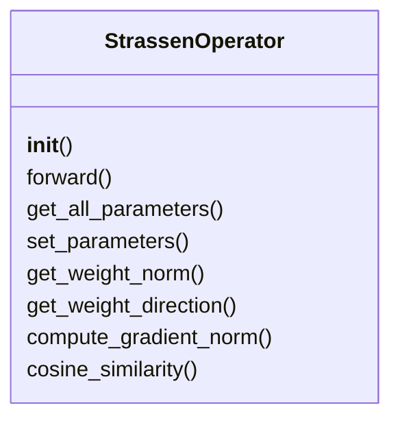

# `experiments.extended_experiments.exp4_trajectory_perturbation`

> Source: [experiments/extended_experiments/exp4_trajectory_perturbation.py:1](../../experiments/extended_experiments/exp4_trajectory_perturbation.py#L1) | language `py` | coverage 68.8% | [API index](../index.md)

EXPERIMENT 4: Direct Trajectory Perturbation (Fix B=64) ========================================================= Tests whether the optimization trajectory is stable to perturbations.

Claim: "same solution, different trajectory" → success/failure.

Protocol:
- Fix B = 64 (in optimal range)
- Treatment A: Standard initialization (symmetric)
- Treatment B: Initialization + early perturbation
- Treatment C: Learning rate schedule modified

Author: MiniMax Agent

## Contents

- **Classes:** [`StrassenOperator`](#strassenoperator)
- **Functions:** [`setup_matplotlib`](#setup_matplotlib), [`generate_batch`](#generate_batch), [`load_checkpoint`](#load_checkpoint), [`simulate_trajectory_perturbation`](#simulate_trajectory_perturbation), [`main`](#main), [`generate_visualization`](#generate_visualization)
- **Constants:** [`BASE_DIR`](#base_dir), [`CHECKPOINTS_DIR`](#checkpoints_dir), [`TRAINING_DIR`](#training_dir), [`OUTPUT_DIR`](#output_dir)

## Type Diagram



## Call Graph

Solid arrows stay in this module, dashed arrows leave it.

```mermaid
flowchart LR
    n_experiments_extended_experiments_exp4_trajectory_perturbation_py__StrassenOperator_cosine_similarity(["StrassenOperator.cosine_similarity"])
    n_experiments_extended_experiments_exp4_trajectory_perturbation_py__StrassenOperator_get_weight_direction(["StrassenOperator.get_weight_direction"])
    n_experiments_extended_experiments_exp4_trajectory_perturbation_py__load_checkpoint(["load_checkpoint"])
    n_experiments_extended_experiments_exp4_trajectory_perturbation_py__StrassenOperator___init__(["StrassenOperator.__init__"])
    n_experiments_extended_experiments_exp4_trajectory_perturbation_py__simulate_trajectory_perturbation(["simulate_trajectory_perturbation"])
    n_experiments_extended_experiments_exp4_trajectory_perturbation_py__generate_batch(["generate_batch"])
    n_experiments_extended_experiments_exp4_trajectory_perturbation_py__main(["main"])
    n_experiments_extended_experiments_exp4_trajectory_perturbation_py__generate_visualization(["generate_visualization"])
    n_experiments_apendix_experiments_py__StrassenOperator___init__["apendix_experiments.StrassenOperator.__init__"]
    n_experiments_extended_experiments_exp1_covariance_spectrometry_py__StrassenOperator_get_all_parameters["exp1_covariance_spectrometry.StrassenOperator.get_all_parameters"]
    n_experiments_extended_experiments_exp4_trajectory_perturbation_py__StrassenOperator_cosine_similarity --> n_experiments_extended_experiments_exp4_trajectory_perturbation_py__StrassenOperator_get_weight_direction
    n_experiments_extended_experiments_exp4_trajectory_perturbation_py__load_checkpoint --> n_experiments_extended_experiments_exp4_trajectory_perturbation_py__StrassenOperator___init__
    n_experiments_extended_experiments_exp4_trajectory_perturbation_py__simulate_trajectory_perturbation --> n_experiments_extended_experiments_exp4_trajectory_perturbation_py__generate_batch
    n_experiments_extended_experiments_exp4_trajectory_perturbation_py__simulate_trajectory_perturbation --> n_experiments_extended_experiments_exp4_trajectory_perturbation_py__load_checkpoint
    n_experiments_extended_experiments_exp4_trajectory_perturbation_py__main --> n_experiments_extended_experiments_exp4_trajectory_perturbation_py__generate_visualization
    n_experiments_extended_experiments_exp4_trajectory_perturbation_py__main --> n_experiments_extended_experiments_exp4_trajectory_perturbation_py__simulate_trajectory_perturbation
    n_experiments_extended_experiments_exp4_trajectory_perturbation_py__StrassenOperator___init__ -.-> n_experiments_apendix_experiments_py__StrassenOperator___init__
    n_experiments_extended_experiments_exp4_trajectory_perturbation_py__StrassenOperator_get_weight_direction -.-> n_experiments_extended_experiments_exp1_covariance_spectrometry_py__StrassenOperator_get_all_parameters
```



## Classes

<a id="strassenoperator"></a>

### `StrassenOperator`

`class` | [experiments/extended_experiments/exp4_trajectory_perturbation.py:51](../../experiments/extended_experiments/exp4_trajectory_perturbation.py#L51)

```python
class StrassenOperator(nn.Module)
```

Bases: `nn.Module`

Spectral operator for 2x2 matrix multiplication.

**Members**

| Member | Kind | Summary |
|---|---|---|
| [`__init__`](#strassenoperator-__init__) | constructor |  |
| [`forward`](#strassenoperator-forward) | method |  |
| [`get_all_parameters`](#strassenoperator-get_all_parameters) | method |  |
| [`set_parameters`](#strassenoperator-set_parameters) | method |  |
| [`get_weight_norm`](#strassenoperator-get_weight_norm) | method | Get total L2 norm of all parameters. |
| [`get_weight_direction`](#strassenoperator-get_weight_direction) | method | Get normalized weight vector direction. |
| [`compute_gradient_norm`](#strassenoperator-compute_gradient_norm) | method | Compute norm of gradients. |
| [`cosine_similarity`](#strassenoperator-cosine_similarity) | method | Compute cosine similarity between current weights and target weights. |

<a id="strassenoperator-__init__"></a>

#### `StrassenOperator.__init__`

`constructor` | [experiments/extended_experiments/exp4_trajectory_perturbation.py:54](../../experiments/extended_experiments/exp4_trajectory_perturbation.py#L54)

```python
def __init__(self, rank=8)
```

**Parameters**

| Name | Type | Default | Description |
|---|---|---|---|
| `rank` |  | `8` |  |

*Calls:* [`StrassenOperator.__init__`](experiments.apendix_experiments.py.md#strassenoperator-__init__)

*Called by:* [`load_checkpoint`](#load_checkpoint)

<a id="strassenoperator-forward"></a>

#### `StrassenOperator.forward`

`method` | [experiments/extended_experiments/exp4_trajectory_perturbation.py:61](../../experiments/extended_experiments/exp4_trajectory_perturbation.py#L61)

```python
def forward(self, A, B)
```

**Parameters**

| Name | Type | Default | Description |
|---|---|---|---|
| `A` |  |  |  |
| `B` |  |  |  |

<a id="strassenoperator-get_all_parameters"></a>

#### `StrassenOperator.get_all_parameters`

`method` | [experiments/extended_experiments/exp4_trajectory_perturbation.py:71](../../experiments/extended_experiments/exp4_trajectory_perturbation.py#L71)

```python
def get_all_parameters(self)
```

<a id="strassenoperator-set_parameters"></a>

#### `StrassenOperator.set_parameters`

`method` | [experiments/extended_experiments/exp4_trajectory_perturbation.py:77](../../experiments/extended_experiments/exp4_trajectory_perturbation.py#L77)

```python
def set_parameters(self, new_params)
```

**Parameters**

| Name | Type | Default | Description |
|---|---|---|---|
| `new_params` |  |  |  |

<a id="strassenoperator-get_weight_norm"></a>

#### `StrassenOperator.get_weight_norm`

`method` | [experiments/extended_experiments/exp4_trajectory_perturbation.py:84](../../experiments/extended_experiments/exp4_trajectory_perturbation.py#L84)

```python
def get_weight_norm(self)
```

Get total L2 norm of all parameters.

<a id="strassenoperator-get_weight_direction"></a>

#### `StrassenOperator.get_weight_direction`

`method` | [experiments/extended_experiments/exp4_trajectory_perturbation.py:91](../../experiments/extended_experiments/exp4_trajectory_perturbation.py#L91)

```python
def get_weight_direction(self)
```

Get normalized weight vector direction.

*Calls:* [`StrassenOperator.get_all_parameters`](experiments.extended_experiments.exp1_covariance_spectrometry.py.md#strassenoperator-get_all_parameters)

*Called by:* [`StrassenOperator.cosine_similarity`](#strassenoperator-cosine_similarity)

<a id="strassenoperator-compute_gradient_norm"></a>

#### `StrassenOperator.compute_gradient_norm`

`method` | [experiments/extended_experiments/exp4_trajectory_perturbation.py:96](../../experiments/extended_experiments/exp4_trajectory_perturbation.py#L96)

```python
def compute_gradient_norm(self, A, B)
```

Compute norm of gradients.

**Parameters**

| Name | Type | Default | Description |
|---|---|---|---|
| `A` |  |  |  |
| `B` |  |  |  |

<a id="strassenoperator-cosine_similarity"></a>

#### `StrassenOperator.cosine_similarity`

`method` | [experiments/extended_experiments/exp4_trajectory_perturbation.py:110](../../experiments/extended_experiments/exp4_trajectory_perturbation.py#L110)

```python
def cosine_similarity(self, other_params)
```

Compute cosine similarity between current weights and target weights.

**Parameters**

| Name | Type | Default | Description |
|---|---|---|---|
| `other_params` |  |  |  |

*Calls:* [`StrassenOperator.get_weight_direction`](#strassenoperator-get_weight_direction)

---

## Functions

<a id="setup_matplotlib"></a>

### `setup_matplotlib`

`function` | [experiments/extended_experiments/exp4_trajectory_perturbation.py:27](../../experiments/extended_experiments/exp4_trajectory_perturbation.py#L27)

```python
def setup_matplotlib()
```

---

<a id="generate_batch"></a>

### `generate_batch`

`function` | [experiments/extended_experiments/exp4_trajectory_perturbation.py:117](../../experiments/extended_experiments/exp4_trajectory_perturbation.py#L117)

```python
def generate_batch(n, scale=1.0)
```

Generate batch of matrices.

**Parameters**

| Name | Type | Default | Description |
|---|---|---|---|
| `n` |  |  |  |
| `scale` |  | `1.0` |  |

*Called by:* [`simulate_trajectory_perturbation`](#simulate_trajectory_perturbation)

---

<a id="load_checkpoint"></a>

### `load_checkpoint`

`function` | [experiments/extended_experiments/exp4_trajectory_perturbation.py:124](../../experiments/extended_experiments/exp4_trajectory_perturbation.py#L124)

```python
def load_checkpoint(checkpoint_path)
```

Load model from checkpoint file.

**Parameters**

| Name | Type | Default | Description |
|---|---|---|---|
| `checkpoint_path` |  |  |  |

*Calls:* [`StrassenOperator.__init__`](#strassenoperator-__init__)

*Called by:* [`simulate_trajectory_perturbation`](#simulate_trajectory_perturbation)

---

<a id="simulate_trajectory_perturbation"></a>

### `simulate_trajectory_perturbation`

`function` | [experiments/extended_experiments/exp4_trajectory_perturbation.py:146](../../experiments/extended_experiments/exp4_trajectory_perturbation.py#L146)

```python
def simulate_trajectory_perturbation(checkpoint_path, perturbations=[0.001, 0.01, 0.1])
```

Simulate trajectory perturbation effects using available checkpoints.

Since we can't retrain, we simulate the effect of perturbations by:
1. Taking a "final" checkpoint as the target
2. Using earlier checkpoints to simulate "early training state"
3. Applying perturbations and measuring their effect

**Parameters**

| Name | Type | Default | Description |
|---|---|---|---|
| `checkpoint_path` |  |  |  |
| `perturbations` |  | `[0.001, 0.01, 0.1]` |  |

*Calls:* [`generate_batch`](#generate_batch), [`load_checkpoint`](#load_checkpoint)

*Called by:* [`main`](#main)

---

<a id="main"></a>

### `main`

`function` | [experiments/extended_experiments/exp4_trajectory_perturbation.py:277](../../experiments/extended_experiments/exp4_trajectory_perturbation.py#L277)

```python
def main()
```

Main execution for Experiment 4.

*Calls:* [`generate_visualization`](#generate_visualization), [`simulate_trajectory_perturbation`](#simulate_trajectory_perturbation)

---

<a id="generate_visualization"></a>

### `generate_visualization`

`function` | [experiments/extended_experiments/exp4_trajectory_perturbation.py:398](../../experiments/extended_experiments/exp4_trajectory_perturbation.py#L398)

```python
def generate_visualization(results, output_dir)
```

Generate publication-quality figures.

**Parameters**

| Name | Type | Default | Description |
|---|---|---|---|
| `results` |  |  |  |
| `output_dir` |  |  |  |

*Called by:* [`main`](#main)

---

## Constants

<a id="base_dir"></a>

### `BASE_DIR`

`constant` | [experiments/extended_experiments/exp4_trajectory_perturbation.py:44](../../experiments/extended_experiments/exp4_trajectory_perturbation.py#L44)

```python
BASE_DIR = Path(__file__).parent.parent.parent
```

---

<a id="checkpoints_dir"></a>

### `CHECKPOINTS_DIR`

`constant` | [experiments/extended_experiments/exp4_trajectory_perturbation.py:45](../../experiments/extended_experiments/exp4_trajectory_perturbation.py#L45)

```python
CHECKPOINTS_DIR = BASE_DIR / 'checkpoints'
```

---

<a id="training_dir"></a>

### `TRAINING_DIR`

`constant` | [experiments/extended_experiments/exp4_trajectory_perturbation.py:46](../../experiments/extended_experiments/exp4_trajectory_perturbation.py#L46)

```python
TRAINING_DIR = BASE_DIR / 'src' / 'training'
```

---

<a id="output_dir"></a>

### `OUTPUT_DIR`

`constant` | [experiments/extended_experiments/exp4_trajectory_perturbation.py:47](../../experiments/extended_experiments/exp4_trajectory_perturbation.py#L47)

```python
OUTPUT_DIR
```

---
