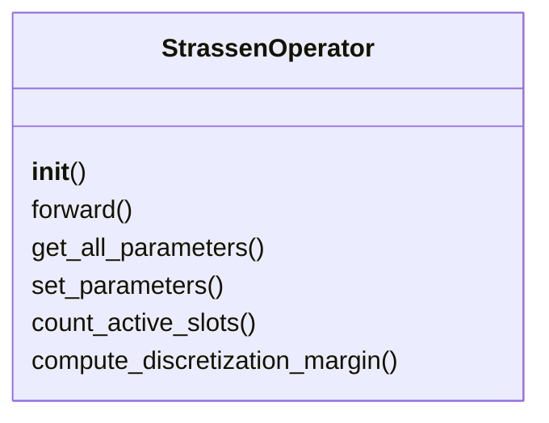
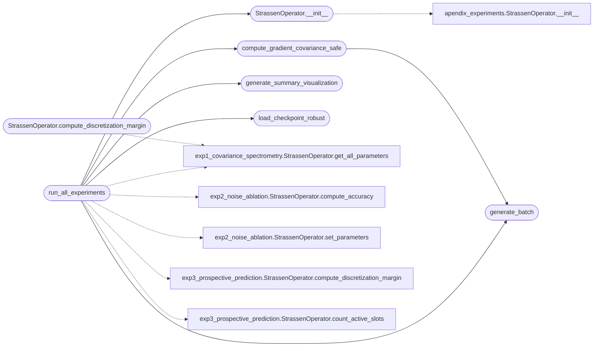

# `experiments.extended_experiments.run_all_experiments`

> Source: [experiments/extended_experiments/run_all_experiments.py:1](../../experiments/extended_experiments/run_all_experiments.py#L1) | language `py` | coverage 42.9% | [API index](../index.md)

Robust Runner for Reviewer Experiments ======================================= Handles various checkpoint formats and numerical issues.

## Contents

- **Classes:** [`StrassenOperator`](#strassenoperator)
- **Functions:** [`setup_matplotlib`](#setup_matplotlib), [`generate_batch`](#generate_batch), [`load_checkpoint_robust`](#load_checkpoint_robust), [`compute_gradient_covariance_safe`](#compute_gradient_covariance_safe), [`run_all_experiments`](#run_all_experiments), [`generate_summary_visualization`](#generate_summary_visualization)
- **Constants:** [`PROJECT_ROOT`](#project_root), [`BASE_DIR`](#base_dir), [`CHECKPOINTS_DIR`](#checkpoints_dir), [`TRAINING_DIR`](#training_dir), [`OUTPUT_DIR`](#output_dir)

## Type Diagram



## Call Graph

Solid arrows stay in this module, dashed arrows leave it.



## Classes

<a id="strassenoperator"></a>

### `StrassenOperator`

`class` | [experiments/extended_experiments/run_all_experiments.py:48](../../experiments/extended_experiments/run_all_experiments.py#L48)

```python
class StrassenOperator(nn.Module)
```

Bases: `nn.Module`

Spectral operator for 2x2 matrix multiplication.

**Members**

| Member | Kind | Summary |
|---|---|---|
| [`__init__`](#strassenoperator-__init__) | constructor |  |
| [`forward`](#strassenoperator-forward) | method |  |
| [`get_all_parameters`](#strassenoperator-get_all_parameters) | method |  |
| [`set_parameters`](#strassenoperator-set_parameters) | method |  |
| [`count_active_slots`](#strassenoperator-count_active_slots) | method |  |
| [`compute_discretization_margin`](#strassenoperator-compute_discretization_margin) | method |  |

<a id="strassenoperator-__init__"></a>

#### `StrassenOperator.__init__`

`constructor` | [experiments/extended_experiments/run_all_experiments.py:51](../../experiments/extended_experiments/run_all_experiments.py#L51)

```python
def __init__(self, rank=8)
```

**Parameters**

| Name | Type | Default | Description |
|---|---|---|---|
| `rank` |  | `8` |  |

*Calls:* [`StrassenOperator.__init__`](experiments.apendix_experiments.py.md#strassenoperator-__init__)

*Called by:* [`run_all_experiments`](#run_all_experiments)

<a id="strassenoperator-forward"></a>

#### `StrassenOperator.forward`

`method` | [experiments/extended_experiments/run_all_experiments.py:58](../../experiments/extended_experiments/run_all_experiments.py#L58)

```python
def forward(self, A, B)
```

**Parameters**

| Name | Type | Default | Description |
|---|---|---|---|
| `A` |  |  |  |
| `B` |  |  |  |

<a id="strassenoperator-get_all_parameters"></a>

#### `StrassenOperator.get_all_parameters`

`method` | [experiments/extended_experiments/run_all_experiments.py:68](../../experiments/extended_experiments/run_all_experiments.py#L68)

```python
def get_all_parameters(self)
```

<a id="strassenoperator-set_parameters"></a>

#### `StrassenOperator.set_parameters`

`method` | [experiments/extended_experiments/run_all_experiments.py:74](../../experiments/extended_experiments/run_all_experiments.py#L74)

```python
def set_parameters(self, new_params)
```

**Parameters**

| Name | Type | Default | Description |
|---|---|---|---|
| `new_params` |  |  |  |

<a id="strassenoperator-count_active_slots"></a>

#### `StrassenOperator.count_active_slots`

`method` | [experiments/extended_experiments/run_all_experiments.py:81](../../experiments/extended_experiments/run_all_experiments.py#L81)

```python
def count_active_slots(self, threshold=0.1)
```

**Parameters**

| Name | Type | Default | Description |
|---|---|---|---|
| `threshold` |  | `0.1` |  |

<a id="strassenoperator-compute_discretization_margin"></a>

#### `StrassenOperator.compute_discretization_margin`

`method` | [experiments/extended_experiments/run_all_experiments.py:88](../../experiments/extended_experiments/run_all_experiments.py#L88)

```python
def compute_discretization_margin(self)
```

*Calls:* [`StrassenOperator.get_all_parameters`](experiments.extended_experiments.exp1_covariance_spectrometry.py.md#strassenoperator-get_all_parameters)

---

## Functions

<a id="setup_matplotlib"></a>

### `setup_matplotlib`

`function` | [experiments/extended_experiments/run_all_experiments.py:24](../../experiments/extended_experiments/run_all_experiments.py#L24)

```python
def setup_matplotlib()
```

---

<a id="generate_batch"></a>

### `generate_batch`

`function` | [experiments/extended_experiments/run_all_experiments.py:95](../../experiments/extended_experiments/run_all_experiments.py#L95)

```python
def generate_batch(n, scale=1.0)
```

**Parameters**

| Name | Type | Default | Description |
|---|---|---|---|
| `n` |  |  |  |
| `scale` |  | `1.0` |  |

*Called by:* [`compute_gradient_covariance_safe`](#compute_gradient_covariance_safe), [`run_all_experiments`](#run_all_experiments)

---

<a id="load_checkpoint_robust"></a>

### `load_checkpoint_robust`

`function` | [experiments/extended_experiments/run_all_experiments.py:101](../../experiments/extended_experiments/run_all_experiments.py#L101)

```python
def load_checkpoint_robust(checkpoint_path, model)
```

Load checkpoint with multiple format fallback strategies.

**Parameters**

| Name | Type | Default | Description |
|---|---|---|---|
| `checkpoint_path` |  |  |  |
| `model` |  |  |  |

*Called by:* [`run_all_experiments`](#run_all_experiments)

---

<a id="compute_gradient_covariance_safe"></a>

### `compute_gradient_covariance_safe`

`function` | [experiments/extended_experiments/run_all_experiments.py:135](../../experiments/extended_experiments/run_all_experiments.py#L135)

```python
def compute_gradient_covariance_safe(model, batch_size=64, n_samples=64)
```

Compute κ(Σₜ) with numerical safety.

**Parameters**

| Name | Type | Default | Description |
|---|---|---|---|
| `model` |  |  |  |
| `batch_size` |  | `64` |  |
| `n_samples` |  | `64` |  |

*Calls:* [`generate_batch`](#generate_batch)

*Called by:* [`run_all_experiments`](#run_all_experiments)

---

<a id="run_all_experiments"></a>

### `run_all_experiments`

`function` | [experiments/extended_experiments/run_all_experiments.py:205](../../experiments/extended_experiments/run_all_experiments.py#L205)

```python
def run_all_experiments()
```

Run all experiments.

*Calls:* [`StrassenOperator.get_all_parameters`](experiments.extended_experiments.exp1_covariance_spectrometry.py.md#strassenoperator-get_all_parameters), [`StrassenOperator.compute_accuracy`](experiments.extended_experiments.exp2_noise_ablation.py.md#strassenoperator-compute_accuracy), [`StrassenOperator.set_parameters`](experiments.extended_experiments.exp2_noise_ablation.py.md#strassenoperator-set_parameters), [`StrassenOperator.compute_discretization_margin`](experiments.extended_experiments.exp3_prospective_prediction.py.md#strassenoperator-compute_discretization_margin), [`StrassenOperator.count_active_slots`](experiments.extended_experiments.exp3_prospective_prediction.py.md#strassenoperator-count_active_slots), [`StrassenOperator.__init__`](#strassenoperator-__init__), [`compute_gradient_covariance_safe`](#compute_gradient_covariance_safe), [`generate_batch`](#generate_batch), [`generate_summary_visualization`](#generate_summary_visualization), [`load_checkpoint_robust`](#load_checkpoint_robust)

---

<a id="generate_summary_visualization"></a>

### `generate_summary_visualization`

`function` | [experiments/extended_experiments/run_all_experiments.py:496](../../experiments/extended_experiments/run_all_experiments.py#L496)

```python
def generate_summary_visualization(results, output_dir)
```

Generate summary visualization.

**Parameters**

| Name | Type | Default | Description |
|---|---|---|---|
| `results` |  |  |  |
| `output_dir` |  |  |  |

*Called by:* [`run_all_experiments`](#run_all_experiments)

---

## Constants

<a id="project_root"></a>

### `PROJECT_ROOT`

`constant` | [experiments/extended_experiments/run_all_experiments.py:11](../../experiments/extended_experiments/run_all_experiments.py#L11)

```python
PROJECT_ROOT = os.path.dirname(os.path.dirname(os.path.dirname(os.path.abspath(__file__))))
```

---

<a id="base_dir"></a>

### `BASE_DIR`

`constant` | [experiments/extended_experiments/run_all_experiments.py:41](../../experiments/extended_experiments/run_all_experiments.py#L41)

```python
BASE_DIR = Path(PROJECT_ROOT)
```

---

<a id="checkpoints_dir"></a>

### `CHECKPOINTS_DIR`

`constant` | [experiments/extended_experiments/run_all_experiments.py:42](../../experiments/extended_experiments/run_all_experiments.py#L42)

```python
CHECKPOINTS_DIR = BASE_DIR / 'checkpoints'
```

---

<a id="training_dir"></a>

### `TRAINING_DIR`

`constant` | [experiments/extended_experiments/run_all_experiments.py:43](../../experiments/extended_experiments/run_all_experiments.py#L43)

```python
TRAINING_DIR = BASE_DIR / 'src' / 'training'
```

---

<a id="output_dir"></a>

### `OUTPUT_DIR`

`constant` | [experiments/extended_experiments/run_all_experiments.py:44](../../experiments/extended_experiments/run_all_experiments.py#L44)

```python
OUTPUT_DIR = BASE_DIR / 'experiments' / 'reviewer_experiments'
```

---
