# `experiments.extended_experiments.validate2`

> Source: [experiments/extended_experiments/validate2.py:1](../../experiments/extended_experiments/validate2.py#L1) | language `py` | coverage 84.1% | [API index](../index.md)

================================================================================ BATERÍA DE EXPERIMENTOS DE VALIDACIÓN - RESPUESTA A REVISOR ================================================================================

Script completo para validar los experimentos del paper usando checkpoints
PRE-GROKKED del repositorio strass_strassen.

Experimentos incluidos:
1. Local Complexity (LC) vs Época - Métrica de progreso
2. Poda Iterativa + Fine-tuning - Verificación de cuenca discreta (δ < 0.1)
3. Curvas ROC con Bootstrap CI - Validación estadística

El script usa checkpoints ya grokkeados (accuracy ≈ 100%) para evitar el
problema de entrenar desde cero modelos que nunca grokkean.

Autor: grisun0
Fecha: 2026-01-22
================================================================================

## Contents

- **Classes:** [`ExperimentConfig`](#experimentconfig), [`StrassenOperator`](#strassenoperator), [`StrassenDataGenerator`](#strassendatagenerator), [`LocalComplexityCalculator`](#localcomplexitycalculator), [`GrokkingVerifier`](#grokkingverifier), [`IterativePruningEngine`](#iterativepruningengine), [`LocalComplexityExperiment`](#localcomplexityexperiment), [`BalancedRunsGenerator`](#balancedrunsgenerator), [`BootstrapStatistics`](#bootstrapstatistics), [`VisualizationGenerator`](#visualizationgenerator), [`ExperimentOrchestrator`](#experimentorchestrator)
- **Functions:** [`find_grokked_checkpoint`](#find_grokked_checkpoint), [`analyze_checkpoints`](#analyze_checkpoints), [`main`](#main)
- **Constants:** [`SEED`](#seed)

## Type Diagram

```mermaid
classDiagram
    direction LR
    class ExperimentConfig
    ExperimentConfig : int rank
    ExperimentConfig : int matrix_size
    ExperimentConfig : int input_dim
    ExperimentConfig : int output_dim
    ExperimentConfig : int hidden_dim
    ExperimentConfig : float learning_rate
    ExperimentConfig : float weight_decay
    ExperimentConfig : int batch_size
    ExperimentConfig : int max_epochs
    ExperimentConfig : int prune_max_iterations
    ExperimentConfig : float prune_initial_percent
    ExperimentConfig : float prune_step_percent
    ExperimentConfig : int finetune_epochs
    ExperimentConfig : float finetune_lr
    ExperimentConfig : float delta_threshold
    ExperimentConfig : float discretization_threshold
    ExperimentConfig : List[float] discretization_values
    ExperimentConfig : int test_samples
    ExperimentConfig : float accuracy_threshold
    ExperimentConfig : float grokking_accuracy_threshold
    ExperimentConfig : int n_bootstrap
    ExperimentConfig : float confidence_level
    ExperimentConfig : int n_experiment_runs
    ExperimentConfig : int checkpoint_interval_minutes
    class StrassenOperator
    StrassenOperator : __init__()
    StrassenOperator : forward()
    StrassenOperator : slot_importance()
    StrassenOperator : count_active()
    StrassenOperator : compute_SP()
    StrassenOperator : get_state_dict()
    StrassenOperator : load_state_dict()
    class StrassenDataGenerator
    StrassenDataGenerator : __init__()
    StrassenDataGenerator : generate_matrix()
    StrassenDataGenerator : generate_data()
    StrassenDataGenerator : get_train_test()
    class LocalComplexityCalculator
    LocalComplexityCalculator : __init__()
    LocalComplexityCalculator : compute_lc()
    LocalComplexityCalculator : compute_batch_diversity()
    class GrokkingVerifier
    GrokkingVerifier : __init__()
    GrokkingVerifier : verify()
    class IterativePruningEngine
    IterativePruningEngine : __init__()
    IterativePruningEngine : get_weight_magnitudes()
    IterativePruningEngine : compute_sparsity()
    IterativePruningEngine : prune_percent()
    IterativePruningEngine : fine_tune()
    IterativePruningEngine : run_protocol()
    class LocalComplexityExperiment
    LocalComplexityExperiment : __init__()
    LocalComplexityExperiment : run_full_experiment()
    class BalancedRunsGenerator
    BalancedRunsGenerator : __init__()
    BalancedRunsGenerator : run_balanced_experiments()
    class BootstrapStatistics
    BootstrapStatistics : __init__()
    BootstrapStatistics : compute_roc_with_ci()
    BootstrapStatistics : compute_kappa_with_ci()
    BootstrapStatistics : compute_accuracy_with_ci()
    class VisualizationGenerator
    VisualizationGenerator : __init__()
    VisualizationGenerator : plot_local_complexity()
    VisualizationGenerator : plot_pruning_results()
    VisualizationGenerator : plot_roc_with_ci()
    VisualizationGenerator : plot_balanced_runs_results()
    VisualizationGenerator : plot_discretization_results()
    class ExperimentOrchestrator
    ExperimentOrchestrator : __init__()
    ExperimentOrchestrator : find_grokked_checkpoint()
    ExperimentOrchestrator : load_grokked_checkpoint()
    ExperimentOrchestrator : verify_checkpoint_is_grokked()
    ExperimentOrchestrator : run_local_complexity_experiment()
    ExperimentOrchestrator : run_lc_training_experiment()
    ExperimentOrchestrator : run_pruning_experiment()
    ExperimentOrchestrator : run_balanced_runs_experiment()
    ExperimentOrchestrator : run_roc_analysis()
    ExperimentOrchestrator : generate_summary_report()
    ExperimentOrchestrator : save_results()
    ExperimentOrchestrator : run_all_experiments()
```



## Call Graph

Solid arrows stay in this module, dashed arrows leave it.

```mermaid
flowchart LR
    n_experiments_extended_experiments_validate2_py__StrassenDataGenerator___init__(["StrassenDataGenerator.__init__"])
    n_experiments_extended_experiments_validate2_py__StrassenDataGenerator_generate_data(["StrassenDataGenerator.generate_data"])
    n_experiments_extended_experiments_validate2_py__StrassenDataGenerator_generate_matrix(["StrassenDataGenerator.generate_matrix"])
    n_experiments_extended_experiments_validate2_py__IterativePruningEngine___init__(["IterativePruningEngine.__init__"])
    n_experiments_extended_experiments_validate2_py__GrokkingVerifier___init__(["GrokkingVerifier.__init__"])
    n_experiments_extended_experiments_validate2_py__IterativePruningEngine_prune_percent(["IterativePruningEngine.prune_percent"])
    n_experiments_extended_experiments_validate2_py__IterativePruningEngine_compute_sparsity(["IterativePruningEngine.compute_sparsity"])
    n_experiments_extended_experiments_validate2_py__IterativePruningEngine_get_weight_magnitudes(["IterativePruningEngine.get_weight_magnitudes"])
    n_experiments_extended_experiments_validate2_py__IterativePruningEngine_run_protocol(["IterativePruningEngine.run_protocol"])
    n_experiments_extended_experiments_validate2_py__GrokkingVerifier_verify(["GrokkingVerifier.verify"])
    n_experiments_extended_experiments_validate2_py__IterativePruningEngine_fine_tune(["IterativePruningEngine.fine_tune"])
    n_experiments_extended_experiments_validate2_py__LocalComplexityExperiment_run_full_experiment(["LocalComplexityExperiment.run_full_experiment"])
    n_experiments_extended_experiments_validate2_py__LocalComplexityCalculator___init__(["LocalComplexityCalculator.__init__"])
    n_experiments_extended_experiments_validate2_py__LocalComplexityCalculator_compute_lc(["LocalComplexityCalculator.compute_lc"])
    n_experiments_extended_experiments_validate2_py__StrassenOperator___init__(["StrassenOperator.__init__"])
    n_experiments_extended_experiments_validate2_py__ExperimentOrchestrator___init__(["ExperimentOrchestrator.__init__"])
    n_experiments_extended_experiments_validate2_py__BalancedRunsGenerator___init__(["BalancedRunsGenerator.__init__"])
    n_experiments_extended_experiments_validate2_py__BootstrapStatistics___init__(["BootstrapStatistics.__init__"])
    n_experiments_extended_experiments_validate2_py__LocalComplexityExperiment___init__(["LocalComplexityExperiment.__init__"])
    n_experiments_extended_experiments_validate2_py__VisualizationGenerator___init__(["VisualizationGenerator.__init__"])
    n_experiments_extended_experiments_validate2_py__ExperimentOrchestrator_load_grokked_checkpoint(["ExperimentOrchestrator.load_grokked_checkpoint"])
    n_experiments_extended_experiments_validate2_py__ExperimentOrchestrator_verify_checkpoint_is_grokked(["ExperimentOrchestrator.verify_checkpoint_is_grokked"])
    n_experiments_extended_experiments_validate2_py__ExperimentOrchestrator_run_local_complexity_experiment(["ExperimentOrchestrator.run_local_complexity_experiment"])
    n_experiments_extended_experiments_validate2_py__StrassenDataGenerator___init__ --> n_experiments_extended_experiments_validate2_py__StrassenDataGenerator_generate_data
    n_experiments_extended_experiments_validate2_py__StrassenDataGenerator_generate_data --> n_experiments_extended_experiments_validate2_py__StrassenDataGenerator_generate_matrix
    n_experiments_extended_experiments_validate2_py__IterativePruningEngine___init__ --> n_experiments_extended_experiments_validate2_py__GrokkingVerifier___init__
    n_experiments_extended_experiments_validate2_py__IterativePruningEngine_prune_percent --> n_experiments_extended_experiments_validate2_py__IterativePruningEngine_compute_sparsity
    n_experiments_extended_experiments_validate2_py__IterativePruningEngine_prune_percent --> n_experiments_extended_experiments_validate2_py__IterativePruningEngine_get_weight_magnitudes
    n_experiments_extended_experiments_validate2_py__IterativePruningEngine_run_protocol --> n_experiments_extended_experiments_validate2_py__GrokkingVerifier___init__
    n_experiments_extended_experiments_validate2_py__IterativePruningEngine_run_protocol --> n_experiments_extended_experiments_validate2_py__GrokkingVerifier_verify
    n_experiments_extended_experiments_validate2_py__IterativePruningEngine_run_protocol --> n_experiments_extended_experiments_validate2_py__IterativePruningEngine_compute_sparsity
    n_experiments_extended_experiments_validate2_py__IterativePruningEngine_run_protocol --> n_experiments_extended_experiments_validate2_py__IterativePruningEngine_fine_tune
    n_experiments_extended_experiments_validate2_py__IterativePruningEngine_run_protocol --> n_experiments_extended_experiments_validate2_py__IterativePruningEngine_prune_percent
    n_experiments_extended_experiments_validate2_py__LocalComplexityExperiment_run_full_experiment --> n_experiments_extended_experiments_validate2_py__LocalComplexityCalculator___init__
    n_experiments_extended_experiments_validate2_py__LocalComplexityExperiment_run_full_experiment --> n_experiments_extended_experiments_validate2_py__LocalComplexityCalculator_compute_lc
    n_experiments_extended_experiments_validate2_py__LocalComplexityExperiment_run_full_experiment --> n_experiments_extended_experiments_validate2_py__StrassenDataGenerator___init__
    n_experiments_extended_experiments_validate2_py__LocalComplexityExperiment_run_full_experiment --> n_experiments_extended_experiments_validate2_py__StrassenOperator___init__
    n_experiments_extended_experiments_validate2_py__ExperimentOrchestrator___init__ --> n_experiments_extended_experiments_validate2_py__BalancedRunsGenerator___init__
    n_experiments_extended_experiments_validate2_py__ExperimentOrchestrator___init__ --> n_experiments_extended_experiments_validate2_py__BootstrapStatistics___init__
    n_experiments_extended_experiments_validate2_py__ExperimentOrchestrator___init__ --> n_experiments_extended_experiments_validate2_py__GrokkingVerifier___init__
    n_experiments_extended_experiments_validate2_py__ExperimentOrchestrator___init__ --> n_experiments_extended_experiments_validate2_py__IterativePruningEngine___init__
    n_experiments_extended_experiments_validate2_py__ExperimentOrchestrator___init__ --> n_experiments_extended_experiments_validate2_py__LocalComplexityExperiment___init__
    n_experiments_extended_experiments_validate2_py__ExperimentOrchestrator___init__ --> n_experiments_extended_experiments_validate2_py__VisualizationGenerator___init__
    n_experiments_extended_experiments_validate2_py__ExperimentOrchestrator_load_grokked_checkpoint --> n_experiments_extended_experiments_validate2_py__StrassenOperator___init__
    n_experiments_extended_experiments_validate2_py__ExperimentOrchestrator_verify_checkpoint_is_grokked --> n_experiments_extended_experiments_validate2_py__GrokkingVerifier_verify
    n_experiments_extended_experiments_validate2_py__ExperimentOrchestrator_run_local_complexity_experiment --> n_experiments_extended_experiments_validate2_py__LocalComplexityCalculator___init__
    n_experiments_extended_experiments_validate2_py__ExperimentOrchestrator_run_local_complexity_experiment --> n_experiments_extended_experiments_validate2_py__LocalComplexityCalculator_compute_lc
```



## Classes

<a id="experimentconfig"></a>

### `ExperimentConfig`

`class` `dataclass` | [experiments/extended_experiments/validate2.py:60](../../experiments/extended_experiments/validate2.py#L60)

Decorators: `@dataclass`

```python
class ExperimentConfig
```

Configuración centralizada para todos los experimentos.

Sigue el principio de responsabilidad única - solo gestiona parámetros.
No usa magic numbers; todos los valores están definidos aquí.

**Attributes**

| Name | Type | Default | Description |
|---|---|---|---|
| [`rank`](#experimentconfig-rank) | `int` | `8` |  |
| [`matrix_size`](#experimentconfig-matrix_size) | `int` | `2` |  |
| [`input_dim`](#experimentconfig-input_dim) | `int` | `8` |  |
| [`output_dim`](#experimentconfig-output_dim) | `int` | `4` |  |
| [`hidden_dim`](#experimentconfig-hidden_dim) | `int` | `128` |  |
| [`learning_rate`](#experimentconfig-learning_rate) | `float` | `0.02` |  |
| [`weight_decay`](#experimentconfig-weight_decay) | `float` | `0.0001` |  |
| [`batch_size`](#experimentconfig-batch_size) | `int` | `256` |  |
| [`max_epochs`](#experimentconfig-max_epochs) | `int` | `6000` |  |
| [`prune_max_iterations`](#experimentconfig-prune_max_iterations) | `int` | `60` |  |
| [`prune_initial_percent`](#experimentconfig-prune_initial_percent) | `float` | `10.0` |  |
| [`prune_step_percent`](#experimentconfig-prune_step_percent) | `float` | `5.0` |  |
| [`finetune_epochs`](#experimentconfig-finetune_epochs) | `int` | `200` |  |
| [`finetune_lr`](#experimentconfig-finetune_lr) | `float` | `0.005` |  |
| [`delta_threshold`](#experimentconfig-delta_threshold) | `float` | `0.1` |  |
| [`discretization_threshold`](#experimentconfig-discretization_threshold) | `float` | `0.5` |  |
| [`discretization_values`](#experimentconfig-discretization_values) | `List[float]` | `None` |  |
| [`test_samples`](#experimentconfig-test_samples) | `int` | `10000` |  |
| [`accuracy_threshold`](#experimentconfig-accuracy_threshold) | `float` | `0.001` |  |
| [`grokking_accuracy_threshold`](#experimentconfig-grokking_accuracy_threshold) | `float` | `99.9` |  |
| [`n_bootstrap`](#experimentconfig-n_bootstrap) | `int` | `1000` |  |
| [`confidence_level`](#experimentconfig-confidence_level) | `float` | `0.95` |  |
| [`n_experiment_runs`](#experimentconfig-n_experiment_runs) | `int` | `60` |  |
| [`checkpoint_interval_minutes`](#experimentconfig-checkpoint_interval_minutes) | `int` | `5` |  |
| [`checkpoint_dir`](#experimentconfig-checkpoint_dir) | `str` | `'checkpoints'` |  |
| [`eval_interval`](#experimentconfig-eval_interval) | `int` | `100` |  |
| [`log_interval`](#experimentconfig-log_interval) | `int` | `500` |  |
| [`use_gpu_if_available`](#experimentconfig-use_gpu_if_available) | `bool` | `True` |  |

---

<a id="strassenoperator"></a>

### `StrassenOperator`

`class` | [experiments/extended_experiments/validate2.py:126](../../experiments/extended_experiments/validate2.py#L126)

```python
class StrassenOperator(nn.Module)
```

Bases: `nn.Module`

Operador Strassen para multiplicación de matrices 2x2 vía descomposición tensorial.

El modelo representa el tensor de rango R:
C_ij = Σ_r W[ij,r] * (U[r,:] · a) * (V[r,:] · b)

Donde:
- U, V: Coeficientes de combinación lineal (LC)
- W: Coeficientes de reconstrucción
- Sparsity (SP): Cuántos slots están activos

**Members**

| Member | Kind | Summary |
|---|---|---|
| [`__init__`](#strassenoperator-__init__) | constructor |  |
| [`forward`](#strassenoperator-forward) | method | Computar A @ B usando descomposición tensorial. |
| [`slot_importance`](#strassenoperator-slot_importance) | method | Importancia de cada slot basada en normas. |
| [`count_active`](#strassenoperator-count_active) | method | Contar slots activos. |
| [`compute_SP`](#strassenoperator-compute_sp) | method | Métrica de Sparsity. |
| [`get_state_dict`](#strassenoperator-get_state_dict) | method | Obtener estado completo para checkpointing. |
| [`load_state_dict`](#strassenoperator-load_state_dict) | method | Cargar estado completo desde checkpoint. |

<a id="strassenoperator-__init__"></a>

#### `StrassenOperator.__init__`

`constructor` | [experiments/extended_experiments/validate2.py:139](../../experiments/extended_experiments/validate2.py#L139)

```python
def __init__(self, rank: int = 8)
```

**Parameters**

| Name | Type | Default | Description |
|---|---|---|---|
| `rank` | `int` | `8` |  |

*Calls:* [`StrassenOperator.__init__`](experiments.apendix_experiments.py.md#strassenoperator-__init__)

*Called by:* [`ExperimentOrchestrator.load_grokked_checkpoint`](#experimentorchestrator-load_grokked_checkpoint), [`ExperimentOrchestrator.run_pruning_experiment`](#experimentorchestrator-run_pruning_experiment), [`LocalComplexityExperiment.run_full_experiment`](#localcomplexityexperiment-run_full_experiment), [`analyze_checkpoints`](#analyze_checkpoints)

<a id="strassenoperator-forward"></a>

#### `StrassenOperator.forward`

`method` | [experiments/extended_experiments/validate2.py:156](../../experiments/extended_experiments/validate2.py#L156)

```python
def forward(self, A: torch.Tensor, B: torch.Tensor) -> torch.Tensor
```

Computar A @ B usando descomposición tensorial.

**Parameters**

| Name | Type | Default | Description |
|---|---|---|---|
| `A` | `torch.Tensor` |  | Tensor de entrada de forma (batch, 2, 2) |
| `B` | `torch.Tensor` |  | Tensor de entrada de forma (batch, 2, 2) |

**Returns:** `torch.Tensor` - Tensor de salida de forma (batch, 2, 2)

<a id="strassenoperator-slot_importance"></a>

#### `StrassenOperator.slot_importance`

`method` | [experiments/extended_experiments/validate2.py:183](../../experiments/extended_experiments/validate2.py#L183)

```python
def slot_importance(self) -> torch.Tensor
```

Importancia de cada slot basada en normas.

**Returns:** `torch.Tensor`

<a id="strassenoperator-count_active"></a>

#### `StrassenOperator.count_active`

`method` | [experiments/extended_experiments/validate2.py:190](../../experiments/extended_experiments/validate2.py#L190)

```python
def count_active(self, threshold: float = 0.1) -> int
```

Contar slots activos.

**Parameters**

| Name | Type | Default | Description |
|---|---|---|---|
| `threshold` | `float` | `0.1` |  |

**Returns:** `int`

*Calls:* [`StrassenOperator.slot_importance`](experiments.apendix_experiments.py.md#strassenoperator-slot_importance)

<a id="strassenoperator-compute_sp"></a>

#### `StrassenOperator.compute_SP`

`method` | [experiments/extended_experiments/validate2.py:194](../../experiments/extended_experiments/validate2.py#L194)

```python
def compute_SP(self) -> torch.Tensor
```

Métrica de Sparsity.

SP -> 0 significa máxima sparsity.

**Returns:** `torch.Tensor`

*Calls:* [`StrassenOperator.slot_importance`](experiments.apendix_experiments.py.md#strassenoperator-slot_importance)

<a id="strassenoperator-get_state_dict"></a>

#### `StrassenOperator.get_state_dict`

`method` | [experiments/extended_experiments/validate2.py:202](../../experiments/extended_experiments/validate2.py#L202)

```python
def get_state_dict(self) -> Dict[str, Any]
```

Obtener estado completo para checkpointing.

**Returns:** `Dict[str, Any]`

<a id="strassenoperator-load_state_dict"></a>

#### `StrassenOperator.load_state_dict`

`method` | [experiments/extended_experiments/validate2.py:211](../../experiments/extended_experiments/validate2.py#L211)

```python
def load_state_dict(self, state_dict: Dict[str, Any]) -> None
```

Cargar estado completo desde checkpoint.

**Parameters**

| Name | Type | Default | Description |
|---|---|---|---|
| `state_dict` | `Dict[str, Any]` |  |  |

---

<a id="strassendatagenerator"></a>

### `StrassenDataGenerator`

`class` | [experiments/extended_experiments/validate2.py:225](../../experiments/extended_experiments/validate2.py#L225)

```python
class StrassenDataGenerator
```

Generador de datos para multiplicación de matrices 2x2.

**Members**

| Member | Kind | Summary |
|---|---|---|
| [`__init__`](#strassendatagenerator-__init__) | constructor |  |
| [`generate_matrix`](#strassendatagenerator-generate_matrix) | method | Generar matriz aleatoria con valores enteros. |
| [`generate_data`](#strassendatagenerator-generate_data) | method | Generar pares de matrices y sus productos. |
| [`get_train_test`](#strassendatagenerator-get_train_test) | method | Dividir en conjuntos de entrenamiento y prueba. |

<a id="strassendatagenerator-__init__"></a>

#### `StrassenDataGenerator.__init__`

`constructor` | [experiments/extended_experiments/validate2.py:228](../../experiments/extended_experiments/validate2.py#L228)

```python
def __init__(self, num_samples: int = 10000, matrix_size: int = 2, seed: int = 42)
```

**Parameters**

| Name | Type | Default | Description |
|---|---|---|---|
| `num_samples` | `int` | `10000` |  |
| `matrix_size` | `int` | `2` |  |
| `seed` | `int` | `42` |  |

*Calls:* [`StrassenDataGenerator.generate_data`](#strassendatagenerator-generate_data)

*Called by:* [`ExperimentOrchestrator.run_local_complexity_experiment`](#experimentorchestrator-run_local_complexity_experiment), [`ExperimentOrchestrator.run_pruning_experiment`](#experimentorchestrator-run_pruning_experiment), [`LocalComplexityExperiment.run_full_experiment`](#localcomplexityexperiment-run_full_experiment)

<a id="strassendatagenerator-generate_matrix"></a>

#### `StrassenDataGenerator.generate_matrix`

`method` | [experiments/extended_experiments/validate2.py:238](../../experiments/extended_experiments/validate2.py#L238)

```python
def generate_matrix(self) -> torch.Tensor
```

Generar matriz aleatoria con valores enteros.

**Returns:** `torch.Tensor`

*Called by:* [`StrassenDataGenerator.generate_data`](#strassendatagenerator-generate_data)

<a id="strassendatagenerator-generate_data"></a>

#### `StrassenDataGenerator.generate_data`

`method` | [experiments/extended_experiments/validate2.py:242](../../experiments/extended_experiments/validate2.py#L242)

```python
def generate_data(self) -> Tuple[torch.Tensor, torch.Tensor]
```

Generar pares de matrices y sus productos.

**Returns:** `Tuple[torch.Tensor, torch.Tensor]`

*Calls:* [`StrassenDataGenerator.generate_matrix`](#strassendatagenerator-generate_matrix)

*Called by:* [`StrassenDataGenerator.__init__`](#strassendatagenerator-__init__)

<a id="strassendatagenerator-get_train_test"></a>

#### `StrassenDataGenerator.get_train_test`

`method` | [experiments/extended_experiments/validate2.py:260](../../experiments/extended_experiments/validate2.py#L260)

```python
def get_train_test(self, test_ratio: float = 0.2) -> Tuple
```

Dividir en conjuntos de entrenamiento y prueba.

**Parameters**

| Name | Type | Default | Description |
|---|---|---|---|
| `test_ratio` | `float` | `0.2` |  |

**Returns:** `Tuple`

---

<a id="localcomplexitycalculator"></a>

### `LocalComplexityCalculator`

`class` | [experiments/extended_experiments/validate2.py:277](../../experiments/extended_experiments/validate2.py#L277)

```python
class LocalComplexityCalculator
```

Calculadora de Complejidad Local basada en la varianza del gradiente.

LC = ||grad||^2 / N (Noise Scale normalizada)

Esta métrica captura la "dificultad" del batch actual y su relación
con el aprendizaje del modelo.

**Members**

| Member | Kind | Summary |
|---|---|---|
| [`__init__`](#localcomplexitycalculator-__init__) | constructor |  |
| [`compute_lc`](#localcomplexitycalculator-compute_lc) | method | Calcular LC para un batch específico. |
| [`compute_batch_diversity`](#localcomplexitycalculator-compute_batch_diversity) | method | Calcular diversidad del batch basada en varianza de activaciones. |

<a id="localcomplexitycalculator-__init__"></a>

#### `LocalComplexityCalculator.__init__`

`constructor` | [experiments/extended_experiments/validate2.py:287](../../experiments/extended_experiments/validate2.py#L287)

```python
def __init__(self, model: nn.Module, config: ExperimentConfig)
```

**Parameters**

| Name | Type | Default | Description |
|---|---|---|---|
| `model` | `nn.Module` |  |  |
| `config` | `ExperimentConfig` |  |  |

*Called by:* [`ExperimentOrchestrator.run_local_complexity_experiment`](#experimentorchestrator-run_local_complexity_experiment), [`LocalComplexityExperiment.run_full_experiment`](#localcomplexityexperiment-run_full_experiment)

<a id="localcomplexitycalculator-compute_lc"></a>

#### `LocalComplexityCalculator.compute_lc`

`method` | [experiments/extended_experiments/validate2.py:292](../../experiments/extended_experiments/validate2.py#L292)

```python
def compute_lc(self, batch_inputs: torch.Tensor, batch_targets: torch.Tensor) -> float
```

Calcular LC para un batch específico.

LC = ||g||^2 / N_batch

Donde g es el gradiente de la pérdida respecto a los pesos.

**Parameters**

| Name | Type | Default | Description |
|---|---|---|---|
| `batch_inputs` | `torch.Tensor` |  |  |
| `batch_targets` | `torch.Tensor` |  |  |

**Returns:** `float`

*Called by:* [`ExperimentOrchestrator.run_local_complexity_experiment`](#experimentorchestrator-run_local_complexity_experiment), [`LocalComplexityExperiment.run_full_experiment`](#localcomplexityexperiment-run_full_experiment)

<a id="localcomplexitycalculator-compute_batch_diversity"></a>

#### `LocalComplexityCalculator.compute_batch_diversity`

`method` | [experiments/extended_experiments/validate2.py:326](../../experiments/extended_experiments/validate2.py#L326)

```python
def compute_batch_diversity(self, batch_inputs: torch.Tensor) -> float
```

Calcular diversidad del batch basada en varianza de activaciones.

**Parameters**

| Name | Type | Default | Description |
|---|---|---|---|
| `batch_inputs` | `torch.Tensor` |  |  |

**Returns:** `float`

---

<a id="grokkingverifier"></a>

### `GrokkingVerifier`

`class` | [experiments/extended_experiments/validate2.py:340](../../experiments/extended_experiments/validate2.py#L340)

```python
class GrokkingVerifier
```

Verifica que un modelo ha grokkeado correctamente.

**Members**

| Member | Kind | Summary |
|---|---|---|
| [`__init__`](#grokkingverifier-__init__) | constructor |  |
| [`verify`](#grokkingverifier-verify) | method | Verificar que el operador ha grokkeado correctamente. |

<a id="grokkingverifier-__init__"></a>

#### `GrokkingVerifier.__init__`

`constructor` | [experiments/extended_experiments/validate2.py:343](../../experiments/extended_experiments/validate2.py#L343)

```python
def __init__(self, config: ExperimentConfig)
```

**Parameters**

| Name | Type | Default | Description |
|---|---|---|---|
| `config` | `ExperimentConfig` |  |  |

*Called by:* [`ExperimentOrchestrator.__init__`](#experimentorchestrator-__init__), [`IterativePruningEngine.__init__`](#iterativepruningengine-__init__), [`IterativePruningEngine.run_protocol`](#iterativepruningengine-run_protocol), [`analyze_checkpoints`](#analyze_checkpoints)

<a id="grokkingverifier-verify"></a>

#### `GrokkingVerifier.verify`

`method` | [experiments/extended_experiments/validate2.py:347](../../experiments/extended_experiments/validate2.py#L347)

```python
def verify(self, model: nn.Module, n_test: Optional[int] = None) -> Tuple[bool, Dict[str, float]]
```

Verificar que el operador ha grokkeado correctamente.

**Parameters**

| Name | Type | Default | Description |
|---|---|---|---|
| `model` | `nn.Module` |  |  |
| `n_test` | `Optional[int]` | `None` |  |

**Returns:** `Tuple[bool, Dict[str, float]]` - Tupla de (éxito, métricas)

*Called by:* [`ExperimentOrchestrator.verify_checkpoint_is_grokked`](#experimentorchestrator-verify_checkpoint_is_grokked), [`IterativePruningEngine.run_protocol`](#iterativepruningengine-run_protocol), [`analyze_checkpoints`](#analyze_checkpoints)

---

<a id="iterativepruningengine"></a>

### `IterativePruningEngine`

`class` | [experiments/extended_experiments/validate2.py:405](../../experiments/extended_experiments/validate2.py#L405)

```python
class IterativePruningEngine
```

Motor para poda iterativa con fine-tuning completo.

Protocolo:
1. Calcular importancia de pesos (magnitud L1)
2. Podar p% de pesos menos importantes
3. Fine-tune por épocas especificadas
4. Chequear degradación δ
5. Si δ < threshold, continuar; si no, detener
6. Verificar discretización con δ < 0.1 (PUNTO A DEL REVISOR)

Este protocolo es CRUCIAL para verificar la hipótesis de cuenca discreta.

**Members**

| Member | Kind | Summary |
|---|---|---|
| [`__init__`](#iterativepruningengine-__init__) | constructor |  |
| [`get_weight_magnitudes`](#iterativepruningengine-get_weight_magnitudes) | method | Obtener magnitud absoluta de todos los pesos. |
| [`compute_sparsity`](#iterativepruningengine-compute_sparsity) | method | Calcular porcentaje de pesos en cero. |
| [`prune_percent`](#iterativepruningengine-prune_percent) | method | Podar el porcentaje especificado de pesos menos importantes. |
| [`fine_tune`](#iterativepruningengine-fine_tune) | method | Fine-tune del modelo podado con métricas completas. |
| [`run_protocol`](#iterativepruningengine-run_protocol) | method | Ejecutar protocolo completo de poda iterativa. |

<a id="iterativepruningengine-__init__"></a>

#### `IterativePruningEngine.__init__`

`constructor` | [experiments/extended_experiments/validate2.py:420](../../experiments/extended_experiments/validate2.py#L420)

```python
def __init__(self, config: ExperimentConfig)
```

**Parameters**

| Name | Type | Default | Description |
|---|---|---|---|
| `config` | `ExperimentConfig` |  |  |

*Calls:* [`GrokkingVerifier.__init__`](#grokkingverifier-__init__)

*Called by:* [`ExperimentOrchestrator.__init__`](#experimentorchestrator-__init__)

<a id="iterativepruningengine-get_weight_magnitudes"></a>

#### `IterativePruningEngine.get_weight_magnitudes`

`method` | [experiments/extended_experiments/validate2.py:426](../../experiments/extended_experiments/validate2.py#L426)

```python
def get_weight_magnitudes(self, model: nn.Module) -> torch.Tensor
```

Obtener magnitud absoluta de todos los pesos.

**Parameters**

| Name | Type | Default | Description |
|---|---|---|---|
| `model` | `nn.Module` |  |  |

**Returns:** `torch.Tensor`

*Called by:* [`IterativePruningEngine.prune_percent`](#iterativepruningengine-prune_percent)

<a id="iterativepruningengine-compute_sparsity"></a>

#### `IterativePruningEngine.compute_sparsity`

`method` | [experiments/extended_experiments/validate2.py:431](../../experiments/extended_experiments/validate2.py#L431)

```python
def compute_sparsity(self, model: nn.Module) -> float
```

Calcular porcentaje de pesos en cero.

**Parameters**

| Name | Type | Default | Description |
|---|---|---|---|
| `model` | `nn.Module` |  |  |

**Returns:** `float`

*Called by:* [`IterativePruningEngine.prune_percent`](#iterativepruningengine-prune_percent), [`IterativePruningEngine.run_protocol`](#iterativepruningengine-run_protocol)

<a id="iterativepruningengine-prune_percent"></a>

#### `IterativePruningEngine.prune_percent`

`method` | [experiments/extended_experiments/validate2.py:437](../../experiments/extended_experiments/validate2.py#L437)

```python
def prune_percent(self, model: nn.Module, percent: float) -> Tuple[int, float]
```

Podar el porcentaje especificado de pesos menos importantes.

Returns: (num_pruned, current_sparsity)

**Parameters**

| Name | Type | Default | Description |
|---|---|---|---|
| `model` | `nn.Module` |  |  |
| `percent` | `float` |  |  |

**Returns:** `Tuple[int, float]`

*Calls:* [`IterativePruningEngine.compute_sparsity`](#iterativepruningengine-compute_sparsity), [`IterativePruningEngine.get_weight_magnitudes`](#iterativepruningengine-get_weight_magnitudes)

*Called by:* [`IterativePruningEngine.run_protocol`](#iterativepruningengine-run_protocol)

<a id="iterativepruningengine-fine_tune"></a>

#### `IterativePruningEngine.fine_tune`

`method` | [experiments/extended_experiments/validate2.py:457](../../experiments/extended_experiments/validate2.py#L457)

```python
def fine_tune(self, model: nn.Module, train_data: Tuple[torch.Tensor, torch.Tensor]) -> Dict[str, Any]
```

Fine-tune del modelo podado con métricas completas.

**Parameters**

| Name | Type | Default | Description |
|---|---|---|---|
| `model` | `nn.Module` |  |  |
| `train_data` | `Tuple[torch.Tensor, torch.Tensor]` |  |  |

**Returns:** `Dict[str, Any]`

*Called by:* [`IterativePruningEngine.run_protocol`](#iterativepruningengine-run_protocol)

<a id="iterativepruningengine-run_protocol"></a>

#### `IterativePruningEngine.run_protocol`

`method` | [experiments/extended_experiments/validate2.py:624](../../experiments/extended_experiments/validate2.py#L624)

```python
def run_protocol(self, model: nn.Module, train_data: Tuple[torch.Tensor, torch.Tensor]) -> Dict[str, Any]
```

Ejecutar protocolo completo de poda iterativa.

**Parameters**

| Name | Type | Default | Description |
|---|---|---|---|
| `model` | `nn.Module` |  |  |
| `train_data` | `Tuple[torch.Tensor, torch.Tensor]` |  |  |

**Returns:** `Dict[str, Any]` - Diccionario con resultados completos

*Calls:* [`GrokkingVerifier.__init__`](#grokkingverifier-__init__), [`GrokkingVerifier.verify`](#grokkingverifier-verify), [`IterativePruningEngine.compute_sparsity`](#iterativepruningengine-compute_sparsity), [`IterativePruningEngine.fine_tune`](#iterativepruningengine-fine_tune), [`IterativePruningEngine.prune_percent`](#iterativepruningengine-prune_percent)

*Called by:* [`ExperimentOrchestrator.run_pruning_experiment`](#experimentorchestrator-run_pruning_experiment)

---

<a id="localcomplexityexperiment"></a>

### `LocalComplexityExperiment`

`class` | [experiments/extended_experiments/validate2.py:764](../../experiments/extended_experiments/validate2.py#L764)

```python
class LocalComplexityExperiment
```

Experimento de Local Complexity entrenando desde cero.

Esto es CRUCIAL para responder al revisor (PUNTO B):
- Se entrena un modelo desde cero hasta grokking
- Se mide LC en cada época para capturar la transición de fase
- Si LC muestra un cambio alrededor del grokking, la métrica es útil
- Si LC permanece constante, la métrica NO captura la transición

**Members**

| Member | Kind | Summary |
|---|---|---|
| [`__init__`](#localcomplexityexperiment-__init__) | constructor |  |
| [`run_full_experiment`](#localcomplexityexperiment-run_full_experiment) | method | Ejecutar experimento completo de LC entrenando desde cero. |

<a id="localcomplexityexperiment-__init__"></a>

#### `LocalComplexityExperiment.__init__`

`constructor` | [experiments/extended_experiments/validate2.py:775](../../experiments/extended_experiments/validate2.py#L775)

```python
def __init__(self, config: ExperimentConfig)
```

**Parameters**

| Name | Type | Default | Description |
|---|---|---|---|
| `config` | `ExperimentConfig` |  |  |

*Called by:* [`ExperimentOrchestrator.__init__`](#experimentorchestrator-__init__)

<a id="localcomplexityexperiment-run_full_experiment"></a>

#### `LocalComplexityExperiment.run_full_experiment`

`method` | [experiments/extended_experiments/validate2.py:779](../../experiments/extended_experiments/validate2.py#L779)

```python
def run_full_experiment(self, target_epochs: int = None) -> Dict[str, Any]
```

Ejecutar experimento completo de LC entrenando desde cero.

**Parameters**

| Name | Type | Default | Description |
|---|---|---|---|
| `target_epochs` | `int` | `None` |  |

**Returns:** `Dict[str, Any]`

*Calls:* [`LocalComplexityCalculator.__init__`](#localcomplexitycalculator-__init__), [`LocalComplexityCalculator.compute_lc`](#localcomplexitycalculator-compute_lc), [`StrassenDataGenerator.__init__`](#strassendatagenerator-__init__), [`StrassenOperator.__init__`](#strassenoperator-__init__)

*Called by:* [`ExperimentOrchestrator.run_lc_training_experiment`](#experimentorchestrator-run_lc_training_experiment)

---

<a id="balancedrunsgenerator"></a>

### `BalancedRunsGenerator`

`class` | [experiments/extended_experiments/validate2.py:890](../../experiments/extended_experiments/validate2.py#L890)

```python
class BalancedRunsGenerator
```

Generador de runs balanceados para calcular AUC válido.

Esto es CRUCIAL para responder al revisor (PUNTO C):
- Entrenar múltiples modelos con diferentes hiperparámetros
- Algunos grokkean, otros no (condiciones variadas)
- Generar dataset balanceado para ROC/AUC

Si todos los samples son de una sola clase, AUC es indefinido.
Necesitamos mix de grokked + no-grokked para calcularlo.

**Members**

| Member | Kind | Summary |
|---|---|---|
| [`__init__`](#balancedrunsgenerator-__init__) | constructor |  |
| [`run_balanced_experiments`](#balancedrunsgenerator-run_balanced_experiments) | method | Ejecutar multiples runs con condiciones disenhadas para producir mix. |

<a id="balancedrunsgenerator-__init__"></a>

#### `BalancedRunsGenerator.__init__`

`constructor` | [experiments/extended_experiments/validate2.py:903](../../experiments/extended_experiments/validate2.py#L903)

```python
def __init__(self, config: ExperimentConfig)
```

**Parameters**

| Name | Type | Default | Description |
|---|---|---|---|
| `config` | `ExperimentConfig` |  |  |

*Called by:* [`ExperimentOrchestrator.__init__`](#experimentorchestrator-__init__)

<a id="balancedrunsgenerator-run_balanced_experiments"></a>

#### `BalancedRunsGenerator.run_balanced_experiments`

`method` | [experiments/extended_experiments/validate2.py:907](../../experiments/extended_experiments/validate2.py#L907)

```python
def run_balanced_experiments(self, n_runs: int = None) -> Dict[str, Any]
```

Ejecutar multiples runs con condiciones disenhadas para producir mix.

**Parameters**

| Name | Type | Default | Description |
|---|---|---|---|
| `n_runs` | `int` | `None` |  |

**Returns:** `Dict[str, Any]` - Diccionario con resultados de todos los runs

*Called by:* [`ExperimentOrchestrator.run_balanced_runs_experiment`](#experimentorchestrator-run_balanced_runs_experiment)

---

<a id="bootstrapstatistics"></a>

### `BootstrapStatistics`

`class` | [experiments/extended_experiments/validate2.py:1135](../../experiments/extended_experiments/validate2.py#L1135)

```python
class BootstrapStatistics
```

Generador de estadísticas con intervalos de confianza bootstrap.

Calcula:
- Curvas ROC con IC del 95%
- AUC con IC del 95%
- Kappa de Cohen con IC del 95%

**Members**

| Member | Kind | Summary |
|---|---|---|
| [`__init__`](#bootstrapstatistics-__init__) | constructor |  |
| [`compute_roc_with_ci`](#bootstrapstatistics-compute_roc_with_ci) | method | Calcular curva ROC con intervalos de confianza bootstrap. |
| [`compute_kappa_with_ci`](#bootstrapstatistics-compute_kappa_with_ci) | method | Calcular Kappa de Cohen con IC bootstrap. |
| [`compute_accuracy_with_ci`](#bootstrapstatistics-compute_accuracy_with_ci) | method | Calcular accuracy con IC binomial. |

<a id="bootstrapstatistics-__init__"></a>

#### `BootstrapStatistics.__init__`

`constructor` | [experiments/extended_experiments/validate2.py:1145](../../experiments/extended_experiments/validate2.py#L1145)

```python
def __init__(self, config: ExperimentConfig)
```

**Parameters**

| Name | Type | Default | Description |
|---|---|---|---|
| `config` | `ExperimentConfig` |  |  |

*Called by:* [`ExperimentOrchestrator.__init__`](#experimentorchestrator-__init__)

<a id="bootstrapstatistics-compute_roc_with_ci"></a>

#### `BootstrapStatistics.compute_roc_with_ci`

`method` | [experiments/extended_experiments/validate2.py:1149](../../experiments/extended_experiments/validate2.py#L1149)

```python
def compute_roc_with_ci(self, y_true: np.ndarray, y_scores: np.ndarray) -> Dict[str, Any]
```

Calcular curva ROC con intervalos de confianza bootstrap.

**Parameters**

| Name | Type | Default | Description |
|---|---|---|---|
| `y_true` | `np.ndarray` |  |  |
| `y_scores` | `np.ndarray` |  |  |

**Returns:** `Dict[str, Any]` - Diccionario con resultados ROC

*Called by:* [`ExperimentOrchestrator.run_roc_analysis`](#experimentorchestrator-run_roc_analysis)

<a id="bootstrapstatistics-compute_kappa_with_ci"></a>

#### `BootstrapStatistics.compute_kappa_with_ci`

`method` | [experiments/extended_experiments/validate2.py:1236](../../experiments/extended_experiments/validate2.py#L1236)

```python
def compute_kappa_with_ci(self, y_true: np.ndarray, y_pred: np.ndarray) -> Dict[str, Any]
```

Calcular Kappa de Cohen con IC bootstrap.

**Parameters**

| Name | Type | Default | Description |
|---|---|---|---|
| `y_true` | `np.ndarray` |  |  |
| `y_pred` | `np.ndarray` |  |  |

**Returns:** `Dict[str, Any]`

*Called by:* [`ExperimentOrchestrator.run_roc_analysis`](#experimentorchestrator-run_roc_analysis)

<a id="bootstrapstatistics-compute_accuracy_with_ci"></a>

#### `BootstrapStatistics.compute_accuracy_with_ci`

`method` | [experiments/extended_experiments/validate2.py:1260](../../experiments/extended_experiments/validate2.py#L1260)

```python
def compute_accuracy_with_ci(self, correct: np.ndarray) -> Dict[str, Any]
```

Calcular accuracy con IC binomial.

**Parameters**

| Name | Type | Default | Description |
|---|---|---|---|
| `correct` | `np.ndarray` |  |  |

**Returns:** `Dict[str, Any]`

*Called by:* [`ExperimentOrchestrator.run_roc_analysis`](#experimentorchestrator-run_roc_analysis)

---

<a id="visualizationgenerator"></a>

### `VisualizationGenerator`

`class` | [experiments/extended_experiments/validate2.py:1281](../../experiments/extended_experiments/validate2.py#L1281)

```python
class VisualizationGenerator
```

Generador de visualizaciones con estilo académico.

**Members**

| Member | Kind | Summary |
|---|---|---|
| [`__init__`](#visualizationgenerator-__init__) | constructor |  |
| [`plot_local_complexity`](#visualizationgenerator-plot_local_complexity) | method | Graficar evolución de Local Complexity y Accuracy. |
| [`plot_pruning_results`](#visualizationgenerator-plot_pruning_results) | method | Graficar resultados de poda iterativa. |
| [`plot_roc_with_ci`](#visualizationgenerator-plot_roc_with_ci) | method | Graficar curva ROC con intervalos de confianza. |
| [`plot_balanced_runs_results`](#visualizationgenerator-plot_balanced_runs_results) | method | Graficar resultados del experimento de runs balanceados. |
| [`plot_discretization_results`](#visualizationgenerator-plot_discretization_results) | method | Graficar resultados de discretizacion. |

<a id="visualizationgenerator-__init__"></a>

#### `VisualizationGenerator.__init__`

`constructor` | [experiments/extended_experiments/validate2.py:1284](../../experiments/extended_experiments/validate2.py#L1284)

```python
def __init__(self, style: str = 'seaborn-v0_8')
```

**Parameters**

| Name | Type | Default | Description |
|---|---|---|---|
| `style` | `str` | `'seaborn-v0_8'` |  |

*Called by:* [`ExperimentOrchestrator.__init__`](#experimentorchestrator-__init__)

<a id="visualizationgenerator-plot_local_complexity"></a>

#### `VisualizationGenerator.plot_local_complexity`

`method` | [experiments/extended_experiments/validate2.py:1298](../../experiments/extended_experiments/validate2.py#L1298)

```python
def plot_local_complexity(self, epochs: np.ndarray, lc_values: np.ndarray, accuracy: np.ndarray, save_path: str) -> None
```

Graficar evolución de Local Complexity y Accuracy.

**Parameters**

| Name | Type | Default | Description |
|---|---|---|---|
| `epochs` | `np.ndarray` |  |  |
| `lc_values` | `np.ndarray` |  |  |
| `accuracy` | `np.ndarray` |  |  |
| `save_path` | `str` |  |  |

*Called by:* [`ExperimentOrchestrator.run_lc_training_experiment`](#experimentorchestrator-run_lc_training_experiment), [`ExperimentOrchestrator.run_local_complexity_experiment`](#experimentorchestrator-run_local_complexity_experiment)

<a id="visualizationgenerator-plot_pruning_results"></a>

#### `VisualizationGenerator.plot_pruning_results`

`method` | [experiments/extended_experiments/validate2.py:1342](../../experiments/extended_experiments/validate2.py#L1342)

```python
def plot_pruning_results(self, pruning_data: Dict, save_path: str) -> None
```

Graficar resultados de poda iterativa.

**Parameters**

| Name | Type | Default | Description |
|---|---|---|---|
| `pruning_data` | `Dict` |  |  |
| `save_path` | `str` |  |  |

*Called by:* [`ExperimentOrchestrator.run_pruning_experiment`](#experimentorchestrator-run_pruning_experiment)

<a id="visualizationgenerator-plot_roc_with_ci"></a>

#### `VisualizationGenerator.plot_roc_with_ci`

`method` | [experiments/extended_experiments/validate2.py:1404](../../experiments/extended_experiments/validate2.py#L1404)

```python
def plot_roc_with_ci(self, roc_data: Dict, save_path: str) -> None
```

Graficar curva ROC con intervalos de confianza.

**Parameters**

| Name | Type | Default | Description |
|---|---|---|---|
| `roc_data` | `Dict` |  |  |
| `save_path` | `str` |  |  |

*Called by:* [`ExperimentOrchestrator.run_roc_analysis`](#experimentorchestrator-run_roc_analysis)

<a id="visualizationgenerator-plot_balanced_runs_results"></a>

#### `VisualizationGenerator.plot_balanced_runs_results`

`method` | [experiments/extended_experiments/validate2.py:1467](../../experiments/extended_experiments/validate2.py#L1467)

```python
def plot_balanced_runs_results(self, balanced_data: Dict, save_path: str) -> None
```

Graficar resultados del experimento de runs balanceados.

**Parameters**

| Name | Type | Default | Description |
|---|---|---|---|
| `balanced_data` | `Dict` |  |  |
| `save_path` | `str` |  |  |

*Called by:* [`ExperimentOrchestrator.run_balanced_runs_experiment`](#experimentorchestrator-run_balanced_runs_experiment)

<a id="visualizationgenerator-plot_discretization_results"></a>

#### `VisualizationGenerator.plot_discretization_results`

`method` | [experiments/extended_experiments/validate2.py:1556](../../experiments/extended_experiments/validate2.py#L1556)

```python
def plot_discretization_results(self, pruning_data: Dict, save_path: str) -> None
```

Graficar resultados de discretizacion.

**Parameters**

| Name | Type | Default | Description |
|---|---|---|---|
| `pruning_data` | `Dict` |  |  |
| `save_path` | `str` |  |  |

*Called by:* [`ExperimentOrchestrator.run_pruning_experiment`](#experimentorchestrator-run_pruning_experiment)

---

<a id="experimentorchestrator"></a>

### `ExperimentOrchestrator`

`class` | [experiments/extended_experiments/validate2.py:1646](../../experiments/extended_experiments/validate2.py#L1646)

```python
class ExperimentOrchestrator
```

Orquestador principal para todos los experimentos.

Coordina:
1. Carga de checkpoint grokkeado
2. Verificación de grokking
3. Experimento de Local Complexity
4. Protocolo de poda iterativa
5. Análisis ROC/AUC
6. Generación de visualizaciones

**Members**

| Member | Kind | Summary |
|---|---|---|
| [`__init__`](#experimentorchestrator-__init__) | constructor |  |
| [`find_grokked_checkpoint`](#experimentorchestrator-find_grokked_checkpoint) | method | Buscar checkpoint grokkeado en múltiples ubicaciones. |
| [`load_grokked_checkpoint`](#experimentorchestrator-load_grokked_checkpoint) | method | Cargar checkpoint grokkeado y verificar que grokkeó. |
| [`verify_checkpoint_is_grokked`](#experimentorchestrator-verify_checkpoint_is_grokked) | method | Verificar que el checkpoint cargado realmente grokkeó. |
| [`run_local_complexity_experiment`](#experimentorchestrator-run_local_complexity_experiment) | method | Ejecutar experimento de Local Complexity vs Época. |
| [`run_lc_training_experiment`](#experimentorchestrator-run_lc_training_experiment) | method | Ejecutar experimento de Local Complexity . |
| [`run_pruning_experiment`](#experimentorchestrator-run_pruning_experiment) | method | Ejecutar protocolo de poda iterativa + fine-tuning. |
| [`run_balanced_runs_experiment`](#experimentorchestrator-run_balanced_runs_experiment) | method | Ejecutar experimento de runs balanceados (PUNTO C DEL REVISOR). |
| [`run_roc_analysis`](#experimentorchestrator-run_roc_analysis) | method | Ejecutar análisis ROC/AUC con bootstrap. |
| [`generate_summary_report`](#experimentorchestrator-generate_summary_report) | method | Generar reporte de resumen en markdown. |
| [`save_results`](#experimentorchestrator-save_results) | method | Guardar todos los resultados. |
| [`run_all_experiments`](#experimentorchestrator-run_all_experiments) | method | Ejecutar suite completa de experimentos. |

<a id="experimentorchestrator-__init__"></a>

#### `ExperimentOrchestrator.__init__`

`constructor` | [experiments/extended_experiments/validate2.py:1659](../../experiments/extended_experiments/validate2.py#L1659)

```python
def __init__(self, config: ExperimentConfig)
```

**Parameters**

| Name | Type | Default | Description |
|---|---|---|---|
| `config` | `ExperimentConfig` |  |  |

*Calls:* [`BalancedRunsGenerator.__init__`](#balancedrunsgenerator-__init__), [`BootstrapStatistics.__init__`](#bootstrapstatistics-__init__), [`GrokkingVerifier.__init__`](#grokkingverifier-__init__), [`IterativePruningEngine.__init__`](#iterativepruningengine-__init__), [`LocalComplexityExperiment.__init__`](#localcomplexityexperiment-__init__), [`VisualizationGenerator.__init__`](#visualizationgenerator-__init__)

*Called by:* [`main`](#main)

<a id="experimentorchestrator-find_grokked_checkpoint"></a>

#### `ExperimentOrchestrator.find_grokked_checkpoint`

`method` | [experiments/extended_experiments/validate2.py:1689](../../experiments/extended_experiments/validate2.py#L1689)

```python
def find_grokked_checkpoint(self) -> Optional[str]
```

Buscar checkpoint grokkeado en múltiples ubicaciones.

**Returns:** `Optional[str]` - Path al archivo de checkpoint o None si no se encuentra

*Called by:* [`ExperimentOrchestrator.run_all_experiments`](#experimentorchestrator-run_all_experiments)

<a id="experimentorchestrator-load_grokked_checkpoint"></a>

#### `ExperimentOrchestrator.load_grokked_checkpoint`

`method` | [experiments/extended_experiments/validate2.py:1733](../../experiments/extended_experiments/validate2.py#L1733)

```python
def load_grokked_checkpoint(self, checkpoint_path: str) -> StrassenOperator
```

Cargar checkpoint grokkeado y verificar que grokkeó.

**Parameters**

| Name | Type | Default | Description |
|---|---|---|---|
| `checkpoint_path` | `str` |  |  |

**Returns:** `StrassenOperator` - Modelo cargado y verificado

*Calls:* [`StrassenOperator.__init__`](#strassenoperator-__init__)

*Called by:* [`ExperimentOrchestrator.run_all_experiments`](#experimentorchestrator-run_all_experiments)

<a id="experimentorchestrator-verify_checkpoint_is_grokked"></a>

#### `ExperimentOrchestrator.verify_checkpoint_is_grokked`

`method` | [experiments/extended_experiments/validate2.py:1768](../../experiments/extended_experiments/validate2.py#L1768)

```python
def verify_checkpoint_is_grokked(self) -> Tuple[bool, Dict[str, float]]
```

Verificar que el checkpoint cargado realmente grokkeó.

**Returns:** `Tuple[bool, Dict[str, float]]` - Tupla de (es_grokked, métricas)

**Raises**

- `ValueError`: (raised in the body, not documented)

*Calls:* [`GrokkingVerifier.verify`](#grokkingverifier-verify)

*Called by:* [`ExperimentOrchestrator.run_all_experiments`](#experimentorchestrator-run_all_experiments)

<a id="experimentorchestrator-run_local_complexity_experiment"></a>

#### `ExperimentOrchestrator.run_local_complexity_experiment`

`method` | [experiments/extended_experiments/validate2.py:1795](../../experiments/extended_experiments/validate2.py#L1795)

```python
def run_local_complexity_experiment(self, epochs: int = 3000) -> Dict[str, Any]
```

Ejecutar experimento de Local Complexity vs Época.

Nota: Como usamos un checkpoint ya grokked, esto mide la LC
durante el fine-tuning post-poda, no durante el grokking inicial.

**Parameters**

| Name | Type | Default | Description |
|---|---|---|---|
| `epochs` | `int` | `3000` |  |

**Returns:** `Dict[str, Any]` - Diccionario con historial de LC y accuracy

**Raises**

- `ValueError`: (raised in the body, not documented)

*Calls:* [`LocalComplexityCalculator.__init__`](#localcomplexitycalculator-__init__), [`LocalComplexityCalculator.compute_lc`](#localcomplexitycalculator-compute_lc), [`StrassenDataGenerator.__init__`](#strassendatagenerator-__init__), [`VisualizationGenerator.plot_local_complexity`](#visualizationgenerator-plot_local_complexity)

*Called by:* [`ExperimentOrchestrator.run_all_experiments`](#experimentorchestrator-run_all_experiments)

<a id="experimentorchestrator-run_lc_training_experiment"></a>

#### `ExperimentOrchestrator.run_lc_training_experiment`

`method` | [experiments/extended_experiments/validate2.py:1897](../../experiments/extended_experiments/validate2.py#L1897)

```python
def run_lc_training_experiment(self, epochs: int = None) -> Dict[str, Any]
```

Ejecutar experimento de Local Complexity .

- Entrenar un modelo desde cero hasta grokking
- Medir LC en cada época para capturar la transición de fase
- Si LC muestra un cambio alrededor del grokking, la métrica es útil
- Si LC permanece constante, la métrica NO captura la transición

**Parameters**

| Name | Type | Default | Description |
|---|---|---|---|
| `epochs` | `int` | `None` |  |

**Returns:** `Dict[str, Any]` - Diccionario con historial completo del experimento

*Calls:* [`LocalComplexityExperiment.run_full_experiment`](#localcomplexityexperiment-run_full_experiment), [`VisualizationGenerator.plot_local_complexity`](#visualizationgenerator-plot_local_complexity)

*Called by:* [`ExperimentOrchestrator.run_all_experiments`](#experimentorchestrator-run_all_experiments)

<a id="experimentorchestrator-run_pruning_experiment"></a>

#### `ExperimentOrchestrator.run_pruning_experiment`

`method` | [experiments/extended_experiments/validate2.py:1936](../../experiments/extended_experiments/validate2.py#L1936)

```python
def run_pruning_experiment(self) -> Dict[str, Any]
```

Ejecutar protocolo de poda iterativa + fine-tuning.

**Returns:** `Dict[str, Any]` - Diccionario con resultados de poda

**Raises**

- `ValueError`: (raised in the body, not documented)

*Calls:* [`IterativePruningEngine.run_protocol`](#iterativepruningengine-run_protocol), [`StrassenDataGenerator.__init__`](#strassendatagenerator-__init__), [`StrassenOperator.__init__`](#strassenoperator-__init__), [`VisualizationGenerator.plot_discretization_results`](#visualizationgenerator-plot_discretization_results), [`VisualizationGenerator.plot_pruning_results`](#visualizationgenerator-plot_pruning_results)

*Called by:* [`ExperimentOrchestrator.run_all_experiments`](#experimentorchestrator-run_all_experiments)

<a id="experimentorchestrator-run_balanced_runs_experiment"></a>

#### `ExperimentOrchestrator.run_balanced_runs_experiment`

`method` | [experiments/extended_experiments/validate2.py:1980](../../experiments/extended_experiments/validate2.py#L1980)

```python
def run_balanced_runs_experiment(self, n_runs: int = None) -> Dict[str, Any]
```

Ejecutar experimento de runs balanceados (PUNTO C DEL REVISOR).

Esto es CRUCIAL para obtener un AUC valido:
- Entrenar multiples modelos con diferentes hiperparametros
- Algunos grokkean, otros no
- Generar dataset balanceado para ROC/AUC

**Parameters**

| Name | Type | Default | Description |
|---|---|---|---|
| `n_runs` | `int` | `None` |  |

**Returns:** `Dict[str, Any]` - Diccionario con resultados de todos los runs

*Calls:* [`BalancedRunsGenerator.run_balanced_experiments`](#balancedrunsgenerator-run_balanced_experiments), [`VisualizationGenerator.plot_balanced_runs_results`](#visualizationgenerator-plot_balanced_runs_results)

*Called by:* [`ExperimentOrchestrator.run_all_experiments`](#experimentorchestrator-run_all_experiments)

<a id="experimentorchestrator-run_roc_analysis"></a>

#### `ExperimentOrchestrator.run_roc_analysis`

`method` | [experiments/extended_experiments/validate2.py:2043](../../experiments/extended_experiments/validate2.py#L2043)

```python
def run_roc_analysis(self) -> Dict[str, Any]
```

Ejecutar análisis ROC/AUC con bootstrap.

**Returns:** `Dict[str, Any]` - Diccionario con resultados ROC

**Raises**

- `ValueError`: (raised in the body, not documented)

*Calls:* [`BootstrapStatistics.compute_accuracy_with_ci`](#bootstrapstatistics-compute_accuracy_with_ci), [`BootstrapStatistics.compute_kappa_with_ci`](#bootstrapstatistics-compute_kappa_with_ci), [`BootstrapStatistics.compute_roc_with_ci`](#bootstrapstatistics-compute_roc_with_ci), [`VisualizationGenerator.plot_roc_with_ci`](#visualizationgenerator-plot_roc_with_ci)

*Called by:* [`ExperimentOrchestrator.run_all_experiments`](#experimentorchestrator-run_all_experiments)

<a id="experimentorchestrator-generate_summary_report"></a>

#### `ExperimentOrchestrator.generate_summary_report`

`method` | [experiments/extended_experiments/validate2.py:2124](../../experiments/extended_experiments/validate2.py#L2124)

```python
def generate_summary_report(self) -> str
```

Generar reporte de resumen en markdown.

**Returns:** `str`

*Called by:* [`ExperimentOrchestrator.save_results`](#experimentorchestrator-save_results)

<a id="experimentorchestrator-save_results"></a>

#### `ExperimentOrchestrator.save_results`

`method` | [experiments/extended_experiments/validate2.py:2197](../../experiments/extended_experiments/validate2.py#L2197)

```python
def save_results(self) -> None
```

Guardar todos los resultados.

*Calls:* [`ExperimentOrchestrator.generate_summary_report`](#experimentorchestrator-generate_summary_report)

*Called by:* [`ExperimentOrchestrator.run_all_experiments`](#experimentorchestrator-run_all_experiments)

<a id="experimentorchestrator-run_all_experiments"></a>

#### `ExperimentOrchestrator.run_all_experiments`

`method` | [experiments/extended_experiments/validate2.py:2235](../../experiments/extended_experiments/validate2.py#L2235)

```python
def run_all_experiments(self, checkpoint_path: Optional[str] = None) -> Dict[str, Any]
```

Ejecutar suite completa de experimentos.

**Parameters**

| Name | Type | Default | Description |
|---|---|---|---|
| `checkpoint_path` | `Optional[str]` | `None` |  |

**Returns:** `Dict[str, Any]`

**Raises**

- `FileNotFoundError`: (raised in the body, not documented)

*Calls:* [`ExperimentOrchestrator.find_grokked_checkpoint`](#experimentorchestrator-find_grokked_checkpoint), [`ExperimentOrchestrator.load_grokked_checkpoint`](#experimentorchestrator-load_grokked_checkpoint), [`ExperimentOrchestrator.run_balanced_runs_experiment`](#experimentorchestrator-run_balanced_runs_experiment), [`ExperimentOrchestrator.run_lc_training_experiment`](#experimentorchestrator-run_lc_training_experiment), [`ExperimentOrchestrator.run_local_complexity_experiment`](#experimentorchestrator-run_local_complexity_experiment), [`ExperimentOrchestrator.run_pruning_experiment`](#experimentorchestrator-run_pruning_experiment), [`ExperimentOrchestrator.run_roc_analysis`](#experimentorchestrator-run_roc_analysis), [`ExperimentOrchestrator.save_results`](#experimentorchestrator-save_results), [`ExperimentOrchestrator.verify_checkpoint_is_grokked`](#experimentorchestrator-verify_checkpoint_is_grokked)

*Called by:* [`main`](#main)

---

## Functions

<a id="find_grokked_checkpoint"></a>

### `find_grokked_checkpoint`

`function` | [experiments/extended_experiments/validate2.py:2313](../../experiments/extended_experiments/validate2.py#L2313)

```python
def find_grokked_checkpoint() -> str
```

Buscar checkpoint grokkeado en múltiples ubicaciones.

**Returns:** `str` - Path al archivo de checkpoint grokkeado

**Raises**

- `FileNotFoundError`: (raised in the body, not documented)

---

<a id="analyze_checkpoints"></a>

### `analyze_checkpoints`

`function` | [experiments/extended_experiments/validate2.py:2353](../../experiments/extended_experiments/validate2.py#L2353)

```python
def analyze_checkpoints() -> Dict[str, Dict[str, float]]
```

Analizar todos los checkpoints disponibles para encontrar el grokkeado.

**Returns:** `Dict[str, Dict[str, float]]` - Diccionario con métricas de cada checkpoint

*Calls:* [`ExperimentConfig`](#experimentconfig), [`GrokkingVerifier.__init__`](#grokkingverifier-__init__), [`GrokkingVerifier.verify`](#grokkingverifier-verify), [`StrassenOperator.__init__`](#strassenoperator-__init__)

---

<a id="main"></a>

### `main`

`function` | [experiments/extended_experiments/validate2.py:2423](../../experiments/extended_experiments/validate2.py#L2423)

```python
def main()
```

Punto de entrada principal.

*Calls:* [`ExperimentConfig`](#experimentconfig), [`ExperimentOrchestrator.__init__`](#experimentorchestrator-__init__), [`ExperimentOrchestrator.run_all_experiments`](#experimentorchestrator-run_all_experiments)

---

## Constants

<a id="seed"></a>

### `SEED`

`constant` | [experiments/extended_experiments/validate2.py:50](../../experiments/extended_experiments/validate2.py#L50)

```python
SEED = 42
```

---
