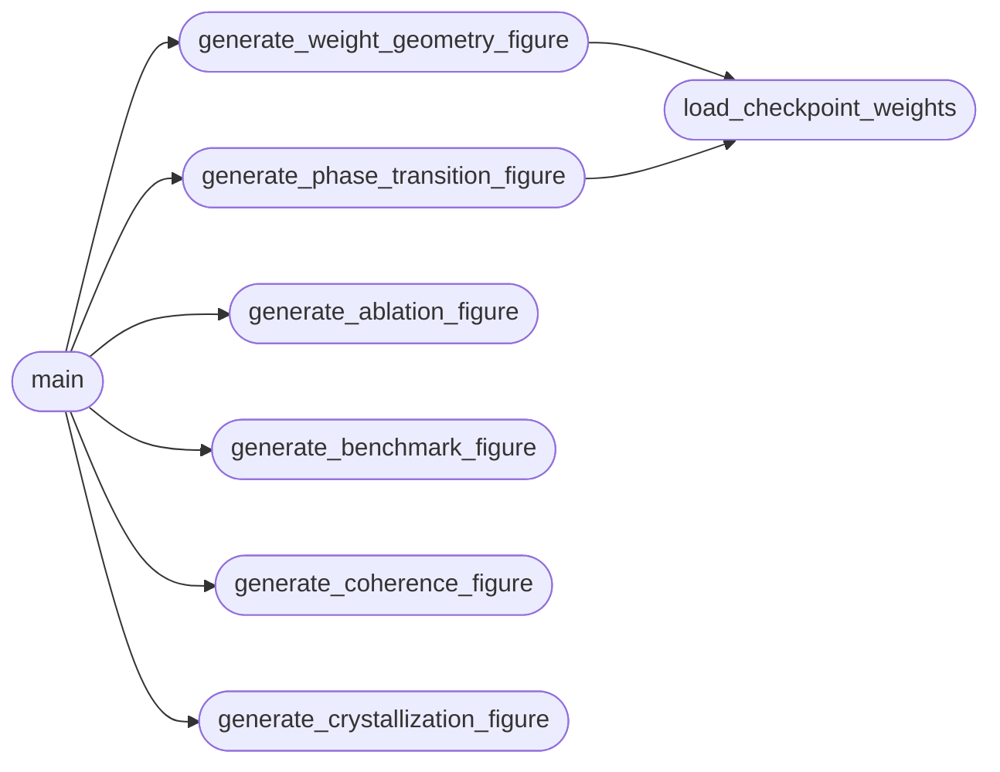

# `experiments.generate_figures`

> Source: [experiments/generate_figures.py:1](../../experiments/generate_figures.py#L1) | language `py` | coverage 90.0% | [API index](../index.md)

Algorithmic Invariance: Experimental Visualizations Generates publication-quality figures from real experimental data.

Author: Matrix Agent

## Contents

- **Functions:** [`setup_matplotlib_for_plotting`](#setup_matplotlib_for_plotting), [`generate_benchmark_figure`](#generate_benchmark_figure), [`generate_ablation_figure`](#generate_ablation_figure), [`load_checkpoint_weights`](#load_checkpoint_weights), [`generate_weight_geometry_figure`](#generate_weight_geometry_figure), [`generate_phase_transition_figure`](#generate_phase_transition_figure), [`generate_coherence_figure`](#generate_coherence_figure), [`generate_crystallization_figure`](#generate_crystallization_figure), [`main`](#main)
- **Constants:** [`BASE_DIR`](#base_dir), [`STATS_DIR`](#stats_dir), [`CHECKPOINTS_DIR`](#checkpoints_dir), [`FIGURES_DIR`](#figures_dir)

## Call Graph

Solid arrows stay in this module, dashed arrows leave it.



## Functions

<a id="setup_matplotlib_for_plotting"></a>

### `setup_matplotlib_for_plotting`

`function` | [experiments/generate_figures.py:15](../../experiments/generate_figures.py#L15)

```python
def setup_matplotlib_for_plotting()
```

Configure matplotlib and seaborn for proper rendering.

---

<a id="generate_benchmark_figure"></a>

### `generate_benchmark_figure`

`function` | [experiments/generate_figures.py:63](../../experiments/generate_figures.py#L63)

```python
def generate_benchmark_figure()
```

Generate benchmark performance comparison plot.

*Called by:* [`main`](#main)

---

<a id="generate_ablation_figure"></a>

### `generate_ablation_figure`

`function` | [experiments/generate_figures.py:124](../../experiments/generate_figures.py#L124)

```python
def generate_ablation_figure()
```

Generate ablation study visualization.

*Called by:* [`main`](#main)

---

<a id="load_checkpoint_weights"></a>

### `load_checkpoint_weights`

`function` | [experiments/generate_figures.py:219](../../experiments/generate_figures.py#L219)

```python
def load_checkpoint_weights()
```

Load all checkpoint files and extract weight tensors.

*Called by:* [`generate_phase_transition_figure`](#generate_phase_transition_figure), [`generate_weight_geometry_figure`](#generate_weight_geometry_figure)

---

<a id="generate_weight_geometry_figure"></a>

### `generate_weight_geometry_figure`

`function` | [experiments/generate_figures.py:258](../../experiments/generate_figures.py#L258)

```python
def generate_weight_geometry_figure()
```

Generate weight space geometry visualization.

*Calls:* [`load_checkpoint_weights`](#load_checkpoint_weights)

*Called by:* [`main`](#main)

---

<a id="generate_phase_transition_figure"></a>

### `generate_phase_transition_figure`

`function` | [experiments/generate_figures.py:354](../../experiments/generate_figures.py#L354)

```python
def generate_phase_transition_figure()
```

Generate phase transition analysis from checkpoint evolution.

*Calls:* [`load_checkpoint_weights`](#load_checkpoint_weights)

*Called by:* [`main`](#main)

---

<a id="generate_coherence_figure"></a>

### `generate_coherence_figure`

`function` | [experiments/generate_figures.py:465](../../experiments/generate_figures.py#L465)

```python
def generate_coherence_figure()
```

Generate cache coherence analysis visualization.

*Called by:* [`main`](#main)

---

<a id="generate_crystallization_figure"></a>

### `generate_crystallization_figure`

`function` | [experiments/generate_figures.py:534](../../experiments/generate_figures.py#L534)

```python
def generate_crystallization_figure()
```

Visualize the crystallization of Strassen coefficients.

*Called by:* [`main`](#main)

---

<a id="main"></a>

### `main`

`function` | [experiments/generate_figures.py:623](../../experiments/generate_figures.py#L623)

```python
def main()
```

*Calls:* [`generate_ablation_figure`](#generate_ablation_figure), [`generate_benchmark_figure`](#generate_benchmark_figure), [`generate_coherence_figure`](#generate_coherence_figure), [`generate_crystallization_figure`](#generate_crystallization_figure), [`generate_phase_transition_figure`](#generate_phase_transition_figure), [`generate_weight_geometry_figure`](#generate_weight_geometry_figure)

---

## Constants

<a id="base_dir"></a>

### `BASE_DIR`

`constant` | [experiments/generate_figures.py:53](../../experiments/generate_figures.py#L53)

```python
BASE_DIR = os.path.dirname(os.path.abspath(__file__))
```

---

<a id="stats_dir"></a>

### `STATS_DIR`

`constant` | [experiments/generate_figures.py:54](../../experiments/generate_figures.py#L54)

```python
STATS_DIR = os.path.join(BASE_DIR, 'statistics')
```

---

<a id="checkpoints_dir"></a>

### `CHECKPOINTS_DIR`

`constant` | [experiments/generate_figures.py:55](../../experiments/generate_figures.py#L55)

```python
CHECKPOINTS_DIR = os.path.join(BASE_DIR, '..', 'checkpoints')
```

---

<a id="figures_dir"></a>

### `FIGURES_DIR`

`constant` | [experiments/generate_figures.py:56](../../experiments/generate_figures.py#L56)

```python
FIGURES_DIR = os.path.join(BASE_DIR, '..', 'figures')
```

---
