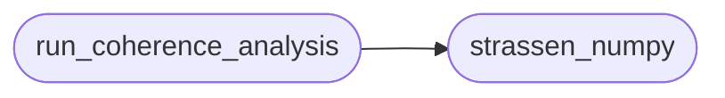

# `experiments.statistics.coherence_analysis`

> Source: [experiments/statistics/coherence_analysis.py:1](../../experiments/statistics/coherence_analysis.py#L1) | language `py` | coverage 33.3% | [API index](../index.md)

ANÁLISIS DE COHERENCIA TEMPORAL ================================ Medición de la estabilidad del algoritmo Strassen.

## Contents

- **Functions:** [`strassen_numpy`](#strassen_numpy), [`run_coherence_analysis`](#run_coherence_analysis)
- **Constants:** [`THRESHOLD`](#threshold)

## Call Graph

Solid arrows stay in this module, dashed arrows leave it.



## Functions

<a id="strassen_numpy"></a>

### `strassen_numpy`

`function` | [experiments/statistics/coherence_analysis.py:15](../../experiments/statistics/coherence_analysis.py#L15)

```python
def strassen_numpy(A, B, threshold=THRESHOLD)
```

**Parameters**

| Name | Type | Default | Description |
|---|---|---|---|
| `A` |  |  |  |
| `B` |  |  |  |
| `threshold` |  | `THRESHOLD` |  |

*Called by:* [`run_coherence_analysis`](#run_coherence_analysis)

---

<a id="run_coherence_analysis"></a>

### `run_coherence_analysis`

`function` | [experiments/statistics/coherence_analysis.py:42](../../experiments/statistics/coherence_analysis.py#L42)

```python
def run_coherence_analysis()
```

*Calls:* [`strassen_numpy`](#strassen_numpy)

---

## Constants

<a id="threshold"></a>

### `THRESHOLD`

`constant` | [experiments/statistics/coherence_analysis.py:13](../../experiments/statistics/coherence_analysis.py#L13)

```python
THRESHOLD = 2048
```

---
