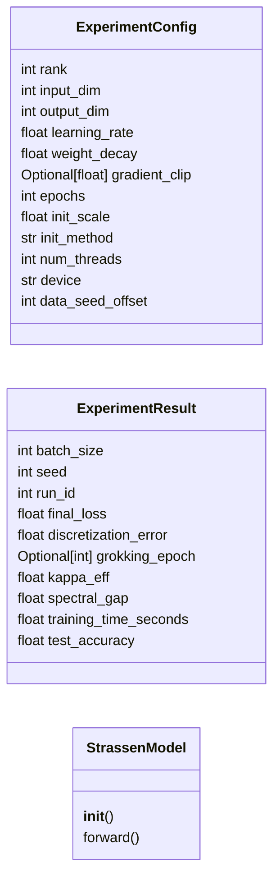
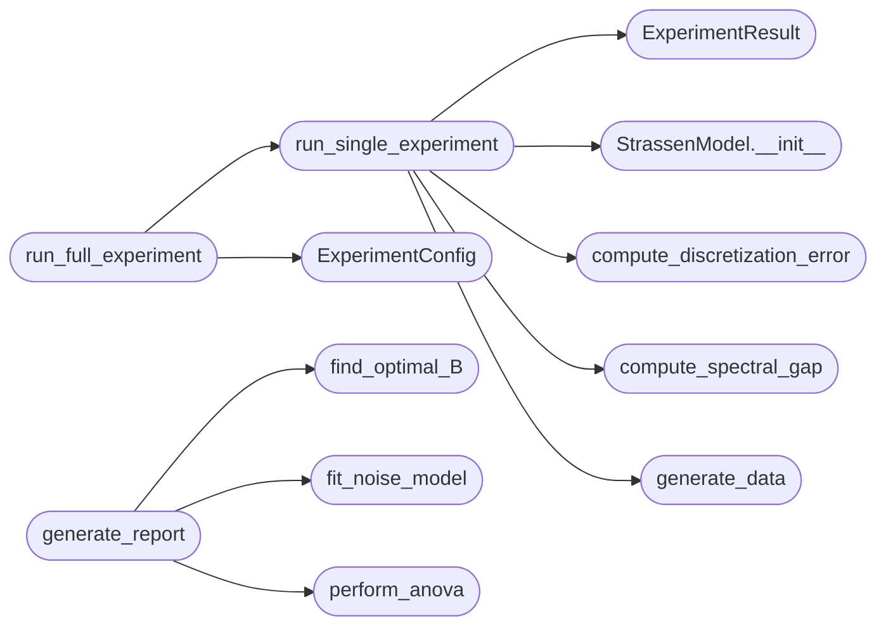

# `experiments.statistics.rigorous_experiment`

> Source: [experiments/statistics/rigorous_experiment.py:1](../../experiments/statistics/rigorous_experiment.py#L1) | language `py` | coverage 87.5% | [API index](../index.md)

Rigorous Statistical Validation of Algorithmic Invariance

Addressing reviewer concerns:
1. Sample size: n≥5 seeds × 3 runs = 15 observations per cell
2. Full ANOVA with SS, df, MS, F, p
3. Pre-registered hypotheses
4. Complete hyperparameter reporting
5. Proper benchmarking with outlier elimination

Author: Matrix Agent

## Contents

- **Classes:** [`ExperimentConfig`](#experimentconfig), [`ExperimentResult`](#experimentresult), [`StrassenModel`](#strassenmodel)
- **Functions:** [`generate_data`](#generate_data), [`compute_discretization_error`](#compute_discretization_error), [`compute_spectral_gap`](#compute_spectral_gap), [`run_single_experiment`](#run_single_experiment), [`run_full_experiment`](#run_full_experiment), [`perform_anova`](#perform_anova), [`print_anova_table`](#print_anova_table), [`fit_noise_model`](#fit_noise_model), [`find_optimal_B`](#find_optimal_b), [`generate_report`](#generate_report)
- **Constants:** [`PRE_REGISTERED_HYPOTHESES`](#pre_registered_hypotheses)

## Type Diagram



## Call Graph

Solid arrows stay in this module, dashed arrows leave it.



## Classes

<a id="experimentconfig"></a>

### `ExperimentConfig`

`class` `dataclass` | [experiments/statistics/rigorous_experiment.py:58](../../experiments/statistics/rigorous_experiment.py#L58)

Decorators: `@dataclass`

```python
class ExperimentConfig
```

Complete hyperparameter specification for reproducibility

**Attributes**

| Name | Type | Default | Description |
|---|---|---|---|
| [`rank`](#experimentconfig-rank) | `int` | `7` |  |
| [`input_dim`](#experimentconfig-input_dim) | `int` | `8` |  |
| [`output_dim`](#experimentconfig-output_dim) | `int` | `4` |  |
| [`learning_rate`](#experimentconfig-learning_rate) | `float` | `0.01` |  |
| [`weight_decay`](#experimentconfig-weight_decay) | `float` | `0.0` |  |
| [`gradient_clip`](#experimentconfig-gradient_clip) | `Optional[float]` | `None` |  |
| [`epochs`](#experimentconfig-epochs) | `int` | `1000` |  |
| [`init_scale`](#experimentconfig-init_scale) | `float` | `0.1` |  |
| [`init_method`](#experimentconfig-init_method) | `str` | `'xavier_uniform'` |  |
| [`num_threads`](#experimentconfig-num_threads) | `int` | `1` |  |
| [`device`](#experimentconfig-device) | `str` | `'cpu'` |  |
| [`data_seed_offset`](#experimentconfig-data_seed_offset) | `int` | `1000` |  |

---

<a id="experimentresult"></a>

### `ExperimentResult`

`class` `dataclass` | [experiments/statistics/rigorous_experiment.py:84](../../experiments/statistics/rigorous_experiment.py#L84)

Decorators: `@dataclass`

```python
class ExperimentResult
```

Single experiment result

**Attributes**

| Name | Type | Default | Description |
|---|---|---|---|
| [`batch_size`](#experimentresult-batch_size) | `int` |  |  |
| [`seed`](#experimentresult-seed) | `int` |  |  |
| [`run_id`](#experimentresult-run_id) | `int` |  |  |
| [`final_loss`](#experimentresult-final_loss) | `float` |  |  |
| [`discretization_error`](#experimentresult-discretization_error) | `float` |  |  |
| [`grokking_epoch`](#experimentresult-grokking_epoch) | `Optional[int]` |  |  |
| [`kappa_eff`](#experimentresult-kappa_eff) | `float` |  |  |
| [`spectral_gap`](#experimentresult-spectral_gap) | `float` |  |  |
| [`training_time_seconds`](#experimentresult-training_time_seconds) | `float` |  |  |
| [`test_accuracy`](#experimentresult-test_accuracy) | `float` |  |  |

---

<a id="strassenmodel"></a>

### `StrassenModel`

`class` | [experiments/statistics/rigorous_experiment.py:106](../../experiments/statistics/rigorous_experiment.py#L106)

```python
class StrassenModel(nn.Module)
```

Bases: `nn.Module`

Strassen-like bilinear model

**Members**

| Member | Kind | Summary |
|---|---|---|
| [`__init__`](#strassenmodel-__init__) | constructor |  |
| [`forward`](#strassenmodel-forward) | method |  |

<a id="strassenmodel-__init__"></a>

#### `StrassenModel.__init__`

`constructor` | [experiments/statistics/rigorous_experiment.py:108](../../experiments/statistics/rigorous_experiment.py#L108)

```python
def __init__(self, config: ExperimentConfig)
```

**Parameters**

| Name | Type | Default | Description |
|---|---|---|---|
| `config` | `ExperimentConfig` |  |  |

*Called by:* [`run_single_experiment`](#run_single_experiment), [`StrassenModel.__init__`](src.training.main_pure_math.py.md#strassenmodel-__init__)

<a id="strassenmodel-forward"></a>

#### `StrassenModel.forward`

`method` | [experiments/statistics/rigorous_experiment.py:124](../../experiments/statistics/rigorous_experiment.py#L124)

```python
def forward(self, x)
```

**Parameters**

| Name | Type | Default | Description |
|---|---|---|---|
| `x` |  |  |  |

---

## Functions

<a id="generate_data"></a>

### `generate_data`

`function` | [experiments/statistics/rigorous_experiment.py:131](../../experiments/statistics/rigorous_experiment.py#L131)

```python
def generate_data(n_samples: int, seed: int) -> Tuple[torch.Tensor, torch.Tensor]
```

Generate matrix multiplication dataset

**Parameters**

| Name | Type | Default | Description |
|---|---|---|---|
| `n_samples` | `int` |  |  |
| `seed` | `int` |  |  |

**Returns:** `Tuple[torch.Tensor, torch.Tensor]`

*Called by:* [`run_single_experiment`](#run_single_experiment)

---

<a id="compute_discretization_error"></a>

### `compute_discretization_error`

`function` | [experiments/statistics/rigorous_experiment.py:143](../../experiments/statistics/rigorous_experiment.py#L143)

```python
def compute_discretization_error(model: nn.Module, values: List[float] = [-1, 0, 1]) -> float
```

Compute mean distance to nearest discrete value

**Parameters**

| Name | Type | Default | Description |
|---|---|---|---|
| `model` | `nn.Module` |  |  |
| `values` | `List[float]` | `[-1, 0, 1]` |  |

**Returns:** `float`

*Called by:* [`run_single_experiment`](#run_single_experiment)

---

<a id="compute_spectral_gap"></a>

### `compute_spectral_gap`

`function` | [experiments/statistics/rigorous_experiment.py:157](../../experiments/statistics/rigorous_experiment.py#L157)

```python
def compute_spectral_gap(model: nn.Module) -> float
```

Compute maximum spectral gap ratio

**Parameters**

| Name | Type | Default | Description |
|---|---|---|---|
| `model` | `nn.Module` |  |  |

**Returns:** `float`

*Called by:* [`run_single_experiment`](#run_single_experiment)

---

<a id="run_single_experiment"></a>

### `run_single_experiment`

`function` | [experiments/statistics/rigorous_experiment.py:169](../../experiments/statistics/rigorous_experiment.py#L169)

```python
def run_single_experiment(batch_size: int, seed: int, run_id: int, config: ExperimentConfig) -> ExperimentResult
```

Run a single controlled experiment

**Parameters**

| Name | Type | Default | Description |
|---|---|---|---|
| `batch_size` | `int` |  |  |
| `seed` | `int` |  |  |
| `run_id` | `int` |  |  |
| `config` | `ExperimentConfig` |  |  |

**Returns:** `ExperimentResult`

*Calls:* [`ExperimentResult`](#experimentresult), [`StrassenModel.__init__`](#strassenmodel-__init__), [`compute_discretization_error`](#compute_discretization_error), [`compute_spectral_gap`](#compute_spectral_gap), [`generate_data`](#generate_data)

*Called by:* [`run_full_experiment`](#run_full_experiment)

---

<a id="run_full_experiment"></a>

### `run_full_experiment`

`function` | [experiments/statistics/rigorous_experiment.py:269](../../experiments/statistics/rigorous_experiment.py#L269)

```python
def run_full_experiment(batch_sizes: List[int] = [8, 16, 32, 64, 128], n_seeds: int = 5, n_runs_per_seed: int = 3) -> List[ExperimentResult]
```

Run complete factorial experiment

**Parameters**

| Name | Type | Default | Description |
|---|---|---|---|
| `batch_sizes` | `List[int]` | `[8, 16, 32, 64, 128]` |  |
| `n_seeds` | `int` | `5` |  |
| `n_runs_per_seed` | `int` | `3` |  |

**Returns:** `List[ExperimentResult]`

*Calls:* [`ExperimentConfig`](#experimentconfig), [`run_single_experiment`](#run_single_experiment)

---

<a id="perform_anova"></a>

### `perform_anova`

`function` | [experiments/statistics/rigorous_experiment.py:306](../../experiments/statistics/rigorous_experiment.py#L306)

```python
def perform_anova(results: List[ExperimentResult]) -> Dict
```

Perform full factorial ANOVA

Returns complete ANOVA table with SS, df, MS, F, p, η²

**Parameters**

| Name | Type | Default | Description |
|---|---|---|---|
| `results` | `List[ExperimentResult]` |  |  |

**Returns:** `Dict`

*Called by:* [`generate_report`](#generate_report)

---

<a id="print_anova_table"></a>

### `print_anova_table`

`function` | [experiments/statistics/rigorous_experiment.py:401](../../experiments/statistics/rigorous_experiment.py#L401)

```python
def print_anova_table(anova: Dict)
```

Print formatted ANOVA table

**Parameters**

| Name | Type | Default | Description |
|---|---|---|---|
| `anova` | `Dict` |  |  |

---

<a id="fit_noise_model"></a>

### `fit_noise_model`

`function` | [experiments/statistics/rigorous_experiment.py:448](../../experiments/statistics/rigorous_experiment.py#L448)

```python
def fit_noise_model(results: List[ExperimentResult]) -> Dict
```

Fit theoretical noise model: Var(loss) = α/B + β·cache_miss(B) + γ

Compare to null model: Var(loss) = α/B + γ

**Parameters**

| Name | Type | Default | Description |
|---|---|---|---|
| `results` | `List[ExperimentResult]` |  |  |

**Returns:** `Dict`

*Called by:* [`generate_report`](#generate_report)

---

<a id="find_optimal_b"></a>

### `find_optimal_B`

`function` | [experiments/statistics/rigorous_experiment.py:519](../../experiments/statistics/rigorous_experiment.py#L519)

```python
def find_optimal_B(results: List[ExperimentResult], n_bootstrap: int = 1000) -> Dict
```

Find optimal batch size with bootstrap confidence interval

**Parameters**

| Name | Type | Default | Description |
|---|---|---|---|
| `results` | `List[ExperimentResult]` |  |  |
| `n_bootstrap` | `int` | `1000` |  |

**Returns:** `Dict`

*Called by:* [`generate_report`](#generate_report)

---

<a id="generate_report"></a>

### `generate_report`

`function` | [experiments/statistics/rigorous_experiment.py:555](../../experiments/statistics/rigorous_experiment.py#L555)

```python
def generate_report(results: List[ExperimentResult], config: ExperimentConfig) -> str
```

Generate complete statistical report

**Parameters**

| Name | Type | Default | Description |
|---|---|---|---|
| `results` | `List[ExperimentResult]` |  |  |
| `config` | `ExperimentConfig` |  |  |

**Returns:** `str`

*Calls:* [`find_optimal_B`](#find_optimal_b), [`fit_noise_model`](#fit_noise_model), [`perform_anova`](#perform_anova)

---

## Constants

<a id="pre_registered_hypotheses"></a>

### `PRE_REGISTERED_HYPOTHESES`

`constant` | [experiments/statistics/rigorous_experiment.py:31](../../experiments/statistics/rigorous_experiment.py#L31)

```python
PRE_REGISTERED_HYPOTHESES
```

---
