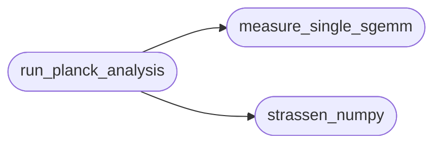

# `experiments.validation.benchmark`

> Source: [experiments/validation/benchmark.py:1](../../experiments/validation/benchmark.py#L1) | language `py` | coverage 100.0% | [API index](../index.md)

LÍMITE DE RUIDO DE GRADIENTE COMPUTACIONAL - BENCHMARK =========================================== Análisis del punto donde Strassen deja de ser realizable.

## Contents

- **Functions:** [`strassen_numpy`](#strassen_numpy), [`measure_single_sgemm`](#measure_single_sgemm), [`run_planck_analysis`](#run_planck_analysis)
- **Constants:** [`THRESHOLD`](#threshold)

## Call Graph

Solid arrows stay in this module, dashed arrows leave it.



## Functions

<a id="strassen_numpy"></a>

### `strassen_numpy`

`function` | [experiments/validation/benchmark.py:15](../../experiments/validation/benchmark.py#L15)

```python
def strassen_numpy(A, B, threshold=THRESHOLD)
```

Strassen recursivo con NumPy para productos base.

**Parameters**

| Name | Type | Default | Description |
|---|---|---|---|
| `A` |  |  |  |
| `B` |  |  |  |
| `threshold` |  | `THRESHOLD` |  |

*Called by:* [`run_planck_analysis`](#run_planck_analysis)

---

<a id="measure_single_sgemm"></a>

### `measure_single_sgemm`

`function` | [experiments/validation/benchmark.py:49](../../experiments/validation/benchmark.py#L49)

```python
def measure_single_sgemm(n, threads=1)
```

Mide tiempo de un solo sgemm de tamaño n.

**Parameters**

| Name | Type | Default | Description |
|---|---|---|---|
| `n` |  |  |  |
| `threads` |  | `1` |  |

*Called by:* [`run_planck_analysis`](#run_planck_analysis)

---

<a id="run_planck_analysis"></a>

### `run_planck_analysis`

`function` | [experiments/validation/benchmark.py:59](../../experiments/validation/benchmark.py#L59)

```python
def run_planck_analysis()
```

Ejecuta el análisis del Límite de Planck.

*Calls:* [`measure_single_sgemm`](#measure_single_sgemm), [`strassen_numpy`](#strassen_numpy)

---

## Constants

<a id="threshold"></a>

### `THRESHOLD`

`constant` | [experiments/validation/benchmark.py:13](../../experiments/validation/benchmark.py#L13)

```python
THRESHOLD = 2048
```

---
