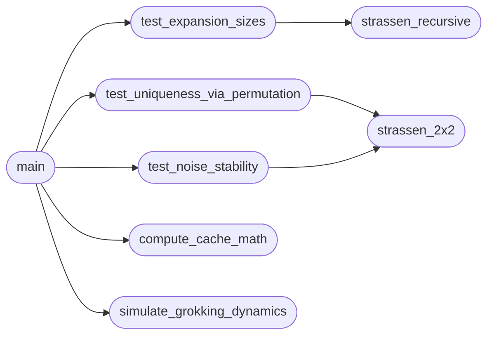

# `experiments.validation_experiments`

> Source: [experiments/validation_experiments.py:1](../../experiments/validation_experiments.py#L1) | language `py` | coverage 100.0% | [API index](../index.md)

Validation experiments for algorithmic invariance paper.

Runs: uniqueness test, noise stability, grokking dynamics visualization.

## Contents

- **Functions:** [`strassen_2x2`](#strassen_2x2), [`strassen_recursive`](#strassen_recursive), [`test_uniqueness_via_permutation`](#test_uniqueness_via_permutation), [`test_noise_stability`](#test_noise_stability), [`test_expansion_sizes`](#test_expansion_sizes), [`simulate_grokking_dynamics`](#simulate_grokking_dynamics), [`compute_cache_math`](#compute_cache_math), [`main`](#main)
- **Constants:** [`STRASSEN_U`](#strassen_u), [`STRASSEN_V`](#strassen_v), [`STRASSEN_W`](#strassen_w)

## Call Graph

Solid arrows stay in this module, dashed arrows leave it.



## Functions

<a id="strassen_2x2"></a>

### `strassen_2x2`

`function` | [experiments/validation_experiments.py:47](../../experiments/validation_experiments.py#L47)

```python
def strassen_2x2(A, B, U, V, W)
```

Compute 2x2 matrix multiplication using Strassen coefficients.

**Parameters**

| Name | Type | Default | Description |
|---|---|---|---|
| `A` |  |  |  |
| `B` |  |  |  |
| `U` |  |  |  |
| `V` |  |  |  |
| `W` |  |  |  |

*Called by:* [`test_noise_stability`](#test_noise_stability), [`test_uniqueness_via_permutation`](#test_uniqueness_via_permutation)

---

<a id="strassen_recursive"></a>

### `strassen_recursive`

`function` | [experiments/validation_experiments.py:56](../../experiments/validation_experiments.py#L56)

```python
def strassen_recursive(A, B, U, V, W, threshold=2)
```

Recursive Strassen for NxN matrices.

**Parameters**

| Name | Type | Default | Description |
|---|---|---|---|
| `A` |  |  |  |
| `B` |  |  |  |
| `U` |  |  |  |
| `V` |  |  |  |
| `W` |  |  |  |
| `threshold` |  | `2` |  |

*Called by:* [`test_expansion_sizes`](#test_expansion_sizes)

---

<a id="test_uniqueness_via_permutation"></a>

### `test_uniqueness_via_permutation`

`function` | [experiments/validation_experiments.py:85](../../experiments/validation_experiments.py#L85)

```python
def test_uniqueness_via_permutation()
```

Test that permuting slots produces equivalent computation.

*Calls:* [`strassen_2x2`](#strassen_2x2)

*Called by:* [`main`](#main)

---

<a id="test_noise_stability"></a>

### `test_noise_stability`

`function` | [experiments/validation_experiments.py:125](../../experiments/validation_experiments.py#L125)

```python
def test_noise_stability()
```

Test stability under Gaussian noise.

*Calls:* [`strassen_2x2`](#strassen_2x2)

*Called by:* [`main`](#main)

---

<a id="test_expansion_sizes"></a>

### `test_expansion_sizes`

`function` | [experiments/validation_experiments.py:162](../../experiments/validation_experiments.py#L162)

```python
def test_expansion_sizes()
```

Test expansion to larger sizes.

*Calls:* [`strassen_recursive`](#strassen_recursive)

*Called by:* [`main`](#main)

---

<a id="simulate_grokking_dynamics"></a>

### `simulate_grokking_dynamics`

`function` | [experiments/validation_experiments.py:184](../../experiments/validation_experiments.py#L184)

```python
def simulate_grokking_dynamics()
```

Simulate grokking dynamics for visualization.

*Called by:* [`main`](#main)

---

<a id="compute_cache_math"></a>

### `compute_cache_math`

`function` | [experiments/validation_experiments.py:250](../../experiments/validation_experiments.py#L250)

```python
def compute_cache_math()
```

Compute L3 cache requirements for different batch sizes.

*Called by:* [`main`](#main)

---

<a id="main"></a>

### `main`

`function` | [experiments/validation_experiments.py:294](../../experiments/validation_experiments.py#L294)

```python
def main()
```

Run all validation experiments.

*Calls:* [`compute_cache_math`](#compute_cache_math), [`simulate_grokking_dynamics`](#simulate_grokking_dynamics), [`test_expansion_sizes`](#test_expansion_sizes), [`test_noise_stability`](#test_noise_stability), [`test_uniqueness_via_permutation`](#test_uniqueness_via_permutation)

---

## Constants

<a id="strassen_u"></a>

### `STRASSEN_U`

`constant` | [experiments/validation_experiments.py:19](../../experiments/validation_experiments.py#L19)

```python
STRASSEN_U
```

---

<a id="strassen_v"></a>

### `STRASSEN_V`

`constant` | [experiments/validation_experiments.py:29](../../experiments/validation_experiments.py#L29)

```python
STRASSEN_V
```

---

<a id="strassen_w"></a>

### `STRASSEN_W`

`constant` | [experiments/validation_experiments.py:39](../../experiments/validation_experiments.py#L39)

```python
STRASSEN_W
```

---
