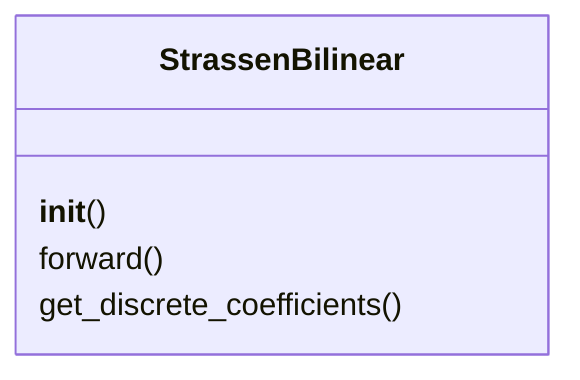
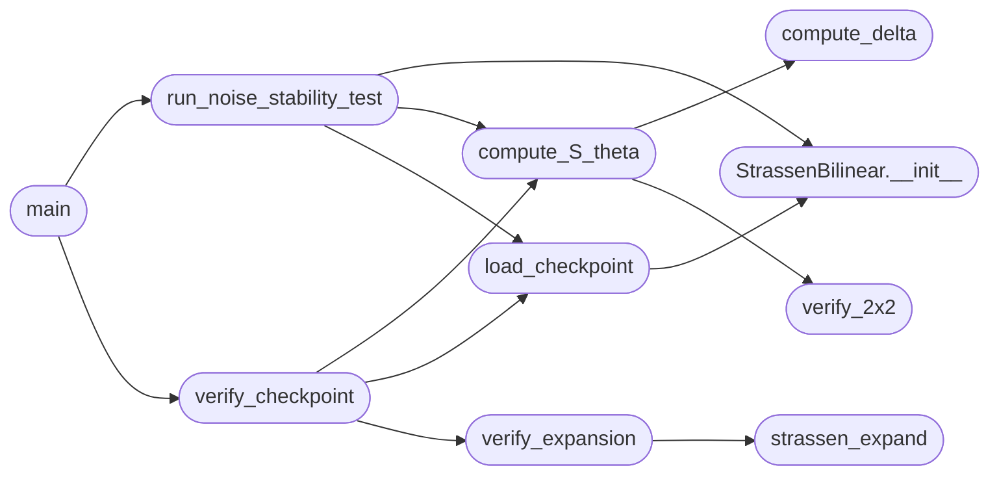

# `experiments.verify_checkpoints`

> Source: [experiments/verify_checkpoints.py:1](../../experiments/verify_checkpoints.py#L1) | language `py` | coverage 7.1% | [API index](../index.md)

Checkpoint Verification and Zero-Shot Expansion Test =====================================================

This script verifies trained checkpoints and tests zero-shot expansion
from 2x2 to 64x64 matrices using the two-phase protocol.

Metrics:
    S(theta): Binary success indicator (1 if discretization succeeds)
    delta(theta): Distance to integers ||theta - Q(theta)||_inf
    Expansion error: Max relative error at each scale

Author: grisun0
License: AGPL v3

## Contents

- **Classes:** [`StrassenBilinear`](#strassenbilinear)
- **Functions:** [`compute_delta`](#compute_delta), [`verify_2x2`](#verify_2x2), [`strassen_expand`](#strassen_expand), [`verify_expansion`](#verify_expansion), [`compute_S_theta`](#compute_s_theta), [`load_checkpoint`](#load_checkpoint), [`verify_checkpoint`](#verify_checkpoint), [`run_noise_stability_test`](#run_noise_stability_test), [`main`](#main)

## Type Diagram



## Call Graph

Solid arrows stay in this module, dashed arrows leave it.



## Classes

<a id="strassenbilinear"></a>

### `StrassenBilinear`

`class` | [experiments/verify_checkpoints.py:25](../../experiments/verify_checkpoints.py#L25)

```python
class StrassenBilinear(nn.Module)
```

Bases: `nn.Module`

**Members**

| Member | Kind | Summary |
|---|---|---|
| [`__init__`](#strassenbilinear-__init__) | constructor |  |
| [`forward`](#strassenbilinear-forward) | method |  |
| [`get_discrete_coefficients`](#strassenbilinear-get_discrete_coefficients) | method |  |

<a id="strassenbilinear-__init__"></a>

#### `StrassenBilinear.__init__`

`constructor` | [experiments/verify_checkpoints.py:27](../../experiments/verify_checkpoints.py#L27)

```python
def __init__(self, rank=8)
```

**Parameters**

| Name | Type | Default | Description |
|---|---|---|---|
| `rank` |  | `8` |  |

*Called by:* [`load_checkpoint`](#load_checkpoint), [`run_noise_stability_test`](#run_noise_stability_test)

<a id="strassenbilinear-forward"></a>

#### `StrassenBilinear.forward`

`method` | [experiments/verify_checkpoints.py:34](../../experiments/verify_checkpoints.py#L34)

```python
def forward(self, A, B)
```

**Parameters**

| Name | Type | Default | Description |
|---|---|---|---|
| `A` |  |  |  |
| `B` |  |  |  |

<a id="strassenbilinear-get_discrete_coefficients"></a>

#### `StrassenBilinear.get_discrete_coefficients`

`method` | [experiments/verify_checkpoints.py:44](../../experiments/verify_checkpoints.py#L44)

```python
def get_discrete_coefficients(self)
```

---

## Functions

<a id="compute_delta"></a>

### `compute_delta`

`function` | [experiments/verify_checkpoints.py:51](../../experiments/verify_checkpoints.py#L51)

```python
def compute_delta(model)
```

**Parameters**

| Name | Type | Default | Description |
|---|---|---|---|
| `model` |  |  |  |

*Called by:* [`compute_S_theta`](#compute_s_theta)

---

<a id="verify_2x2"></a>

### `verify_2x2`

`function` | [experiments/verify_checkpoints.py:68](../../experiments/verify_checkpoints.py#L68)

```python
def verify_2x2(U, V, W, n_test=1000)
```

**Parameters**

| Name | Type | Default | Description |
|---|---|---|---|
| `U` |  |  |  |
| `V` |  |  |  |
| `W` |  |  |  |
| `n_test` |  | `1000` |  |

*Called by:* [`compute_S_theta`](#compute_s_theta)

---

<a id="strassen_expand"></a>

### `strassen_expand`

`function` | [experiments/verify_checkpoints.py:89](../../experiments/verify_checkpoints.py#L89)

```python
def strassen_expand(A, B, U, V, W)
```

**Parameters**

| Name | Type | Default | Description |
|---|---|---|---|
| `A` |  |  |  |
| `B` |  |  |  |
| `U` |  |  |  |
| `V` |  |  |  |
| `W` |  |  |  |

*Called by:* [`verify_expansion`](#verify_expansion)

---

<a id="verify_expansion"></a>

### `verify_expansion`

`function` | [experiments/verify_checkpoints.py:126](../../experiments/verify_checkpoints.py#L126)

```python
def verify_expansion(U, V, W, sizes=[2, 4, 8, 16, 32, 64])
```

**Parameters**

| Name | Type | Default | Description |
|---|---|---|---|
| `U` |  |  |  |
| `V` |  |  |  |
| `W` |  |  |  |
| `sizes` |  | `[2, 4, 8, 16, 32, 64]` |  |

*Calls:* [`strassen_expand`](#strassen_expand)

*Called by:* [`verify_checkpoint`](#verify_checkpoint)

---

<a id="compute_s_theta"></a>

### `compute_S_theta`

`function` | [experiments/verify_checkpoints.py:152](../../experiments/verify_checkpoints.py#L152)

```python
def compute_S_theta(model)
```

**Parameters**

| Name | Type | Default | Description |
|---|---|---|---|
| `model` |  |  |  |

*Calls:* [`compute_delta`](#compute_delta), [`verify_2x2`](#verify_2x2)

*Called by:* [`run_noise_stability_test`](#run_noise_stability_test), [`verify_checkpoint`](#verify_checkpoint)

---

<a id="load_checkpoint"></a>

### `load_checkpoint`

`function` | [experiments/verify_checkpoints.py:166](../../experiments/verify_checkpoints.py#L166)

```python
def load_checkpoint(path)
```

**Parameters**

| Name | Type | Default | Description |
|---|---|---|---|
| `path` |  |  |  |

*Calls:* [`StrassenBilinear.__init__`](#strassenbilinear-__init__)

*Called by:* [`run_noise_stability_test`](#run_noise_stability_test), [`verify_checkpoint`](#verify_checkpoint)

---

<a id="verify_checkpoint"></a>

### `verify_checkpoint`

`function` | [experiments/verify_checkpoints.py:183](../../experiments/verify_checkpoints.py#L183)

```python
def verify_checkpoint(checkpoint_path)
```

**Parameters**

| Name | Type | Default | Description |
|---|---|---|---|
| `checkpoint_path` |  |  |  |

*Calls:* [`compute_S_theta`](#compute_s_theta), [`load_checkpoint`](#load_checkpoint), [`verify_expansion`](#verify_expansion)

*Called by:* [`main`](#main)

---

<a id="run_noise_stability_test"></a>

### `run_noise_stability_test`

`function` | [experiments/verify_checkpoints.py:226](../../experiments/verify_checkpoints.py#L226)

```python
def run_noise_stability_test(checkpoint_path, noise_levels=[0.001, 0.005, 0.01, 0.05, 0.1])
```

**Parameters**

| Name | Type | Default | Description |
|---|---|---|---|
| `checkpoint_path` |  |  |  |
| `noise_levels` |  | `[0.001, 0.005, 0.01, 0.05, 0.1]` |  |

*Calls:* [`StrassenBilinear.__init__`](#strassenbilinear-__init__), [`compute_S_theta`](#compute_s_theta), [`load_checkpoint`](#load_checkpoint)

*Called by:* [`main`](#main)

---

<a id="main"></a>

### `main`

`function` | [experiments/verify_checkpoints.py:249](../../experiments/verify_checkpoints.py#L249)

```python
def main()
```

*Calls:* [`run_noise_stability_test`](#run_noise_stability_test), [`verify_checkpoint`](#verify_checkpoint)

---
