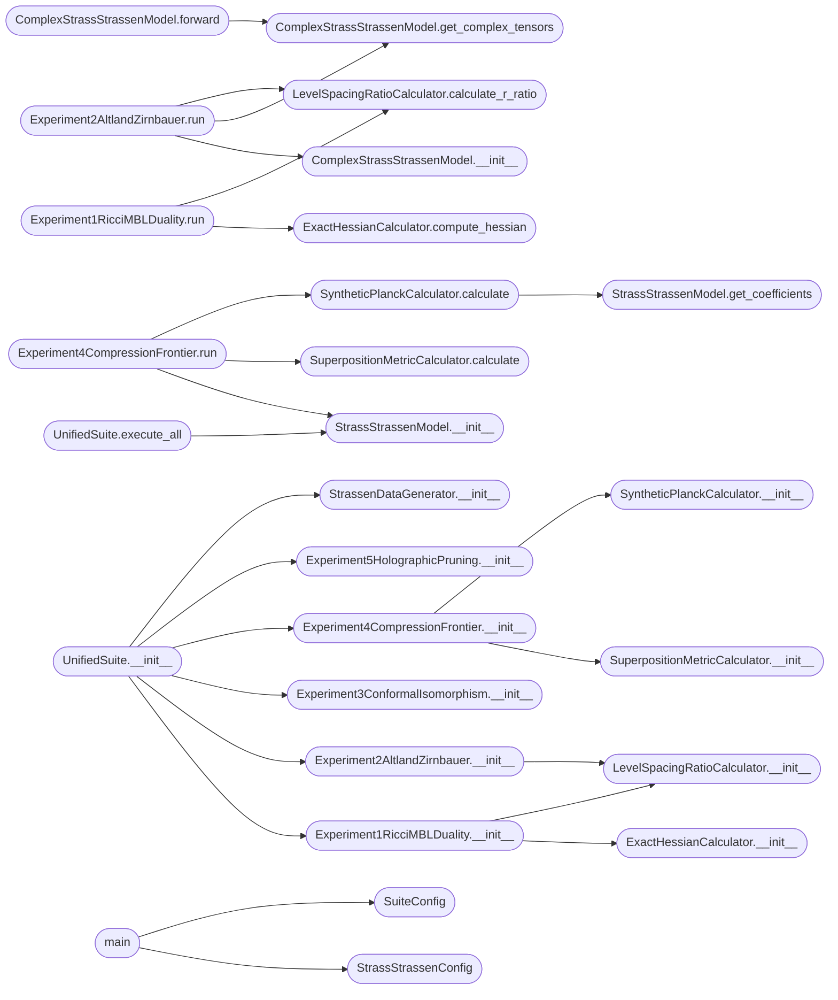

# `experimetn2`

> Source: [experimetn2.py:1](../../experimetn2.py#L1) | language `py` | coverage 33.3% | [API index](../index.md)

Unified Hidden Connections Suite - Physical ML Lab (Falsification and Rigor) ============================================================================= An experimental suite designed to test five hidden connections in the Strassen-Strassen bilinear neural network architecture.

This framework implements exact models, true complex-valued operators, and rigorous Hessian spectroscopy to separate metaphorical claims from mathematical physics.

Author: Physical ML Lab
Year: 2026
License: AGPL v3

## Contents

- **Classes:** [`StrassStrassenConfig`](#strassstrassenconfig), [`TrainingConfig`](#trainingconfig), [`SuiteConfig`](#suiteconfig), [`StrassStrassenModel`](#strassstrassenmodel), [`ComplexStrassStrassenModel`](#complexstrassstrassenmodel), [`StrassenDataGenerator`](#strassendatagenerator), [`CheckpointManager`](#checkpointmanager), [`LevelSpacingRatioCalculator`](#levelspacingratiocalculator), [`ExactHessianCalculator`](#exacthessiancalculator), [`SyntheticPlanckCalculator`](#syntheticplanckcalculator), [`SuperpositionMetricCalculator`](#superpositionmetriccalculator), [`IExperiment`](#iexperiment), [`Experiment1RicciMBLDuality`](#experiment1riccimblduality), [`Experiment2AltlandZirnbauer`](#experiment2altlandzirnbauer), [`Experiment3ConformalIsomorphism`](#experiment3conformalisomorphism), [`Experiment4CompressionFrontier`](#experiment4compressionfrontier), [`Experiment5HolographicPruning`](#experiment5holographicpruning), [`UnifiedSuite`](#unifiedsuite)
- **Functions:** [`main`](#main)
- **Constants:** [`T`](#t)

## Type Diagram

```mermaid
classDiagram
    direction LR
    class StrassStrassenConfig
    StrassStrassenConfig : int matrix_size
    StrassStrassenConfig : int input_dim
    StrassStrassenConfig : int output_dim
    StrassStrassenConfig : int rank
    StrassStrassenConfig : int target_rank
    StrassStrassenConfig : str device
    StrassStrassenConfig : torchdtype dtype
    class TrainingConfig
    TrainingConfig : int epochs
    TrainingConfig : int batch_size
    TrainingConfig : float learning_rate
    TrainingConfig : float weight_decay
    TrainingConfig : int scheduler_t0
    TrainingConfig : float grad_clip_norm
    TrainingConfig : float accuracy_threshold
    TrainingConfig : int seed
    class SuiteConfig
    SuiteConfig : StrassStrassenConfig model_config
    SuiteConfig : TrainingConfig training_config
    SuiteConfig : str output_dir
    class StrassStrassenModel
    StrassStrassenModel : __init__()
    StrassStrassenModel : forward()
    StrassStrassenModel : get_coefficients()
    StrassStrassenModel : slot_importance()
    class ComplexStrassStrassenModel
    ComplexStrassStrassenModel : __init__()
    ComplexStrassStrassenModel : get_complex_tensors()
    ComplexStrassStrassenModel : forward()
    class StrassenDataGenerator
    StrassenDataGenerator : __init__()
    StrassenDataGenerator : generate_batch()
    class CheckpointManager
    CheckpointManager : save()
    class LevelSpacingRatioCalculator
    LevelSpacingRatioCalculator : __init__()
    LevelSpacingRatioCalculator : calculate_r_ratio()
    class ExactHessianCalculator
    ExactHessianCalculator : __init__()
    ExactHessianCalculator : compute_hessian()
    class SyntheticPlanckCalculator
    SyntheticPlanckCalculator : __init__()
    SyntheticPlanckCalculator : calculate()
    class SuperpositionMetricCalculator
    SuperpositionMetricCalculator : __init__()
    SuperpositionMetricCalculator : calculate()
    class IExperiment
    IExperiment : run()
    IExperiment : get_name()
    class Experiment1RicciMBLDuality
    Experiment1RicciMBLDuality : __init__()
    Experiment1RicciMBLDuality : get_name()
    Experiment1RicciMBLDuality : run()
    class Experiment2AltlandZirnbauer
    Experiment2AltlandZirnbauer : __init__()
    Experiment2AltlandZirnbauer : get_name()
    Experiment2AltlandZirnbauer : run()
    class Experiment3ConformalIsomorphism
    Experiment3ConformalIsomorphism : __init__()
    Experiment3ConformalIsomorphism : get_name()
    Experiment3ConformalIsomorphism : run()
    class Experiment4CompressionFrontier
    Experiment4CompressionFrontier : __init__()
    Experiment4CompressionFrontier : get_name()
    Experiment4CompressionFrontier : run()
    class Experiment5HolographicPruning
    Experiment5HolographicPruning : __init__()
    Experiment5HolographicPruning : get_name()
    Experiment5HolographicPruning : run()
    class UnifiedSuite
    UnifiedSuite : __init__()
    UnifiedSuite : execute_all()
    IExperiment <|-- Experiment1RicciMBLDuality
    IExperiment <|-- Experiment2AltlandZirnbauer
    IExperiment <|-- Experiment3ConformalIsomorphism
    IExperiment <|-- Experiment4CompressionFrontier
    IExperiment <|-- Experiment5HolographicPruning
```



## Call Graph

Solid arrows stay in this module, dashed arrows leave it.



## Classes

<a id="strassstrassenconfig"></a>

### `StrassStrassenConfig`

`class` `dataclass` | [experimetn2.py:53](../../experimetn2.py#L53)

Decorators: `@dataclass(frozen=True)`

```python
class StrassStrassenConfig
```

Immutable canonical configuration for the Strassen bilinear model.

**Attributes**

| Name | Type | Default | Description |
|---|---|---|---|
| [`matrix_size`](#strassstrassenconfig-matrix_size) | `int` | `2` |  |
| [`input_dim`](#strassstrassenconfig-input_dim) | `int` | `4` |  |
| [`output_dim`](#strassstrassenconfig-output_dim) | `int` | `4` |  |
| [`rank`](#strassstrassenconfig-rank) | `int` | `8` |  |
| [`target_rank`](#strassstrassenconfig-target_rank) | `int` | `7` |  |
| [`device`](#strassstrassenconfig-device) | `str` | `field(default_factory=lambda: 'cuda' if torch.cuda.is_available() else 'cpu')` |  |
| [`dtype`](#strassstrassenconfig-dtype) | `torch.dtype` | `torch.float32` |  |

---

<a id="trainingconfig"></a>

### `TrainingConfig`

`class` `dataclass` | [experimetn2.py:71](../../experimetn2.py#L71)

Decorators: `@dataclass(frozen=True)`

```python
class TrainingConfig
```

Immutable training hyperparameters for crystallization runs.

**Attributes**

| Name | Type | Default | Description |
|---|---|---|---|
| [`epochs`](#trainingconfig-epochs) | `int` | `10000` |  |
| [`batch_size`](#trainingconfig-batch_size) | `int` | `128` |  |
| [`learning_rate`](#trainingconfig-learning_rate) | `float` | `0.01` |  |
| [`weight_decay`](#trainingconfig-weight_decay) | `float` | `0.0001` |  |
| [`scheduler_t0`](#trainingconfig-scheduler_t0) | `int` | `5000` |  |
| [`grad_clip_norm`](#trainingconfig-grad_clip_norm) | `float` | `1.0` |  |
| [`accuracy_threshold`](#trainingconfig-accuracy_threshold) | `float` | `0.001` |  |
| [`seed`](#trainingconfig-seed) | `int` | `42` |  |

---

<a id="suiteconfig"></a>

### `SuiteConfig`

`class` `dataclass` | [experimetn2.py:84](../../experimetn2.py#L84)

Decorators: `@dataclass(frozen=True)`

```python
class SuiteConfig
```

Top-level suite configuration orchestrator.

**Attributes**

| Name | Type | Default | Description |
|---|---|---|---|
| [`model_config`](#suiteconfig-model_config) | `StrassStrassenConfig` | `field(default_factory=StrassStrassenConfig)` |  |
| [`training_config`](#suiteconfig-training_config) | `TrainingConfig` | `field(default_factory=TrainingConfig)` |  |
| [`output_dir`](#suiteconfig-output_dir) | `str` | `'unified_hidden_connections_results'` |  |

---

<a id="strassstrassenmodel"></a>

### `StrassStrassenModel`

`class` | [experimetn2.py:95](../../experimetn2.py#L95)

```python
class StrassStrassenModel(nn.Module)
```

Bases: `nn.Module`

Exact bilinear tensor-decomposition model for 2x2 matrix multiplication.

Implements C = W((U * A) ⊙ (V * B)) where ⊙ denotes element-wise product. U, V in R^{rank x input_dim}, W in R^{output_dim x rank}.

**Members**

| Member | Kind | Summary |
|---|---|---|
| [`__init__`](#strassstrassenmodel-__init__) | constructor |  |
| [`forward`](#strassstrassenmodel-forward) | method |  |
| [`get_coefficients`](#strassstrassenmodel-get_coefficients) | method |  |
| [`slot_importance`](#strassstrassenmodel-slot_importance) | method |  |

<a id="strassstrassenmodel-__init__"></a>

#### `StrassStrassenModel.__init__`

`constructor` | [experimetn2.py:101](../../experimetn2.py#L101)

```python
def __init__(self, config: StrassStrassenConfig) -> None
```

**Parameters**

| Name | Type | Default | Description |
|---|---|---|---|
| `config` | `StrassStrassenConfig` |  |  |

*Called by:* [`Experiment4CompressionFrontier.run`](#experiment4compressionfrontier-run), [`UnifiedSuite.execute_all`](#unifiedsuite-execute_all), [`StrassStrassenModel.__init__`](unified_hidden_connections_suite.py.md#strassstrassenmodel-__init__)

<a id="strassstrassenmodel-forward"></a>

#### `StrassStrassenModel.forward`

`method` | [experimetn2.py:115](../../experimetn2.py#L115)

```python
def forward(self, A: torch.Tensor, B: torch.Tensor) -> torch.Tensor
```

**Parameters**

| Name | Type | Default | Description |
|---|---|---|---|
| `A` | `torch.Tensor` |  |  |
| `B` | `torch.Tensor` |  |  |

**Returns:** `torch.Tensor`

<a id="strassstrassenmodel-get_coefficients"></a>

#### `StrassStrassenModel.get_coefficients`

`method` | [experimetn2.py:125](../../experimetn2.py#L125)

```python
def get_coefficients(self) -> Dict[str, torch.Tensor]
```

**Returns:** `Dict[str, torch.Tensor]`

*Called by:* [`SyntheticPlanckCalculator.calculate`](#syntheticplanckcalculator-calculate), [`SyntheticPlanckCalculator.calculate`](unified_hidden_connections_suite.py.md#syntheticplanckcalculator-calculate)

<a id="strassstrassenmodel-slot_importance"></a>

#### `StrassStrassenModel.slot_importance`

`method` | [experimetn2.py:128](../../experimetn2.py#L128)

```python
def slot_importance(self) -> torch.Tensor
```

**Returns:** `torch.Tensor`

*Called by:* [`StrassStrassenModel.count_active_slots`](unified_hidden_connections_suite.py.md#strassstrassenmodel-count_active_slots)

---

<a id="complexstrassstrassenmodel"></a>

### `ComplexStrassStrassenModel`

`class` | [experimetn2.py:135](../../experimetn2.py#L135)

```python
class ComplexStrassStrassenModel(nn.Module)
```

Bases: `nn.Module`

Genuinely complex-valued bilinear model for Altland-Zirnbauer spectral testing.

Uses complex parameters and arithmetic to break time-reversal symmetry.

**Members**

| Member | Kind | Summary |
|---|---|---|
| [`__init__`](#complexstrassstrassenmodel-__init__) | constructor |  |
| [`get_complex_tensors`](#complexstrassstrassenmodel-get_complex_tensors) | method |  |
| [`forward`](#complexstrassstrassenmodel-forward) | method |  |

<a id="complexstrassstrassenmodel-__init__"></a>

#### `ComplexStrassStrassenModel.__init__`

`constructor` | [experimetn2.py:140](../../experimetn2.py#L140)

```python
def __init__(self, config: StrassStrassenConfig, gamma: float = 0.5) -> None
```

**Parameters**

| Name | Type | Default | Description |
|---|---|---|---|
| `config` | `StrassStrassenConfig` |  |  |
| `gamma` | `float` | `0.5` |  |

*Called by:* [`Experiment2AltlandZirnbauer.run`](#experiment2altlandzirnbauer-run)

<a id="complexstrassstrassenmodel-get_complex_tensors"></a>

#### `ComplexStrassStrassenModel.get_complex_tensors`

`method` | [experimetn2.py:153](../../experimetn2.py#L153)

```python
def get_complex_tensors(self) -> Tuple[torch.Tensor, torch.Tensor, torch.Tensor]
```

**Returns:** `Tuple[torch.Tensor, torch.Tensor, torch.Tensor]`

*Called by:* [`ComplexStrassStrassenModel.forward`](#complexstrassstrassenmodel-forward), [`Experiment2AltlandZirnbauer.run`](#experiment2altlandzirnbauer-run)

<a id="complexstrassstrassenmodel-forward"></a>

#### `ComplexStrassStrassenModel.forward`

`method` | [experimetn2.py:160](../../experimetn2.py#L160)

```python
def forward(self, A: torch.Tensor, B: torch.Tensor) -> torch.Tensor
```

**Parameters**

| Name | Type | Default | Description |
|---|---|---|---|
| `A` | `torch.Tensor` |  |  |
| `B` | `torch.Tensor` |  |  |

**Returns:** `torch.Tensor`

*Calls:* [`ComplexStrassStrassenModel.get_complex_tensors`](#complexstrassstrassenmodel-get_complex_tensors)

---

<a id="strassendatagenerator"></a>

### `StrassenDataGenerator`

`class` | [experimetn2.py:178](../../experimetn2.py#L178)

```python
class StrassenDataGenerator
```

Generates random 2x2 matrix pairs and their exact products.

**Members**

| Member | Kind | Summary |
|---|---|---|
| [`__init__`](#strassendatagenerator-__init__) | constructor |  |
| [`generate_batch`](#strassendatagenerator-generate_batch) | method |  |

<a id="strassendatagenerator-__init__"></a>

#### `StrassenDataGenerator.__init__`

`constructor` | [experimetn2.py:180](../../experimetn2.py#L180)

```python
def __init__(self, config: StrassStrassenConfig) -> None
```

**Parameters**

| Name | Type | Default | Description |
|---|---|---|---|
| `config` | `StrassStrassenConfig` |  |  |

*Called by:* [`UnifiedSuite.__init__`](#unifiedsuite-__init__)

<a id="strassendatagenerator-generate_batch"></a>

#### `StrassenDataGenerator.generate_batch`

`method` | [experimetn2.py:183](../../experimetn2.py#L183)

```python
def generate_batch(self, batch_size: int) -> Tuple[torch.Tensor, torch.Tensor, torch.Tensor]
```

**Parameters**

| Name | Type | Default | Description |
|---|---|---|---|
| `batch_size` | `int` |  |  |

**Returns:** `Tuple[torch.Tensor, torch.Tensor, torch.Tensor]`

---

<a id="checkpointmanager"></a>

### `CheckpointManager`

`class` | [experimetn2.py:190](../../experimetn2.py#L190)

```python
class CheckpointManager
```

Handles serialization and metadata tracking of model checkpoints.

**Members**

| Member | Kind | Summary |
|---|---|---|
| [`save`](#checkpointmanager-save) | method |  |

<a id="checkpointmanager-save"></a>

#### `CheckpointManager.save`

`method` | [experimetn2.py:192](../../experimetn2.py#L192)

```python
def save(self, model: nn.Module, epoch: int, metrics: Dict[str, Any], path: Path) -> None
```

**Parameters**

| Name | Type | Default | Description |
|---|---|---|---|
| `model` | `nn.Module` |  |  |
| `epoch` | `int` |  |  |
| `metrics` | `Dict[str, Any]` |  |  |
| `path` | `Path` |  |  |

*Called by:* [`LongTrainingPhase.execute`](full_seed_prospector.py.md#longtrainingphase-execute), [`MaxwellAnalyzer.analyze_checkpoint`](maxwell_strassen_analysis.py.md#maxwellanalyzer-analyze_checkpoint)

---

<a id="levelspacingratiocalculator"></a>

### `LevelSpacingRatioCalculator`

`class` | [experimetn2.py:207](../../experimetn2.py#L207)

```python
class LevelSpacingRatioCalculator
```

Computes adjacent gap ratio 'r' of eigenvalues to determine spectral class.

**Members**

| Member | Kind | Summary |
|---|---|---|
| [`__init__`](#levelspacingratiocalculator-__init__) | constructor |  |
| [`calculate_r_ratio`](#levelspacingratiocalculator-calculate_r_ratio) | method |  |

<a id="levelspacingratiocalculator-__init__"></a>

#### `LevelSpacingRatioCalculator.__init__`

`constructor` | [experimetn2.py:209](../../experimetn2.py#L209)

```python
def __init__(self, tolerance: float = 0.05) -> None
```

**Parameters**

| Name | Type | Default | Description |
|---|---|---|---|
| `tolerance` | `float` | `0.05` |  |

*Called by:* [`Experiment1RicciMBLDuality.__init__`](#experiment1riccimblduality-__init__), [`Experiment2AltlandZirnbauer.__init__`](#experiment2altlandzirnbauer-__init__)

<a id="levelspacingratiocalculator-calculate_r_ratio"></a>

#### `LevelSpacingRatioCalculator.calculate_r_ratio`

`method` | [experimetn2.py:212](../../experimetn2.py#L212)

```python
def calculate_r_ratio(self, eigenvalues: np.ndarray) -> Dict[str, Any]
```

**Parameters**

| Name | Type | Default | Description |
|---|---|---|---|
| `eigenvalues` | `np.ndarray` |  |  |

**Returns:** `Dict[str, Any]`

*Called by:* [`Experiment1RicciMBLDuality.run`](#experiment1riccimblduality-run), [`Experiment2AltlandZirnbauer.run`](#experiment2altlandzirnbauer-run)

---

<a id="exacthessiancalculator"></a>

### `ExactHessianCalculator`

`class` | [experimetn2.py:244](../../experimetn2.py#L244)

```python
class ExactHessianCalculator
```

Computes the mathematically exact full-rank Hessian of the model loss.

**Members**

| Member | Kind | Summary |
|---|---|---|
| [`__init__`](#exacthessiancalculator-__init__) | constructor |  |
| [`compute_hessian`](#exacthessiancalculator-compute_hessian) | method |  |

<a id="exacthessiancalculator-__init__"></a>

#### `ExactHessianCalculator.__init__`

`constructor` | [experimetn2.py:246](../../experimetn2.py#L246)

```python
def __init__(self, config: StrassStrassenConfig) -> None
```

**Parameters**

| Name | Type | Default | Description |
|---|---|---|---|
| `config` | `StrassStrassenConfig` |  |  |

*Called by:* [`Experiment1RicciMBLDuality.__init__`](#experiment1riccimblduality-__init__)

<a id="exacthessiancalculator-compute_hessian"></a>

#### `ExactHessianCalculator.compute_hessian`

`method` | [experimetn2.py:249](../../experimetn2.py#L249)

```python
def compute_hessian(self, model: nn.Module, A: torch.Tensor, B: torch.Tensor, C_true: torch.Tensor) -> torch.Tensor
```

**Parameters**

| Name | Type | Default | Description |
|---|---|---|---|
| `model` | `nn.Module` |  |  |
| `A` | `torch.Tensor` |  |  |
| `B` | `torch.Tensor` |  |  |
| `C_true` | `torch.Tensor` |  |  |

**Returns:** `torch.Tensor`

*Called by:* [`Experiment1RicciMBLDuality.run`](#experiment1riccimblduality-run)

---

<a id="syntheticplanckcalculator"></a>

### `SyntheticPlanckCalculator`

`class` | [experimetn2.py:278](../../experimetn2.py#L278)

```python
class SyntheticPlanckCalculator
```

Computes the synthetic Planck constant from parameter and loss statistics.

**Members**

| Member | Kind | Summary |
|---|---|---|
| [`__init__`](#syntheticplanckcalculator-__init__) | constructor |  |
| [`calculate`](#syntheticplanckcalculator-calculate) | method |  |

<a id="syntheticplanckcalculator-__init__"></a>

#### `SyntheticPlanckCalculator.__init__`

`constructor` | [experimetn2.py:280](../../experimetn2.py#L280)

```python
def __init__(self, noise_floor: float = 1e-10) -> None
```

**Parameters**

| Name | Type | Default | Description |
|---|---|---|---|
| `noise_floor` | `float` | `1e-10` |  |

*Called by:* [`Experiment4CompressionFrontier.__init__`](#experiment4compressionfrontier-__init__)

<a id="syntheticplanckcalculator-calculate"></a>

#### `SyntheticPlanckCalculator.calculate`

`method` | [experimetn2.py:283](../../experimetn2.py#L283)

```python
def calculate(self, model: StrassStrassenModel, current_loss: float) -> Dict[str, float]
```

**Parameters**

| Name | Type | Default | Description |
|---|---|---|---|
| `model` | `StrassStrassenModel` |  |  |
| `current_loss` | `float` |  |  |

**Returns:** `Dict[str, float]`

*Calls:* [`StrassStrassenModel.get_coefficients`](#strassstrassenmodel-get_coefficients)

*Called by:* [`Experiment4CompressionFrontier.run`](#experiment4compressionfrontier-run), [`Experiment4CompressionFrontier.run`](unified_hidden_connections_suite.py.md#experiment4compressionfrontier-run)

---

<a id="superpositionmetriccalculator"></a>

### `SuperpositionMetricCalculator`

`class` | [experimetn2.py:328](../../experimetn2.py#L328)

```python
class SuperpositionMetricCalculator
```

Measures representation density via Sparse Autoencoder (SAE) bottleneck analysis.

**Members**

| Member | Kind | Summary |
|---|---|---|
| [`__init__`](#superpositionmetriccalculator-__init__) | constructor |  |
| [`calculate`](#superpositionmetriccalculator-calculate) | method |  |

<a id="superpositionmetriccalculator-__init__"></a>

#### `SuperpositionMetricCalculator.__init__`

`constructor` | [experimetn2.py:330](../../experimetn2.py#L330)

```python
def __init__(self, config: StrassStrassenConfig) -> None
```

**Parameters**

| Name | Type | Default | Description |
|---|---|---|---|
| `config` | `StrassStrassenConfig` |  |  |

*Called by:* [`Experiment4CompressionFrontier.__init__`](#experiment4compressionfrontier-__init__)

<a id="superpositionmetriccalculator-calculate"></a>

#### `SuperpositionMetricCalculator.calculate`

`method` | [experimetn2.py:333](../../experimetn2.py#L333)

```python
def calculate(self, model: StrassStrassenModel, datagen: StrassenDataGenerator) -> Dict[str, float]
```

**Parameters**

| Name | Type | Default | Description |
|---|---|---|---|
| `model` | `StrassStrassenModel` |  |  |
| `datagen` | `StrassenDataGenerator` |  |  |

**Returns:** `Dict[str, float]`

*Calls:* [`StrassenDataGenerator.generate_batch`](batch_size.py.md#strassendatagenerator-generate_batch)

*Called by:* [`Experiment4CompressionFrontier.run`](#experiment4compressionfrontier-run), [`Experiment4CompressionFrontier.run`](unified_hidden_connections_suite.py.md#experiment4compressionfrontier-run)

---

<a id="iexperiment"></a>

### `IExperiment`

`class` `abstract` | [experimetn2.py:385](../../experimetn2.py#L385)

```python
class IExperiment(ABC)
```

Bases: `ABC`

Subclasses: [`Experiment1RicciMBLDuality`](#experiment1riccimblduality), [`Experiment2AltlandZirnbauer`](#experiment2altlandzirnbauer), [`Experiment3ConformalIsomorphism`](#experiment3conformalisomorphism), [`Experiment4CompressionFrontier`](#experiment4compressionfrontier), [`Experiment5HolographicPruning`](#experiment5holographicpruning)

Abstract interface defining the execution protocol for experiments.

**Members**

| Member | Kind | Summary |
|---|---|---|
| [`run`](#iexperiment-run) | method |  |
| [`get_name`](#iexperiment-get_name) | method |  |

<a id="iexperiment-run"></a>

#### `IExperiment.run`

`method` `abstract` | [experimetn2.py:388](../../experimetn2.py#L388)

Decorators: `@abstractmethod`

```python
def run(self, model: StrassStrassenModel) -> Dict[str, Any]
```

**Parameters**

| Name | Type | Default | Description |
|---|---|---|---|
| `model` | `StrassStrassenModel` |  |  |

**Returns:** `Dict[str, Any]`

<a id="iexperiment-get_name"></a>

#### `IExperiment.get_name`

`method` `abstract` | [experimetn2.py:390](../../experimetn2.py#L390)

Decorators: `@abstractmethod`

```python
def get_name(self) -> str
```

**Returns:** `str`

---

<a id="experiment1riccimblduality"></a>

### `Experiment1RicciMBLDuality`

`class` | [experimetn2.py:393](../../experimetn2.py#L393)

```python
class Experiment1RicciMBLDuality(IExperiment)
```

Bases: [`IExperiment`](#iexperiment)

Experiment 1: Ricci-MBL Duality.

Tracks geometric curvature (Hessian Ricci scalar) against adjacent gap ratio during a long-duration optimization trajectory to capture crystallization.

**Members**

| Member | Kind | Summary |
|---|---|---|
| [`__init__`](#experiment1riccimblduality-__init__) | constructor |  |
| [`get_name`](#experiment1riccimblduality-get_name) | method |  |
| [`run`](#experiment1riccimblduality-run) | method |  |

<a id="experiment1riccimblduality-__init__"></a>

#### `Experiment1RicciMBLDuality.__init__`

`constructor` | [experimetn2.py:399](../../experimetn2.py#L399)

```python
def __init__(self, suite_config: SuiteConfig, datagen: StrassenDataGenerator) -> None
```

**Parameters**

| Name | Type | Default | Description |
|---|---|---|---|
| `suite_config` | `SuiteConfig` |  |  |
| `datagen` | `StrassenDataGenerator` |  |  |

*Calls:* [`ExactHessianCalculator.__init__`](#exacthessiancalculator-__init__), [`LevelSpacingRatioCalculator.__init__`](#levelspacingratiocalculator-__init__)

*Called by:* [`UnifiedSuite.__init__`](#unifiedsuite-__init__)

<a id="experiment1riccimblduality-get_name"></a>

#### `Experiment1RicciMBLDuality.get_name`

`method` | [experimetn2.py:405](../../experimetn2.py#L405)

```python
def get_name(self) -> str
```

**Returns:** `str`

<a id="experiment1riccimblduality-run"></a>

#### `Experiment1RicciMBLDuality.run`

`method` | [experimetn2.py:408](../../experimetn2.py#L408)

```python
def run(self, model: StrassStrassenModel) -> Dict[str, Any]
```

**Parameters**

| Name | Type | Default | Description |
|---|---|---|---|
| `model` | `StrassStrassenModel` |  |  |

**Returns:** `Dict[str, Any]`

*Calls:* [`ExactHessianCalculator.compute_hessian`](#exacthessiancalculator-compute_hessian), [`LevelSpacingRatioCalculator.calculate_r_ratio`](#levelspacingratiocalculator-calculate_r_ratio)

---

<a id="experiment2altlandzirnbauer"></a>

### `Experiment2AltlandZirnbauer`

`class` | [experimetn2.py:457](../../experimetn2.py#L457)

```python
class Experiment2AltlandZirnbauer(IExperiment)
```

Bases: [`IExperiment`](#iexperiment)

Experiment 2: Altland-Zirnbauer Symmetry Dial.

Uses complex parameters and arithmetic to trigger a true symmetry crossover from real symmetric ensembles (GOE) to complex Hermitian (GUE).

**Members**

| Member | Kind | Summary |
|---|---|---|
| [`__init__`](#experiment2altlandzirnbauer-__init__) | constructor |  |
| [`get_name`](#experiment2altlandzirnbauer-get_name) | method |  |
| [`run`](#experiment2altlandzirnbauer-run) | method |  |

<a id="experiment2altlandzirnbauer-__init__"></a>

#### `Experiment2AltlandZirnbauer.__init__`

`constructor` | [experimetn2.py:463](../../experimetn2.py#L463)

```python
def __init__(self, suite_config: SuiteConfig, datagen: StrassenDataGenerator) -> None
```

**Parameters**

| Name | Type | Default | Description |
|---|---|---|---|
| `suite_config` | `SuiteConfig` |  |  |
| `datagen` | `StrassenDataGenerator` |  |  |

*Calls:* [`LevelSpacingRatioCalculator.__init__`](#levelspacingratiocalculator-__init__)

*Called by:* [`UnifiedSuite.__init__`](#unifiedsuite-__init__)

<a id="experiment2altlandzirnbauer-get_name"></a>

#### `Experiment2AltlandZirnbauer.get_name`

`method` | [experimetn2.py:468](../../experimetn2.py#L468)

```python
def get_name(self) -> str
```

**Returns:** `str`

<a id="experiment2altlandzirnbauer-run"></a>

#### `Experiment2AltlandZirnbauer.run`

`method` | [experimetn2.py:471](../../experimetn2.py#L471)

```python
def run(self, model: StrassStrassenModel) -> Dict[str, Any]
```

**Parameters**

| Name | Type | Default | Description |
|---|---|---|---|
| `model` | `StrassStrassenModel` |  |  |

**Returns:** `Dict[str, Any]`

*Calls:* [`ComplexStrassStrassenModel.__init__`](#complexstrassstrassenmodel-__init__), [`ComplexStrassStrassenModel.get_complex_tensors`](#complexstrassstrassenmodel-get_complex_tensors), [`LevelSpacingRatioCalculator.calculate_r_ratio`](#levelspacingratiocalculator-calculate_r_ratio)

---

<a id="experiment3conformalisomorphism"></a>

### `Experiment3ConformalIsomorphism`

`class` | [experimetn2.py:520](../../experimetn2.py#L520)

```python
class Experiment3ConformalIsomorphism(IExperiment)
```

Bases: [`IExperiment`](#iexperiment)

Experiment 3: Conformal Isomorphism.

Conducts mathematical stress-testing of fractional-linear Möbius transformations vs scale-conformal transformations to map the physical limits of learned tensor models.

**Members**

| Member | Kind | Summary |
|---|---|---|
| [`__init__`](#experiment3conformalisomorphism-__init__) | constructor |  |
| [`get_name`](#experiment3conformalisomorphism-get_name) | method |  |
| [`run`](#experiment3conformalisomorphism-run) | method |  |

<a id="experiment3conformalisomorphism-__init__"></a>

#### `Experiment3ConformalIsomorphism.__init__`

`constructor` | [experimetn2.py:527](../../experimetn2.py#L527)

```python
def __init__(self, suite_config: SuiteConfig, datagen: StrassenDataGenerator) -> None
```

**Parameters**

| Name | Type | Default | Description |
|---|---|---|---|
| `suite_config` | `SuiteConfig` |  |  |
| `datagen` | `StrassenDataGenerator` |  |  |

*Called by:* [`UnifiedSuite.__init__`](#unifiedsuite-__init__)

<a id="experiment3conformalisomorphism-get_name"></a>

#### `Experiment3ConformalIsomorphism.get_name`

`method` | [experimetn2.py:531](../../experimetn2.py#L531)

```python
def get_name(self) -> str
```

**Returns:** `str`

<a id="experiment3conformalisomorphism-run"></a>

#### `Experiment3ConformalIsomorphism.run`

`method` | [experimetn2.py:534](../../experimetn2.py#L534)

```python
def run(self, model: StrassStrassenModel) -> Dict[str, Any]
```

**Parameters**

| Name | Type | Default | Description |
|---|---|---|---|
| `model` | `StrassStrassenModel` |  |  |

**Returns:** `Dict[str, Any]`

---

<a id="experiment4compressionfrontier"></a>

### `Experiment4CompressionFrontier`

`class` | [experimetn2.py:570](../../experimetn2.py#L570)

```python
class Experiment4CompressionFrontier(IExperiment)
```

Bases: [`IExperiment`](#iexperiment)

Experiment 4: Compression Frontier.

Tests the thermodynamic bound between parameter uncertainty (hbar) and representation superposition (psi) under varied weight decay levels.

**Members**

| Member | Kind | Summary |
|---|---|---|
| [`__init__`](#experiment4compressionfrontier-__init__) | constructor |  |
| [`get_name`](#experiment4compressionfrontier-get_name) | method |  |
| [`run`](#experiment4compressionfrontier-run) | method |  |

<a id="experiment4compressionfrontier-__init__"></a>

#### `Experiment4CompressionFrontier.__init__`

`constructor` | [experimetn2.py:576](../../experimetn2.py#L576)

```python
def __init__(self, suite_config: SuiteConfig, datagen: StrassenDataGenerator) -> None
```

**Parameters**

| Name | Type | Default | Description |
|---|---|---|---|
| `suite_config` | `SuiteConfig` |  |  |
| `datagen` | `StrassenDataGenerator` |  |  |

*Calls:* [`SuperpositionMetricCalculator.__init__`](#superpositionmetriccalculator-__init__), [`SyntheticPlanckCalculator.__init__`](#syntheticplanckcalculator-__init__)

*Called by:* [`UnifiedSuite.__init__`](#unifiedsuite-__init__)

<a id="experiment4compressionfrontier-get_name"></a>

#### `Experiment4CompressionFrontier.get_name`

`method` | [experimetn2.py:582](../../experimetn2.py#L582)

```python
def get_name(self) -> str
```

**Returns:** `str`

<a id="experiment4compressionfrontier-run"></a>

#### `Experiment4CompressionFrontier.run`

`method` | [experimetn2.py:585](../../experimetn2.py#L585)

```python
def run(self, model: StrassStrassenModel) -> Dict[str, Any]
```

**Parameters**

| Name | Type | Default | Description |
|---|---|---|---|
| `model` | `StrassStrassenModel` |  |  |

**Returns:** `Dict[str, Any]`

*Calls:* [`StrassStrassenModel.__init__`](#strassstrassenmodel-__init__), [`SuperpositionMetricCalculator.calculate`](#superpositionmetriccalculator-calculate), [`SyntheticPlanckCalculator.calculate`](#syntheticplanckcalculator-calculate)

---

<a id="experiment5holographicpruning"></a>

### `Experiment5HolographicPruning`

`class` | [experimetn2.py:624](../../experimetn2.py#L624)

```python
class Experiment5HolographicPruning(IExperiment)
```

Bases: [`IExperiment`](#iexperiment)

Experiment 5: Holographic Pruning.

Distinguishes volumetric representation structures from structured boundary-state mechanisms via element-wise versus slot-wise pruning.

**Members**

| Member | Kind | Summary |
|---|---|---|
| [`__init__`](#experiment5holographicpruning-__init__) | constructor |  |
| [`get_name`](#experiment5holographicpruning-get_name) | method |  |
| [`run`](#experiment5holographicpruning-run) | method |  |

<a id="experiment5holographicpruning-__init__"></a>

#### `Experiment5HolographicPruning.__init__`

`constructor` | [experimetn2.py:630](../../experimetn2.py#L630)

```python
def __init__(self, suite_config: SuiteConfig, datagen: StrassenDataGenerator) -> None
```

**Parameters**

| Name | Type | Default | Description |
|---|---|---|---|
| `suite_config` | `SuiteConfig` |  |  |
| `datagen` | `StrassenDataGenerator` |  |  |

*Called by:* [`UnifiedSuite.__init__`](#unifiedsuite-__init__)

<a id="experiment5holographicpruning-get_name"></a>

#### `Experiment5HolographicPruning.get_name`

`method` | [experimetn2.py:634](../../experimetn2.py#L634)

```python
def get_name(self) -> str
```

**Returns:** `str`

<a id="experiment5holographicpruning-run"></a>

#### `Experiment5HolographicPruning.run`

`method` | [experimetn2.py:637](../../experimetn2.py#L637)

```python
def run(self, model: StrassStrassenModel) -> Dict[str, Any]
```

**Parameters**

| Name | Type | Default | Description |
|---|---|---|---|
| `model` | `StrassStrassenModel` |  |  |

**Returns:** `Dict[str, Any]`

---

<a id="unifiedsuite"></a>

### `UnifiedSuite`

`class` | [experimetn2.py:699](../../experimetn2.py#L699)

```python
class UnifiedSuite
```

Orchestrates and structures the execution of the five experiments.

**Members**

| Member | Kind | Summary |
|---|---|---|
| [`__init__`](#unifiedsuite-__init__) | constructor |  |
| [`execute_all`](#unifiedsuite-execute_all) | method |  |

<a id="unifiedsuite-__init__"></a>

#### `UnifiedSuite.__init__`

`constructor` | [experimetn2.py:701](../../experimetn2.py#L701)

```python
def __init__(self, config: SuiteConfig) -> None
```

**Parameters**

| Name | Type | Default | Description |
|---|---|---|---|
| `config` | `SuiteConfig` |  |  |

*Calls:* [`Experiment1RicciMBLDuality.__init__`](#experiment1riccimblduality-__init__), [`Experiment2AltlandZirnbauer.__init__`](#experiment2altlandzirnbauer-__init__), [`Experiment3ConformalIsomorphism.__init__`](#experiment3conformalisomorphism-__init__), [`Experiment4CompressionFrontier.__init__`](#experiment4compressionfrontier-__init__), [`Experiment5HolographicPruning.__init__`](#experiment5holographicpruning-__init__), [`StrassenDataGenerator.__init__`](#strassendatagenerator-__init__)

*Called by:* [`main`](#main)

<a id="unifiedsuite-execute_all"></a>

#### `UnifiedSuite.execute_all`

`method` | [experimetn2.py:712](../../experimetn2.py#L712)

```python
def execute_all(self) -> Dict[str, Any]
```

**Returns:** `Dict[str, Any]`

*Calls:* [`StrassStrassenModel.__init__`](#strassstrassenmodel-__init__)

*Called by:* [`main`](#main)

---

## Functions

<a id="main"></a>

### `main`

`function` | [experimetn2.py:745](../../experimetn2.py#L745)

```python
def main() -> int
```

**Returns:** `int`

*Calls:* [`StrassStrassenConfig`](#strassstrassenconfig), [`SuiteConfig`](#suiteconfig), [`TrainingConfig`](#trainingconfig), [`UnifiedSuite.__init__`](#unifiedsuite-__init__), [`UnifiedSuite.execute_all`](#unifiedsuite-execute_all)

---

## Constants

<a id="t"></a>

### `T`

`constant` | [experimetn2.py:49](../../experimetn2.py#L49)

```python
T = TypeVar('T')
```

---
