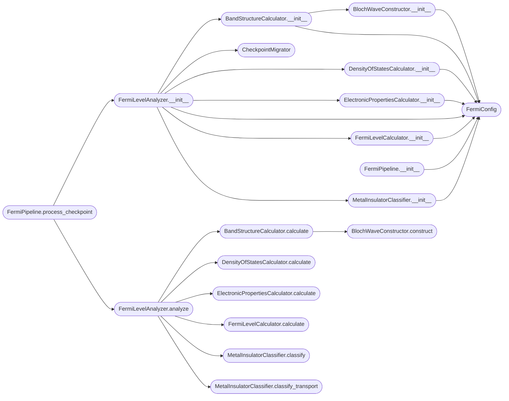

# `fermi`

> Source: [fermi.py:1](../../fermi.py#L1) | language `py` | coverage 2.0% | [API index](../index.md)

## Contents

- **Classes:** [`FermiConfig`](#fermiconfig), [`BilinearModel`](#bilinearmodel), [`BlochWaveConstructor`](#blochwaveconstructor), [`BandStructureCalculator`](#bandstructurecalculator), [`FermiLevelCalculator`](#fermilevelcalculator), [`DensityOfStatesCalculator`](#densityofstatescalculator), [`ElectronicPropertiesCalculator`](#electronicpropertiescalculator), [`MetalInsulatorClassifier`](#metalinsulatorclassifier), [`CheckpointMigrator`](#checkpointmigrator), [`FermiLevelAnalyzer`](#fermilevelanalyzer), [`FermiPipeline`](#fermipipeline)
- **Protocols:** [`IModel`](#imodel), [`IBlochWaveConstructor`](#iblochwaveconstructor), [`IBandStructureCalculator`](#ibandstructurecalculator), [`IFermiLevelCalculator`](#ifermilevelcalculator), [`IDensityOfStatesCalculator`](#idensityofstatescalculator), [`IElectronicPropertiesCalculator`](#ielectronicpropertiescalculator), [`IMetalInsulatorClassifier`](#imetalinsulatorclassifier)
- **Functions:** [`main`](#main)

## Type Diagram

```mermaid
classDiagram
    direction LR
    class FermiConfig
    FermiConfig : int HIDDEN_DIM
    FermiConfig : int MATRIX_SIZE
    FermiConfig : int NUM_ELECTRONS
    FermiConfig : int NUM_BANDS
    FermiConfig : float LATTICE_CONSTANT
    FermiConfig : float HBAR
    FermiConfig : float ELECTRON_MASS
    FermiConfig : float EV_CONVERSION
    FermiConfig : float FERMI_TOLERANCE
    FermiConfig : int MAX_OCCUPATION
    FermiConfig : float TEMPERATURE_ZERO
    FermiConfig : float TEMPERATURE_LOW
    FermiConfig : float TEMPERATURE_ROOM
    FermiConfig : int K_POINTS
    FermiConfig : float K_MIN
    FermiConfig : float K_MAX
    FermiConfig : int FIGURE_DPI
    FermiConfig : str SAVE_FORMAT
    FermiConfig : str DEVICE
    class IModel
    <<protocol>> IModel
    IModel : get_coefficients()
    class IBlochWaveConstructor
    <<protocol>> IBlochWaveConstructor
    IBlochWaveConstructor : construct()
    class IBandStructureCalculator
    <<protocol>> IBandStructureCalculator
    IBandStructureCalculator : calculate()
    class IFermiLevelCalculator
    <<protocol>> IFermiLevelCalculator
    IFermiLevelCalculator : calculate()
    class IDensityOfStatesCalculator
    <<protocol>> IDensityOfStatesCalculator
    IDensityOfStatesCalculator : calculate()
    class IElectronicPropertiesCalculator
    <<protocol>> IElectronicPropertiesCalculator
    IElectronicPropertiesCalculator : calculate()
    class IMetalInsulatorClassifier
    <<protocol>> IMetalInsulatorClassifier
    IMetalInsulatorClassifier : classify()
    class BilinearModel
    BilinearModel : __init__()
    BilinearModel : forward()
    BilinearModel : get_coefficients()
    class BlochWaveConstructor
    BlochWaveConstructor : __init__()
    BlochWaveConstructor : construct()
    class BandStructureCalculator
    BandStructureCalculator : __init__()
    BandStructureCalculator : calculate()
    class FermiLevelCalculator
    FermiLevelCalculator : __init__()
    FermiLevelCalculator : calculate()
    class DensityOfStatesCalculator
    DensityOfStatesCalculator : __init__()
    DensityOfStatesCalculator : calculate()
    class ElectronicPropertiesCalculator
    ElectronicPropertiesCalculator : __init__()
    ElectronicPropertiesCalculator : calculate()
    class MetalInsulatorClassifier
    MetalInsulatorClassifier : __init__()
    MetalInsulatorClassifier : classify()
    MetalInsulatorClassifier : classify_transport()
    class CheckpointMigrator
    CheckpointMigrator : migrate()
    class FermiLevelAnalyzer
    FermiLevelAnalyzer : __init__()
    FermiLevelAnalyzer : analyze()
    class FermiPipeline
    FermiPipeline : __init__()
    FermiPipeline : process_checkpoint()
    FermiPipeline : process_directory()
    FermiPipeline : generate_summary()
    FermiPipeline : plot_band_structures()
```



## Call Graph

Solid arrows stay in this module, dashed arrows leave it.



## Classes

<a id="fermiconfig"></a>

### `FermiConfig`

`class` `dataclass` | [fermi.py:19](../../fermi.py#L19)

Decorators: `@dataclass(frozen=True)`

```python
class FermiConfig
```

**Attributes**

| Name | Type | Default | Description |
|---|---|---|---|
| [`HIDDEN_DIM`](#fermiconfig-hidden_dim) | `int` | `8` |  |
| [`MATRIX_SIZE`](#fermiconfig-matrix_size) | `int` | `2` |  |
| [`NUM_ELECTRONS`](#fermiconfig-num_electrons) | `int` | `7` |  |
| [`NUM_BANDS`](#fermiconfig-num_bands) | `int` | `10` |  |
| [`LATTICE_CONSTANT`](#fermiconfig-lattice_constant) | `float` | `1.0` |  |
| [`HBAR`](#fermiconfig-hbar) | `float` | `1.054571817e-34` |  |
| [`ELECTRON_MASS`](#fermiconfig-electron_mass) | `float` | `9.10938356e-31` |  |
| [`EV_CONVERSION`](#fermiconfig-ev_conversion) | `float` | `6.242e+18` |  |
| [`FERMI_TOLERANCE`](#fermiconfig-fermi_tolerance) | `float` | `1e-06` |  |
| [`MAX_OCCUPATION`](#fermiconfig-max_occupation) | `int` | `2` |  |
| [`TEMPERATURE_ZERO`](#fermiconfig-temperature_zero) | `float` | `0.0` |  |
| [`TEMPERATURE_LOW`](#fermiconfig-temperature_low) | `float` | `0.001` |  |
| [`TEMPERATURE_ROOM`](#fermiconfig-temperature_room) | `float` | `0.025` |  |
| [`K_POINTS`](#fermiconfig-k_points) | `int` | `20` |  |
| [`K_MIN`](#fermiconfig-k_min) | `float` | `-np.pi` |  |
| [`K_MAX`](#fermiconfig-k_max) | `float` | `np.pi` |  |
| [`FIGURE_DPI`](#fermiconfig-figure_dpi) | `int` | `150` |  |
| [`SAVE_FORMAT`](#fermiconfig-save_format) | `str` | `'png'` |  |
| [`DEVICE`](#fermiconfig-device) | `str` | `'cuda' if torch.cuda.is_available() else 'cpu'` |  |

---

<a id="bilinearmodel"></a>

### `BilinearModel`

`class` | [fermi.py:83](../../fermi.py#L83)

```python
class BilinearModel(nn.Module)
```

Bases: `nn.Module`

**Members**

| Member | Kind | Summary |
|---|---|---|
| [`__init__`](#bilinearmodel-__init__) | constructor |  |
| [`forward`](#bilinearmodel-forward) | method |  |
| [`get_coefficients`](#bilinearmodel-get_coefficients) | method |  |

<a id="bilinearmodel-__init__"></a>

#### `BilinearModel.__init__`

`constructor` | [fermi.py:84](../../fermi.py#L84)

```python
def __init__(self, hidden_dim: int = FermiConfig.HIDDEN_DIM, matrix_size: int = FermiConfig.MATRIX_SIZE)
```

**Parameters**

| Name | Type | Default | Description |
|---|---|---|---|
| `hidden_dim` | `int` | `FermiConfig.HIDDEN_DIM` |  |
| `matrix_size` | `int` | `FermiConfig.MATRIX_SIZE` |  |

*Calls:* [`BilinearModel.__init__`](dirac_polos_zeros.py.md#bilinearmodel-__init__)

<a id="bilinearmodel-forward"></a>

#### `BilinearModel.forward`

`method` | [fermi.py:100](../../fermi.py#L100)

```python
def forward(self, a: torch.Tensor, b: torch.Tensor) -> torch.Tensor
```

**Parameters**

| Name | Type | Default | Description |
|---|---|---|---|
| `a` | `torch.Tensor` |  |  |
| `b` | `torch.Tensor` |  |  |

**Returns:** `torch.Tensor`

<a id="bilinearmodel-get_coefficients"></a>

#### `BilinearModel.get_coefficients`

`method` | [fermi.py:103](../../fermi.py#L103)

```python
def get_coefficients(self) -> Dict[str, torch.Tensor]
```

**Returns:** `Dict[str, torch.Tensor]`

---

<a id="blochwaveconstructor"></a>

### `BlochWaveConstructor`

`class` | [fermi.py:111](../../fermi.py#L111)

```python
class BlochWaveConstructor
```

**Members**

| Member | Kind | Summary |
|---|---|---|
| [`__init__`](#blochwaveconstructor-__init__) | constructor |  |
| [`construct`](#blochwaveconstructor-construct) | method |  |

<a id="blochwaveconstructor-__init__"></a>

#### `BlochWaveConstructor.__init__`

`constructor` | [fermi.py:112](../../fermi.py#L112)

```python
def __init__(self, config: FermiConfig = FermiConfig())
```

**Parameters**

| Name | Type | Default | Description |
|---|---|---|---|
| `config` | `FermiConfig` | `FermiConfig()` |  |

*Calls:* [`FermiConfig`](#fermiconfig)

*Called by:* [`BandStructureCalculator.__init__`](#bandstructurecalculator-__init__)

<a id="blochwaveconstructor-construct"></a>

#### `BlochWaveConstructor.construct`

`method` | [fermi.py:115](../../fermi.py#L115)

```python
def construct(self, weights: torch.Tensor, k: float) -> np.ndarray
```

**Parameters**

| Name | Type | Default | Description |
|---|---|---|---|
| `weights` | `torch.Tensor` |  |  |
| `k` | `float` |  |  |

**Returns:** `np.ndarray`

*Called by:* [`BandStructureCalculator.calculate`](#bandstructurecalculator-calculate)

---

<a id="bandstructurecalculator"></a>

### `BandStructureCalculator`

`class` | [fermi.py:135](../../fermi.py#L135)

```python
class BandStructureCalculator
```

**Members**

| Member | Kind | Summary |
|---|---|---|
| [`__init__`](#bandstructurecalculator-__init__) | constructor |  |
| [`calculate`](#bandstructurecalculator-calculate) | method |  |

<a id="bandstructurecalculator-__init__"></a>

#### `BandStructureCalculator.__init__`

`constructor` | [fermi.py:136](../../fermi.py#L136)

```python
def __init__(self, config: FermiConfig = FermiConfig())
```

**Parameters**

| Name | Type | Default | Description |
|---|---|---|---|
| `config` | `FermiConfig` | `FermiConfig()` |  |

*Calls:* [`BlochWaveConstructor.__init__`](#blochwaveconstructor-__init__), [`FermiConfig`](#fermiconfig)

*Called by:* [`FermiLevelAnalyzer.__init__`](#fermilevelanalyzer-__init__)

<a id="bandstructurecalculator-calculate"></a>

#### `BandStructureCalculator.calculate`

`method` | [fermi.py:140](../../fermi.py#L140)

```python
def calculate(self, model: IModel) -> Dict[str, Any]
```

**Parameters**

| Name | Type | Default | Description |
|---|---|---|---|
| `model` | `IModel` |  |  |

**Returns:** `Dict[str, Any]`

*Calls:* [`IModel.get_coefficients`](dirac_polos_zeros.py.md#imodel-get_coefficients), [`BlochWaveConstructor.construct`](#blochwaveconstructor-construct)

*Called by:* [`FermiLevelAnalyzer.analyze`](#fermilevelanalyzer-analyze)

---

<a id="fermilevelcalculator"></a>

### `FermiLevelCalculator`

`class` | [fermi.py:215](../../fermi.py#L215)

```python
class FermiLevelCalculator
```

**Members**

| Member | Kind | Summary |
|---|---|---|
| [`__init__`](#fermilevelcalculator-__init__) | constructor |  |
| [`calculate`](#fermilevelcalculator-calculate) | method |  |

<a id="fermilevelcalculator-__init__"></a>

#### `FermiLevelCalculator.__init__`

`constructor` | [fermi.py:216](../../fermi.py#L216)

```python
def __init__(self, config: FermiConfig = FermiConfig())
```

**Parameters**

| Name | Type | Default | Description |
|---|---|---|---|
| `config` | `FermiConfig` | `FermiConfig()` |  |

*Calls:* [`FermiConfig`](#fermiconfig)

*Called by:* [`FermiLevelAnalyzer.__init__`](#fermilevelanalyzer-__init__)

<a id="fermilevelcalculator-calculate"></a>

#### `FermiLevelCalculator.calculate`

`method` | [fermi.py:219](../../fermi.py#L219)

```python
def calculate(self, eigenvalues: np.ndarray, num_electrons: int) -> Dict[str, float]
```

**Parameters**

| Name | Type | Default | Description |
|---|---|---|---|
| `eigenvalues` | `np.ndarray` |  |  |
| `num_electrons` | `int` |  |  |

**Returns:** `Dict[str, float]`

*Called by:* [`FermiLevelAnalyzer.analyze`](#fermilevelanalyzer-analyze)

---

<a id="densityofstatescalculator"></a>

### `DensityOfStatesCalculator`

`class` | [fermi.py:285](../../fermi.py#L285)

```python
class DensityOfStatesCalculator
```

**Members**

| Member | Kind | Summary |
|---|---|---|
| [`__init__`](#densityofstatescalculator-__init__) | constructor |  |
| [`calculate`](#densityofstatescalculator-calculate) | method |  |

<a id="densityofstatescalculator-__init__"></a>

#### `DensityOfStatesCalculator.__init__`

`constructor` | [fermi.py:286](../../fermi.py#L286)

```python
def __init__(self, config: FermiConfig = FermiConfig())
```

**Parameters**

| Name | Type | Default | Description |
|---|---|---|---|
| `config` | `FermiConfig` | `FermiConfig()` |  |

*Calls:* [`FermiConfig`](#fermiconfig)

*Called by:* [`FermiLevelAnalyzer.__init__`](#fermilevelanalyzer-__init__)

<a id="densityofstatescalculator-calculate"></a>

#### `DensityOfStatesCalculator.calculate`

`method` | [fermi.py:289](../../fermi.py#L289)

```python
def calculate(self, eigenvalues: np.ndarray, energies: np.ndarray) -> np.ndarray
```

**Parameters**

| Name | Type | Default | Description |
|---|---|---|---|
| `eigenvalues` | `np.ndarray` |  |  |
| `energies` | `np.ndarray` |  |  |

**Returns:** `np.ndarray`

*Called by:* [`FermiLevelAnalyzer.analyze`](#fermilevelanalyzer-analyze)

---

<a id="electronicpropertiescalculator"></a>

### `ElectronicPropertiesCalculator`

`class` | [fermi.py:306](../../fermi.py#L306)

```python
class ElectronicPropertiesCalculator
```

**Members**

| Member | Kind | Summary |
|---|---|---|
| [`__init__`](#electronicpropertiescalculator-__init__) | constructor |  |
| [`calculate`](#electronicpropertiescalculator-calculate) | method |  |

<a id="electronicpropertiescalculator-__init__"></a>

#### `ElectronicPropertiesCalculator.__init__`

`constructor` | [fermi.py:307](../../fermi.py#L307)

```python
def __init__(self, config: FermiConfig = FermiConfig())
```

**Parameters**

| Name | Type | Default | Description |
|---|---|---|---|
| `config` | `FermiConfig` | `FermiConfig()` |  |

*Calls:* [`FermiConfig`](#fermiconfig)

*Called by:* [`FermiLevelAnalyzer.__init__`](#fermilevelanalyzer-__init__)

<a id="electronicpropertiescalculator-calculate"></a>

#### `ElectronicPropertiesCalculator.calculate`

`method` | [fermi.py:310](../../fermi.py#L310)

```python
def calculate(self, eigenvalues: np.ndarray, eigenvectors: np.ndarray, fermi_level: float) -> Dict[str, Any]
```

**Parameters**

| Name | Type | Default | Description |
|---|---|---|---|
| `eigenvalues` | `np.ndarray` |  |  |
| `eigenvectors` | `np.ndarray` |  |  |
| `fermi_level` | `float` |  |  |

**Returns:** `Dict[str, Any]`

*Called by:* [`FermiLevelAnalyzer.analyze`](#fermilevelanalyzer-analyze)

---

<a id="metalinsulatorclassifier"></a>

### `MetalInsulatorClassifier`

`class` | [fermi.py:368](../../fermi.py#L368)

```python
class MetalInsulatorClassifier
```

**Members**

| Member | Kind | Summary |
|---|---|---|
| [`__init__`](#metalinsulatorclassifier-__init__) | constructor |  |
| [`classify`](#metalinsulatorclassifier-classify) | method |  |
| [`classify_transport`](#metalinsulatorclassifier-classify_transport) | method |  |

<a id="metalinsulatorclassifier-__init__"></a>

#### `MetalInsulatorClassifier.__init__`

`constructor` | [fermi.py:369](../../fermi.py#L369)

```python
def __init__(self, config: FermiConfig = FermiConfig())
```

**Parameters**

| Name | Type | Default | Description |
|---|---|---|---|
| `config` | `FermiConfig` | `FermiConfig()` |  |

*Calls:* [`FermiConfig`](#fermiconfig)

*Called by:* [`FermiLevelAnalyzer.__init__`](#fermilevelanalyzer-__init__)

<a id="metalinsulatorclassifier-classify"></a>

#### `MetalInsulatorClassifier.classify`

`method` | [fermi.py:372](../../fermi.py#L372)

```python
def classify(self, band_gap: float, dos_at_fermi: float) -> str
```

**Parameters**

| Name | Type | Default | Description |
|---|---|---|---|
| `band_gap` | `float` |  |  |
| `dos_at_fermi` | `float` |  |  |

**Returns:** `str`

*Called by:* [`FermiLevelAnalyzer.analyze`](#fermilevelanalyzer-analyze)

<a id="metalinsulatorclassifier-classify_transport"></a>

#### `MetalInsulatorClassifier.classify_transport`

`method` | [fermi.py:386](../../fermi.py#L386)

```python
def classify_transport(self, effective_masses: Dict[str, float], band_gap: float) -> Dict[str, str]
```

**Parameters**

| Name | Type | Default | Description |
|---|---|---|---|
| `effective_masses` | `Dict[str, float]` |  |  |
| `band_gap` | `float` |  |  |

**Returns:** `Dict[str, str]`

*Called by:* [`FermiLevelAnalyzer.analyze`](#fermilevelanalyzer-analyze)

---

<a id="checkpointmigrator"></a>

### `CheckpointMigrator`

`class` | [fermi.py:408](../../fermi.py#L408)

```python
class CheckpointMigrator
```

**Members**

| Member | Kind | Summary |
|---|---|---|
| [`migrate`](#checkpointmigrator-migrate) | method |  |

<a id="checkpointmigrator-migrate"></a>

#### `CheckpointMigrator.migrate`

`method` | [fermi.py:409](../../fermi.py#L409)

```python
def migrate(self, raw_data: Any, device: str) -> Optional[Dict[str, torch.Tensor]]
```

**Parameters**

| Name | Type | Default | Description |
|---|---|---|---|
| `raw_data` | `Any` |  |  |
| `device` | `str` |  |  |

**Returns:** `Optional[Dict[str, torch.Tensor]]`

---

<a id="fermilevelanalyzer"></a>

### `FermiLevelAnalyzer`

`class` | [fermi.py:458](../../fermi.py#L458)

```python
class FermiLevelAnalyzer
```

**Members**

| Member | Kind | Summary |
|---|---|---|
| [`__init__`](#fermilevelanalyzer-__init__) | constructor |  |
| [`analyze`](#fermilevelanalyzer-analyze) | method |  |

<a id="fermilevelanalyzer-__init__"></a>

#### `FermiLevelAnalyzer.__init__`

`constructor` | [fermi.py:459](../../fermi.py#L459)

```python
def __init__(self, checkpoint_path: str, config: FermiConfig = FermiConfig())
```

**Parameters**

| Name | Type | Default | Description |
|---|---|---|---|
| `checkpoint_path` | `str` |  |  |
| `config` | `FermiConfig` | `FermiConfig()` |  |

*Calls:* [`BandStructureCalculator.__init__`](#bandstructurecalculator-__init__), [`CheckpointMigrator`](#checkpointmigrator), [`DensityOfStatesCalculator.__init__`](#densityofstatescalculator-__init__), [`ElectronicPropertiesCalculator.__init__`](#electronicpropertiescalculator-__init__), [`FermiConfig`](#fermiconfig), [`FermiLevelCalculator.__init__`](#fermilevelcalculator-__init__), [`MetalInsulatorClassifier.__init__`](#metalinsulatorclassifier-__init__)

*Called by:* [`FermiPipeline.process_checkpoint`](#fermipipeline-process_checkpoint)

<a id="fermilevelanalyzer-analyze"></a>

#### `FermiLevelAnalyzer.analyze`

`method` | [fermi.py:495](../../fermi.py#L495)

```python
def analyze(self) -> Dict[str, Any]
```

**Returns:** `Dict[str, Any]`

*Calls:* [`BandStructureCalculator.calculate`](#bandstructurecalculator-calculate), [`DensityOfStatesCalculator.calculate`](#densityofstatescalculator-calculate), [`ElectronicPropertiesCalculator.calculate`](#electronicpropertiescalculator-calculate), [`FermiLevelCalculator.calculate`](#fermilevelcalculator-calculate), [`MetalInsulatorClassifier.classify`](#metalinsulatorclassifier-classify), [`MetalInsulatorClassifier.classify_transport`](#metalinsulatorclassifier-classify_transport)

*Called by:* [`FermiPipeline.process_checkpoint`](#fermipipeline-process_checkpoint)

---

<a id="fermipipeline"></a>

### `FermiPipeline`

`class` | [fermi.py:608](../../fermi.py#L608)

```python
class FermiPipeline
```

**Members**

| Member | Kind | Summary |
|---|---|---|
| [`__init__`](#fermipipeline-__init__) | constructor |  |
| [`process_checkpoint`](#fermipipeline-process_checkpoint) | method |  |
| [`process_directory`](#fermipipeline-process_directory) | method |  |
| [`generate_summary`](#fermipipeline-generate_summary) | method |  |
| [`plot_band_structures`](#fermipipeline-plot_band_structures) | method | Generate comparison plots of band structures across checkpoints. |

<a id="fermipipeline-__init__"></a>

#### `FermiPipeline.__init__`

`constructor` | [fermi.py:609](../../fermi.py#L609)

```python
def __init__(self, config: FermiConfig = FermiConfig())
```

**Parameters**

| Name | Type | Default | Description |
|---|---|---|---|
| `config` | `FermiConfig` | `FermiConfig()` |  |

*Calls:* [`FermiConfig`](#fermiconfig)

*Called by:* [`main`](#main)

<a id="fermipipeline-process_checkpoint"></a>

#### `FermiPipeline.process_checkpoint`

`method` | [fermi.py:612](../../fermi.py#L612)

```python
def process_checkpoint(self, checkpoint_path: str, output_dir: str) -> Dict[str, Any]
```

**Parameters**

| Name | Type | Default | Description |
|---|---|---|---|
| `checkpoint_path` | `str` |  |  |
| `output_dir` | `str` |  |  |

**Returns:** `Dict[str, Any]`

*Calls:* [`FermiLevelAnalyzer.__init__`](#fermilevelanalyzer-__init__), [`FermiLevelAnalyzer.analyze`](#fermilevelanalyzer-analyze)

*Called by:* [`FermiPipeline.process_directory`](#fermipipeline-process_directory), [`main`](#main)

<a id="fermipipeline-process_directory"></a>

#### `FermiPipeline.process_directory`

`method` | [fermi.py:626](../../fermi.py#L626)

```python
def process_directory(self, checkpoint_dir: str, n_latest: Optional[int], output_dir: str) -> List[Dict[str, Any]]
```

**Parameters**

| Name | Type | Default | Description |
|---|---|---|---|
| `checkpoint_dir` | `str` |  |  |
| `n_latest` | `Optional[int]` |  |  |
| `output_dir` | `str` |  |  |

**Returns:** `List[Dict[str, Any]]`

*Calls:* [`FermiPipeline.process_checkpoint`](#fermipipeline-process_checkpoint)

*Called by:* [`main`](#main)

<a id="fermipipeline-generate_summary"></a>

#### `FermiPipeline.generate_summary`

`method` | [fermi.py:653](../../fermi.py#L653)

```python
def generate_summary(self, all_results: List[Dict[str, Any]], output_dir: str) -> None
```

**Parameters**

| Name | Type | Default | Description |
|---|---|---|---|
| `all_results` | `List[Dict[str, Any]]` |  |  |
| `output_dir` | `str` |  |  |

*Called by:* [`main`](#main)

<a id="fermipipeline-plot_band_structures"></a>

#### `FermiPipeline.plot_band_structures`

`method` | [fermi.py:724](../../fermi.py#L724)

```python
def plot_band_structures(self, all_results: List[Dict[str, Any]], output_dir: str) -> None
```

Generate comparison plots of band structures across checkpoints.

**Parameters**

| Name | Type | Default | Description |
|---|---|---|---|
| `all_results` | `List[Dict[str, Any]]` |  |  |
| `output_dir` | `str` |  |  |

*Called by:* [`main`](#main)

---

## Protocols

<a id="imodel"></a>

### `IModel`

`protocol` | [fermi.py:49](../../fermi.py#L49)

Decorators: `@runtime_checkable`

```python
class IModel(Protocol)
```

Bases: `Protocol`

**Members**

| Member | Kind | Summary |
|---|---|---|
| [`get_coefficients`](#imodel-get_coefficients) | method |  |

<a id="imodel-get_coefficients"></a>

#### `IModel.get_coefficients`

`method` | [fermi.py:50](../../fermi.py#L50)

```python
def get_coefficients(self) -> Dict[str, torch.Tensor]
```

**Returns:** `Dict[str, torch.Tensor]`

---

<a id="iblochwaveconstructor"></a>

### `IBlochWaveConstructor`

`protocol` | [fermi.py:54](../../fermi.py#L54)

Decorators: `@runtime_checkable`

```python
class IBlochWaveConstructor(Protocol)
```

Bases: `Protocol`

**Members**

| Member | Kind | Summary |
|---|---|---|
| [`construct`](#iblochwaveconstructor-construct) | method |  |

<a id="iblochwaveconstructor-construct"></a>

#### `IBlochWaveConstructor.construct`

`method` | [fermi.py:55](../../fermi.py#L55)

```python
def construct(self, weights: torch.Tensor, k: float) -> np.ndarray
```

**Parameters**

| Name | Type | Default | Description |
|---|---|---|---|
| `weights` | `torch.Tensor` |  |  |
| `k` | `float` |  |  |

**Returns:** `np.ndarray`

---

<a id="ibandstructurecalculator"></a>

### `IBandStructureCalculator`

`protocol` | [fermi.py:59](../../fermi.py#L59)

Decorators: `@runtime_checkable`

```python
class IBandStructureCalculator(Protocol)
```

Bases: `Protocol`

**Members**

| Member | Kind | Summary |
|---|---|---|
| [`calculate`](#ibandstructurecalculator-calculate) | method |  |

<a id="ibandstructurecalculator-calculate"></a>

#### `IBandStructureCalculator.calculate`

`method` | [fermi.py:60](../../fermi.py#L60)

```python
def calculate(self, model: IModel) -> Dict[str, Any]
```

**Parameters**

| Name | Type | Default | Description |
|---|---|---|---|
| `model` | `IModel` |  |  |

**Returns:** `Dict[str, Any]`

---

<a id="ifermilevelcalculator"></a>

### `IFermiLevelCalculator`

`protocol` | [fermi.py:64](../../fermi.py#L64)

Decorators: `@runtime_checkable`

```python
class IFermiLevelCalculator(Protocol)
```

Bases: `Protocol`

**Members**

| Member | Kind | Summary |
|---|---|---|
| [`calculate`](#ifermilevelcalculator-calculate) | method |  |

<a id="ifermilevelcalculator-calculate"></a>

#### `IFermiLevelCalculator.calculate`

`method` | [fermi.py:65](../../fermi.py#L65)

```python
def calculate(self, eigenvalues: np.ndarray, num_electrons: int) -> Dict[str, float]
```

**Parameters**

| Name | Type | Default | Description |
|---|---|---|---|
| `eigenvalues` | `np.ndarray` |  |  |
| `num_electrons` | `int` |  |  |

**Returns:** `Dict[str, float]`

---

<a id="idensityofstatescalculator"></a>

### `IDensityOfStatesCalculator`

`protocol` | [fermi.py:69](../../fermi.py#L69)

Decorators: `@runtime_checkable`

```python
class IDensityOfStatesCalculator(Protocol)
```

Bases: `Protocol`

**Members**

| Member | Kind | Summary |
|---|---|---|
| [`calculate`](#idensityofstatescalculator-calculate) | method |  |

<a id="idensityofstatescalculator-calculate"></a>

#### `IDensityOfStatesCalculator.calculate`

`method` | [fermi.py:70](../../fermi.py#L70)

```python
def calculate(self, eigenvalues: np.ndarray, energies: np.ndarray) -> np.ndarray
```

**Parameters**

| Name | Type | Default | Description |
|---|---|---|---|
| `eigenvalues` | `np.ndarray` |  |  |
| `energies` | `np.ndarray` |  |  |

**Returns:** `np.ndarray`

---

<a id="ielectronicpropertiescalculator"></a>

### `IElectronicPropertiesCalculator`

`protocol` | [fermi.py:74](../../fermi.py#L74)

Decorators: `@runtime_checkable`

```python
class IElectronicPropertiesCalculator(Protocol)
```

Bases: `Protocol`

**Members**

| Member | Kind | Summary |
|---|---|---|
| [`calculate`](#ielectronicpropertiescalculator-calculate) | method |  |

<a id="ielectronicpropertiescalculator-calculate"></a>

#### `IElectronicPropertiesCalculator.calculate`

`method` | [fermi.py:75](../../fermi.py#L75)

```python
def calculate(self, eigenvalues: np.ndarray, eigenvectors: np.ndarray, fermi_level: float) -> Dict[str, Any]
```

**Parameters**

| Name | Type | Default | Description |
|---|---|---|---|
| `eigenvalues` | `np.ndarray` |  |  |
| `eigenvectors` | `np.ndarray` |  |  |
| `fermi_level` | `float` |  |  |

**Returns:** `Dict[str, Any]`

---

<a id="imetalinsulatorclassifier"></a>

### `IMetalInsulatorClassifier`

`protocol` | [fermi.py:79](../../fermi.py#L79)

Decorators: `@runtime_checkable`

```python
class IMetalInsulatorClassifier(Protocol)
```

Bases: `Protocol`

**Members**

| Member | Kind | Summary |
|---|---|---|
| [`classify`](#imetalinsulatorclassifier-classify) | method |  |

<a id="imetalinsulatorclassifier-classify"></a>

#### `IMetalInsulatorClassifier.classify`

`method` | [fermi.py:80](../../fermi.py#L80)

```python
def classify(self, band_gap: float, dos_at_fermi: float) -> str
```

**Parameters**

| Name | Type | Default | Description |
|---|---|---|---|
| `band_gap` | `float` |  |  |
| `dos_at_fermi` | `float` |  |  |

**Returns:** `str`

---

## Functions

<a id="main"></a>

### `main`

`function` | [fermi.py:766](../../fermi.py#L766)

```python
def main()
```

*Calls:* [`FermiConfig`](#fermiconfig), [`FermiPipeline.__init__`](#fermipipeline-__init__), [`FermiPipeline.generate_summary`](#fermipipeline-generate_summary), [`FermiPipeline.plot_band_structures`](#fermipipeline-plot_band_structures), [`FermiPipeline.process_checkpoint`](#fermipipeline-process_checkpoint), [`FermiPipeline.process_directory`](#fermipipeline-process_directory)

---
