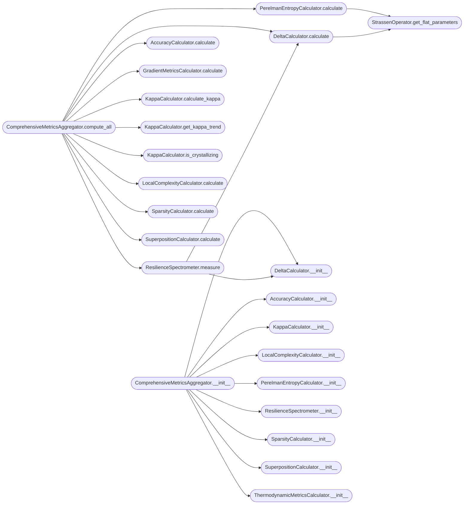

# `full_seed_prospector`

> Source: [full_seed_prospector.py:1](../../full_seed_prospector.py#L1) | language `py` | coverage 70.4% | [API index](../index.md)

Riemann-Strassen Crystallization Framework v3.0 ================================================

Unified framework for seed prospecting and long-term training of Strassen
algorithm crystallization via geometric flow theory and phase transitions.

Theoretical Framework:
- delta (discretization margin) as primary crystallization metric
- kappa (gradient covariance condition number) as order parameter
- tau coupled to effective noise scale (GNS)
- Perelman entropy for thermodynamic analysis
- Adaptive quantization pressure based on system state

Modes:
- prospect: Fast seed mining to identify crystallization candidates
- train: Long-term training with full thermodynamic metrics

Repository: https://github.com/grisuno/strass_strassen

## Contents

- **Classes:** [`UnifiedConfig`](#unifiedconfig), [`IMetricCalculator`](#imetriccalculator), [`ILossComponent`](#ilosscomponent), [`ICheckpointManager`](#icheckpointmanager), [`ITrainingPhase`](#itrainingphase), [`StrassenOperator`](#strassenoperator), [`DeltaCalculator`](#deltacalculator), [`AccuracyCalculator`](#accuracycalculator), [`KappaCalculator`](#kappacalculator), [`PerelmanEntropyCalculator`](#perelmanentropycalculator), [`SparsityCalculator`](#sparsitycalculator), [`GradientMetricsCalculator`](#gradientmetricscalculator), [`ResilienceSpectrometer`](#resiliencespectrometer), [`ComprehensiveMetricsAggregator`](#comprehensivemetricsaggregator), [`AdaptiveQuantizationLoss`](#adaptivequantizationloss), [`RicciCurvaturePenalty`](#riccicurvaturepenalty), [`GeometricLossAggregator`](#geometriclossaggregator), [`CheckpointManager`](#checkpointmanager), [`MatrixDataGenerator`](#matrixdatagenerator), [`DynamicBatchSizeScheduler`](#dynamicbatchsizescheduler), [`GlassDetector`](#glassdetector), [`ProspectorPhase`](#prospectorphase), [`LongTrainingPhase`](#longtrainingphase), [`ProgressiveSparsificationPhase`](#progressivesparsificationphase), [`CoefficientDiscretizationPhase`](#coefficientdiscretizationphase), [`StrassenVerifier`](#strassenverifier), [`CanonicalStrassenProvider`](#canonicalstrassenprovider), [`SeedProspector`](#seedprospector), [`LongTrainingPipeline`](#longtrainingpipeline), [`LocalComplexityCalculator`](#localcomplexitycalculator), [`SuperpositionCalculator`](#superpositioncalculator), [`ThermodynamicMetricsCalculator`](#thermodynamicmetricscalculator)
- **Enums:** [`ExecutionMode`](#executionmode)
- **Functions:** [`main`](#main)

## Type Diagram

```mermaid
classDiagram
    direction LR
    class ExecutionMode
    <<enum>> ExecutionMode
    ExecutionMode : PROSPECT
    ExecutionMode : TRAIN
    class UnifiedConfig
    UnifiedConfig : int rank
    UnifiedConfig : int target_rank
    UnifiedConfig : int matrix_size
    UnifiedConfig : int input_dim
    UnifiedConfig : int output_dim
    UnifiedConfig : int perelman_dimension
    UnifiedConfig : int prospect_epochs
    UnifiedConfig : int train_epochs
    UnifiedConfig : int batch_size_min
    UnifiedConfig : int batch_size_max
    UnifiedConfig : int batch_size_cycle_length
    UnifiedConfig : float learning_rate
    UnifiedConfig : float weight_decay
    UnifiedConfig : float gradient_clip
    UnifiedConfig : int cosine_annealing_t0
    UnifiedConfig : int prospect_cosine_t0
    UnifiedConfig : int kappa_window_size
    UnifiedConfig : int kappa_calculation_freq
    UnifiedConfig : float kappa_crystallization_threshold
    UnifiedConfig : float quantization_base_weight
    UnifiedConfig : float quantization_max_weight
    UnifiedConfig : int quantization_anneal_start
    UnifiedConfig : float quantization_kappa_multiplier
    UnifiedConfig : float quantization_mse_scale_min
    class IMetricCalculator
    IMetricCalculator : calculate()
    class ILossComponent
    ILossComponent : compute()
    class ICheckpointManager
    ICheckpointManager : save()
    ICheckpointManager : load()
    ICheckpointManager : should_checkpoint()
    class ITrainingPhase
    ITrainingPhase : execute()
    class StrassenOperator
    StrassenOperator : __init__()
    StrassenOperator : forward()
    StrassenOperator : slot_importance()
    StrassenOperator : count_active()
    StrassenOperator : get_flat_parameters()
    StrassenOperator : get_parameter_count()
    class DeltaCalculator
    DeltaCalculator : __init__()
    DeltaCalculator : calculate()
    class AccuracyCalculator
    AccuracyCalculator : __init__()
    AccuracyCalculator : calculate()
    class KappaCalculator
    KappaCalculator : __init__()
    KappaCalculator : accumulate_gradient()
    KappaCalculator : calculate_kappa()
    KappaCalculator : get_kappa_trend()
    KappaCalculator : is_crystallizing()
    KappaCalculator : reset()
    class PerelmanEntropyCalculator
    PerelmanEntropyCalculator : __init__()
    PerelmanEntropyCalculator : calculate()
    PerelmanEntropyCalculator : reset()
    class SparsityCalculator
    SparsityCalculator : __init__()
    SparsityCalculator : calculate()
    class GradientMetricsCalculator
    GradientMetricsCalculator : calculate()
    class ResilienceSpectrometer
    ResilienceSpectrometer : __init__()
    ResilienceSpectrometer : measure()
    class ComprehensiveMetricsAggregator
    ComprehensiveMetricsAggregator : __init__()
    ComprehensiveMetricsAggregator : compute_all()
    ComprehensiveMetricsAggregator : accumulate_gradient()
    ComprehensiveMetricsAggregator : update_lr()
    ComprehensiveMetricsAggregator : reset()
    class AdaptiveQuantizationLoss
    AdaptiveQuantizationLoss : __init__()
    AdaptiveQuantizationLoss : compute()
    class RicciCurvaturePenalty
    RicciCurvaturePenalty : __init__()
    RicciCurvaturePenalty : compute()
    class GeometricLossAggregator
    GeometricLossAggregator : __init__()
    GeometricLossAggregator : compute()
    class CheckpointManager
    CheckpointManager : __init__()
    CheckpointManager : save()
    CheckpointManager : load()
    CheckpointManager : should_checkpoint()
    CheckpointManager : get_latest_checkpoint_path()
    class MatrixDataGenerator
    MatrixDataGenerator : __init__()
    MatrixDataGenerator : generate_batch()
    class DynamicBatchSizeScheduler
    DynamicBatchSizeScheduler : __init__()
    DynamicBatchSizeScheduler : get_batch_size()
    class GlassDetector
    GlassDetector : __init__()
    GlassDetector : should_stop()
    class ProspectorPhase
    ProspectorPhase : __init__()
    ProspectorPhase : execute()
    class LongTrainingPhase
    LongTrainingPhase : __init__()
    LongTrainingPhase : execute()
    IMetricCalculator <|-- DeltaCalculator
    IMetricCalculator <|-- AccuracyCalculator
    IMetricCalculator <|-- PerelmanEntropyCalculator
    IMetricCalculator <|-- SparsityCalculator
    ILossComponent <|-- AdaptiveQuantizationLoss
    ILossComponent <|-- RicciCurvaturePenalty
    ILossComponent <|-- GeometricLossAggregator
    ICheckpointManager <|-- CheckpointManager
    ITrainingPhase <|-- ProspectorPhase
    ITrainingPhase <|-- LongTrainingPhase
```



## Call Graph

Solid arrows stay in this module, dashed arrows leave it.



## Classes

<a id="unifiedconfig"></a>

### `UnifiedConfig`

`class` `dataclass` | [full_seed_prospector.py:52](../../full_seed_prospector.py#L52)

Decorators: `@dataclass(frozen=True)`

```python
class UnifiedConfig
```

Immutable unified configuration for all execution modes.

**Attributes**

| Name | Type | Default | Description |
|---|---|---|---|
| [`rank`](#unifiedconfig-rank) | `int` | `8` |  |
| [`target_rank`](#unifiedconfig-target_rank) | `int` | `7` |  |
| [`matrix_size`](#unifiedconfig-matrix_size) | `int` | `2` |  |
| [`input_dim`](#unifiedconfig-input_dim) | `int` | `4` |  |
| [`output_dim`](#unifiedconfig-output_dim) | `int` | `4` |  |
| [`perelman_dimension`](#unifiedconfig-perelman_dimension) | `int` | `104` |  |
| [`prospect_epochs`](#unifiedconfig-prospect_epochs) | `int` | `5000` |  |
| [`train_epochs`](#unifiedconfig-train_epochs) | `int` | `29000` |  |
| [`batch_size_min`](#unifiedconfig-batch_size_min) | `int` | `24` |  |
| [`batch_size_max`](#unifiedconfig-batch_size_max) | `int` | `128` |  |
| [`batch_size_cycle_length`](#unifiedconfig-batch_size_cycle_length) | `int` | `5000` |  |
| [`learning_rate`](#unifiedconfig-learning_rate) | `float` | `0.02` |  |
| [`weight_decay`](#unifiedconfig-weight_decay) | `float` | `0.0001` |  |
| [`gradient_clip`](#unifiedconfig-gradient_clip) | `float` | `1.0` |  |
| [`cosine_annealing_t0`](#unifiedconfig-cosine_annealing_t0) | `int` | `20000` |  |
| [`prospect_cosine_t0`](#unifiedconfig-prospect_cosine_t0) | `int` | `2000` |  |
| [`kappa_window_size`](#unifiedconfig-kappa_window_size) | `int` | `100` |  |
| [`kappa_calculation_freq`](#unifiedconfig-kappa_calculation_freq) | `int` | `100` |  |
| [`kappa_crystallization_threshold`](#unifiedconfig-kappa_crystallization_threshold) | `float` | `10.0` |  |
| [`quantization_base_weight`](#unifiedconfig-quantization_base_weight) | `float` | `0.0001` |  |
| [`quantization_max_weight`](#unifiedconfig-quantization_max_weight) | `float` | `1.0` |  |
| [`quantization_anneal_start`](#unifiedconfig-quantization_anneal_start) | `int` | `1000` |  |
| [`quantization_kappa_multiplier`](#unifiedconfig-quantization_kappa_multiplier) | `float` | `10.0` |  |
| [`quantization_mse_scale_min`](#unifiedconfig-quantization_mse_scale_min) | `float` | `0.1` |  |
| [`quantization_mse_scale_max`](#unifiedconfig-quantization_mse_scale_max) | `float` | `10.0` |  |
| [`quantization_mse_scale_factor`](#unifiedconfig-quantization_mse_scale_factor) | `float` | `1000.0` |  |
| [`perelman_tau_initial`](#unifiedconfig-perelman_tau_initial) | `float` | `1.0` |  |
| [`perelman_tau_adaptive`](#unifiedconfig-perelman_tau_adaptive) | `bool` | `True` |  |
| [`perelman_tau_min`](#unifiedconfig-perelman_tau_min) | `float` | `1e-06` |  |
| [`perelman_tau_smoothing`](#unifiedconfig-perelman_tau_smoothing) | `float` | `0.9` |  |
| [`perelman_log_w_min`](#unifiedconfig-perelman_log_w_min) | `float` | `-700.0` |  |
| [`perelman_log_w_max`](#unifiedconfig-perelman_log_w_max) | `float` | `700.0` |  |
| [`ricci_penalty_weight`](#unifiedconfig-ricci_penalty_weight) | `float` | `0.001` |  |
| [`phase2_steps`](#unifiedconfig-phase2_steps) | `int` | `2000` |  |
| [`phase2_learning_rate`](#unifiedconfig-phase2_learning_rate) | `float` | `0.005` |  |
| [`phase2_decay_factor`](#unifiedconfig-phase2_decay_factor) | `float` | `0.99` |  |
| [`phase3_epochs`](#unifiedconfig-phase3_epochs) | `int` | `10000` |  |
| [`phase3_print_interval`](#unifiedconfig-phase3_print_interval) | `int` | `2000` |  |
| [`spectral_regularization`](#unifiedconfig-spectral_regularization) | `float` | `1e-06` |  |
| [`eigenvalue_filter_threshold`](#unifiedconfig-eigenvalue_filter_threshold) | `float` | `1e-10` |  |
| [`kappa_min_samples`](#unifiedconfig-kappa_min_samples) | `int` | `10` |  |
| [`kappa_max_samples`](#unifiedconfig-kappa_max_samples) | `int` | `50` |  |
| [`accuracy_threshold`](#unifiedconfig-accuracy_threshold) | `float` | `99.9` |  |
| [`accuracy_error_tolerance`](#unifiedconfig-accuracy_error_tolerance) | `float` | `0.001` |  |
| [`discretization_tolerance`](#unifiedconfig-discretization_tolerance) | `float` | `1e-05` |  |
| [`sparsity_threshold`](#unifiedconfig-sparsity_threshold) | `float` | `0.1` |  |
| [`target_delta`](#unifiedconfig-target_delta) | `float` | `0.05` |  |
| [`target_accuracy`](#unifiedconfig-target_accuracy) | `float` | `99.0` |  |
| [`target_kappa`](#unifiedconfig-target_kappa) | `float` | `10.0` |  |
| [`mining_max_attempts`](#unifiedconfig-mining_max_attempts) | `int` | `1000` |  |
| [`mining_start_seed`](#unifiedconfig-mining_start_seed) | `int` | `1` |  |
| [`mining_glass_patience_epochs`](#unifiedconfig-mining_glass_patience_epochs) | `int` | `100` |  |
| [`mining_check_interval`](#unifiedconfig-mining_check_interval) | `int` | `50` |  |
| [`mining_partial_log_interval`](#unifiedconfig-mining_partial_log_interval) | `int` | `10` |  |
| [`mining_metrics_display_interval`](#unifiedconfig-mining_metrics_display_interval) | `int` | `25` |  |
| [`crystallization_confirmation_epochs`](#unifiedconfig-crystallization_confirmation_epochs) | `int` | `50` |  |
| [`post_crystallization_lr_factor`](#unifiedconfig-post_crystallization_lr_factor) | `float` | `0.01` |  |
| [`checkpoint_interval_minutes`](#unifiedconfig-checkpoint_interval_minutes) | `float` | `5.0` |  |
| [`checkpoint_dir`](#unifiedconfig-checkpoint_dir) | `str` | `'checkpoints'` |  |
| [`latest_checkpoint_name`](#unifiedconfig-latest_checkpoint_name) | `str` | `'latest.pt'` |  |
| [`crystal_dir`](#unifiedconfig-crystal_dir) | `str` | `'crystal_seeds_strassen'` |  |
| [`output_dir`](#unifiedconfig-output_dir) | `str` | `'outputs'` |  |
| [`resilience_test_samples`](#unifiedconfig-resilience_test_samples) | `int` | `1000` |  |
| [`resilience_pruning_steps`](#unifiedconfig-resilience_pruning_steps) | `int` | `20` |  |
| [`resilience_sparsity_max`](#unifiedconfig-resilience_sparsity_max) | `float` | `0.6` |  |
| [`resilience_min_accuracy`](#unifiedconfig-resilience_min_accuracy) | `float` | `99.0` |  |
| [`resilience_max_delta`](#unifiedconfig-resilience_max_delta) | `float` | `0.1` |  |
| [`resilience_critical_threshold`](#unifiedconfig-resilience_critical_threshold) | `float` | `0.3` |  |
| [`resilience_check_interval`](#unifiedconfig-resilience_check_interval) | `int` | `5000` |  |
| [`local_complexity_epsilon`](#unifiedconfig-local_complexity_epsilon) | `float` | `0.001` |  |
| [`local_complexity_num_samples`](#unifiedconfig-local_complexity_num_samples) | `int` | `100` |  |
| [`superposition_sae_hidden_dim`](#unifiedconfig-superposition_sae_hidden_dim) | `int` | `64` |  |
| [`superposition_sae_sparsity`](#unifiedconfig-superposition_sae_sparsity) | `float` | `0.1` |  |
| [`planck_constant_regularization`](#unifiedconfig-planck_constant_regularization) | `float` | `1e-06` |  |
| [`boltzmann_constant`](#unifiedconfig-boltzmann_constant) | `float` | `1.0` |  |
| [`device`](#unifiedconfig-device) | `str` | `'cuda' if torch.cuda.is_available() else 'cpu'` |  |
| [`random_seed`](#unifiedconfig-random_seed) | `int` | `42` |  |
| [`metrics_display_interval`](#unifiedconfig-metrics_display_interval) | `int` | `100` |  |
| [`metrics_history_max_length`](#unifiedconfig-metrics_history_max_length) | `int` | `1000` |  |
| [`metrics_save_interval`](#unifiedconfig-metrics_save_interval) | `int` | `10` |  |

---

<a id="imetriccalculator"></a>

### `IMetricCalculator`

`class` `abstract` | [full_seed_prospector.py:162](../../full_seed_prospector.py#L162)

```python
class IMetricCalculator(ABC)
```

Bases: `ABC`

Subclasses: [`AccuracyCalculator`](#accuracycalculator), [`DeltaCalculator`](#deltacalculator), [`LocalComplexityCalculator`](#localcomplexitycalculator), [`PerelmanEntropyCalculator`](#perelmanentropycalculator), [`SparsityCalculator`](#sparsitycalculator), [`SuperpositionCalculator`](#superpositioncalculator), [`ThermodynamicMetricsCalculator`](#thermodynamicmetricscalculator)

Interface for metric calculation strategies.

**Members**

| Member | Kind | Summary |
|---|---|---|
| [`calculate`](#imetriccalculator-calculate) | method |  |

<a id="imetriccalculator-calculate"></a>

#### `IMetricCalculator.calculate`

`method` `abstract` | [full_seed_prospector.py:166](../../full_seed_prospector.py#L166)

Decorators: `@abstractmethod`

```python
def calculate(self, **kwargs) -> Dict[str, float]
```

**Parameters**

| Name | Type | Default | Description |
|---|---|---|---|
| `**kwargs` |  |  |  |

**Returns:** `Dict[str, float]`

---

<a id="ilosscomponent"></a>

### `ILossComponent`

`class` `abstract` | [full_seed_prospector.py:170](../../full_seed_prospector.py#L170)

```python
class ILossComponent(ABC)
```

Bases: `ABC`

Subclasses: [`AdaptiveQuantizationLoss`](#adaptivequantizationloss), [`GeometricLossAggregator`](#geometriclossaggregator), [`RicciCurvaturePenalty`](#riccicurvaturepenalty)

Interface for loss function components.

**Members**

| Member | Kind | Summary |
|---|---|---|
| [`compute`](#ilosscomponent-compute) | method |  |

<a id="ilosscomponent-compute"></a>

#### `ILossComponent.compute`

`method` `abstract` | [full_seed_prospector.py:174](../../full_seed_prospector.py#L174)

Decorators: `@abstractmethod`

```python
def compute(self, model: nn.Module, loss_mse: torch.Tensor, epoch: int, **kwargs) -> torch.Tensor
```

**Parameters**

| Name | Type | Default | Description |
|---|---|---|---|
| `model` | `nn.Module` |  |  |
| `loss_mse` | `torch.Tensor` |  |  |
| `epoch` | `int` |  |  |
| `**kwargs` |  |  |  |

**Returns:** `torch.Tensor`

---

<a id="icheckpointmanager"></a>

### `ICheckpointManager`

`class` `abstract` | [full_seed_prospector.py:179](../../full_seed_prospector.py#L179)

```python
class ICheckpointManager(ABC)
```

Bases: `ABC`

Subclasses: [`CheckpointManager`](#checkpointmanager)

Interface for checkpoint management.

**Members**

| Member | Kind | Summary |
|---|---|---|
| [`save`](#icheckpointmanager-save) | method |  |
| [`load`](#icheckpointmanager-load) | method |  |
| [`should_checkpoint`](#icheckpointmanager-should_checkpoint) | method |  |

<a id="icheckpointmanager-save"></a>

#### `ICheckpointManager.save`

`method` `abstract` | [full_seed_prospector.py:183](../../full_seed_prospector.py#L183)

Decorators: `@abstractmethod`

```python
def save(self, state: Dict[str, Any], path: Optional[str] = None) -> str
```

**Parameters**

| Name | Type | Default | Description |
|---|---|---|---|
| `state` | `Dict[str, Any]` |  |  |
| `path` | `Optional[str]` | `None` |  |

**Returns:** `str`

<a id="icheckpointmanager-load"></a>

#### `ICheckpointManager.load`

`method` `abstract` | [full_seed_prospector.py:187](../../full_seed_prospector.py#L187)

Decorators: `@abstractmethod`

```python
def load(self, path: str) -> Optional[Dict[str, Any]]
```

**Parameters**

| Name | Type | Default | Description |
|---|---|---|---|
| `path` | `str` |  |  |

**Returns:** `Optional[Dict[str, Any]]`

<a id="icheckpointmanager-should_checkpoint"></a>

#### `ICheckpointManager.should_checkpoint`

`method` `abstract` | [full_seed_prospector.py:191](../../full_seed_prospector.py#L191)

Decorators: `@abstractmethod`

```python
def should_checkpoint(self) -> bool
```

**Returns:** `bool`

---

<a id="itrainingphase"></a>

### `ITrainingPhase`

`class` `abstract` | [full_seed_prospector.py:195](../../full_seed_prospector.py#L195)

```python
class ITrainingPhase(ABC)
```

Bases: `ABC`

Subclasses: [`CoefficientDiscretizationPhase`](#coefficientdiscretizationphase), [`LongTrainingPhase`](#longtrainingphase), [`ProgressiveSparsificationPhase`](#progressivesparsificationphase), [`ProspectorPhase`](#prospectorphase)

Interface for training phase execution.

**Members**

| Member | Kind | Summary |
|---|---|---|
| [`execute`](#itrainingphase-execute) | method |  |

<a id="itrainingphase-execute"></a>

#### `ITrainingPhase.execute`

`method` `abstract` | [full_seed_prospector.py:199](../../full_seed_prospector.py#L199)

Decorators: `@abstractmethod`

```python
def execute(self, model: nn.Module, **kwargs) -> Any
```

**Parameters**

| Name | Type | Default | Description |
|---|---|---|---|
| `model` | `nn.Module` |  |  |
| `**kwargs` |  |  |  |

**Returns:** `Any`

---

<a id="strassenoperator"></a>

### `StrassenOperator`

`class` | [full_seed_prospector.py:203](../../full_seed_prospector.py#L203)

```python
class StrassenOperator(nn.Module)
```

Bases: `nn.Module`

Spectral operator for 2x2 matrix multiplication with Strassen structure.

**Members**

| Member | Kind | Summary |
|---|---|---|
| [`__init__`](#strassenoperator-__init__) | constructor |  |
| [`forward`](#strassenoperator-forward) | method | Forward pass computing C = A @ B via low-rank factorization. |
| [`slot_importance`](#strassenoperator-slot_importance) | method | Calculate importance of each rank slot. |
| [`count_active`](#strassenoperator-count_active) | method | Count active slots above threshold. |
| [`get_flat_parameters`](#strassenoperator-get_flat_parameters) | method | Get flattened parameter vector. |
| [`get_parameter_count`](#strassenoperator-get_parameter_count) | method | Get total parameter count. |

<a id="strassenoperator-__init__"></a>

#### `StrassenOperator.__init__`

`constructor` | [full_seed_prospector.py:206](../../full_seed_prospector.py#L206)

```python
def __init__(self, config: UnifiedConfig)
```

**Parameters**

| Name | Type | Default | Description |
|---|---|---|---|
| `config` | `UnifiedConfig` |  |  |

*Calls:* [`StrassenOperator.__init__`](experiments.apendix_experiments.py.md#strassenoperator-__init__)

*Called by:* [`LongTrainingPipeline.run`](#longtrainingpipeline-run), [`SeedProspector.prospect`](#seedprospector-prospect)

<a id="strassenoperator-forward"></a>

#### `StrassenOperator.forward`

`method` | [full_seed_prospector.py:276](../../full_seed_prospector.py#L276)

```python
def forward(self, A: torch.Tensor, B: torch.Tensor) -> torch.Tensor
```

Forward pass computing C = A @ B via low-rank factorization.

**Parameters**

| Name | Type | Default | Description |
|---|---|---|---|
| `A` | `torch.Tensor` |  |  |
| `B` | `torch.Tensor` |  |  |

**Returns:** `torch.Tensor`

<a id="strassenoperator-slot_importance"></a>

#### `StrassenOperator.slot_importance`

`method` | [full_seed_prospector.py:291](../../full_seed_prospector.py#L291)

```python
def slot_importance(self) -> torch.Tensor
```

Calculate importance of each rank slot.

**Returns:** `torch.Tensor`

<a id="strassenoperator-count_active"></a>

#### `StrassenOperator.count_active`

`method` | [full_seed_prospector.py:298](../../full_seed_prospector.py#L298)

```python
def count_active(self, threshold: Optional[float] = None) -> int
```

Count active slots above threshold.

**Parameters**

| Name | Type | Default | Description |
|---|---|---|---|
| `threshold` | `Optional[float]` | `None` |  |

**Returns:** `int`

*Calls:* [`StrassenOperator.slot_importance`](experiments.apendix_experiments.py.md#strassenoperator-slot_importance)

<a id="strassenoperator-get_flat_parameters"></a>

#### `StrassenOperator.get_flat_parameters`

`method` | [full_seed_prospector.py:304](../../full_seed_prospector.py#L304)

```python
def get_flat_parameters(self) -> torch.Tensor
```

Get flattened parameter vector.

**Returns:** `torch.Tensor`

*Called by:* [`DeltaCalculator.calculate`](#deltacalculator-calculate), [`LocalComplexityCalculator.calculate`](#localcomplexitycalculator-calculate), [`PerelmanEntropyCalculator.calculate`](#perelmanentropycalculator-calculate), [`SuperpositionCalculator.calculate`](#superpositioncalculator-calculate)

<a id="strassenoperator-get_parameter_count"></a>

#### `StrassenOperator.get_parameter_count`

`method` | [full_seed_prospector.py:308](../../full_seed_prospector.py#L308)

```python
def get_parameter_count(self) -> int
```

Get total parameter count.

**Returns:** `int`

---

<a id="deltacalculator"></a>

### `DeltaCalculator`

`class` | [full_seed_prospector.py:313](../../full_seed_prospector.py#L313)

```python
class DeltaCalculator(IMetricCalculator)
```

Bases: [`IMetricCalculator`](#imetriccalculator)

Calculate delta (discretization margin) metric.

**Members**

| Member | Kind | Summary |
|---|---|---|
| [`__init__`](#deltacalculator-__init__) | constructor |  |
| [`calculate`](#deltacalculator-calculate) | method | Calculate delta: mean squared distance to {-1, 0, 1}. |

<a id="deltacalculator-__init__"></a>

#### `DeltaCalculator.__init__`

`constructor` | [full_seed_prospector.py:316](../../full_seed_prospector.py#L316)

```python
def __init__(self, config: UnifiedConfig)
```

**Parameters**

| Name | Type | Default | Description |
|---|---|---|---|
| `config` | `UnifiedConfig` |  |  |

*Called by:* [`ComprehensiveMetricsAggregator.__init__`](#comprehensivemetricsaggregator-__init__), [`ResilienceSpectrometer.measure`](#resiliencespectrometer-measure)

<a id="deltacalculator-calculate"></a>

#### `DeltaCalculator.calculate`

`method` | [full_seed_prospector.py:319](../../full_seed_prospector.py#L319)

```python
def calculate(self, model: StrassenOperator, **kwargs) -> Dict[str, float]
```

Calculate delta: mean squared distance to {-1, 0, 1}.

**Parameters**

| Name | Type | Default | Description |
|---|---|---|---|
| `model` | `StrassenOperator` |  |  |
| `**kwargs` |  |  |  |

**Returns:** `Dict[str, float]`

*Calls:* [`StrassenOperator.get_flat_parameters`](#strassenoperator-get_flat_parameters)

*Called by:* [`ComprehensiveMetricsAggregator.compute_all`](#comprehensivemetricsaggregator-compute_all), [`ResilienceSpectrometer.measure`](#resiliencespectrometer-measure)

---

<a id="accuracycalculator"></a>

### `AccuracyCalculator`

`class` | [full_seed_prospector.py:333](../../full_seed_prospector.py#L333)

```python
class AccuracyCalculator(IMetricCalculator)
```

Bases: [`IMetricCalculator`](#imetriccalculator)

Calculate matrix multiplication accuracy.

**Members**

| Member | Kind | Summary |
|---|---|---|
| [`__init__`](#accuracycalculator-__init__) | constructor |  |
| [`calculate`](#accuracycalculator-calculate) | method | Calculate accuracy percentage. |

<a id="accuracycalculator-__init__"></a>

#### `AccuracyCalculator.__init__`

`constructor` | [full_seed_prospector.py:336](../../full_seed_prospector.py#L336)

```python
def __init__(self, config: UnifiedConfig)
```

**Parameters**

| Name | Type | Default | Description |
|---|---|---|---|
| `config` | `UnifiedConfig` |  |  |

*Called by:* [`ComprehensiveMetricsAggregator.__init__`](#comprehensivemetricsaggregator-__init__)

<a id="accuracycalculator-calculate"></a>

#### `AccuracyCalculator.calculate`

`method` | [full_seed_prospector.py:339](../../full_seed_prospector.py#L339)

```python
def calculate(self, model: StrassenOperator, C_pred: Optional[torch.Tensor] = None, C_true: Optional[torch.Tensor] = None, n_test: int = 1000, **kwargs) -> Dict[str, float]
```

Calculate accuracy percentage.

**Parameters**

| Name | Type | Default | Description |
|---|---|---|---|
| `model` | `StrassenOperator` |  |  |
| `C_pred` | `Optional[torch.Tensor]` | `None` |  |
| `C_true` | `Optional[torch.Tensor]` | `None` |  |
| `n_test` | `int` | `1000` |  |
| `**kwargs` |  |  |  |

**Returns:** `Dict[str, float]`

*Called by:* [`ComprehensiveMetricsAggregator.compute_all`](#comprehensivemetricsaggregator-compute_all)

---

<a id="kappacalculator"></a>

### `KappaCalculator`

`class` | [full_seed_prospector.py:371](../../full_seed_prospector.py#L371)

```python
class KappaCalculator
```

Calculate kappa (gradient covariance condition number).

**Members**

| Member | Kind | Summary |
|---|---|---|
| [`__init__`](#kappacalculator-__init__) | constructor |  |
| [`accumulate_gradient`](#kappacalculator-accumulate_gradient) | method | Accumulate current gradient vector. |
| [`calculate_kappa`](#kappacalculator-calculate_kappa) | method | Calculate condition number of gradient covariance matrix. |
| [`get_kappa_trend`](#kappacalculator-get_kappa_trend) | method | Determine kappa trend direction. |
| [`is_crystallizing`](#kappacalculator-is_crystallizing) | method | Detect if system is in crystallization phase. |
| [`reset`](#kappacalculator-reset) | method | Reset calculator state. |

<a id="kappacalculator-__init__"></a>

#### `KappaCalculator.__init__`

`constructor` | [full_seed_prospector.py:374](../../full_seed_prospector.py#L374)

```python
def __init__(self, config: UnifiedConfig)
```

**Parameters**

| Name | Type | Default | Description |
|---|---|---|---|
| `config` | `UnifiedConfig` |  |  |

*Called by:* [`ComprehensiveMetricsAggregator.__init__`](#comprehensivemetricsaggregator-__init__)

<a id="kappacalculator-accumulate_gradient"></a>

#### `KappaCalculator.accumulate_gradient`

`method` | [full_seed_prospector.py:379](../../full_seed_prospector.py#L379)

```python
def accumulate_gradient(self, model: nn.Module) -> None
```

Accumulate current gradient vector.

**Parameters**

| Name | Type | Default | Description |
|---|---|---|---|
| `model` | `nn.Module` |  |  |

*Called by:* [`ComprehensiveMetricsAggregator.accumulate_gradient`](#comprehensivemetricsaggregator-accumulate_gradient)

<a id="kappacalculator-calculate_kappa"></a>

#### `KappaCalculator.calculate_kappa`

`method` | [full_seed_prospector.py:393](../../full_seed_prospector.py#L393)

```python
def calculate_kappa(self) -> Optional[float]
```

Calculate condition number of gradient covariance matrix.

**Returns:** `Optional[float]`

*Called by:* [`ComprehensiveMetricsAggregator.compute_all`](#comprehensivemetricsaggregator-compute_all)

<a id="kappacalculator-get_kappa_trend"></a>

#### `KappaCalculator.get_kappa_trend`

`method` | [full_seed_prospector.py:425](../../full_seed_prospector.py#L425)

```python
def get_kappa_trend(self) -> str
```

Determine kappa trend direction.

**Returns:** `str`

*Called by:* [`ComprehensiveMetricsAggregator.compute_all`](#comprehensivemetricsaggregator-compute_all)

<a id="kappacalculator-is_crystallizing"></a>

#### `KappaCalculator.is_crystallizing`

`method` | [full_seed_prospector.py:439](../../full_seed_prospector.py#L439)

```python
def is_crystallizing(self) -> bool
```

Detect if system is in crystallization phase.

**Returns:** `bool`

*Called by:* [`ComprehensiveMetricsAggregator.compute_all`](#comprehensivemetricsaggregator-compute_all)

<a id="kappacalculator-reset"></a>

#### `KappaCalculator.reset`

`method` | [full_seed_prospector.py:449](../../full_seed_prospector.py#L449)

```python
def reset(self) -> None
```

Reset calculator state.

*Called by:* [`ComprehensiveMetricsAggregator.reset`](#comprehensivemetricsaggregator-reset)

---

<a id="perelmanentropycalculator"></a>

### `PerelmanEntropyCalculator`

`class` | [full_seed_prospector.py:455](../../full_seed_prospector.py#L455)

```python
class PerelmanEntropyCalculator(IMetricCalculator)
```

Bases: [`IMetricCalculator`](#imetriccalculator)

Calculate Perelman W-entropy with adaptive tau.

**Members**

| Member | Kind | Summary |
|---|---|---|
| [`__init__`](#perelmanentropycalculator-__init__) | constructor |  |
| [`calculate`](#perelmanentropycalculator-calculate) | method | Calculate W-entropy with adaptive tau coupling to GNS. |
| [`reset`](#perelmanentropycalculator-reset) | method | Reset calculator state. |

<a id="perelmanentropycalculator-__init__"></a>

#### `PerelmanEntropyCalculator.__init__`

`constructor` | [full_seed_prospector.py:458](../../full_seed_prospector.py#L458)

```python
def __init__(self, config: UnifiedConfig)
```

**Parameters**

| Name | Type | Default | Description |
|---|---|---|---|
| `config` | `UnifiedConfig` |  |  |

*Called by:* [`ComprehensiveMetricsAggregator.__init__`](#comprehensivemetricsaggregator-__init__)

<a id="perelmanentropycalculator-calculate"></a>

#### `PerelmanEntropyCalculator.calculate`

`method` | [full_seed_prospector.py:465](../../full_seed_prospector.py#L465)

```python
def calculate(self, model: StrassenOperator, loss: torch.Tensor, epoch: int, gradient_norm: float, **kwargs) -> Dict[str, float]
```

Calculate W-entropy with adaptive tau coupling to GNS.

**Parameters**

| Name | Type | Default | Description |
|---|---|---|---|
| `model` | `StrassenOperator` |  |  |
| `loss` | `torch.Tensor` |  |  |
| `epoch` | `int` |  |  |
| `gradient_norm` | `float` |  |  |
| `**kwargs` |  |  |  |

**Returns:** `Dict[str, float]`

*Calls:* [`StrassenOperator.get_flat_parameters`](#strassenoperator-get_flat_parameters)

*Called by:* [`ComprehensiveMetricsAggregator.compute_all`](#comprehensivemetricsaggregator-compute_all)

<a id="perelmanentropycalculator-reset"></a>

#### `PerelmanEntropyCalculator.reset`

`method` | [full_seed_prospector.py:546](../../full_seed_prospector.py#L546)

```python
def reset(self) -> None
```

Reset calculator state.

*Called by:* [`ComprehensiveMetricsAggregator.reset`](#comprehensivemetricsaggregator-reset)

---

<a id="sparsitycalculator"></a>

### `SparsityCalculator`

`class` | [full_seed_prospector.py:553](../../full_seed_prospector.py#L553)

```python
class SparsityCalculator(IMetricCalculator)
```

Bases: [`IMetricCalculator`](#imetriccalculator)

Calculate sparsity metrics.

**Members**

| Member | Kind | Summary |
|---|---|---|
| [`__init__`](#sparsitycalculator-__init__) | constructor |  |
| [`calculate`](#sparsitycalculator-calculate) | method | Calculate active slots and sparsity. |

<a id="sparsitycalculator-__init__"></a>

#### `SparsityCalculator.__init__`

`constructor` | [full_seed_prospector.py:556](../../full_seed_prospector.py#L556)

```python
def __init__(self, config: UnifiedConfig)
```

**Parameters**

| Name | Type | Default | Description |
|---|---|---|---|
| `config` | `UnifiedConfig` |  |  |

*Called by:* [`ComprehensiveMetricsAggregator.__init__`](#comprehensivemetricsaggregator-__init__)

<a id="sparsitycalculator-calculate"></a>

#### `SparsityCalculator.calculate`

`method` | [full_seed_prospector.py:559](../../full_seed_prospector.py#L559)

```python
def calculate(self, model: StrassenOperator, **kwargs) -> Dict[str, float]
```

Calculate active slots and sparsity.

**Parameters**

| Name | Type | Default | Description |
|---|---|---|---|
| `model` | `StrassenOperator` |  |  |
| `**kwargs` |  |  |  |

**Returns:** `Dict[str, float]`

*Calls:* [`StrassenOperator.count_active`](experiments.apendix_experiments.py.md#strassenoperator-count_active)

*Called by:* [`ComprehensiveMetricsAggregator.compute_all`](#comprehensivemetricsaggregator-compute_all)

---

<a id="gradientmetricscalculator"></a>

### `GradientMetricsCalculator`

`class` | [full_seed_prospector.py:573](../../full_seed_prospector.py#L573)

```python
class GradientMetricsCalculator
```

Calculate gradient statistics.

**Members**

| Member | Kind | Summary |
|---|---|---|
| [`calculate`](#gradientmetricscalculator-calculate) | staticmethod | Calculate gradient norm statistics. |

<a id="gradientmetricscalculator-calculate"></a>

#### `GradientMetricsCalculator.calculate`

`staticmethod` | [full_seed_prospector.py:577](../../full_seed_prospector.py#L577)

Decorators: `@staticmethod`

```python
def calculate(model: nn.Module) -> Dict[str, float]
```

Calculate gradient norm statistics.

**Parameters**

| Name | Type | Default | Description |
|---|---|---|---|
| `model` | `nn.Module` |  |  |

**Returns:** `Dict[str, float]`

*Called by:* [`ComprehensiveMetricsAggregator.compute_all`](#comprehensivemetricsaggregator-compute_all)

---

<a id="resiliencespectrometer"></a>

### `ResilienceSpectrometer`

`class` | [full_seed_prospector.py:599](../../full_seed_prospector.py#L599)

```python
class ResilienceSpectrometer
```

Measure structural stability under progressive pruning.

**Members**

| Member | Kind | Summary |
|---|---|---|
| [`__init__`](#resiliencespectrometer-__init__) | constructor |  |
| [`measure`](#resiliencespectrometer-measure) | method | Measure resilience via progressive magnitude pruning. |

<a id="resiliencespectrometer-__init__"></a>

#### `ResilienceSpectrometer.__init__`

`constructor` | [full_seed_prospector.py:602](../../full_seed_prospector.py#L602)

```python
def __init__(self, config: UnifiedConfig)
```

**Parameters**

| Name | Type | Default | Description |
|---|---|---|---|
| `config` | `UnifiedConfig` |  |  |

*Called by:* [`ComprehensiveMetricsAggregator.__init__`](#comprehensivemetricsaggregator-__init__)

<a id="resiliencespectrometer-measure"></a>

#### `ResilienceSpectrometer.measure`

`method` | [full_seed_prospector.py:605](../../full_seed_prospector.py#L605)

```python
def measure(self, model: StrassenOperator) -> Dict[str, Any]
```

Measure resilience via progressive magnitude pruning.

**Parameters**

| Name | Type | Default | Description |
|---|---|---|---|
| `model` | `StrassenOperator` |  |  |

**Returns:** `Dict[str, Any]`

*Calls:* [`DeltaCalculator.__init__`](#deltacalculator-__init__), [`DeltaCalculator.calculate`](#deltacalculator-calculate)

*Called by:* [`ComprehensiveMetricsAggregator.compute_all`](#comprehensivemetricsaggregator-compute_all)

---

<a id="comprehensivemetricsaggregator"></a>

### `ComprehensiveMetricsAggregator`

`class` | [full_seed_prospector.py:694](../../full_seed_prospector.py#L694)

```python
class ComprehensiveMetricsAggregator
```

Aggregate all metrics including LC, SP, kappa, delta, h_bar_eff, T_eff.

**Members**

| Member | Kind | Summary |
|---|---|---|
| [`__init__`](#comprehensivemetricsaggregator-__init__) | constructor |  |
| [`compute_all`](#comprehensivemetricsaggregator-compute_all) | method | Compute all available metrics. |
| [`accumulate_gradient`](#comprehensivemetricsaggregator-accumulate_gradient) | method | Accumulate gradient for kappa calculation. |
| [`update_lr`](#comprehensivemetricsaggregator-update_lr) | method | Update current learning rate. |
| [`reset`](#comprehensivemetricsaggregator-reset) | method | Reset all calculators. |

<a id="comprehensivemetricsaggregator-__init__"></a>

#### `ComprehensiveMetricsAggregator.__init__`

`constructor` | [full_seed_prospector.py:697](../../full_seed_prospector.py#L697)

```python
def __init__(self, config: UnifiedConfig)
```

**Parameters**

| Name | Type | Default | Description |
|---|---|---|---|
| `config` | `UnifiedConfig` |  |  |

*Calls:* [`AccuracyCalculator.__init__`](#accuracycalculator-__init__), [`DeltaCalculator.__init__`](#deltacalculator-__init__), [`KappaCalculator.__init__`](#kappacalculator-__init__), [`LocalComplexityCalculator.__init__`](#localcomplexitycalculator-__init__), [`PerelmanEntropyCalculator.__init__`](#perelmanentropycalculator-__init__), [`ResilienceSpectrometer.__init__`](#resiliencespectrometer-__init__), [`SparsityCalculator.__init__`](#sparsitycalculator-__init__), [`SuperpositionCalculator.__init__`](#superpositioncalculator-__init__), [`ThermodynamicMetricsCalculator.__init__`](#thermodynamicmetricscalculator-__init__)

*Called by:* [`LongTrainingPhase.__init__`](#longtrainingphase-__init__), [`ProspectorPhase.__init__`](#prospectorphase-__init__)

<a id="comprehensivemetricsaggregator-compute_all"></a>

#### `ComprehensiveMetricsAggregator.compute_all`

`method` | [full_seed_prospector.py:711](../../full_seed_prospector.py#L711)

```python
def compute_all(self, model: StrassenOperator, C_pred: torch.Tensor, C_true: torch.Tensor, loss: torch.Tensor, epoch: int, force_kappa: bool = False, force_lc: bool = False, force_sp: bool = False) -> Tuple[Dict[str, float], Optional[float]]
```

Compute all available metrics.

**Parameters**

| Name | Type | Default | Description |
|---|---|---|---|
| `model` | `StrassenOperator` |  |  |
| `C_pred` | `torch.Tensor` |  |  |
| `C_true` | `torch.Tensor` |  |  |
| `loss` | `torch.Tensor` |  |  |
| `epoch` | `int` |  |  |
| `force_kappa` | `bool` | `False` |  |
| `force_lc` | `bool` | `False` |  |
| `force_sp` | `bool` | `False` |  |

**Returns:** `Tuple[Dict[str, float], Optional[float]]`

*Calls:* [`AccuracyCalculator.calculate`](#accuracycalculator-calculate), [`DeltaCalculator.calculate`](#deltacalculator-calculate), [`GradientMetricsCalculator.calculate`](#gradientmetricscalculator-calculate), [`KappaCalculator.calculate_kappa`](#kappacalculator-calculate_kappa), [`KappaCalculator.get_kappa_trend`](#kappacalculator-get_kappa_trend), [`KappaCalculator.is_crystallizing`](#kappacalculator-is_crystallizing), [`LocalComplexityCalculator.calculate`](#localcomplexitycalculator-calculate), [`PerelmanEntropyCalculator.calculate`](#perelmanentropycalculator-calculate), [`ResilienceSpectrometer.measure`](#resiliencespectrometer-measure), [`SparsityCalculator.calculate`](#sparsitycalculator-calculate), [`SuperpositionCalculator.calculate`](#superpositioncalculator-calculate), [`ThermodynamicMetricsCalculator.calculate`](#thermodynamicmetricscalculator-calculate)

*Called by:* [`LongTrainingPhase.execute`](#longtrainingphase-execute), [`ProspectorPhase.execute`](#prospectorphase-execute)

<a id="comprehensivemetricsaggregator-accumulate_gradient"></a>

#### `ComprehensiveMetricsAggregator.accumulate_gradient`

`method` | [full_seed_prospector.py:787](../../full_seed_prospector.py#L787)

```python
def accumulate_gradient(self, model: nn.Module) -> None
```

Accumulate gradient for kappa calculation.

**Parameters**

| Name | Type | Default | Description |
|---|---|---|---|
| `model` | `nn.Module` |  |  |

*Calls:* [`KappaCalculator.accumulate_gradient`](#kappacalculator-accumulate_gradient)

*Called by:* [`LongTrainingPhase.execute`](#longtrainingphase-execute), [`ProspectorPhase.execute`](#prospectorphase-execute)

<a id="comprehensivemetricsaggregator-update_lr"></a>

#### `ComprehensiveMetricsAggregator.update_lr`

`method` | [full_seed_prospector.py:791](../../full_seed_prospector.py#L791)

```python
def update_lr(self, lr: float) -> None
```

Update current learning rate.

**Parameters**

| Name | Type | Default | Description |
|---|---|---|---|
| `lr` | `float` |  |  |

*Called by:* [`LongTrainingPhase.execute`](#longtrainingphase-execute), [`ProspectorPhase.execute`](#prospectorphase-execute)

<a id="comprehensivemetricsaggregator-reset"></a>

#### `ComprehensiveMetricsAggregator.reset`

`method` | [full_seed_prospector.py:795](../../full_seed_prospector.py#L795)

```python
def reset(self) -> None
```

Reset all calculators.

*Calls:* [`KappaCalculator.reset`](#kappacalculator-reset), [`PerelmanEntropyCalculator.reset`](#perelmanentropycalculator-reset)

---

<a id="adaptivequantizationloss"></a>

### `AdaptiveQuantizationLoss`

`class` | [full_seed_prospector.py:802](../../full_seed_prospector.py#L802)

```python
class AdaptiveQuantizationLoss(ILossComponent)
```

Bases: [`ILossComponent`](#ilosscomponent)

Adaptive quantization loss pushing towards {-1, 0, 1}.

**Members**

| Member | Kind | Summary |
|---|---|---|
| [`__init__`](#adaptivequantizationloss-__init__) | constructor |  |
| [`compute`](#adaptivequantizationloss-compute) | method | Compute quantization loss with adaptive weighting. |

<a id="adaptivequantizationloss-__init__"></a>

#### `AdaptiveQuantizationLoss.__init__`

`constructor` | [full_seed_prospector.py:805](../../full_seed_prospector.py#L805)

```python
def __init__(self, config: UnifiedConfig)
```

**Parameters**

| Name | Type | Default | Description |
|---|---|---|---|
| `config` | `UnifiedConfig` |  |  |

*Called by:* [`GeometricLossAggregator.__init__`](#geometriclossaggregator-__init__)

<a id="adaptivequantizationloss-compute"></a>

#### `AdaptiveQuantizationLoss.compute`

`method` | [full_seed_prospector.py:808](../../full_seed_prospector.py#L808)

```python
def compute(self, model: nn.Module, loss_mse: torch.Tensor, epoch: int, kappa: Optional[float] = None, **kwargs) -> torch.Tensor
```

Compute quantization loss with adaptive weighting.

**Parameters**

| Name | Type | Default | Description |
|---|---|---|---|
| `model` | `nn.Module` |  |  |
| `loss_mse` | `torch.Tensor` |  |  |
| `epoch` | `int` |  |  |
| `kappa` | `Optional[float]` | `None` |  |
| `**kwargs` |  |  |  |

**Returns:** `torch.Tensor`

*Called by:* [`GeometricLossAggregator.compute`](#geometriclossaggregator-compute)

---

<a id="riccicurvaturepenalty"></a>

### `RicciCurvaturePenalty`

`class` | [full_seed_prospector.py:854](../../full_seed_prospector.py#L854)

```python
class RicciCurvaturePenalty(ILossComponent)
```

Bases: [`ILossComponent`](#ilosscomponent)

Ricci scalar curvature penalty.

**Members**

| Member | Kind | Summary |
|---|---|---|
| [`__init__`](#riccicurvaturepenalty-__init__) | constructor |  |
| [`compute`](#riccicurvaturepenalty-compute) | method | Compute Ricci curvature penalty. |

<a id="riccicurvaturepenalty-__init__"></a>

#### `RicciCurvaturePenalty.__init__`

`constructor` | [full_seed_prospector.py:857](../../full_seed_prospector.py#L857)

```python
def __init__(self, config: UnifiedConfig)
```

**Parameters**

| Name | Type | Default | Description |
|---|---|---|---|
| `config` | `UnifiedConfig` |  |  |

*Called by:* [`GeometricLossAggregator.__init__`](#geometriclossaggregator-__init__)

<a id="riccicurvaturepenalty-compute"></a>

#### `RicciCurvaturePenalty.compute`

`method` | [full_seed_prospector.py:860](../../full_seed_prospector.py#L860)

```python
def compute(self, model: nn.Module, loss_mse: torch.Tensor, epoch: int, **kwargs) -> torch.Tensor
```

Compute Ricci curvature penalty.

**Parameters**

| Name | Type | Default | Description |
|---|---|---|---|
| `model` | `nn.Module` |  |  |
| `loss_mse` | `torch.Tensor` |  |  |
| `epoch` | `int` |  |  |
| `**kwargs` |  |  |  |

**Returns:** `torch.Tensor`

*Called by:* [`GeometricLossAggregator.compute`](#geometriclossaggregator-compute)

---

<a id="geometriclossaggregator"></a>

### `GeometricLossAggregator`

`class` | [full_seed_prospector.py:868](../../full_seed_prospector.py#L868)

```python
class GeometricLossAggregator(ILossComponent)
```

Bases: [`ILossComponent`](#ilosscomponent)

Aggregate geometric loss components.

**Members**

| Member | Kind | Summary |
|---|---|---|
| [`__init__`](#geometriclossaggregator-__init__) | constructor |  |
| [`compute`](#geometriclossaggregator-compute) | method | Compute total geometric loss. |

<a id="geometriclossaggregator-__init__"></a>

#### `GeometricLossAggregator.__init__`

`constructor` | [full_seed_prospector.py:871](../../full_seed_prospector.py#L871)

```python
def __init__(self, config: UnifiedConfig)
```

**Parameters**

| Name | Type | Default | Description |
|---|---|---|---|
| `config` | `UnifiedConfig` |  |  |

*Calls:* [`AdaptiveQuantizationLoss.__init__`](#adaptivequantizationloss-__init__), [`RicciCurvaturePenalty.__init__`](#riccicurvaturepenalty-__init__)

*Called by:* [`LongTrainingPhase.__init__`](#longtrainingphase-__init__), [`ProspectorPhase.__init__`](#prospectorphase-__init__)

<a id="geometriclossaggregator-compute"></a>

#### `GeometricLossAggregator.compute`

`method` | [full_seed_prospector.py:876](../../full_seed_prospector.py#L876)

```python
def compute(self, model: nn.Module, loss_mse: torch.Tensor, epoch: int, kappa: Optional[float] = None, **kwargs) -> torch.Tensor
```

Compute total geometric loss.

**Parameters**

| Name | Type | Default | Description |
|---|---|---|---|
| `model` | `nn.Module` |  |  |
| `loss_mse` | `torch.Tensor` |  |  |
| `epoch` | `int` |  |  |
| `kappa` | `Optional[float]` | `None` |  |
| `**kwargs` |  |  |  |

**Returns:** `torch.Tensor`

*Calls:* [`AdaptiveQuantizationLoss.compute`](#adaptivequantizationloss-compute), [`RicciCurvaturePenalty.compute`](#riccicurvaturepenalty-compute)

*Called by:* [`LongTrainingPhase.execute`](#longtrainingphase-execute), [`ProspectorPhase.execute`](#prospectorphase-execute)

---

<a id="checkpointmanager"></a>

### `CheckpointManager`

`class` | [full_seed_prospector.py:884](../../full_seed_prospector.py#L884)

```python
class CheckpointManager(ICheckpointManager)
```

Bases: [`ICheckpointManager`](#icheckpointmanager)

Manage model checkpointing.

**Members**

| Member | Kind | Summary |
|---|---|---|
| [`__init__`](#checkpointmanager-__init__) | constructor |  |
| [`save`](#checkpointmanager-save) | method | Save checkpoint to disk. |
| [`load`](#checkpointmanager-load) | method | Load checkpoint from disk. |
| [`should_checkpoint`](#checkpointmanager-should_checkpoint) | method | Check if checkpoint interval has elapsed. |
| [`get_latest_checkpoint_path`](#checkpointmanager-get_latest_checkpoint_path) | method | Get path to latest checkpoint if exists. |

<a id="checkpointmanager-__init__"></a>

#### `CheckpointManager.__init__`

`constructor` | [full_seed_prospector.py:887](../../full_seed_prospector.py#L887)

```python
def __init__(self, config: UnifiedConfig)
```

**Parameters**

| Name | Type | Default | Description |
|---|---|---|---|
| `config` | `UnifiedConfig` |  |  |

*Called by:* [`LongTrainingPhase.__init__`](#longtrainingphase-__init__), [`LongTrainingPipeline.__init__`](#longtrainingpipeline-__init__)

<a id="checkpointmanager-save"></a>

#### `CheckpointManager.save`

`method` | [full_seed_prospector.py:893](../../full_seed_prospector.py#L893)

```python
def save(self, state: Dict[str, Any], path: Optional[str] = None) -> str
```

Save checkpoint to disk.

**Parameters**

| Name | Type | Default | Description |
|---|---|---|---|
| `state` | `Dict[str, Any]` |  |  |
| `path` | `Optional[str]` | `None` |  |

**Returns:** `str`

<a id="checkpointmanager-load"></a>

#### `CheckpointManager.load`

`method` | [full_seed_prospector.py:911](../../full_seed_prospector.py#L911)

```python
def load(self, path: str) -> Optional[Dict[str, Any]]
```

Load checkpoint from disk.

**Parameters**

| Name | Type | Default | Description |
|---|---|---|---|
| `path` | `str` |  |  |

**Returns:** `Optional[Dict[str, Any]]`

*Called by:* [`LongTrainingPipeline.run`](#longtrainingpipeline-run)

<a id="checkpointmanager-should_checkpoint"></a>

#### `CheckpointManager.should_checkpoint`

`method` | [full_seed_prospector.py:919](../../full_seed_prospector.py#L919)

```python
def should_checkpoint(self) -> bool
```

Check if checkpoint interval has elapsed.

**Returns:** `bool`

*Called by:* [`LongTrainingPhase.execute`](#longtrainingphase-execute)

<a id="checkpointmanager-get_latest_checkpoint_path"></a>

#### `CheckpointManager.get_latest_checkpoint_path`

`method` | [full_seed_prospector.py:924](../../full_seed_prospector.py#L924)

```python
def get_latest_checkpoint_path(self) -> Optional[str]
```

Get path to latest checkpoint if exists.

**Returns:** `Optional[str]`

*Called by:* [`LongTrainingPipeline.run`](#longtrainingpipeline-run)

---

<a id="matrixdatagenerator"></a>

### `MatrixDataGenerator`

`class` | [full_seed_prospector.py:930](../../full_seed_prospector.py#L930)

```python
class MatrixDataGenerator
```

Generate random matrix data for training.

**Members**

| Member | Kind | Summary |
|---|---|---|
| [`__init__`](#matrixdatagenerator-__init__) | constructor |  |
| [`generate_batch`](#matrixdatagenerator-generate_batch) | method | Generate batch of random matrices. |

<a id="matrixdatagenerator-__init__"></a>

#### `MatrixDataGenerator.__init__`

`constructor` | [full_seed_prospector.py:933](../../full_seed_prospector.py#L933)

```python
def __init__(self, config: UnifiedConfig, scale: float = 1.0)
```

**Parameters**

| Name | Type | Default | Description |
|---|---|---|---|
| `config` | `UnifiedConfig` |  |  |
| `scale` | `float` | `1.0` |  |

*Called by:* [`LongTrainingPhase.__init__`](#longtrainingphase-__init__), [`ProgressiveSparsificationPhase.__init__`](#progressivesparsificationphase-__init__), [`ProspectorPhase.__init__`](#prospectorphase-__init__)

<a id="matrixdatagenerator-generate_batch"></a>

#### `MatrixDataGenerator.generate_batch`

`method` | [full_seed_prospector.py:938](../../full_seed_prospector.py#L938)

```python
def generate_batch(self, n: int) -> Tuple[torch.Tensor, torch.Tensor]
```

Generate batch of random matrices.

**Parameters**

| Name | Type | Default | Description |
|---|---|---|---|
| `n` | `int` |  |  |

**Returns:** `Tuple[torch.Tensor, torch.Tensor]`

*Called by:* [`LongTrainingPhase.execute`](#longtrainingphase-execute), [`ProgressiveSparsificationPhase.execute`](#progressivesparsificationphase-execute), [`ProspectorPhase.execute`](#prospectorphase-execute)

---

<a id="dynamicbatchsizescheduler"></a>

### `DynamicBatchSizeScheduler`

`class` | [full_seed_prospector.py:947](../../full_seed_prospector.py#L947)

```python
class DynamicBatchSizeScheduler
```

Schedule batch size with cosine annealing.

**Members**

| Member | Kind | Summary |
|---|---|---|
| [`__init__`](#dynamicbatchsizescheduler-__init__) | constructor |  |
| [`get_batch_size`](#dynamicbatchsizescheduler-get_batch_size) | method | Get batch size for current epoch. |

<a id="dynamicbatchsizescheduler-__init__"></a>

#### `DynamicBatchSizeScheduler.__init__`

`constructor` | [full_seed_prospector.py:950](../../full_seed_prospector.py#L950)

```python
def __init__(self, config: UnifiedConfig)
```

**Parameters**

| Name | Type | Default | Description |
|---|---|---|---|
| `config` | `UnifiedConfig` |  |  |

*Called by:* [`LongTrainingPhase.__init__`](#longtrainingphase-__init__), [`ProspectorPhase.__init__`](#prospectorphase-__init__)

<a id="dynamicbatchsizescheduler-get_batch_size"></a>

#### `DynamicBatchSizeScheduler.get_batch_size`

`method` | [full_seed_prospector.py:953](../../full_seed_prospector.py#L953)

```python
def get_batch_size(self, epoch: int) -> int
```

Get batch size for current epoch.

**Parameters**

| Name | Type | Default | Description |
|---|---|---|---|
| `epoch` | `int` |  |  |

**Returns:** `int`

*Called by:* [`LongTrainingPhase.execute`](#longtrainingphase-execute), [`ProspectorPhase.execute`](#prospectorphase-execute)

---

<a id="glassdetector"></a>

### `GlassDetector`

`class` | [full_seed_prospector.py:969](../../full_seed_prospector.py#L969)

```python
class GlassDetector
```

Detect glass state (non-crystallizing seeds).

**Members**

| Member | Kind | Summary |
|---|---|---|
| [`__init__`](#glassdetector-__init__) | constructor |  |
| [`should_stop`](#glassdetector-should_stop) | method | Determine if training should stop due to glass state. |

<a id="glassdetector-__init__"></a>

#### `GlassDetector.__init__`

`constructor` | [full_seed_prospector.py:972](../../full_seed_prospector.py#L972)

```python
def __init__(self, config: UnifiedConfig)
```

**Parameters**

| Name | Type | Default | Description |
|---|---|---|---|
| `config` | `UnifiedConfig` |  |  |

*Called by:* [`ProspectorPhase.__init__`](#prospectorphase-__init__)

<a id="glassdetector-should_stop"></a>

#### `GlassDetector.should_stop`

`method` | [full_seed_prospector.py:977](../../full_seed_prospector.py#L977)

```python
def should_stop(self, epoch: int, metrics: Dict[str, float]) -> Tuple[bool, str]
```

Determine if training should stop due to glass state.

**Parameters**

| Name | Type | Default | Description |
|---|---|---|---|
| `epoch` | `int` |  |  |
| `metrics` | `Dict[str, float]` |  |  |

**Returns:** `Tuple[bool, str]`

*Called by:* [`ProspectorPhase.execute`](#prospectorphase-execute)

---

<a id="prospectorphase"></a>

### `ProspectorPhase`

`class` | [full_seed_prospector.py:1025](../../full_seed_prospector.py#L1025)

```python
class ProspectorPhase(ITrainingPhase)
```

Bases: [`ITrainingPhase`](#itrainingphase)

Fast prospecting phase to identify crystal seeds.

**Members**

| Member | Kind | Summary |
|---|---|---|
| [`__init__`](#prospectorphase-__init__) | constructor |  |
| [`execute`](#prospectorphase-execute) | method | Execute prospecting phase with all metrics visible. |

<a id="prospectorphase-__init__"></a>

#### `ProspectorPhase.__init__`

`constructor` | [full_seed_prospector.py:1028](../../full_seed_prospector.py#L1028)

```python
def __init__(self, config: UnifiedConfig, seed: int)
```

**Parameters**

| Name | Type | Default | Description |
|---|---|---|---|
| `config` | `UnifiedConfig` |  |  |
| `seed` | `int` |  |  |

*Calls:* [`ComprehensiveMetricsAggregator.__init__`](#comprehensivemetricsaggregator-__init__), [`DynamicBatchSizeScheduler.__init__`](#dynamicbatchsizescheduler-__init__), [`GeometricLossAggregator.__init__`](#geometriclossaggregator-__init__), [`GlassDetector.__init__`](#glassdetector-__init__), [`MatrixDataGenerator.__init__`](#matrixdatagenerator-__init__)

*Called by:* [`SeedProspector.prospect`](#seedprospector-prospect)

<a id="prospectorphase-execute"></a>

#### `ProspectorPhase.execute`

`method` | [full_seed_prospector.py:1037](../../full_seed_prospector.py#L1037)

```python
def execute(self, model: StrassenOperator, **kwargs) -> Tuple[bool, Dict[str, Any]]
```

Execute prospecting phase with all metrics visible.

**Parameters**

| Name | Type | Default | Description |
|---|---|---|---|
| `model` | `StrassenOperator` |  |  |
| `**kwargs` |  |  |  |

**Returns:** `Tuple[bool, Dict[str, Any]]`

*Calls:* [`ComprehensiveMetricsAggregator.accumulate_gradient`](#comprehensivemetricsaggregator-accumulate_gradient), [`ComprehensiveMetricsAggregator.compute_all`](#comprehensivemetricsaggregator-compute_all), [`ComprehensiveMetricsAggregator.update_lr`](#comprehensivemetricsaggregator-update_lr), [`DynamicBatchSizeScheduler.get_batch_size`](#dynamicbatchsizescheduler-get_batch_size), [`GeometricLossAggregator.compute`](#geometriclossaggregator-compute), [`GlassDetector.should_stop`](#glassdetector-should_stop), [`MatrixDataGenerator.generate_batch`](#matrixdatagenerator-generate_batch)

*Called by:* [`SeedProspector.prospect`](#seedprospector-prospect)

---

<a id="longtrainingphase"></a>

### `LongTrainingPhase`

`class` | [full_seed_prospector.py:1152](../../full_seed_prospector.py#L1152)

```python
class LongTrainingPhase(ITrainingPhase)
```

Bases: [`ITrainingPhase`](#itrainingphase)

Long training phase with full thermodynamic metrics.

**Members**

| Member | Kind | Summary |
|---|---|---|
| [`__init__`](#longtrainingphase-__init__) | constructor |  |
| [`execute`](#longtrainingphase-execute) | method | Execute long training phase. |

<a id="longtrainingphase-__init__"></a>

#### `LongTrainingPhase.__init__`

`constructor` | [full_seed_prospector.py:1155](../../full_seed_prospector.py#L1155)

```python
def __init__(self, config: UnifiedConfig)
```

**Parameters**

| Name | Type | Default | Description |
|---|---|---|---|
| `config` | `UnifiedConfig` |  |  |

*Calls:* [`CheckpointManager.__init__`](#checkpointmanager-__init__), [`ComprehensiveMetricsAggregator.__init__`](#comprehensivemetricsaggregator-__init__), [`DynamicBatchSizeScheduler.__init__`](#dynamicbatchsizescheduler-__init__), [`GeometricLossAggregator.__init__`](#geometriclossaggregator-__init__), [`MatrixDataGenerator.__init__`](#matrixdatagenerator-__init__)

*Called by:* [`LongTrainingPipeline.run`](#longtrainingpipeline-run)

<a id="longtrainingphase-execute"></a>

#### `LongTrainingPhase.execute`

`method` | [full_seed_prospector.py:1164](../../full_seed_prospector.py#L1164)

```python
def execute(self, model: StrassenOperator, **kwargs) -> StrassenOperator
```

Execute long training phase.

**Parameters**

| Name | Type | Default | Description |
|---|---|---|---|
| `model` | `StrassenOperator` |  |  |
| `**kwargs` |  |  |  |

**Returns:** `StrassenOperator`

*Calls:* [`CheckpointManager.save`](experimetn2.py.md#checkpointmanager-save), [`CheckpointManager.should_checkpoint`](#checkpointmanager-should_checkpoint), [`ComprehensiveMetricsAggregator.accumulate_gradient`](#comprehensivemetricsaggregator-accumulate_gradient), [`ComprehensiveMetricsAggregator.compute_all`](#comprehensivemetricsaggregator-compute_all), [`ComprehensiveMetricsAggregator.update_lr`](#comprehensivemetricsaggregator-update_lr), [`DynamicBatchSizeScheduler.get_batch_size`](#dynamicbatchsizescheduler-get_batch_size), [`GeometricLossAggregator.compute`](#geometriclossaggregator-compute), [`MatrixDataGenerator.generate_batch`](#matrixdatagenerator-generate_batch)

*Called by:* [`LongTrainingPipeline.run`](#longtrainingpipeline-run)

---

<a id="progressivesparsificationphase"></a>

### `ProgressiveSparsificationPhase`

`class` | [full_seed_prospector.py:1335](../../full_seed_prospector.py#L1335)

```python
class ProgressiveSparsificationPhase(ITrainingPhase)
```

Bases: [`ITrainingPhase`](#itrainingphase)

Progressive sparsification guided by slot importance.

**Members**

| Member | Kind | Summary |
|---|---|---|
| [`__init__`](#progressivesparsificationphase-__init__) | constructor |  |
| [`execute`](#progressivesparsificationphase-execute) | method | Execute sparsification phase. |

<a id="progressivesparsificationphase-__init__"></a>

#### `ProgressiveSparsificationPhase.__init__`

`constructor` | [full_seed_prospector.py:1338](../../full_seed_prospector.py#L1338)

```python
def __init__(self, config: UnifiedConfig)
```

**Parameters**

| Name | Type | Default | Description |
|---|---|---|---|
| `config` | `UnifiedConfig` |  |  |

*Calls:* [`MatrixDataGenerator.__init__`](#matrixdatagenerator-__init__)

*Called by:* [`LongTrainingPipeline.run`](#longtrainingpipeline-run)

<a id="progressivesparsificationphase-execute"></a>

#### `ProgressiveSparsificationPhase.execute`

`method` | [full_seed_prospector.py:1342](../../full_seed_prospector.py#L1342)

```python
def execute(self, model: StrassenOperator, **kwargs) -> Tuple[StrassenOperator, List[int]]
```

Execute sparsification phase.

**Parameters**

| Name | Type | Default | Description |
|---|---|---|---|
| `model` | `StrassenOperator` |  |  |
| `**kwargs` |  |  |  |

**Returns:** `Tuple[StrassenOperator, List[int]]`

*Calls:* [`StrassenOperator.count_active`](experiments.apendix_experiments.py.md#strassenoperator-count_active), [`StrassenOperator.slot_importance`](experiments.apendix_experiments.py.md#strassenoperator-slot_importance), [`MatrixDataGenerator.generate_batch`](#matrixdatagenerator-generate_batch)

*Called by:* [`LongTrainingPipeline.run`](#longtrainingpipeline-run)

---

<a id="coefficientdiscretizationphase"></a>

### `CoefficientDiscretizationPhase`

`class` | [full_seed_prospector.py:1442](../../full_seed_prospector.py#L1442)

```python
class CoefficientDiscretizationPhase(ITrainingPhase)
```

Bases: [`ITrainingPhase`](#itrainingphase)

Discretize coefficients to {-1, 0, 1}.

**Members**

| Member | Kind | Summary |
|---|---|---|
| [`__init__`](#coefficientdiscretizationphase-__init__) | constructor |  |
| [`execute`](#coefficientdiscretizationphase-execute) | method | Execute discretization phase. |

<a id="coefficientdiscretizationphase-__init__"></a>

#### `CoefficientDiscretizationPhase.__init__`

`constructor` | [full_seed_prospector.py:1445](../../full_seed_prospector.py#L1445)

```python
def __init__(self, config: UnifiedConfig)
```

**Parameters**

| Name | Type | Default | Description |
|---|---|---|---|
| `config` | `UnifiedConfig` |  |  |

*Called by:* [`LongTrainingPipeline.run`](#longtrainingpipeline-run)

<a id="coefficientdiscretizationphase-execute"></a>

#### `CoefficientDiscretizationPhase.execute`

`method` | [full_seed_prospector.py:1448](../../full_seed_prospector.py#L1448)

```python
def execute(self, model: StrassenOperator, **kwargs) -> Tuple[torch.Tensor, torch.Tensor, torch.Tensor]
```

Execute discretization phase.

**Parameters**

| Name | Type | Default | Description |
|---|---|---|---|
| `model` | `StrassenOperator` |  |  |
| `**kwargs` |  |  |  |

**Returns:** `Tuple[torch.Tensor, torch.Tensor, torch.Tensor]`

*Called by:* [`LongTrainingPipeline.run`](#longtrainingpipeline-run)

---

<a id="strassenverifier"></a>

### `StrassenVerifier`

`class` | [full_seed_prospector.py:1532](../../full_seed_prospector.py#L1532)

```python
class StrassenVerifier
```

Verify Strassen algorithm correctness.

**Members**

| Member | Kind | Summary |
|---|---|---|
| [`__init__`](#strassenverifier-__init__) | constructor |  |
| [`verify`](#strassenverifier-verify) | method | Verify algorithm on random test matrices. |

<a id="strassenverifier-__init__"></a>

#### `StrassenVerifier.__init__`

`constructor` | [full_seed_prospector.py:1535](../../full_seed_prospector.py#L1535)

```python
def __init__(self, config: UnifiedConfig)
```

**Parameters**

| Name | Type | Default | Description |
|---|---|---|---|
| `config` | `UnifiedConfig` |  |  |

*Called by:* [`LongTrainingPipeline.__init__`](#longtrainingpipeline-__init__)

<a id="strassenverifier-verify"></a>

#### `StrassenVerifier.verify`

`method` | [full_seed_prospector.py:1538](../../full_seed_prospector.py#L1538)

```python
def verify(self, U: torch.Tensor, V: torch.Tensor, W: torch.Tensor, n_test: int = 10000) -> Tuple[bool, float, Dict[str, float]]
```

Verify algorithm on random test matrices.

**Parameters**

| Name | Type | Default | Description |
|---|---|---|---|
| `U` | `torch.Tensor` |  |  |
| `V` | `torch.Tensor` |  |  |
| `W` | `torch.Tensor` |  |  |
| `n_test` | `int` | `10000` |  |

**Returns:** `Tuple[bool, float, Dict[str, float]]`

*Called by:* [`LongTrainingPipeline.run`](#longtrainingpipeline-run)

---

<a id="canonicalstrassenprovider"></a>

### `CanonicalStrassenProvider`

`class` | [full_seed_prospector.py:1588](../../full_seed_prospector.py#L1588)

```python
class CanonicalStrassenProvider
```

Provide canonical Strassen algorithm coefficients.

**Members**

| Member | Kind | Summary |
|---|---|---|
| [`get_canonical`](#canonicalstrassenprovider-get_canonical) | staticmethod | Return canonical Strassen algorithm matrices. |

<a id="canonicalstrassenprovider-get_canonical"></a>

#### `CanonicalStrassenProvider.get_canonical`

`staticmethod` | [full_seed_prospector.py:1592](../../full_seed_prospector.py#L1592)

Decorators: `@staticmethod`

```python
def get_canonical() -> Tuple[torch.Tensor, torch.Tensor, torch.Tensor]
```

Return canonical Strassen algorithm matrices.

**Returns:** `Tuple[torch.Tensor, torch.Tensor, torch.Tensor]`

*Called by:* [`LongTrainingPipeline.run`](#longtrainingpipeline-run)

---

<a id="seedprospector"></a>

### `SeedProspector`

`class` | [full_seed_prospector.py:1623](../../full_seed_prospector.py#L1623)

```python
class SeedProspector
```

Prospect seeds for crystallization candidates.

**Members**

| Member | Kind | Summary |
|---|---|---|
| [`__init__`](#seedprospector-__init__) | constructor |  |
| [`prospect`](#seedprospector-prospect) | method | Prospect multiple seeds for crystals. |

<a id="seedprospector-__init__"></a>

#### `SeedProspector.__init__`

`constructor` | [full_seed_prospector.py:1626](../../full_seed_prospector.py#L1626)

```python
def __init__(self, config: UnifiedConfig)
```

**Parameters**

| Name | Type | Default | Description |
|---|---|---|---|
| `config` | `UnifiedConfig` |  |  |

*Called by:* [`main`](#main)

<a id="seedprospector-prospect"></a>

#### `SeedProspector.prospect`

`method` | [full_seed_prospector.py:1631](../../full_seed_prospector.py#L1631)

```python
def prospect(self, total_attempts: Optional[int] = None, start_seed: Optional[int] = None) -> bool
```

Prospect multiple seeds for crystals.

**Parameters**

| Name | Type | Default | Description |
|---|---|---|---|
| `total_attempts` | `Optional[int]` | `None` |  |
| `start_seed` | `Optional[int]` | `None` |  |

**Returns:** `bool`

*Calls:* [`ProspectorPhase.__init__`](#prospectorphase-__init__), [`ProspectorPhase.execute`](#prospectorphase-execute), [`StrassenOperator.__init__`](#strassenoperator-__init__)

*Called by:* [`main`](#main)

---

<a id="longtrainingpipeline"></a>

### `LongTrainingPipeline`

`class` | [full_seed_prospector.py:1742](../../full_seed_prospector.py#L1742)

```python
class LongTrainingPipeline
```

Long training pipeline with all phases.

**Members**

| Member | Kind | Summary |
|---|---|---|
| [`__init__`](#longtrainingpipeline-__init__) | constructor |  |
| [`run`](#longtrainingpipeline-run) | method | Run complete training pipeline. |

<a id="longtrainingpipeline-__init__"></a>

#### `LongTrainingPipeline.__init__`

`constructor` | [full_seed_prospector.py:1745](../../full_seed_prospector.py#L1745)

```python
def __init__(self, config: UnifiedConfig)
```

**Parameters**

| Name | Type | Default | Description |
|---|---|---|---|
| `config` | `UnifiedConfig` |  |  |

*Calls:* [`CanonicalStrassenProvider`](#canonicalstrassenprovider), [`CheckpointManager.__init__`](#checkpointmanager-__init__), [`StrassenVerifier.__init__`](#strassenverifier-__init__)

*Called by:* [`main`](#main)

<a id="longtrainingpipeline-run"></a>

#### `LongTrainingPipeline.run`

`method` | [full_seed_prospector.py:1771](../../full_seed_prospector.py#L1771)

```python
def run(self, resume_from: Optional[str] = None, seed: Optional[int] = None) -> bool
```

Run complete training pipeline.

**Parameters**

| Name | Type | Default | Description |
|---|---|---|---|
| `resume_from` | `Optional[str]` | `None` |  |
| `seed` | `Optional[int]` | `None` |  |

**Returns:** `bool`

*Calls:* [`CanonicalStrassenProvider.get_canonical`](#canonicalstrassenprovider-get_canonical), [`CheckpointManager.get_latest_checkpoint_path`](#checkpointmanager-get_latest_checkpoint_path), [`CheckpointManager.load`](#checkpointmanager-load), [`CoefficientDiscretizationPhase.__init__`](#coefficientdiscretizationphase-__init__), [`CoefficientDiscretizationPhase.execute`](#coefficientdiscretizationphase-execute), [`LongTrainingPhase.__init__`](#longtrainingphase-__init__), [`LongTrainingPhase.execute`](#longtrainingphase-execute), [`ProgressiveSparsificationPhase.__init__`](#progressivesparsificationphase-__init__), [`ProgressiveSparsificationPhase.execute`](#progressivesparsificationphase-execute), [`StrassenOperator.__init__`](#strassenoperator-__init__), [`StrassenVerifier.verify`](#strassenverifier-verify)

*Called by:* [`main`](#main)

---

<a id="localcomplexitycalculator"></a>

### `LocalComplexityCalculator`

`class` | [full_seed_prospector.py:1849](../../full_seed_prospector.py#L1849)

```python
class LocalComplexityCalculator(IMetricCalculator)
```

Bases: [`IMetricCalculator`](#imetriccalculator)

Calculate Local Complexity as defined in the paper.

**Members**

| Member | Kind | Summary |
|---|---|---|
| [`__init__`](#localcomplexitycalculator-__init__) | constructor |  |
| [`calculate`](#localcomplexitycalculator-calculate) | method | Calculate LC as effective local dimensionality (paper definition). |

<a id="localcomplexitycalculator-__init__"></a>

#### `LocalComplexityCalculator.__init__`

`constructor` | [full_seed_prospector.py:1852](../../full_seed_prospector.py#L1852)

```python
def __init__(self, config: UnifiedConfig)
```

**Parameters**

| Name | Type | Default | Description |
|---|---|---|---|
| `config` | `UnifiedConfig` |  |  |

*Called by:* [`ComprehensiveMetricsAggregator.__init__`](#comprehensivemetricsaggregator-__init__)

<a id="localcomplexitycalculator-calculate"></a>

#### `LocalComplexityCalculator.calculate`

`method` | [full_seed_prospector.py:1855](../../full_seed_prospector.py#L1855)

```python
def calculate(self, model: StrassenOperator, **kwargs) -> Dict[str, float]
```

Calculate LC as effective local dimensionality (paper definition).

Compatible fraction approach → log(volume) can be negative.

**Parameters**

| Name | Type | Default | Description |
|---|---|---|---|
| `model` | `StrassenOperator` |  |  |
| `**kwargs` |  |  |  |

**Returns:** `Dict[str, float]`

*Calls:* [`StrassenOperator.get_flat_parameters`](#strassenoperator-get_flat_parameters)

*Called by:* [`ComprehensiveMetricsAggregator.compute_all`](#comprehensivemetricsaggregator-compute_all), [`ThermodynamicAnalyzer.analyze`](gravity.py.md#thermodynamicanalyzer-analyze)

---

<a id="superpositioncalculator"></a>

### `SuperpositionCalculator`

`class` | [full_seed_prospector.py:1915](../../full_seed_prospector.py#L1915)

```python
class SuperpositionCalculator(IMetricCalculator)
```

Bases: [`IMetricCalculator`](#imetriccalculator)

Calculate Superposition metrics using sparse autoencoder.

**Members**

| Member | Kind | Summary |
|---|---|---|
| [`__init__`](#superpositioncalculator-__init__) | constructor |  |
| [`calculate`](#superpositioncalculator-calculate) | method | Calculate superposition coefficient psi and effective features F. |

<a id="superpositioncalculator-__init__"></a>

#### `SuperpositionCalculator.__init__`

`constructor` | [full_seed_prospector.py:1918](../../full_seed_prospector.py#L1918)

```python
def __init__(self, config: UnifiedConfig)
```

**Parameters**

| Name | Type | Default | Description |
|---|---|---|---|
| `config` | `UnifiedConfig` |  |  |

*Called by:* [`ComprehensiveMetricsAggregator.__init__`](#comprehensivemetricsaggregator-__init__)

<a id="superpositioncalculator-calculate"></a>

#### `SuperpositionCalculator.calculate`

`method` | [full_seed_prospector.py:1930](../../full_seed_prospector.py#L1930)

```python
def calculate(self, model: StrassenOperator, **kwargs) -> Dict[str, float]
```

Calculate superposition coefficient psi and effective features F.

**Parameters**

| Name | Type | Default | Description |
|---|---|---|---|
| `model` | `StrassenOperator` |  |  |
| `**kwargs` |  |  |  |

**Returns:** `Dict[str, float]`

*Calls:* [`StrassenOperator.get_flat_parameters`](#strassenoperator-get_flat_parameters)

*Called by:* [`ComprehensiveMetricsAggregator.compute_all`](#comprehensivemetricsaggregator-compute_all)

---

<a id="thermodynamicmetricscalculator"></a>

### `ThermodynamicMetricsCalculator`

`class` | [full_seed_prospector.py:1964](../../full_seed_prospector.py#L1964)

```python
class ThermodynamicMetricsCalculator(IMetricCalculator)
```

Bases: [`IMetricCalculator`](#imetriccalculator)

Calculate thermodynamic metrics: h_bar_eff and T_eff.

**Members**

| Member | Kind | Summary |
|---|---|---|
| [`__init__`](#thermodynamicmetricscalculator-__init__) | constructor |  |
| [`calculate`](#thermodynamicmetricscalculator-calculate) | method | Calculate effective Planck constant and temperature. |

<a id="thermodynamicmetricscalculator-__init__"></a>

#### `ThermodynamicMetricsCalculator.__init__`

`constructor` | [full_seed_prospector.py:1967](../../full_seed_prospector.py#L1967)

```python
def __init__(self, config: UnifiedConfig)
```

**Parameters**

| Name | Type | Default | Description |
|---|---|---|---|
| `config` | `UnifiedConfig` |  |  |

*Called by:* [`ComprehensiveMetricsAggregator.__init__`](#comprehensivemetricsaggregator-__init__)

<a id="thermodynamicmetricscalculator-calculate"></a>

#### `ThermodynamicMetricsCalculator.calculate`

`method` | [full_seed_prospector.py:1970](../../full_seed_prospector.py#L1970)

```python
def calculate(self, model: StrassenOperator, gradient_covariance: Optional[torch.Tensor] = None, **kwargs) -> Dict[str, float]
```

Calculate effective Planck constant and temperature.

**Parameters**

| Name | Type | Default | Description |
|---|---|---|---|
| `model` | `StrassenOperator` |  |  |
| `gradient_covariance` | `Optional[torch.Tensor]` | `None` |  |
| `**kwargs` |  |  |  |

**Returns:** `Dict[str, float]`

*Called by:* [`ComprehensiveMetricsAggregator.compute_all`](#comprehensivemetricsaggregator-compute_all)

---

## Enums

<a id="executionmode"></a>

### `ExecutionMode`

`enum` | [full_seed_prospector.py:46](../../full_seed_prospector.py#L46)

```python
class ExecutionMode(Enum)
```

Bases: `Enum`

**Attributes**

| Name | Type | Default | Description |
|---|---|---|---|
| [`PROSPECT`](#executionmode-prospect) |  | `'prospect'` |  |
| [`TRAIN`](#executionmode-train) |  | `'train'` |  |

---

## Functions

<a id="main"></a>

### `main`

`function` | [full_seed_prospector.py:2022](../../full_seed_prospector.py#L2022)

```python
def main()
```

Main entry point.

*Calls:* [`LongTrainingPipeline.__init__`](#longtrainingpipeline-__init__), [`LongTrainingPipeline.run`](#longtrainingpipeline-run), [`SeedProspector.__init__`](#seedprospector-__init__), [`SeedProspector.prospect`](#seedprospector-prospect), [`UnifiedConfig`](#unifiedconfig)

---
