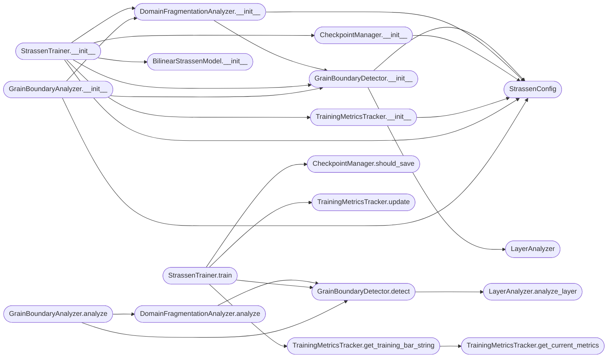

# `grain`

> Source: [grain.py:1](../../grain.py#L1) | language `py` | coverage 0.0% | [API index](../index.md)

## Contents

- **Classes:** [`StrassenConfig`](#strassenconfig), [`BilinearStrassenModel`](#bilinearstrassenmodel), [`LayerAnalyzer`](#layeranalyzer), [`GrainBoundaryDetector`](#grainboundarydetector), [`DomainFragmentationAnalyzer`](#domainfragmentationanalyzer), [`CheckpointManager`](#checkpointmanager), [`TrainingMetricsTracker`](#trainingmetricstracker), [`StrassenTrainer`](#strassentrainer), [`GrainBoundaryAnalyzer`](#grainboundaryanalyzer), [`GrainBoundaryPipeline`](#grainboundarypipeline)
- **Protocols:** [`IModel`](#imodel), [`IGrainBoundaryDetector`](#igrainboundarydetector), [`ILayerAnalyzer`](#ilayeranalyzer), [`IDislocationCalculator`](#idislocationcalculator), [`IDomainFragmentationAnalyzer`](#idomainfragmentationanalyzer), [`ICheckpointManager`](#icheckpointmanager), [`ITrainingMonitor`](#itrainingmonitor)
- **Functions:** [`run_training`](#run_training), [`run_analysis`](#run_analysis), [`main`](#main)

## Type Diagram

```mermaid
classDiagram
    direction LR
    class StrassenConfig
    StrassenConfig : int HIDDEN_DIM
    StrassenConfig : int MATRIX_SIZE
    StrassenConfig : int TARGET_SLOTS
    StrassenConfig : int BATCH_SIZE
    StrassenConfig : float LEARNING_RATE
    StrassenConfig : float WEIGHT_DECAY
    StrassenConfig : int MAX_EPOCHS
    StrassenConfig : int PATIENCE
    StrassenConfig : float DISCRETIZATION_MARGIN
    StrassenConfig : float PRUNING_THRESHOLD
    StrassenConfig : float CHECKPOINT_INTERVAL_MINUTES
    StrassenConfig : str CHECKPOINT_DIR
    StrassenConfig : str OUTPUT_DIR
    StrassenConfig : int GRAIN_BOUNDARY_LAYERS
    StrassenConfig : int ENTROPY_BINS
    StrassenConfig : int TEMPERATURE_WINDOW
    StrassenConfig : int FIGURE_DPI
    StrassenConfig : str SAVE_FORMAT
    StrassenConfig : str DEVICE
    StrassenConfig : int RANDOM_SEED
    StrassenConfig : bool VERBOSE
    StrassenConfig : to_dict()
    class IModel
    <<protocol>> IModel
    IModel : forward()
    IModel : get_coefficients()
    class IGrainBoundaryDetector
    <<protocol>> IGrainBoundaryDetector
    IGrainBoundaryDetector : detect()
    class ILayerAnalyzer
    <<protocol>> ILayerAnalyzer
    ILayerAnalyzer : analyze_layer()
    class IDislocationCalculator
    <<protocol>> IDislocationCalculator
    IDislocationCalculator : calculate()
    class IDomainFragmentationAnalyzer
    <<protocol>> IDomainFragmentationAnalyzer
    IDomainFragmentationAnalyzer : analyze()
    class ICheckpointManager
    <<protocol>> ICheckpointManager
    ICheckpointManager : save()
    ICheckpointManager : load()
    class ITrainingMonitor
    <<protocol>> ITrainingMonitor
    ITrainingMonitor : update()
    ITrainingMonitor : should_checkpoint()
    class BilinearStrassenModel
    BilinearStrassenModel : __init__()
    BilinearStrassenModel : forward()
    BilinearStrassenModel : get_coefficients()
    class LayerAnalyzer
    LayerAnalyzer : analyze_layer()
    class GrainBoundaryDetector
    GrainBoundaryDetector : __init__()
    GrainBoundaryDetector : detect()
    class DomainFragmentationAnalyzer
    DomainFragmentationAnalyzer : __init__()
    DomainFragmentationAnalyzer : analyze()
    class CheckpointManager
    CheckpointManager : __init__()
    CheckpointManager : save()
    CheckpointManager : load()
    CheckpointManager : should_save()
    class TrainingMetricsTracker
    TrainingMetricsTracker : __init__()
    TrainingMetricsTracker : update()
    TrainingMetricsTracker : get_current_metrics()
    TrainingMetricsTracker : get_training_bar_string()
    class StrassenTrainer
    StrassenTrainer : __init__()
    StrassenTrainer : train()
    class GrainBoundaryAnalyzer
    GrainBoundaryAnalyzer : __init__()
    GrainBoundaryAnalyzer : analyze()
    class GrainBoundaryPipeline
    GrainBoundaryPipeline : __init__()
    GrainBoundaryPipeline : process_checkpoint()
    GrainBoundaryPipeline : process_directory()
    GrainBoundaryPipeline : generate_summary()
```



## Call Graph

Solid arrows stay in this module, dashed arrows leave it.



## Classes

<a id="strassenconfig"></a>

### `StrassenConfig`

`class` `dataclass` | [grain.py:25](../../grain.py#L25)

Decorators: `@dataclass(frozen=True)`

```python
class StrassenConfig
```

**Attributes**

| Name | Type | Default | Description |
|---|---|---|---|
| [`HIDDEN_DIM`](#strassenconfig-hidden_dim) | `int` | `8` |  |
| [`MATRIX_SIZE`](#strassenconfig-matrix_size) | `int` | `2` |  |
| [`TARGET_SLOTS`](#strassenconfig-target_slots) | `int` | `7` |  |
| [`BATCH_SIZE`](#strassenconfig-batch_size) | `int` | `32` |  |
| [`LEARNING_RATE`](#strassenconfig-learning_rate) | `float` | `0.001` |  |
| [`WEIGHT_DECAY`](#strassenconfig-weight_decay) | `float` | `0.0001` |  |
| [`MAX_EPOCHS`](#strassenconfig-max_epochs) | `int` | `10000` |  |
| [`PATIENCE`](#strassenconfig-patience) | `int` | `500` |  |
| [`DISCRETIZATION_MARGIN`](#strassenconfig-discretization_margin) | `float` | `0.1` |  |
| [`PRUNING_THRESHOLD`](#strassenconfig-pruning_threshold) | `float` | `0.5` |  |
| [`CHECKPOINT_INTERVAL_MINUTES`](#strassenconfig-checkpoint_interval_minutes) | `float` | `5.0` |  |
| [`CHECKPOINT_DIR`](#strassenconfig-checkpoint_dir) | `str` | `'checkpoints'` |  |
| [`OUTPUT_DIR`](#strassenconfig-output_dir) | `str` | `'grain_boundary_analysis'` |  |
| [`GRAIN_BOUNDARY_LAYERS`](#strassenconfig-grain_boundary_layers) | `int` | `3` |  |
| [`ENTROPY_BINS`](#strassenconfig-entropy_bins) | `int` | `50` |  |
| [`TEMPERATURE_WINDOW`](#strassenconfig-temperature_window) | `int` | `100` |  |
| [`FIGURE_DPI`](#strassenconfig-figure_dpi) | `int` | `150` |  |
| [`SAVE_FORMAT`](#strassenconfig-save_format) | `str` | `'png'` |  |
| [`DEVICE`](#strassenconfig-device) | `str` | `'cuda' if torch.cuda.is_available() else 'cpu'` |  |
| [`RANDOM_SEED`](#strassenconfig-random_seed) | `int` | `42` |  |
| [`VERBOSE`](#strassenconfig-verbose) | `bool` | `True` |  |

**Members**

| Member | Kind | Summary |
|---|---|---|
| [`to_dict`](#strassenconfig-to_dict) | method |  |

<a id="strassenconfig-to_dict"></a>

#### `StrassenConfig.to_dict`

`method` | [grain.py:57](../../grain.py#L57)

```python
def to_dict(self) -> Dict[str, Any]
```

**Returns:** `Dict[str, Any]`

---

<a id="bilinearstrassenmodel"></a>

### `BilinearStrassenModel`

`class` | [grain.py:102](../../grain.py#L102)

```python
class BilinearStrassenModel(nn.Module)
```

Bases: `nn.Module`

**Members**

| Member | Kind | Summary |
|---|---|---|
| [`__init__`](#bilinearstrassenmodel-__init__) | constructor |  |
| [`forward`](#bilinearstrassenmodel-forward) | method |  |
| [`get_coefficients`](#bilinearstrassenmodel-get_coefficients) | method |  |

<a id="bilinearstrassenmodel-__init__"></a>

#### `BilinearStrassenModel.__init__`

`constructor` | [grain.py:103](../../grain.py#L103)

```python
def __init__(self, hidden_dim: int = StrassenConfig.HIDDEN_DIM, matrix_size: int = StrassenConfig.MATRIX_SIZE)
```

**Parameters**

| Name | Type | Default | Description |
|---|---|---|---|
| `hidden_dim` | `int` | `StrassenConfig.HIDDEN_DIM` |  |
| `matrix_size` | `int` | `StrassenConfig.MATRIX_SIZE` |  |

*Calls:* [`BilinearStrassenModel.__init__`](batch_size.py.md#bilinearstrassenmodel-__init__)

*Called by:* [`StrassenTrainer.__init__`](#strassentrainer-__init__)

<a id="bilinearstrassenmodel-forward"></a>

#### `BilinearStrassenModel.forward`

`method` | [grain.py:119](../../grain.py#L119)

```python
def forward(self, a: torch.Tensor, b: torch.Tensor) -> torch.Tensor
```

**Parameters**

| Name | Type | Default | Description |
|---|---|---|---|
| `a` | `torch.Tensor` |  |  |
| `b` | `torch.Tensor` |  |  |

**Returns:** `torch.Tensor`

<a id="bilinearstrassenmodel-get_coefficients"></a>

#### `BilinearStrassenModel.get_coefficients`

`method` | [grain.py:122](../../grain.py#L122)

```python
def get_coefficients(self) -> Dict[str, torch.Tensor]
```

**Returns:** `Dict[str, torch.Tensor]`

---

<a id="layeranalyzer"></a>

### `LayerAnalyzer`

`class` | [grain.py:130](../../grain.py#L130)

```python
class LayerAnalyzer
```

**Members**

| Member | Kind | Summary |
|---|---|---|
| [`analyze_layer`](#layeranalyzer-analyze_layer) | method |  |

<a id="layeranalyzer-analyze_layer"></a>

#### `LayerAnalyzer.analyze_layer`

`method` | [grain.py:131](../../grain.py#L131)

```python
def analyze_layer(self, weights: torch.Tensor, layer_name: str) -> Dict[str, float]
```

**Parameters**

| Name | Type | Default | Description |
|---|---|---|---|
| `weights` | `torch.Tensor` |  |  |
| `layer_name` | `str` |  |  |

**Returns:** `Dict[str, float]`

*Called by:* [`GrainBoundaryDetector.detect`](#grainboundarydetector-detect)

---

<a id="grainboundarydetector"></a>

### `GrainBoundaryDetector`

`class` | [grain.py:153](../../grain.py#L153)

```python
class GrainBoundaryDetector
```

**Members**

| Member | Kind | Summary |
|---|---|---|
| [`__init__`](#grainboundarydetector-__init__) | constructor |  |
| [`detect`](#grainboundarydetector-detect) | method |  |

<a id="grainboundarydetector-__init__"></a>

#### `GrainBoundaryDetector.__init__`

`constructor` | [grain.py:154](../../grain.py#L154)

```python
def __init__(self, config: StrassenConfig = StrassenConfig())
```

**Parameters**

| Name | Type | Default | Description |
|---|---|---|---|
| `config` | `StrassenConfig` | `StrassenConfig()` |  |

*Calls:* [`LayerAnalyzer`](#layeranalyzer), [`StrassenConfig`](#strassenconfig)

*Called by:* [`DomainFragmentationAnalyzer.__init__`](#domainfragmentationanalyzer-__init__), [`GrainBoundaryAnalyzer.__init__`](#grainboundaryanalyzer-__init__), [`StrassenTrainer.__init__`](#strassentrainer-__init__)

<a id="grainboundarydetector-detect"></a>

#### `GrainBoundaryDetector.detect`

`method` | [grain.py:158](../../grain.py#L158)

```python
def detect(self, model: IModel, pruning_level: float) -> Dict[str, Any]
```

**Parameters**

| Name | Type | Default | Description |
|---|---|---|---|
| `model` | `IModel` |  |  |
| `pruning_level` | `float` |  |  |

**Returns:** `Dict[str, Any]`

*Calls:* [`IModel.get_coefficients`](dirac_polos_zeros.py.md#imodel-get_coefficients), [`LayerAnalyzer.analyze_layer`](#layeranalyzer-analyze_layer)

*Called by:* [`DomainFragmentationAnalyzer.analyze`](#domainfragmentationanalyzer-analyze), [`GrainBoundaryAnalyzer.analyze`](#grainboundaryanalyzer-analyze), [`StrassenTrainer.train`](#strassentrainer-train)

---

<a id="domainfragmentationanalyzer"></a>

### `DomainFragmentationAnalyzer`

`class` | [grain.py:243](../../grain.py#L243)

```python
class DomainFragmentationAnalyzer
```

**Members**

| Member | Kind | Summary |
|---|---|---|
| [`__init__`](#domainfragmentationanalyzer-__init__) | constructor |  |
| [`analyze`](#domainfragmentationanalyzer-analyze) | method |  |

<a id="domainfragmentationanalyzer-__init__"></a>

#### `DomainFragmentationAnalyzer.__init__`

`constructor` | [grain.py:244](../../grain.py#L244)

```python
def __init__(self, config: StrassenConfig = StrassenConfig())
```

**Parameters**

| Name | Type | Default | Description |
|---|---|---|---|
| `config` | `StrassenConfig` | `StrassenConfig()` |  |

*Calls:* [`GrainBoundaryDetector.__init__`](#grainboundarydetector-__init__), [`StrassenConfig`](#strassenconfig)

*Called by:* [`GrainBoundaryAnalyzer.__init__`](#grainboundaryanalyzer-__init__), [`StrassenTrainer.__init__`](#strassentrainer-__init__)

<a id="domainfragmentationanalyzer-analyze"></a>

#### `DomainFragmentationAnalyzer.analyze`

`method` | [grain.py:248](../../grain.py#L248)

```python
def analyze(self, model: IModel, pruning_level: float) -> Dict[str, Any]
```

**Parameters**

| Name | Type | Default | Description |
|---|---|---|---|
| `model` | `IModel` |  |  |
| `pruning_level` | `float` |  |  |

**Returns:** `Dict[str, Any]`

*Calls:* [`GrainBoundaryDetector.detect`](#grainboundarydetector-detect)

*Called by:* [`GrainBoundaryAnalyzer.analyze`](#grainboundaryanalyzer-analyze)

---

<a id="checkpointmanager"></a>

### `CheckpointManager`

`class` | [grain.py:309](../../grain.py#L309)

```python
class CheckpointManager
```

**Members**

| Member | Kind | Summary |
|---|---|---|
| [`__init__`](#checkpointmanager-__init__) | constructor |  |
| [`save`](#checkpointmanager-save) | method |  |
| [`load`](#checkpointmanager-load) | method |  |
| [`should_save`](#checkpointmanager-should_save) | method |  |

<a id="checkpointmanager-__init__"></a>

#### `CheckpointManager.__init__`

`constructor` | [grain.py:310](../../grain.py#L310)

```python
def __init__(self, config: StrassenConfig = StrassenConfig())
```

**Parameters**

| Name | Type | Default | Description |
|---|---|---|---|
| `config` | `StrassenConfig` | `StrassenConfig()` |  |

*Calls:* [`StrassenConfig`](#strassenconfig)

*Called by:* [`StrassenTrainer.__init__`](#strassentrainer-__init__)

<a id="checkpointmanager-save"></a>

#### `CheckpointManager.save`

`method` | [grain.py:314](../../grain.py#L314)

```python
def save(self, model: IModel, epoch: int, metrics: Dict[str, Any], path: str)
```

**Parameters**

| Name | Type | Default | Description |
|---|---|---|---|
| `model` | `IModel` |  |  |
| `epoch` | `int` |  |  |
| `metrics` | `Dict[str, Any]` |  |  |
| `path` | `str` |  |  |

<a id="checkpointmanager-load"></a>

#### `CheckpointManager.load`

`method` | [grain.py:332](../../grain.py#L332)

```python
def load(self, path: str) -> Dict[str, Any]
```

**Parameters**

| Name | Type | Default | Description |
|---|---|---|---|
| `path` | `str` |  |  |

**Returns:** `Dict[str, Any]`

<a id="checkpointmanager-should_save"></a>

#### `CheckpointManager.should_save`

`method` | [grain.py:335](../../grain.py#L335)

```python
def should_save(self) -> bool
```

**Returns:** `bool`

*Called by:* [`StrassenTrainer.train`](#strassentrainer-train), [`MaxwellAnalyzer.analyze_checkpoint`](maxwell_strassen_analysis.py.md#maxwellanalyzer-analyze_checkpoint)

---

<a id="trainingmetricstracker"></a>

### `TrainingMetricsTracker`

`class` | [grain.py:340](../../grain.py#L340)

```python
class TrainingMetricsTracker
```

**Members**

| Member | Kind | Summary |
|---|---|---|
| [`__init__`](#trainingmetricstracker-__init__) | constructor |  |
| [`update`](#trainingmetricstracker-update) | method |  |
| [`get_current_metrics`](#trainingmetricstracker-get_current_metrics) | method |  |
| [`get_training_bar_string`](#trainingmetricstracker-get_training_bar_string) | method |  |

<a id="trainingmetricstracker-__init__"></a>

#### `TrainingMetricsTracker.__init__`

`constructor` | [grain.py:341](../../grain.py#L341)

```python
def __init__(self, config: StrassenConfig = StrassenConfig())
```

**Parameters**

| Name | Type | Default | Description |
|---|---|---|---|
| `config` | `StrassenConfig` | `StrassenConfig()` |  |

*Calls:* [`StrassenConfig`](#strassenconfig)

*Called by:* [`StrassenTrainer.__init__`](#strassentrainer-__init__)

<a id="trainingmetricstracker-update"></a>

#### `TrainingMetricsTracker.update`

`method` | [grain.py:358](../../grain.py#L358)

```python
def update(self, epoch: int, loss: float, accuracy: float, model: IModel, grain_result: Optional[Dict] = None)
```

**Parameters**

| Name | Type | Default | Description |
|---|---|---|---|
| `epoch` | `int` |  |  |
| `loss` | `float` |  |  |
| `accuracy` | `float` |  |  |
| `model` | `IModel` |  |  |
| `grain_result` | `Optional[Dict]` | `None` |  |

*Calls:* [`IModel.get_coefficients`](dirac_polos_zeros.py.md#imodel-get_coefficients)

*Called by:* [`StrassenTrainer.train`](#strassentrainer-train)

<a id="trainingmetricstracker-get_current_metrics"></a>

#### `TrainingMetricsTracker.get_current_metrics`

`method` | [grain.py:382](../../grain.py#L382)

```python
def get_current_metrics(self) -> Dict[str, float]
```

**Returns:** `Dict[str, float]`

*Called by:* [`TrainingMetricsTracker.get_training_bar_string`](#trainingmetricstracker-get_training_bar_string)

<a id="trainingmetricstracker-get_training_bar_string"></a>

#### `TrainingMetricsTracker.get_training_bar_string`

`method` | [grain.py:389](../../grain.py#L389)

```python
def get_training_bar_string(self, epoch: int, total_epochs: int) -> str
```

**Parameters**

| Name | Type | Default | Description |
|---|---|---|---|
| `epoch` | `int` |  |  |
| `total_epochs` | `int` |  |  |

**Returns:** `str`

*Calls:* [`TrainingMetricsTracker.get_current_metrics`](#trainingmetricstracker-get_current_metrics)

*Called by:* [`StrassenTrainer.train`](#strassentrainer-train)

---

<a id="strassentrainer"></a>

### `StrassenTrainer`

`class` | [grain.py:407](../../grain.py#L407)

```python
class StrassenTrainer
```

**Members**

| Member | Kind | Summary |
|---|---|---|
| [`__init__`](#strassentrainer-__init__) | constructor |  |
| [`train`](#strassentrainer-train) | method |  |

<a id="strassentrainer-__init__"></a>

#### `StrassenTrainer.__init__`

`constructor` | [grain.py:408](../../grain.py#L408)

```python
def __init__(self, config: StrassenConfig = StrassenConfig(), seed: int = None)
```

**Parameters**

| Name | Type | Default | Description |
|---|---|---|---|
| `config` | `StrassenConfig` | `StrassenConfig()` |  |
| `seed` | `int` | `None` |  |

*Calls:* [`BilinearStrassenModel.__init__`](#bilinearstrassenmodel-__init__), [`CheckpointManager.__init__`](#checkpointmanager-__init__), [`DomainFragmentationAnalyzer.__init__`](#domainfragmentationanalyzer-__init__), [`GrainBoundaryDetector.__init__`](#grainboundarydetector-__init__), [`StrassenConfig`](#strassenconfig), [`TrainingMetricsTracker.__init__`](#trainingmetricstracker-__init__)

*Called by:* [`run_training`](#run_training)

<a id="strassentrainer-train"></a>

#### `StrassenTrainer.train`

`method` | [grain.py:486](../../grain.py#L486)

```python
def train(self)
```

*Calls:* [`CheckpointManager.should_save`](#checkpointmanager-should_save), [`GrainBoundaryDetector.detect`](#grainboundarydetector-detect), [`TrainingMetricsTracker.get_training_bar_string`](#trainingmetricstracker-get_training_bar_string), [`TrainingMetricsTracker.update`](#trainingmetricstracker-update)

*Called by:* [`run_training`](#run_training)

---

<a id="grainboundaryanalyzer"></a>

### `GrainBoundaryAnalyzer`

`class` | [grain.py:547](../../grain.py#L547)

```python
class GrainBoundaryAnalyzer
```

**Members**

| Member | Kind | Summary |
|---|---|---|
| [`__init__`](#grainboundaryanalyzer-__init__) | constructor |  |
| [`analyze`](#grainboundaryanalyzer-analyze) | method |  |

<a id="grainboundaryanalyzer-__init__"></a>

#### `GrainBoundaryAnalyzer.__init__`

`constructor` | [grain.py:548](../../grain.py#L548)

```python
def __init__(self, checkpoint_path: str, config: StrassenConfig = StrassenConfig())
```

**Parameters**

| Name | Type | Default | Description |
|---|---|---|---|
| `checkpoint_path` | `str` |  |  |
| `config` | `StrassenConfig` | `StrassenConfig()` |  |

*Calls:* [`DomainFragmentationAnalyzer.__init__`](#domainfragmentationanalyzer-__init__), [`GrainBoundaryDetector.__init__`](#grainboundarydetector-__init__), [`StrassenConfig`](#strassenconfig)

*Called by:* [`GrainBoundaryPipeline.process_checkpoint`](#grainboundarypipeline-process_checkpoint)

<a id="grainboundaryanalyzer-analyze"></a>

#### `GrainBoundaryAnalyzer.analyze`

`method` | [grain.py:628](../../grain.py#L628)

```python
def analyze(self) -> Dict[str, Any]
```

**Returns:** `Dict[str, Any]`

*Calls:* [`DomainFragmentationAnalyzer.analyze`](#domainfragmentationanalyzer-analyze), [`GrainBoundaryDetector.detect`](#grainboundarydetector-detect)

*Called by:* [`GrainBoundaryPipeline.process_checkpoint`](#grainboundarypipeline-process_checkpoint)

---

<a id="grainboundarypipeline"></a>

### `GrainBoundaryPipeline`

`class` | [grain.py:726](../../grain.py#L726)

```python
class GrainBoundaryPipeline
```

**Members**

| Member | Kind | Summary |
|---|---|---|
| [`__init__`](#grainboundarypipeline-__init__) | constructor |  |
| [`process_checkpoint`](#grainboundarypipeline-process_checkpoint) | method |  |
| [`process_directory`](#grainboundarypipeline-process_directory) | method |  |
| [`generate_summary`](#grainboundarypipeline-generate_summary) | method |  |

<a id="grainboundarypipeline-__init__"></a>

#### `GrainBoundaryPipeline.__init__`

`constructor` | [grain.py:727](../../grain.py#L727)

```python
def __init__(self, config: StrassenConfig = StrassenConfig())
```

**Parameters**

| Name | Type | Default | Description |
|---|---|---|---|
| `config` | `StrassenConfig` | `StrassenConfig()` |  |

*Calls:* [`StrassenConfig`](#strassenconfig)

*Called by:* [`main`](#main), [`run_analysis`](#run_analysis)

<a id="grainboundarypipeline-process_checkpoint"></a>

#### `GrainBoundaryPipeline.process_checkpoint`

`method` | [grain.py:730](../../grain.py#L730)

```python
def process_checkpoint(self, checkpoint_path: str, output_dir: str) -> Dict[str, Any]
```

**Parameters**

| Name | Type | Default | Description |
|---|---|---|---|
| `checkpoint_path` | `str` |  |  |
| `output_dir` | `str` |  |  |

**Returns:** `Dict[str, Any]`

*Calls:* [`GrainBoundaryAnalyzer.__init__`](#grainboundaryanalyzer-__init__), [`GrainBoundaryAnalyzer.analyze`](#grainboundaryanalyzer-analyze)

*Called by:* [`GrainBoundaryPipeline.process_directory`](#grainboundarypipeline-process_directory), [`main`](#main)

<a id="grainboundarypipeline-process_directory"></a>

#### `GrainBoundaryPipeline.process_directory`

`method` | [grain.py:744](../../grain.py#L744)

```python
def process_directory(self, checkpoint_dir: str, n_latest: Optional[int], output_dir: str) -> List[Dict[str, Any]]
```

**Parameters**

| Name | Type | Default | Description |
|---|---|---|---|
| `checkpoint_dir` | `str` |  |  |
| `n_latest` | `Optional[int]` |  |  |
| `output_dir` | `str` |  |  |

**Returns:** `List[Dict[str, Any]]`

*Calls:* [`GrainBoundaryPipeline.process_checkpoint`](#grainboundarypipeline-process_checkpoint)

*Called by:* [`run_analysis`](#run_analysis)

<a id="grainboundarypipeline-generate_summary"></a>

#### `GrainBoundaryPipeline.generate_summary`

`method` | [grain.py:771](../../grain.py#L771)

```python
def generate_summary(self, all_results: List[Dict[str, Any]], output_dir: str) -> None
```

**Parameters**

| Name | Type | Default | Description |
|---|---|---|---|
| `all_results` | `List[Dict[str, Any]]` |  |  |
| `output_dir` | `str` |  |  |

*Called by:* [`run_analysis`](#run_analysis)

---

## Protocols

<a id="imodel"></a>

### `IModel`

`protocol` | [grain.py:65](../../grain.py#L65)

Decorators: `@runtime_checkable`

```python
class IModel(Protocol)
```

Bases: `Protocol`

**Members**

| Member | Kind | Summary |
|---|---|---|
| [`forward`](#imodel-forward) | method |  |
| [`get_coefficients`](#imodel-get_coefficients) | method |  |

<a id="imodel-forward"></a>

#### `IModel.forward`

`method` | [grain.py:66](../../grain.py#L66)

```python
def forward(self, a: torch.Tensor, b: torch.Tensor) -> torch.Tensor
```

**Parameters**

| Name | Type | Default | Description |
|---|---|---|---|
| `a` | `torch.Tensor` |  |  |
| `b` | `torch.Tensor` |  |  |

**Returns:** `torch.Tensor`

<a id="imodel-get_coefficients"></a>

#### `IModel.get_coefficients`

`method` | [grain.py:67](../../grain.py#L67)

```python
def get_coefficients(self) -> Dict[str, torch.Tensor]
```

**Returns:** `Dict[str, torch.Tensor]`

---

<a id="igrainboundarydetector"></a>

### `IGrainBoundaryDetector`

`protocol` | [grain.py:71](../../grain.py#L71)

Decorators: `@runtime_checkable`

```python
class IGrainBoundaryDetector(Protocol)
```

Bases: `Protocol`

**Members**

| Member | Kind | Summary |
|---|---|---|
| [`detect`](#igrainboundarydetector-detect) | method |  |

<a id="igrainboundarydetector-detect"></a>

#### `IGrainBoundaryDetector.detect`

`method` | [grain.py:72](../../grain.py#L72)

```python
def detect(self, model: IModel, pruning_level: float) -> Dict[str, Any]
```

**Parameters**

| Name | Type | Default | Description |
|---|---|---|---|
| `model` | `IModel` |  |  |
| `pruning_level` | `float` |  |  |

**Returns:** `Dict[str, Any]`

---

<a id="ilayeranalyzer"></a>

### `ILayerAnalyzer`

`protocol` | [grain.py:76](../../grain.py#L76)

Decorators: `@runtime_checkable`

```python
class ILayerAnalyzer(Protocol)
```

Bases: `Protocol`

**Members**

| Member | Kind | Summary |
|---|---|---|
| [`analyze_layer`](#ilayeranalyzer-analyze_layer) | method |  |

<a id="ilayeranalyzer-analyze_layer"></a>

#### `ILayerAnalyzer.analyze_layer`

`method` | [grain.py:77](../../grain.py#L77)

```python
def analyze_layer(self, weights: torch.Tensor, layer_name: str) -> Dict[str, float]
```

**Parameters**

| Name | Type | Default | Description |
|---|---|---|---|
| `weights` | `torch.Tensor` |  |  |
| `layer_name` | `str` |  |  |

**Returns:** `Dict[str, float]`

---

<a id="idislocationcalculator"></a>

### `IDislocationCalculator`

`protocol` | [grain.py:81](../../grain.py#L81)

Decorators: `@runtime_checkable`

```python
class IDislocationCalculator(Protocol)
```

Bases: `Protocol`

**Members**

| Member | Kind | Summary |
|---|---|---|
| [`calculate`](#idislocationcalculator-calculate) | method |  |

<a id="idislocationcalculator-calculate"></a>

#### `IDislocationCalculator.calculate`

`method` | [grain.py:82](../../grain.py#L82)

```python
def calculate(self, layer_deltas: Dict[str, float]) -> Dict[str, Any]
```

**Parameters**

| Name | Type | Default | Description |
|---|---|---|---|
| `layer_deltas` | `Dict[str, float]` |  |  |

**Returns:** `Dict[str, Any]`

---

<a id="idomainfragmentationanalyzer"></a>

### `IDomainFragmentationAnalyzer`

`protocol` | [grain.py:86](../../grain.py#L86)

Decorators: `@runtime_checkable`

```python
class IDomainFragmentationAnalyzer(Protocol)
```

Bases: `Protocol`

**Members**

| Member | Kind | Summary |
|---|---|---|
| [`analyze`](#idomainfragmentationanalyzer-analyze) | method |  |

<a id="idomainfragmentationanalyzer-analyze"></a>

#### `IDomainFragmentationAnalyzer.analyze`

`method` | [grain.py:87](../../grain.py#L87)

```python
def analyze(self, model: IModel, pruning_level: float) -> Dict[str, Any]
```

**Parameters**

| Name | Type | Default | Description |
|---|---|---|---|
| `model` | `IModel` |  |  |
| `pruning_level` | `float` |  |  |

**Returns:** `Dict[str, Any]`

---

<a id="icheckpointmanager"></a>

### `ICheckpointManager`

`protocol` | [grain.py:91](../../grain.py#L91)

Decorators: `@runtime_checkable`

```python
class ICheckpointManager(Protocol)
```

Bases: `Protocol`

**Members**

| Member | Kind | Summary |
|---|---|---|
| [`save`](#icheckpointmanager-save) | method |  |
| [`load`](#icheckpointmanager-load) | method |  |

<a id="icheckpointmanager-save"></a>

#### `ICheckpointManager.save`

`method` | [grain.py:92](../../grain.py#L92)

```python
def save(self, model: IModel, epoch: int, metrics: Dict[str, Any], path: str) -> None
```

**Parameters**

| Name | Type | Default | Description |
|---|---|---|---|
| `model` | `IModel` |  |  |
| `epoch` | `int` |  |  |
| `metrics` | `Dict[str, Any]` |  |  |
| `path` | `str` |  |  |

<a id="icheckpointmanager-load"></a>

#### `ICheckpointManager.load`

`method` | [grain.py:93](../../grain.py#L93)

```python
def load(self, path: str) -> Dict[str, Any]
```

**Parameters**

| Name | Type | Default | Description |
|---|---|---|---|
| `path` | `str` |  |  |

**Returns:** `Dict[str, Any]`

---

<a id="itrainingmonitor"></a>

### `ITrainingMonitor`

`protocol` | [grain.py:97](../../grain.py#L97)

Decorators: `@runtime_checkable`

```python
class ITrainingMonitor(Protocol)
```

Bases: `Protocol`

**Members**

| Member | Kind | Summary |
|---|---|---|
| [`update`](#itrainingmonitor-update) | method |  |
| [`should_checkpoint`](#itrainingmonitor-should_checkpoint) | method |  |

<a id="itrainingmonitor-update"></a>

#### `ITrainingMonitor.update`

`method` | [grain.py:98](../../grain.py#L98)

```python
def update(self, epoch: int, metrics: Dict[str, Any]) -> None
```

**Parameters**

| Name | Type | Default | Description |
|---|---|---|---|
| `epoch` | `int` |  |  |
| `metrics` | `Dict[str, Any]` |  |  |

<a id="itrainingmonitor-should_checkpoint"></a>

#### `ITrainingMonitor.should_checkpoint`

`method` | [grain.py:99](../../grain.py#L99)

```python
def should_checkpoint(self) -> bool
```

**Returns:** `bool`

---

## Functions

<a id="run_training"></a>

### `run_training`

`function` | [grain.py:833](../../grain.py#L833)

```python
def run_training(seed: int, config: StrassenConfig)
```

**Parameters**

| Name | Type | Default | Description |
|---|---|---|---|
| `seed` | `int` |  |  |
| `config` | `StrassenConfig` |  |  |

*Calls:* [`StrassenTrainer.__init__`](#strassentrainer-__init__), [`StrassenTrainer.train`](#strassentrainer-train)

*Called by:* [`main`](#main)

---

<a id="run_analysis"></a>

### `run_analysis`

`function` | [grain.py:838](../../grain.py#L838)

```python
def run_analysis(checkpoint_dir: str, output_dir: str, n_latest: Optional[int], config: StrassenConfig)
```

**Parameters**

| Name | Type | Default | Description |
|---|---|---|---|
| `checkpoint_dir` | `str` |  |  |
| `output_dir` | `str` |  |  |
| `n_latest` | `Optional[int]` |  |  |
| `config` | `StrassenConfig` |  |  |

*Calls:* [`GrainBoundaryPipeline.__init__`](#grainboundarypipeline-__init__), [`GrainBoundaryPipeline.generate_summary`](#grainboundarypipeline-generate_summary), [`GrainBoundaryPipeline.process_directory`](#grainboundarypipeline-process_directory)

*Called by:* [`main`](#main)

---

<a id="main"></a>

### `main`

`function` | [grain.py:845](../../grain.py#L845)

```python
def main()
```

*Calls:* [`GrainBoundaryPipeline.__init__`](#grainboundarypipeline-__init__), [`GrainBoundaryPipeline.process_checkpoint`](#grainboundarypipeline-process_checkpoint), [`StrassenConfig`](#strassenconfig), [`run_analysis`](#run_analysis), [`run_training`](#run_training)

---
