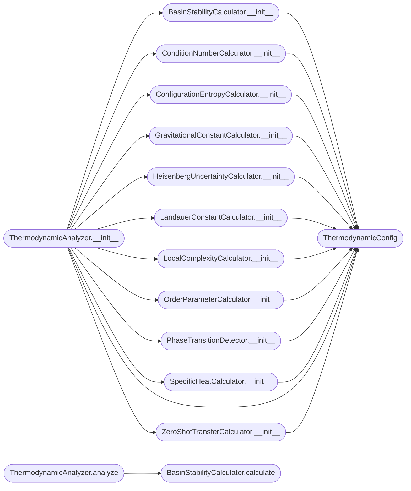

# `gravity`

> Source: [gravity.py:1](../../gravity.py#L1) | language `py` | coverage 0.0% | [API index](../index.md)

## Contents

- **Classes:** [`ThermodynamicConfig`](#thermodynamicconfig), [`BilinearModel`](#bilinearmodel), [`OrderParameterCalculator`](#orderparametercalculator), [`ConfigurationEntropyCalculator`](#configurationentropycalculator), [`SpecificHeatCalculator`](#specificheatcalculator), [`GravitationalConstantCalculator`](#gravitationalconstantcalculator), [`LandauerConstantCalculator`](#landauerconstantcalculator), [`HeisenbergUncertaintyCalculator`](#heisenberguncertaintycalculator), [`LocalComplexityCalculator`](#localcomplexitycalculator), [`BasinStabilityCalculator`](#basinstabilitycalculator), [`ZeroShotTransferCalculator`](#zeroshottransfercalculator), [`ConditionNumberCalculator`](#conditionnumbercalculator), [`PhaseTransitionDetector`](#phasetransitiondetector), [`ThermodynamicAnalyzer`](#thermodynamicanalyzer), [`ThermodynamicPipeline`](#thermodynamicpipeline)
- **Protocols:** [`IModel`](#imodel), [`IOrderParameterCalculator`](#iorderparametercalculator), [`IEntropyCalculator`](#ientropycalculator), [`ISpecificHeatCalculator`](#ispecificheatcalculator), [`IGravitationalConstantCalculator`](#igravitationalconstantcalculator), [`ILandauerConstantCalculator`](#ilandauerconstantcalculator), [`IHeisenbergUncertaintyCalculator`](#iheisenberguncertaintycalculator), [`ILocalComplexityCalculator`](#ilocalcomplexitycalculator), [`IBasinStabilityCalculator`](#ibasinstabilitycalculator), [`IZeroShotTransferCalculator`](#izeroshottransfercalculator), [`IConditionNumberCalculator`](#iconditionnumbercalculator)
- **Functions:** [`main`](#main)

## Type Diagram

```mermaid
classDiagram
    direction LR
    class ThermodynamicConfig
    ThermodynamicConfig : int BATCH_SIZE
    ThermodynamicConfig : int HIDDEN_DIM
    ThermodynamicConfig : int MATRIX_SIZE
    ThermodynamicConfig : float WEIGHT_DECAY
    ThermodynamicConfig : float LEARNING_RATE
    ThermodynamicConfig : float EPSILON_0
    ThermodynamicConfig : float DELTA_THRESHOLD
    ThermodynamicConfig : float GAUSSIAN_SIGMA
    ThermodynamicConfig : int SPATIAL_RESOLUTION
    ThermodynamicConfig : int FLUX_INTEGRATION_SAMPLES
    ThermodynamicConfig : float POLE_ZERO_TOLERANCE
    ThermodynamicConfig : float STABILITY_MARGIN
    ThermodynamicConfig : int FREQUENCY_SAMPLES
    ThermodynamicConfig : float FREQUENCY_MIN
    ThermodynamicConfig : float FREQUENCY_MAX
    ThermodynamicConfig : int TIME_SAMPLES
    ThermodynamicConfig : float TIME_MAX
    ThermodynamicConfig : str COLORMAP
    ThermodynamicConfig : int FIGURE_DPI
    ThermodynamicConfig : str SAVE_FORMAT
    ThermodynamicConfig : str DEVICE
    ThermodynamicConfig : int ENTROPY_BINS
    ThermodynamicConfig : int TEMPERATURE_WINDOW
    ThermodynamicConfig : int G_ALG_WINDOW
    class IModel
    <<protocol>> IModel
    IModel : forward()
    IModel : get_coefficients()
    class IOrderParameterCalculator
    <<protocol>> IOrderParameterCalculator
    IOrderParameterCalculator : calculate()
    class IEntropyCalculator
    <<protocol>> IEntropyCalculator
    IEntropyCalculator : calculate()
    class ISpecificHeatCalculator
    <<protocol>> ISpecificHeatCalculator
    ISpecificHeatCalculator : calculate()
    class IGravitationalConstantCalculator
    <<protocol>> IGravitationalConstantCalculator
    IGravitationalConstantCalculator : calculate()
    class ILandauerConstantCalculator
    <<protocol>> ILandauerConstantCalculator
    ILandauerConstantCalculator : calculate()
    class IHeisenbergUncertaintyCalculator
    <<protocol>> IHeisenbergUncertaintyCalculator
    IHeisenbergUncertaintyCalculator : calculate()
    class ILocalComplexityCalculator
    <<protocol>> ILocalComplexityCalculator
    ILocalComplexityCalculator : calculate()
    class IBasinStabilityCalculator
    <<protocol>> IBasinStabilityCalculator
    IBasinStabilityCalculator : calculate()
    class IZeroShotTransferCalculator
    <<protocol>> IZeroShotTransferCalculator
    IZeroShotTransferCalculator : calculate()
    class IConditionNumberCalculator
    <<protocol>> IConditionNumberCalculator
    IConditionNumberCalculator : calculate()
    class BilinearModel
    BilinearModel : __init__()
    BilinearModel : forward()
    BilinearModel : get_coefficients()
    class OrderParameterCalculator
    OrderParameterCalculator : __init__()
    OrderParameterCalculator : calculate()
    class ConfigurationEntropyCalculator
    ConfigurationEntropyCalculator : __init__()
    ConfigurationEntropyCalculator : calculate()
    class SpecificHeatCalculator
    SpecificHeatCalculator : __init__()
    SpecificHeatCalculator : calculate()
    class GravitationalConstantCalculator
    GravitationalConstantCalculator : __init__()
    GravitationalConstantCalculator : calculate()
    class LandauerConstantCalculator
    LandauerConstantCalculator : __init__()
    LandauerConstantCalculator : calculate()
    class HeisenbergUncertaintyCalculator
    HeisenbergUncertaintyCalculator : __init__()
    HeisenbergUncertaintyCalculator : calculate()
    class LocalComplexityCalculator
    LocalComplexityCalculator : __init__()
    LocalComplexityCalculator : calculate()
    class BasinStabilityCalculator
    BasinStabilityCalculator : __init__()
    BasinStabilityCalculator : calculate()
    class ZeroShotTransferCalculator
    ZeroShotTransferCalculator : __init__()
    ZeroShotTransferCalculator : calculate()
    class ConditionNumberCalculator
    ConditionNumberCalculator : __init__()
    ConditionNumberCalculator : calculate()
    class PhaseTransitionDetector
    PhaseTransitionDetector : __init__()
    PhaseTransitionDetector : detect()
```



## Call Graph

Solid arrows stay in this module, dashed arrows leave it.



## Classes

<a id="thermodynamicconfig"></a>

### `ThermodynamicConfig`

`class` `dataclass` | [gravity.py:24](../../gravity.py#L24)

Decorators: `@dataclass(frozen=True)`

```python
class ThermodynamicConfig
```

**Attributes**

| Name | Type | Default | Description |
|---|---|---|---|
| [`BATCH_SIZE`](#thermodynamicconfig-batch_size) | `int` | `32` |  |
| [`HIDDEN_DIM`](#thermodynamicconfig-hidden_dim) | `int` | `8` |  |
| [`MATRIX_SIZE`](#thermodynamicconfig-matrix_size) | `int` | `2` |  |
| [`WEIGHT_DECAY`](#thermodynamicconfig-weight_decay) | `float` | `0.0001` |  |
| [`LEARNING_RATE`](#thermodynamicconfig-learning_rate) | `float` | `0.001` |  |
| [`EPSILON_0`](#thermodynamicconfig-epsilon_0) | `float` | `8.854187817e-12` |  |
| [`DELTA_THRESHOLD`](#thermodynamicconfig-delta_threshold) | `float` | `1e-06` |  |
| [`GAUSSIAN_SIGMA`](#thermodynamicconfig-gaussian_sigma) | `float` | `0.1` |  |
| [`SPATIAL_RESOLUTION`](#thermodynamicconfig-spatial_resolution) | `int` | `100` |  |
| [`FLUX_INTEGRATION_SAMPLES`](#thermodynamicconfig-flux_integration_samples) | `int` | `1000` |  |
| [`POLE_ZERO_TOLERANCE`](#thermodynamicconfig-pole_zero_tolerance) | `float` | `1e-06` |  |
| [`STABILITY_MARGIN`](#thermodynamicconfig-stability_margin) | `float` | `0.01` |  |
| [`FREQUENCY_SAMPLES`](#thermodynamicconfig-frequency_samples) | `int` | `1000` |  |
| [`FREQUENCY_MIN`](#thermodynamicconfig-frequency_min) | `float` | `0.001` |  |
| [`FREQUENCY_MAX`](#thermodynamicconfig-frequency_max) | `float` | `1000.0` |  |
| [`TIME_SAMPLES`](#thermodynamicconfig-time_samples) | `int` | `500` |  |
| [`TIME_MAX`](#thermodynamicconfig-time_max) | `float` | `10.0` |  |
| [`COLORMAP`](#thermodynamicconfig-colormap) | `str` | `'viridis'` |  |
| [`FIGURE_DPI`](#thermodynamicconfig-figure_dpi) | `int` | `150` |  |
| [`SAVE_FORMAT`](#thermodynamicconfig-save_format) | `str` | `'png'` |  |
| [`DEVICE`](#thermodynamicconfig-device) | `str` | `'cuda' if torch.cuda.is_available() else 'cpu'` |  |
| [`ENTROPY_BINS`](#thermodynamicconfig-entropy_bins) | `int` | `50` |  |
| [`TEMPERATURE_WINDOW`](#thermodynamicconfig-temperature_window) | `int` | `100` |  |
| [`G_ALG_WINDOW`](#thermodynamicconfig-g_alg_window) | `int` | `10` |  |
| [`LANDAUER_THRESHOLD`](#thermodynamicconfig-landauer_threshold) | `float` | `1e-10` |  |
| [`HEISENBERG_TOLERANCE`](#thermodynamicconfig-heisenberg_tolerance) | `float` | `1e-06` |  |

---

<a id="bilinearmodel"></a>

### `BilinearModel`

`class` | [gravity.py:114](../../gravity.py#L114)

```python
class BilinearModel(nn.Module)
```

Bases: `nn.Module`

**Members**

| Member | Kind | Summary |
|---|---|---|
| [`__init__`](#bilinearmodel-__init__) | constructor |  |
| [`forward`](#bilinearmodel-forward) | method |  |
| [`get_coefficients`](#bilinearmodel-get_coefficients) | method |  |

<a id="bilinearmodel-__init__"></a>

#### `BilinearModel.__init__`

`constructor` | [gravity.py:115](../../gravity.py#L115)

```python
def __init__(self, hidden_dim: int = ThermodynamicConfig.HIDDEN_DIM, matrix_size: int = ThermodynamicConfig.MATRIX_SIZE)
```

**Parameters**

| Name | Type | Default | Description |
|---|---|---|---|
| `hidden_dim` | `int` | `ThermodynamicConfig.HIDDEN_DIM` |  |
| `matrix_size` | `int` | `ThermodynamicConfig.MATRIX_SIZE` |  |

*Calls:* [`BilinearModel.__init__`](dirac_polos_zeros.py.md#bilinearmodel-__init__)

<a id="bilinearmodel-forward"></a>

#### `BilinearModel.forward`

`method` | [gravity.py:131](../../gravity.py#L131)

```python
def forward(self, a: torch.Tensor, b: torch.Tensor) -> torch.Tensor
```

**Parameters**

| Name | Type | Default | Description |
|---|---|---|---|
| `a` | `torch.Tensor` |  |  |
| `b` | `torch.Tensor` |  |  |

**Returns:** `torch.Tensor`

<a id="bilinearmodel-get_coefficients"></a>

#### `BilinearModel.get_coefficients`

`method` | [gravity.py:134](../../gravity.py#L134)

```python
def get_coefficients(self) -> Dict[str, torch.Tensor]
```

**Returns:** `Dict[str, torch.Tensor]`

---

<a id="orderparametercalculator"></a>

### `OrderParameterCalculator`

`class` | [gravity.py:142](../../gravity.py#L142)

```python
class OrderParameterCalculator
```

**Members**

| Member | Kind | Summary |
|---|---|---|
| [`__init__`](#orderparametercalculator-__init__) | constructor |  |
| [`calculate`](#orderparametercalculator-calculate) | method |  |

<a id="orderparametercalculator-__init__"></a>

#### `OrderParameterCalculator.__init__`

`constructor` | [gravity.py:143](../../gravity.py#L143)

```python
def __init__(self, config: ThermodynamicConfig = ThermodynamicConfig())
```

**Parameters**

| Name | Type | Default | Description |
|---|---|---|---|
| `config` | `ThermodynamicConfig` | `ThermodynamicConfig()` |  |

*Calls:* [`ThermodynamicConfig`](#thermodynamicconfig)

*Called by:* [`ThermodynamicAnalyzer.__init__`](#thermodynamicanalyzer-__init__)

<a id="orderparametercalculator-calculate"></a>

#### `OrderParameterCalculator.calculate`

`method` | [gravity.py:146](../../gravity.py#L146)

```python
def calculate(self, model: IModel) -> float
```

**Parameters**

| Name | Type | Default | Description |
|---|---|---|---|
| `model` | `IModel` |  |  |

**Returns:** `float`

*Calls:* [`IModel.get_coefficients`](dirac_polos_zeros.py.md#imodel-get_coefficients)

*Called by:* [`ThermodynamicAnalyzer.analyze`](#thermodynamicanalyzer-analyze)

---

<a id="configurationentropycalculator"></a>

### `ConfigurationEntropyCalculator`

`class` | [gravity.py:154](../../gravity.py#L154)

```python
class ConfigurationEntropyCalculator
```

**Members**

| Member | Kind | Summary |
|---|---|---|
| [`__init__`](#configurationentropycalculator-__init__) | constructor |  |
| [`calculate`](#configurationentropycalculator-calculate) | method |  |

<a id="configurationentropycalculator-__init__"></a>

#### `ConfigurationEntropyCalculator.__init__`

`constructor` | [gravity.py:155](../../gravity.py#L155)

```python
def __init__(self, config: ThermodynamicConfig = ThermodynamicConfig())
```

**Parameters**

| Name | Type | Default | Description |
|---|---|---|---|
| `config` | `ThermodynamicConfig` | `ThermodynamicConfig()` |  |

*Calls:* [`ThermodynamicConfig`](#thermodynamicconfig)

*Called by:* [`ThermodynamicAnalyzer.__init__`](#thermodynamicanalyzer-__init__)

<a id="configurationentropycalculator-calculate"></a>

#### `ConfigurationEntropyCalculator.calculate`

`method` | [gravity.py:158](../../gravity.py#L158)

```python
def calculate(self, model: IModel) -> float
```

**Parameters**

| Name | Type | Default | Description |
|---|---|---|---|
| `model` | `IModel` |  |  |

**Returns:** `float`

*Calls:* [`IModel.get_coefficients`](dirac_polos_zeros.py.md#imodel-get_coefficients)

*Called by:* [`ThermodynamicAnalyzer.analyze`](#thermodynamicanalyzer-analyze)

---

<a id="specificheatcalculator"></a>

### `SpecificHeatCalculator`

`class` | [gravity.py:171](../../gravity.py#L171)

```python
class SpecificHeatCalculator
```

**Members**

| Member | Kind | Summary |
|---|---|---|
| [`__init__`](#specificheatcalculator-__init__) | constructor |  |
| [`calculate`](#specificheatcalculator-calculate) | method |  |

<a id="specificheatcalculator-__init__"></a>

#### `SpecificHeatCalculator.__init__`

`constructor` | [gravity.py:172](../../gravity.py#L172)

```python
def __init__(self, config: ThermodynamicConfig = ThermodynamicConfig())
```

**Parameters**

| Name | Type | Default | Description |
|---|---|---|---|
| `config` | `ThermodynamicConfig` | `ThermodynamicConfig()` |  |

*Calls:* [`ThermodynamicConfig`](#thermodynamicconfig)

*Called by:* [`ThermodynamicAnalyzer.__init__`](#thermodynamicanalyzer-__init__)

<a id="specificheatcalculator-calculate"></a>

#### `SpecificHeatCalculator.calculate`

`method` | [gravity.py:175](../../gravity.py#L175)

```python
def calculate(self, loss_history: List[float]) -> float
```

**Parameters**

| Name | Type | Default | Description |
|---|---|---|---|
| `loss_history` | `List[float]` |  |  |

**Returns:** `float`

*Called by:* [`ThermodynamicAnalyzer.analyze`](#thermodynamicanalyzer-analyze)

---

<a id="gravitationalconstantcalculator"></a>

### `GravitationalConstantCalculator`

`class` | [gravity.py:183](../../gravity.py#L183)

```python
class GravitationalConstantCalculator
```

**Members**

| Member | Kind | Summary |
|---|---|---|
| [`__init__`](#gravitationalconstantcalculator-__init__) | constructor |  |
| [`calculate`](#gravitationalconstantcalculator-calculate) | method |  |

<a id="gravitationalconstantcalculator-__init__"></a>

#### `GravitationalConstantCalculator.__init__`

`constructor` | [gravity.py:184](../../gravity.py#L184)

```python
def __init__(self, config: ThermodynamicConfig = ThermodynamicConfig())
```

**Parameters**

| Name | Type | Default | Description |
|---|---|---|---|
| `config` | `ThermodynamicConfig` | `ThermodynamicConfig()` |  |

*Calls:* [`ThermodynamicConfig`](#thermodynamicconfig)

*Called by:* [`ThermodynamicAnalyzer.__init__`](#thermodynamicanalyzer-__init__)

<a id="gravitationalconstantcalculator-calculate"></a>

#### `GravitationalConstantCalculator.calculate`

`method` | [gravity.py:187](../../gravity.py#L187)

```python
def calculate(self, model: IModel, gradient_history: List[torch.Tensor], loss_history: List[float], static_gradient: Optional[torch.Tensor] = None) -> Dict[str, float]
```

**Parameters**

| Name | Type | Default | Description |
|---|---|---|---|
| `model` | `IModel` |  |  |
| `gradient_history` | `List[torch.Tensor]` |  |  |
| `loss_history` | `List[float]` |  |  |
| `static_gradient` | `Optional[torch.Tensor]` | `None` |  |

**Returns:** `Dict[str, float]`

*Calls:* [`IModel.get_coefficients`](dirac_polos_zeros.py.md#imodel-get_coefficients)

*Called by:* [`ThermodynamicAnalyzer.analyze`](#thermodynamicanalyzer-analyze), [`HawkingRadiationCalculator.calculate_all`](hawking_radiation.py.md#hawkingradiationcalculator-calculate_all)

---

<a id="landauerconstantcalculator"></a>

### `LandauerConstantCalculator`

`class` | [gravity.py:239](../../gravity.py#L239)

```python
class LandauerConstantCalculator
```

**Members**

| Member | Kind | Summary |
|---|---|---|
| [`__init__`](#landauerconstantcalculator-__init__) | constructor |  |
| [`calculate`](#landauerconstantcalculator-calculate) | method |  |

<a id="landauerconstantcalculator-__init__"></a>

#### `LandauerConstantCalculator.__init__`

`constructor` | [gravity.py:240](../../gravity.py#L240)

```python
def __init__(self, config: ThermodynamicConfig = ThermodynamicConfig())
```

**Parameters**

| Name | Type | Default | Description |
|---|---|---|---|
| `config` | `ThermodynamicConfig` | `ThermodynamicConfig()` |  |

*Calls:* [`ThermodynamicConfig`](#thermodynamicconfig)

*Called by:* [`ThermodynamicAnalyzer.__init__`](#thermodynamicanalyzer-__init__)

<a id="landauerconstantcalculator-calculate"></a>

#### `LandauerConstantCalculator.calculate`

`method` | [gravity.py:243](../../gravity.py#L243)

```python
def calculate(self, entropy_change: float, energy_dissipated: float, has_transition: bool = False, transition_window: bool = False) -> Dict[str, float]
```

**Parameters**

| Name | Type | Default | Description |
|---|---|---|---|
| `entropy_change` | `float` |  |  |
| `energy_dissipated` | `float` |  |  |
| `has_transition` | `bool` | `False` |  |
| `transition_window` | `bool` | `False` |  |

**Returns:** `Dict[str, float]`

*Called by:* [`ThermodynamicAnalyzer.analyze`](#thermodynamicanalyzer-analyze)

---

<a id="heisenberguncertaintycalculator"></a>

### `HeisenbergUncertaintyCalculator`

`class` | [gravity.py:271](../../gravity.py#L271)

```python
class HeisenbergUncertaintyCalculator
```

**Members**

| Member | Kind | Summary |
|---|---|---|
| [`__init__`](#heisenberguncertaintycalculator-__init__) | constructor |  |
| [`calculate`](#heisenberguncertaintycalculator-calculate) | method |  |

<a id="heisenberguncertaintycalculator-__init__"></a>

#### `HeisenbergUncertaintyCalculator.__init__`

`constructor` | [gravity.py:272](../../gravity.py#L272)

```python
def __init__(self, config: ThermodynamicConfig = ThermodynamicConfig())
```

**Parameters**

| Name | Type | Default | Description |
|---|---|---|---|
| `config` | `ThermodynamicConfig` | `ThermodynamicConfig()` |  |

*Calls:* [`ThermodynamicConfig`](#thermodynamicconfig)

*Called by:* [`ThermodynamicAnalyzer.__init__`](#thermodynamicanalyzer-__init__)

<a id="heisenberguncertaintycalculator-calculate"></a>

#### `HeisenbergUncertaintyCalculator.calculate`

`method` | [gravity.py:275](../../gravity.py#L275)

```python
def calculate(self, model: IModel, temperature: float, static_gradient: Optional[torch.Tensor] = None) -> Dict[str, float]
```

**Parameters**

| Name | Type | Default | Description |
|---|---|---|---|
| `model` | `IModel` |  |  |
| `temperature` | `float` |  |  |
| `static_gradient` | `Optional[torch.Tensor]` | `None` |  |

**Returns:** `Dict[str, float]`

*Calls:* [`IModel.get_coefficients`](dirac_polos_zeros.py.md#imodel-get_coefficients)

*Called by:* [`ThermodynamicAnalyzer.analyze`](#thermodynamicanalyzer-analyze)

---

<a id="localcomplexitycalculator"></a>

### `LocalComplexityCalculator`

`class` | [gravity.py:310](../../gravity.py#L310)

```python
class LocalComplexityCalculator
```

**Members**

| Member | Kind | Summary |
|---|---|---|
| [`__init__`](#localcomplexitycalculator-__init__) | constructor |  |
| [`calculate`](#localcomplexitycalculator-calculate) | method |  |

<a id="localcomplexitycalculator-__init__"></a>

#### `LocalComplexityCalculator.__init__`

`constructor` | [gravity.py:311](../../gravity.py#L311)

```python
def __init__(self, config: ThermodynamicConfig = ThermodynamicConfig())
```

**Parameters**

| Name | Type | Default | Description |
|---|---|---|---|
| `config` | `ThermodynamicConfig` | `ThermodynamicConfig()` |  |

*Calls:* [`ThermodynamicConfig`](#thermodynamicconfig)

*Called by:* [`ThermodynamicAnalyzer.__init__`](#thermodynamicanalyzer-__init__)

<a id="localcomplexitycalculator-calculate"></a>

#### `LocalComplexityCalculator.calculate`

`method` | [gravity.py:314](../../gravity.py#L314)

```python
def calculate(self, model: IModel) -> float
```

**Parameters**

| Name | Type | Default | Description |
|---|---|---|---|
| `model` | `IModel` |  |  |

**Returns:** `float`

*Calls:* [`IModel.get_coefficients`](dirac_polos_zeros.py.md#imodel-get_coefficients)

---

<a id="basinstabilitycalculator"></a>

### `BasinStabilityCalculator`

`class` | [gravity.py:327](../../gravity.py#L327)

```python
class BasinStabilityCalculator
```

**Members**

| Member | Kind | Summary |
|---|---|---|
| [`__init__`](#basinstabilitycalculator-__init__) | constructor |  |
| [`calculate`](#basinstabilitycalculator-calculate) | method |  |

<a id="basinstabilitycalculator-__init__"></a>

#### `BasinStabilityCalculator.__init__`

`constructor` | [gravity.py:328](../../gravity.py#L328)

```python
def __init__(self, config: ThermodynamicConfig = ThermodynamicConfig())
```

**Parameters**

| Name | Type | Default | Description |
|---|---|---|---|
| `config` | `ThermodynamicConfig` | `ThermodynamicConfig()` |  |

*Calls:* [`ThermodynamicConfig`](#thermodynamicconfig)

*Called by:* [`ThermodynamicAnalyzer.__init__`](#thermodynamicanalyzer-__init__)

<a id="basinstabilitycalculator-calculate"></a>

#### `BasinStabilityCalculator.calculate`

`method` | [gravity.py:331](../../gravity.py#L331)

```python
def calculate(self, model: IModel, test_data: Tuple[torch.Tensor, ...]) -> Dict[str, Any]
```

**Parameters**

| Name | Type | Default | Description |
|---|---|---|---|
| `model` | `IModel` |  |  |
| `test_data` | `Tuple[torch.Tensor, ...]` |  |  |

**Returns:** `Dict[str, Any]`

*Called by:* [`ThermodynamicAnalyzer.analyze`](#thermodynamicanalyzer-analyze)

---

<a id="zeroshottransfercalculator"></a>

### `ZeroShotTransferCalculator`

`class` | [gravity.py:365](../../gravity.py#L365)

```python
class ZeroShotTransferCalculator
```

**Members**

| Member | Kind | Summary |
|---|---|---|
| [`__init__`](#zeroshottransfercalculator-__init__) | constructor |  |
| [`calculate`](#zeroshottransfercalculator-calculate) | method |  |

<a id="zeroshottransfercalculator-__init__"></a>

#### `ZeroShotTransferCalculator.__init__`

`constructor` | [gravity.py:366](../../gravity.py#L366)

```python
def __init__(self, config: ThermodynamicConfig = ThermodynamicConfig())
```

**Parameters**

| Name | Type | Default | Description |
|---|---|---|---|
| `config` | `ThermodynamicConfig` | `ThermodynamicConfig()` |  |

*Calls:* [`ThermodynamicConfig`](#thermodynamicconfig)

*Called by:* [`ThermodynamicAnalyzer.__init__`](#thermodynamicanalyzer-__init__)

<a id="zeroshottransfercalculator-calculate"></a>

#### `ZeroShotTransferCalculator.calculate`

`method` | [gravity.py:369](../../gravity.py#L369)

```python
def calculate(self, model: IModel, target_size: int) -> float
```

**Parameters**

| Name | Type | Default | Description |
|---|---|---|---|
| `model` | `IModel` |  |  |
| `target_size` | `int` |  |  |

**Returns:** `float`

*Calls:* [`IModel.get_coefficients`](dirac_polos_zeros.py.md#imodel-get_coefficients)

*Called by:* [`ThermodynamicAnalyzer.analyze`](#thermodynamicanalyzer-analyze)

---

<a id="conditionnumbercalculator"></a>

### `ConditionNumberCalculator`

`class` | [gravity.py:398](../../gravity.py#L398)

```python
class ConditionNumberCalculator
```

**Members**

| Member | Kind | Summary |
|---|---|---|
| [`__init__`](#conditionnumbercalculator-__init__) | constructor |  |
| [`calculate`](#conditionnumbercalculator-calculate) | method |  |

<a id="conditionnumbercalculator-__init__"></a>

#### `ConditionNumberCalculator.__init__`

`constructor` | [gravity.py:399](../../gravity.py#L399)

```python
def __init__(self, config: ThermodynamicConfig = ThermodynamicConfig())
```

**Parameters**

| Name | Type | Default | Description |
|---|---|---|---|
| `config` | `ThermodynamicConfig` | `ThermodynamicConfig()` |  |

*Calls:* [`ThermodynamicConfig`](#thermodynamicconfig)

*Called by:* [`ThermodynamicAnalyzer.__init__`](#thermodynamicanalyzer-__init__)

<a id="conditionnumbercalculator-calculate"></a>

#### `ConditionNumberCalculator.calculate`

`method` | [gravity.py:403](../../gravity.py#L403)

```python
def calculate(self, gradient_history: List[torch.Tensor], static_gradient: Optional[torch.Tensor] = None) -> Dict[str, float]
```

**Parameters**

| Name | Type | Default | Description |
|---|---|---|---|
| `gradient_history` | `List[torch.Tensor]` |  |  |
| `static_gradient` | `Optional[torch.Tensor]` | `None` |  |

**Returns:** `Dict[str, float]`

*Called by:* [`ThermodynamicAnalyzer.analyze`](#thermodynamicanalyzer-analyze)

---

<a id="phasetransitiondetector"></a>

### `PhaseTransitionDetector`

`class` | [gravity.py:454](../../gravity.py#L454)

```python
class PhaseTransitionDetector
```

**Members**

| Member | Kind | Summary |
|---|---|---|
| [`__init__`](#phasetransitiondetector-__init__) | constructor |  |
| [`detect`](#phasetransitiondetector-detect) | method |  |

<a id="phasetransitiondetector-__init__"></a>

#### `PhaseTransitionDetector.__init__`

`constructor` | [gravity.py:455](../../gravity.py#L455)

```python
def __init__(self, config: ThermodynamicConfig = ThermodynamicConfig())
```

**Parameters**

| Name | Type | Default | Description |
|---|---|---|---|
| `config` | `ThermodynamicConfig` | `ThermodynamicConfig()` |  |

*Calls:* [`ThermodynamicConfig`](#thermodynamicconfig)

*Called by:* [`ThermodynamicAnalyzer.__init__`](#thermodynamicanalyzer-__init__)

<a id="phasetransitiondetector-detect"></a>

#### `PhaseTransitionDetector.detect`

`method` | [gravity.py:458](../../gravity.py#L458)

```python
def detect(self, loss_history: List[float], entropy_history: Optional[List[float]] = None) -> Dict[str, Any]
```

**Parameters**

| Name | Type | Default | Description |
|---|---|---|---|
| `loss_history` | `List[float]` |  |  |
| `entropy_history` | `Optional[List[float]]` | `None` |  |

**Returns:** `Dict[str, Any]`

*Called by:* [`ThermodynamicAnalyzer.analyze`](#thermodynamicanalyzer-analyze)

---

<a id="thermodynamicanalyzer"></a>

### `ThermodynamicAnalyzer`

`class` | [gravity.py:505](../../gravity.py#L505)

```python
class ThermodynamicAnalyzer
```

**Members**

| Member | Kind | Summary |
|---|---|---|
| [`__init__`](#thermodynamicanalyzer-__init__) | constructor |  |
| [`analyze`](#thermodynamicanalyzer-analyze) | method |  |

<a id="thermodynamicanalyzer-__init__"></a>

#### `ThermodynamicAnalyzer.__init__`

`constructor` | [gravity.py:506](../../gravity.py#L506)

```python
def __init__(self, checkpoint_path: str, config: ThermodynamicConfig = ThermodynamicConfig())
```

**Parameters**

| Name | Type | Default | Description |
|---|---|---|---|
| `checkpoint_path` | `str` |  |  |
| `config` | `ThermodynamicConfig` | `ThermodynamicConfig()` |  |

*Calls:* [`BasinStabilityCalculator.__init__`](#basinstabilitycalculator-__init__), [`ConditionNumberCalculator.__init__`](#conditionnumbercalculator-__init__), [`ConfigurationEntropyCalculator.__init__`](#configurationentropycalculator-__init__), [`GravitationalConstantCalculator.__init__`](#gravitationalconstantcalculator-__init__), [`HeisenbergUncertaintyCalculator.__init__`](#heisenberguncertaintycalculator-__init__), [`LandauerConstantCalculator.__init__`](#landauerconstantcalculator-__init__), [`LocalComplexityCalculator.__init__`](#localcomplexitycalculator-__init__), [`OrderParameterCalculator.__init__`](#orderparametercalculator-__init__), [`PhaseTransitionDetector.__init__`](#phasetransitiondetector-__init__), [`SpecificHeatCalculator.__init__`](#specificheatcalculator-__init__), [`ThermodynamicConfig`](#thermodynamicconfig), [`ZeroShotTransferCalculator.__init__`](#zeroshottransfercalculator-__init__)

*Called by:* [`ThermodynamicPipeline.process_checkpoint`](#thermodynamicpipeline-process_checkpoint)

<a id="thermodynamicanalyzer-analyze"></a>

#### `ThermodynamicAnalyzer.analyze`

`method` | [gravity.py:630](../../gravity.py#L630)

```python
def analyze(self) -> Dict[str, Any]
```

**Returns:** `Dict[str, Any]`

*Calls:* [`LocalComplexityCalculator.calculate`](full_seed_prospector.py.md#localcomplexitycalculator-calculate), [`BasinStabilityCalculator.calculate`](#basinstabilitycalculator-calculate), [`ConditionNumberCalculator.calculate`](#conditionnumbercalculator-calculate), [`ConfigurationEntropyCalculator.calculate`](#configurationentropycalculator-calculate), [`GravitationalConstantCalculator.calculate`](#gravitationalconstantcalculator-calculate), [`HeisenbergUncertaintyCalculator.calculate`](#heisenberguncertaintycalculator-calculate), [`LandauerConstantCalculator.calculate`](#landauerconstantcalculator-calculate), [`OrderParameterCalculator.calculate`](#orderparametercalculator-calculate), [`PhaseTransitionDetector.detect`](#phasetransitiondetector-detect), [`SpecificHeatCalculator.calculate`](#specificheatcalculator-calculate), [`ZeroShotTransferCalculator.calculate`](#zeroshottransfercalculator-calculate)

*Called by:* [`ThermodynamicPipeline.process_checkpoint`](#thermodynamicpipeline-process_checkpoint)

---

<a id="thermodynamicpipeline"></a>

### `ThermodynamicPipeline`

`class` | [gravity.py:837](../../gravity.py#L837)

```python
class ThermodynamicPipeline
```

**Members**

| Member | Kind | Summary |
|---|---|---|
| [`__init__`](#thermodynamicpipeline-__init__) | constructor |  |
| [`process_checkpoint`](#thermodynamicpipeline-process_checkpoint) | method |  |
| [`process_directory`](#thermodynamicpipeline-process_directory) | method |  |
| [`generate_summary`](#thermodynamicpipeline-generate_summary) | method |  |

<a id="thermodynamicpipeline-__init__"></a>

#### `ThermodynamicPipeline.__init__`

`constructor` | [gravity.py:838](../../gravity.py#L838)

```python
def __init__(self, config: ThermodynamicConfig = ThermodynamicConfig())
```

**Parameters**

| Name | Type | Default | Description |
|---|---|---|---|
| `config` | `ThermodynamicConfig` | `ThermodynamicConfig()` |  |

*Calls:* [`ThermodynamicConfig`](#thermodynamicconfig)

*Called by:* [`main`](#main)

<a id="thermodynamicpipeline-process_checkpoint"></a>

#### `ThermodynamicPipeline.process_checkpoint`

`method` | [gravity.py:841](../../gravity.py#L841)

```python
def process_checkpoint(self, checkpoint_path: str, output_dir: str) -> Dict[str, Any]
```

**Parameters**

| Name | Type | Default | Description |
|---|---|---|---|
| `checkpoint_path` | `str` |  |  |
| `output_dir` | `str` |  |  |

**Returns:** `Dict[str, Any]`

*Calls:* [`ThermodynamicAnalyzer.__init__`](#thermodynamicanalyzer-__init__), [`ThermodynamicAnalyzer.analyze`](#thermodynamicanalyzer-analyze)

*Called by:* [`ThermodynamicPipeline.process_directory`](#thermodynamicpipeline-process_directory), [`main`](#main)

<a id="thermodynamicpipeline-process_directory"></a>

#### `ThermodynamicPipeline.process_directory`

`method` | [gravity.py:855](../../gravity.py#L855)

```python
def process_directory(self, checkpoint_dir: str, n_latest: Optional[int], output_dir: str) -> List[Dict[str, Any]]
```

**Parameters**

| Name | Type | Default | Description |
|---|---|---|---|
| `checkpoint_dir` | `str` |  |  |
| `n_latest` | `Optional[int]` |  |  |
| `output_dir` | `str` |  |  |

**Returns:** `List[Dict[str, Any]]`

*Calls:* [`ThermodynamicPipeline.process_checkpoint`](#thermodynamicpipeline-process_checkpoint)

*Called by:* [`main`](#main)

<a id="thermodynamicpipeline-generate_summary"></a>

#### `ThermodynamicPipeline.generate_summary`

`method` | [gravity.py:882](../../gravity.py#L882)

```python
def generate_summary(self, all_results: List[Dict[str, Any]], output_dir: str) -> None
```

**Parameters**

| Name | Type | Default | Description |
|---|---|---|---|
| `all_results` | `List[Dict[str, Any]]` |  |  |
| `output_dir` | `str` |  |  |

*Called by:* [`main`](#main)

---

## Protocols

<a id="imodel"></a>

### `IModel`

`protocol` | [gravity.py:59](../../gravity.py#L59)

Decorators: `@runtime_checkable`

```python
class IModel(Protocol)
```

Bases: `Protocol`

**Members**

| Member | Kind | Summary |
|---|---|---|
| [`forward`](#imodel-forward) | method |  |
| [`get_coefficients`](#imodel-get_coefficients) | method |  |

<a id="imodel-forward"></a>

#### `IModel.forward`

`method` | [gravity.py:60](../../gravity.py#L60)

```python
def forward(self, a: torch.Tensor, b: torch.Tensor) -> torch.Tensor
```

**Parameters**

| Name | Type | Default | Description |
|---|---|---|---|
| `a` | `torch.Tensor` |  |  |
| `b` | `torch.Tensor` |  |  |

**Returns:** `torch.Tensor`

<a id="imodel-get_coefficients"></a>

#### `IModel.get_coefficients`

`method` | [gravity.py:61](../../gravity.py#L61)

```python
def get_coefficients(self) -> Dict[str, torch.Tensor]
```

**Returns:** `Dict[str, torch.Tensor]`

---

<a id="iorderparametercalculator"></a>

### `IOrderParameterCalculator`

`protocol` | [gravity.py:65](../../gravity.py#L65)

Decorators: `@runtime_checkable`

```python
class IOrderParameterCalculator(Protocol)
```

Bases: `Protocol`

**Members**

| Member | Kind | Summary |
|---|---|---|
| [`calculate`](#iorderparametercalculator-calculate) | method |  |

<a id="iorderparametercalculator-calculate"></a>

#### `IOrderParameterCalculator.calculate`

`method` | [gravity.py:66](../../gravity.py#L66)

```python
def calculate(self, model: IModel) -> float
```

**Parameters**

| Name | Type | Default | Description |
|---|---|---|---|
| `model` | `IModel` |  |  |

**Returns:** `float`

---

<a id="ientropycalculator"></a>

### `IEntropyCalculator`

`protocol` | [gravity.py:70](../../gravity.py#L70)

Decorators: `@runtime_checkable`

```python
class IEntropyCalculator(Protocol)
```

Bases: `Protocol`

**Members**

| Member | Kind | Summary |
|---|---|---|
| [`calculate`](#ientropycalculator-calculate) | method |  |

<a id="ientropycalculator-calculate"></a>

#### `IEntropyCalculator.calculate`

`method` | [gravity.py:71](../../gravity.py#L71)

```python
def calculate(self, model: IModel) -> float
```

**Parameters**

| Name | Type | Default | Description |
|---|---|---|---|
| `model` | `IModel` |  |  |

**Returns:** `float`

---

<a id="ispecificheatcalculator"></a>

### `ISpecificHeatCalculator`

`protocol` | [gravity.py:75](../../gravity.py#L75)

Decorators: `@runtime_checkable`

```python
class ISpecificHeatCalculator(Protocol)
```

Bases: `Protocol`

**Members**

| Member | Kind | Summary |
|---|---|---|
| [`calculate`](#ispecificheatcalculator-calculate) | method |  |

<a id="ispecificheatcalculator-calculate"></a>

#### `ISpecificHeatCalculator.calculate`

`method` | [gravity.py:76](../../gravity.py#L76)

```python
def calculate(self, loss_history: List[float]) -> float
```

**Parameters**

| Name | Type | Default | Description |
|---|---|---|---|
| `loss_history` | `List[float]` |  |  |

**Returns:** `float`

---

<a id="igravitationalconstantcalculator"></a>

### `IGravitationalConstantCalculator`

`protocol` | [gravity.py:80](../../gravity.py#L80)

Decorators: `@runtime_checkable`

```python
class IGravitationalConstantCalculator(Protocol)
```

Bases: `Protocol`

**Members**

| Member | Kind | Summary |
|---|---|---|
| [`calculate`](#igravitationalconstantcalculator-calculate) | method |  |

<a id="igravitationalconstantcalculator-calculate"></a>

#### `IGravitationalConstantCalculator.calculate`

`method` | [gravity.py:81](../../gravity.py#L81)

```python
def calculate(self, model: IModel, gradient_history: List[torch.Tensor]) -> float
```

**Parameters**

| Name | Type | Default | Description |
|---|---|---|---|
| `model` | `IModel` |  |  |
| `gradient_history` | `List[torch.Tensor]` |  |  |

**Returns:** `float`

---

<a id="ilandauerconstantcalculator"></a>

### `ILandauerConstantCalculator`

`protocol` | [gravity.py:85](../../gravity.py#L85)

Decorators: `@runtime_checkable`

```python
class ILandauerConstantCalculator(Protocol)
```

Bases: `Protocol`

**Members**

| Member | Kind | Summary |
|---|---|---|
| [`calculate`](#ilandauerconstantcalculator-calculate) | method |  |

<a id="ilandauerconstantcalculator-calculate"></a>

#### `ILandauerConstantCalculator.calculate`

`method` | [gravity.py:86](../../gravity.py#L86)

```python
def calculate(self, entropy_change: float, energy_dissipated: float) -> float
```

**Parameters**

| Name | Type | Default | Description |
|---|---|---|---|
| `entropy_change` | `float` |  |  |
| `energy_dissipated` | `float` |  |  |

**Returns:** `float`

---

<a id="iheisenberguncertaintycalculator"></a>

### `IHeisenbergUncertaintyCalculator`

`protocol` | [gravity.py:90](../../gravity.py#L90)

Decorators: `@runtime_checkable`

```python
class IHeisenbergUncertaintyCalculator(Protocol)
```

Bases: `Protocol`

**Members**

| Member | Kind | Summary |
|---|---|---|
| [`calculate`](#iheisenberguncertaintycalculator-calculate) | method |  |

<a id="iheisenberguncertaintycalculator-calculate"></a>

#### `IHeisenbergUncertaintyCalculator.calculate`

`method` | [gravity.py:91](../../gravity.py#L91)

```python
def calculate(self, model: IModel, temperature: float) -> float
```

**Parameters**

| Name | Type | Default | Description |
|---|---|---|---|
| `model` | `IModel` |  |  |
| `temperature` | `float` |  |  |

**Returns:** `float`

---

<a id="ilocalcomplexitycalculator"></a>

### `ILocalComplexityCalculator`

`protocol` | [gravity.py:95](../../gravity.py#L95)

Decorators: `@runtime_checkable`

```python
class ILocalComplexityCalculator(Protocol)
```

Bases: `Protocol`

**Members**

| Member | Kind | Summary |
|---|---|---|
| [`calculate`](#ilocalcomplexitycalculator-calculate) | method |  |

<a id="ilocalcomplexitycalculator-calculate"></a>

#### `ILocalComplexityCalculator.calculate`

`method` | [gravity.py:96](../../gravity.py#L96)

```python
def calculate(self, model: IModel) -> float
```

**Parameters**

| Name | Type | Default | Description |
|---|---|---|---|
| `model` | `IModel` |  |  |

**Returns:** `float`

---

<a id="ibasinstabilitycalculator"></a>

### `IBasinStabilityCalculator`

`protocol` | [gravity.py:100](../../gravity.py#L100)

Decorators: `@runtime_checkable`

```python
class IBasinStabilityCalculator(Protocol)
```

Bases: `Protocol`

**Members**

| Member | Kind | Summary |
|---|---|---|
| [`calculate`](#ibasinstabilitycalculator-calculate) | method |  |

<a id="ibasinstabilitycalculator-calculate"></a>

#### `IBasinStabilityCalculator.calculate`

`method` | [gravity.py:101](../../gravity.py#L101)

```python
def calculate(self, model: IModel, test_data: Tuple[torch.Tensor, ...]) -> Dict[str, Any]
```

**Parameters**

| Name | Type | Default | Description |
|---|---|---|---|
| `model` | `IModel` |  |  |
| `test_data` | `Tuple[torch.Tensor, ...]` |  |  |

**Returns:** `Dict[str, Any]`

---

<a id="izeroshottransfercalculator"></a>

### `IZeroShotTransferCalculator`

`protocol` | [gravity.py:105](../../gravity.py#L105)

Decorators: `@runtime_checkable`

```python
class IZeroShotTransferCalculator(Protocol)
```

Bases: `Protocol`

**Members**

| Member | Kind | Summary |
|---|---|---|
| [`calculate`](#izeroshottransfercalculator-calculate) | method |  |

<a id="izeroshottransfercalculator-calculate"></a>

#### `IZeroShotTransferCalculator.calculate`

`method` | [gravity.py:106](../../gravity.py#L106)

```python
def calculate(self, model: IModel, target_size: int) -> float
```

**Parameters**

| Name | Type | Default | Description |
|---|---|---|---|
| `model` | `IModel` |  |  |
| `target_size` | `int` |  |  |

**Returns:** `float`

---

<a id="iconditionnumbercalculator"></a>

### `IConditionNumberCalculator`

`protocol` | [gravity.py:110](../../gravity.py#L110)

Decorators: `@runtime_checkable`

```python
class IConditionNumberCalculator(Protocol)
```

Bases: `Protocol`

**Members**

| Member | Kind | Summary |
|---|---|---|
| [`calculate`](#iconditionnumbercalculator-calculate) | method |  |

<a id="iconditionnumbercalculator-calculate"></a>

#### `IConditionNumberCalculator.calculate`

`method` | [gravity.py:111](../../gravity.py#L111)

```python
def calculate(self, gradient_covariance: np.ndarray) -> float
```

**Parameters**

| Name | Type | Default | Description |
|---|---|---|---|
| `gradient_covariance` | `np.ndarray` |  |  |

**Returns:** `float`

---

## Functions

<a id="main"></a>

### `main`

`function` | [gravity.py:1114](../../gravity.py#L1114)

```python
def main()
```

*Calls:* [`ThermodynamicConfig`](#thermodynamicconfig), [`ThermodynamicPipeline.__init__`](#thermodynamicpipeline-__init__), [`ThermodynamicPipeline.generate_summary`](#thermodynamicpipeline-generate_summary), [`ThermodynamicPipeline.process_checkpoint`](#thermodynamicpipeline-process_checkpoint), [`ThermodynamicPipeline.process_directory`](#thermodynamicpipeline-process_directory)

---
