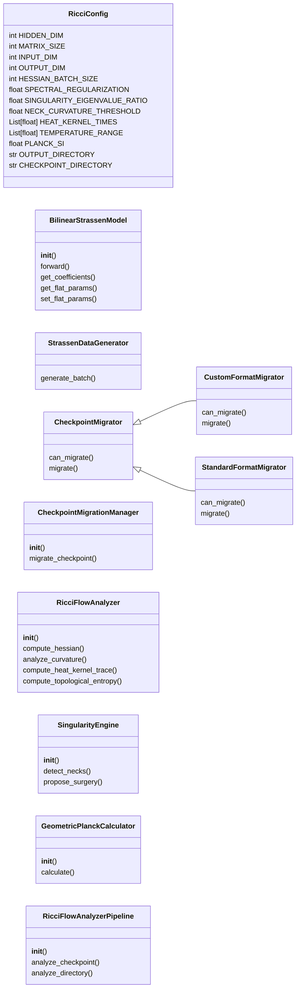
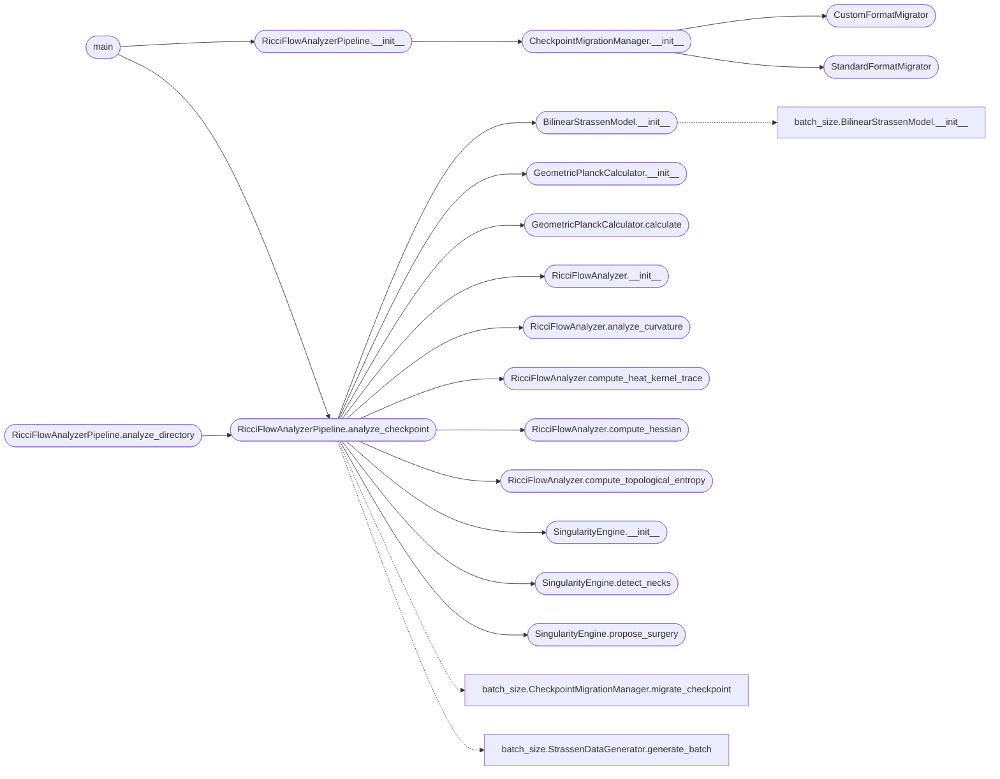

# `grigori_perelmans_ricci_flow`

> Source: [grigori_perelmans_ricci_flow.py:1](../../grigori_perelmans_ricci_flow.py#L1) | language `py` | coverage 39.0% | [API index](../index.md)

StrassenRicciFlow - Geometric Dynamics and Singularity Analysis

Analyzes neural network checkpoints using Ricci Flow theory.
Calculates curvature (Hessian), identifies singularities ("necks"), and
derives thermodynamic quantities (Heat Kernel, Entropy) from the spectral geometry.

Architecture: SOLID principles, Tensor-based Ricci analysis, Surgical pruning heuristics

## Contents

- **Classes:** [`RicciConfig`](#ricciconfig), [`BilinearStrassenModel`](#bilinearstrassenmodel), [`StrassenDataGenerator`](#strassendatagenerator), [`CheckpointMigrator`](#checkpointmigrator), [`CustomFormatMigrator`](#customformatmigrator), [`StandardFormatMigrator`](#standardformatmigrator), [`CheckpointMigrationManager`](#checkpointmigrationmanager), [`RicciFlowAnalyzer`](#ricciflowanalyzer), [`SingularityEngine`](#singularityengine), [`GeometricPlanckCalculator`](#geometricplanckcalculator), [`RicciFlowAnalyzerPipeline`](#ricciflowanalyzerpipeline)
- **Functions:** [`set_random_seed`](#set_random_seed), [`main`](#main)
- **Constants:** [`CONFIG`](#config)

## Type Diagram



## Call Graph

Solid arrows stay in this module, dashed arrows leave it.



## Classes

<a id="ricciconfig"></a>

### `RicciConfig`

`class` `dataclass` | [grigori_perelmans_ricci_flow.py:34](../../grigori_perelmans_ricci_flow.py#L34)

Decorators: `@dataclass(frozen=True)`

```python
class RicciConfig
```

Immutable configuration for Ricci Flow analysis.

**Attributes**

| Name | Type | Default | Description |
|---|---|---|---|
| [`HIDDEN_DIM`](#ricciconfig-hidden_dim) | `int` | `8` |  |
| [`MATRIX_SIZE`](#ricciconfig-matrix_size) | `int` | `2` |  |
| [`INPUT_DIM`](#ricciconfig-input_dim) | `int` | `4` |  |
| [`OUTPUT_DIM`](#ricciconfig-output_dim) | `int` | `4` |  |
| [`HESSIAN_BATCH_SIZE`](#ricciconfig-hessian_batch_size) | `int` | `1` |  |
| [`SPECTRAL_REGULARIZATION`](#ricciconfig-spectral_regularization) | `float` | `1e-06` |  |
| [`SINGULARITY_EIGENVALUE_RATIO`](#ricciconfig-singularity_eigenvalue_ratio) | `float` | `100.0` |  |
| [`NECK_CURVATURE_THRESHOLD`](#ricciconfig-neck_curvature_threshold) | `float` | `10.0` |  |
| [`HEAT_KERNEL_TIMES`](#ricciconfig-heat_kernel_times) | `List[float]` | `field(default_factory=lambda: [0.1, 1.0, 10.0])` |  |
| [`TEMPERATURE_RANGE`](#ricciconfig-temperature_range) | `List[float]` | `field(default_factory=lambda: [0.01, 0.1, 1.0])` |  |
| [`PLANCK_SI`](#ricciconfig-planck_si) | `float` | `1.054571817e-34` |  |
| [`OUTPUT_DIRECTORY`](#ricciconfig-output_directory) | `str` | `'ricci_analysis_reports'` |  |
| [`CHECKPOINT_DIRECTORY`](#ricciconfig-checkpoint_directory) | `str` | `'checkpoints'` |  |

---

<a id="bilinearstrassenmodel"></a>

### `BilinearStrassenModel`

`class` | [grigori_perelmans_ricci_flow.py:82](../../grigori_perelmans_ricci_flow.py#L82)

```python
class BilinearStrassenModel(nn.Module)
```

Bases: `nn.Module`

Bilinear model f(A,B) = W((U*A) ⊙ (V*B)).

**Members**

| Member | Kind | Summary |
|---|---|---|
| [`__init__`](#bilinearstrassenmodel-__init__) | constructor |  |
| [`forward`](#bilinearstrassenmodel-forward) | method |  |
| [`get_coefficients`](#bilinearstrassenmodel-get_coefficients) | method |  |
| [`get_flat_params`](#bilinearstrassenmodel-get_flat_params) | method | Return all parameters as a single flattened vector. |
| [`set_flat_params`](#bilinearstrassenmodel-set_flat_params) | method | Set model parameters from a flattened vector. |

<a id="bilinearstrassenmodel-__init__"></a>

#### `BilinearStrassenModel.__init__`

`constructor` | [grigori_perelmans_ricci_flow.py:86](../../grigori_perelmans_ricci_flow.py#L86)

```python
def __init__(self, config: RicciConfig = CONFIG)
```

**Parameters**

| Name | Type | Default | Description |
|---|---|---|---|
| `config` | `RicciConfig` | `CONFIG` |  |

*Calls:* [`BilinearStrassenModel.__init__`](batch_size.py.md#bilinearstrassenmodel-__init__)

*Called by:* [`RicciFlowAnalyzerPipeline.analyze_checkpoint`](#ricciflowanalyzerpipeline-analyze_checkpoint)

<a id="bilinearstrassenmodel-forward"></a>

#### `BilinearStrassenModel.forward`

`method` | [grigori_perelmans_ricci_flow.py:99](../../grigori_perelmans_ricci_flow.py#L99)

```python
def forward(self, a: torch.Tensor, b: torch.Tensor) -> torch.Tensor
```

**Parameters**

| Name | Type | Default | Description |
|---|---|---|---|
| `a` | `torch.Tensor` |  |  |
| `b` | `torch.Tensor` |  |  |

**Returns:** `torch.Tensor`

<a id="bilinearstrassenmodel-get_coefficients"></a>

#### `BilinearStrassenModel.get_coefficients`

`method` | [grigori_perelmans_ricci_flow.py:102](../../grigori_perelmans_ricci_flow.py#L102)

```python
def get_coefficients(self) -> Dict[str, torch.Tensor]
```

**Returns:** `Dict[str, torch.Tensor]`

<a id="bilinearstrassenmodel-get_flat_params"></a>

#### `BilinearStrassenModel.get_flat_params`

`method` | [grigori_perelmans_ricci_flow.py:109](../../grigori_perelmans_ricci_flow.py#L109)

```python
def get_flat_params(self) -> torch.Tensor
```

Return all parameters as a single flattened vector.

**Returns:** `torch.Tensor`

<a id="bilinearstrassenmodel-set_flat_params"></a>

#### `BilinearStrassenModel.set_flat_params`

`method` | [grigori_perelmans_ricci_flow.py:114](../../grigori_perelmans_ricci_flow.py#L114)

```python
def set_flat_params(self, flat_params: torch.Tensor) -> None
```

Set model parameters from a flattened vector.

**Parameters**

| Name | Type | Default | Description |
|---|---|---|---|
| `flat_params` | `torch.Tensor` |  |  |

---

<a id="strassendatagenerator"></a>

### `StrassenDataGenerator`

`class` | [grigori_perelmans_ricci_flow.py:128](../../grigori_perelmans_ricci_flow.py#L128)

```python
class StrassenDataGenerator
```

**Members**

| Member | Kind | Summary |
|---|---|---|
| [`generate_batch`](#strassendatagenerator-generate_batch) | staticmethod |  |

<a id="strassendatagenerator-generate_batch"></a>

#### `StrassenDataGenerator.generate_batch`

`staticmethod` | [grigori_perelmans_ricci_flow.py:130](../../grigori_perelmans_ricci_flow.py#L130)

Decorators: `@staticmethod`

```python
def generate_batch(batch_size: int, config: RicciConfig = CONFIG)
```

**Parameters**

| Name | Type | Default | Description |
|---|---|---|---|
| `batch_size` | `int` |  |  |
| `config` | `RicciConfig` | `CONFIG` |  |

---

<a id="checkpointmigrator"></a>

### `CheckpointMigrator`

`class` `abstract` | [grigori_perelmans_ricci_flow.py:145](../../grigori_perelmans_ricci_flow.py#L145)

```python
class CheckpointMigrator(ABC)
```

Bases: `ABC`

Subclasses: [`CustomFormatMigrator`](#customformatmigrator), [`StandardFormatMigrator`](#standardformatmigrator)

**Members**

| Member | Kind | Summary |
|---|---|---|
| [`can_migrate`](#checkpointmigrator-can_migrate) | method |  |
| [`migrate`](#checkpointmigrator-migrate) | method |  |

<a id="checkpointmigrator-can_migrate"></a>

#### `CheckpointMigrator.can_migrate`

`method` `abstract` | [grigori_perelmans_ricci_flow.py:147](../../grigori_perelmans_ricci_flow.py#L147)

Decorators: `@abstractmethod`

```python
def can_migrate(self, state_dict: Dict[str, Any]) -> bool
```

**Parameters**

| Name | Type | Default | Description |
|---|---|---|---|
| `state_dict` | `Dict[str, Any]` |  |  |

**Returns:** `bool`

<a id="checkpointmigrator-migrate"></a>

#### `CheckpointMigrator.migrate`

`method` `abstract` | [grigori_perelmans_ricci_flow.py:149](../../grigori_perelmans_ricci_flow.py#L149)

Decorators: `@abstractmethod`

```python
def migrate(self, state_dict: Dict[str, Any]) -> Optional[Dict[str, torch.Tensor]]
```

**Parameters**

| Name | Type | Default | Description |
|---|---|---|---|
| `state_dict` | `Dict[str, Any]` |  |  |

**Returns:** `Optional[Dict[str, torch.Tensor]]`

---

<a id="customformatmigrator"></a>

### `CustomFormatMigrator`

`class` | [grigori_perelmans_ricci_flow.py:151](../../grigori_perelmans_ricci_flow.py#L151)

```python
class CustomFormatMigrator(CheckpointMigrator)
```

Bases: [`CheckpointMigrator`](#checkpointmigrator)

**Members**

| Member | Kind | Summary |
|---|---|---|
| [`can_migrate`](#customformatmigrator-can_migrate) | method |  |
| [`migrate`](#customformatmigrator-migrate) | method |  |

<a id="customformatmigrator-can_migrate"></a>

#### `CustomFormatMigrator.can_migrate`

`method` | [grigori_perelmans_ricci_flow.py:152](../../grigori_perelmans_ricci_flow.py#L152)

```python
def can_migrate(self, state_dict: Dict[str, Any]) -> bool
```

**Parameters**

| Name | Type | Default | Description |
|---|---|---|---|
| `state_dict` | `Dict[str, Any]` |  |  |

**Returns:** `bool`

<a id="customformatmigrator-migrate"></a>

#### `CustomFormatMigrator.migrate`

`method` | [grigori_perelmans_ricci_flow.py:154](../../grigori_perelmans_ricci_flow.py#L154)

```python
def migrate(self, state_dict: Dict[str, Any]) -> Optional[Dict[str, torch.Tensor]]
```

**Parameters**

| Name | Type | Default | Description |
|---|---|---|---|
| `state_dict` | `Dict[str, Any]` |  |  |

**Returns:** `Optional[Dict[str, torch.Tensor]]`

---

<a id="standardformatmigrator"></a>

### `StandardFormatMigrator`

`class` | [grigori_perelmans_ricci_flow.py:166](../../grigori_perelmans_ricci_flow.py#L166)

```python
class StandardFormatMigrator(CheckpointMigrator)
```

Bases: [`CheckpointMigrator`](#checkpointmigrator)

**Members**

| Member | Kind | Summary |
|---|---|---|
| [`can_migrate`](#standardformatmigrator-can_migrate) | method |  |
| [`migrate`](#standardformatmigrator-migrate) | method |  |

<a id="standardformatmigrator-can_migrate"></a>

#### `StandardFormatMigrator.can_migrate`

`method` | [grigori_perelmans_ricci_flow.py:167](../../grigori_perelmans_ricci_flow.py#L167)

```python
def can_migrate(self, state_dict: Dict[str, Any]) -> bool
```

**Parameters**

| Name | Type | Default | Description |
|---|---|---|---|
| `state_dict` | `Dict[str, Any]` |  |  |

**Returns:** `bool`

<a id="standardformatmigrator-migrate"></a>

#### `StandardFormatMigrator.migrate`

`method` | [grigori_perelmans_ricci_flow.py:169](../../grigori_perelmans_ricci_flow.py#L169)

```python
def migrate(self, state_dict: Dict[str, Any]) -> Optional[Dict[str, torch.Tensor]]
```

**Parameters**

| Name | Type | Default | Description |
|---|---|---|---|
| `state_dict` | `Dict[str, Any]` |  |  |

**Returns:** `Optional[Dict[str, torch.Tensor]]`

---

<a id="checkpointmigrationmanager"></a>

### `CheckpointMigrationManager`

`class` | [grigori_perelmans_ricci_flow.py:172](../../grigori_perelmans_ricci_flow.py#L172)

```python
class CheckpointMigrationManager
```

**Members**

| Member | Kind | Summary |
|---|---|---|
| [`__init__`](#checkpointmigrationmanager-__init__) | constructor |  |
| [`migrate_checkpoint`](#checkpointmigrationmanager-migrate_checkpoint) | method |  |

<a id="checkpointmigrationmanager-__init__"></a>

#### `CheckpointMigrationManager.__init__`

`constructor` | [grigori_perelmans_ricci_flow.py:173](../../grigori_perelmans_ricci_flow.py#L173)

```python
def __init__(self)
```

*Calls:* [`CustomFormatMigrator`](#customformatmigrator), [`StandardFormatMigrator`](#standardformatmigrator)

*Called by:* [`RicciFlowAnalyzerPipeline.__init__`](#ricciflowanalyzerpipeline-__init__)

<a id="checkpointmigrationmanager-migrate_checkpoint"></a>

#### `CheckpointMigrationManager.migrate_checkpoint`

`method` | [grigori_perelmans_ricci_flow.py:176](../../grigori_perelmans_ricci_flow.py#L176)

```python
def migrate_checkpoint(self, path: str, device: str = 'cpu') -> Optional[Dict[str, torch.Tensor]]
```

**Parameters**

| Name | Type | Default | Description |
|---|---|---|---|
| `path` | `str` |  |  |
| `device` | `str` | `'cpu'` |  |

**Returns:** `Optional[Dict[str, torch.Tensor]]`

---

<a id="ricciflowanalyzer"></a>

### `RicciFlowAnalyzer`

`class` | [grigori_perelmans_ricci_flow.py:193](../../grigori_perelmans_ricci_flow.py#L193)

```python
class RicciFlowAnalyzer
```

Calculates Ricci curvature metrics using Hessian as Metric Tensor proxy.

In Perelman's flow, dg/dt = -2Ric. Here we analyze instantaneous state of Metric (Hessian).

**Members**

| Member | Kind | Summary |
|---|---|---|
| [`__init__`](#ricciflowanalyzer-__init__) | constructor |  |
| [`compute_hessian`](#ricciflowanalyzer-compute_hessian) | method | Computes exact Hessian of loss w.r.t parameters. |
| [`analyze_curvature`](#ricciflowanalyzer-analyze_curvature) | method | Analyze Hessian spectrum to derive Ricci Scalar and Topological invariants. |
| [`compute_heat_kernel_trace`](#ricciflowanalyzer-compute_heat_kernel_trace) | method | Trace of Heat Kernel: Z(t) = Sum( exp(-lambda_i * t) ). |
| [`compute_topological_entropy`](#ricciflowanalyzer-compute_topological_entropy) | method | von Neumann Entropy / Spectral Entropy. |

<a id="ricciflowanalyzer-__init__"></a>

#### `RicciFlowAnalyzer.__init__`

`constructor` | [grigori_perelmans_ricci_flow.py:199](../../grigori_perelmans_ricci_flow.py#L199)

```python
def __init__(self, model: nn.Module, config: RicciConfig = CONFIG)
```

**Parameters**

| Name | Type | Default | Description |
|---|---|---|---|
| `model` | `nn.Module` |  |  |
| `config` | `RicciConfig` | `CONFIG` |  |

*Called by:* [`RicciFlowAnalyzerPipeline.analyze_checkpoint`](#ricciflowanalyzerpipeline-analyze_checkpoint)

<a id="ricciflowanalyzer-compute_hessian"></a>

#### `RicciFlowAnalyzer.compute_hessian`

`method` | [grigori_perelmans_ricci_flow.py:203](../../grigori_perelmans_ricci_flow.py#L203)

```python
def compute_hessian(self, input_a: torch.Tensor, input_b: torch.Tensor, target_c: torch.Tensor) -> torch.Tensor
```

Computes exact Hessian of loss w.r.t parameters.

H = d^2L / dtheta^2

**Parameters**

| Name | Type | Default | Description |
|---|---|---|---|
| `input_a` | `torch.Tensor` |  |  |
| `input_b` | `torch.Tensor` |  |  |
| `target_c` | `torch.Tensor` |  |  |

**Returns:** `torch.Tensor`

*Called by:* [`RicciFlowAnalyzerPipeline.analyze_checkpoint`](#ricciflowanalyzerpipeline-analyze_checkpoint)

<a id="ricciflowanalyzer-analyze_curvature"></a>

#### `RicciFlowAnalyzer.analyze_curvature`

`method` | [grigori_perelmans_ricci_flow.py:247](../../grigori_perelmans_ricci_flow.py#L247)

```python
def analyze_curvature(self, hessian: torch.Tensor) -> Dict[str, Any]
```

Analyze Hessian spectrum to derive Ricci Scalar and Topological invariants.

**Parameters**

| Name | Type | Default | Description |
|---|---|---|---|
| `hessian` | `torch.Tensor` |  |  |

**Returns:** `Dict[str, Any]`

*Called by:* [`RicciFlowAnalyzerPipeline.analyze_checkpoint`](#ricciflowanalyzerpipeline-analyze_checkpoint)

<a id="ricciflowanalyzer-compute_heat_kernel_trace"></a>

#### `RicciFlowAnalyzer.compute_heat_kernel_trace`

`method` | [grigori_perelmans_ricci_flow.py:285](../../grigori_perelmans_ricci_flow.py#L285)

```python
def compute_heat_kernel_trace(self, eigenvalues: torch.Tensor, t: float = 1.0) -> float
```

Trace of Heat Kernel: Z(t) = Sum( exp(-lambda_i * t) ).

Relates to Partition Function in Quantum Mechanics.

**Parameters**

| Name | Type | Default | Description |
|---|---|---|---|
| `eigenvalues` | `torch.Tensor` |  |  |
| `t` | `float` | `1.0` |  |

**Returns:** `float`

*Called by:* [`RicciFlowAnalyzerPipeline.analyze_checkpoint`](#ricciflowanalyzerpipeline-analyze_checkpoint)

<a id="ricciflowanalyzer-compute_topological_entropy"></a>

#### `RicciFlowAnalyzer.compute_topological_entropy`

`method` | [grigori_perelmans_ricci_flow.py:296](../../grigori_perelmans_ricci_flow.py#L296)

```python
def compute_topological_entropy(self, eigenvalues: torch.Tensor) -> float
```

von Neumann Entropy / Spectral Entropy.

S = - Sum( p_i * log(p_i) ) where p_i are normalized eigenvalue weights.

**Parameters**

| Name | Type | Default | Description |
|---|---|---|---|
| `eigenvalues` | `torch.Tensor` |  |  |

**Returns:** `float`

*Called by:* [`RicciFlowAnalyzerPipeline.analyze_checkpoint`](#ricciflowanalyzerpipeline-analyze_checkpoint)

---

<a id="singularityengine"></a>

### `SingularityEngine`

`class` | [grigori_perelmans_ricci_flow.py:310](../../grigori_perelmans_ricci_flow.py#L310)

```python
class SingularityEngine
```

Identifies 'necks' (singularities) in the geometry and proposes 'surgery' (pruning).

A 'neck' is a parameter direction with extreme curvature (Hessian eigenvalue).

**Members**

| Member | Kind | Summary |
|---|---|---|
| [`__init__`](#singularityengine-__init__) | constructor |  |
| [`detect_necks`](#singularityengine-detect_necks) | method | Identify if the system is in a 'bottleneck' state. |
| [`propose_surgery`](#singularityengine-propose_surgery) | method | Propose parameters to 'cut' (prune) based on curvature heuristics. |

<a id="singularityengine-__init__"></a>

#### `SingularityEngine.__init__`

`constructor` | [grigori_perelmans_ricci_flow.py:316](../../grigori_perelmans_ricci_flow.py#L316)

```python
def __init__(self, model: nn.Module, eigenvalues: torch.Tensor, config: RicciConfig = CONFIG)
```

**Parameters**

| Name | Type | Default | Description |
|---|---|---|---|
| `model` | `nn.Module` |  |  |
| `eigenvalues` | `torch.Tensor` |  |  |
| `config` | `RicciConfig` | `CONFIG` |  |

*Called by:* [`RicciFlowAnalyzerPipeline.analyze_checkpoint`](#ricciflowanalyzerpipeline-analyze_checkpoint)

<a id="singularityengine-detect_necks"></a>

#### `SingularityEngine.detect_necks`

`method` | [grigori_perelmans_ricci_flow.py:325](../../grigori_perelmans_ricci_flow.py#L325)

```python
def detect_necks(self, curvature_analysis: Dict[str, Any]) -> Dict[str, Any]
```

Identify if the system is in a 'bottleneck' state.

**Parameters**

| Name | Type | Default | Description |
|---|---|---|---|
| `curvature_analysis` | `Dict[str, Any]` |  |  |

**Returns:** `Dict[str, Any]`

*Called by:* [`RicciFlowAnalyzerPipeline.analyze_checkpoint`](#ricciflowanalyzerpipeline-analyze_checkpoint)

<a id="singularityengine-propose_surgery"></a>

#### `SingularityEngine.propose_surgery`

`method` | [grigori_perelmans_ricci_flow.py:336](../../grigori_perelmans_ricci_flow.py#L336)

```python
def propose_surgery(self) -> List[str]
```

Propose parameters to 'cut' (prune) based on curvature heuristics.

In Strassen, the 'bias' slot (8th) often carries the 'noise' or singular connection.

**Returns:** `List[str]`

*Called by:* [`RicciFlowAnalyzerPipeline.analyze_checkpoint`](#ricciflowanalyzerpipeline-analyze_checkpoint)

---

<a id="geometricplanckcalculator"></a>

### `GeometricPlanckCalculator`

`class` | [grigori_perelmans_ricci_flow.py:366](../../grigori_perelmans_ricci_flow.py#L366)

```python
class GeometricPlanckCalculator
```

Estimates effective Planck constant from Spectral Geometry.

Uses the Hessian eigenvalues to define an energy spectrum.

**Members**

| Member | Kind | Summary |
|---|---|---|
| [`__init__`](#geometricplanckcalculator-__init__) | constructor |  |
| [`calculate`](#geometricplanckcalculator-calculate) | method |  |

<a id="geometricplanckcalculator-__init__"></a>

#### `GeometricPlanckCalculator.__init__`

`constructor` | [grigori_perelmans_ricci_flow.py:371](../../grigori_perelmans_ricci_flow.py#L371)

```python
def __init__(self, eigenvalues: torch.Tensor, ricci_scalar: float, config: RicciConfig = CONFIG)
```

**Parameters**

| Name | Type | Default | Description |
|---|---|---|---|
| `eigenvalues` | `torch.Tensor` |  |  |
| `ricci_scalar` | `float` |  |  |
| `config` | `RicciConfig` | `CONFIG` |  |

*Called by:* [`RicciFlowAnalyzerPipeline.analyze_checkpoint`](#ricciflowanalyzerpipeline-analyze_checkpoint)

<a id="geometricplanckcalculator-calculate"></a>

#### `GeometricPlanckCalculator.calculate`

`method` | [grigori_perelmans_ricci_flow.py:376](../../grigori_perelmans_ricci_flow.py#L376)

```python
def calculate(self) -> Dict[str, Any]
```

**Returns:** `Dict[str, Any]`

*Called by:* [`RicciFlowAnalyzerPipeline.analyze_checkpoint`](#ricciflowanalyzerpipeline-analyze_checkpoint)

---

<a id="ricciflowanalyzerpipeline"></a>

### `RicciFlowAnalyzerPipeline`

`class` | [grigori_perelmans_ricci_flow.py:430](../../grigori_perelmans_ricci_flow.py#L430)

```python
class RicciFlowAnalyzerPipeline
```

Complete analysis pipeline for Ricci Flow and Planck Estimation.

Orchestrates Hessian computation, Curvature Analysis, and Physics metrics.

**Members**

| Member | Kind | Summary |
|---|---|---|
| [`__init__`](#ricciflowanalyzerpipeline-__init__) | constructor |  |
| [`analyze_checkpoint`](#ricciflowanalyzerpipeline-analyze_checkpoint) | method | Perform complete analysis of a single checkpoint. |
| [`analyze_directory`](#ricciflowanalyzerpipeline-analyze_directory) | method |  |

<a id="ricciflowanalyzerpipeline-__init__"></a>

#### `RicciFlowAnalyzerPipeline.__init__`

`constructor` | [grigori_perelmans_ricci_flow.py:435](../../grigori_perelmans_ricci_flow.py#L435)

```python
def __init__(self, config: RicciConfig = CONFIG)
```

**Parameters**

| Name | Type | Default | Description |
|---|---|---|---|
| `config` | `RicciConfig` | `CONFIG` |  |

*Calls:* [`CheckpointMigrationManager.__init__`](#checkpointmigrationmanager-__init__)

*Called by:* [`main`](#main)

<a id="ricciflowanalyzerpipeline-analyze_checkpoint"></a>

#### `RicciFlowAnalyzerPipeline.analyze_checkpoint`

`method` | [grigori_perelmans_ricci_flow.py:439](../../grigori_perelmans_ricci_flow.py#L439)

```python
def analyze_checkpoint(self, checkpoint_path: str, device: str = 'cpu') -> Dict[str, Any]
```

Perform complete analysis of a single checkpoint.

**Parameters**

| Name | Type | Default | Description |
|---|---|---|---|
| `checkpoint_path` | `str` |  |  |
| `device` | `str` | `'cpu'` |  |

**Returns:** `Dict[str, Any]`

**Raises**

- `ValueError`: (raised in the body, not documented)

*Calls:* [`CheckpointMigrationManager.migrate_checkpoint`](batch_size.py.md#checkpointmigrationmanager-migrate_checkpoint), [`StrassenDataGenerator.generate_batch`](batch_size.py.md#strassendatagenerator-generate_batch), [`BilinearStrassenModel.__init__`](#bilinearstrassenmodel-__init__), [`GeometricPlanckCalculator.__init__`](#geometricplanckcalculator-__init__), [`GeometricPlanckCalculator.calculate`](#geometricplanckcalculator-calculate), [`RicciFlowAnalyzer.__init__`](#ricciflowanalyzer-__init__), [`RicciFlowAnalyzer.analyze_curvature`](#ricciflowanalyzer-analyze_curvature), [`RicciFlowAnalyzer.compute_heat_kernel_trace`](#ricciflowanalyzer-compute_heat_kernel_trace), [`RicciFlowAnalyzer.compute_hessian`](#ricciflowanalyzer-compute_hessian), [`RicciFlowAnalyzer.compute_topological_entropy`](#ricciflowanalyzer-compute_topological_entropy), [`SingularityEngine.__init__`](#singularityengine-__init__), [`SingularityEngine.detect_necks`](#singularityengine-detect_necks) and 1 more

*Called by:* [`RicciFlowAnalyzerPipeline.analyze_directory`](#ricciflowanalyzerpipeline-analyze_directory), [`main`](#main)

<a id="ricciflowanalyzerpipeline-analyze_directory"></a>

#### `RicciFlowAnalyzerPipeline.analyze_directory`

`method` | [grigori_perelmans_ricci_flow.py:527](../../grigori_perelmans_ricci_flow.py#L527)

```python
def analyze_directory(self, directory: str, device: str = 'cpu', pattern: str = '*.pt') -> List[Dict[str, Any]]
```

**Parameters**

| Name | Type | Default | Description |
|---|---|---|---|
| `directory` | `str` |  |  |
| `device` | `str` | `'cpu'` |  |
| `pattern` | `str` | `'*.pt'` |  |

**Returns:** `List[Dict[str, Any]]`

**Raises**

- `ValueError`: (raised in the body, not documented)

*Calls:* [`RicciFlowAnalyzerPipeline.analyze_checkpoint`](#ricciflowanalyzerpipeline-analyze_checkpoint)

---

## Functions

<a id="set_random_seed"></a>

### `set_random_seed`

`function` | [grigori_perelmans_ricci_flow.py:70](../../grigori_perelmans_ricci_flow.py#L70)

```python
def set_random_seed(seed: int = 42) -> None
```

**Parameters**

| Name | Type | Default | Description |
|---|---|---|---|
| `seed` | `int` | `42` |  |

---

<a id="main"></a>

### `main`

`function` | [grigori_perelmans_ricci_flow.py:593](../../grigori_perelmans_ricci_flow.py#L593)

```python
def main()
```

*Calls:* [`RicciFlowAnalyzerPipeline.__init__`](#ricciflowanalyzerpipeline-__init__), [`RicciFlowAnalyzerPipeline.analyze_checkpoint`](#ricciflowanalyzerpipeline-analyze_checkpoint)

---

## Constants

<a id="config"></a>

### `CONFIG`

`constant` | [grigori_perelmans_ricci_flow.py:63](../../grigori_perelmans_ricci_flow.py#L63)

```python
CONFIG = RicciConfig()
```

---
