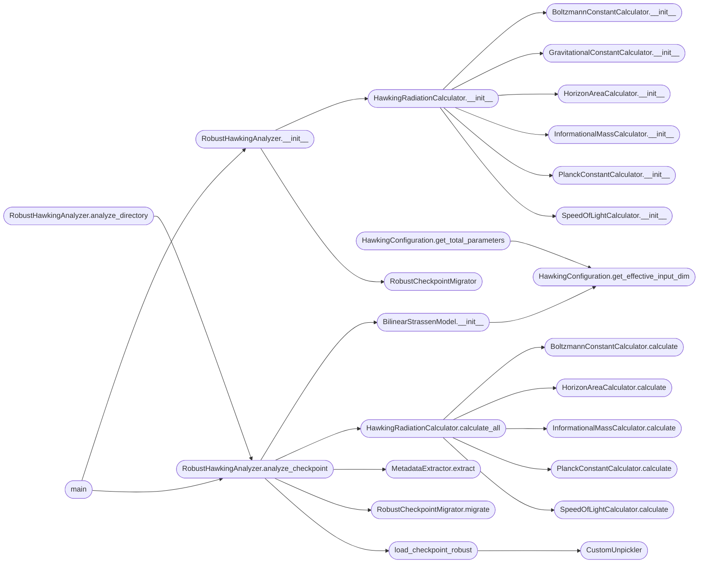

# `hawking_radiation`

> Source: [hawking_radiation.py:1](../../hawking_radiation.py#L1) | language `py` | coverage 46.7% | [API index](../index.md)

HawkingRadiationAnalyzer - Robust Version for Exotic Checkpoints

This version handles checkpoints with:
- Custom classes (UnifiedConfig, etc.) that can't be unpickled normally
- Nested structures with metadata
- Missing delta keys in various locations
- Exotic checkpoint formats

Uses custom unpickler and robust migration strategies.

## Contents

- **Classes:** [`CustomUnpickler`](#customunpickler), [`HawkingConfiguration`](#hawkingconfiguration), [`BilinearStrassenModel`](#bilinearstrassenmodel), [`RobustCheckpointMigrator`](#robustcheckpointmigrator), [`MetadataExtractor`](#metadataextractor), [`GravitationalConstantCalculator`](#gravitationalconstantcalculator), [`PlanckConstantCalculator`](#planckconstantcalculator), [`BoltzmannConstantCalculator`](#boltzmannconstantcalculator), [`SpeedOfLightCalculator`](#speedoflightcalculator), [`InformationalMassCalculator`](#informationalmasscalculator), [`HorizonAreaCalculator`](#horizonareacalculator), [`HawkingRadiationCalculator`](#hawkingradiationcalculator), [`RobustHawkingAnalyzer`](#robusthawkinganalyzer)
- **Protocols:** [`IModel`](#imodel)
- **Functions:** [`load_checkpoint_robust`](#load_checkpoint_robust), [`main`](#main)
- **Constants:** [`CONFIG`](#config)

## Type Diagram

```mermaid
classDiagram
    direction LR
    class CustomUnpickler
    CustomUnpickler : find_class()
    class HawkingConfiguration
    HawkingConfiguration : int HIDDEN_DIM
    HawkingConfiguration : int MATRIX_SIZE
    HawkingConfiguration : int INPUT_DIM
    HawkingConfiguration : float PLANCK_SI
    HawkingConfiguration : float SPEED_OF_LIGHT_SI
    HawkingConfiguration : float GRAVITATIONAL_CONSTANT_SI
    HawkingConfiguration : float BOLTZMANN_CONSTANT_SI
    HawkingConfiguration : float SOLAR_MASS_SI
    HawkingConfiguration : float DISCRETIZATION_MARGIN
    HawkingConfiguration : float OPTIMAL_DELTA_THRESHOLD
    HawkingConfiguration : float INDUSTRIAL_DELTA_THRESHOLD
    HawkingConfiguration : int ENTROPY_BINS
    HawkingConfiguration : int TEMPERATURE_WINDOW
    HawkingConfiguration : int GRADIENT_WINDOW
    HawkingConfiguration : float SPECTRAL_REGULARIZATION
    HawkingConfiguration : int EFFECTIVE_INFORMATION_DIM
    HawkingConfiguration : float ACTIVE_PARAM_THRESHOLD
    HawkingConfiguration : str OUTPUT_DIRECTORY
    HawkingConfiguration : str DEVICE
    HawkingConfiguration : get_effective_input_dim()
    HawkingConfiguration : get_total_parameters()
    class IModel
    <<protocol>> IModel
    IModel : get_coefficients()
    IModel : forward()
    class BilinearStrassenModel
    BilinearStrassenModel : __init__()
    BilinearStrassenModel : forward()
    BilinearStrassenModel : get_coefficients()
    BilinearStrassenModel : get_flat_parameters()
    class RobustCheckpointMigrator
    RobustCheckpointMigrator : migrate()
    class MetadataExtractor
    MetadataExtractor : extract()
    class GravitationalConstantCalculator
    GravitationalConstantCalculator : __init__()
    GravitationalConstantCalculator : calculate()
    class PlanckConstantCalculator
    PlanckConstantCalculator : __init__()
    PlanckConstantCalculator : calculate()
    class BoltzmannConstantCalculator
    BoltzmannConstantCalculator : __init__()
    BoltzmannConstantCalculator : calculate()
    class SpeedOfLightCalculator
    SpeedOfLightCalculator : __init__()
    SpeedOfLightCalculator : calculate()
    class InformationalMassCalculator
    InformationalMassCalculator : __init__()
    InformationalMassCalculator : calculate()
    class HorizonAreaCalculator
    HorizonAreaCalculator : __init__()
    HorizonAreaCalculator : calculate()
    class HawkingRadiationCalculator
    HawkingRadiationCalculator : __init__()
    HawkingRadiationCalculator : calculate_all()
    class RobustHawkingAnalyzer
    RobustHawkingAnalyzer : __init__()
    RobustHawkingAnalyzer : analyze_checkpoint()
    RobustHawkingAnalyzer : analyze_directory()
```



## Call Graph

Solid arrows stay in this module, dashed arrows leave it.



## Classes

<a id="customunpickler"></a>

### `CustomUnpickler`

`class` | [hawking_radiation.py:36](../../hawking_radiation.py#L36)

```python
class CustomUnpickler(pickle.Unpickler)
```

Bases: `pickle.Unpickler`

Custom unpickler that handles unknown classes by creating dummy objects.

This solves the "Can't get attribute 'UnifiedConfig'" error by providing
fallback objects for any class that can't be found.

**Members**

| Member | Kind | Summary |
|---|---|---|
| [`find_class`](#customunpickler-find_class) | method | Override find_class to handle missing classes gracefully. |

<a id="customunpickler-find_class"></a>

#### `CustomUnpickler.find_class`

`method` | [hawking_radiation.py:44](../../hawking_radiation.py#L44)

```python
def find_class(self, module, name)
```

Override find_class to handle missing classes gracefully.

**Parameters**

| Name | Type | Default | Description |
|---|---|---|---|
| `module` |  |  |  |
| `name` |  |  |  |

---

<a id="hawkingconfiguration"></a>

### `HawkingConfiguration`

`class` `dataclass` | [hawking_radiation.py:138](../../hawking_radiation.py#L138)

Decorators: `@dataclass(frozen=True)`

```python
class HawkingConfiguration
```

Immutable configuration for Hawking radiation analysis.

**Attributes**

| Name | Type | Default | Description |
|---|---|---|---|
| [`HIDDEN_DIM`](#hawkingconfiguration-hidden_dim) | `int` | `8` |  |
| [`MATRIX_SIZE`](#hawkingconfiguration-matrix_size) | `int` | `2` |  |
| [`INPUT_DIM`](#hawkingconfiguration-input_dim) | `int` | `4` |  |
| [`PLANCK_SI`](#hawkingconfiguration-planck_si) | `float` | `1.054571817e-34` |  |
| [`SPEED_OF_LIGHT_SI`](#hawkingconfiguration-speed_of_light_si) | `float` | `299792458` |  |
| [`GRAVITATIONAL_CONSTANT_SI`](#hawkingconfiguration-gravitational_constant_si) | `float` | `6.6743e-11` |  |
| [`BOLTZMANN_CONSTANT_SI`](#hawkingconfiguration-boltzmann_constant_si) | `float` | `1.380649e-23` |  |
| [`SOLAR_MASS_SI`](#hawkingconfiguration-solar_mass_si) | `float` | `1.98847e+30` |  |
| [`DISCRETIZATION_MARGIN`](#hawkingconfiguration-discretization_margin) | `float` | `0.1` |  |
| [`OPTIMAL_DELTA_THRESHOLD`](#hawkingconfiguration-optimal_delta_threshold) | `float` | `0.01` |  |
| [`INDUSTRIAL_DELTA_THRESHOLD`](#hawkingconfiguration-industrial_delta_threshold) | `float` | `0.1` |  |
| [`ENTROPY_BINS`](#hawkingconfiguration-entropy_bins) | `int` | `50` |  |
| [`TEMPERATURE_WINDOW`](#hawkingconfiguration-temperature_window) | `int` | `100` |  |
| [`GRADIENT_WINDOW`](#hawkingconfiguration-gradient_window) | `int` | `10` |  |
| [`SPECTRAL_REGULARIZATION`](#hawkingconfiguration-spectral_regularization) | `float` | `1e-06` |  |
| [`EFFECTIVE_INFORMATION_DIM`](#hawkingconfiguration-effective_information_dim) | `int` | `7` |  |
| [`ACTIVE_PARAM_THRESHOLD`](#hawkingconfiguration-active_param_threshold) | `float` | `0.01` |  |
| [`OUTPUT_DIRECTORY`](#hawkingconfiguration-output_directory) | `str` | `'hawking_analysis_reports'` |  |
| [`DEVICE`](#hawkingconfiguration-device) | `str` | `'cuda' if torch.cuda.is_available() else 'cpu'` |  |

**Members**

| Member | Kind | Summary |
|---|---|---|
| [`get_effective_input_dim`](#hawkingconfiguration-get_effective_input_dim) | method |  |
| [`get_total_parameters`](#hawkingconfiguration-get_total_parameters) | method |  |

<a id="hawkingconfiguration-get_effective_input_dim"></a>

#### `HawkingConfiguration.get_effective_input_dim`

`method` | [hawking_radiation.py:172](../../hawking_radiation.py#L172)

```python
def get_effective_input_dim(self) -> int
```

**Returns:** `int`

*Called by:* [`BilinearStrassenModel.__init__`](#bilinearstrassenmodel-__init__), [`HawkingConfiguration.get_total_parameters`](#hawkingconfiguration-get_total_parameters)

<a id="hawkingconfiguration-get_total_parameters"></a>

#### `HawkingConfiguration.get_total_parameters`

`method` | [hawking_radiation.py:175](../../hawking_radiation.py#L175)

```python
def get_total_parameters(self) -> int
```

**Returns:** `int`

*Calls:* [`HawkingConfiguration.get_effective_input_dim`](#hawkingconfiguration-get_effective_input_dim)

---

<a id="bilinearstrassenmodel"></a>

### `BilinearStrassenModel`

`class` | [hawking_radiation.py:197](../../hawking_radiation.py#L197)

```python
class BilinearStrassenModel(nn.Module)
```

Bases: `nn.Module`

Bilinear model for Strassen matrix multiplication.

**Members**

| Member | Kind | Summary |
|---|---|---|
| [`__init__`](#bilinearstrassenmodel-__init__) | constructor |  |
| [`forward`](#bilinearstrassenmodel-forward) | method |  |
| [`get_coefficients`](#bilinearstrassenmodel-get_coefficients) | method |  |
| [`get_flat_parameters`](#bilinearstrassenmodel-get_flat_parameters) | method |  |

<a id="bilinearstrassenmodel-__init__"></a>

#### `BilinearStrassenModel.__init__`

`constructor` | [hawking_radiation.py:200](../../hawking_radiation.py#L200)

```python
def __init__(self, config: HawkingConfiguration = CONFIG)
```

**Parameters**

| Name | Type | Default | Description |
|---|---|---|---|
| `config` | `HawkingConfiguration` | `CONFIG` |  |

*Calls:* [`BilinearStrassenModel.__init__`](batch_size.py.md#bilinearstrassenmodel-__init__), [`HawkingConfiguration.get_effective_input_dim`](#hawkingconfiguration-get_effective_input_dim)

*Called by:* [`RobustHawkingAnalyzer.analyze_checkpoint`](#robusthawkinganalyzer-analyze_checkpoint)

<a id="bilinearstrassenmodel-forward"></a>

#### `BilinearStrassenModel.forward`

`method` | [hawking_radiation.py:216](../../hawking_radiation.py#L216)

```python
def forward(self, a: torch.Tensor, b: torch.Tensor) -> torch.Tensor
```

**Parameters**

| Name | Type | Default | Description |
|---|---|---|---|
| `a` | `torch.Tensor` |  |  |
| `b` | `torch.Tensor` |  |  |

**Returns:** `torch.Tensor`

<a id="bilinearstrassenmodel-get_coefficients"></a>

#### `BilinearStrassenModel.get_coefficients`

`method` | [hawking_radiation.py:219](../../hawking_radiation.py#L219)

```python
def get_coefficients(self) -> Dict[str, torch.Tensor]
```

**Returns:** `Dict[str, torch.Tensor]`

<a id="bilinearstrassenmodel-get_flat_parameters"></a>

#### `BilinearStrassenModel.get_flat_parameters`

`method` | [hawking_radiation.py:226](../../hawking_radiation.py#L226)

```python
def get_flat_parameters(self) -> torch.Tensor
```

**Returns:** `torch.Tensor`

---

<a id="robustcheckpointmigrator"></a>

### `RobustCheckpointMigrator`

`class` | [hawking_radiation.py:234](../../hawking_radiation.py#L234)

```python
class RobustCheckpointMigrator
```

Enhanced checkpoint migrator that handles: - Direct U, V, W tensors - U_coefs format - Standard .weight format - Nested structures with config - Encoder format - State dicts within state dicts

**Members**

| Member | Kind | Summary |
|---|---|---|
| [`migrate`](#robustcheckpointmigrator-migrate) | method | Main migration entry point with multiple strategies. |

<a id="robustcheckpointmigrator-migrate"></a>

#### `RobustCheckpointMigrator.migrate`

`method` | [hawking_radiation.py:245](../../hawking_radiation.py#L245)

```python
def migrate(self, raw_data: Any, device: str) -> Optional[Dict[str, torch.Tensor]]
```

Main migration entry point with multiple strategies.

**Parameters**

| Name | Type | Default | Description |
|---|---|---|---|
| `raw_data` | `Any` |  |  |
| `device` | `str` |  |  |

**Returns:** `Optional[Dict[str, torch.Tensor]]`

*Called by:* [`RobustHawkingAnalyzer.analyze_checkpoint`](#robusthawkinganalyzer-analyze_checkpoint)

---

<a id="metadataextractor"></a>

### `MetadataExtractor`

`class` | [hawking_radiation.py:514](../../hawking_radiation.py#L514)

```python
class MetadataExtractor
```

Extracts metadata from various checkpoint formats.

**Members**

| Member | Kind | Summary |
|---|---|---|
| [`extract`](#metadataextractor-extract) | staticmethod | Extract all relevant metadata from checkpoint. |

<a id="metadataextractor-extract"></a>

#### `MetadataExtractor.extract`

`staticmethod` | [hawking_radiation.py:518](../../hawking_radiation.py#L518)

Decorators: `@staticmethod`

```python
def extract(checkpoint: Any) -> Dict[str, Any]
```

Extract all relevant metadata from checkpoint.

**Parameters**

| Name | Type | Default | Description |
|---|---|---|---|
| `checkpoint` | `Any` |  |  |

**Returns:** `Dict[str, Any]`

*Called by:* [`RobustHawkingAnalyzer.analyze_checkpoint`](#robusthawkinganalyzer-analyze_checkpoint)

---

<a id="gravitationalconstantcalculator"></a>

### `GravitationalConstantCalculator`

`class` | [hawking_radiation.py:609](../../hawking_radiation.py#L609)

```python
class GravitationalConstantCalculator
```

Calculates effective gravitational constant G_alg.

**Members**

| Member | Kind | Summary |
|---|---|---|
| [`__init__`](#gravitationalconstantcalculator-__init__) | constructor |  |
| [`calculate`](#gravitationalconstantcalculator-calculate) | method |  |

<a id="gravitationalconstantcalculator-__init__"></a>

#### `GravitationalConstantCalculator.__init__`

`constructor` | [hawking_radiation.py:612](../../hawking_radiation.py#L612)

```python
def __init__(self, config: HawkingConfiguration = CONFIG)
```

**Parameters**

| Name | Type | Default | Description |
|---|---|---|---|
| `config` | `HawkingConfiguration` | `CONFIG` |  |

*Called by:* [`HawkingRadiationCalculator.__init__`](#hawkingradiationcalculator-__init__)

<a id="gravitationalconstantcalculator-calculate"></a>

#### `GravitationalConstantCalculator.calculate`

`method` | [hawking_radiation.py:615](../../hawking_radiation.py#L615)

```python
def calculate(self, model: IModel, gradient: Optional[torch.Tensor] = None, precomputed_delta: Optional[float] = None) -> Dict[str, float]
```

**Parameters**

| Name | Type | Default | Description |
|---|---|---|---|
| `model` | `IModel` |  |  |
| `gradient` | `Optional[torch.Tensor]` | `None` |  |
| `precomputed_delta` | `Optional[float]` | `None` |  |

**Returns:** `Dict[str, float]`

*Calls:* [`IModel.get_coefficients`](dirac_polos_zeros.py.md#imodel-get_coefficients)

---

<a id="planckconstantcalculator"></a>

### `PlanckConstantCalculator`

`class` | [hawking_radiation.py:676](../../hawking_radiation.py#L676)

```python
class PlanckConstantCalculator
```

Calculates effective Planck constant h_bar_eff.

**Members**

| Member | Kind | Summary |
|---|---|---|
| [`__init__`](#planckconstantcalculator-__init__) | constructor |  |
| [`calculate`](#planckconstantcalculator-calculate) | method |  |

<a id="planckconstantcalculator-__init__"></a>

#### `PlanckConstantCalculator.__init__`

`constructor` | [hawking_radiation.py:679](../../hawking_radiation.py#L679)

```python
def __init__(self, config: HawkingConfiguration = CONFIG)
```

**Parameters**

| Name | Type | Default | Description |
|---|---|---|---|
| `config` | `HawkingConfiguration` | `CONFIG` |  |

*Called by:* [`HawkingRadiationCalculator.__init__`](#hawkingradiationcalculator-__init__)

<a id="planckconstantcalculator-calculate"></a>

#### `PlanckConstantCalculator.calculate`

`method` | [hawking_radiation.py:682](../../hawking_radiation.py#L682)

```python
def calculate(self, model: IModel, loss: float = 1.0, precomputed_delta: Optional[float] = None) -> Dict[str, float]
```

**Parameters**

| Name | Type | Default | Description |
|---|---|---|---|
| `model` | `IModel` |  |  |
| `loss` | `float` | `1.0` |  |
| `precomputed_delta` | `Optional[float]` | `None` |  |

**Returns:** `Dict[str, float]`

*Calls:* [`IModel.get_coefficients`](dirac_polos_zeros.py.md#imodel-get_coefficients)

*Called by:* [`HawkingRadiationCalculator.calculate_all`](#hawkingradiationcalculator-calculate_all)

---

<a id="boltzmannconstantcalculator"></a>

### `BoltzmannConstantCalculator`

`class` | [hawking_radiation.py:768](../../hawking_radiation.py#L768)

```python
class BoltzmannConstantCalculator
```

Calculates effective Boltzmann constant k_B_eff.

**Members**

| Member | Kind | Summary |
|---|---|---|
| [`__init__`](#boltzmannconstantcalculator-__init__) | constructor |  |
| [`calculate`](#boltzmannconstantcalculator-calculate) | method |  |

<a id="boltzmannconstantcalculator-__init__"></a>

#### `BoltzmannConstantCalculator.__init__`

`constructor` | [hawking_radiation.py:771](../../hawking_radiation.py#L771)

```python
def __init__(self, config: HawkingConfiguration = CONFIG)
```

**Parameters**

| Name | Type | Default | Description |
|---|---|---|---|
| `config` | `HawkingConfiguration` | `CONFIG` |  |

*Called by:* [`HawkingRadiationCalculator.__init__`](#hawkingradiationcalculator-__init__)

<a id="boltzmannconstantcalculator-calculate"></a>

#### `BoltzmannConstantCalculator.calculate`

`method` | [hawking_radiation.py:774](../../hawking_radiation.py#L774)

```python
def calculate(self, model: IModel, loss: float = 1.0, loss_history: Optional[List[float]] = None) -> Dict[str, float]
```

**Parameters**

| Name | Type | Default | Description |
|---|---|---|---|
| `model` | `IModel` |  |  |
| `loss` | `float` | `1.0` |  |
| `loss_history` | `Optional[List[float]]` | `None` |  |

**Returns:** `Dict[str, float]`

*Calls:* [`IModel.get_coefficients`](dirac_polos_zeros.py.md#imodel-get_coefficients)

*Called by:* [`HawkingRadiationCalculator.calculate_all`](#hawkingradiationcalculator-calculate_all)

---

<a id="speedoflightcalculator"></a>

### `SpeedOfLightCalculator`

`class` | [hawking_radiation.py:823](../../hawking_radiation.py#L823)

```python
class SpeedOfLightCalculator
```

Calculates effective speed of light c_eff.

**Members**

| Member | Kind | Summary |
|---|---|---|
| [`__init__`](#speedoflightcalculator-__init__) | constructor |  |
| [`calculate`](#speedoflightcalculator-calculate) | method |  |

<a id="speedoflightcalculator-__init__"></a>

#### `SpeedOfLightCalculator.__init__`

`constructor` | [hawking_radiation.py:826](../../hawking_radiation.py#L826)

```python
def __init__(self, config: HawkingConfiguration = CONFIG)
```

**Parameters**

| Name | Type | Default | Description |
|---|---|---|---|
| `config` | `HawkingConfiguration` | `CONFIG` |  |

*Called by:* [`HawkingRadiationCalculator.__init__`](#hawkingradiationcalculator-__init__)

<a id="speedoflightcalculator-calculate"></a>

#### `SpeedOfLightCalculator.calculate`

`method` | [hawking_radiation.py:829](../../hawking_radiation.py#L829)

```python
def calculate(self, model: IModel, h_bar: float, G_alg: float) -> Dict[str, float]
```

**Parameters**

| Name | Type | Default | Description |
|---|---|---|---|
| `model` | `IModel` |  |  |
| `h_bar` | `float` |  |  |
| `G_alg` | `float` |  |  |

**Returns:** `Dict[str, float]`

*Calls:* [`IModel.get_coefficients`](dirac_polos_zeros.py.md#imodel-get_coefficients)

*Called by:* [`HawkingRadiationCalculator.calculate_all`](#hawkingradiationcalculator-calculate_all)

---

<a id="informationalmasscalculator"></a>

### `InformationalMassCalculator`

`class` | [hawking_radiation.py:883](../../hawking_radiation.py#L883)

```python
class InformationalMassCalculator
```

Calculates effective mass M_eff.

**Members**

| Member | Kind | Summary |
|---|---|---|
| [`__init__`](#informationalmasscalculator-__init__) | constructor |  |
| [`calculate`](#informationalmasscalculator-calculate) | method |  |

<a id="informationalmasscalculator-__init__"></a>

#### `InformationalMassCalculator.__init__`

`constructor` | [hawking_radiation.py:886](../../hawking_radiation.py#L886)

```python
def __init__(self, config: HawkingConfiguration = CONFIG)
```

**Parameters**

| Name | Type | Default | Description |
|---|---|---|---|
| `config` | `HawkingConfiguration` | `CONFIG` |  |

*Called by:* [`HawkingRadiationCalculator.__init__`](#hawkingradiationcalculator-__init__)

<a id="informationalmasscalculator-calculate"></a>

#### `InformationalMassCalculator.calculate`

`method` | [hawking_radiation.py:889](../../hawking_radiation.py#L889)

```python
def calculate(self, model: IModel, G_alg: float, c_eff: float, h_bar: float) -> Dict[str, float]
```

**Parameters**

| Name | Type | Default | Description |
|---|---|---|---|
| `model` | `IModel` |  |  |
| `G_alg` | `float` |  |  |
| `c_eff` | `float` |  |  |
| `h_bar` | `float` |  |  |

**Returns:** `Dict[str, float]`

*Calls:* [`IModel.get_coefficients`](dirac_polos_zeros.py.md#imodel-get_coefficients)

*Called by:* [`HawkingRadiationCalculator.calculate_all`](#hawkingradiationcalculator-calculate_all)

---

<a id="horizonareacalculator"></a>

### `HorizonAreaCalculator`

`class` | [hawking_radiation.py:939](../../hawking_radiation.py#L939)

```python
class HorizonAreaCalculator
```

Calculates effective area A_eff.

**Members**

| Member | Kind | Summary |
|---|---|---|
| [`__init__`](#horizonareacalculator-__init__) | constructor |  |
| [`calculate`](#horizonareacalculator-calculate) | method |  |

<a id="horizonareacalculator-__init__"></a>

#### `HorizonAreaCalculator.__init__`

`constructor` | [hawking_radiation.py:942](../../hawking_radiation.py#L942)

```python
def __init__(self, config: HawkingConfiguration = CONFIG)
```

**Parameters**

| Name | Type | Default | Description |
|---|---|---|---|
| `config` | `HawkingConfiguration` | `CONFIG` |  |

*Called by:* [`HawkingRadiationCalculator.__init__`](#hawkingradiationcalculator-__init__)

<a id="horizonareacalculator-calculate"></a>

#### `HorizonAreaCalculator.calculate`

`method` | [hawking_radiation.py:945](../../hawking_radiation.py#L945)

```python
def calculate(self, model: IModel, M_eff: float) -> Dict[str, float]
```

**Parameters**

| Name | Type | Default | Description |
|---|---|---|---|
| `model` | `IModel` |  |  |
| `M_eff` | `float` |  |  |

**Returns:** `Dict[str, float]`

*Calls:* [`IModel.get_coefficients`](dirac_polos_zeros.py.md#imodel-get_coefficients)

*Called by:* [`HawkingRadiationCalculator.calculate_all`](#hawkingradiationcalculator-calculate_all)

---

<a id="hawkingradiationcalculator"></a>

### `HawkingRadiationCalculator`

`class` | [hawking_radiation.py:991](../../hawking_radiation.py#L991)

```python
class HawkingRadiationCalculator
```

Calculates Hawking radiation metrics.

**Members**

| Member | Kind | Summary |
|---|---|---|
| [`__init__`](#hawkingradiationcalculator-__init__) | constructor |  |
| [`calculate_all`](#hawkingradiationcalculator-calculate_all) | method | Calculate all Hawking radiation metrics. |

<a id="hawkingradiationcalculator-__init__"></a>

#### `HawkingRadiationCalculator.__init__`

`constructor` | [hawking_radiation.py:994](../../hawking_radiation.py#L994)

```python
def __init__(self, config: HawkingConfiguration = CONFIG)
```

**Parameters**

| Name | Type | Default | Description |
|---|---|---|---|
| `config` | `HawkingConfiguration` | `CONFIG` |  |

*Calls:* [`BoltzmannConstantCalculator.__init__`](#boltzmannconstantcalculator-__init__), [`GravitationalConstantCalculator.__init__`](#gravitationalconstantcalculator-__init__), [`HorizonAreaCalculator.__init__`](#horizonareacalculator-__init__), [`InformationalMassCalculator.__init__`](#informationalmasscalculator-__init__), [`PlanckConstantCalculator.__init__`](#planckconstantcalculator-__init__), [`SpeedOfLightCalculator.__init__`](#speedoflightcalculator-__init__)

*Called by:* [`RobustHawkingAnalyzer.__init__`](#robusthawkinganalyzer-__init__)

<a id="hawkingradiationcalculator-calculate_all"></a>

#### `HawkingRadiationCalculator.calculate_all`

`method` | [hawking_radiation.py:1003](../../hawking_radiation.py#L1003)

```python
def calculate_all(self, model: IModel, loss: float = 1.0, loss_history: Optional[List[float]] = None, gradient: Optional[torch.Tensor] = None, precomputed_delta: Optional[float] = None) -> Dict[str, Any]
```

Calculate all Hawking radiation metrics.

**Parameters**

| Name | Type | Default | Description |
|---|---|---|---|
| `model` | `IModel` |  |  |
| `loss` | `float` | `1.0` |  |
| `loss_history` | `Optional[List[float]]` | `None` |  |
| `gradient` | `Optional[torch.Tensor]` | `None` |  |
| `precomputed_delta` | `Optional[float]` | `None` |  |

**Returns:** `Dict[str, Any]`

*Calls:* [`GravitationalConstantCalculator.calculate`](gravity.py.md#gravitationalconstantcalculator-calculate), [`BoltzmannConstantCalculator.calculate`](#boltzmannconstantcalculator-calculate), [`HorizonAreaCalculator.calculate`](#horizonareacalculator-calculate), [`InformationalMassCalculator.calculate`](#informationalmasscalculator-calculate), [`PlanckConstantCalculator.calculate`](#planckconstantcalculator-calculate), [`SpeedOfLightCalculator.calculate`](#speedoflightcalculator-calculate)

*Called by:* [`RobustHawkingAnalyzer.analyze_checkpoint`](#robusthawkinganalyzer-analyze_checkpoint)

---

<a id="robusthawkinganalyzer"></a>

### `RobustHawkingAnalyzer`

`class` | [hawking_radiation.py:1166](../../hawking_radiation.py#L1166)

```python
class RobustHawkingAnalyzer
```

Robust analyzer that handles exotic checkpoint formats.

**Members**

| Member | Kind | Summary |
|---|---|---|
| [`__init__`](#robusthawkinganalyzer-__init__) | constructor |  |
| [`analyze_checkpoint`](#robusthawkinganalyzer-analyze_checkpoint) | method | Analyze a single checkpoint with robust error handling. |
| [`analyze_directory`](#robusthawkinganalyzer-analyze_directory) | method | Analyze all checkpoints in directory. |

<a id="robusthawkinganalyzer-__init__"></a>

#### `RobustHawkingAnalyzer.__init__`

`constructor` | [hawking_radiation.py:1169](../../hawking_radiation.py#L1169)

```python
def __init__(self, config: HawkingConfiguration = CONFIG)
```

**Parameters**

| Name | Type | Default | Description |
|---|---|---|---|
| `config` | `HawkingConfiguration` | `CONFIG` |  |

*Calls:* [`HawkingRadiationCalculator.__init__`](#hawkingradiationcalculator-__init__), [`RobustCheckpointMigrator`](#robustcheckpointmigrator)

*Called by:* [`main`](#main)

<a id="robusthawkinganalyzer-analyze_checkpoint"></a>

#### `RobustHawkingAnalyzer.analyze_checkpoint`

`method` | [hawking_radiation.py:1174](../../hawking_radiation.py#L1174)

```python
def analyze_checkpoint(self, checkpoint_path: str) -> Dict[str, Any]
```

Analyze a single checkpoint with robust error handling.

**Parameters**

| Name | Type | Default | Description |
|---|---|---|---|
| `checkpoint_path` | `str` |  |  |

**Returns:** `Dict[str, Any]`

**Raises**

- `RuntimeError`: (raised in the body, not documented)

*Calls:* [`BilinearStrassenModel.__init__`](#bilinearstrassenmodel-__init__), [`HawkingRadiationCalculator.calculate_all`](#hawkingradiationcalculator-calculate_all), [`MetadataExtractor.extract`](#metadataextractor-extract), [`RobustCheckpointMigrator.migrate`](#robustcheckpointmigrator-migrate), [`load_checkpoint_robust`](#load_checkpoint_robust)

*Called by:* [`RobustHawkingAnalyzer.analyze_directory`](#robusthawkinganalyzer-analyze_directory), [`main`](#main)

<a id="robusthawkinganalyzer-analyze_directory"></a>

#### `RobustHawkingAnalyzer.analyze_directory`

`method` | [hawking_radiation.py:1295](../../hawking_radiation.py#L1295)

```python
def analyze_directory(self, checkpoint_dir: str, output_dir: str, pattern: str = '*.pt') -> List[Dict[str, Any]]
```

Analyze all checkpoints in directory.

**Parameters**

| Name | Type | Default | Description |
|---|---|---|---|
| `checkpoint_dir` | `str` |  |  |
| `output_dir` | `str` |  |  |
| `pattern` | `str` | `'*.pt'` |  |

**Returns:** `List[Dict[str, Any]]`

**Raises**

- `ValueError`: (raised in the body, not documented)

*Calls:* [`RobustHawkingAnalyzer.analyze_checkpoint`](#robusthawkinganalyzer-analyze_checkpoint)

*Called by:* [`main`](#main)

---

## Protocols

<a id="imodel"></a>

### `IModel`

`protocol` | [hawking_radiation.py:188](../../hawking_radiation.py#L188)

Decorators: `@runtime_checkable`

```python
class IModel(Protocol)
```

Bases: `Protocol`

**Members**

| Member | Kind | Summary |
|---|---|---|
| [`get_coefficients`](#imodel-get_coefficients) | method |  |
| [`forward`](#imodel-forward) | method |  |

<a id="imodel-get_coefficients"></a>

#### `IModel.get_coefficients`

`method` | [hawking_radiation.py:189](../../hawking_radiation.py#L189)

```python
def get_coefficients(self) -> Dict[str, torch.Tensor]
```

**Returns:** `Dict[str, torch.Tensor]`

<a id="imodel-forward"></a>

#### `IModel.forward`

`method` | [hawking_radiation.py:190](../../hawking_radiation.py#L190)

```python
def forward(self, a: torch.Tensor, b: torch.Tensor) -> torch.Tensor
```

**Parameters**

| Name | Type | Default | Description |
|---|---|---|---|
| `a` | `torch.Tensor` |  |  |
| `b` | `torch.Tensor` |  |  |

**Returns:** `torch.Tensor`

---

## Functions

<a id="load_checkpoint_robust"></a>

### `load_checkpoint_robust`

`function` | [hawking_radiation.py:93](../../hawking_radiation.py#L93)

```python
def load_checkpoint_robust(path: str, device: str = 'cpu') -> Any
```

Load checkpoint with robust handling of custom classes.

Tries multiple loading strategies in order:
1. Standard torch.load
2. Custom unpickler
3. Weights_only mode with manual extraction

**Parameters**

| Name | Type | Default | Description |
|---|---|---|---|
| `path` | `str` |  |  |
| `device` | `str` | `'cpu'` |  |

**Returns:** `Any`

**Raises**

- `RuntimeError`: (raised in the body, not documented)

*Calls:* [`CustomUnpickler`](#customunpickler)

*Called by:* [`RobustHawkingAnalyzer.analyze_checkpoint`](#robusthawkinganalyzer-analyze_checkpoint)

---

<a id="main"></a>

### `main`

`function` | [hawking_radiation.py:1406](../../hawking_radiation.py#L1406)

```python
def main()
```

*Calls:* [`RobustHawkingAnalyzer.__init__`](#robusthawkinganalyzer-__init__), [`RobustHawkingAnalyzer.analyze_checkpoint`](#robusthawkinganalyzer-analyze_checkpoint), [`RobustHawkingAnalyzer.analyze_directory`](#robusthawkinganalyzer-analyze_directory)

---

## Constants

<a id="config"></a>

### `CONFIG`

`constant` | [hawking_radiation.py:180](../../hawking_radiation.py#L180)

```python
CONFIG = HawkingConfiguration()
```

---
