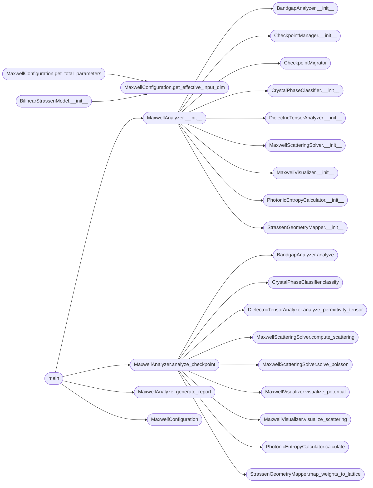

# `maxwell_strassen_analysis`

> Source: [maxwell_strassen_analysis.py:1](../../maxwell_strassen_analysis.py#L1) | language `py` | coverage 25.9% | [API index](../index.md)

maxwell_strassen_analysis.py

Electromagnetic Analysis of Strassen Algorithm Crystallization
Applies Maxwell's Equations to distinguish Crystalline (Strassen) phases
from Amorphous (Glass) phases in neural network weight distributions.

Implements:
- Mapping of weights to 3D Dielectric/Charge lattices.
- Solving Electrostatic Potential (Poisson Equation).
- Calculating EM Scattering (Bragg peaks vs Rayleigh scattering).
- Photonic Entropy and Bandgap analysis.

## Contents

- **Classes:** [`MaxwellConfiguration`](#maxwellconfiguration), [`BilinearStrassenModel`](#bilinearstrassenmodel), [`CheckpointMigrator`](#checkpointmigrator), [`StrassenGeometryMapper`](#strassengeometrymapper), [`DielectricTensorAnalyzer`](#dielectrictensoranalyzer), [`MaxwellScatteringSolver`](#maxwellscatteringsolver), [`PhotonicEntropyCalculator`](#photonicentropycalculator), [`BandgapAnalyzer`](#bandgapanalyzer), [`CrystalPhaseClassifier`](#crystalphaseclassifier), [`CheckpointManager`](#checkpointmanager), [`MaxwellVisualizer`](#maxwellvisualizer), [`MaxwellAnalyzer`](#maxwellanalyzer)
- **Protocols:** [`IModel`](#imodel), [`IGeometryMapper`](#igeometrymapper), [`IMaxwellSolver`](#imaxwellsolver), [`IDielectricAnalyzer`](#idielectricanalyzer), [`IPhaseClassifier`](#iphaseclassifier)
- **Functions:** [`main`](#main)

## Type Diagram

```mermaid
classDiagram
    direction LR
    class MaxwellConfiguration
    MaxwellConfiguration : int HIDDEN_DIM
    MaxwellConfiguration : int MATRIX_SIZE
    MaxwellConfiguration : int INPUT_DIM
    MaxwellConfiguration : Tuple[int, ] EXPANSION_SCALES
    MaxwellConfiguration : float LATTICE_CONSTANT
    MaxwellConfiguration : float PERMITTIVITY_VACUUM
    MaxwellConfiguration : float PERMEABILITY_VACUUM
    MaxwellConfiguration : float SPEED_OF_LIGHT
    MaxwellConfiguration : float PERMITTIVITY_WEIGHT_SCALE
    MaxwellConfiguration : int GRID_DIMENSION
    MaxwellConfiguration : int FREQUENCY_SAMPLES
    MaxwellConfiguration : float WAVEVECTOR_MIN
    MaxwellConfiguration : float WAVEVECTOR_MAX
    MaxwellConfiguration : float CRYSTALLINITY_ENTROPY_THRESHOLD
    MaxwellConfiguration : float BRAGG_PEAK_PROMINENCE
    MaxwellConfiguration : float ANISOTROPY_RATIO_THRESHOLD
    MaxwellConfiguration : float DISCRETIZATION_MARGIN
    MaxwellConfiguration : float ALPHA_THRESHOLD_CRYSTAL
    MaxwellConfiguration : float ALPHA_THRESHOLD_GLASS
    MaxwellConfiguration : float GLASS_TEMPERATURE_THRESHOLD
    MaxwellConfiguration : float CRYSTAL_TEMPERATURE_THRESHOLD
    MaxwellConfiguration : int CHECKPOINT_INTERVAL_MINUTES
    MaxwellConfiguration : int FIGURE_DPI
    MaxwellConfiguration : str SAVE_FORMAT
    class IModel
    <<protocol>> IModel
    IModel : get_coefficients()
    class IGeometryMapper
    <<protocol>> IGeometryMapper
    IGeometryMapper : map_weights_to_lattice()
    class IMaxwellSolver
    <<protocol>> IMaxwellSolver
    IMaxwellSolver : solve_poisson()
    IMaxwellSolver : compute_scattering()
    class IDielectricAnalyzer
    <<protocol>> IDielectricAnalyzer
    IDielectricAnalyzer : analyze_permittivity_tensor()
    class IPhaseClassifier
    <<protocol>> IPhaseClassifier
    IPhaseClassifier : classify()
    class BilinearStrassenModel
    BilinearStrassenModel : __init__()
    BilinearStrassenModel : forward()
    BilinearStrassenModel : get_coefficients()
    class CheckpointMigrator
    CheckpointMigrator : migrate()
    class StrassenGeometryMapper
    StrassenGeometryMapper : __init__()
    StrassenGeometryMapper : map_weights_to_lattice()
    class DielectricTensorAnalyzer
    DielectricTensorAnalyzer : __init__()
    DielectricTensorAnalyzer : analyze_permittivity_tensor()
    class MaxwellScatteringSolver
    MaxwellScatteringSolver : __init__()
    MaxwellScatteringSolver : solve_poisson()
    MaxwellScatteringSolver : compute_scattering()
    class PhotonicEntropyCalculator
    PhotonicEntropyCalculator : __init__()
    PhotonicEntropyCalculator : calculate()
    class BandgapAnalyzer
    BandgapAnalyzer : __init__()
    BandgapAnalyzer : analyze()
    class CrystalPhaseClassifier
    CrystalPhaseClassifier : __init__()
    CrystalPhaseClassifier : classify()
    class CheckpointManager
    CheckpointManager : __init__()
    CheckpointManager : should_save()
    CheckpointManager : save()
    class MaxwellVisualizer
    MaxwellVisualizer : __init__()
    MaxwellVisualizer : visualize_lattice()
    MaxwellVisualizer : visualize_scattering()
    MaxwellVisualizer : visualize_potential()
    class MaxwellAnalyzer
    MaxwellAnalyzer : __init__()
    MaxwellAnalyzer : analyze_checkpoint()
    MaxwellAnalyzer : generate_report()
```



## Call Graph

Solid arrows stay in this module, dashed arrows leave it.



## Classes

<a id="maxwellconfiguration"></a>

### `MaxwellConfiguration`

`class` `dataclass` | [maxwell_strassen_analysis.py:42](../../maxwell_strassen_analysis.py#L42)

Decorators: `@dataclass(frozen=True)`

```python
class MaxwellConfiguration
```

Configuration for Maxwellian analysis of Strassen crystals.

Physics Parameters:
-------------------
LATTICE_CONSTANT: Spacing between weight nodes (arbitrary units, e.g., nm scale).
PERMITTIVITY_VACUUM: ε_0 (scaled for numerical stability).
PERMITTIVITY_WEIGHT_SCALE: Factor to convert weight magnitude to dielectric contrast.

Simulation Parameters:
----------------------
GRID_DIMENSION: Size of the cubic lattice for weight embedding (N x N x N).
FREQUENCY_SAMPLES: Number of frequency points for spectral analysis.
WAVEVECTOR_RANGE: Range of k-vectors for scattering simulation.

Analysis Thresholds:
--------------------
CRYSTALLINITY_THRESHOLD: Entropy threshold to classify as Crystal vs Glass.
BRAGG_PEAK_SHARPNESS: Minimum prominence for a peak to be considered Bragg scattering.

**Attributes**

| Name | Type | Default | Description |
|---|---|---|---|
| [`HIDDEN_DIM`](#maxwellconfiguration-hidden_dim) | `int` | `8` |  |
| [`MATRIX_SIZE`](#maxwellconfiguration-matrix_size) | `int` | `2` |  |
| [`INPUT_DIM`](#maxwellconfiguration-input_dim) | `int` | `4` |  |
| [`EXPANSION_SCALES`](#maxwellconfiguration-expansion_scales) | `Tuple[int, ...]` | `(2, 4, 8, 16, 32, 64)` |  |
| [`LATTICE_CONSTANT`](#maxwellconfiguration-lattice_constant) | `float` | `1.0` |  |
| [`PERMITTIVITY_VACUUM`](#maxwellconfiguration-permittivity_vacuum) | `float` | `8.854e-12` |  |
| [`PERMEABILITY_VACUUM`](#maxwellconfiguration-permeability_vacuum) | `float` | `4 * np.pi * 1e-07` |  |
| [`SPEED_OF_LIGHT`](#maxwellconfiguration-speed_of_light) | `float` | `300000000.0` |  |
| [`PERMITTIVITY_WEIGHT_SCALE`](#maxwellconfiguration-permittivity_weight_scale) | `float` | `1.0` |  |
| [`GRID_DIMENSION`](#maxwellconfiguration-grid_dimension) | `int` | `16` |  |
| [`FREQUENCY_SAMPLES`](#maxwellconfiguration-frequency_samples) | `int` | `100` |  |
| [`WAVEVECTOR_MIN`](#maxwellconfiguration-wavevector_min) | `float` | `-np.pi` |  |
| [`WAVEVECTOR_MAX`](#maxwellconfiguration-wavevector_max) | `float` | `np.pi` |  |
| [`CRYSTALLINITY_ENTROPY_THRESHOLD`](#maxwellconfiguration-crystallinity_entropy_threshold) | `float` | `2.0` |  |
| [`BRAGG_PEAK_PROMINENCE`](#maxwellconfiguration-bragg_peak_prominence) | `float` | `0.8` |  |
| [`ANISOTROPY_RATIO_THRESHOLD`](#maxwellconfiguration-anisotropy_ratio_threshold) | `float` | `5.0` |  |
| [`DISCRETIZATION_MARGIN`](#maxwellconfiguration-discretization_margin) | `float` | `0.1` |  |
| [`ALPHA_THRESHOLD_CRYSTAL`](#maxwellconfiguration-alpha_threshold_crystal) | `float` | `7.0` |  |
| [`ALPHA_THRESHOLD_GLASS`](#maxwellconfiguration-alpha_threshold_glass) | `float` | `1.0` |  |
| [`GLASS_TEMPERATURE_THRESHOLD`](#maxwellconfiguration-glass_temperature_threshold) | `float` | `0.1` |  |
| [`CRYSTAL_TEMPERATURE_THRESHOLD`](#maxwellconfiguration-crystal_temperature_threshold) | `float` | `0.01` |  |
| [`CHECKPOINT_INTERVAL_MINUTES`](#maxwellconfiguration-checkpoint_interval_minutes) | `int` | `5` |  |
| [`FIGURE_DPI`](#maxwellconfiguration-figure_dpi) | `int` | `150` |  |
| [`SAVE_FORMAT`](#maxwellconfiguration-save_format) | `str` | `'png'` |  |
| [`DEVICE`](#maxwellconfiguration-device) | `str` | `'cuda' if torch.cuda.is_available() else 'cpu'` |  |
| [`METRIC_PRECISION`](#maxwellconfiguration-metric_precision) | `int` | `6` |  |

**Members**

| Member | Kind | Summary |
|---|---|---|
| [`get_effective_input_dim`](#maxwellconfiguration-get_effective_input_dim) | method |  |
| [`get_total_parameters`](#maxwellconfiguration-get_total_parameters) | method |  |

<a id="maxwellconfiguration-get_effective_input_dim"></a>

#### `MaxwellConfiguration.get_effective_input_dim`

`method` | [maxwell_strassen_analysis.py:103](../../maxwell_strassen_analysis.py#L103)

```python
def get_effective_input_dim(self) -> int
```

**Returns:** `int`

*Called by:* [`BilinearStrassenModel.__init__`](#bilinearstrassenmodel-__init__), [`MaxwellConfiguration.get_total_parameters`](#maxwellconfiguration-get_total_parameters)

<a id="maxwellconfiguration-get_total_parameters"></a>

#### `MaxwellConfiguration.get_total_parameters`

`method` | [maxwell_strassen_analysis.py:106](../../maxwell_strassen_analysis.py#L106)

```python
def get_total_parameters(self) -> int
```

**Returns:** `int`

*Calls:* [`MaxwellConfiguration.get_effective_input_dim`](#maxwellconfiguration-get_effective_input_dim)

---

<a id="bilinearstrassenmodel"></a>

### `BilinearStrassenModel`

`class` | [maxwell_strassen_analysis.py:145](../../maxwell_strassen_analysis.py#L145)

```python
class BilinearStrassenModel(nn.Module)
```

Bases: `nn.Module`

**Members**

| Member | Kind | Summary |
|---|---|---|
| [`__init__`](#bilinearstrassenmodel-__init__) | constructor |  |
| [`forward`](#bilinearstrassenmodel-forward) | method |  |
| [`get_coefficients`](#bilinearstrassenmodel-get_coefficients) | method |  |

<a id="bilinearstrassenmodel-__init__"></a>

#### `BilinearStrassenModel.__init__`

`constructor` | [maxwell_strassen_analysis.py:146](../../maxwell_strassen_analysis.py#L146)

```python
def __init__(self, config: MaxwellConfiguration)
```

**Parameters**

| Name | Type | Default | Description |
|---|---|---|---|
| `config` | `MaxwellConfiguration` |  |  |

*Calls:* [`BilinearStrassenModel.__init__`](batch_size.py.md#bilinearstrassenmodel-__init__), [`MaxwellConfiguration.get_effective_input_dim`](#maxwellconfiguration-get_effective_input_dim)

<a id="bilinearstrassenmodel-forward"></a>

#### `BilinearStrassenModel.forward`

`method` | [maxwell_strassen_analysis.py:161](../../maxwell_strassen_analysis.py#L161)

```python
def forward(self, a, b)
```

**Parameters**

| Name | Type | Default | Description |
|---|---|---|---|
| `a` |  |  |  |
| `b` |  |  |  |

<a id="bilinearstrassenmodel-get_coefficients"></a>

#### `BilinearStrassenModel.get_coefficients`

`method` | [maxwell_strassen_analysis.py:164](../../maxwell_strassen_analysis.py#L164)

```python
def get_coefficients(self) -> Dict[str, np.ndarray]
```

**Returns:** `Dict[str, np.ndarray]`

---

<a id="checkpointmigrator"></a>

### `CheckpointMigrator`

`class` | [maxwell_strassen_analysis.py:171](../../maxwell_strassen_analysis.py#L171)

```python
class CheckpointMigrator
```

**Members**

| Member | Kind | Summary |
|---|---|---|
| [`migrate`](#checkpointmigrator-migrate) | method |  |

<a id="checkpointmigrator-migrate"></a>

#### `CheckpointMigrator.migrate`

`method` | [maxwell_strassen_analysis.py:172](../../maxwell_strassen_analysis.py#L172)

```python
def migrate(self, raw_data: Any, config: MaxwellConfiguration) -> Optional[Dict[str, np.ndarray]]
```

**Parameters**

| Name | Type | Default | Description |
|---|---|---|---|
| `raw_data` | `Any` |  |  |
| `config` | `MaxwellConfiguration` |  |  |

**Returns:** `Optional[Dict[str, np.ndarray]]`

---

<a id="strassengeometrymapper"></a>

### `StrassenGeometryMapper`

`class` | [maxwell_strassen_analysis.py:227](../../maxwell_strassen_analysis.py#L227)

```python
class StrassenGeometryMapper
```

Maps abstract weight vectors to a 3D Dielectric Lattice.

Strategy:
1. Flatten U, V, W into a single vector.
2. Populate a 3D grid (NxNxN) using a space-filling curve (Z-order)
   or layer-wise assignment.
3. Compute Effective Charge Density ρ and Permittivity ε.

Crystal Hypothesis:
- Crystallized weights (discrete values) form ordered arrays.
- Glass weights (random) form noise.

**Members**

| Member | Kind | Summary |
|---|---|---|
| [`__init__`](#strassengeometrymapper-__init__) | constructor |  |
| [`map_weights_to_lattice`](#strassengeometrymapper-map_weights_to_lattice) | method | charge_density: 3D array of charge distribution. permittivity: 3D array of dielectric constants. |

<a id="strassengeometrymapper-__init__"></a>

#### `StrassenGeometryMapper.__init__`

`constructor` | [maxwell_strassen_analysis.py:241](../../maxwell_strassen_analysis.py#L241)

```python
def __init__(self, config: MaxwellConfiguration)
```

**Parameters**

| Name | Type | Default | Description |
|---|---|---|---|
| `config` | `MaxwellConfiguration` |  |  |

*Called by:* [`MaxwellAnalyzer.__init__`](#maxwellanalyzer-__init__)

<a id="strassengeometrymapper-map_weights_to_lattice"></a>

#### `StrassenGeometryMapper.map_weights_to_lattice`

`method` | [maxwell_strassen_analysis.py:244](../../maxwell_strassen_analysis.py#L244)

```python
def map_weights_to_lattice(self, weights: Dict[str, np.ndarray]) -> Tuple[np.ndarray, np.ndarray]
```

charge_density: 3D array of charge distribution. permittivity: 3D array of dielectric constants.

**Parameters**

| Name | Type | Default | Description |
|---|---|---|---|
| `weights` | `Dict[str, np.ndarray]` |  |  |

**Returns:** `Tuple[np.ndarray, np.ndarray]`

*Called by:* [`MaxwellAnalyzer.analyze_checkpoint`](#maxwellanalyzer-analyze_checkpoint)

---

<a id="dielectrictensoranalyzer"></a>

### `DielectricTensorAnalyzer`

`class` | [maxwell_strassen_analysis.py:288](../../maxwell_strassen_analysis.py#L288)

```python
class DielectricTensorAnalyzer
```

Analyzes the anisotropy of the dielectric medium.

Glass: Isotropic (ε ~ scalar)
Crystal: Anisotropic (ε ~ tensor with specific principal axes)

**Members**

| Member | Kind | Summary |
|---|---|---|
| [`__init__`](#dielectrictensoranalyzer-__init__) | constructor |  |
| [`analyze_permittivity_tensor`](#dielectrictensoranalyzer-analyze_permittivity_tensor) | method | Analyze the effective permittivity tensor of the medium. |

<a id="dielectrictensoranalyzer-__init__"></a>

#### `DielectricTensorAnalyzer.__init__`

`constructor` | [maxwell_strassen_analysis.py:295](../../maxwell_strassen_analysis.py#L295)

```python
def __init__(self, config: MaxwellConfiguration)
```

**Parameters**

| Name | Type | Default | Description |
|---|---|---|---|
| `config` | `MaxwellConfiguration` |  |  |

*Called by:* [`MaxwellAnalyzer.__init__`](#maxwellanalyzer-__init__)

<a id="dielectrictensoranalyzer-analyze_permittivity_tensor"></a>

#### `DielectricTensorAnalyzer.analyze_permittivity_tensor`

`method` | [maxwell_strassen_analysis.py:298](../../maxwell_strassen_analysis.py#L298)

```python
def analyze_permittivity_tensor(self, permittivity: np.ndarray) -> Dict[str, Any]
```

Analyze the effective permittivity tensor of the medium.

**Parameters**

| Name | Type | Default | Description |
|---|---|---|---|
| `permittivity` | `np.ndarray` |  |  |

**Returns:** `Dict[str, Any]`

*Called by:* [`MaxwellAnalyzer.analyze_checkpoint`](#maxwellanalyzer-analyze_checkpoint)

---

<a id="maxwellscatteringsolver"></a>

### `MaxwellScatteringSolver`

`class` | [maxwell_strassen_analysis.py:350](../../maxwell_strassen_analysis.py#L350)

```python
class MaxwellScatteringSolver
```

Solves Maxwell's equations in the frequency domain via FFT.

Key Analysis:
1. Electrostatics: Solve ∇·(ε∇φ) = -ρ.
2. Scattering: Calculate Fourier Transform of Dielectric contrast.
   - Crystal: Sharp Bragg Peaks at k-vectors determined by lattice periodicity.
   - Glass: Broad diffuse scattering (Rayleigh).

**Members**

| Member | Kind | Summary |
|---|---|---|
| [`__init__`](#maxwellscatteringsolver-__init__) | constructor |  |
| [`solve_poisson`](#maxwellscatteringsolver-solve_poisson) | method | Solves Poisson equation for Electric Potential φ. |
| [`compute_scattering`](#maxwellscatteringsolver-compute_scattering) | method | Compute the Scattering Amplitude S(k). |

<a id="maxwellscatteringsolver-__init__"></a>

#### `MaxwellScatteringSolver.__init__`

`constructor` | [maxwell_strassen_analysis.py:360](../../maxwell_strassen_analysis.py#L360)

```python
def __init__(self, config: MaxwellConfiguration)
```

**Parameters**

| Name | Type | Default | Description |
|---|---|---|---|
| `config` | `MaxwellConfiguration` |  |  |

*Called by:* [`MaxwellAnalyzer.__init__`](#maxwellanalyzer-__init__)

<a id="maxwellscatteringsolver-solve_poisson"></a>

#### `MaxwellScatteringSolver.solve_poisson`

`method` | [maxwell_strassen_analysis.py:363](../../maxwell_strassen_analysis.py#L363)

```python
def solve_poisson(self, charge_density: np.ndarray, permittivity: np.ndarray) -> np.ndarray
```

Solves Poisson equation for Electric Potential φ.

Using Spectral Method (FFT): ∇²φ = -ρ / ε_0

For variable ε (heterogeneous medium), this is approximate.
We use the convolution theorem for the Green's function.

**Parameters**

| Name | Type | Default | Description |
|---|---|---|---|
| `charge_density` | `np.ndarray` |  |  |
| `permittivity` | `np.ndarray` |  |  |

**Returns:** `np.ndarray`

*Called by:* [`MaxwellAnalyzer.analyze_checkpoint`](#maxwellanalyzer-analyze_checkpoint)

<a id="maxwellscatteringsolver-compute_scattering"></a>

#### `MaxwellScatteringSolver.compute_scattering`

`method` | [maxwell_strassen_analysis.py:401](../../maxwell_strassen_analysis.py#L401)

```python
def compute_scattering(self, permittivity: np.ndarray) -> Dict[str, Any]
```

Compute the Scattering Amplitude S(k).

S(k) ∝ |FT(Δε)|²

Δε = ε(r) - ε_avg (Dielectric contrast)

**Parameters**

| Name | Type | Default | Description |
|---|---|---|---|
| `permittivity` | `np.ndarray` |  |  |

**Returns:** `Dict[str, Any]` - Dict containing scattering intensity map and peak analysis.

*Called by:* [`MaxwellAnalyzer.analyze_checkpoint`](#maxwellanalyzer-analyze_checkpoint)

---

<a id="photonicentropycalculator"></a>

### `PhotonicEntropyCalculator`

`class` | [maxwell_strassen_analysis.py:466](../../maxwell_strassen_analysis.py#L466)

```python
class PhotonicEntropyCalculator
```

Calculates the entropy of the electromagnetic field distribution.

S = -∑ p(E) log p(E)

Glass: High Entropy (Disordered field).
Crystal: Low Entropy (Ordered, localized modes).

**Members**

| Member | Kind | Summary |
|---|---|---|
| [`__init__`](#photonicentropycalculator-__init__) | constructor |  |
| [`calculate`](#photonicentropycalculator-calculate) | method |  |

<a id="photonicentropycalculator-__init__"></a>

#### `PhotonicEntropyCalculator.__init__`

`constructor` | [maxwell_strassen_analysis.py:474](../../maxwell_strassen_analysis.py#L474)

```python
def __init__(self, config: MaxwellConfiguration)
```

**Parameters**

| Name | Type | Default | Description |
|---|---|---|---|
| `config` | `MaxwellConfiguration` |  |  |

*Called by:* [`MaxwellAnalyzer.__init__`](#maxwellanalyzer-__init__)

<a id="photonicentropycalculator-calculate"></a>

#### `PhotonicEntropyCalculator.calculate`

`method` | [maxwell_strassen_analysis.py:477](../../maxwell_strassen_analysis.py#L477)

```python
def calculate(self, potential: np.ndarray, intensity: np.ndarray) -> Dict[str, float]
```

**Parameters**

| Name | Type | Default | Description |
|---|---|---|---|
| `potential` | `np.ndarray` |  |  |
| `intensity` | `np.ndarray` |  |  |

**Returns:** `Dict[str, float]`

*Called by:* [`MaxwellAnalyzer.analyze_checkpoint`](#maxwellanalyzer-analyze_checkpoint)

---

<a id="bandgapanalyzer"></a>

### `BandgapAnalyzer`

`class` | [maxwell_strassen_analysis.py:498](../../maxwell_strassen_analysis.py#L498)

```python
class BandgapAnalyzer
```

Estimates if a photonic bandgap exists.

A bandgap implies certain frequencies cannot propagate.

We use the Fourier coefficients to estimate the gap.

**Members**

| Member | Kind | Summary |
|---|---|---|
| [`__init__`](#bandgapanalyzer-__init__) | constructor |  |
| [`analyze`](#bandgapanalyzer-analyze) | method |  |

<a id="bandgapanalyzer-__init__"></a>

#### `BandgapAnalyzer.__init__`

`constructor` | [maxwell_strassen_analysis.py:505](../../maxwell_strassen_analysis.py#L505)

```python
def __init__(self, config: MaxwellConfiguration)
```

**Parameters**

| Name | Type | Default | Description |
|---|---|---|---|
| `config` | `MaxwellConfiguration` |  |  |

*Called by:* [`MaxwellAnalyzer.__init__`](#maxwellanalyzer-__init__)

<a id="bandgapanalyzer-analyze"></a>

#### `BandgapAnalyzer.analyze`

`method` | [maxwell_strassen_analysis.py:508](../../maxwell_strassen_analysis.py#L508)

```python
def analyze(self, fourier_coeffs: np.ndarray) -> Dict[str, Any]
```

**Parameters**

| Name | Type | Default | Description |
|---|---|---|---|
| `fourier_coeffs` | `np.ndarray` |  |  |

**Returns:** `Dict[str, Any]`

*Called by:* [`MaxwellAnalyzer.analyze_checkpoint`](#maxwellanalyzer-analyze_checkpoint)

---

<a id="crystalphaseclassifier"></a>

### `CrystalPhaseClassifier`

`class` | [maxwell_strassen_analysis.py:544](../../maxwell_strassen_analysis.py#L544)

```python
class CrystalPhaseClassifier
```

Classifies the material phase (Crystal vs Glass) based on EM metrics.

**Members**

| Member | Kind | Summary |
|---|---|---|
| [`__init__`](#crystalphaseclassifier-__init__) | constructor |  |
| [`classify`](#crystalphaseclassifier-classify) | method | Decision Logic: 1. |

<a id="crystalphaseclassifier-__init__"></a>

#### `CrystalPhaseClassifier.__init__`

`constructor` | [maxwell_strassen_analysis.py:548](../../maxwell_strassen_analysis.py#L548)

```python
def __init__(self, config: MaxwellConfiguration)
```

**Parameters**

| Name | Type | Default | Description |
|---|---|---|---|
| `config` | `MaxwellConfiguration` |  |  |

*Called by:* [`MaxwellAnalyzer.__init__`](#maxwellanalyzer-__init__)

<a id="crystalphaseclassifier-classify"></a>

#### `CrystalPhaseClassifier.classify`

`method` | [maxwell_strassen_analysis.py:551](../../maxwell_strassen_analysis.py#L551)

```python
def classify(self, em_metrics: Dict[str, Any], purity_metrics: Dict[str, Any]) -> Dict[str, Any]
```

Decision Logic: 1.

If Purity Alpha > Threshold AND Discretization is high -> Pre-cursor. 2. If Anisotropy is High -> Crystal Order. 3. If Scattering shows Bragg Peaks -> Long Range Order. 4. If Entropy is Low -> Ordered System.

**Parameters**

| Name | Type | Default | Description |
|---|---|---|---|
| `em_metrics` | `Dict[str, Any]` |  |  |
| `purity_metrics` | `Dict[str, Any]` |  |  |

**Returns:** `Dict[str, Any]`

*Called by:* [`MaxwellAnalyzer.analyze_checkpoint`](#maxwellanalyzer-analyze_checkpoint)

---

<a id="checkpointmanager"></a>

### `CheckpointManager`

`class` | [maxwell_strassen_analysis.py:605](../../maxwell_strassen_analysis.py#L605)

```python
class CheckpointManager
```

**Members**

| Member | Kind | Summary |
|---|---|---|
| [`__init__`](#checkpointmanager-__init__) | constructor |  |
| [`should_save`](#checkpointmanager-should_save) | method |  |
| [`save`](#checkpointmanager-save) | method |  |

<a id="checkpointmanager-__init__"></a>

#### `CheckpointManager.__init__`

`constructor` | [maxwell_strassen_analysis.py:606](../../maxwell_strassen_analysis.py#L606)

```python
def __init__(self, config: MaxwellConfiguration)
```

**Parameters**

| Name | Type | Default | Description |
|---|---|---|---|
| `config` | `MaxwellConfiguration` |  |  |

*Called by:* [`MaxwellAnalyzer.__init__`](#maxwellanalyzer-__init__)

<a id="checkpointmanager-should_save"></a>

#### `CheckpointManager.should_save`

`method` | [maxwell_strassen_analysis.py:610](../../maxwell_strassen_analysis.py#L610)

```python
def should_save(self) -> bool
```

**Returns:** `bool`

<a id="checkpointmanager-save"></a>

#### `CheckpointManager.save`

`method` | [maxwell_strassen_analysis.py:613](../../maxwell_strassen_analysis.py#L613)

```python
def save(self, data: Dict[str, Any], output_dir: str)
```

**Parameters**

| Name | Type | Default | Description |
|---|---|---|---|
| `data` | `Dict[str, Any]` |  |  |
| `output_dir` | `str` |  |  |

---

<a id="maxwellvisualizer"></a>

### `MaxwellVisualizer`

`class` | [maxwell_strassen_analysis.py:625](../../maxwell_strassen_analysis.py#L625)

```python
class MaxwellVisualizer
```

**Members**

| Member | Kind | Summary |
|---|---|---|
| [`__init__`](#maxwellvisualizer-__init__) | constructor |  |
| [`visualize_lattice`](#maxwellvisualizer-visualize_lattice) | method |  |
| [`visualize_scattering`](#maxwellvisualizer-visualize_scattering) | method |  |
| [`visualize_potential`](#maxwellvisualizer-visualize_potential) | method |  |

<a id="maxwellvisualizer-__init__"></a>

#### `MaxwellVisualizer.__init__`

`constructor` | [maxwell_strassen_analysis.py:626](../../maxwell_strassen_analysis.py#L626)

```python
def __init__(self, config: MaxwellConfiguration)
```

**Parameters**

| Name | Type | Default | Description |
|---|---|---|---|
| `config` | `MaxwellConfiguration` |  |  |

*Called by:* [`MaxwellAnalyzer.__init__`](#maxwellanalyzer-__init__)

<a id="maxwellvisualizer-visualize_lattice"></a>

#### `MaxwellVisualizer.visualize_lattice`

`method` | [maxwell_strassen_analysis.py:629](../../maxwell_strassen_analysis.py#L629)

```python
def visualize_lattice(self, permittivity: np.ndarray, output_dir: str, name: str)
```

**Parameters**

| Name | Type | Default | Description |
|---|---|---|---|
| `permittivity` | `np.ndarray` |  |  |
| `output_dir` | `str` |  |  |
| `name` | `str` |  |  |

<a id="maxwellvisualizer-visualize_scattering"></a>

#### `MaxwellVisualizer.visualize_scattering`

`method` | [maxwell_strassen_analysis.py:648](../../maxwell_strassen_analysis.py#L648)

```python
def visualize_scattering(self, scattering_slice: np.ndarray, output_dir: str, name: str)
```

**Parameters**

| Name | Type | Default | Description |
|---|---|---|---|
| `scattering_slice` | `np.ndarray` |  |  |
| `output_dir` | `str` |  |  |
| `name` | `str` |  |  |

*Called by:* [`MaxwellAnalyzer.analyze_checkpoint`](#maxwellanalyzer-analyze_checkpoint)

<a id="maxwellvisualizer-visualize_potential"></a>

#### `MaxwellVisualizer.visualize_potential`

`method` | [maxwell_strassen_analysis.py:659](../../maxwell_strassen_analysis.py#L659)

```python
def visualize_potential(self, potential: np.ndarray, output_dir: str, name: str)
```

**Parameters**

| Name | Type | Default | Description |
|---|---|---|---|
| `potential` | `np.ndarray` |  |  |
| `output_dir` | `str` |  |  |
| `name` | `str` |  |  |

*Called by:* [`MaxwellAnalyzer.analyze_checkpoint`](#maxwellanalyzer-analyze_checkpoint)

---

<a id="maxwellanalyzer"></a>

### `MaxwellAnalyzer`

`class` | [maxwell_strassen_analysis.py:677](../../maxwell_strassen_analysis.py#L677)

```python
class MaxwellAnalyzer
```

**Members**

| Member | Kind | Summary |
|---|---|---|
| [`__init__`](#maxwellanalyzer-__init__) | constructor |  |
| [`analyze_checkpoint`](#maxwellanalyzer-analyze_checkpoint) | method | Executes the full Maxwellian analysis pipeline on a single checkpoint. |
| [`generate_report`](#maxwellanalyzer-generate_report) | method |  |

<a id="maxwellanalyzer-__init__"></a>

#### `MaxwellAnalyzer.__init__`

`constructor` | [maxwell_strassen_analysis.py:678](../../maxwell_strassen_analysis.py#L678)

```python
def __init__(self, config: MaxwellConfiguration)
```

**Parameters**

| Name | Type | Default | Description |
|---|---|---|---|
| `config` | `MaxwellConfiguration` |  |  |

*Calls:* [`BandgapAnalyzer.__init__`](#bandgapanalyzer-__init__), [`CheckpointManager.__init__`](#checkpointmanager-__init__), [`CheckpointMigrator`](#checkpointmigrator), [`CrystalPhaseClassifier.__init__`](#crystalphaseclassifier-__init__), [`DielectricTensorAnalyzer.__init__`](#dielectrictensoranalyzer-__init__), [`MaxwellScatteringSolver.__init__`](#maxwellscatteringsolver-__init__), [`MaxwellVisualizer.__init__`](#maxwellvisualizer-__init__), [`PhotonicEntropyCalculator.__init__`](#photonicentropycalculator-__init__), [`StrassenGeometryMapper.__init__`](#strassengeometrymapper-__init__)

*Called by:* [`main`](#main)

<a id="maxwellanalyzer-analyze_checkpoint"></a>

#### `MaxwellAnalyzer.analyze_checkpoint`

`method` | [maxwell_strassen_analysis.py:701](../../maxwell_strassen_analysis.py#L701)

```python
def analyze_checkpoint(self, checkpoint_path: str, output_dir: str) -> Dict[str, Any]
```

Executes the full Maxwellian analysis pipeline on a single checkpoint.

**Parameters**

| Name | Type | Default | Description |
|---|---|---|---|
| `checkpoint_path` | `str` |  |  |
| `output_dir` | `str` |  |  |

**Returns:** `Dict[str, Any]`

**Raises**

- `ValueError`: (raised in the body, not documented)

*Calls:* [`CheckpointMigrator.migrate`](batch_size.py.md#checkpointmigrator-migrate), [`CheckpointManager.save`](experimetn2.py.md#checkpointmanager-save), [`CheckpointManager.should_save`](grain.py.md#checkpointmanager-should_save), [`BandgapAnalyzer.analyze`](#bandgapanalyzer-analyze), [`CrystalPhaseClassifier.classify`](#crystalphaseclassifier-classify), [`DielectricTensorAnalyzer.analyze_permittivity_tensor`](#dielectrictensoranalyzer-analyze_permittivity_tensor), [`MaxwellScatteringSolver.compute_scattering`](#maxwellscatteringsolver-compute_scattering), [`MaxwellScatteringSolver.solve_poisson`](#maxwellscatteringsolver-solve_poisson), [`MaxwellVisualizer.visualize_potential`](#maxwellvisualizer-visualize_potential), [`MaxwellVisualizer.visualize_scattering`](#maxwellvisualizer-visualize_scattering), [`PhotonicEntropyCalculator.calculate`](#photonicentropycalculator-calculate), [`StrassenGeometryMapper.map_weights_to_lattice`](#strassengeometrymapper-map_weights_to_lattice)

*Called by:* [`main`](#main)

<a id="maxwellanalyzer-generate_report"></a>

#### `MaxwellAnalyzer.generate_report`

`method` | [maxwell_strassen_analysis.py:765](../../maxwell_strassen_analysis.py#L765)

```python
def generate_report(self, results: List[Dict], output_dir: str)
```

**Parameters**

| Name | Type | Default | Description |
|---|---|---|---|
| `results` | `List[Dict]` |  |  |
| `output_dir` | `str` |  |  |

*Called by:* [`main`](#main)

---

## Protocols

<a id="imodel"></a>

### `IModel`

`protocol` | [maxwell_strassen_analysis.py:116](../../maxwell_strassen_analysis.py#L116)

Decorators: `@runtime_checkable`

```python
class IModel(Protocol)
```

Bases: `Protocol`

**Members**

| Member | Kind | Summary |
|---|---|---|
| [`get_coefficients`](#imodel-get_coefficients) | method |  |

<a id="imodel-get_coefficients"></a>

#### `IModel.get_coefficients`

`method` | [maxwell_strassen_analysis.py:117](../../maxwell_strassen_analysis.py#L117)

```python
def get_coefficients(self) -> Dict[str, np.ndarray]
```

**Returns:** `Dict[str, np.ndarray]`

---

<a id="igeometrymapper"></a>

### `IGeometryMapper`

`protocol` | [maxwell_strassen_analysis.py:121](../../maxwell_strassen_analysis.py#L121)

Decorators: `@runtime_checkable`

```python
class IGeometryMapper(Protocol)
```

Bases: `Protocol`

**Members**

| Member | Kind | Summary |
|---|---|---|
| [`map_weights_to_lattice`](#igeometrymapper-map_weights_to_lattice) | method |  |

<a id="igeometrymapper-map_weights_to_lattice"></a>

#### `IGeometryMapper.map_weights_to_lattice`

`method` | [maxwell_strassen_analysis.py:122](../../maxwell_strassen_analysis.py#L122)

```python
def map_weights_to_lattice(self, weights: Dict[str, np.ndarray]) -> Tuple[np.ndarray, np.ndarray]
```

**Parameters**

| Name | Type | Default | Description |
|---|---|---|---|
| `weights` | `Dict[str, np.ndarray]` |  |  |

**Returns:** `Tuple[np.ndarray, np.ndarray]`

---

<a id="imaxwellsolver"></a>

### `IMaxwellSolver`

`protocol` | [maxwell_strassen_analysis.py:126](../../maxwell_strassen_analysis.py#L126)

Decorators: `@runtime_checkable`

```python
class IMaxwellSolver(Protocol)
```

Bases: `Protocol`

**Members**

| Member | Kind | Summary |
|---|---|---|
| [`solve_poisson`](#imaxwellsolver-solve_poisson) | method |  |
| [`compute_scattering`](#imaxwellsolver-compute_scattering) | method |  |

<a id="imaxwellsolver-solve_poisson"></a>

#### `IMaxwellSolver.solve_poisson`

`method` | [maxwell_strassen_analysis.py:127](../../maxwell_strassen_analysis.py#L127)

```python
def solve_poisson(self, charge_density: np.ndarray, permittivity: np.ndarray) -> np.ndarray
```

**Parameters**

| Name | Type | Default | Description |
|---|---|---|---|
| `charge_density` | `np.ndarray` |  |  |
| `permittivity` | `np.ndarray` |  |  |

**Returns:** `np.ndarray`

<a id="imaxwellsolver-compute_scattering"></a>

#### `IMaxwellSolver.compute_scattering`

`method` | [maxwell_strassen_analysis.py:128](../../maxwell_strassen_analysis.py#L128)

```python
def compute_scattering(self, permittivity: np.ndarray) -> np.ndarray
```

**Parameters**

| Name | Type | Default | Description |
|---|---|---|---|
| `permittivity` | `np.ndarray` |  |  |

**Returns:** `np.ndarray`

---

<a id="idielectricanalyzer"></a>

### `IDielectricAnalyzer`

`protocol` | [maxwell_strassen_analysis.py:132](../../maxwell_strassen_analysis.py#L132)

Decorators: `@runtime_checkable`

```python
class IDielectricAnalyzer(Protocol)
```

Bases: `Protocol`

**Members**

| Member | Kind | Summary |
|---|---|---|
| [`analyze_permittivity_tensor`](#idielectricanalyzer-analyze_permittivity_tensor) | method |  |

<a id="idielectricanalyzer-analyze_permittivity_tensor"></a>

#### `IDielectricAnalyzer.analyze_permittivity_tensor`

`method` | [maxwell_strassen_analysis.py:133](../../maxwell_strassen_analysis.py#L133)

```python
def analyze_permittivity_tensor(self, permittivity: np.ndarray) -> Dict[str, Any]
```

**Parameters**

| Name | Type | Default | Description |
|---|---|---|---|
| `permittivity` | `np.ndarray` |  |  |

**Returns:** `Dict[str, Any]`

---

<a id="iphaseclassifier"></a>

### `IPhaseClassifier`

`protocol` | [maxwell_strassen_analysis.py:137](../../maxwell_strassen_analysis.py#L137)

Decorators: `@runtime_checkable`

```python
class IPhaseClassifier(Protocol)
```

Bases: `Protocol`

**Members**

| Member | Kind | Summary |
|---|---|---|
| [`classify`](#iphaseclassifier-classify) | method |  |

<a id="iphaseclassifier-classify"></a>

#### `IPhaseClassifier.classify`

`method` | [maxwell_strassen_analysis.py:138](../../maxwell_strassen_analysis.py#L138)

```python
def classify(self, metrics: Dict[str, Any]) -> str
```

**Parameters**

| Name | Type | Default | Description |
|---|---|---|---|
| `metrics` | `Dict[str, Any]` |  |  |

**Returns:** `str`

---

## Functions

<a id="main"></a>

### `main`

`function` | [maxwell_strassen_analysis.py:788](../../maxwell_strassen_analysis.py#L788)

```python
def main()
```

*Calls:* [`MaxwellAnalyzer.__init__`](#maxwellanalyzer-__init__), [`MaxwellAnalyzer.analyze_checkpoint`](#maxwellanalyzer-analyze_checkpoint), [`MaxwellAnalyzer.generate_report`](#maxwellanalyzer-generate_report), [`MaxwellConfiguration`](#maxwellconfiguration)

---
