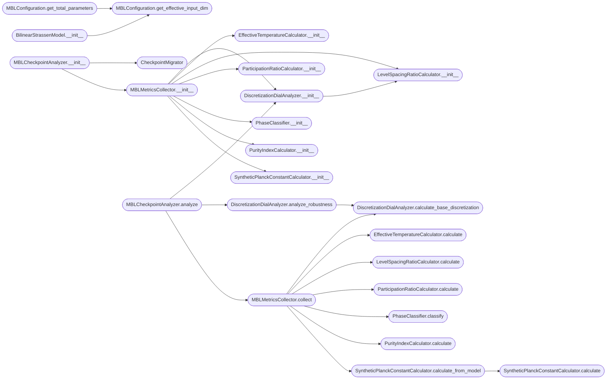

# `mbl_analyzer`

> Source: [mbl_analyzer.py:1](../../mbl_analyzer.py#L1) | language `py` | coverage 58.8% | [API index](../index.md)

Remove tqdm dependency and use standard library

## Contents

- **Classes:** [`MBLConfiguration`](#mblconfiguration), [`BilinearStrassenModel`](#bilinearstrassenmodel), [`LevelSpacingRatioCalculator`](#levelspacingratiocalculator), [`ParticipationRatioCalculator`](#participationratiocalculator), [`SyntheticPlanckConstantCalculator`](#syntheticplanckconstantcalculator), [`DiscretizationDialAnalyzer`](#discretizationdialanalyzer), [`PurityIndexCalculator`](#purityindexcalculator), [`EffectiveTemperatureCalculator`](#effectivetemperaturecalculator), [`PhaseClassifier`](#phaseclassifier), [`CheckpointMigrator`](#checkpointmigrator), [`MBLCheckpointManager`](#mblcheckpointmanager), [`MBLMetricsCollector`](#mblmetricscollector), [`MBLCheckpointAnalyzer`](#mblcheckpointanalyzer), [`MBLAnalysisPipeline`](#mblanalysispipeline)
- **Protocols:** [`IModel`](#imodel), [`ILevelSpacingCalculator`](#ilevelspacingcalculator), [`IParticipationRatioCalculator`](#iparticipationratiocalculator), [`ISyntheticPlanckCalculator`](#isyntheticplanckcalculator), [`IDiscretizationDialAnalyzer`](#idiscretizationdialanalyzer), [`ICheckpointManager`](#icheckpointmanager), [`ITrainingMetricsCollector`](#itrainingmetricscollector)
- **Functions:** [`main`](#main)

## Type Diagram

```mermaid
classDiagram
    direction LR
    class MBLConfiguration
    MBLConfiguration : int HIDDEN_DIM
    MBLConfiguration : int MATRIX_SIZE
    MBLConfiguration : int INPUT_DIM
    MBLConfiguration : float LEVEL_SPACING_WIGNER_DYSON
    MBLConfiguration : float LEVEL_SPACING_POISSON
    MBLConfiguration : float LEVEL_SPACING_TOLERANCE
    MBLConfiguration : float PR_LOCALIZATION_THRESHOLD
    MBLConfiguration : float PR_DELIMITED_THRESHOLD
    MBLConfiguration : int PR_RENYI_INDEX
    MBLConfiguration : float HBAR_ENERGY_GAP_SCALE
    MBLConfiguration : float HBAR_NUMERICAL_NOISE_FLOOR
    MBLConfiguration : float DISCRETIZATION_BASE
    MBLConfiguration : Tuple[float, ] DISCRETIZATION_NOISE_LEVELS
    MBLConfiguration : float DISCRETIZATION_GAP_COLLAPSE_THRESHOLD
    MBLConfiguration : float DISCRETIZATION_MARGIN
    MBLConfiguration : int ENTROPY_BINS
    MBLConfiguration : int TEMPERATURE_WINDOW
    MBLConfiguration : int SPECIFIC_HEAT_WINDOW
    MBLConfiguration : Tuple[float, ] PRUNING_LEVELS
    MBLConfiguration : float ALPHA_SATURATION
    MBLConfiguration : float ALPHA_THRESHOLD_CRYSTAL
    MBLConfiguration : float ALPHA_THRESHOLD_GLASS
    MBLConfiguration : float GLASS_TEMPERATURE_THRESHOLD
    MBLConfiguration : float CRYSTAL_TEMPERATURE_THRESHOLD
    class IModel
    <<protocol>> IModel
    IModel : get_coefficients()
    IModel : forward()
    class ILevelSpacingCalculator
    <<protocol>> ILevelSpacingCalculator
    ILevelSpacingCalculator : calculate()
    class IParticipationRatioCalculator
    <<protocol>> IParticipationRatioCalculator
    IParticipationRatioCalculator : calculate()
    class ISyntheticPlanckCalculator
    <<protocol>> ISyntheticPlanckCalculator
    ISyntheticPlanckCalculator : calculate()
    class IDiscretizationDialAnalyzer
    <<protocol>> IDiscretizationDialAnalyzer
    IDiscretizationDialAnalyzer : analyze_robustness()
    class ICheckpointManager
    <<protocol>> ICheckpointManager
    ICheckpointManager : save_checkpoint()
    ICheckpointManager : load_checkpoint()
    class ITrainingMetricsCollector
    <<protocol>> ITrainingMetricsCollector
    ITrainingMetricsCollector : collect()
    class BilinearStrassenModel
    BilinearStrassenModel : __init__()
    BilinearStrassenModel : forward()
    BilinearStrassenModel : get_coefficients()
    BilinearStrassenModel : get_flat_parameters()
    BilinearStrassenModel : construct_hessian_approximation()
    class LevelSpacingRatioCalculator
    LevelSpacingRatioCalculator : __init__()
    LevelSpacingRatioCalculator : calculate()
    class ParticipationRatioCalculator
    ParticipationRatioCalculator : __init__()
    ParticipationRatioCalculator : calculate()
    class SyntheticPlanckConstantCalculator
    SyntheticPlanckConstantCalculator : __init__()
    SyntheticPlanckConstantCalculator : calculate()
    SyntheticPlanckConstantCalculator : calculate_from_model()
    class DiscretizationDialAnalyzer
    DiscretizationDialAnalyzer : __init__()
    DiscretizationDialAnalyzer : calculate_base_discretization()
    DiscretizationDialAnalyzer : analyze_robustness()
    class PurityIndexCalculator
    PurityIndexCalculator : __init__()
    PurityIndexCalculator : calculate()
    class EffectiveTemperatureCalculator
    EffectiveTemperatureCalculator : __init__()
    EffectiveTemperatureCalculator : calculate()
    class PhaseClassifier
    PhaseClassifier : __init__()
    PhaseClassifier : classify()
    class CheckpointMigrator
    CheckpointMigrator : migrate()
    class MBLCheckpointManager
    MBLCheckpointManager : __init__()
    MBLCheckpointManager : should_save_checkpoint()
    MBLCheckpointManager : save_checkpoint()
    MBLCheckpointManager : load_checkpoint()
    class MBLMetricsCollector
    MBLMetricsCollector : __init__()
    MBLMetricsCollector : collect()
    class MBLCheckpointAnalyzer
    MBLCheckpointAnalyzer : __init__()
    MBLCheckpointAnalyzer : analyze()
    class MBLAnalysisPipeline
    MBLAnalysisPipeline : __init__()
    MBLAnalysisPipeline : process_checkpoint()
    MBLAnalysisPipeline : process_directory()
    MBLAnalysisPipeline : generate_summary()
```



## Call Graph

Solid arrows stay in this module, dashed arrows leave it.



## Classes

<a id="mblconfiguration"></a>

### `MBLConfiguration`

`class` `dataclass` | [mbl_analyzer.py:24](../../mbl_analyzer.py#L24)

Decorators: `@dataclass(frozen=True)`

```python
class MBLConfiguration
```

Comprehensive configuration for MBL analysis of Strassen algorithm crystallization.

All parameters are centralized here following SOLID principles.

**Attributes**

| Name | Type | Default | Description |
|---|---|---|---|
| [`HIDDEN_DIM`](#mblconfiguration-hidden_dim) | `int` | `8` |  |
| [`MATRIX_SIZE`](#mblconfiguration-matrix_size) | `int` | `2` |  |
| [`INPUT_DIM`](#mblconfiguration-input_dim) | `int` | `4` |  |
| [`LEVEL_SPACING_WIGNER_DYSON`](#mblconfiguration-level_spacing_wigner_dyson) | `float` | `0.5307` |  |
| [`LEVEL_SPACING_POISSON`](#mblconfiguration-level_spacing_poisson) | `float` | `0.3863` |  |
| [`LEVEL_SPACING_TOLERANCE`](#mblconfiguration-level_spacing_tolerance) | `float` | `0.05` |  |
| [`PR_LOCALIZATION_THRESHOLD`](#mblconfiguration-pr_localization_threshold) | `float` | `0.8` |  |
| [`PR_DELIMITED_THRESHOLD`](#mblconfiguration-pr_delimited_threshold) | `float` | `0.1` |  |
| [`PR_RENYI_INDEX`](#mblconfiguration-pr_renyi_index) | `int` | `2` |  |
| [`HBAR_ENERGY_GAP_SCALE`](#mblconfiguration-hbar_energy_gap_scale) | `float` | `1.0` |  |
| [`HBAR_NUMERICAL_NOISE_FLOOR`](#mblconfiguration-hbar_numerical_noise_floor) | `float` | `1e-07` |  |
| [`DISCRETIZATION_BASE`](#mblconfiguration-discretization_base) | `float` | `0.00015` |  |
| [`DISCRETIZATION_NOISE_LEVELS`](#mblconfiguration-discretization_noise_levels) | `Tuple[float, ...]` | `(0.0, 0.001, 0.005, 0.01, 0.05, 0.1)` |  |
| [`DISCRETIZATION_GAP_COLLAPSE_THRESHOLD`](#mblconfiguration-discretization_gap_collapse_threshold) | `float` | `0.5` |  |
| [`DISCRETIZATION_MARGIN`](#mblconfiguration-discretization_margin) | `float` | `0.1` |  |
| [`ENTROPY_BINS`](#mblconfiguration-entropy_bins) | `int` | `50` |  |
| [`TEMPERATURE_WINDOW`](#mblconfiguration-temperature_window) | `int` | `100` |  |
| [`SPECIFIC_HEAT_WINDOW`](#mblconfiguration-specific_heat_window) | `int` | `50` |  |
| [`PRUNING_LEVELS`](#mblconfiguration-pruning_levels) | `Tuple[float, ...]` | `(0.0, 0.3, 0.5, 0.7, 0.9)` |  |
| [`ALPHA_SATURATION`](#mblconfiguration-alpha_saturation) | `float` | `20.0` |  |
| [`ALPHA_THRESHOLD_CRYSTAL`](#mblconfiguration-alpha_threshold_crystal) | `float` | `7.0` |  |
| [`ALPHA_THRESHOLD_GLASS`](#mblconfiguration-alpha_threshold_glass) | `float` | `1.0` |  |
| [`GLASS_TEMPERATURE_THRESHOLD`](#mblconfiguration-glass_temperature_threshold) | `float` | `0.1` |  |
| [`CRYSTAL_TEMPERATURE_THRESHOLD`](#mblconfiguration-crystal_temperature_threshold) | `float` | `0.01` |  |
| [`CHECKPOINT_INTERVAL_MINUTES`](#mblconfiguration-checkpoint_interval_minutes) | `int` | `5` |  |
| [`CHECKPOINT_KEEP_LATEST`](#mblconfiguration-checkpoint_keep_latest) | `bool` | `True` |  |
| [`CHECKPOINT_COMPRESSION`](#mblconfiguration-checkpoint_compression) | `bool` | `False` |  |
| [`FIGURE_DPI`](#mblconfiguration-figure_dpi) | `int` | `150` |  |
| [`SAVE_FORMAT`](#mblconfiguration-save_format) | `str` | `'png'` |  |
| [`DEVICE`](#mblconfiguration-device) | `str` | `'cuda' if torch.cuda.is_available() else 'cpu'` |  |
| [`PRECISION`](#mblconfiguration-precision) | `str` | `'float32'` |  |
| [`METRIC_PRECISION`](#mblconfiguration-metric_precision) | `int` | `6` |  |

**Members**

| Member | Kind | Summary |
|---|---|---|
| [`get_effective_input_dim`](#mblconfiguration-get_effective_input_dim) | method |  |
| [`get_total_parameters`](#mblconfiguration-get_total_parameters) | method |  |

<a id="mblconfiguration-get_effective_input_dim"></a>

#### `MBLConfiguration.get_effective_input_dim`

`method` | [mbl_analyzer.py:84](../../mbl_analyzer.py#L84)

```python
def get_effective_input_dim(self) -> int
```

**Returns:** `int`

*Called by:* [`BilinearStrassenModel.__init__`](#bilinearstrassenmodel-__init__), [`MBLConfiguration.get_total_parameters`](#mblconfiguration-get_total_parameters)

<a id="mblconfiguration-get_total_parameters"></a>

#### `MBLConfiguration.get_total_parameters`

`method` | [mbl_analyzer.py:87](../../mbl_analyzer.py#L87)

```python
def get_total_parameters(self) -> int
```

**Returns:** `int`

*Calls:* [`MBLConfiguration.get_effective_input_dim`](#mblconfiguration-get_effective_input_dim)

---

<a id="bilinearstrassenmodel"></a>

### `BilinearStrassenModel`

`class` | [mbl_analyzer.py:138](../../mbl_analyzer.py#L138)

```python
class BilinearStrassenModel(nn.Module)
```

Bases: `nn.Module`

Bilinear model for Strassen algorithm implementation.

Represents the 2x2 matrix multiplication with hidden dimension expansion.

**Members**

| Member | Kind | Summary |
|---|---|---|
| [`__init__`](#bilinearstrassenmodel-__init__) | constructor |  |
| [`forward`](#bilinearstrassenmodel-forward) | method | Forward pass implementing bilinear multiplication. |
| [`get_coefficients`](#bilinearstrassenmodel-get_coefficients) | method | Returns weight matrices for analysis. |
| [`get_flat_parameters`](#bilinearstrassenmodel-get_flat_parameters) | method | Returns all parameters flattened for Hamiltonian construction. |
| [`construct_hessian_approximation`](#bilinearstrassenmodel-construct_hessian_approximation) | method | Constructs approximate Hessian matrix from weight correlations. |

<a id="bilinearstrassenmodel-__init__"></a>

#### `BilinearStrassenModel.__init__`

`constructor` | [mbl_analyzer.py:143](../../mbl_analyzer.py#L143)

```python
def __init__(self, config: MBLConfiguration)
```

**Parameters**

| Name | Type | Default | Description |
|---|---|---|---|
| `config` | `MBLConfiguration` |  |  |

*Calls:* [`BilinearStrassenModel.__init__`](batch_size.py.md#bilinearstrassenmodel-__init__), [`MBLConfiguration.get_effective_input_dim`](#mblconfiguration-get_effective_input_dim)

<a id="bilinearstrassenmodel-forward"></a>

#### `BilinearStrassenModel.forward`

`method` | [mbl_analyzer.py:160](../../mbl_analyzer.py#L160)

```python
def forward(self, a: torch.Tensor, b: torch.Tensor) -> torch.Tensor
```

Forward pass implementing bilinear multiplication.

**Parameters**

| Name | Type | Default | Description |
|---|---|---|---|
| `a` | `torch.Tensor` |  |  |
| `b` | `torch.Tensor` |  |  |

**Returns:** `torch.Tensor`

<a id="bilinearstrassenmodel-get_coefficients"></a>

#### `BilinearStrassenModel.get_coefficients`

`method` | [mbl_analyzer.py:164](../../mbl_analyzer.py#L164)

```python
def get_coefficients(self) -> Dict[str, torch.Tensor]
```

Returns weight matrices for analysis.

**Returns:** `Dict[str, torch.Tensor]`

<a id="bilinearstrassenmodel-get_flat_parameters"></a>

#### `BilinearStrassenModel.get_flat_parameters`

`method` | [mbl_analyzer.py:172](../../mbl_analyzer.py#L172)

```python
def get_flat_parameters(self) -> torch.Tensor
```

Returns all parameters flattened for Hamiltonian construction.

**Returns:** `torch.Tensor`

<a id="bilinearstrassenmodel-construct_hessian_approximation"></a>

#### `BilinearStrassenModel.construct_hessian_approximation`

`method` | [mbl_analyzer.py:179](../../mbl_analyzer.py#L179)

```python
def construct_hessian_approximation(self) -> np.ndarray
```

Constructs approximate Hessian matrix from weight correlations.

This serves as the 'Hamiltonian' for MBL analysis.

**Returns:** `np.ndarray`

*Calls:* [`BilinearStrassenModel.get_coefficients`](batch_size.py.md#bilinearstrassenmodel-get_coefficients)

---

<a id="levelspacingratiocalculator"></a>

### `LevelSpacingRatioCalculator`

`class` | [mbl_analyzer.py:205](../../mbl_analyzer.py#L205)

```python
class LevelSpacingRatioCalculator
```

Calculates the level spacing ratio r for MBL phase detection.

The ratio r_n = min(delta_n, delta_{n+1}) / max(delta_n, delta_{n+1})
where delta_n = E_{n+1} - E_n (energy level spacing).

- Oganesyan & Huse (2008): r_WD ≈ 0.53 (Wigner-Dyson, thermal)
- Poisson statistics: r_P ≈ 0.386 (MBL/localized phase)

**Members**

| Member | Kind | Summary |
|---|---|---|
| [`__init__`](#levelspacingratiocalculator-__init__) | constructor |  |
| [`calculate`](#levelspacingratiocalculator-calculate) | method | Calculate level spacing statistics from model weights. |

<a id="levelspacingratiocalculator-__init__"></a>

#### `LevelSpacingRatioCalculator.__init__`

`constructor` | [mbl_analyzer.py:217](../../mbl_analyzer.py#L217)

```python
def __init__(self, config: MBLConfiguration)
```

**Parameters**

| Name | Type | Default | Description |
|---|---|---|---|
| `config` | `MBLConfiguration` |  |  |

*Called by:* [`DiscretizationDialAnalyzer.__init__`](#discretizationdialanalyzer-__init__), [`MBLMetricsCollector.__init__`](#mblmetricscollector-__init__)

<a id="levelspacingratiocalculator-calculate"></a>

#### `LevelSpacingRatioCalculator.calculate`

`method` | [mbl_analyzer.py:220](../../mbl_analyzer.py#L220)

```python
def calculate(self, model: IModel) -> Dict[str, float]
```

Calculate level spacing statistics from model weights.

**Parameters**

| Name | Type | Default | Description |
|---|---|---|---|
| `model` | `IModel` |  |  |

**Returns:** `Dict[str, float]` - Dictionary containing mean ratio, variance, and phase classification.

*Called by:* [`MBLMetricsCollector.collect`](#mblmetricscollector-collect), [`Experiment1RicciMBLDuality.run`](unified_hidden_connections_suite.py.md#experiment1riccimblduality-run), [`Experiment2AltlandZirnbauer.run`](unified_hidden_connections_suite.py.md#experiment2altlandzirnbauer-run)

---

<a id="participationratiocalculator"></a>

### `ParticipationRatioCalculator`

`class` | [mbl_analyzer.py:321](../../mbl_analyzer.py#L321)

```python
class ParticipationRatioCalculator
```

Calculates Inverse Participation Ratio (IPR) for localization analysis.

IPR = sum_i |c_i|^4 where c_i are coefficients in the chosen basis.
IPR = 1 for fully localized state, IPR = 1/N for fully delocalized state.

Used to quantify the 'crystallinity' of the weight distribution.

**Members**

| Member | Kind | Summary |
|---|---|---|
| [`__init__`](#participationratiocalculator-__init__) | constructor |  |
| [`calculate`](#participationratiocalculator-calculate) | method | Calculate participation ratios for all weight layers. |

<a id="participationratiocalculator-__init__"></a>

#### `ParticipationRatioCalculator.__init__`

`constructor` | [mbl_analyzer.py:331](../../mbl_analyzer.py#L331)

```python
def __init__(self, config: MBLConfiguration)
```

**Parameters**

| Name | Type | Default | Description |
|---|---|---|---|
| `config` | `MBLConfiguration` |  |  |

*Called by:* [`MBLMetricsCollector.__init__`](#mblmetricscollector-__init__)

<a id="participationratiocalculator-calculate"></a>

#### `ParticipationRatioCalculator.calculate`

`method` | [mbl_analyzer.py:334](../../mbl_analyzer.py#L334)

```python
def calculate(self, model: IModel) -> Dict[str, float]
```

Calculate participation ratios for all weight layers.

**Parameters**

| Name | Type | Default | Description |
|---|---|---|---|
| `model` | `IModel` |  |  |

**Returns:** `Dict[str, float]` - Dictionary containing global and layer-wise IPR metrics.

*Calls:* [`IModel.get_coefficients`](dirac_polos_zeros.py.md#imodel-get_coefficients)

*Called by:* [`MBLMetricsCollector.collect`](#mblmetricscollector-collect)

---

<a id="syntheticplanckconstantcalculator"></a>

### `SyntheticPlanckConstantCalculator`

`class` | [mbl_analyzer.py:420](../../mbl_analyzer.py#L420)

```python
class SyntheticPlanckConstantCalculator
```

Calculates effective synthetic Planck's constant (hbar_eff) from model properties.

Based on the relation: hbar_eff ∝ 1 / sqrt(PR * Energy_Gap)
where PR is the Participation Ratio and Energy_Gap is the spectral gap.

This represents the quantum of action in the synthetic quantum system.

**Members**

| Member | Kind | Summary |
|---|---|---|
| [`__init__`](#syntheticplanckconstantcalculator-__init__) | constructor |  |
| [`calculate`](#syntheticplanckconstantcalculator-calculate) | method | Calculate synthetic Planck's constant. |
| [`calculate_from_model`](#syntheticplanckconstantcalculator-calculate_from_model) | method | Comprehensive calculation from model and previous analyses. |

<a id="syntheticplanckconstantcalculator-__init__"></a>

#### `SyntheticPlanckConstantCalculator.__init__`

`constructor` | [mbl_analyzer.py:430](../../mbl_analyzer.py#L430)

```python
def __init__(self, config: MBLConfiguration)
```

**Parameters**

| Name | Type | Default | Description |
|---|---|---|---|
| `config` | `MBLConfiguration` |  |  |

*Called by:* [`MBLMetricsCollector.__init__`](#mblmetricscollector-__init__)

<a id="syntheticplanckconstantcalculator-calculate"></a>

#### `SyntheticPlanckConstantCalculator.calculate`

`method` | [mbl_analyzer.py:433](../../mbl_analyzer.py#L433)

```python
def calculate(self, participation_ratio: float, energy_gap: float) -> float
```

Calculate synthetic Planck's constant.

**Parameters**

| Name | Type | Default | Description |
|---|---|---|---|
| `participation_ratio` | `float` |  | Inverse participation ratio (measure of localization) |
| `energy_gap` | `float` |  | Energy gap from spectrum (measure of quantum discreteness) |

**Returns:** `float` - Synthetic hbar value representing the quantum scale of the system.

*Called by:* [`SyntheticPlanckConstantCalculator.calculate_from_model`](#syntheticplanckconstantcalculator-calculate_from_model)

<a id="syntheticplanckconstantcalculator-calculate_from_model"></a>

#### `SyntheticPlanckConstantCalculator.calculate_from_model`

`method` | [mbl_analyzer.py:456](../../mbl_analyzer.py#L456)

```python
def calculate_from_model(self, model: IModel, level_spacing_results: Dict[str, float], pr_results: Dict[str, float]) -> Dict[str, float]
```

Comprehensive calculation from model and previous analyses.

**Parameters**

| Name | Type | Default | Description |
|---|---|---|---|
| `model` | `IModel` |  |  |
| `level_spacing_results` | `Dict[str, float]` |  |  |
| `pr_results` | `Dict[str, float]` |  |  |

**Returns:** `Dict[str, float]`

*Calls:* [`SyntheticPlanckConstantCalculator.calculate`](#syntheticplanckconstantcalculator-calculate)

*Called by:* [`MBLMetricsCollector.collect`](#mblmetricscollector-collect)

---

<a id="discretizationdialanalyzer"></a>

### `DiscretizationDialAnalyzer`

`class` | [mbl_analyzer.py:486](../../mbl_analyzer.py#L486)

```python
class DiscretizationDialAnalyzer
```

Analyzes the discretization parameter delta as a phase transition control.

The discretization delta measures how close weights are to discrete values.
It acts as a "dial" that controls the quantum-classical transition.

This implements the noise robustness test: applying Gaussian perturbations
and measuring when the energy gap collapses (loss of quantum protection).

**Members**

| Member | Kind | Summary |
|---|---|---|
| [`__init__`](#discretizationdialanalyzer-__init__) | constructor |  |
| [`calculate_base_discretization`](#discretizationdialanalyzer-calculate_base_discretization) | method | Calculate the base discretization level from weight rounding error. |
| [`analyze_robustness`](#discretizationdialanalyzer-analyze_robustness) | method | Test robustness by applying noise and measuring gap collapse. |

<a id="discretizationdialanalyzer-__init__"></a>

#### `DiscretizationDialAnalyzer.__init__`

`constructor` | [mbl_analyzer.py:497](../../mbl_analyzer.py#L497)

```python
def __init__(self, config: MBLConfiguration)
```

**Parameters**

| Name | Type | Default | Description |
|---|---|---|---|
| `config` | `MBLConfiguration` |  |  |

*Calls:* [`LevelSpacingRatioCalculator.__init__`](#levelspacingratiocalculator-__init__)

*Called by:* [`MBLCheckpointAnalyzer.analyze`](#mblcheckpointanalyzer-analyze), [`MBLMetricsCollector.__init__`](#mblmetricscollector-__init__), [`main`](#main)

<a id="discretizationdialanalyzer-calculate_base_discretization"></a>

#### `DiscretizationDialAnalyzer.calculate_base_discretization`

`method` | [mbl_analyzer.py:501](../../mbl_analyzer.py#L501)

```python
def calculate_base_discretization(self, model: IModel) -> Dict[str, float]
```

Calculate the base discretization level from weight rounding error.

**Parameters**

| Name | Type | Default | Description |
|---|---|---|---|
| `model` | `IModel` |  |  |

**Returns:** `Dict[str, float]`

*Calls:* [`IModel.get_coefficients`](dirac_polos_zeros.py.md#imodel-get_coefficients)

*Called by:* [`DiscretizationDialAnalyzer.analyze_robustness`](#discretizationdialanalyzer-analyze_robustness), [`MBLMetricsCollector.collect`](#mblmetricscollector-collect)

<a id="discretizationdialanalyzer-analyze_robustness"></a>

#### `DiscretizationDialAnalyzer.analyze_robustness`

`method` | [mbl_analyzer.py:528](../../mbl_analyzer.py#L528)

```python
def analyze_robustness(self, model: IModel, noise_levels: Optional[Tuple[float, ...]] = None) -> Dict[str, Any]
```

Test robustness by applying noise and measuring gap collapse.

**Parameters**

| Name | Type | Default | Description |
|---|---|---|---|
| `model` | `IModel` |  | The neural network model |
| `noise_levels` | `Optional[Tuple[float, ...]]` | `None` | Tuple of noise magnitudes to test |

**Returns:** `Dict[str, Any]` - Dictionary containing robustness metrics and phase transition points.

*Calls:* [`DiscretizationDialAnalyzer.calculate_base_discretization`](#discretizationdialanalyzer-calculate_base_discretization)

*Called by:* [`MBLCheckpointAnalyzer.analyze`](#mblcheckpointanalyzer-analyze), [`main`](#main)

---

<a id="purityindexcalculator"></a>

### `PurityIndexCalculator`

`class` | [mbl_analyzer.py:614](../../mbl_analyzer.py#L614)

```python
class PurityIndexCalculator
```

Original purity calculation preserved exactly as in user's code.

Calculates the 'crystallinity' of the weight distribution.

**Members**

| Member | Kind | Summary |
|---|---|---|
| [`__init__`](#purityindexcalculator-__init__) | constructor |  |
| [`calculate`](#purityindexcalculator-calculate) | method |  |

<a id="purityindexcalculator-__init__"></a>

#### `PurityIndexCalculator.__init__`

`constructor` | [mbl_analyzer.py:620](../../mbl_analyzer.py#L620)

```python
def __init__(self, config: MBLConfiguration)
```

**Parameters**

| Name | Type | Default | Description |
|---|---|---|---|
| `config` | `MBLConfiguration` |  |  |

*Called by:* [`MBLMetricsCollector.__init__`](#mblmetricscollector-__init__)

<a id="purityindexcalculator-calculate"></a>

#### `PurityIndexCalculator.calculate`

`method` | [mbl_analyzer.py:623](../../mbl_analyzer.py#L623)

```python
def calculate(self, model: IModel) -> Dict[str, float]
```

**Parameters**

| Name | Type | Default | Description |
|---|---|---|---|
| `model` | `IModel` |  |  |

**Returns:** `Dict[str, float]`

*Calls:* [`IModel.get_coefficients`](dirac_polos_zeros.py.md#imodel-get_coefficients)

*Called by:* [`MBLMetricsCollector.collect`](#mblmetricscollector-collect), [`PolycrystalAnalyzer.analyze_polycrystal`](purity_index.py.md#polycrystalanalyzer-analyze_polycrystal), [`PurityAnalyzer.analyze`](purity_index.py.md#purityanalyzer-analyze)

---

<a id="effectivetemperaturecalculator"></a>

### `EffectiveTemperatureCalculator`

`class` | [mbl_analyzer.py:674](../../mbl_analyzer.py#L674)

```python
class EffectiveTemperatureCalculator
```

Original temperature calculation preserved exactly.

**Members**

| Member | Kind | Summary |
|---|---|---|
| [`__init__`](#effectivetemperaturecalculator-__init__) | constructor |  |
| [`calculate`](#effectivetemperaturecalculator-calculate) | method |  |

<a id="effectivetemperaturecalculator-__init__"></a>

#### `EffectiveTemperatureCalculator.__init__`

`constructor` | [mbl_analyzer.py:679](../../mbl_analyzer.py#L679)

```python
def __init__(self, config: MBLConfiguration)
```

**Parameters**

| Name | Type | Default | Description |
|---|---|---|---|
| `config` | `MBLConfiguration` |  |  |

*Called by:* [`MBLMetricsCollector.__init__`](#mblmetricscollector-__init__)

<a id="effectivetemperaturecalculator-calculate"></a>

#### `EffectiveTemperatureCalculator.calculate`

`method` | [mbl_analyzer.py:682](../../mbl_analyzer.py#L682)

```python
def calculate(self, loss_history: List[float]) -> Dict[str, float]
```

**Parameters**

| Name | Type | Default | Description |
|---|---|---|---|
| `loss_history` | `List[float]` |  |  |

**Returns:** `Dict[str, float]`

*Called by:* [`MBLMetricsCollector.collect`](#mblmetricscollector-collect), [`PolycrystalAnalyzer.analyze_polycrystal`](purity_index.py.md#polycrystalanalyzer-analyze_polycrystal), [`PurityAnalyzer.analyze`](purity_index.py.md#purityanalyzer-analyze)

---

<a id="phaseclassifier"></a>

### `PhaseClassifier`

`class` | [mbl_analyzer.py:721](../../mbl_analyzer.py#L721)

```python
class PhaseClassifier
```

Original phase classification preserved exactly.

**Members**

| Member | Kind | Summary |
|---|---|---|
| [`__init__`](#phaseclassifier-__init__) | constructor |  |
| [`classify`](#phaseclassifier-classify) | method |  |

<a id="phaseclassifier-__init__"></a>

#### `PhaseClassifier.__init__`

`constructor` | [mbl_analyzer.py:726](../../mbl_analyzer.py#L726)

```python
def __init__(self, config: MBLConfiguration)
```

**Parameters**

| Name | Type | Default | Description |
|---|---|---|---|
| `config` | `MBLConfiguration` |  |  |

*Called by:* [`MBLMetricsCollector.__init__`](#mblmetricscollector-__init__)

<a id="phaseclassifier-classify"></a>

#### `PhaseClassifier.classify`

`method` | [mbl_analyzer.py:729](../../mbl_analyzer.py#L729)

```python
def classify(self, alpha: float, temperature: float) -> str
```

**Parameters**

| Name | Type | Default | Description |
|---|---|---|---|
| `alpha` | `float` |  |  |
| `temperature` | `float` |  |  |

**Returns:** `str`

*Called by:* [`MBLMetricsCollector.collect`](#mblmetricscollector-collect), [`PolycrystalAnalyzer.analyze_polycrystal`](purity_index.py.md#polycrystalanalyzer-analyze_polycrystal), [`PurityAnalyzer.analyze`](purity_index.py.md#purityanalyzer-analyze)

---

<a id="checkpointmigrator"></a>

### `CheckpointMigrator`

`class` | [mbl_analyzer.py:746](../../mbl_analyzer.py#L746)

```python
class CheckpointMigrator
```

Original checkpoint migration logic preserved exactly.

**Members**

| Member | Kind | Summary |
|---|---|---|
| [`migrate`](#checkpointmigrator-migrate) | method |  |

<a id="checkpointmigrator-migrate"></a>

#### `CheckpointMigrator.migrate`

`method` | [mbl_analyzer.py:751](../../mbl_analyzer.py#L751)

```python
def migrate(self, raw_data: Any, device: str) -> Optional[Dict[str, torch.Tensor]]
```

**Parameters**

| Name | Type | Default | Description |
|---|---|---|---|
| `raw_data` | `Any` |  |  |
| `device` | `str` |  |  |

**Returns:** `Optional[Dict[str, torch.Tensor]]`

---

<a id="mblcheckpointmanager"></a>

### `MBLCheckpointManager`

`class` | [mbl_analyzer.py:800](../../mbl_analyzer.py#L800)

```python
class MBLCheckpointManager
```

Manages checkpoint saving with 5-minute intervals and latest file maintenance.

**Members**

| Member | Kind | Summary |
|---|---|---|
| [`__init__`](#mblcheckpointmanager-__init__) | constructor |  |
| [`should_save_checkpoint`](#mblcheckpointmanager-should_save_checkpoint) | method | Check if 5 minutes have elapsed since last checkpoint. |
| [`save_checkpoint`](#mblcheckpointmanager-save_checkpoint) | method | Save checkpoint with all MBL metrics. |
| [`load_checkpoint`](#mblcheckpointmanager-load_checkpoint) | method | Load checkpoint with automatic device placement. |

<a id="mblcheckpointmanager-__init__"></a>

#### `MBLCheckpointManager.__init__`

`constructor` | [mbl_analyzer.py:805](../../mbl_analyzer.py#L805)

```python
def __init__(self, config: MBLConfiguration)
```

**Parameters**

| Name | Type | Default | Description |
|---|---|---|---|
| `config` | `MBLConfiguration` |  |  |

<a id="mblcheckpointmanager-should_save_checkpoint"></a>

#### `MBLCheckpointManager.should_save_checkpoint`

`method` | [mbl_analyzer.py:810](../../mbl_analyzer.py#L810)

```python
def should_save_checkpoint(self) -> bool
```

Check if 5 minutes have elapsed since last checkpoint.

**Returns:** `bool`

<a id="mblcheckpointmanager-save_checkpoint"></a>

#### `MBLCheckpointManager.save_checkpoint`

`method` | [mbl_analyzer.py:816](../../mbl_analyzer.py#L816)

```python
def save_checkpoint(self, model: nn.Module, epoch: int, metrics: Dict[str, Any], loss_history: List[float], checkpoint_dir: str) -> str
```

Save checkpoint with all MBL metrics.

**Parameters**

| Name | Type | Default | Description |
|---|---|---|---|
| `model` | `nn.Module` |  |  |
| `epoch` | `int` |  |  |
| `metrics` | `Dict[str, Any]` |  |  |
| `loss_history` | `List[float]` |  |  |
| `checkpoint_dir` | `str` |  |  |

**Returns:** `str`

<a id="mblcheckpointmanager-load_checkpoint"></a>

#### `MBLCheckpointManager.load_checkpoint`

`method` | [mbl_analyzer.py:850](../../mbl_analyzer.py#L850)

```python
def load_checkpoint(self, path: str) -> Dict[str, Any]
```

Load checkpoint with automatic device placement.

**Parameters**

| Name | Type | Default | Description |
|---|---|---|---|
| `path` | `str` |  |  |

**Returns:** `Dict[str, Any]`

---

<a id="mblmetricscollector"></a>

### `MBLMetricsCollector`

`class` | [mbl_analyzer.py:855](../../mbl_analyzer.py#L855)

```python
class MBLMetricsCollector
```

Collects all MBL metrics for comprehensive training monitoring.

**Members**

| Member | Kind | Summary |
|---|---|---|
| [`__init__`](#mblmetricscollector-__init__) | constructor |  |
| [`collect`](#mblmetricscollector-collect) | method | Collect all metrics for the current training state. |

<a id="mblmetricscollector-__init__"></a>

#### `MBLMetricsCollector.__init__`

`constructor` | [mbl_analyzer.py:860](../../mbl_analyzer.py#L860)

```python
def __init__(self, config: MBLConfiguration)
```

**Parameters**

| Name | Type | Default | Description |
|---|---|---|---|
| `config` | `MBLConfiguration` |  |  |

*Calls:* [`DiscretizationDialAnalyzer.__init__`](#discretizationdialanalyzer-__init__), [`EffectiveTemperatureCalculator.__init__`](#effectivetemperaturecalculator-__init__), [`LevelSpacingRatioCalculator.__init__`](#levelspacingratiocalculator-__init__), [`ParticipationRatioCalculator.__init__`](#participationratiocalculator-__init__), [`PhaseClassifier.__init__`](#phaseclassifier-__init__), [`PurityIndexCalculator.__init__`](#purityindexcalculator-__init__), [`SyntheticPlanckConstantCalculator.__init__`](#syntheticplanckconstantcalculator-__init__)

*Called by:* [`MBLCheckpointAnalyzer.__init__`](#mblcheckpointanalyzer-__init__)

<a id="mblmetricscollector-collect"></a>

#### `MBLMetricsCollector.collect`

`method` | [mbl_analyzer.py:870](../../mbl_analyzer.py#L870)

```python
def collect(self, model: IModel, loss: float, epoch: int, loss_history: List[float]) -> Dict[str, Any]
```

Collect all metrics for the current training state.

**Parameters**

| Name | Type | Default | Description |
|---|---|---|---|
| `model` | `IModel` |  |  |
| `loss` | `float` |  |  |
| `epoch` | `int` |  |  |
| `loss_history` | `List[float]` |  |  |

**Returns:** `Dict[str, Any]`

*Calls:* [`DiscretizationDialAnalyzer.calculate_base_discretization`](#discretizationdialanalyzer-calculate_base_discretization), [`EffectiveTemperatureCalculator.calculate`](#effectivetemperaturecalculator-calculate), [`LevelSpacingRatioCalculator.calculate`](#levelspacingratiocalculator-calculate), [`ParticipationRatioCalculator.calculate`](#participationratiocalculator-calculate), [`PhaseClassifier.classify`](#phaseclassifier-classify), [`PurityIndexCalculator.calculate`](#purityindexcalculator-calculate), [`SyntheticPlanckConstantCalculator.calculate_from_model`](#syntheticplanckconstantcalculator-calculate_from_model)

*Called by:* [`MBLCheckpointAnalyzer.analyze`](#mblcheckpointanalyzer-analyze)

---

<a id="mblcheckpointanalyzer"></a>

### `MBLCheckpointAnalyzer`

`class` | [mbl_analyzer.py:962](../../mbl_analyzer.py#L962)

```python
class MBLCheckpointAnalyzer
```

Comprehensive analyzer for MBL metrics from checkpoints.

**Members**

| Member | Kind | Summary |
|---|---|---|
| [`__init__`](#mblcheckpointanalyzer-__init__) | constructor |  |
| [`analyze`](#mblcheckpointanalyzer-analyze) | method | Perform complete MBL analysis on checkpoint. |

<a id="mblcheckpointanalyzer-__init__"></a>

#### `MBLCheckpointAnalyzer.__init__`

`constructor` | [mbl_analyzer.py:967](../../mbl_analyzer.py#L967)

```python
def __init__(self, checkpoint_path: str, config: MBLConfiguration)
```

**Parameters**

| Name | Type | Default | Description |
|---|---|---|---|
| `checkpoint_path` | `str` |  |  |
| `config` | `MBLConfiguration` |  |  |

*Calls:* [`CheckpointMigrator`](#checkpointmigrator), [`MBLMetricsCollector.__init__`](#mblmetricscollector-__init__)

*Called by:* [`MBLAnalysisPipeline.process_checkpoint`](#mblanalysispipeline-process_checkpoint), [`main`](#main)

<a id="mblcheckpointanalyzer-analyze"></a>

#### `MBLCheckpointAnalyzer.analyze`

`method` | [mbl_analyzer.py:998](../../mbl_analyzer.py#L998)

```python
def analyze(self) -> Dict[str, Any]
```

Perform complete MBL analysis on checkpoint.

**Returns:** `Dict[str, Any]`

*Calls:* [`DiscretizationDialAnalyzer.__init__`](#discretizationdialanalyzer-__init__), [`DiscretizationDialAnalyzer.analyze_robustness`](#discretizationdialanalyzer-analyze_robustness), [`MBLMetricsCollector.collect`](#mblmetricscollector-collect)

*Called by:* [`MBLAnalysisPipeline.process_checkpoint`](#mblanalysispipeline-process_checkpoint)

---

<a id="mblanalysispipeline"></a>

### `MBLAnalysisPipeline`

`class` | [mbl_analyzer.py:1102](../../mbl_analyzer.py#L1102)

```python
class MBLAnalysisPipeline
```

Main pipeline for processing checkpoints and generating reports.

**Members**

| Member | Kind | Summary |
|---|---|---|
| [`__init__`](#mblanalysispipeline-__init__) | constructor |  |
| [`process_checkpoint`](#mblanalysispipeline-process_checkpoint) | method | Process single checkpoint and save results. |
| [`process_directory`](#mblanalysispipeline-process_directory) | method | Process multiple checkpoints from directory. |
| [`generate_summary`](#mblanalysispipeline-generate_summary) | method | Generate aggregate summary report. |

<a id="mblanalysispipeline-__init__"></a>

#### `MBLAnalysisPipeline.__init__`

`constructor` | [mbl_analyzer.py:1107](../../mbl_analyzer.py#L1107)

```python
def __init__(self, config: MBLConfiguration)
```

**Parameters**

| Name | Type | Default | Description |
|---|---|---|---|
| `config` | `MBLConfiguration` |  |  |

*Called by:* [`main`](#main)

<a id="mblanalysispipeline-process_checkpoint"></a>

#### `MBLAnalysisPipeline.process_checkpoint`

`method` | [mbl_analyzer.py:1110](../../mbl_analyzer.py#L1110)

```python
def process_checkpoint(self, checkpoint_path: str, output_dir: str) -> Dict[str, Any]
```

Process single checkpoint and save results.

**Parameters**

| Name | Type | Default | Description |
|---|---|---|---|
| `checkpoint_path` | `str` |  |  |
| `output_dir` | `str` |  |  |

**Returns:** `Dict[str, Any]`

*Calls:* [`MBLCheckpointAnalyzer.__init__`](#mblcheckpointanalyzer-__init__), [`MBLCheckpointAnalyzer.analyze`](#mblcheckpointanalyzer-analyze)

*Called by:* [`MBLAnalysisPipeline.process_directory`](#mblanalysispipeline-process_directory), [`main`](#main)

<a id="mblanalysispipeline-process_directory"></a>

#### `MBLAnalysisPipeline.process_directory`

`method` | [mbl_analyzer.py:1125](../../mbl_analyzer.py#L1125)

```python
def process_directory(self, checkpoint_dir: str, n_latest: Optional[int], output_dir: str) -> List[Dict[str, Any]]
```

Process multiple checkpoints from directory.

**Parameters**

| Name | Type | Default | Description |
|---|---|---|---|
| `checkpoint_dir` | `str` |  |  |
| `n_latest` | `Optional[int]` |  |  |
| `output_dir` | `str` |  |  |

**Returns:** `List[Dict[str, Any]]`

*Calls:* [`MBLAnalysisPipeline.process_checkpoint`](#mblanalysispipeline-process_checkpoint)

*Called by:* [`main`](#main)

<a id="mblanalysispipeline-generate_summary"></a>

#### `MBLAnalysisPipeline.generate_summary`

`method` | [mbl_analyzer.py:1155](../../mbl_analyzer.py#L1155)

```python
def generate_summary(self, all_results: List[Dict[str, Any]], output_dir: str) -> None
```

Generate aggregate summary report.

**Parameters**

| Name | Type | Default | Description |
|---|---|---|---|
| `all_results` | `List[Dict[str, Any]]` |  |  |
| `output_dir` | `str` |  |  |

*Called by:* [`main`](#main)

---

## Protocols

<a id="imodel"></a>

### `IModel`

`protocol` | [mbl_analyzer.py:93](../../mbl_analyzer.py#L93)

Decorators: `@runtime_checkable`

```python
class IModel(Protocol)
```

Bases: `Protocol`

Protocol for models compatible with MBL analysis.

**Members**

| Member | Kind | Summary |
|---|---|---|
| [`get_coefficients`](#imodel-get_coefficients) | method |  |
| [`forward`](#imodel-forward) | method |  |

<a id="imodel-get_coefficients"></a>

#### `IModel.get_coefficients`

`method` | [mbl_analyzer.py:95](../../mbl_analyzer.py#L95)

```python
def get_coefficients(self) -> Dict[str, torch.Tensor]
```

**Returns:** `Dict[str, torch.Tensor]`

<a id="imodel-forward"></a>

#### `IModel.forward`

`method` | [mbl_analyzer.py:96](../../mbl_analyzer.py#L96)

```python
def forward(self, a: torch.Tensor, b: torch.Tensor) -> torch.Tensor
```

**Parameters**

| Name | Type | Default | Description |
|---|---|---|---|
| `a` | `torch.Tensor` |  |  |
| `b` | `torch.Tensor` |  |  |

**Returns:** `torch.Tensor`

---

<a id="ilevelspacingcalculator"></a>

### `ILevelSpacingCalculator`

`protocol` | [mbl_analyzer.py:100](../../mbl_analyzer.py#L100)

Decorators: `@runtime_checkable`

```python
class ILevelSpacingCalculator(Protocol)
```

Bases: `Protocol`

Protocol for level spacing ratio calculation.

**Members**

| Member | Kind | Summary |
|---|---|---|
| [`calculate`](#ilevelspacingcalculator-calculate) | method |  |

<a id="ilevelspacingcalculator-calculate"></a>

#### `ILevelSpacingCalculator.calculate`

`method` | [mbl_analyzer.py:102](../../mbl_analyzer.py#L102)

```python
def calculate(self, model: IModel) -> Dict[str, float]
```

**Parameters**

| Name | Type | Default | Description |
|---|---|---|---|
| `model` | `IModel` |  |  |

**Returns:** `Dict[str, float]`

---

<a id="iparticipationratiocalculator"></a>

### `IParticipationRatioCalculator`

`protocol` | [mbl_analyzer.py:106](../../mbl_analyzer.py#L106)

Decorators: `@runtime_checkable`

```python
class IParticipationRatioCalculator(Protocol)
```

Bases: `Protocol`

Protocol for participation ratio calculation.

**Members**

| Member | Kind | Summary |
|---|---|---|
| [`calculate`](#iparticipationratiocalculator-calculate) | method |  |

<a id="iparticipationratiocalculator-calculate"></a>

#### `IParticipationRatioCalculator.calculate`

`method` | [mbl_analyzer.py:108](../../mbl_analyzer.py#L108)

```python
def calculate(self, model: IModel) -> Dict[str, float]
```

**Parameters**

| Name | Type | Default | Description |
|---|---|---|---|
| `model` | `IModel` |  |  |

**Returns:** `Dict[str, float]`

---

<a id="isyntheticplanckcalculator"></a>

### `ISyntheticPlanckCalculator`

`protocol` | [mbl_analyzer.py:112](../../mbl_analyzer.py#L112)

Decorators: `@runtime_checkable`

```python
class ISyntheticPlanckCalculator(Protocol)
```

Bases: `Protocol`

Protocol for synthetic Planck's constant calculation.

**Members**

| Member | Kind | Summary |
|---|---|---|
| [`calculate`](#isyntheticplanckcalculator-calculate) | method |  |

<a id="isyntheticplanckcalculator-calculate"></a>

#### `ISyntheticPlanckCalculator.calculate`

`method` | [mbl_analyzer.py:114](../../mbl_analyzer.py#L114)

```python
def calculate(self, participation_ratio: float, energy_gap: float) -> float
```

**Parameters**

| Name | Type | Default | Description |
|---|---|---|---|
| `participation_ratio` | `float` |  |  |
| `energy_gap` | `float` |  |  |

**Returns:** `float`

---

<a id="idiscretizationdialanalyzer"></a>

### `IDiscretizationDialAnalyzer`

`protocol` | [mbl_analyzer.py:118](../../mbl_analyzer.py#L118)

Decorators: `@runtime_checkable`

```python
class IDiscretizationDialAnalyzer(Protocol)
```

Bases: `Protocol`

Protocol for discretization dial analysis.

**Members**

| Member | Kind | Summary |
|---|---|---|
| [`analyze_robustness`](#idiscretizationdialanalyzer-analyze_robustness) | method |  |

<a id="idiscretizationdialanalyzer-analyze_robustness"></a>

#### `IDiscretizationDialAnalyzer.analyze_robustness`

`method` | [mbl_analyzer.py:120](../../mbl_analyzer.py#L120)

```python
def analyze_robustness(self, model: IModel, noise_levels: Tuple[float, ...]) -> Dict[str, Any]
```

**Parameters**

| Name | Type | Default | Description |
|---|---|---|---|
| `model` | `IModel` |  |  |
| `noise_levels` | `Tuple[float, ...]` |  |  |

**Returns:** `Dict[str, Any]`

---

<a id="icheckpointmanager"></a>

### `ICheckpointManager`

`protocol` | [mbl_analyzer.py:124](../../mbl_analyzer.py#L124)

Decorators: `@runtime_checkable`

```python
class ICheckpointManager(Protocol)
```

Bases: `Protocol`

Protocol for checkpoint management.

**Members**

| Member | Kind | Summary |
|---|---|---|
| [`save_checkpoint`](#icheckpointmanager-save_checkpoint) | method |  |
| [`load_checkpoint`](#icheckpointmanager-load_checkpoint) | method |  |

<a id="icheckpointmanager-save_checkpoint"></a>

#### `ICheckpointManager.save_checkpoint`

`method` | [mbl_analyzer.py:126](../../mbl_analyzer.py#L126)

```python
def save_checkpoint(self, model: nn.Module, epoch: int, metrics: Dict[str, Any], loss_history: List[float], path: str) -> None
```

**Parameters**

| Name | Type | Default | Description |
|---|---|---|---|
| `model` | `nn.Module` |  |  |
| `epoch` | `int` |  |  |
| `metrics` | `Dict[str, Any]` |  |  |
| `loss_history` | `List[float]` |  |  |
| `path` | `str` |  |  |

<a id="icheckpointmanager-load_checkpoint"></a>

#### `ICheckpointManager.load_checkpoint`

`method` | [mbl_analyzer.py:128](../../mbl_analyzer.py#L128)

```python
def load_checkpoint(self, path: str) -> Dict[str, Any]
```

**Parameters**

| Name | Type | Default | Description |
|---|---|---|---|
| `path` | `str` |  |  |

**Returns:** `Dict[str, Any]`

---

<a id="itrainingmetricscollector"></a>

### `ITrainingMetricsCollector`

`protocol` | [mbl_analyzer.py:132](../../mbl_analyzer.py#L132)

Decorators: `@runtime_checkable`

```python
class ITrainingMetricsCollector(Protocol)
```

Bases: `Protocol`

Protocol for collecting all training metrics.

**Members**

| Member | Kind | Summary |
|---|---|---|
| [`collect`](#itrainingmetricscollector-collect) | method |  |

<a id="itrainingmetricscollector-collect"></a>

#### `ITrainingMetricsCollector.collect`

`method` | [mbl_analyzer.py:134](../../mbl_analyzer.py#L134)

```python
def collect(self, model: IModel, loss: float, epoch: int, loss_history: List[float]) -> Dict[str, Any]
```

**Parameters**

| Name | Type | Default | Description |
|---|---|---|---|
| `model` | `IModel` |  |  |
| `loss` | `float` |  |  |
| `epoch` | `int` |  |  |
| `loss_history` | `List[float]` |  |  |

**Returns:** `Dict[str, Any]`

---

## Functions

<a id="main"></a>

### `main`

`function` | [mbl_analyzer.py:1227](../../mbl_analyzer.py#L1227)

```python
def main()
```

*Calls:* [`DiscretizationDialAnalyzer.__init__`](#discretizationdialanalyzer-__init__), [`DiscretizationDialAnalyzer.analyze_robustness`](#discretizationdialanalyzer-analyze_robustness), [`MBLAnalysisPipeline.__init__`](#mblanalysispipeline-__init__), [`MBLAnalysisPipeline.generate_summary`](#mblanalysispipeline-generate_summary), [`MBLAnalysisPipeline.process_checkpoint`](#mblanalysispipeline-process_checkpoint), [`MBLAnalysisPipeline.process_directory`](#mblanalysispipeline-process_directory), [`MBLCheckpointAnalyzer.__init__`](#mblcheckpointanalyzer-__init__), [`MBLConfiguration`](#mblconfiguration)

---
