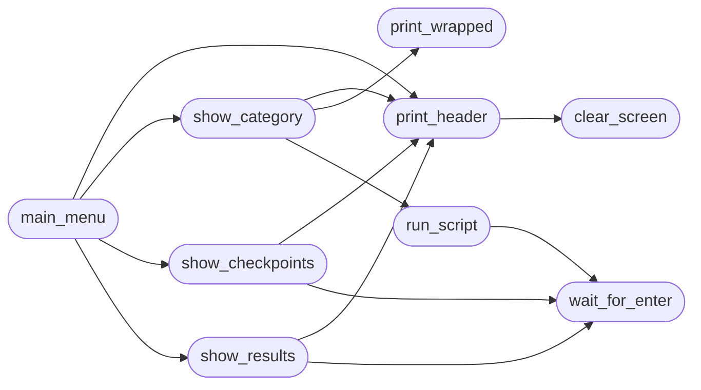

# `menu`

> Source: [menu.py:1](../../menu.py#L1) | language `py` | coverage 10.0% | [API index](../index.md)

Unified Menu for Strassen Algorithmic Crystallization Experiments ================================================================

Interactive navigator for all training, experiments, analysis,
benchmarks, and physics-inspired scripts in this repository.

Usage:
    python menu.py

## Contents

- **Functions:** [`clear_screen`](#clear_screen), [`print_header`](#print_header), [`print_wrapped`](#print_wrapped), [`wait_for_enter`](#wait_for_enter), [`run_script`](#run_script), [`show_checkpoints`](#show_checkpoints), [`show_results`](#show_results), [`show_category`](#show_category), [`main_menu`](#main_menu)
- **Constants:** [`BASE_DIR`](#base_dir), [`CATEGORIES`](#categories), [`TERM_WIDTH`](#term_width), [`SEP`](#sep)

## Call Graph

Solid arrows stay in this module, dashed arrows leave it.



## Functions

<a id="clear_screen"></a>

### `clear_screen`

`function` | [menu.py:304](../../menu.py#L304)

```python
def clear_screen()
```

*Called by:* [`print_header`](#print_header)

---

<a id="print_header"></a>

### `print_header`

`function` | [menu.py:308](../../menu.py#L308)

```python
def print_header(title, subtitle='')
```

**Parameters**

| Name | Type | Default | Description |
|---|---|---|---|
| `title` |  |  |  |
| `subtitle` |  | `''` |  |

*Calls:* [`clear_screen`](#clear_screen)

*Called by:* [`main_menu`](#main_menu), [`show_category`](#show_category), [`show_checkpoints`](#show_checkpoints), [`show_results`](#show_results)

---

<a id="print_wrapped"></a>

### `print_wrapped`

`function` | [menu.py:318](../../menu.py#L318)

```python
def print_wrapped(text, indent=4)
```

**Parameters**

| Name | Type | Default | Description |
|---|---|---|---|
| `text` |  |  |  |
| `indent` |  | `4` |  |

*Called by:* [`show_category`](#show_category)

---

<a id="wait_for_enter"></a>

### `wait_for_enter`

`function` | [menu.py:323](../../menu.py#L323)

```python
def wait_for_enter()
```

*Called by:* [`run_script`](#run_script), [`show_checkpoints`](#show_checkpoints), [`show_results`](#show_results)

---

<a id="run_script"></a>

### `run_script`

`function` | [menu.py:332](../../menu.py#L332)

```python
def run_script(entry)
```

**Parameters**

| Name | Type | Default | Description |
|---|---|---|---|
| `entry` |  |  |  |

*Calls:* [`wait_for_enter`](#wait_for_enter)

*Called by:* [`show_category`](#show_category)

---

<a id="show_checkpoints"></a>

### `show_checkpoints`

`function` | [menu.py:362](../../menu.py#L362)

```python
def show_checkpoints()
```

*Calls:* [`print_header`](#print_header), [`wait_for_enter`](#wait_for_enter)

*Called by:* [`main_menu`](#main_menu)

---

<a id="show_results"></a>

### `show_results`

`function` | [menu.py:397](../../menu.py#L397)

```python
def show_results()
```

*Calls:* [`print_header`](#print_header), [`wait_for_enter`](#wait_for_enter)

*Called by:* [`main_menu`](#main_menu)

---

<a id="show_category"></a>

### `show_category`

`function` | [menu.py:433](../../menu.py#L433)

```python
def show_category(cat)
```

**Parameters**

| Name | Type | Default | Description |
|---|---|---|---|
| `cat` |  |  |  |

*Calls:* [`print_header`](#print_header), [`print_wrapped`](#print_wrapped), [`run_script`](#run_script)

*Called by:* [`main_menu`](#main_menu)

---

<a id="main_menu"></a>

### `main_menu`

`function` | [menu.py:473](../../menu.py#L473)

```python
def main_menu()
```

*Calls:* [`print_header`](#print_header), [`show_category`](#show_category), [`show_checkpoints`](#show_checkpoints), [`show_results`](#show_results)

---

## Constants

<a id="base_dir"></a>

### `BASE_DIR`

`constant` | [menu.py:18](../../menu.py#L18)

```python
BASE_DIR = os.path.dirname(os.path.abspath(__file__))
```

---

<a id="categories"></a>

### `CATEGORIES`

`constant` | [menu.py:24](../../menu.py#L24)

```python
CATEGORIES
```

---

<a id="term_width"></a>

### `TERM_WIDTH`

`constant` | [menu.py:300](../../menu.py#L300)

```python
TERM_WIDTH = min(os.get_terminal_size().columns, 90) if sys.stdout.isatty() else 80
```

---

<a id="sep"></a>

### `SEP`

`constant` | [menu.py:301](../../menu.py#L301)

```python
SEP = '-' * TERM_WIDTH
```

---
