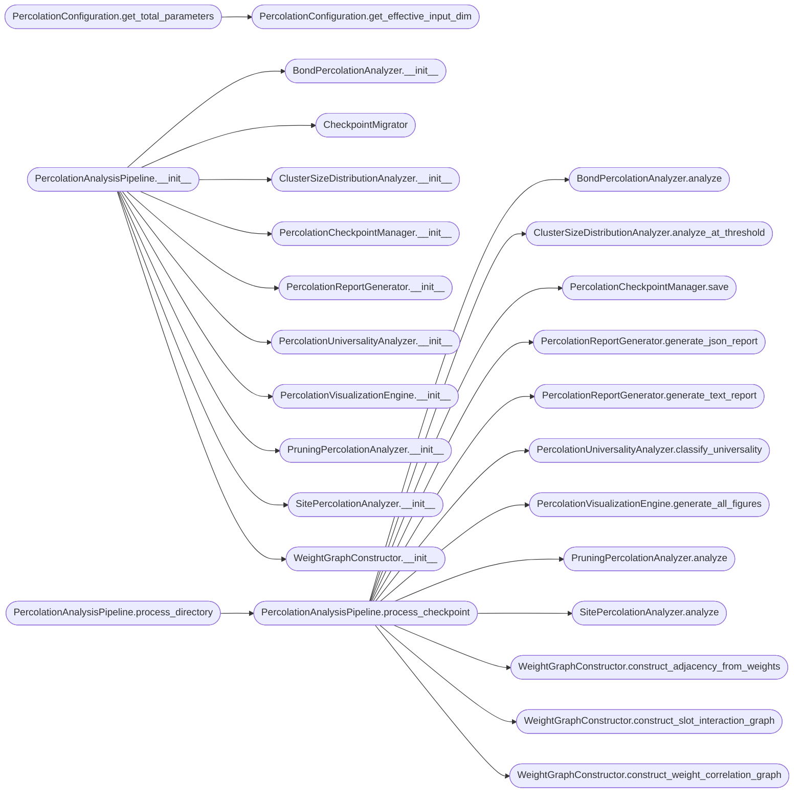

# `percolation_analysis`

> Source: [percolation_analysis.py:1](../../percolation_analysis.py#L1) | language `py` | coverage 0.0% | [API index](../index.md)

## Contents

- **Classes:** [`PercolationConfiguration`](#percolationconfiguration), [`NumpyModelWrapper`](#numpymodelwrapper), [`CheckpointMigrator`](#checkpointmigrator), [`WeightGraphConstructor`](#weightgraphconstructor), [`BondPercolationAnalyzer`](#bondpercolationanalyzer), [`SitePercolationAnalyzer`](#sitepercolationanalyzer), [`PruningPercolationAnalyzer`](#pruningpercolationanalyzer), [`ClusterSizeDistributionAnalyzer`](#clustersizedistributionanalyzer), [`PercolationUniversalityAnalyzer`](#percolationuniversalityanalyzer), [`PercolationCheckpointManager`](#percolationcheckpointmanager), [`PercolationVisualizationEngine`](#percolationvisualizationengine), [`PercolationReportGenerator`](#percolationreportgenerator), [`PercolationAnalysisPipeline`](#percolationanalysispipeline)
- **Protocols:** [`IModel`](#imodel)
- **Functions:** [`main`](#main)

## Type Diagram

```mermaid
classDiagram
    direction LR
    class PercolationConfiguration
    PercolationConfiguration : int HIDDEN_DIM
    PercolationConfiguration : int MATRIX_SIZE
    PercolationConfiguration : int INPUT_DIM
    PercolationConfiguration : Tuple[int, ] EXPANSION_SCALES
    PercolationConfiguration : int PERCOLATION_NUM_THRESHOLDS
    PercolationConfiguration : float PERCOLATION_THRESHOLD_MIN
    PercolationConfiguration : float PERCOLATION_THRESHOLD_MAX
    PercolationConfiguration : Tuple[float, ] PRUNING_LEVELS
    PercolationConfiguration : float DISCRETIZATION_MARGIN
    PercolationConfiguration : float ALPHA_SATURATION
    PercolationConfiguration : float ALPHA_THRESHOLD_CRYSTAL
    PercolationConfiguration : float ALPHA_THRESHOLD_GLASS
    PercolationConfiguration : float GLASS_TEMPERATURE_THRESHOLD
    PercolationConfiguration : float CRYSTAL_TEMPERATURE_THRESHOLD
    PercolationConfiguration : int TEMPERATURE_WINDOW
    PercolationConfiguration : int SPECIFIC_HEAT_WINDOW
    PercolationConfiguration : float LEVEL_SPACING_WIGNER_DYSON
    PercolationConfiguration : float LEVEL_SPACING_POISSON
    PercolationConfiguration : float LEVEL_SPACING_TOLERANCE
    PercolationConfiguration : float PR_LOCALIZATION_THRESHOLD
    PercolationConfiguration : float PR_DELIMITED_THRESHOLD
    PercolationConfiguration : int PR_RENYI_INDEX
    PercolationConfiguration : float HBAR_ENERGY_GAP_SCALE
    PercolationConfiguration : float HBAR_NUMERICAL_NOISE_FLOOR
    class IModel
    <<protocol>> IModel
    IModel : get_coefficients()
    class NumpyModelWrapper
    NumpyModelWrapper : __init__()
    NumpyModelWrapper : get_coefficients()
    NumpyModelWrapper : get_flat_parameters()
    class CheckpointMigrator
    CheckpointMigrator : migrate()
    class WeightGraphConstructor
    WeightGraphConstructor : __init__()
    WeightGraphConstructor : construct_adjacency_from_weights()
    WeightGraphConstructor : construct_weight_correlation_graph()
    WeightGraphConstructor : construct_slot_interaction_graph()
    class BondPercolationAnalyzer
    BondPercolationAnalyzer : __init__()
    BondPercolationAnalyzer : analyze()
    class SitePercolationAnalyzer
    SitePercolationAnalyzer : __init__()
    SitePercolationAnalyzer : analyze()
    class PruningPercolationAnalyzer
    PruningPercolationAnalyzer : __init__()
    PruningPercolationAnalyzer : analyze()
    class ClusterSizeDistributionAnalyzer
    ClusterSizeDistributionAnalyzer : __init__()
    ClusterSizeDistributionAnalyzer : analyze_at_threshold()
    class PercolationUniversalityAnalyzer
    PercolationUniversalityAnalyzer : __init__()
    PercolationUniversalityAnalyzer : classify_universality()
    class PercolationCheckpointManager
    PercolationCheckpointManager : __init__()
    PercolationCheckpointManager : should_save()
    PercolationCheckpointManager : save()
    PercolationCheckpointManager : load()
    class PercolationVisualizationEngine
    PercolationVisualizationEngine : __init__()
    PercolationVisualizationEngine : generate_all_figures()
    class PercolationReportGenerator
    PercolationReportGenerator : __init__()
    PercolationReportGenerator : generate_text_report()
    PercolationReportGenerator : generate_json_report()
    class PercolationAnalysisPipeline
    PercolationAnalysisPipeline : __init__()
    PercolationAnalysisPipeline : process_checkpoint()
    PercolationAnalysisPipeline : process_directory()
```



## Call Graph

Solid arrows stay in this module, dashed arrows leave it.



## Classes

<a id="percolationconfiguration"></a>

### `PercolationConfiguration`

`class` `dataclass` | [percolation_analysis.py:31](../../percolation_analysis.py#L31)

Decorators: `@dataclass(frozen=True)`

```python
class PercolationConfiguration
```

**Attributes**

| Name | Type | Default | Description |
|---|---|---|---|
| [`HIDDEN_DIM`](#percolationconfiguration-hidden_dim) | `int` | `8` |  |
| [`MATRIX_SIZE`](#percolationconfiguration-matrix_size) | `int` | `2` |  |
| [`INPUT_DIM`](#percolationconfiguration-input_dim) | `int` | `4` |  |
| [`EXPANSION_SCALES`](#percolationconfiguration-expansion_scales) | `Tuple[int, ...]` | `(2, 4, 8, 16, 32, 64)` |  |
| [`PERCOLATION_NUM_THRESHOLDS`](#percolationconfiguration-percolation_num_thresholds) | `int` | `50` |  |
| [`PERCOLATION_THRESHOLD_MIN`](#percolationconfiguration-percolation_threshold_min) | `float` | `0.01` |  |
| [`PERCOLATION_THRESHOLD_MAX`](#percolationconfiguration-percolation_threshold_max) | `float` | `0.99` |  |
| [`PRUNING_LEVELS`](#percolationconfiguration-pruning_levels) | `Tuple[float, ...]` | `(0.0, 0.05, 0.1, 0.15, 0.2, 0.25, 0.3, 0.35, 0.4, 0.42, 0.44, 0.46, 0.48, 0.49, 0.5, 0.51, 0.52, 0.54, 0.55, 0.6, 0.65, 0.7, 0.75, 0.8, 0.85, 0.9, 0.95)` |  |
| [`DISCRETIZATION_MARGIN`](#percolationconfiguration-discretization_margin) | `float` | `0.1` |  |
| [`ALPHA_SATURATION`](#percolationconfiguration-alpha_saturation) | `float` | `20.0` |  |
| [`ALPHA_THRESHOLD_CRYSTAL`](#percolationconfiguration-alpha_threshold_crystal) | `float` | `7.0` |  |
| [`ALPHA_THRESHOLD_GLASS`](#percolationconfiguration-alpha_threshold_glass) | `float` | `1.0` |  |
| [`GLASS_TEMPERATURE_THRESHOLD`](#percolationconfiguration-glass_temperature_threshold) | `float` | `0.1` |  |
| [`CRYSTAL_TEMPERATURE_THRESHOLD`](#percolationconfiguration-crystal_temperature_threshold) | `float` | `0.01` |  |
| [`TEMPERATURE_WINDOW`](#percolationconfiguration-temperature_window) | `int` | `100` |  |
| [`SPECIFIC_HEAT_WINDOW`](#percolationconfiguration-specific_heat_window) | `int` | `50` |  |
| [`LEVEL_SPACING_WIGNER_DYSON`](#percolationconfiguration-level_spacing_wigner_dyson) | `float` | `0.5307` |  |
| [`LEVEL_SPACING_POISSON`](#percolationconfiguration-level_spacing_poisson) | `float` | `0.3863` |  |
| [`LEVEL_SPACING_TOLERANCE`](#percolationconfiguration-level_spacing_tolerance) | `float` | `0.05` |  |
| [`PR_LOCALIZATION_THRESHOLD`](#percolationconfiguration-pr_localization_threshold) | `float` | `0.8` |  |
| [`PR_DELIMITED_THRESHOLD`](#percolationconfiguration-pr_delimited_threshold) | `float` | `0.1` |  |
| [`PR_RENYI_INDEX`](#percolationconfiguration-pr_renyi_index) | `int` | `2` |  |
| [`HBAR_ENERGY_GAP_SCALE`](#percolationconfiguration-hbar_energy_gap_scale) | `float` | `1.0` |  |
| [`HBAR_NUMERICAL_NOISE_FLOOR`](#percolationconfiguration-hbar_numerical_noise_floor) | `float` | `1e-07` |  |
| [`DISCRETIZATION_NOISE_LEVELS`](#percolationconfiguration-discretization_noise_levels) | `Tuple[float, ...]` | `(0.0, 0.001, 0.005, 0.01, 0.05, 0.1)` |  |
| [`DISCRETIZATION_GAP_COLLAPSE_THRESHOLD`](#percolationconfiguration-discretization_gap_collapse_threshold) | `float` | `0.5` |  |
| [`PERCOLATION_2D_SITE_PC`](#percolationconfiguration-percolation_2d_site_pc) | `float` | `0.592746` |  |
| [`PERCOLATION_2D_BOND_PC`](#percolationconfiguration-percolation_2d_bond_pc) | `float` | `0.5` |  |
| [`PERCOLATION_3D_SITE_PC`](#percolationconfiguration-percolation_3d_site_pc) | `float` | `0.3116` |  |
| [`PERCOLATION_BETA_2D`](#percolationconfiguration-percolation_beta_2d) | `float` | `5.0 / 36.0` |  |
| [`PERCOLATION_GAMMA_2D`](#percolationconfiguration-percolation_gamma_2d) | `float` | `43.0 / 18.0` |  |
| [`PERCOLATION_NU_2D`](#percolationconfiguration-percolation_nu_2d) | `float` | `4.0 / 3.0` |  |
| [`PERCOLATION_BETA_MF`](#percolationconfiguration-percolation_beta_mf) | `float` | `1.0` |  |
| [`PERCOLATION_GAMMA_MF`](#percolationconfiguration-percolation_gamma_mf) | `float` | `1.0` |  |
| [`PERCOLATION_NU_MF`](#percolationconfiguration-percolation_nu_mf) | `float` | `0.5` |  |
| [`CHECKPOINT_INTERVAL_MINUTES`](#percolationconfiguration-checkpoint_interval_minutes) | `int` | `5` |  |
| [`FIGURE_DPI`](#percolationconfiguration-figure_dpi) | `int` | `150` |  |
| [`SAVE_FORMAT`](#percolationconfiguration-save_format) | `str` | `'png'` |  |
| [`FIGURE_WIDTH`](#percolationconfiguration-figure_width) | `float` | `14.0` |  |
| [`FIGURE_HEIGHT`](#percolationconfiguration-figure_height) | `float` | `10.0` |  |
| [`DEVICE`](#percolationconfiguration-device) | `str` | `'cpu'` |  |
| [`METRIC_PRECISION`](#percolationconfiguration-metric_precision) | `int` | `6` |  |
| [`ENTROPY_BINS`](#percolationconfiguration-entropy_bins) | `int` | `50` |  |
| [`STRASSEN_RANK`](#percolationconfiguration-strassen_rank) | `int` | `7` |  |
| [`STRASSEN_DISCRETE_VALUES`](#percolationconfiguration-strassen_discrete_values) | `Tuple[int, ...]` | `(-1, 0, 1)` |  |

**Members**

| Member | Kind | Summary |
|---|---|---|
| [`get_effective_input_dim`](#percolationconfiguration-get_effective_input_dim) | method |  |
| [`get_total_parameters`](#percolationconfiguration-get_total_parameters) | method |  |
| [`get_percolation_thresholds`](#percolationconfiguration-get_percolation_thresholds) | method |  |

<a id="percolationconfiguration-get_effective_input_dim"></a>

#### `PercolationConfiguration.get_effective_input_dim`

`method` | [percolation_analysis.py:82](../../percolation_analysis.py#L82)

```python
def get_effective_input_dim(self) -> int
```

**Returns:** `int`

*Called by:* [`PercolationConfiguration.get_total_parameters`](#percolationconfiguration-get_total_parameters)

<a id="percolationconfiguration-get_total_parameters"></a>

#### `PercolationConfiguration.get_total_parameters`

`method` | [percolation_analysis.py:85](../../percolation_analysis.py#L85)

```python
def get_total_parameters(self) -> int
```

**Returns:** `int`

*Calls:* [`PercolationConfiguration.get_effective_input_dim`](#percolationconfiguration-get_effective_input_dim)

<a id="percolationconfiguration-get_percolation_thresholds"></a>

#### `PercolationConfiguration.get_percolation_thresholds`

`method` | [percolation_analysis.py:89](../../percolation_analysis.py#L89)

```python
def get_percolation_thresholds(self) -> np.ndarray
```

**Returns:** `np.ndarray`

---

<a id="numpymodelwrapper"></a>

### `NumpyModelWrapper`

`class` | [percolation_analysis.py:101](../../percolation_analysis.py#L101)

```python
class NumpyModelWrapper
```

**Members**

| Member | Kind | Summary |
|---|---|---|
| [`__init__`](#numpymodelwrapper-__init__) | constructor |  |
| [`get_coefficients`](#numpymodelwrapper-get_coefficients) | method |  |
| [`get_flat_parameters`](#numpymodelwrapper-get_flat_parameters) | method |  |

<a id="numpymodelwrapper-__init__"></a>

#### `NumpyModelWrapper.__init__`

`constructor` | [percolation_analysis.py:102](../../percolation_analysis.py#L102)

```python
def __init__(self, weights: Dict[str, np.ndarray])
```

**Parameters**

| Name | Type | Default | Description |
|---|---|---|---|
| `weights` | `Dict[str, np.ndarray]` |  |  |

<a id="numpymodelwrapper-get_coefficients"></a>

#### `NumpyModelWrapper.get_coefficients`

`method` | [percolation_analysis.py:105](../../percolation_analysis.py#L105)

```python
def get_coefficients(self) -> Dict[str, np.ndarray]
```

**Returns:** `Dict[str, np.ndarray]`

<a id="numpymodelwrapper-get_flat_parameters"></a>

#### `NumpyModelWrapper.get_flat_parameters`

`method` | [percolation_analysis.py:108](../../percolation_analysis.py#L108)

```python
def get_flat_parameters(self) -> np.ndarray
```

**Returns:** `np.ndarray`

---

<a id="checkpointmigrator"></a>

### `CheckpointMigrator`

`class` | [percolation_analysis.py:264](../../percolation_analysis.py#L264)

```python
class CheckpointMigrator
```

**Members**

| Member | Kind | Summary |
|---|---|---|
| [`migrate`](#checkpointmigrator-migrate) | method |  |

<a id="checkpointmigrator-migrate"></a>

#### `CheckpointMigrator.migrate`

`method` | [percolation_analysis.py:265](../../percolation_analysis.py#L265)

```python
def migrate(self, raw_data: Any, config: PercolationConfiguration) -> Optional[Dict[str, np.ndarray]]
```

**Parameters**

| Name | Type | Default | Description |
|---|---|---|---|
| `raw_data` | `Any` |  |  |
| `config` | `PercolationConfiguration` |  |  |

**Returns:** `Optional[Dict[str, np.ndarray]]`

*Calls:* [`CheckpointMigrator.migrate`](batch_size.py.md#checkpointmigrator-migrate)

---

<a id="weightgraphconstructor"></a>

### `WeightGraphConstructor`

`class` | [percolation_analysis.py:350](../../percolation_analysis.py#L350)

```python
class WeightGraphConstructor
```

**Members**

| Member | Kind | Summary |
|---|---|---|
| [`__init__`](#weightgraphconstructor-__init__) | constructor |  |
| [`construct_adjacency_from_weights`](#weightgraphconstructor-construct_adjacency_from_weights) | method |  |
| [`construct_weight_correlation_graph`](#weightgraphconstructor-construct_weight_correlation_graph) | method |  |
| [`construct_slot_interaction_graph`](#weightgraphconstructor-construct_slot_interaction_graph) | method |  |

<a id="weightgraphconstructor-__init__"></a>

#### `WeightGraphConstructor.__init__`

`constructor` | [percolation_analysis.py:351](../../percolation_analysis.py#L351)

```python
def __init__(self, config: PercolationConfiguration)
```

**Parameters**

| Name | Type | Default | Description |
|---|---|---|---|
| `config` | `PercolationConfiguration` |  |  |

*Called by:* [`PercolationAnalysisPipeline.__init__`](#percolationanalysispipeline-__init__)

<a id="weightgraphconstructor-construct_adjacency_from_weights"></a>

#### `WeightGraphConstructor.construct_adjacency_from_weights`

`method` | [percolation_analysis.py:354](../../percolation_analysis.py#L354)

```python
def construct_adjacency_from_weights(self, weights: Dict[str, np.ndarray]) -> np.ndarray
```

**Parameters**

| Name | Type | Default | Description |
|---|---|---|---|
| `weights` | `Dict[str, np.ndarray]` |  |  |

**Returns:** `np.ndarray`

*Called by:* [`PercolationAnalysisPipeline.process_checkpoint`](#percolationanalysispipeline-process_checkpoint)

<a id="weightgraphconstructor-construct_weight_correlation_graph"></a>

#### `WeightGraphConstructor.construct_weight_correlation_graph`

`method` | [percolation_analysis.py:375](../../percolation_analysis.py#L375)

```python
def construct_weight_correlation_graph(self, weights: Dict[str, np.ndarray]) -> np.ndarray
```

**Parameters**

| Name | Type | Default | Description |
|---|---|---|---|
| `weights` | `Dict[str, np.ndarray]` |  |  |

**Returns:** `np.ndarray`

*Called by:* [`PercolationAnalysisPipeline.process_checkpoint`](#percolationanalysispipeline-process_checkpoint)

<a id="weightgraphconstructor-construct_slot_interaction_graph"></a>

#### `WeightGraphConstructor.construct_slot_interaction_graph`

`method` | [percolation_analysis.py:386](../../percolation_analysis.py#L386)

```python
def construct_slot_interaction_graph(self, weights: Dict[str, np.ndarray]) -> np.ndarray
```

**Parameters**

| Name | Type | Default | Description |
|---|---|---|---|
| `weights` | `Dict[str, np.ndarray]` |  |  |

**Returns:** `np.ndarray`

*Called by:* [`PercolationAnalysisPipeline.process_checkpoint`](#percolationanalysispipeline-process_checkpoint)

---

<a id="bondpercolationanalyzer"></a>

### `BondPercolationAnalyzer`

`class` | [percolation_analysis.py:402](../../percolation_analysis.py#L402)

```python
class BondPercolationAnalyzer
```

**Members**

| Member | Kind | Summary |
|---|---|---|
| [`__init__`](#bondpercolationanalyzer-__init__) | constructor |  |
| [`analyze`](#bondpercolationanalyzer-analyze) | method |  |

<a id="bondpercolationanalyzer-__init__"></a>

#### `BondPercolationAnalyzer.__init__`

`constructor` | [percolation_analysis.py:403](../../percolation_analysis.py#L403)

```python
def __init__(self, config: PercolationConfiguration)
```

**Parameters**

| Name | Type | Default | Description |
|---|---|---|---|
| `config` | `PercolationConfiguration` |  |  |

*Called by:* [`PercolationAnalysisPipeline.__init__`](#percolationanalysispipeline-__init__)

<a id="bondpercolationanalyzer-analyze"></a>

#### `BondPercolationAnalyzer.analyze`

`method` | [percolation_analysis.py:406](../../percolation_analysis.py#L406)

```python
def analyze(self, adjacency: np.ndarray, thresholds: Optional[np.ndarray] = None) -> Dict[str, Any]
```

**Parameters**

| Name | Type | Default | Description |
|---|---|---|---|
| `adjacency` | `np.ndarray` |  |  |
| `thresholds` | `Optional[np.ndarray]` | `None` |  |

**Returns:** `Dict[str, Any]`

*Called by:* [`PercolationAnalysisPipeline.process_checkpoint`](#percolationanalysispipeline-process_checkpoint)

---

<a id="sitepercolationanalyzer"></a>

### `SitePercolationAnalyzer`

`class` | [percolation_analysis.py:488](../../percolation_analysis.py#L488)

```python
class SitePercolationAnalyzer
```

**Members**

| Member | Kind | Summary |
|---|---|---|
| [`__init__`](#sitepercolationanalyzer-__init__) | constructor |  |
| [`analyze`](#sitepercolationanalyzer-analyze) | method |  |

<a id="sitepercolationanalyzer-__init__"></a>

#### `SitePercolationAnalyzer.__init__`

`constructor` | [percolation_analysis.py:489](../../percolation_analysis.py#L489)

```python
def __init__(self, config: PercolationConfiguration)
```

**Parameters**

| Name | Type | Default | Description |
|---|---|---|---|
| `config` | `PercolationConfiguration` |  |  |

*Called by:* [`PercolationAnalysisPipeline.__init__`](#percolationanalysispipeline-__init__)

<a id="sitepercolationanalyzer-analyze"></a>

#### `SitePercolationAnalyzer.analyze`

`method` | [percolation_analysis.py:492](../../percolation_analysis.py#L492)

```python
def analyze(self, weights: Dict[str, np.ndarray], thresholds: Optional[np.ndarray] = None) -> Dict[str, Any]
```

**Parameters**

| Name | Type | Default | Description |
|---|---|---|---|
| `weights` | `Dict[str, np.ndarray]` |  |  |
| `thresholds` | `Optional[np.ndarray]` | `None` |  |

**Returns:** `Dict[str, Any]`

*Called by:* [`PercolationAnalysisPipeline.process_checkpoint`](#percolationanalysispipeline-process_checkpoint)

---

<a id="pruningpercolationanalyzer"></a>

### `PruningPercolationAnalyzer`

`class` | [percolation_analysis.py:542](../../percolation_analysis.py#L542)

```python
class PruningPercolationAnalyzer
```

**Members**

| Member | Kind | Summary |
|---|---|---|
| [`__init__`](#pruningpercolationanalyzer-__init__) | constructor |  |
| [`analyze`](#pruningpercolationanalyzer-analyze) | method |  |

<a id="pruningpercolationanalyzer-__init__"></a>

#### `PruningPercolationAnalyzer.__init__`

`constructor` | [percolation_analysis.py:543](../../percolation_analysis.py#L543)

```python
def __init__(self, config: PercolationConfiguration)
```

**Parameters**

| Name | Type | Default | Description |
|---|---|---|---|
| `config` | `PercolationConfiguration` |  |  |

*Called by:* [`PercolationAnalysisPipeline.__init__`](#percolationanalysispipeline-__init__)

<a id="pruningpercolationanalyzer-analyze"></a>

#### `PruningPercolationAnalyzer.analyze`

`method` | [percolation_analysis.py:546](../../percolation_analysis.py#L546)

```python
def analyze(self, weights: Dict[str, np.ndarray]) -> Dict[str, Any]
```

**Parameters**

| Name | Type | Default | Description |
|---|---|---|---|
| `weights` | `Dict[str, np.ndarray]` |  |  |

**Returns:** `Dict[str, Any]`

*Called by:* [`PercolationAnalysisPipeline.process_checkpoint`](#percolationanalysispipeline-process_checkpoint)

---

<a id="clustersizedistributionanalyzer"></a>

### `ClusterSizeDistributionAnalyzer`

`class` | [percolation_analysis.py:725](../../percolation_analysis.py#L725)

```python
class ClusterSizeDistributionAnalyzer
```

**Members**

| Member | Kind | Summary |
|---|---|---|
| [`__init__`](#clustersizedistributionanalyzer-__init__) | constructor |  |
| [`analyze_at_threshold`](#clustersizedistributionanalyzer-analyze_at_threshold) | method |  |

<a id="clustersizedistributionanalyzer-__init__"></a>

#### `ClusterSizeDistributionAnalyzer.__init__`

`constructor` | [percolation_analysis.py:726](../../percolation_analysis.py#L726)

```python
def __init__(self, config: PercolationConfiguration)
```

**Parameters**

| Name | Type | Default | Description |
|---|---|---|---|
| `config` | `PercolationConfiguration` |  |  |

*Called by:* [`PercolationAnalysisPipeline.__init__`](#percolationanalysispipeline-__init__)

<a id="clustersizedistributionanalyzer-analyze_at_threshold"></a>

#### `ClusterSizeDistributionAnalyzer.analyze_at_threshold`

`method` | [percolation_analysis.py:729](../../percolation_analysis.py#L729)

```python
def analyze_at_threshold(self, adjacency: np.ndarray, threshold: float) -> Dict[str, Any]
```

**Parameters**

| Name | Type | Default | Description |
|---|---|---|---|
| `adjacency` | `np.ndarray` |  |  |
| `threshold` | `float` |  |  |

**Returns:** `Dict[str, Any]`

*Called by:* [`PercolationAnalysisPipeline.process_checkpoint`](#percolationanalysispipeline-process_checkpoint)

---

<a id="percolationuniversalityanalyzer"></a>

### `PercolationUniversalityAnalyzer`

`class` | [percolation_analysis.py:775](../../percolation_analysis.py#L775)

```python
class PercolationUniversalityAnalyzer
```

**Members**

| Member | Kind | Summary |
|---|---|---|
| [`__init__`](#percolationuniversalityanalyzer-__init__) | constructor |  |
| [`classify_universality`](#percolationuniversalityanalyzer-classify_universality) | method |  |

<a id="percolationuniversalityanalyzer-__init__"></a>

#### `PercolationUniversalityAnalyzer.__init__`

`constructor` | [percolation_analysis.py:776](../../percolation_analysis.py#L776)

```python
def __init__(self, config: PercolationConfiguration)
```

**Parameters**

| Name | Type | Default | Description |
|---|---|---|---|
| `config` | `PercolationConfiguration` |  |  |

*Called by:* [`PercolationAnalysisPipeline.__init__`](#percolationanalysispipeline-__init__)

<a id="percolationuniversalityanalyzer-classify_universality"></a>

#### `PercolationUniversalityAnalyzer.classify_universality`

`method` | [percolation_analysis.py:779](../../percolation_analysis.py#L779)

```python
def classify_universality(self, measured: Dict[str, Optional[float]]) -> Dict[str, Any]
```

**Parameters**

| Name | Type | Default | Description |
|---|---|---|---|
| `measured` | `Dict[str, Optional[float]]` |  |  |

**Returns:** `Dict[str, Any]`

*Called by:* [`PercolationAnalysisPipeline.process_checkpoint`](#percolationanalysispipeline-process_checkpoint)

---

<a id="percolationcheckpointmanager"></a>

### `PercolationCheckpointManager`

`class` | [percolation_analysis.py:808](../../percolation_analysis.py#L808)

```python
class PercolationCheckpointManager
```

**Members**

| Member | Kind | Summary |
|---|---|---|
| [`__init__`](#percolationcheckpointmanager-__init__) | constructor |  |
| [`should_save`](#percolationcheckpointmanager-should_save) | method |  |
| [`save`](#percolationcheckpointmanager-save) | method |  |
| [`load`](#percolationcheckpointmanager-load) | method |  |

<a id="percolationcheckpointmanager-__init__"></a>

#### `PercolationCheckpointManager.__init__`

`constructor` | [percolation_analysis.py:809](../../percolation_analysis.py#L809)

```python
def __init__(self, config: PercolationConfiguration)
```

**Parameters**

| Name | Type | Default | Description |
|---|---|---|---|
| `config` | `PercolationConfiguration` |  |  |

*Called by:* [`PercolationAnalysisPipeline.__init__`](#percolationanalysispipeline-__init__)

<a id="percolationcheckpointmanager-should_save"></a>

#### `PercolationCheckpointManager.should_save`

`method` | [percolation_analysis.py:814](../../percolation_analysis.py#L814)

```python
def should_save(self) -> bool
```

**Returns:** `bool`

<a id="percolationcheckpointmanager-save"></a>

#### `PercolationCheckpointManager.save`

`method` | [percolation_analysis.py:817](../../percolation_analysis.py#L817)

```python
def save(self, results: Dict[str, Any], output_dir: str) -> str
```

**Parameters**

| Name | Type | Default | Description |
|---|---|---|---|
| `results` | `Dict[str, Any]` |  |  |
| `output_dir` | `str` |  |  |

**Returns:** `str`

*Called by:* [`PercolationAnalysisPipeline.process_checkpoint`](#percolationanalysispipeline-process_checkpoint)

<a id="percolationcheckpointmanager-load"></a>

#### `PercolationCheckpointManager.load`

`method` | [percolation_analysis.py:829](../../percolation_analysis.py#L829)

```python
def load(self, output_dir: str) -> Optional[Dict[str, Any]]
```

**Parameters**

| Name | Type | Default | Description |
|---|---|---|---|
| `output_dir` | `str` |  |  |

**Returns:** `Optional[Dict[str, Any]]`

---

<a id="percolationvisualizationengine"></a>

### `PercolationVisualizationEngine`

`class` | [percolation_analysis.py:837](../../percolation_analysis.py#L837)

```python
class PercolationVisualizationEngine
```

**Members**

| Member | Kind | Summary |
|---|---|---|
| [`__init__`](#percolationvisualizationengine-__init__) | constructor |  |
| [`generate_all_figures`](#percolationvisualizationengine-generate_all_figures) | method |  |

<a id="percolationvisualizationengine-__init__"></a>

#### `PercolationVisualizationEngine.__init__`

`constructor` | [percolation_analysis.py:838](../../percolation_analysis.py#L838)

```python
def __init__(self, config: PercolationConfiguration)
```

**Parameters**

| Name | Type | Default | Description |
|---|---|---|---|
| `config` | `PercolationConfiguration` |  |  |

*Called by:* [`PercolationAnalysisPipeline.__init__`](#percolationanalysispipeline-__init__)

<a id="percolationvisualizationengine-generate_all_figures"></a>

#### `PercolationVisualizationEngine.generate_all_figures`

`method` | [percolation_analysis.py:841](../../percolation_analysis.py#L841)

```python
def generate_all_figures(self, results: Dict[str, Any], output_dir: str) -> List[str]
```

**Parameters**

| Name | Type | Default | Description |
|---|---|---|---|
| `results` | `Dict[str, Any]` |  |  |
| `output_dir` | `str` |  |  |

**Returns:** `List[str]`

*Called by:* [`PercolationAnalysisPipeline.process_checkpoint`](#percolationanalysispipeline-process_checkpoint)

---

<a id="percolationreportgenerator"></a>

### `PercolationReportGenerator`

`class` | [percolation_analysis.py:1049](../../percolation_analysis.py#L1049)

```python
class PercolationReportGenerator
```

**Members**

| Member | Kind | Summary |
|---|---|---|
| [`__init__`](#percolationreportgenerator-__init__) | constructor |  |
| [`generate_text_report`](#percolationreportgenerator-generate_text_report) | method |  |
| [`generate_json_report`](#percolationreportgenerator-generate_json_report) | method |  |

<a id="percolationreportgenerator-__init__"></a>

#### `PercolationReportGenerator.__init__`

`constructor` | [percolation_analysis.py:1050](../../percolation_analysis.py#L1050)

```python
def __init__(self, config: PercolationConfiguration)
```

**Parameters**

| Name | Type | Default | Description |
|---|---|---|---|
| `config` | `PercolationConfiguration` |  |  |

*Called by:* [`PercolationAnalysisPipeline.__init__`](#percolationanalysispipeline-__init__)

<a id="percolationreportgenerator-generate_text_report"></a>

#### `PercolationReportGenerator.generate_text_report`

`method` | [percolation_analysis.py:1053](../../percolation_analysis.py#L1053)

```python
def generate_text_report(self, results: Dict[str, Any], output_dir: str) -> str
```

**Parameters**

| Name | Type | Default | Description |
|---|---|---|---|
| `results` | `Dict[str, Any]` |  |  |
| `output_dir` | `str` |  |  |

**Returns:** `str`

*Called by:* [`PercolationAnalysisPipeline.process_checkpoint`](#percolationanalysispipeline-process_checkpoint)

<a id="percolationreportgenerator-generate_json_report"></a>

#### `PercolationReportGenerator.generate_json_report`

`method` | [percolation_analysis.py:1131](../../percolation_analysis.py#L1131)

```python
def generate_json_report(self, results: Dict[str, Any], output_dir: str) -> str
```

**Parameters**

| Name | Type | Default | Description |
|---|---|---|---|
| `results` | `Dict[str, Any]` |  |  |
| `output_dir` | `str` |  |  |

**Returns:** `str`

*Called by:* [`PercolationAnalysisPipeline.process_checkpoint`](#percolationanalysispipeline-process_checkpoint)

---

<a id="percolationanalysispipeline"></a>

### `PercolationAnalysisPipeline`

`class` | [percolation_analysis.py:1139](../../percolation_analysis.py#L1139)

```python
class PercolationAnalysisPipeline
```

**Members**

| Member | Kind | Summary |
|---|---|---|
| [`__init__`](#percolationanalysispipeline-__init__) | constructor |  |
| [`process_checkpoint`](#percolationanalysispipeline-process_checkpoint) | method |  |
| [`process_directory`](#percolationanalysispipeline-process_directory) | method |  |

<a id="percolationanalysispipeline-__init__"></a>

#### `PercolationAnalysisPipeline.__init__`

`constructor` | [percolation_analysis.py:1140](../../percolation_analysis.py#L1140)

```python
def __init__(self, config: PercolationConfiguration)
```

**Parameters**

| Name | Type | Default | Description |
|---|---|---|---|
| `config` | `PercolationConfiguration` |  |  |

*Calls:* [`BondPercolationAnalyzer.__init__`](#bondpercolationanalyzer-__init__), [`CheckpointMigrator`](#checkpointmigrator), [`ClusterSizeDistributionAnalyzer.__init__`](#clustersizedistributionanalyzer-__init__), [`PercolationCheckpointManager.__init__`](#percolationcheckpointmanager-__init__), [`PercolationReportGenerator.__init__`](#percolationreportgenerator-__init__), [`PercolationUniversalityAnalyzer.__init__`](#percolationuniversalityanalyzer-__init__), [`PercolationVisualizationEngine.__init__`](#percolationvisualizationengine-__init__), [`PruningPercolationAnalyzer.__init__`](#pruningpercolationanalyzer-__init__), [`SitePercolationAnalyzer.__init__`](#sitepercolationanalyzer-__init__), [`WeightGraphConstructor.__init__`](#weightgraphconstructor-__init__)

*Called by:* [`main`](#main)

<a id="percolationanalysispipeline-process_checkpoint"></a>

#### `PercolationAnalysisPipeline.process_checkpoint`

`method` | [percolation_analysis.py:1164](../../percolation_analysis.py#L1164)

```python
def process_checkpoint(self, checkpoint_path: str, output_dir: str) -> Dict[str, Any]
```

**Parameters**

| Name | Type | Default | Description |
|---|---|---|---|
| `checkpoint_path` | `str` |  |  |
| `output_dir` | `str` |  |  |

**Returns:** `Dict[str, Any]`

*Calls:* [`BondPercolationAnalyzer.analyze`](#bondpercolationanalyzer-analyze), [`ClusterSizeDistributionAnalyzer.analyze_at_threshold`](#clustersizedistributionanalyzer-analyze_at_threshold), [`PercolationCheckpointManager.save`](#percolationcheckpointmanager-save), [`PercolationReportGenerator.generate_json_report`](#percolationreportgenerator-generate_json_report), [`PercolationReportGenerator.generate_text_report`](#percolationreportgenerator-generate_text_report), [`PercolationUniversalityAnalyzer.classify_universality`](#percolationuniversalityanalyzer-classify_universality), [`PercolationVisualizationEngine.generate_all_figures`](#percolationvisualizationengine-generate_all_figures), [`PruningPercolationAnalyzer.analyze`](#pruningpercolationanalyzer-analyze), [`SitePercolationAnalyzer.analyze`](#sitepercolationanalyzer-analyze), [`WeightGraphConstructor.construct_adjacency_from_weights`](#weightgraphconstructor-construct_adjacency_from_weights), [`WeightGraphConstructor.construct_slot_interaction_graph`](#weightgraphconstructor-construct_slot_interaction_graph), [`WeightGraphConstructor.construct_weight_correlation_graph`](#weightgraphconstructor-construct_weight_correlation_graph)

*Called by:* [`PercolationAnalysisPipeline.process_directory`](#percolationanalysispipeline-process_directory), [`main`](#main)

<a id="percolationanalysispipeline-process_directory"></a>

#### `PercolationAnalysisPipeline.process_directory`

`method` | [percolation_analysis.py:1212](../../percolation_analysis.py#L1212)

```python
def process_directory(self, checkpoint_dir: str, n_latest: Optional[int], output_dir: str) -> List[Dict[str, Any]]
```

**Parameters**

| Name | Type | Default | Description |
|---|---|---|---|
| `checkpoint_dir` | `str` |  |  |
| `n_latest` | `Optional[int]` |  |  |
| `output_dir` | `str` |  |  |

**Returns:** `List[Dict[str, Any]]`

*Calls:* [`PercolationAnalysisPipeline.process_checkpoint`](#percolationanalysispipeline-process_checkpoint)

*Called by:* [`main`](#main)

---

## Protocols

<a id="imodel"></a>

### `IModel`

`protocol` | [percolation_analysis.py:97](../../percolation_analysis.py#L97)

Decorators: `@runtime_checkable`

```python
class IModel(Protocol)
```

Bases: `Protocol`

**Members**

| Member | Kind | Summary |
|---|---|---|
| [`get_coefficients`](#imodel-get_coefficients) | method |  |

<a id="imodel-get_coefficients"></a>

#### `IModel.get_coefficients`

`method` | [percolation_analysis.py:98](../../percolation_analysis.py#L98)

```python
def get_coefficients(self) -> Dict[str, np.ndarray]
```

**Returns:** `Dict[str, np.ndarray]`

---

## Functions

<a id="main"></a>

### `main`

`function` | [percolation_analysis.py:1264](../../percolation_analysis.py#L1264)

```python
def main()
```

*Calls:* [`PercolationAnalysisPipeline.__init__`](#percolationanalysispipeline-__init__), [`PercolationAnalysisPipeline.process_checkpoint`](#percolationanalysispipeline-process_checkpoint), [`PercolationAnalysisPipeline.process_directory`](#percolationanalysispipeline-process_directory), [`PercolationConfiguration`](#percolationconfiguration)

---
