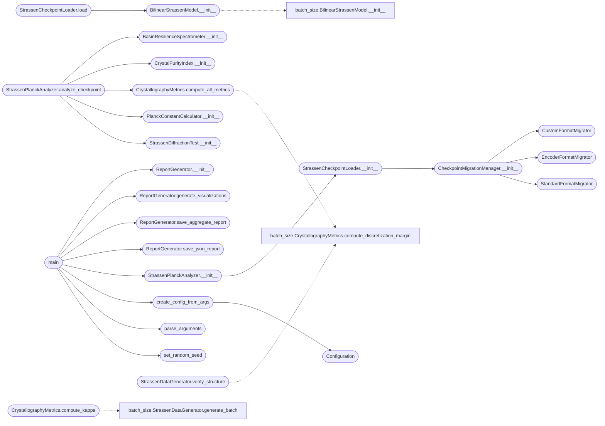

# `plank`

> Source: [plank.py:1](../../plank.py#L1) | language `py` | coverage 85.0% | [API index](../index.md)

StrassenPlanckCalculator - Unified Checkpoint Analysis and Planck Constant Calculation

Calculates effective Planck constant (h_bar) from Strassen model checkpoints using
crystallographic metrics and quantum-inspired thermodynamic analysis.

Architecture: SOLID principles, parametric configuration, comprehensive metrics

## Contents

- **Classes:** [`Configuration`](#configuration), [`BilinearStrassenModel`](#bilinearstrassenmodel), [`CheckpointMigrator`](#checkpointmigrator), [`CustomFormatMigrator`](#customformatmigrator), [`EncoderFormatMigrator`](#encoderformatmigrator), [`StandardFormatMigrator`](#standardformatmigrator), [`CheckpointMigrationManager`](#checkpointmigrationmanager), [`StrassenDataGenerator`](#strassendatagenerator), [`CrystallographyMetrics`](#crystallographymetrics), [`StrassenDiffractionTest`](#strassendiffractiontest), [`BasinResilienceSpectrometer`](#basinresiliencespectrometer), [`CrystalPurityIndex`](#crystalpurityindex), [`PlanckConstantCalculator`](#planckconstantcalculator), [`StrassenCheckpointLoader`](#strassencheckpointloader), [`StrassenPlanckAnalyzer`](#strassenplanckanalyzer), [`ReportGenerator`](#reportgenerator)
- **Functions:** [`set_random_seed`](#set_random_seed), [`parse_arguments`](#parse_arguments), [`create_config_from_args`](#create_config_from_args), [`main`](#main)
- **Constants:** [`CONFIG`](#config)

## Type Diagram

```mermaid
classDiagram
    direction LR
    class Configuration
    Configuration : int BATCH_SIZE
    Configuration : int HIDDEN_SLOTS
    Configuration : int TARGET_SLOTS
    Configuration : int MATRIX_SIZE
    Configuration : int INPUT_DIM
    Configuration : int OUTPUT_DIM
    Configuration : float WEIGHT_DECAY
    Configuration : float LEARNING_RATE
    Configuration : int EPOCHS
    Configuration : int RANDOM_SEED
    Configuration : float DISCRETIZATION_MARGIN
    Configuration : float OPTIMAL_DELTA_THRESHOLD
    Configuration : float INDUSTRIAL_DELTA_THRESHOLD
    Configuration : float POLYCRYSTALLINE_DELTA_THRESHOLD
    Configuration : float AMORPHOUS_DELTA_THRESHOLD
    Configuration : float PLANCK_SI
    Configuration : float SPEED_OF_LIGHT
    Configuration : float GRAVITATIONAL_CONSTANT
    Configuration : float SOLAR_MASS
    Configuration : float BOLTZMANN_CONSTANT
    Configuration : List[float] NOISE_LEVELS
    Configuration : int RESILIENCE_TRIALS
    Configuration : int RESILIENCE_EPOCHS
    Configuration : float RESILIENCE_LEARNING_RATE
    class BilinearStrassenModel
    BilinearStrassenModel : __init__()
    BilinearStrassenModel : forward()
    BilinearStrassenModel : get_coefficients()
    BilinearStrassenModel : compute_lambda_effective()
    class CheckpointMigrator
    CheckpointMigrator : can_migrate()
    CheckpointMigrator : migrate()
    class CustomFormatMigrator
    CustomFormatMigrator : can_migrate()
    CustomFormatMigrator : migrate()
    class EncoderFormatMigrator
    EncoderFormatMigrator : can_migrate()
    EncoderFormatMigrator : migrate()
    class StandardFormatMigrator
    StandardFormatMigrator : can_migrate()
    StandardFormatMigrator : migrate()
    class CheckpointMigrationManager
    CheckpointMigrationManager : __init__()
    CheckpointMigrationManager : migrate_checkpoint()
    class StrassenDataGenerator
    StrassenDataGenerator : generate_batch()
    StrassenDataGenerator : verify_structure()
    class CrystallographyMetrics
    CrystallographyMetrics : compute_kappa()
    CrystallographyMetrics : compute_discretization_margin()
    CrystallographyMetrics : compute_local_complexity()
    CrystallographyMetrics : compute_all_metrics()
    class StrassenDiffractionTest
    StrassenDiffractionTest : __init__()
    StrassenDiffractionTest : test_gauge_invariance()
    class BasinResilienceSpectrometer
    BasinResilienceSpectrometer : __init__()
    BasinResilienceSpectrometer : measure_resilience_spectrum()
    class CrystalPurityIndex
    CrystalPurityIndex : __init__()
    CrystalPurityIndex : compute()
    class PlanckConstantCalculator
    PlanckConstantCalculator : __init__()
    PlanckConstantCalculator : calculate_all()
    class StrassenCheckpointLoader
    StrassenCheckpointLoader : __init__()
    StrassenCheckpointLoader : load()
    StrassenCheckpointLoader : extract_training_metrics()
    class StrassenPlanckAnalyzer
    StrassenPlanckAnalyzer : __init__()
    StrassenPlanckAnalyzer : analyze_checkpoint()
    StrassenPlanckAnalyzer : analyze_directory()
    class ReportGenerator
    ReportGenerator : __init__()
    ReportGenerator : save_json_report()
    ReportGenerator : save_aggregate_report()
    ReportGenerator : generate_visualizations()
    CheckpointMigrator <|-- CustomFormatMigrator
    CheckpointMigrator <|-- EncoderFormatMigrator
    CheckpointMigrator <|-- StandardFormatMigrator
```



## Call Graph

Solid arrows stay in this module, dashed arrows leave it.



## Classes

<a id="configuration"></a>

### `Configuration`

`class` `dataclass` | [plank.py:32](../../plank.py#L32)

Decorators: `@dataclass(frozen=True)`

```python
class Configuration
```

Immutable configuration container following Single Responsibility Principle.

**Attributes**

| Name | Type | Default | Description |
|---|---|---|---|
| [`BATCH_SIZE`](#configuration-batch_size) | `int` | `32` |  |
| [`HIDDEN_SLOTS`](#configuration-hidden_slots) | `int` | `8` |  |
| [`TARGET_SLOTS`](#configuration-target_slots) | `int` | `7` |  |
| [`MATRIX_SIZE`](#configuration-matrix_size) | `int` | `2` |  |
| [`INPUT_DIM`](#configuration-input_dim) | `int` | `4` |  |
| [`OUTPUT_DIM`](#configuration-output_dim) | `int` | `4` |  |
| [`WEIGHT_DECAY`](#configuration-weight_decay) | `float` | `0.0001` |  |
| [`LEARNING_RATE`](#configuration-learning_rate) | `float` | `0.001` |  |
| [`EPOCHS`](#configuration-epochs) | `int` | `3000` |  |
| [`RANDOM_SEED`](#configuration-random_seed) | `int` | `42` |  |
| [`DISCRETIZATION_MARGIN`](#configuration-discretization_margin) | `float` | `0.1` |  |
| [`OPTIMAL_DELTA_THRESHOLD`](#configuration-optimal_delta_threshold) | `float` | `0.01` |  |
| [`INDUSTRIAL_DELTA_THRESHOLD`](#configuration-industrial_delta_threshold) | `float` | `0.1` |  |
| [`POLYCRYSTALLINE_DELTA_THRESHOLD`](#configuration-polycrystalline_delta_threshold) | `float` | `0.3` |  |
| [`AMORPHOUS_DELTA_THRESHOLD`](#configuration-amorphous_delta_threshold) | `float` | `0.5` |  |
| [`PLANCK_SI`](#configuration-planck_si) | `float` | `1.054571817e-34` |  |
| [`SPEED_OF_LIGHT`](#configuration-speed_of_light) | `float` | `299792458` |  |
| [`GRAVITATIONAL_CONSTANT`](#configuration-gravitational_constant) | `float` | `6.6743e-11` |  |
| [`SOLAR_MASS`](#configuration-solar_mass) | `float` | `1.98847e+30` |  |
| [`BOLTZMANN_CONSTANT`](#configuration-boltzmann_constant) | `float` | `1.380649e-23` |  |
| [`NOISE_LEVELS`](#configuration-noise_levels) | `List[float]` | `field(default_factory=lambda: [1e-05, 5e-05, 0.0001, 0.0005, 0.001, 0.005, 0.01])` |  |
| [`RESILIENCE_TRIALS`](#configuration-resilience_trials) | `int` | `5` |  |
| [`RESILIENCE_EPOCHS`](#configuration-resilience_epochs) | `int` | `30` |  |
| [`RESILIENCE_LEARNING_RATE`](#configuration-resilience_learning_rate) | `float` | `1e-05` |  |
| [`GAUGE_SAMPLES`](#configuration-gauge_samples) | `int` | `50` |  |
| [`GAUGE_ERROR_THRESHOLD`](#configuration-gauge_error_threshold) | `float` | `1e-05` |  |
| [`KAPPA_BATCHES`](#configuration-kappa_batches) | `int` | `5` |  |
| [`KAPPA_SAMPLES_PER_BATCH`](#configuration-kappa_samples_per_batch) | `int` | `32` |  |
| [`LC_PERCENTILE`](#configuration-lc_percentile) | `float` | `0.95` |  |
| [`LC_ACTIVATION_THRESHOLD`](#configuration-lc_activation_threshold) | `float` | `0.01` |  |
| [`ULTRA_STRONG_WEIGHTS`](#configuration-ultra_strong_weights) | `Tuple[float, float, float, float]` | `(0.6, 0.25, 0.1, 0.05)` |  |
| [`STRONG_WEIGHTS`](#configuration-strong_weights) | `Tuple[float, float, float, float]` | `(0.5, 0.3, 0.15, 0.05)` |  |
| [`WEAK_WEIGHTS`](#configuration-weak_weights) | `Tuple[float, float, float, float]` | `(0.25, 0.25, 0.25, 0.25)` |  |
| [`ULTRA_STRONG_LAMBDA`](#configuration-ultra_strong_lambda) | `float` | `1e+30` |  |
| [`STRONG_LAMBDA`](#configuration-strong_lambda) | `float` | `10000000000.0` |  |
| [`WEAK_LAMBDA`](#configuration-weak_lambda) | `float` | `1.0` |  |
| [`EFFECTIVE_MODES`](#configuration-effective_modes) | `int` | `31` |  |
| [`OUTPUT_DIRECTORY`](#configuration-output_directory) | `str` | `'planck_analysis_reports'` |  |
| [`CHECKPOINT_DIRECTORY`](#configuration-checkpoint_directory) | `str` | `'checkpoints'` |  |

**Members**

| Member | Kind | Summary |
|---|---|---|
| [`__post_init__`](#configuration-__post_init__) | method | Validate configuration parameters. |

<a id="configuration-__post_init__"></a>

#### `Configuration.__post_init__`

`method` | [plank.py:100](../../plank.py#L100)

```python
def __post_init__(self)
```

Validate configuration parameters.

---

<a id="bilinearstrassenmodel"></a>

### `BilinearStrassenModel`

`class` | [plank.py:127](../../plank.py#L127)

```python
class BilinearStrassenModel(nn.Module)
```

Bases: `nn.Module`

Bilinear model for Strassen matrix multiplication.

Implements f(A,B) = W((U*A) ⊙ (V*B)) where ⊙ is element-wise product.

**Members**

| Member | Kind | Summary |
|---|---|---|
| [`__init__`](#bilinearstrassenmodel-__init__) | constructor |  |
| [`forward`](#bilinearstrassenmodel-forward) | method | Forward pass computing approximate matrix product. |
| [`get_coefficients`](#bilinearstrassenmodel-get_coefficients) | method | Return current coefficient matrices. |
| [`compute_lambda_effective`](#bilinearstrassenmodel-compute_lambda_effective) | method | Compute effective lambda (confinement potential) from weight magnitudes. |

<a id="bilinearstrassenmodel-__init__"></a>

#### `BilinearStrassenModel.__init__`

`constructor` | [plank.py:133](../../plank.py#L133)

```python
def __init__(self, config: Configuration = CONFIG)
```

**Parameters**

| Name | Type | Default | Description |
|---|---|---|---|
| `config` | `Configuration` | `CONFIG` |  |

*Calls:* [`BilinearStrassenModel.__init__`](batch_size.py.md#bilinearstrassenmodel-__init__)

*Called by:* [`StrassenCheckpointLoader.load`](#strassencheckpointloader-load)

<a id="bilinearstrassenmodel-forward"></a>

#### `BilinearStrassenModel.forward`

`method` | [plank.py:149](../../plank.py#L149)

```python
def forward(self, matrix_a: torch.Tensor, matrix_b: torch.Tensor) -> torch.Tensor
```

Forward pass computing approximate matrix product.

**Parameters**

| Name | Type | Default | Description |
|---|---|---|---|
| `matrix_a` | `torch.Tensor` |  | Flattened input matrix A [batch, INPUT_DIM] |
| `matrix_b` | `torch.Tensor` |  | Flattened input matrix B [batch, INPUT_DIM] |

**Returns:** `torch.Tensor` - Approximate product C = A @ B [batch, OUTPUT_DIM]

<a id="bilinearstrassenmodel-get_coefficients"></a>

#### `BilinearStrassenModel.get_coefficients`

`method` | [plank.py:166](../../plank.py#L166)

```python
def get_coefficients(self) -> Dict[str, torch.Tensor]
```

Return current coefficient matrices.

**Returns:** `Dict[str, torch.Tensor]`

<a id="bilinearstrassenmodel-compute_lambda_effective"></a>

#### `BilinearStrassenModel.compute_lambda_effective`

`method` | [plank.py:174](../../plank.py#L174)

```python
def compute_lambda_effective(self) -> float
```

Compute effective lambda (confinement potential) from weight magnitudes.

Derived from weight decay interpretation as harmonic confinement.

**Returns:** `float`

---

<a id="checkpointmigrator"></a>

### `CheckpointMigrator`

`class` `abstract` | [plank.py:194](../../plank.py#L194)

```python
class CheckpointMigrator(ABC)
```

Bases: `ABC`

Subclasses: [`CustomFormatMigrator`](#customformatmigrator), [`EncoderFormatMigrator`](#encoderformatmigrator), [`StandardFormatMigrator`](#standardformatmigrator)

Abstract base for checkpoint migration strategies.

**Members**

| Member | Kind | Summary |
|---|---|---|
| [`can_migrate`](#checkpointmigrator-can_migrate) | method | Check if this strategy can handle the given state dict. |
| [`migrate`](#checkpointmigrator-migrate) | method | Migrate state dict to standard format. |

<a id="checkpointmigrator-can_migrate"></a>

#### `CheckpointMigrator.can_migrate`

`method` `abstract` | [plank.py:198](../../plank.py#L198)

Decorators: `@abstractmethod`

```python
def can_migrate(self, state_dict: Dict[str, Any]) -> bool
```

Check if this strategy can handle the given state dict.

**Parameters**

| Name | Type | Default | Description |
|---|---|---|---|
| `state_dict` | `Dict[str, Any]` |  |  |

**Returns:** `bool`

<a id="checkpointmigrator-migrate"></a>

#### `CheckpointMigrator.migrate`

`method` `abstract` | [plank.py:203](../../plank.py#L203)

Decorators: `@abstractmethod`

```python
def migrate(self, state_dict: Dict[str, Any]) -> Optional[Dict[str, torch.Tensor]]
```

Migrate state dict to standard format.

**Parameters**

| Name | Type | Default | Description |
|---|---|---|---|
| `state_dict` | `Dict[str, Any]` |  |  |

**Returns:** `Optional[Dict[str, torch.Tensor]]`

---

<a id="customformatmigrator"></a>

### `CustomFormatMigrator`

`class` | [plank.py:208](../../plank.py#L208)

```python
class CustomFormatMigrator(CheckpointMigrator)
```

Bases: [`CheckpointMigrator`](#checkpointmigrator)

Handles custom U,V,W direct formats.

**Members**

| Member | Kind | Summary |
|---|---|---|
| [`can_migrate`](#customformatmigrator-can_migrate) | method | Check if this strategy can handle the given state dict. |
| [`migrate`](#customformatmigrator-migrate) | method | Migrate state dict to standard format. |

<a id="customformatmigrator-can_migrate"></a>

#### `CustomFormatMigrator.can_migrate`

`method` | [plank.py:211](../../plank.py#L211)

```python
def can_migrate(self, state_dict: Dict[str, Any]) -> bool
```

Check if this strategy can handle the given state dict.

**Parameters**

| Name | Type | Default | Description |
|---|---|---|---|
| `state_dict` | `Dict[str, Any]` |  |  |

**Returns:** `bool`

> **Inherited:** Documentation from [`CheckpointMigrator.can_migrate`](#checkpointmigrator-can_migrate) (plank.py:198).

<a id="customformatmigrator-migrate"></a>

#### `CustomFormatMigrator.migrate`

`method` | [plank.py:214](../../plank.py#L214)

```python
def migrate(self, state_dict: Dict[str, Any]) -> Optional[Dict[str, torch.Tensor]]
```

Migrate state dict to standard format.

**Parameters**

| Name | Type | Default | Description |
|---|---|---|---|
| `state_dict` | `Dict[str, Any]` |  |  |

**Returns:** `Optional[Dict[str, torch.Tensor]]`

> **Inherited:** Documentation from [`CheckpointMigrator.migrate`](#checkpointmigrator-migrate) (plank.py:203).

---

<a id="encoderformatmigrator"></a>

### `EncoderFormatMigrator`

`class` | [plank.py:237](../../plank.py#L237)

```python
class EncoderFormatMigrator(CheckpointMigrator)
```

Bases: [`CheckpointMigrator`](#checkpointmigrator)

Handles encoder.layers format.

**Members**

| Member | Kind | Summary |
|---|---|---|
| [`can_migrate`](#encoderformatmigrator-can_migrate) | method | Check if this strategy can handle the given state dict. |
| [`migrate`](#encoderformatmigrator-migrate) | method | Migrate state dict to standard format. |

<a id="encoderformatmigrator-can_migrate"></a>

#### `EncoderFormatMigrator.can_migrate`

`method` | [plank.py:240](../../plank.py#L240)

```python
def can_migrate(self, state_dict: Dict[str, Any]) -> bool
```

Check if this strategy can handle the given state dict.

**Parameters**

| Name | Type | Default | Description |
|---|---|---|---|
| `state_dict` | `Dict[str, Any]` |  |  |

**Returns:** `bool`

> **Inherited:** Documentation from [`CheckpointMigrator.can_migrate`](#checkpointmigrator-can_migrate) (plank.py:198).

<a id="encoderformatmigrator-migrate"></a>

#### `EncoderFormatMigrator.migrate`

`method` | [plank.py:243](../../plank.py#L243)

```python
def migrate(self, state_dict: Dict[str, Any]) -> Optional[Dict[str, torch.Tensor]]
```

Migrate state dict to standard format.

**Parameters**

| Name | Type | Default | Description |
|---|---|---|---|
| `state_dict` | `Dict[str, Any]` |  |  |

**Returns:** `Optional[Dict[str, torch.Tensor]]`

> **Inherited:** Documentation from [`CheckpointMigrator.migrate`](#checkpointmigrator-migrate) (plank.py:203).

---

<a id="standardformatmigrator"></a>

### `StandardFormatMigrator`

`class` | [plank.py:270](../../plank.py#L270)

```python
class StandardFormatMigrator(CheckpointMigrator)
```

Bases: [`CheckpointMigrator`](#checkpointmigrator)

Handles standard U.weight, V.weight, W.weight format.

**Members**

| Member | Kind | Summary |
|---|---|---|
| [`can_migrate`](#standardformatmigrator-can_migrate) | method | Check if this strategy can handle the given state dict. |
| [`migrate`](#standardformatmigrator-migrate) | method | Migrate state dict to standard format. |

<a id="standardformatmigrator-can_migrate"></a>

#### `StandardFormatMigrator.can_migrate`

`method` | [plank.py:273](../../plank.py#L273)

```python
def can_migrate(self, state_dict: Dict[str, Any]) -> bool
```

Check if this strategy can handle the given state dict.

**Parameters**

| Name | Type | Default | Description |
|---|---|---|---|
| `state_dict` | `Dict[str, Any]` |  |  |

**Returns:** `bool`

> **Inherited:** Documentation from [`CheckpointMigrator.can_migrate`](#checkpointmigrator-can_migrate) (plank.py:198).

<a id="standardformatmigrator-migrate"></a>

#### `StandardFormatMigrator.migrate`

`method` | [plank.py:276](../../plank.py#L276)

```python
def migrate(self, state_dict: Dict[str, Any]) -> Optional[Dict[str, torch.Tensor]]
```

Migrate state dict to standard format.

**Parameters**

| Name | Type | Default | Description |
|---|---|---|---|
| `state_dict` | `Dict[str, Any]` |  |  |

**Returns:** `Optional[Dict[str, torch.Tensor]]`

> **Inherited:** Documentation from [`CheckpointMigrator.migrate`](#checkpointmigrator-migrate) (plank.py:203).

---

<a id="checkpointmigrationmanager"></a>

### `CheckpointMigrationManager`

`class` | [plank.py:284](../../plank.py#L284)

```python
class CheckpointMigrationManager
```

Manages multiple migration strategies.

**Members**

| Member | Kind | Summary |
|---|---|---|
| [`__init__`](#checkpointmigrationmanager-__init__) | constructor |  |
| [`migrate_checkpoint`](#checkpointmigrationmanager-migrate_checkpoint) | method | Attempt to migrate checkpoint using available strategies. |

<a id="checkpointmigrationmanager-__init__"></a>

#### `CheckpointMigrationManager.__init__`

`constructor` | [plank.py:287](../../plank.py#L287)

```python
def __init__(self)
```

*Calls:* [`CustomFormatMigrator`](#customformatmigrator), [`EncoderFormatMigrator`](#encoderformatmigrator), [`StandardFormatMigrator`](#standardformatmigrator)

*Called by:* [`StrassenCheckpointLoader.__init__`](#strassencheckpointloader-__init__)

<a id="checkpointmigrationmanager-migrate_checkpoint"></a>

#### `CheckpointMigrationManager.migrate_checkpoint`

`method` | [plank.py:294](../../plank.py#L294)

```python
def migrate_checkpoint(self, path: str, device: str = 'cpu') -> Optional[Dict[str, torch.Tensor]]
```

Attempt to migrate checkpoint using available strategies.

**Parameters**

| Name | Type | Default | Description |
|---|---|---|---|
| `path` | `str` |  | Path to checkpoint file |
| `device` | `str` | `'cpu'` | Device to load tensors to |

**Returns:** `Optional[Dict[str, torch.Tensor]]` - Migrated state dict or None if migration fails

---

<a id="strassendatagenerator"></a>

### `StrassenDataGenerator`

`class` | [plank.py:341](../../plank.py#L341)

```python
class StrassenDataGenerator
```

Generates training data for 2x2 matrix multiplication.

**Members**

| Member | Kind | Summary |
|---|---|---|
| [`generate_batch`](#strassendatagenerator-generate_batch) | staticmethod | Generate a batch of random matrix pairs and their products. |
| [`verify_structure`](#strassendatagenerator-verify_structure) | staticmethod | Verify if coefficients represent valid Strassen structure. |

<a id="strassendatagenerator-generate_batch"></a>

#### `StrassenDataGenerator.generate_batch`

`staticmethod` | [plank.py:345](../../plank.py#L345)

Decorators: `@staticmethod`

```python
def generate_batch(batch_size: int = CONFIG.BATCH_SIZE, config: Configuration = CONFIG) -> Tuple[torch.Tensor, torch.Tensor, torch.Tensor]
```

Generate a batch of random matrix pairs and their products.

**Parameters**

| Name | Type | Default | Description |
|---|---|---|---|
| `batch_size` | `int` | `CONFIG.BATCH_SIZE` |  |
| `config` | `Configuration` | `CONFIG` |  |

**Returns:** `Tuple[torch.Tensor, torch.Tensor, torch.Tensor]` - Tuple of (A_flat, B_flat, C_flat) where C = A @ B

<a id="strassendatagenerator-verify_structure"></a>

#### `StrassenDataGenerator.verify_structure`

`staticmethod` | [plank.py:366](../../plank.py#L366)

Decorators: `@staticmethod`

```python
def verify_structure(coeffs: Dict[str, torch.Tensor], config: Configuration = CONFIG) -> Dict[str, Any]
```

Verify if coefficients represent valid Strassen structure.

**Parameters**

| Name | Type | Default | Description |
|---|---|---|---|
| `coeffs` | `Dict[str, torch.Tensor]` |  |  |
| `config` | `Configuration` | `CONFIG` |  |

**Returns:** `Dict[str, Any]`

*Calls:* [`CrystallographyMetrics.compute_discretization_margin`](batch_size.py.md#crystallographymetrics-compute_discretization_margin)

---

<a id="crystallographymetrics"></a>

### `CrystallographyMetrics`

`class` | [plank.py:384](../../plank.py#L384)

```python
class CrystallographyMetrics
```

Computes crystallographic quality metrics for Strassen models.

**Members**

| Member | Kind | Summary |
|---|---|---|
| [`compute_kappa`](#crystallographymetrics-compute_kappa) | staticmethod | Compute condition number of gradient covariance matrix. |
| [`compute_discretization_margin`](#crystallographymetrics-compute_discretization_margin) | staticmethod | Compute maximum deviation from nearest integer values. |
| [`compute_local_complexity`](#crystallographymetrics-compute_local_complexity) | staticmethod | Compute local complexity based on active parameters. |
| [`compute_all_metrics`](#crystallographymetrics-compute_all_metrics) | staticmethod | Compute all crystallographic metrics at once. |

<a id="crystallographymetrics-compute_kappa"></a>

#### `CrystallographyMetrics.compute_kappa`

`staticmethod` | [plank.py:388](../../plank.py#L388)

Decorators: `@staticmethod`

```python
def compute_kappa(model: nn.Module, num_batches: int = CONFIG.KAPPA_BATCHES, config: Configuration = CONFIG) -> float
```

Compute condition number of gradient covariance matrix.

High kappa indicates ill-conditioned optimization landscape.
Low kappa (approaching 1.0) indicates well-conditioned, crystalline structure.

**Parameters**

| Name | Type | Default | Description |
|---|---|---|---|
| `model` | `nn.Module` |  |  |
| `num_batches` | `int` | `CONFIG.KAPPA_BATCHES` |  |
| `config` | `Configuration` | `CONFIG` |  |

**Returns:** `float`

*Calls:* [`StrassenDataGenerator.generate_batch`](batch_size.py.md#strassendatagenerator-generate_batch)

<a id="crystallographymetrics-compute_discretization_margin"></a>

#### `CrystallographyMetrics.compute_discretization_margin`

`staticmethod` | [plank.py:429](../../plank.py#L429)

Decorators: `@staticmethod`

```python
def compute_discretization_margin(coeffs: Dict[str, torch.Tensor]) -> float
```

Compute maximum deviation from nearest integer values.

Delta measures how close coefficients are to discrete (integer) values,
indicating crystalline structure formation.

**Parameters**

| Name | Type | Default | Description |
|---|---|---|---|
| `coeffs` | `Dict[str, torch.Tensor]` |  |  |

**Returns:** `float`

<a id="crystallographymetrics-compute_local_complexity"></a>

#### `CrystallographyMetrics.compute_local_complexity`

`staticmethod` | [plank.py:445](../../plank.py#L445)

Decorators: `@staticmethod`

```python
def compute_local_complexity(model: nn.Module, config: Configuration = CONFIG) -> float
```

Compute local complexity based on active parameters.

From "Can't Stop Won't Stop" paper - measures effective parameter count.

**Parameters**

| Name | Type | Default | Description |
|---|---|---|---|
| `model` | `nn.Module` |  |  |
| `config` | `Configuration` | `CONFIG` |  |

**Returns:** `float`

<a id="crystallographymetrics-compute_all_metrics"></a>

#### `CrystallographyMetrics.compute_all_metrics`

`staticmethod` | [plank.py:464](../../plank.py#L464)

Decorators: `@staticmethod`

```python
def compute_all_metrics(model: nn.Module, config: Configuration = CONFIG) -> Dict[str, float]
```

Compute all crystallographic metrics at once.

**Parameters**

| Name | Type | Default | Description |
|---|---|---|---|
| `model` | `nn.Module` |  |  |
| `config` | `Configuration` | `CONFIG` |  |

**Returns:** `Dict[str, float]`

*Calls:* [`CrystallographyMetrics.compute_discretization_margin`](batch_size.py.md#crystallographymetrics-compute_discretization_margin), [`CrystallographyMetrics.compute_kappa`](batch_size.py.md#crystallographymetrics-compute_kappa), [`CrystallographyMetrics.compute_local_complexity`](batch_size.py.md#crystallographymetrics-compute_local_complexity)

*Called by:* [`StrassenPlanckAnalyzer.analyze_checkpoint`](#strassenplanckanalyzer-analyze_checkpoint), [`StrassenCrystallographer.run_full_analysis`](xray_tensor_diffractometer.py.md#strassencrystallographer-run_full_analysis)

---

<a id="strassendiffractiontest"></a>

### `StrassenDiffractionTest`

`class` | [plank.py:483](../../plank.py#L483)

```python
class StrassenDiffractionTest
```

Tests gauge invariance through permutation symmetry.

**Members**

| Member | Kind | Summary |
|---|---|---|
| [`__init__`](#strassendiffractiontest-__init__) | constructor |  |
| [`test_gauge_invariance`](#strassendiffractiontest-test_gauge_invariance) | method | Test if model exhibits true Strassen structure through permutation invariance. |

<a id="strassendiffractiontest-__init__"></a>

#### `StrassenDiffractionTest.__init__`

`constructor` | [plank.py:486](../../plank.py#L486)

```python
def __init__(self, model: nn.Module, config: Configuration = CONFIG)
```

**Parameters**

| Name | Type | Default | Description |
|---|---|---|---|
| `model` | `nn.Module` |  |  |
| `config` | `Configuration` | `CONFIG` |  |

*Called by:* [`StrassenPlanckAnalyzer.analyze_checkpoint`](#strassenplanckanalyzer-analyze_checkpoint)

<a id="strassendiffractiontest-test_gauge_invariance"></a>

#### `StrassenDiffractionTest.test_gauge_invariance`

`method` | [plank.py:490](../../plank.py#L490)

```python
def test_gauge_invariance(self) -> Dict[str, Any]
```

Test if model exhibits true Strassen structure through permutation invariance.

Genuine Strassen algorithm should have exactly one valid permutation (identity).

**Returns:** `Dict[str, Any]`

---

<a id="basinresiliencespectrometer"></a>

### `BasinResilienceSpectrometer`

`class` | [plank.py:560](../../plank.py#L560)

```python
class BasinResilienceSpectrometer
```

Measures basin of attraction through noise injection and recovery.

**Members**

| Member | Kind | Summary |
|---|---|---|
| [`__init__`](#basinresiliencespectrometer-__init__) | constructor |  |
| [`measure_resilience_spectrum`](#basinresiliencespectrometer-measure_resilience_spectrum) | method | Measure resilience across multiple noise levels. |

<a id="basinresiliencespectrometer-__init__"></a>

#### `BasinResilienceSpectrometer.__init__`

`constructor` | [plank.py:563](../../plank.py#L563)

```python
def __init__(self, model: nn.Module, config: Configuration = CONFIG)
```

**Parameters**

| Name | Type | Default | Description |
|---|---|---|---|
| `model` | `nn.Module` |  |  |
| `config` | `Configuration` | `CONFIG` |  |

*Called by:* [`StrassenPlanckAnalyzer.analyze_checkpoint`](#strassenplanckanalyzer-analyze_checkpoint)

<a id="basinresiliencespectrometer-measure_resilience_spectrum"></a>

#### `BasinResilienceSpectrometer.measure_resilience_spectrum`

`method` | [plank.py:570](../../plank.py#L570)

```python
def measure_resilience_spectrum(self) -> Dict[str, Any]
```

Measure resilience across multiple noise levels.

Returns spectrum showing critical noise level where recovery fails.

**Returns:** `Dict[str, Any]`

---

<a id="crystalpurityindex"></a>

### `CrystalPurityIndex`

`class` | [plank.py:677](../../plank.py#L677)

```python
class CrystalPurityIndex
```

Computes normalized purity index from component metrics.

**Members**

| Member | Kind | Summary |
|---|---|---|
| [`__init__`](#crystalpurityindex-__init__) | constructor |  |
| [`compute`](#crystalpurityindex-compute) | method | Compute normalized purity index and grade. |

<a id="crystalpurityindex-__init__"></a>

#### `CrystalPurityIndex.__init__`

`constructor` | [plank.py:680](../../plank.py#L680)

```python
def __init__(self, metrics: Dict[str, float], diffraction_results: Dict[str, Any], resilience_results: Dict[str, Any], config: Configuration = CONFIG)
```

**Parameters**

| Name | Type | Default | Description |
|---|---|---|---|
| `metrics` | `Dict[str, float]` |  |  |
| `diffraction_results` | `Dict[str, Any]` |  |  |
| `resilience_results` | `Dict[str, Any]` |  |  |
| `config` | `Configuration` | `CONFIG` |  |

*Called by:* [`StrassenPlanckAnalyzer.analyze_checkpoint`](#strassenplanckanalyzer-analyze_checkpoint)

<a id="crystalpurityindex-compute"></a>

#### `CrystalPurityIndex.compute`

`method` | [plank.py:692](../../plank.py#L692)

```python
def compute(self) -> Dict[str, Any]
```

Compute normalized purity index and grade.

**Returns:** `Dict[str, Any]`

---

<a id="planckconstantcalculator"></a>

### `PlanckConstantCalculator`

`class` | [plank.py:763](../../plank.py#L763)

```python
class PlanckConstantCalculator
```

Calculates effective Planck constant from Strassen model parameters.

Maps crystallographic metrics to quantum thermodynamic quantities.

**Members**

| Member | Kind | Summary |
|---|---|---|
| [`__init__`](#planckconstantcalculator-__init__) | constructor |  |
| [`calculate_all`](#planckconstantcalculator-calculate_all) | method | Execute all Planck constant calculation methods. |

<a id="planckconstantcalculator-__init__"></a>

#### `PlanckConstantCalculator.__init__`

`constructor` | [plank.py:770](../../plank.py#L770)

```python
def __init__(self, metrics: Dict[str, float], training_metrics: Dict[str, float], config: Configuration = CONFIG)
```

**Parameters**

| Name | Type | Default | Description |
|---|---|---|---|
| `metrics` | `Dict[str, float]` |  |  |
| `training_metrics` | `Dict[str, float]` |  |  |
| `config` | `Configuration` | `CONFIG` |  |

*Called by:* [`StrassenPlanckAnalyzer.analyze_checkpoint`](#strassenplanckanalyzer-analyze_checkpoint)

<a id="planckconstantcalculator-calculate_all"></a>

#### `PlanckConstantCalculator.calculate_all`

`method` | [plank.py:789](../../plank.py#L789)

```python
def calculate_all(self) -> Dict[str, Any]
```

Execute all Planck constant calculation methods.

**Returns:** `Dict[str, Any]`

---

<a id="strassencheckpointloader"></a>

### `StrassenCheckpointLoader`

`class` | [plank.py:936](../../plank.py#L936)

```python
class StrassenCheckpointLoader
```

Loads and migrates Strassen checkpoints with fallback strategies.

**Members**

| Member | Kind | Summary |
|---|---|---|
| [`__init__`](#strassencheckpointloader-__init__) | constructor |  |
| [`load`](#strassencheckpointloader-load) | method | Load checkpoint into model instance. |
| [`extract_training_metrics`](#strassencheckpointloader-extract_training_metrics) | method | Extract training metrics from checkpoint if available. |

<a id="strassencheckpointloader-__init__"></a>

#### `StrassenCheckpointLoader.__init__`

`constructor` | [plank.py:939](../../plank.py#L939)

```python
def __init__(self, config: Configuration = CONFIG)
```

**Parameters**

| Name | Type | Default | Description |
|---|---|---|---|
| `config` | `Configuration` | `CONFIG` |  |

*Calls:* [`CheckpointMigrationManager.__init__`](#checkpointmigrationmanager-__init__)

*Called by:* [`StrassenPlanckAnalyzer.__init__`](#strassenplanckanalyzer-__init__)

<a id="strassencheckpointloader-load"></a>

#### `StrassenCheckpointLoader.load`

`method` | [plank.py:943](../../plank.py#L943)

```python
def load(self, checkpoint_path: str, device: str = 'cpu') -> Optional[nn.Module]
```

Load checkpoint into model instance.

**Parameters**

| Name | Type | Default | Description |
|---|---|---|---|
| `checkpoint_path` | `str` |  | Path to checkpoint file |
| `device` | `str` | `'cpu'` | Target device |

**Returns:** `Optional[nn.Module]` - Loaded model or None if loading fails

*Calls:* [`CheckpointMigrationManager.migrate_checkpoint`](batch_size.py.md#checkpointmigrationmanager-migrate_checkpoint), [`BilinearStrassenModel.__init__`](#bilinearstrassenmodel-__init__)

<a id="strassencheckpointloader-extract_training_metrics"></a>

#### `StrassenCheckpointLoader.extract_training_metrics`

`method` | [plank.py:986](../../plank.py#L986)

```python
def extract_training_metrics(self, checkpoint_path: str) -> Dict[str, float]
```

Extract training metrics from checkpoint if available.

**Parameters**

| Name | Type | Default | Description |
|---|---|---|---|
| `checkpoint_path` | `str` |  |  |

**Returns:** `Dict[str, float]`

---

<a id="strassenplanckanalyzer"></a>

### `StrassenPlanckAnalyzer`

`class` | [plank.py:1014](../../plank.py#L1014)

```python
class StrassenPlanckAnalyzer
```

Complete analysis pipeline for Strassen checkpoints.

Orchestrates crystallographic analysis and Planck constant calculation.

**Members**

| Member | Kind | Summary |
|---|---|---|
| [`__init__`](#strassenplanckanalyzer-__init__) | constructor |  |
| [`analyze_checkpoint`](#strassenplanckanalyzer-analyze_checkpoint) | method | Perform complete analysis of a single checkpoint. |
| [`analyze_directory`](#strassenplanckanalyzer-analyze_directory) | method | Analyze all checkpoints in a directory. |

<a id="strassenplanckanalyzer-__init__"></a>

#### `StrassenPlanckAnalyzer.__init__`

`constructor` | [plank.py:1021](../../plank.py#L1021)

```python
def __init__(self, config: Configuration = CONFIG)
```

**Parameters**

| Name | Type | Default | Description |
|---|---|---|---|
| `config` | `Configuration` | `CONFIG` |  |

*Calls:* [`StrassenCheckpointLoader.__init__`](#strassencheckpointloader-__init__)

*Called by:* [`main`](#main)

<a id="strassenplanckanalyzer-analyze_checkpoint"></a>

#### `StrassenPlanckAnalyzer.analyze_checkpoint`

`method` | [plank.py:1025](../../plank.py#L1025)

```python
def analyze_checkpoint(self, checkpoint_path: str, device: str = 'cpu') -> Dict[str, Any]
```

Perform complete analysis of a single checkpoint.

**Parameters**

| Name | Type | Default | Description |
|---|---|---|---|
| `checkpoint_path` | `str` |  | Path to checkpoint file |
| `device` | `str` | `'cpu'` | Computation device |

**Returns:** `Dict[str, Any]` - Complete analysis report

**Raises**

- `ValueError`: (raised in the body, not documented)

*Calls:* [`PlanckConstantCalculator.calculate_all`](batch_size.py.md#planckconstantcalculator-calculate_all), [`StrassenCheckpointLoader.extract_training_metrics`](batch_size.py.md#strassencheckpointloader-extract_training_metrics), [`StrassenCheckpointLoader.load`](batch_size.py.md#strassencheckpointloader-load), [`BasinResilienceSpectrometer.measure_resilience_spectrum`](crystallography.py.md#basinresiliencespectrometer-measure_resilience_spectrum), [`CrystalPurityIndex.compute`](crystallography.py.md#crystalpurityindex-compute), [`StrassenDiffractionTest.test_gauge_invariance`](crystallography.py.md#strassendiffractiontest-test_gauge_invariance), [`BasinResilienceSpectrometer.__init__`](#basinresiliencespectrometer-__init__), [`CrystalPurityIndex.__init__`](#crystalpurityindex-__init__), [`CrystallographyMetrics.compute_all_metrics`](#crystallographymetrics-compute_all_metrics), [`PlanckConstantCalculator.__init__`](#planckconstantcalculator-__init__), [`StrassenDiffractionTest.__init__`](#strassendiffractiontest-__init__)

<a id="strassenplanckanalyzer-analyze_directory"></a>

#### `StrassenPlanckAnalyzer.analyze_directory`

`method` | [plank.py:1104](../../plank.py#L1104)

```python
def analyze_directory(self, directory: str, device: str = 'cpu', pattern: str = '*.pt') -> List[Dict[str, Any]]
```

Analyze all checkpoints in a directory.

**Parameters**

| Name | Type | Default | Description |
|---|---|---|---|
| `directory` | `str` |  | Directory containing checkpoints |
| `device` | `str` | `'cpu'` | Computation device |
| `pattern` | `str` | `'*.pt'` | File pattern to match |

**Returns:** `List[Dict[str, Any]]` - List of analysis reports

**Raises**

- `ValueError`: (raised in the body, not documented)

*Calls:* [`StrassenPlanckAnalyzer.analyze_checkpoint`](batch_size.py.md#strassenplanckanalyzer-analyze_checkpoint)

---

<a id="reportgenerator"></a>

### `ReportGenerator`

`class` | [plank.py:1165](../../plank.py#L1165)

```python
class ReportGenerator
```

Generates reports and visualizations from analysis results.

**Members**

| Member | Kind | Summary |
|---|---|---|
| [`__init__`](#reportgenerator-__init__) | constructor |  |
| [`save_json_report`](#reportgenerator-save_json_report) | method | Save individual report as JSON. |
| [`save_aggregate_report`](#reportgenerator-save_aggregate_report) | method | Save aggregate report from multiple analyses. |
| [`generate_visualizations`](#reportgenerator-generate_visualizations) | method | Generate visualization plots. |

<a id="reportgenerator-__init__"></a>

#### `ReportGenerator.__init__`

`constructor` | [plank.py:1168](../../plank.py#L1168)

```python
def __init__(self, config: Configuration = CONFIG)
```

**Parameters**

| Name | Type | Default | Description |
|---|---|---|---|
| `config` | `Configuration` | `CONFIG` |  |

*Called by:* [`main`](#main)

<a id="reportgenerator-save_json_report"></a>

#### `ReportGenerator.save_json_report`

`method` | [plank.py:1173](../../plank.py#L1173)

```python
def save_json_report(self, report: Dict[str, Any], suffix: str = '') -> str
```

Save individual report as JSON.

**Parameters**

| Name | Type | Default | Description |
|---|---|---|---|
| `report` | `Dict[str, Any]` |  |  |
| `suffix` | `str` | `''` |  |

**Returns:** `str`

*Called by:* [`main`](#main)

<a id="reportgenerator-save_aggregate_report"></a>

#### `ReportGenerator.save_aggregate_report`

`method` | [plank.py:1185](../../plank.py#L1185)

```python
def save_aggregate_report(self, results: List[Dict[str, Any]]) -> str
```

Save aggregate report from multiple analyses.

**Parameters**

| Name | Type | Default | Description |
|---|---|---|---|
| `results` | `List[Dict[str, Any]]` |  |  |

**Returns:** `str`

*Called by:* [`main`](#main)

<a id="reportgenerator-generate_visualizations"></a>

#### `ReportGenerator.generate_visualizations`

`method` | [plank.py:1255](../../plank.py#L1255)

```python
def generate_visualizations(self, results: List[Dict[str, Any]]) -> str
```

Generate visualization plots.

**Parameters**

| Name | Type | Default | Description |
|---|---|---|---|
| `results` | `List[Dict[str, Any]]` |  |  |

**Returns:** `str`

*Called by:* [`main`](#main)

---

## Functions

<a id="set_random_seed"></a>

### `set_random_seed`

`function` | [plank.py:114](../../plank.py#L114)

```python
def set_random_seed(seed: int = CONFIG.RANDOM_SEED) -> None
```

Set random seeds for reproducibility.

**Parameters**

| Name | Type | Default | Description |
|---|---|---|---|
| `seed` | `int` | `CONFIG.RANDOM_SEED` |  |

*Called by:* [`main`](#main)

---

<a id="parse_arguments"></a>

### `parse_arguments`

`function` | [plank.py:1339](../../plank.py#L1339)

```python
def parse_arguments() -> argparse.Namespace
```

Parse command line arguments.

**Returns:** `argparse.Namespace`

*Called by:* [`main`](#main)

---

<a id="create_config_from_args"></a>

### `create_config_from_args`

`function` | [plank.py:1387](../../plank.py#L1387)

```python
def create_config_from_args(args: argparse.Namespace) -> Configuration
```

Create configuration from command line arguments.

**Parameters**

| Name | Type | Default | Description |
|---|---|---|---|
| `args` | `argparse.Namespace` |  |  |

**Returns:** `Configuration`

*Calls:* [`Configuration`](#configuration)

*Called by:* [`main`](#main)

---

<a id="main"></a>

### `main`

`function` | [plank.py:1399](../../plank.py#L1399)

```python
def main()
```

Main execution entry point.

*Calls:* [`StrassenPlanckAnalyzer.analyze_checkpoint`](batch_size.py.md#strassenplanckanalyzer-analyze_checkpoint), [`StrassenPlanckAnalyzer.analyze_directory`](batch_size.py.md#strassenplanckanalyzer-analyze_directory), [`ReportGenerator.__init__`](#reportgenerator-__init__), [`ReportGenerator.generate_visualizations`](#reportgenerator-generate_visualizations), [`ReportGenerator.save_aggregate_report`](#reportgenerator-save_aggregate_report), [`ReportGenerator.save_json_report`](#reportgenerator-save_json_report), [`StrassenPlanckAnalyzer.__init__`](#strassenplanckanalyzer-__init__), [`create_config_from_args`](#create_config_from_args), [`parse_arguments`](#parse_arguments), [`set_random_seed`](#set_random_seed)

---

## Constants

<a id="config"></a>

### `CONFIG`

`constant` | [plank.py:107](../../plank.py#L107)

```python
CONFIG = Configuration()
```

---
