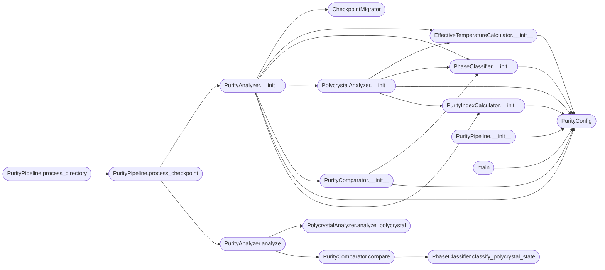

# `purity_index`

> Source: [purity_index.py:1](../../purity_index.py#L1) | language `py` | coverage 0.0% | [API index](../index.md)

## Contents

- **Classes:** [`PurityConfig`](#purityconfig), [`BilinearModel`](#bilinearmodel), [`PurityIndexCalculator`](#purityindexcalculator), [`EffectiveTemperatureCalculator`](#effectivetemperaturecalculator), [`PhaseClassifier`](#phaseclassifier), [`PolycrystalAnalyzer`](#polycrystalanalyzer), [`PurityComparator`](#puritycomparator), [`CheckpointMigrator`](#checkpointmigrator), [`PurityAnalyzer`](#purityanalyzer), [`PurityPipeline`](#puritypipeline)
- **Protocols:** [`IModel`](#imodel), [`IPurityIndexCalculator`](#ipurityindexcalculator), [`IEffectiveTemperatureCalculator`](#ieffectivetemperaturecalculator), [`IPhaseClassifier`](#iphaseclassifier), [`IPolycrystalAnalyzer`](#ipolycrystalanalyzer), [`IPurityComparator`](#ipuritycomparator)
- **Functions:** [`main`](#main)

## Type Diagram

```mermaid
classDiagram
    direction LR
    class PurityConfig
    PurityConfig : int HIDDEN_DIM
    PurityConfig : int MATRIX_SIZE
    PurityConfig : float DISCRETIZATION_MARGIN
    PurityConfig : int ENTROPY_BINS
    PurityConfig : int TEMPERATURE_WINDOW
    PurityConfig : int SPECIFIC_HEAT_WINDOW
    PurityConfig : Tuple[float, ] PRUNING_LEVELS
    PurityConfig : float ALPHA_SATURATION
    PurityConfig : float ALPHA_THRESHOLD_CRYSTAL
    PurityConfig : float ALPHA_THRESHOLD_GLASS
    PurityConfig : float GLASS_TEMPERATURE_THRESHOLD
    PurityConfig : float CRYSTAL_TEMPERATURE_THRESHOLD
    PurityConfig : int FIGURE_DPI
    PurityConfig : str SAVE_FORMAT
    PurityConfig : str DEVICE
    class IModel
    <<protocol>> IModel
    IModel : get_coefficients()
    class IPurityIndexCalculator
    <<protocol>> IPurityIndexCalculator
    IPurityIndexCalculator : calculate()
    class IEffectiveTemperatureCalculator
    <<protocol>> IEffectiveTemperatureCalculator
    IEffectiveTemperatureCalculator : calculate()
    class IPhaseClassifier
    <<protocol>> IPhaseClassifier
    IPhaseClassifier : classify()
    class IPolycrystalAnalyzer
    <<protocol>> IPolycrystalAnalyzer
    IPolycrystalAnalyzer : analyze_polycrystal()
    class IPurityComparator
    <<protocol>> IPurityComparator
    IPurityComparator : compare()
    class BilinearModel
    BilinearModel : __init__()
    BilinearModel : forward()
    BilinearModel : get_coefficients()
    class PurityIndexCalculator
    PurityIndexCalculator : __init__()
    PurityIndexCalculator : calculate()
    class EffectiveTemperatureCalculator
    EffectiveTemperatureCalculator : __init__()
    EffectiveTemperatureCalculator : calculate()
    class PhaseClassifier
    PhaseClassifier : __init__()
    PhaseClassifier : classify()
    PhaseClassifier : classify_polycrystal_state()
    class PolycrystalAnalyzer
    PolycrystalAnalyzer : __init__()
    PolycrystalAnalyzer : analyze_polycrystal()
    class PurityComparator
    PurityComparator : __init__()
    PurityComparator : compare()
    class CheckpointMigrator
    CheckpointMigrator : migrate()
    class PurityAnalyzer
    PurityAnalyzer : __init__()
    PurityAnalyzer : analyze()
    class PurityPipeline
    PurityPipeline : __init__()
    PurityPipeline : process_checkpoint()
    PurityPipeline : process_directory()
    PurityPipeline : generate_summary()
```



## Call Graph

Solid arrows stay in this module, dashed arrows leave it.



## Classes

<a id="purityconfig"></a>

### `PurityConfig`

`class` `dataclass` | [purity_index.py:19](../../purity_index.py#L19)

Decorators: `@dataclass(frozen=True)`

```python
class PurityConfig
```

**Attributes**

| Name | Type | Default | Description |
|---|---|---|---|
| [`HIDDEN_DIM`](#purityconfig-hidden_dim) | `int` | `8` |  |
| [`MATRIX_SIZE`](#purityconfig-matrix_size) | `int` | `2` |  |
| [`DISCRETIZATION_MARGIN`](#purityconfig-discretization_margin) | `float` | `0.1` |  |
| [`ENTROPY_BINS`](#purityconfig-entropy_bins) | `int` | `50` |  |
| [`TEMPERATURE_WINDOW`](#purityconfig-temperature_window) | `int` | `100` |  |
| [`SPECIFIC_HEAT_WINDOW`](#purityconfig-specific_heat_window) | `int` | `50` |  |
| [`PRUNING_LEVELS`](#purityconfig-pruning_levels) | `Tuple[float, ...]` | `(0.0, 0.3, 0.5, 0.7, 0.9)` |  |
| [`ALPHA_SATURATION`](#purityconfig-alpha_saturation) | `float` | `20.0` |  |
| [`ALPHA_THRESHOLD_CRYSTAL`](#purityconfig-alpha_threshold_crystal) | `float` | `7.0` |  |
| [`ALPHA_THRESHOLD_GLASS`](#purityconfig-alpha_threshold_glass) | `float` | `1.0` |  |
| [`GLASS_TEMPERATURE_THRESHOLD`](#purityconfig-glass_temperature_threshold) | `float` | `0.1` |  |
| [`CRYSTAL_TEMPERATURE_THRESHOLD`](#purityconfig-crystal_temperature_threshold) | `float` | `0.01` |  |
| [`FIGURE_DPI`](#purityconfig-figure_dpi) | `int` | `150` |  |
| [`SAVE_FORMAT`](#purityconfig-save_format) | `str` | `'png'` |  |
| [`DEVICE`](#purityconfig-device) | `str` | `'cuda' if torch.cuda.is_available() else 'cpu'` |  |

---

<a id="bilinearmodel"></a>

### `BilinearModel`

`class` | [purity_index.py:73](../../purity_index.py#L73)

```python
class BilinearModel(nn.Module)
```

Bases: `nn.Module`

**Members**

| Member | Kind | Summary |
|---|---|---|
| [`__init__`](#bilinearmodel-__init__) | constructor |  |
| [`forward`](#bilinearmodel-forward) | method |  |
| [`get_coefficients`](#bilinearmodel-get_coefficients) | method |  |

<a id="bilinearmodel-__init__"></a>

#### `BilinearModel.__init__`

`constructor` | [purity_index.py:74](../../purity_index.py#L74)

```python
def __init__(self, hidden_dim: int = PurityConfig.HIDDEN_DIM, matrix_size: int = PurityConfig.MATRIX_SIZE)
```

**Parameters**

| Name | Type | Default | Description |
|---|---|---|---|
| `hidden_dim` | `int` | `PurityConfig.HIDDEN_DIM` |  |
| `matrix_size` | `int` | `PurityConfig.MATRIX_SIZE` |  |

*Calls:* [`BilinearModel.__init__`](dirac_polos_zeros.py.md#bilinearmodel-__init__)

<a id="bilinearmodel-forward"></a>

#### `BilinearModel.forward`

`method` | [purity_index.py:90](../../purity_index.py#L90)

```python
def forward(self, a: torch.Tensor, b: torch.Tensor) -> torch.Tensor
```

**Parameters**

| Name | Type | Default | Description |
|---|---|---|---|
| `a` | `torch.Tensor` |  |  |
| `b` | `torch.Tensor` |  |  |

**Returns:** `torch.Tensor`

<a id="bilinearmodel-get_coefficients"></a>

#### `BilinearModel.get_coefficients`

`method` | [purity_index.py:93](../../purity_index.py#L93)

```python
def get_coefficients(self) -> Dict[str, torch.Tensor]
```

**Returns:** `Dict[str, torch.Tensor]`

---

<a id="purityindexcalculator"></a>

### `PurityIndexCalculator`

`class` | [purity_index.py:101](../../purity_index.py#L101)

```python
class PurityIndexCalculator
```

**Members**

| Member | Kind | Summary |
|---|---|---|
| [`__init__`](#purityindexcalculator-__init__) | constructor |  |
| [`calculate`](#purityindexcalculator-calculate) | method |  |

<a id="purityindexcalculator-__init__"></a>

#### `PurityIndexCalculator.__init__`

`constructor` | [purity_index.py:102](../../purity_index.py#L102)

```python
def __init__(self, config: PurityConfig = PurityConfig())
```

**Parameters**

| Name | Type | Default | Description |
|---|---|---|---|
| `config` | `PurityConfig` | `PurityConfig()` |  |

*Calls:* [`PurityConfig`](#purityconfig)

*Called by:* [`PolycrystalAnalyzer.__init__`](#polycrystalanalyzer-__init__), [`PurityAnalyzer.__init__`](#purityanalyzer-__init__)

<a id="purityindexcalculator-calculate"></a>

#### `PurityIndexCalculator.calculate`

`method` | [purity_index.py:105](../../purity_index.py#L105)

```python
def calculate(self, model: IModel) -> Dict[str, float]
```

**Parameters**

| Name | Type | Default | Description |
|---|---|---|---|
| `model` | `IModel` |  |  |

**Returns:** `Dict[str, float]`

*Calls:* [`IModel.get_coefficients`](dirac_polos_zeros.py.md#imodel-get_coefficients)

---

<a id="effectivetemperaturecalculator"></a>

### `EffectiveTemperatureCalculator`

`class` | [purity_index.py:156](../../purity_index.py#L156)

```python
class EffectiveTemperatureCalculator
```

**Members**

| Member | Kind | Summary |
|---|---|---|
| [`__init__`](#effectivetemperaturecalculator-__init__) | constructor |  |
| [`calculate`](#effectivetemperaturecalculator-calculate) | method |  |

<a id="effectivetemperaturecalculator-__init__"></a>

#### `EffectiveTemperatureCalculator.__init__`

`constructor` | [purity_index.py:157](../../purity_index.py#L157)

```python
def __init__(self, config: PurityConfig = PurityConfig())
```

**Parameters**

| Name | Type | Default | Description |
|---|---|---|---|
| `config` | `PurityConfig` | `PurityConfig()` |  |

*Calls:* [`PurityConfig`](#purityconfig)

*Called by:* [`PolycrystalAnalyzer.__init__`](#polycrystalanalyzer-__init__), [`PurityAnalyzer.__init__`](#purityanalyzer-__init__)

<a id="effectivetemperaturecalculator-calculate"></a>

#### `EffectiveTemperatureCalculator.calculate`

`method` | [purity_index.py:160](../../purity_index.py#L160)

```python
def calculate(self, loss_history: List[float]) -> Dict[str, float]
```

**Parameters**

| Name | Type | Default | Description |
|---|---|---|---|
| `loss_history` | `List[float]` |  |  |

**Returns:** `Dict[str, float]`

---

<a id="phaseclassifier"></a>

### `PhaseClassifier`

`class` | [purity_index.py:199](../../purity_index.py#L199)

```python
class PhaseClassifier
```

**Members**

| Member | Kind | Summary |
|---|---|---|
| [`__init__`](#phaseclassifier-__init__) | constructor |  |
| [`classify`](#phaseclassifier-classify) | method |  |
| [`classify_polycrystal_state`](#phaseclassifier-classify_polycrystal_state) | method |  |

<a id="phaseclassifier-__init__"></a>

#### `PhaseClassifier.__init__`

`constructor` | [purity_index.py:200](../../purity_index.py#L200)

```python
def __init__(self, config: PurityConfig = PurityConfig())
```

**Parameters**

| Name | Type | Default | Description |
|---|---|---|---|
| `config` | `PurityConfig` | `PurityConfig()` |  |

*Calls:* [`PurityConfig`](#purityconfig)

*Called by:* [`PolycrystalAnalyzer.__init__`](#polycrystalanalyzer-__init__), [`PurityAnalyzer.__init__`](#purityanalyzer-__init__), [`PurityComparator.__init__`](#puritycomparator-__init__)

<a id="phaseclassifier-classify"></a>

#### `PhaseClassifier.classify`

`method` | [purity_index.py:203](../../purity_index.py#L203)

```python
def classify(self, alpha: float, temperature: float) -> str
```

**Parameters**

| Name | Type | Default | Description |
|---|---|---|---|
| `alpha` | `float` |  |  |
| `temperature` | `float` |  |  |

**Returns:** `str`

<a id="phaseclassifier-classify_polycrystal_state"></a>

#### `PhaseClassifier.classify_polycrystal_state`

`method` | [purity_index.py:219](../../purity_index.py#L219)

```python
def classify_polycrystal_state(self, original_alpha: float, original_temp: float, poly_alpha: float, poly_temp: float) -> str
```

**Parameters**

| Name | Type | Default | Description |
|---|---|---|---|
| `original_alpha` | `float` |  |  |
| `original_temp` | `float` |  |  |
| `poly_alpha` | `float` |  |  |
| `poly_temp` | `float` |  |  |

**Returns:** `str`

*Called by:* [`PurityComparator.compare`](#puritycomparator-compare)

---

<a id="polycrystalanalyzer"></a>

### `PolycrystalAnalyzer`

`class` | [purity_index.py:236](../../purity_index.py#L236)

```python
class PolycrystalAnalyzer
```

**Members**

| Member | Kind | Summary |
|---|---|---|
| [`__init__`](#polycrystalanalyzer-__init__) | constructor |  |
| [`analyze_polycrystal`](#polycrystalanalyzer-analyze_polycrystal) | method |  |

<a id="polycrystalanalyzer-__init__"></a>

#### `PolycrystalAnalyzer.__init__`

`constructor` | [purity_index.py:237](../../purity_index.py#L237)

```python
def __init__(self, config: PurityConfig = PurityConfig())
```

**Parameters**

| Name | Type | Default | Description |
|---|---|---|---|
| `config` | `PurityConfig` | `PurityConfig()` |  |

*Calls:* [`EffectiveTemperatureCalculator.__init__`](#effectivetemperaturecalculator-__init__), [`PhaseClassifier.__init__`](#phaseclassifier-__init__), [`PurityConfig`](#purityconfig), [`PurityIndexCalculator.__init__`](#purityindexcalculator-__init__)

*Called by:* [`PurityAnalyzer.__init__`](#purityanalyzer-__init__)

<a id="polycrystalanalyzer-analyze_polycrystal"></a>

#### `PolycrystalAnalyzer.analyze_polycrystal`

`method` | [purity_index.py:243](../../purity_index.py#L243)

```python
def analyze_polycrystal(self, model: IModel, pruning_level: float, loss_history: List[float] = None) -> Dict[str, Any]
```

**Parameters**

| Name | Type | Default | Description |
|---|---|---|---|
| `model` | `IModel` |  |  |
| `pruning_level` | `float` |  |  |
| `loss_history` | `List[float]` | `None` |  |

**Returns:** `Dict[str, Any]`

*Calls:* [`EffectiveTemperatureCalculator.calculate`](mbl_analyzer.py.md#effectivetemperaturecalculator-calculate), [`PhaseClassifier.classify`](mbl_analyzer.py.md#phaseclassifier-classify), [`PurityIndexCalculator.calculate`](mbl_analyzer.py.md#purityindexcalculator-calculate)

*Called by:* [`PurityAnalyzer.analyze`](#purityanalyzer-analyze)

---

<a id="puritycomparator"></a>

### `PurityComparator`

`class` | [purity_index.py:274](../../purity_index.py#L274)

```python
class PurityComparator
```

**Members**

| Member | Kind | Summary |
|---|---|---|
| [`__init__`](#puritycomparator-__init__) | constructor |  |
| [`compare`](#puritycomparator-compare) | method |  |

<a id="puritycomparator-__init__"></a>

#### `PurityComparator.__init__`

`constructor` | [purity_index.py:275](../../purity_index.py#L275)

```python
def __init__(self, config: PurityConfig = PurityConfig())
```

**Parameters**

| Name | Type | Default | Description |
|---|---|---|---|
| `config` | `PurityConfig` | `PurityConfig()` |  |

*Calls:* [`PhaseClassifier.__init__`](#phaseclassifier-__init__), [`PurityConfig`](#purityconfig)

*Called by:* [`PurityAnalyzer.__init__`](#purityanalyzer-__init__)

<a id="puritycomparator-compare"></a>

#### `PurityComparator.compare`

`method` | [purity_index.py:279](../../purity_index.py#L279)

```python
def compare(self, original: Dict[str, float], polycrystal: Dict[str, float]) -> Dict[str, Any]
```

**Parameters**

| Name | Type | Default | Description |
|---|---|---|---|
| `original` | `Dict[str, float]` |  |  |
| `polycrystal` | `Dict[str, float]` |  |  |

**Returns:** `Dict[str, Any]`

*Calls:* [`PhaseClassifier.classify_polycrystal_state`](#phaseclassifier-classify_polycrystal_state)

*Called by:* [`PurityAnalyzer.analyze`](#purityanalyzer-analyze)

---

<a id="checkpointmigrator"></a>

### `CheckpointMigrator`

`class` | [purity_index.py:311](../../purity_index.py#L311)

```python
class CheckpointMigrator
```

**Members**

| Member | Kind | Summary |
|---|---|---|
| [`migrate`](#checkpointmigrator-migrate) | method |  |

<a id="checkpointmigrator-migrate"></a>

#### `CheckpointMigrator.migrate`

`method` | [purity_index.py:312](../../purity_index.py#L312)

```python
def migrate(self, raw_data: Any, device: str) -> Optional[Dict[str, torch.Tensor]]
```

**Parameters**

| Name | Type | Default | Description |
|---|---|---|---|
| `raw_data` | `Any` |  |  |
| `device` | `str` |  |  |

**Returns:** `Optional[Dict[str, torch.Tensor]]`

---

<a id="purityanalyzer"></a>

### `PurityAnalyzer`

`class` | [purity_index.py:361](../../purity_index.py#L361)

```python
class PurityAnalyzer
```

**Members**

| Member | Kind | Summary |
|---|---|---|
| [`__init__`](#purityanalyzer-__init__) | constructor |  |
| [`analyze`](#purityanalyzer-analyze) | method |  |

<a id="purityanalyzer-__init__"></a>

#### `PurityAnalyzer.__init__`

`constructor` | [purity_index.py:362](../../purity_index.py#L362)

```python
def __init__(self, checkpoint_path: str, config: PurityConfig = PurityConfig())
```

**Parameters**

| Name | Type | Default | Description |
|---|---|---|---|
| `checkpoint_path` | `str` |  |  |
| `config` | `PurityConfig` | `PurityConfig()` |  |

*Calls:* [`CheckpointMigrator`](#checkpointmigrator), [`EffectiveTemperatureCalculator.__init__`](#effectivetemperaturecalculator-__init__), [`PhaseClassifier.__init__`](#phaseclassifier-__init__), [`PolycrystalAnalyzer.__init__`](#polycrystalanalyzer-__init__), [`PurityComparator.__init__`](#puritycomparator-__init__), [`PurityConfig`](#purityconfig), [`PurityIndexCalculator.__init__`](#purityindexcalculator-__init__)

*Called by:* [`PurityPipeline.process_checkpoint`](#puritypipeline-process_checkpoint)

<a id="purityanalyzer-analyze"></a>

#### `PurityAnalyzer.analyze`

`method` | [purity_index.py:399](../../purity_index.py#L399)

```python
def analyze(self) -> Dict[str, Any]
```

**Returns:** `Dict[str, Any]`

*Calls:* [`EffectiveTemperatureCalculator.calculate`](mbl_analyzer.py.md#effectivetemperaturecalculator-calculate), [`PhaseClassifier.classify`](mbl_analyzer.py.md#phaseclassifier-classify), [`PurityIndexCalculator.calculate`](mbl_analyzer.py.md#purityindexcalculator-calculate), [`PolycrystalAnalyzer.analyze_polycrystal`](#polycrystalanalyzer-analyze_polycrystal), [`PurityComparator.compare`](#puritycomparator-compare)

*Called by:* [`PurityPipeline.process_checkpoint`](#puritypipeline-process_checkpoint)

---

<a id="puritypipeline"></a>

### `PurityPipeline`

`class` | [purity_index.py:492](../../purity_index.py#L492)

```python
class PurityPipeline
```

**Members**

| Member | Kind | Summary |
|---|---|---|
| [`__init__`](#puritypipeline-__init__) | constructor |  |
| [`process_checkpoint`](#puritypipeline-process_checkpoint) | method |  |
| [`process_directory`](#puritypipeline-process_directory) | method |  |
| [`generate_summary`](#puritypipeline-generate_summary) | method |  |

<a id="puritypipeline-__init__"></a>

#### `PurityPipeline.__init__`

`constructor` | [purity_index.py:493](../../purity_index.py#L493)

```python
def __init__(self, config: PurityConfig = PurityConfig())
```

**Parameters**

| Name | Type | Default | Description |
|---|---|---|---|
| `config` | `PurityConfig` | `PurityConfig()` |  |

*Calls:* [`PurityConfig`](#purityconfig)

*Called by:* [`main`](#main)

<a id="puritypipeline-process_checkpoint"></a>

#### `PurityPipeline.process_checkpoint`

`method` | [purity_index.py:496](../../purity_index.py#L496)

```python
def process_checkpoint(self, checkpoint_path: str, output_dir: str) -> Dict[str, Any]
```

**Parameters**

| Name | Type | Default | Description |
|---|---|---|---|
| `checkpoint_path` | `str` |  |  |
| `output_dir` | `str` |  |  |

**Returns:** `Dict[str, Any]`

*Calls:* [`PurityAnalyzer.__init__`](#purityanalyzer-__init__), [`PurityAnalyzer.analyze`](#purityanalyzer-analyze)

*Called by:* [`PurityPipeline.process_directory`](#puritypipeline-process_directory), [`main`](#main)

<a id="puritypipeline-process_directory"></a>

#### `PurityPipeline.process_directory`

`method` | [purity_index.py:510](../../purity_index.py#L510)

```python
def process_directory(self, checkpoint_dir: str, n_latest: Optional[int], output_dir: str) -> List[Dict[str, Any]]
```

**Parameters**

| Name | Type | Default | Description |
|---|---|---|---|
| `checkpoint_dir` | `str` |  |  |
| `n_latest` | `Optional[int]` |  |  |
| `output_dir` | `str` |  |  |

**Returns:** `List[Dict[str, Any]]`

*Calls:* [`PurityPipeline.process_checkpoint`](#puritypipeline-process_checkpoint)

*Called by:* [`main`](#main)

<a id="puritypipeline-generate_summary"></a>

#### `PurityPipeline.generate_summary`

`method` | [purity_index.py:537](../../purity_index.py#L537)

```python
def generate_summary(self, all_results: List[Dict[str, Any]], output_dir: str) -> None
```

**Parameters**

| Name | Type | Default | Description |
|---|---|---|---|
| `all_results` | `List[Dict[str, Any]]` |  |  |
| `output_dir` | `str` |  |  |

*Called by:* [`main`](#main)

---

## Protocols

<a id="imodel"></a>

### `IModel`

`protocol` | [purity_index.py:44](../../purity_index.py#L44)

Decorators: `@runtime_checkable`

```python
class IModel(Protocol)
```

Bases: `Protocol`

**Members**

| Member | Kind | Summary |
|---|---|---|
| [`get_coefficients`](#imodel-get_coefficients) | method |  |

<a id="imodel-get_coefficients"></a>

#### `IModel.get_coefficients`

`method` | [purity_index.py:45](../../purity_index.py#L45)

```python
def get_coefficients(self) -> Dict[str, torch.Tensor]
```

**Returns:** `Dict[str, torch.Tensor]`

---

<a id="ipurityindexcalculator"></a>

### `IPurityIndexCalculator`

`protocol` | [purity_index.py:49](../../purity_index.py#L49)

Decorators: `@runtime_checkable`

```python
class IPurityIndexCalculator(Protocol)
```

Bases: `Protocol`

**Members**

| Member | Kind | Summary |
|---|---|---|
| [`calculate`](#ipurityindexcalculator-calculate) | method |  |

<a id="ipurityindexcalculator-calculate"></a>

#### `IPurityIndexCalculator.calculate`

`method` | [purity_index.py:50](../../purity_index.py#L50)

```python
def calculate(self, model: IModel) -> Dict[str, float]
```

**Parameters**

| Name | Type | Default | Description |
|---|---|---|---|
| `model` | `IModel` |  |  |

**Returns:** `Dict[str, float]`

---

<a id="ieffectivetemperaturecalculator"></a>

### `IEffectiveTemperatureCalculator`

`protocol` | [purity_index.py:54](../../purity_index.py#L54)

Decorators: `@runtime_checkable`

```python
class IEffectiveTemperatureCalculator(Protocol)
```

Bases: `Protocol`

**Members**

| Member | Kind | Summary |
|---|---|---|
| [`calculate`](#ieffectivetemperaturecalculator-calculate) | method |  |

<a id="ieffectivetemperaturecalculator-calculate"></a>

#### `IEffectiveTemperatureCalculator.calculate`

`method` | [purity_index.py:55](../../purity_index.py#L55)

```python
def calculate(self, loss_history: List[float]) -> Dict[str, float]
```

**Parameters**

| Name | Type | Default | Description |
|---|---|---|---|
| `loss_history` | `List[float]` |  |  |

**Returns:** `Dict[str, float]`

---

<a id="iphaseclassifier"></a>

### `IPhaseClassifier`

`protocol` | [purity_index.py:59](../../purity_index.py#L59)

Decorators: `@runtime_checkable`

```python
class IPhaseClassifier(Protocol)
```

Bases: `Protocol`

**Members**

| Member | Kind | Summary |
|---|---|---|
| [`classify`](#iphaseclassifier-classify) | method |  |

<a id="iphaseclassifier-classify"></a>

#### `IPhaseClassifier.classify`

`method` | [purity_index.py:60](../../purity_index.py#L60)

```python
def classify(self, alpha: float, temperature: float) -> str
```

**Parameters**

| Name | Type | Default | Description |
|---|---|---|---|
| `alpha` | `float` |  |  |
| `temperature` | `float` |  |  |

**Returns:** `str`

---

<a id="ipolycrystalanalyzer"></a>

### `IPolycrystalAnalyzer`

`protocol` | [purity_index.py:64](../../purity_index.py#L64)

Decorators: `@runtime_checkable`

```python
class IPolycrystalAnalyzer(Protocol)
```

Bases: `Protocol`

**Members**

| Member | Kind | Summary |
|---|---|---|
| [`analyze_polycrystal`](#ipolycrystalanalyzer-analyze_polycrystal) | method |  |

<a id="ipolycrystalanalyzer-analyze_polycrystal"></a>

#### `IPolycrystalAnalyzer.analyze_polycrystal`

`method` | [purity_index.py:65](../../purity_index.py#L65)

```python
def analyze_polycrystal(self, model: IModel, pruning_level: float) -> Dict[str, Any]
```

**Parameters**

| Name | Type | Default | Description |
|---|---|---|---|
| `model` | `IModel` |  |  |
| `pruning_level` | `float` |  |  |

**Returns:** `Dict[str, Any]`

---

<a id="ipuritycomparator"></a>

### `IPurityComparator`

`protocol` | [purity_index.py:69](../../purity_index.py#L69)

Decorators: `@runtime_checkable`

```python
class IPurityComparator(Protocol)
```

Bases: `Protocol`

**Members**

| Member | Kind | Summary |
|---|---|---|
| [`compare`](#ipuritycomparator-compare) | method |  |

<a id="ipuritycomparator-compare"></a>

#### `IPurityComparator.compare`

`method` | [purity_index.py:70](../../purity_index.py#L70)

```python
def compare(self, original: Dict[str, float], polycrystal: Dict[str, float]) -> Dict[str, Any]
```

**Parameters**

| Name | Type | Default | Description |
|---|---|---|---|
| `original` | `Dict[str, float]` |  |  |
| `polycrystal` | `Dict[str, float]` |  |  |

**Returns:** `Dict[str, Any]`

---

## Functions

<a id="main"></a>

### `main`

`function` | [purity_index.py:611](../../purity_index.py#L611)

```python
def main()
```

*Calls:* [`PurityConfig`](#purityconfig), [`PurityPipeline.__init__`](#puritypipeline-__init__), [`PurityPipeline.generate_summary`](#puritypipeline-generate_summary), [`PurityPipeline.process_checkpoint`](#puritypipeline-process_checkpoint), [`PurityPipeline.process_directory`](#puritypipeline-process_directory)

---
