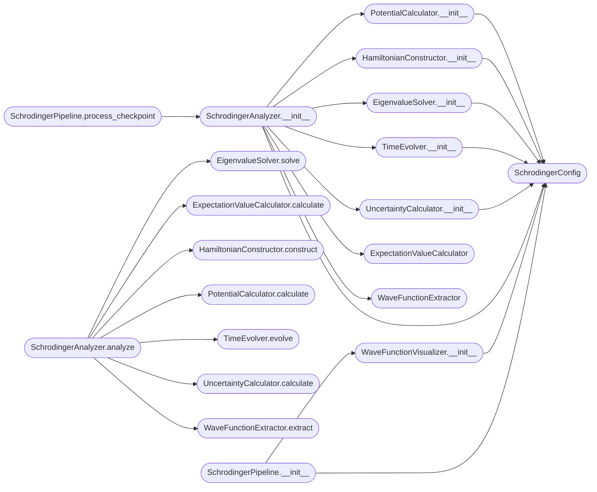

# `scrodingger`

> Source: [scrodingger.py:1](../../scrodingger.py#L1) | language `py` | coverage 0.0% | [API index](../index.md)

## Contents

- **Classes:** [`SchrodingerConfig`](#schrodingerconfig), [`BilinearModel`](#bilinearmodel), [`WaveFunctionExtractor`](#wavefunctionextractor), [`PotentialCalculator`](#potentialcalculator), [`HamiltonianConstructor`](#hamiltonianconstructor), [`EigenvalueSolver`](#eigenvaluesolver), [`TimeEvolver`](#timeevolver), [`ExpectationValueCalculator`](#expectationvaluecalculator), [`UncertaintyCalculator`](#uncertaintycalculator), [`CheckpointLoader`](#checkpointloader), [`CheckpointMigrator`](#checkpointmigrator), [`SchrodingerAnalyzer`](#schrodingeranalyzer), [`WaveFunctionVisualizer`](#wavefunctionvisualizer), [`SchrodingerPipeline`](#schrodingerpipeline)
- **Protocols:** [`IModel`](#imodel), [`IWaveFunctionExtractor`](#iwavefunctionextractor), [`IPotentialCalculator`](#ipotentialcalculator), [`IHamiltonianConstructor`](#ihamiltonianconstructor), [`IEigenvalueSolver`](#ieigenvaluesolver), [`ITimeEvolver`](#itimeevolver), [`IExpectationValueCalculator`](#iexpectationvaluecalculator), [`IUncertaintyCalculator`](#iuncertaintycalculator), [`ICheckpointLoader`](#icheckpointloader), [`ICheckpointMigrator`](#icheckpointmigrator)
- **Functions:** [`main`](#main)

## Type Diagram

```mermaid
classDiagram
    direction LR
    class SchrodingerConfig
    SchrodingerConfig : int HIDDEN_DIM
    SchrodingerConfig : int MATRIX_SIZE
    SchrodingerConfig : int BATCH_SIZE
    SchrodingerConfig : float HBAR
    SchrodingerConfig : float MASS_EFFECTIVE
    SchrodingerConfig : float POTENTIAL_WELL_DEPTH
    SchrodingerConfig : int EIGENVALUE_COUNT
    SchrodingerConfig : int SPATIAL_GRID_POINTS
    SchrodingerConfig : int TIME_STEPS
    SchrodingerConfig : float TIME_MAX
    SchrodingerConfig : float ENERGY_TOLERANCE
    SchrodingerConfig : float WAVE_FUNCTION_NORM_TOLERANCE
    SchrodingerConfig : int FIGURE_DPI
    SchrodingerConfig : str SAVE_FORMAT
    SchrodingerConfig : str COLORMAP
    SchrodingerConfig : str DEVICE
    class IModel
    <<protocol>> IModel
    IModel : get_coefficients()
    class IWaveFunctionExtractor
    <<protocol>> IWaveFunctionExtractor
    IWaveFunctionExtractor : extract()
    class IPotentialCalculator
    <<protocol>> IPotentialCalculator
    IPotentialCalculator : calculate()
    class IHamiltonianConstructor
    <<protocol>> IHamiltonianConstructor
    IHamiltonianConstructor : construct()
    class IEigenvalueSolver
    <<protocol>> IEigenvalueSolver
    IEigenvalueSolver : solve()
    class ITimeEvolver
    <<protocol>> ITimeEvolver
    ITimeEvolver : evolve()
    class IExpectationValueCalculator
    <<protocol>> IExpectationValueCalculator
    IExpectationValueCalculator : calculate()
    class IUncertaintyCalculator
    <<protocol>> IUncertaintyCalculator
    IUncertaintyCalculator : calculate()
    class ICheckpointLoader
    <<protocol>> ICheckpointLoader
    ICheckpointLoader : load()
    class ICheckpointMigrator
    <<protocol>> ICheckpointMigrator
    ICheckpointMigrator : migrate()
    class BilinearModel
    BilinearModel : __init__()
    BilinearModel : forward()
    BilinearModel : get_coefficients()
    class WaveFunctionExtractor
    WaveFunctionExtractor : extract()
    class PotentialCalculator
    PotentialCalculator : __init__()
    PotentialCalculator : calculate()
    class HamiltonianConstructor
    HamiltonianConstructor : __init__()
    HamiltonianConstructor : construct()
    class EigenvalueSolver
    EigenvalueSolver : __init__()
    EigenvalueSolver : solve()
    class TimeEvolver
    TimeEvolver : __init__()
    TimeEvolver : evolve()
    class ExpectationValueCalculator
    ExpectationValueCalculator : calculate()
    class UncertaintyCalculator
    UncertaintyCalculator : __init__()
    UncertaintyCalculator : calculate()
    class CheckpointLoader
    CheckpointLoader : load()
    class CheckpointMigrator
    CheckpointMigrator : migrate()
    class SchrodingerAnalyzer
    SchrodingerAnalyzer : __init__()
    SchrodingerAnalyzer : analyze()
    class WaveFunctionVisualizer
    WaveFunctionVisualizer : __init__()
    WaveFunctionVisualizer : visualize()
    class SchrodingerPipeline
    SchrodingerPipeline : __init__()
    SchrodingerPipeline : process_checkpoint()
    SchrodingerPipeline : process_directory()
    SchrodingerPipeline : generate_summary()
```



## Call Graph

Solid arrows stay in this module, dashed arrows leave it.



## Classes

<a id="schrodingerconfig"></a>

### `SchrodingerConfig`

`class` `dataclass` | [scrodingger.py:19](../../scrodingger.py#L19)

Decorators: `@dataclass(frozen=True)`

```python
class SchrodingerConfig
```

**Attributes**

| Name | Type | Default | Description |
|---|---|---|---|
| [`HIDDEN_DIM`](#schrodingerconfig-hidden_dim) | `int` | `8` |  |
| [`MATRIX_SIZE`](#schrodingerconfig-matrix_size) | `int` | `2` |  |
| [`BATCH_SIZE`](#schrodingerconfig-batch_size) | `int` | `32` |  |
| [`HBAR`](#schrodingerconfig-hbar) | `float` | `1.0` |  |
| [`MASS_EFFECTIVE`](#schrodingerconfig-mass_effective) | `float` | `1.0` |  |
| [`POTENTIAL_WELL_DEPTH`](#schrodingerconfig-potential_well_depth) | `float` | `10.0` |  |
| [`EIGENVALUE_COUNT`](#schrodingerconfig-eigenvalue_count) | `int` | `10` |  |
| [`SPATIAL_GRID_POINTS`](#schrodingerconfig-spatial_grid_points) | `int` | `100` |  |
| [`TIME_STEPS`](#schrodingerconfig-time_steps) | `int` | `1000` |  |
| [`TIME_MAX`](#schrodingerconfig-time_max) | `float` | `10.0` |  |
| [`ENERGY_TOLERANCE`](#schrodingerconfig-energy_tolerance) | `float` | `1e-06` |  |
| [`WAVE_FUNCTION_NORM_TOLERANCE`](#schrodingerconfig-wave_function_norm_tolerance) | `float` | `1e-08` |  |
| [`FIGURE_DPI`](#schrodingerconfig-figure_dpi) | `int` | `150` |  |
| [`SAVE_FORMAT`](#schrodingerconfig-save_format) | `str` | `'png'` |  |
| [`COLORMAP`](#schrodingerconfig-colormap) | `str` | `'viridis'` |  |
| [`DEVICE`](#schrodingerconfig-device) | `str` | `'cuda' if torch.cuda.is_available() else 'cpu'` |  |

---

<a id="bilinearmodel"></a>

### `BilinearModel`

`class` | [scrodingger.py:93](../../scrodingger.py#L93)

```python
class BilinearModel(nn.Module)
```

Bases: `nn.Module`

**Members**

| Member | Kind | Summary |
|---|---|---|
| [`__init__`](#bilinearmodel-__init__) | constructor |  |
| [`forward`](#bilinearmodel-forward) | method |  |
| [`get_coefficients`](#bilinearmodel-get_coefficients) | method |  |

<a id="bilinearmodel-__init__"></a>

#### `BilinearModel.__init__`

`constructor` | [scrodingger.py:94](../../scrodingger.py#L94)

```python
def __init__(self, hidden_dim: int = SchrodingerConfig.HIDDEN_DIM, matrix_size: int = SchrodingerConfig.MATRIX_SIZE)
```

**Parameters**

| Name | Type | Default | Description |
|---|---|---|---|
| `hidden_dim` | `int` | `SchrodingerConfig.HIDDEN_DIM` |  |
| `matrix_size` | `int` | `SchrodingerConfig.MATRIX_SIZE` |  |

*Calls:* [`BilinearModel.__init__`](dirac_polos_zeros.py.md#bilinearmodel-__init__)

<a id="bilinearmodel-forward"></a>

#### `BilinearModel.forward`

`method` | [scrodingger.py:110](../../scrodingger.py#L110)

```python
def forward(self, a: torch.Tensor, b: torch.Tensor) -> torch.Tensor
```

**Parameters**

| Name | Type | Default | Description |
|---|---|---|---|
| `a` | `torch.Tensor` |  |  |
| `b` | `torch.Tensor` |  |  |

**Returns:** `torch.Tensor`

<a id="bilinearmodel-get_coefficients"></a>

#### `BilinearModel.get_coefficients`

`method` | [scrodingger.py:113](../../scrodingger.py#L113)

```python
def get_coefficients(self) -> Dict[str, torch.Tensor]
```

**Returns:** `Dict[str, torch.Tensor]`

---

<a id="wavefunctionextractor"></a>

### `WaveFunctionExtractor`

`class` | [scrodingger.py:121](../../scrodingger.py#L121)

```python
class WaveFunctionExtractor
```

**Members**

| Member | Kind | Summary |
|---|---|---|
| [`extract`](#wavefunctionextractor-extract) | method |  |

<a id="wavefunctionextractor-extract"></a>

#### `WaveFunctionExtractor.extract`

`method` | [scrodingger.py:122](../../scrodingger.py#L122)

```python
def extract(self, model: IModel) -> torch.Tensor
```

**Parameters**

| Name | Type | Default | Description |
|---|---|---|---|
| `model` | `IModel` |  |  |

**Returns:** `torch.Tensor`

*Calls:* [`IModel.get_coefficients`](dirac_polos_zeros.py.md#imodel-get_coefficients)

*Called by:* [`SchrodingerAnalyzer.analyze`](#schrodingeranalyzer-analyze)

---

<a id="potentialcalculator"></a>

### `PotentialCalculator`

`class` | [scrodingger.py:128](../../scrodingger.py#L128)

```python
class PotentialCalculator
```

**Members**

| Member | Kind | Summary |
|---|---|---|
| [`__init__`](#potentialcalculator-__init__) | constructor |  |
| [`calculate`](#potentialcalculator-calculate) | method |  |

<a id="potentialcalculator-__init__"></a>

#### `PotentialCalculator.__init__`

`constructor` | [scrodingger.py:129](../../scrodingger.py#L129)

```python
def __init__(self, config: SchrodingerConfig = SchrodingerConfig())
```

**Parameters**

| Name | Type | Default | Description |
|---|---|---|---|
| `config` | `SchrodingerConfig` | `SchrodingerConfig()` |  |

*Calls:* [`SchrodingerConfig`](#schrodingerconfig)

*Called by:* [`SchrodingerAnalyzer.__init__`](#schrodingeranalyzer-__init__)

<a id="potentialcalculator-calculate"></a>

#### `PotentialCalculator.calculate`

`method` | [scrodingger.py:132](../../scrodingger.py#L132)

```python
def calculate(self, weights: torch.Tensor) -> torch.Tensor
```

**Parameters**

| Name | Type | Default | Description |
|---|---|---|---|
| `weights` | `torch.Tensor` |  |  |

**Returns:** `torch.Tensor`

*Called by:* [`SchrodingerAnalyzer.analyze`](#schrodingeranalyzer-analyze)

---

<a id="hamiltonianconstructor"></a>

### `HamiltonianConstructor`

`class` | [scrodingger.py:150](../../scrodingger.py#L150)

```python
class HamiltonianConstructor
```

**Members**

| Member | Kind | Summary |
|---|---|---|
| [`__init__`](#hamiltonianconstructor-__init__) | constructor |  |
| [`construct`](#hamiltonianconstructor-construct) | method |  |

<a id="hamiltonianconstructor-__init__"></a>

#### `HamiltonianConstructor.__init__`

`constructor` | [scrodingger.py:151](../../scrodingger.py#L151)

```python
def __init__(self, config: SchrodingerConfig = SchrodingerConfig())
```

**Parameters**

| Name | Type | Default | Description |
|---|---|---|---|
| `config` | `SchrodingerConfig` | `SchrodingerConfig()` |  |

*Calls:* [`SchrodingerConfig`](#schrodingerconfig)

*Called by:* [`SchrodingerAnalyzer.__init__`](#schrodingeranalyzer-__init__)

<a id="hamiltonianconstructor-construct"></a>

#### `HamiltonianConstructor.construct`

`method` | [scrodingger.py:154](../../scrodingger.py#L154)

```python
def construct(self, potential: torch.Tensor, mass: float) -> torch.Tensor
```

**Parameters**

| Name | Type | Default | Description |
|---|---|---|---|
| `potential` | `torch.Tensor` |  |  |
| `mass` | `float` |  |  |

**Returns:** `torch.Tensor`

*Called by:* [`SchrodingerAnalyzer.analyze`](#schrodingeranalyzer-analyze)

---

<a id="eigenvaluesolver"></a>

### `EigenvalueSolver`

`class` | [scrodingger.py:170](../../scrodingger.py#L170)

```python
class EigenvalueSolver
```

**Members**

| Member | Kind | Summary |
|---|---|---|
| [`__init__`](#eigenvaluesolver-__init__) | constructor |  |
| [`solve`](#eigenvaluesolver-solve) | method |  |

<a id="eigenvaluesolver-__init__"></a>

#### `EigenvalueSolver.__init__`

`constructor` | [scrodingger.py:171](../../scrodingger.py#L171)

```python
def __init__(self, config: SchrodingerConfig = SchrodingerConfig())
```

**Parameters**

| Name | Type | Default | Description |
|---|---|---|---|
| `config` | `SchrodingerConfig` | `SchrodingerConfig()` |  |

*Calls:* [`SchrodingerConfig`](#schrodingerconfig)

*Called by:* [`SchrodingerAnalyzer.__init__`](#schrodingeranalyzer-__init__)

<a id="eigenvaluesolver-solve"></a>

#### `EigenvalueSolver.solve`

`method` | [scrodingger.py:174](../../scrodingger.py#L174)

```python
def solve(self, hamiltonian: torch.Tensor, count: int) -> Tuple[np.ndarray, np.ndarray]
```

**Parameters**

| Name | Type | Default | Description |
|---|---|---|---|
| `hamiltonian` | `torch.Tensor` |  |  |
| `count` | `int` |  |  |

**Returns:** `Tuple[np.ndarray, np.ndarray]`

*Called by:* [`SchrodingerAnalyzer.analyze`](#schrodingeranalyzer-analyze)

---

<a id="timeevolver"></a>

### `TimeEvolver`

`class` | [scrodingger.py:194](../../scrodingger.py#L194)

```python
class TimeEvolver
```

**Members**

| Member | Kind | Summary |
|---|---|---|
| [`__init__`](#timeevolver-__init__) | constructor |  |
| [`evolve`](#timeevolver-evolve) | method |  |

<a id="timeevolver-__init__"></a>

#### `TimeEvolver.__init__`

`constructor` | [scrodingger.py:195](../../scrodingger.py#L195)

```python
def __init__(self, config: SchrodingerConfig = SchrodingerConfig())
```

**Parameters**

| Name | Type | Default | Description |
|---|---|---|---|
| `config` | `SchrodingerConfig` | `SchrodingerConfig()` |  |

*Calls:* [`SchrodingerConfig`](#schrodingerconfig)

*Called by:* [`SchrodingerAnalyzer.__init__`](#schrodingeranalyzer-__init__)

<a id="timeevolver-evolve"></a>

#### `TimeEvolver.evolve`

`method` | [scrodingger.py:198](../../scrodingger.py#L198)

```python
def evolve(self, initial_state: torch.Tensor, hamiltonian: torch.Tensor, time_steps: int, dt: float) -> List[torch.Tensor]
```

**Parameters**

| Name | Type | Default | Description |
|---|---|---|---|
| `initial_state` | `torch.Tensor` |  |  |
| `hamiltonian` | `torch.Tensor` |  |  |
| `time_steps` | `int` |  |  |
| `dt` | `float` |  |  |

**Returns:** `List[torch.Tensor]`

*Called by:* [`SchrodingerAnalyzer.analyze`](#schrodingeranalyzer-analyze)

---

<a id="expectationvaluecalculator"></a>

### `ExpectationValueCalculator`

`class` | [scrodingger.py:216](../../scrodingger.py#L216)

```python
class ExpectationValueCalculator
```

**Members**

| Member | Kind | Summary |
|---|---|---|
| [`calculate`](#expectationvaluecalculator-calculate) | method |  |

<a id="expectationvaluecalculator-calculate"></a>

#### `ExpectationValueCalculator.calculate`

`method` | [scrodingger.py:217](../../scrodingger.py#L217)

```python
def calculate(self, wave_function: torch.Tensor, operator: torch.Tensor) -> float
```

**Parameters**

| Name | Type | Default | Description |
|---|---|---|---|
| `wave_function` | `torch.Tensor` |  |  |
| `operator` | `torch.Tensor` |  |  |

**Returns:** `float`

*Called by:* [`SchrodingerAnalyzer.analyze`](#schrodingeranalyzer-analyze)

---

<a id="uncertaintycalculator"></a>

### `UncertaintyCalculator`

`class` | [scrodingger.py:226](../../scrodingger.py#L226)

```python
class UncertaintyCalculator
```

**Members**

| Member | Kind | Summary |
|---|---|---|
| [`__init__`](#uncertaintycalculator-__init__) | constructor |  |
| [`calculate`](#uncertaintycalculator-calculate) | method |  |

<a id="uncertaintycalculator-__init__"></a>

#### `UncertaintyCalculator.__init__`

`constructor` | [scrodingger.py:227](../../scrodingger.py#L227)

```python
def __init__(self, config: SchrodingerConfig = SchrodingerConfig())
```

**Parameters**

| Name | Type | Default | Description |
|---|---|---|---|
| `config` | `SchrodingerConfig` | `SchrodingerConfig()` |  |

*Calls:* [`SchrodingerConfig`](#schrodingerconfig)

*Called by:* [`SchrodingerAnalyzer.__init__`](#schrodingeranalyzer-__init__)

<a id="uncertaintycalculator-calculate"></a>

#### `UncertaintyCalculator.calculate`

`method` | [scrodingger.py:230](../../scrodingger.py#L230)

```python
def calculate(self, wave_function: torch.Tensor, position_grid: torch.Tensor) -> Dict[str, float]
```

**Parameters**

| Name | Type | Default | Description |
|---|---|---|---|
| `wave_function` | `torch.Tensor` |  |  |
| `position_grid` | `torch.Tensor` |  |  |

**Returns:** `Dict[str, float]`

*Called by:* [`SchrodingerAnalyzer.analyze`](#schrodingeranalyzer-analyze)

---

<a id="checkpointloader"></a>

### `CheckpointLoader`

`class` | [scrodingger.py:263](../../scrodingger.py#L263)

```python
class CheckpointLoader
```

**Members**

| Member | Kind | Summary |
|---|---|---|
| [`load`](#checkpointloader-load) | method |  |

<a id="checkpointloader-load"></a>

#### `CheckpointLoader.load`

`method` | [scrodingger.py:264](../../scrodingger.py#L264)

```python
def load(self, path: str, device: str) -> Any
```

**Parameters**

| Name | Type | Default | Description |
|---|---|---|---|
| `path` | `str` |  |  |
| `device` | `str` |  |  |

**Returns:** `Any`

**Raises**

- `RuntimeError`: (raised in the body, not documented)

---

<a id="checkpointmigrator"></a>

### `CheckpointMigrator`

`class` | [scrodingger.py:271](../../scrodingger.py#L271)

```python
class CheckpointMigrator
```

**Members**

| Member | Kind | Summary |
|---|---|---|
| [`migrate`](#checkpointmigrator-migrate) | method |  |

<a id="checkpointmigrator-migrate"></a>

#### `CheckpointMigrator.migrate`

`method` | [scrodingger.py:272](../../scrodingger.py#L272)

```python
def migrate(self, raw_data: Any) -> Optional[Dict[str, torch.Tensor]]
```

**Parameters**

| Name | Type | Default | Description |
|---|---|---|---|
| `raw_data` | `Any` |  |  |

**Returns:** `Optional[Dict[str, torch.Tensor]]`

---

<a id="schrodingeranalyzer"></a>

### `SchrodingerAnalyzer`

`class` | [scrodingger.py:320](../../scrodingger.py#L320)

```python
class SchrodingerAnalyzer
```

**Members**

| Member | Kind | Summary |
|---|---|---|
| [`__init__`](#schrodingeranalyzer-__init__) | constructor |  |
| [`analyze`](#schrodingeranalyzer-analyze) | method |  |

<a id="schrodingeranalyzer-__init__"></a>

#### `SchrodingerAnalyzer.__init__`

`constructor` | [scrodingger.py:321](../../scrodingger.py#L321)

```python
def __init__(self, checkpoint_path: str, config: SchrodingerConfig = SchrodingerConfig())
```

**Parameters**

| Name | Type | Default | Description |
|---|---|---|---|
| `checkpoint_path` | `str` |  |  |
| `config` | `SchrodingerConfig` | `SchrodingerConfig()` |  |

*Calls:* [`EigenvalueSolver.__init__`](#eigenvaluesolver-__init__), [`ExpectationValueCalculator`](#expectationvaluecalculator), [`HamiltonianConstructor.__init__`](#hamiltonianconstructor-__init__), [`PotentialCalculator.__init__`](#potentialcalculator-__init__), [`SchrodingerConfig`](#schrodingerconfig), [`TimeEvolver.__init__`](#timeevolver-__init__), [`UncertaintyCalculator.__init__`](#uncertaintycalculator-__init__), [`WaveFunctionExtractor`](#wavefunctionextractor)

*Called by:* [`SchrodingerPipeline.process_checkpoint`](#schrodingerpipeline-process_checkpoint)

<a id="schrodingeranalyzer-analyze"></a>

#### `SchrodingerAnalyzer.analyze`

`method` | [scrodingger.py:357](../../scrodingger.py#L357)

```python
def analyze(self) -> Dict[str, Any]
```

**Returns:** `Dict[str, Any]`

*Calls:* [`EigenvalueSolver.solve`](#eigenvaluesolver-solve), [`ExpectationValueCalculator.calculate`](#expectationvaluecalculator-calculate), [`HamiltonianConstructor.construct`](#hamiltonianconstructor-construct), [`PotentialCalculator.calculate`](#potentialcalculator-calculate), [`TimeEvolver.evolve`](#timeevolver-evolve), [`UncertaintyCalculator.calculate`](#uncertaintycalculator-calculate), [`WaveFunctionExtractor.extract`](#wavefunctionextractor-extract)

*Called by:* [`SchrodingerPipeline.process_checkpoint`](#schrodingerpipeline-process_checkpoint)

---

<a id="wavefunctionvisualizer"></a>

### `WaveFunctionVisualizer`

`class` | [scrodingger.py:542](../../scrodingger.py#L542)

```python
class WaveFunctionVisualizer
```

**Members**

| Member | Kind | Summary |
|---|---|---|
| [`__init__`](#wavefunctionvisualizer-__init__) | constructor |  |
| [`visualize`](#wavefunctionvisualizer-visualize) | method |  |

<a id="wavefunctionvisualizer-__init__"></a>

#### `WaveFunctionVisualizer.__init__`

`constructor` | [scrodingger.py:543](../../scrodingger.py#L543)

```python
def __init__(self, config: SchrodingerConfig = SchrodingerConfig())
```

**Parameters**

| Name | Type | Default | Description |
|---|---|---|---|
| `config` | `SchrodingerConfig` | `SchrodingerConfig()` |  |

*Calls:* [`SchrodingerConfig`](#schrodingerconfig)

*Called by:* [`SchrodingerPipeline.__init__`](#schrodingerpipeline-__init__)

<a id="wavefunctionvisualizer-visualize"></a>

#### `WaveFunctionVisualizer.visualize`

`method` | [scrodingger.py:546](../../scrodingger.py#L546)

```python
def visualize(self, data: Dict[str, Any], output_path: str) -> None
```

**Parameters**

| Name | Type | Default | Description |
|---|---|---|---|
| `data` | `Dict[str, Any]` |  |  |
| `output_path` | `str` |  |  |

---

<a id="schrodingerpipeline"></a>

### `SchrodingerPipeline`

`class` | [scrodingger.py:609](../../scrodingger.py#L609)

```python
class SchrodingerPipeline
```

**Members**

| Member | Kind | Summary |
|---|---|---|
| [`__init__`](#schrodingerpipeline-__init__) | constructor |  |
| [`process_checkpoint`](#schrodingerpipeline-process_checkpoint) | method |  |
| [`process_directory`](#schrodingerpipeline-process_directory) | method |  |
| [`generate_summary`](#schrodingerpipeline-generate_summary) | method |  |

<a id="schrodingerpipeline-__init__"></a>

#### `SchrodingerPipeline.__init__`

`constructor` | [scrodingger.py:610](../../scrodingger.py#L610)

```python
def __init__(self, config: SchrodingerConfig = SchrodingerConfig())
```

**Parameters**

| Name | Type | Default | Description |
|---|---|---|---|
| `config` | `SchrodingerConfig` | `SchrodingerConfig()` |  |

*Calls:* [`SchrodingerConfig`](#schrodingerconfig), [`WaveFunctionVisualizer.__init__`](#wavefunctionvisualizer-__init__)

*Called by:* [`main`](#main)

<a id="schrodingerpipeline-process_checkpoint"></a>

#### `SchrodingerPipeline.process_checkpoint`

`method` | [scrodingger.py:614](../../scrodingger.py#L614)

```python
def process_checkpoint(self, checkpoint_path: str, output_dir: str) -> Dict[str, Any]
```

**Parameters**

| Name | Type | Default | Description |
|---|---|---|---|
| `checkpoint_path` | `str` |  |  |
| `output_dir` | `str` |  |  |

**Returns:** `Dict[str, Any]`

*Calls:* [`SchrodingerAnalyzer.__init__`](#schrodingeranalyzer-__init__), [`SchrodingerAnalyzer.analyze`](#schrodingeranalyzer-analyze)

*Called by:* [`SchrodingerPipeline.process_directory`](#schrodingerpipeline-process_directory), [`main`](#main)

<a id="schrodingerpipeline-process_directory"></a>

#### `SchrodingerPipeline.process_directory`

`method` | [scrodingger.py:628](../../scrodingger.py#L628)

```python
def process_directory(self, checkpoint_dir: str, n_latest: Optional[int], output_dir: str) -> List[Dict[str, Any]]
```

**Parameters**

| Name | Type | Default | Description |
|---|---|---|---|
| `checkpoint_dir` | `str` |  |  |
| `n_latest` | `Optional[int]` |  |  |
| `output_dir` | `str` |  |  |

**Returns:** `List[Dict[str, Any]]`

*Calls:* [`SchrodingerPipeline.process_checkpoint`](#schrodingerpipeline-process_checkpoint)

*Called by:* [`main`](#main)

<a id="schrodingerpipeline-generate_summary"></a>

#### `SchrodingerPipeline.generate_summary`

`method` | [scrodingger.py:655](../../scrodingger.py#L655)

```python
def generate_summary(self, all_results: List[Dict[str, Any]], output_dir: str) -> None
```

**Parameters**

| Name | Type | Default | Description |
|---|---|---|---|
| `all_results` | `List[Dict[str, Any]]` |  |  |
| `output_dir` | `str` |  |  |

*Called by:* [`main`](#main)

---

## Protocols

<a id="imodel"></a>

### `IModel`

`protocol` | [scrodingger.py:44](../../scrodingger.py#L44)

Decorators: `@runtime_checkable`

```python
class IModel(Protocol)
```

Bases: `Protocol`

**Members**

| Member | Kind | Summary |
|---|---|---|
| [`get_coefficients`](#imodel-get_coefficients) | method |  |

<a id="imodel-get_coefficients"></a>

#### `IModel.get_coefficients`

`method` | [scrodingger.py:45](../../scrodingger.py#L45)

```python
def get_coefficients(self) -> Dict[str, torch.Tensor]
```

**Returns:** `Dict[str, torch.Tensor]`

---

<a id="iwavefunctionextractor"></a>

### `IWaveFunctionExtractor`

`protocol` | [scrodingger.py:49](../../scrodingger.py#L49)

Decorators: `@runtime_checkable`

```python
class IWaveFunctionExtractor(Protocol)
```

Bases: `Protocol`

**Members**

| Member | Kind | Summary |
|---|---|---|
| [`extract`](#iwavefunctionextractor-extract) | method |  |

<a id="iwavefunctionextractor-extract"></a>

#### `IWaveFunctionExtractor.extract`

`method` | [scrodingger.py:50](../../scrodingger.py#L50)

```python
def extract(self, model: IModel) -> torch.Tensor
```

**Parameters**

| Name | Type | Default | Description |
|---|---|---|---|
| `model` | `IModel` |  |  |

**Returns:** `torch.Tensor`

---

<a id="ipotentialcalculator"></a>

### `IPotentialCalculator`

`protocol` | [scrodingger.py:54](../../scrodingger.py#L54)

Decorators: `@runtime_checkable`

```python
class IPotentialCalculator(Protocol)
```

Bases: `Protocol`

**Members**

| Member | Kind | Summary |
|---|---|---|
| [`calculate`](#ipotentialcalculator-calculate) | method |  |

<a id="ipotentialcalculator-calculate"></a>

#### `IPotentialCalculator.calculate`

`method` | [scrodingger.py:55](../../scrodingger.py#L55)

```python
def calculate(self, weights: torch.Tensor) -> torch.Tensor
```

**Parameters**

| Name | Type | Default | Description |
|---|---|---|---|
| `weights` | `torch.Tensor` |  |  |

**Returns:** `torch.Tensor`

---

<a id="ihamiltonianconstructor"></a>

### `IHamiltonianConstructor`

`protocol` | [scrodingger.py:59](../../scrodingger.py#L59)

Decorators: `@runtime_checkable`

```python
class IHamiltonianConstructor(Protocol)
```

Bases: `Protocol`

**Members**

| Member | Kind | Summary |
|---|---|---|
| [`construct`](#ihamiltonianconstructor-construct) | method |  |

<a id="ihamiltonianconstructor-construct"></a>

#### `IHamiltonianConstructor.construct`

`method` | [scrodingger.py:60](../../scrodingger.py#L60)

```python
def construct(self, potential: torch.Tensor, mass: float) -> torch.Tensor
```

**Parameters**

| Name | Type | Default | Description |
|---|---|---|---|
| `potential` | `torch.Tensor` |  |  |
| `mass` | `float` |  |  |

**Returns:** `torch.Tensor`

---

<a id="ieigenvaluesolver"></a>

### `IEigenvalueSolver`

`protocol` | [scrodingger.py:64](../../scrodingger.py#L64)

Decorators: `@runtime_checkable`

```python
class IEigenvalueSolver(Protocol)
```

Bases: `Protocol`

**Members**

| Member | Kind | Summary |
|---|---|---|
| [`solve`](#ieigenvaluesolver-solve) | method |  |

<a id="ieigenvaluesolver-solve"></a>

#### `IEigenvalueSolver.solve`

`method` | [scrodingger.py:65](../../scrodingger.py#L65)

```python
def solve(self, hamiltonian: torch.Tensor, count: int) -> Tuple[np.ndarray, np.ndarray]
```

**Parameters**

| Name | Type | Default | Description |
|---|---|---|---|
| `hamiltonian` | `torch.Tensor` |  |  |
| `count` | `int` |  |  |

**Returns:** `Tuple[np.ndarray, np.ndarray]`

---

<a id="itimeevolver"></a>

### `ITimeEvolver`

`protocol` | [scrodingger.py:69](../../scrodingger.py#L69)

Decorators: `@runtime_checkable`

```python
class ITimeEvolver(Protocol)
```

Bases: `Protocol`

**Members**

| Member | Kind | Summary |
|---|---|---|
| [`evolve`](#itimeevolver-evolve) | method |  |

<a id="itimeevolver-evolve"></a>

#### `ITimeEvolver.evolve`

`method` | [scrodingger.py:70](../../scrodingger.py#L70)

```python
def evolve(self, initial_state: torch.Tensor, hamiltonian: torch.Tensor, time_steps: int, dt: float) -> List[torch.Tensor]
```

**Parameters**

| Name | Type | Default | Description |
|---|---|---|---|
| `initial_state` | `torch.Tensor` |  |  |
| `hamiltonian` | `torch.Tensor` |  |  |
| `time_steps` | `int` |  |  |
| `dt` | `float` |  |  |

**Returns:** `List[torch.Tensor]`

---

<a id="iexpectationvaluecalculator"></a>

### `IExpectationValueCalculator`

`protocol` | [scrodingger.py:74](../../scrodingger.py#L74)

Decorators: `@runtime_checkable`

```python
class IExpectationValueCalculator(Protocol)
```

Bases: `Protocol`

**Members**

| Member | Kind | Summary |
|---|---|---|
| [`calculate`](#iexpectationvaluecalculator-calculate) | method |  |

<a id="iexpectationvaluecalculator-calculate"></a>

#### `IExpectationValueCalculator.calculate`

`method` | [scrodingger.py:75](../../scrodingger.py#L75)

```python
def calculate(self, wave_function: torch.Tensor, operator: torch.Tensor) -> float
```

**Parameters**

| Name | Type | Default | Description |
|---|---|---|---|
| `wave_function` | `torch.Tensor` |  |  |
| `operator` | `torch.Tensor` |  |  |

**Returns:** `float`

---

<a id="iuncertaintycalculator"></a>

### `IUncertaintyCalculator`

`protocol` | [scrodingger.py:79](../../scrodingger.py#L79)

Decorators: `@runtime_checkable`

```python
class IUncertaintyCalculator(Protocol)
```

Bases: `Protocol`

**Members**

| Member | Kind | Summary |
|---|---|---|
| [`calculate`](#iuncertaintycalculator-calculate) | method |  |

<a id="iuncertaintycalculator-calculate"></a>

#### `IUncertaintyCalculator.calculate`

`method` | [scrodingger.py:80](../../scrodingger.py#L80)

```python
def calculate(self, wave_function: torch.Tensor, position_grid: torch.Tensor) -> Dict[str, float]
```

**Parameters**

| Name | Type | Default | Description |
|---|---|---|---|
| `wave_function` | `torch.Tensor` |  |  |
| `position_grid` | `torch.Tensor` |  |  |

**Returns:** `Dict[str, float]`

---

<a id="icheckpointloader"></a>

### `ICheckpointLoader`

`protocol` | [scrodingger.py:84](../../scrodingger.py#L84)

Decorators: `@runtime_checkable`

```python
class ICheckpointLoader(Protocol)
```

Bases: `Protocol`

**Members**

| Member | Kind | Summary |
|---|---|---|
| [`load`](#icheckpointloader-load) | method |  |

<a id="icheckpointloader-load"></a>

#### `ICheckpointLoader.load`

`method` | [scrodingger.py:85](../../scrodingger.py#L85)

```python
def load(self, path: str, device: str) -> Any
```

**Parameters**

| Name | Type | Default | Description |
|---|---|---|---|
| `path` | `str` |  |  |
| `device` | `str` |  |  |

**Returns:** `Any`

---

<a id="icheckpointmigrator"></a>

### `ICheckpointMigrator`

`protocol` | [scrodingger.py:89](../../scrodingger.py#L89)

Decorators: `@runtime_checkable`

```python
class ICheckpointMigrator(Protocol)
```

Bases: `Protocol`

**Members**

| Member | Kind | Summary |
|---|---|---|
| [`migrate`](#icheckpointmigrator-migrate) | method |  |

<a id="icheckpointmigrator-migrate"></a>

#### `ICheckpointMigrator.migrate`

`method` | [scrodingger.py:90](../../scrodingger.py#L90)

```python
def migrate(self, raw_data: Any) -> Optional[Dict[str, torch.Tensor]]
```

**Parameters**

| Name | Type | Default | Description |
|---|---|---|---|
| `raw_data` | `Any` |  |  |

**Returns:** `Optional[Dict[str, torch.Tensor]]`

---

## Functions

<a id="main"></a>

### `main`

`function` | [scrodingger.py:779](../../scrodingger.py#L779)

```python
def main()
```

*Calls:* [`SchrodingerConfig`](#schrodingerconfig), [`SchrodingerPipeline.__init__`](#schrodingerpipeline-__init__), [`SchrodingerPipeline.generate_summary`](#schrodingerpipeline-generate_summary), [`SchrodingerPipeline.process_checkpoint`](#schrodingerpipeline-process_checkpoint), [`SchrodingerPipeline.process_directory`](#schrodingerpipeline-process_directory)

---
