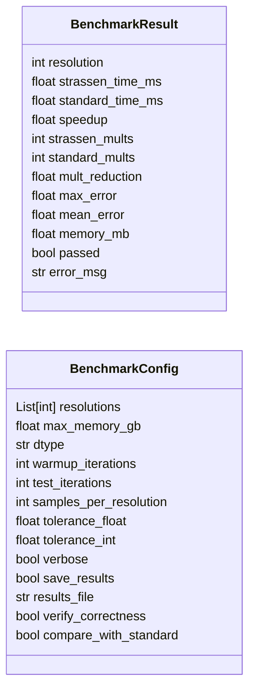
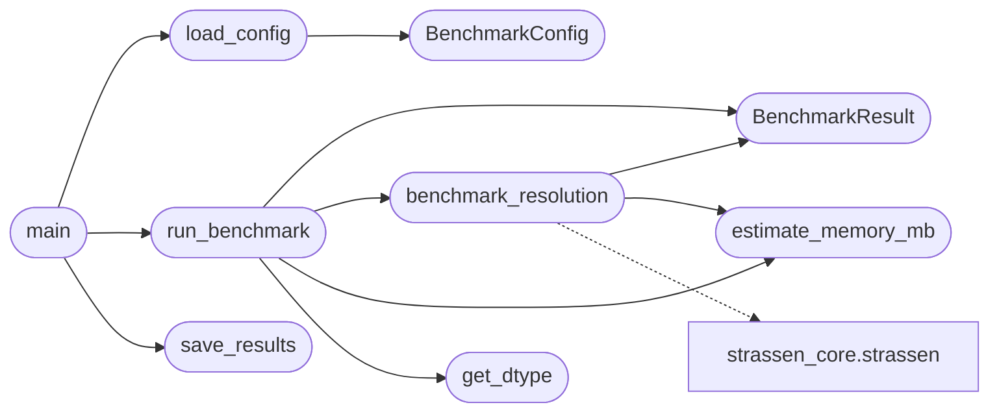

# `src.benchmarks.benchmark_strassen`

> Source: [src/benchmarks/benchmark_strassen.py:1](../../src/benchmarks/benchmark_strassen.py#L1) | language `py` | coverage 70.0% | [API index](../index.md)

Strassen Zero-Shot Expansion Benchmark ====================================== Tests Strassen algorithm across multiple matrix resolutions using the same 2x2 grokked operator recursively.

Author: grisun0

## Contents

- **Classes:** [`BenchmarkResult`](#benchmarkresult), [`BenchmarkConfig`](#benchmarkconfig)
- **Functions:** [`load_config`](#load_config), [`get_dtype`](#get_dtype), [`estimate_memory_mb`](#estimate_memory_mb), [`benchmark_resolution`](#benchmark_resolution), [`run_benchmark`](#run_benchmark), [`save_results`](#save_results), [`main`](#main)

## Type Diagram



## Call Graph

Solid arrows stay in this module, dashed arrows leave it.



## Classes

<a id="benchmarkresult"></a>

### `BenchmarkResult`

`class` `dataclass` | [src/benchmarks/benchmark_strassen.py:29](../../src/benchmarks/benchmark_strassen.py#L29)

Decorators: `@dataclass`

```python
class BenchmarkResult
```

**Attributes**

| Name | Type | Default | Description |
|---|---|---|---|
| [`resolution`](#benchmarkresult-resolution) | `int` |  |  |
| [`strassen_time_ms`](#benchmarkresult-strassen_time_ms) | `float` |  |  |
| [`standard_time_ms`](#benchmarkresult-standard_time_ms) | `float` |  |  |
| [`speedup`](#benchmarkresult-speedup) | `float` |  |  |
| [`strassen_mults`](#benchmarkresult-strassen_mults) | `int` |  |  |
| [`standard_mults`](#benchmarkresult-standard_mults) | `int` |  |  |
| [`mult_reduction`](#benchmarkresult-mult_reduction) | `float` |  |  |
| [`max_error`](#benchmarkresult-max_error) | `float` |  |  |
| [`mean_error`](#benchmarkresult-mean_error) | `float` |  |  |
| [`memory_mb`](#benchmarkresult-memory_mb) | `float` |  |  |
| [`passed`](#benchmarkresult-passed) | `bool` |  |  |
| [`error_msg`](#benchmarkresult-error_msg) | `str` | `''` |  |

---

<a id="benchmarkconfig"></a>

### `BenchmarkConfig`

`class` `dataclass` | [src/benchmarks/benchmark_strassen.py:45](../../src/benchmarks/benchmark_strassen.py#L45)

Decorators: `@dataclass`

```python
class BenchmarkConfig
```

**Attributes**

| Name | Type | Default | Description |
|---|---|---|---|
| [`resolutions`](#benchmarkconfig-resolutions) | `List[int]` | `field(default_factory=list)` |  |
| [`max_memory_gb`](#benchmarkconfig-max_memory_gb) | `float` | `8.0` |  |
| [`dtype`](#benchmarkconfig-dtype) | `str` | `'float32'` |  |
| [`warmup_iterations`](#benchmarkconfig-warmup_iterations) | `int` | `3` |  |
| [`test_iterations`](#benchmarkconfig-test_iterations) | `int` | `10` |  |
| [`samples_per_resolution`](#benchmarkconfig-samples_per_resolution) | `int` | `100` |  |
| [`tolerance_float`](#benchmarkconfig-tolerance_float) | `float` | `0.0001` |  |
| [`tolerance_int`](#benchmarkconfig-tolerance_int) | `float` | `0` |  |
| [`verbose`](#benchmarkconfig-verbose) | `bool` | `True` |  |
| [`save_results`](#benchmarkconfig-save_results) | `bool` | `True` |  |
| [`results_file`](#benchmarkconfig-results_file) | `str` | `'benchmark_results.json'` |  |
| [`verify_correctness`](#benchmarkconfig-verify_correctness) | `bool` | `True` |  |
| [`compare_with_standard`](#benchmarkconfig-compare_with_standard) | `bool` | `True` |  |

---

## Functions

<a id="load_config"></a>

### `load_config`

`function` | [src/benchmarks/benchmark_strassen.py:61](../../src/benchmarks/benchmark_strassen.py#L61)

```python
def load_config(config_path: str = 'config.toml') -> BenchmarkConfig
```

Load configuration from TOML file.

**Parameters**

| Name | Type | Default | Description |
|---|---|---|---|
| `config_path` | `str` | `'config.toml'` |  |

**Returns:** `BenchmarkConfig`

*Calls:* [`BenchmarkConfig`](#benchmarkconfig)

*Called by:* [`main`](#main)

---

<a id="get_dtype"></a>

### `get_dtype`

`function` | [src/benchmarks/benchmark_strassen.py:93](../../src/benchmarks/benchmark_strassen.py#L93)

```python
def get_dtype(dtype_str: str)
```

Convert dtype string to torch dtype.

**Parameters**

| Name | Type | Default | Description |
|---|---|---|---|
| `dtype_str` | `str` |  |  |

*Called by:* [`run_benchmark`](#run_benchmark)

---

<a id="estimate_memory_mb"></a>

### `estimate_memory_mb`

`function` | [src/benchmarks/benchmark_strassen.py:104](../../src/benchmarks/benchmark_strassen.py#L104)

```python
def estimate_memory_mb(n: int, dtype: torch.dtype, batch_size: int = 1) -> float
```

Estimate memory usage for matrix multiplication.

**Parameters**

| Name | Type | Default | Description |
|---|---|---|---|
| `n` | `int` |  |  |
| `dtype` | `torch.dtype` |  |  |
| `batch_size` | `int` | `1` |  |

**Returns:** `float`

*Called by:* [`benchmark_resolution`](#benchmark_resolution), [`run_benchmark`](#run_benchmark)

---

<a id="benchmark_resolution"></a>

### `benchmark_resolution`

`function` | [src/benchmarks/benchmark_strassen.py:114](../../src/benchmarks/benchmark_strassen.py#L114)

```python
def benchmark_resolution(n: int, cfg: BenchmarkConfig, dtype: torch.dtype) -> BenchmarkResult
```

Benchmark Strassen vs standard matmul for given resolution.

**Parameters**

| Name | Type | Default | Description |
|---|---|---|---|
| `n` | `int` |  |  |
| `cfg` | `BenchmarkConfig` |  |  |
| `dtype` | `torch.dtype` |  |  |

**Returns:** `BenchmarkResult`

*Calls:* [`BenchmarkResult`](#benchmarkresult), [`estimate_memory_mb`](#estimate_memory_mb), [`strassen`](src.training.strassen_core.py.md#strassen)

*Called by:* [`run_benchmark`](#run_benchmark)

---

<a id="run_benchmark"></a>

### `run_benchmark`

`function` | [src/benchmarks/benchmark_strassen.py:218](../../src/benchmarks/benchmark_strassen.py#L218)

```python
def run_benchmark(cfg: BenchmarkConfig) -> List[BenchmarkResult]
```

Run full benchmark suite.

**Parameters**

| Name | Type | Default | Description |
|---|---|---|---|
| `cfg` | `BenchmarkConfig` |  |  |

**Returns:** `List[BenchmarkResult]`

*Calls:* [`BenchmarkResult`](#benchmarkresult), [`benchmark_resolution`](#benchmark_resolution), [`estimate_memory_mb`](#estimate_memory_mb), [`get_dtype`](#get_dtype)

*Called by:* [`main`](#main)

---

<a id="save_results"></a>

### `save_results`

`function` | [src/benchmarks/benchmark_strassen.py:310](../../src/benchmarks/benchmark_strassen.py#L310)

```python
def save_results(results: List[BenchmarkResult], filepath: str)
```

Save benchmark results to JSON.

**Parameters**

| Name | Type | Default | Description |
|---|---|---|---|
| `results` | `List[BenchmarkResult]` |  |  |
| `filepath` | `str` |  |  |

*Called by:* [`main`](#main)

---

<a id="main"></a>

### `main`

`function` | [src/benchmarks/benchmark_strassen.py:322](../../src/benchmarks/benchmark_strassen.py#L322)

```python
def main()
```

*Calls:* [`load_config`](#load_config), [`run_benchmark`](#run_benchmark), [`save_results`](#save_results)

---
