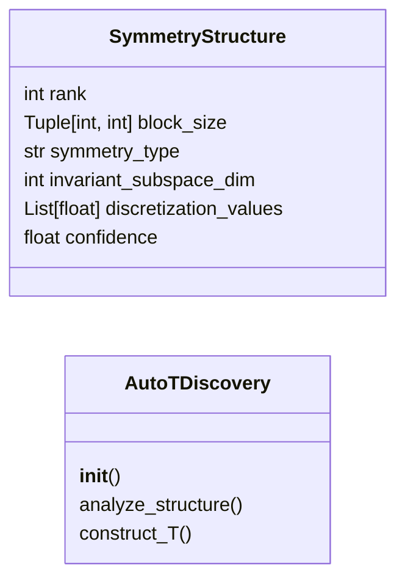
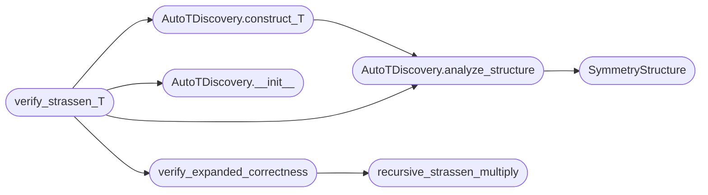

# `src.discovery.auto_T_discovery`

> Source: [src/discovery/auto_T_discovery.py:1](../../src/discovery/auto_T_discovery.py#L1) | language `py` | coverage 88.9% | [API index](../index.md)

Automatic Discovery of Expansion Operator T(W)

Given a converged weight operator W_n, this algorithm automatically discovers
the deterministic expansion operator T that maps W_n -> W_{n'} preserving
algorithmic invariance.

Key insight: T preserves the dominant singular subspace and exploits
discovered symmetries in the weight structure.

Author: grisun0

## Contents

- **Classes:** [`SymmetryStructure`](#symmetrystructure), [`AutoTDiscovery`](#autotdiscovery)
- **Functions:** [`verify_strassen_T`](#verify_strassen_t), [`verify_expanded_correctness`](#verify_expanded_correctness), [`recursive_strassen_multiply`](#recursive_strassen_multiply)

## Type Diagram



## Call Graph

Solid arrows stay in this module, dashed arrows leave it.



## Classes

<a id="symmetrystructure"></a>

### `SymmetryStructure`

`class` `dataclass` | [src/discovery/auto_T_discovery.py:22](../../src/discovery/auto_T_discovery.py#L22)

Decorators: `@dataclass`

```python
class SymmetryStructure
```

Discovered symmetries in weight matrix

**Attributes**

| Name | Type | Default | Description |
|---|---|---|---|
| [`rank`](#symmetrystructure-rank) | `int` |  |  |
| [`block_size`](#symmetrystructure-block_size) | `Tuple[int, int]` |  |  |
| [`symmetry_type`](#symmetrystructure-symmetry_type) | `str` |  |  |
| [`invariant_subspace_dim`](#symmetrystructure-invariant_subspace_dim) | `int` |  |  |
| [`discretization_values`](#symmetrystructure-discretization_values) | `List[float]` |  |  |
| [`confidence`](#symmetrystructure-confidence) | `float` |  |  |

---

<a id="autotdiscovery"></a>

### `AutoTDiscovery`

`class` | [src/discovery/auto_T_discovery.py:32](../../src/discovery/auto_T_discovery.py#L32)

```python
class AutoTDiscovery
```

Automatic discovery of expansion operator T from converged weights.

The algorithm works in three phases:
1. Spectral Analysis: Extract dominant singular subspace
2. Symmetry Detection: Find block/permutation structure
3. T Construction: Build expansion operator preserving invariants

**Members**

| Member | Kind | Summary |
|---|---|---|
| [`__init__`](#autotdiscovery-__init__) | constructor |  |
| [`analyze_structure`](#autotdiscovery-analyze_structure) | method | Phase 1 & 2: Analyze weight matrix structure |
| [`construct_T`](#autotdiscovery-construct_t) | method | Phase 3: Construct expansion operator T |

<a id="autotdiscovery-__init__"></a>

#### `AutoTDiscovery.__init__`

`constructor` | [src/discovery/auto_T_discovery.py:42](../../src/discovery/auto_T_discovery.py#L42)

```python
def __init__(self, tolerance: float = 0.0001, verbose: bool = True)
```

**Parameters**

| Name | Type | Default | Description |
|---|---|---|---|
| `tolerance` | `float` | `0.0001` |  |
| `verbose` | `bool` | `True` |  |

*Called by:* [`verify_strassen_T`](#verify_strassen_t)

<a id="autotdiscovery-analyze_structure"></a>

#### `AutoTDiscovery.analyze_structure`

`method` | [src/discovery/auto_T_discovery.py:46](../../src/discovery/auto_T_discovery.py#L46)

```python
def analyze_structure(self, W: torch.Tensor) -> SymmetryStructure
```

Phase 1 & 2: Analyze weight matrix structure

**Parameters**

| Name | Type | Default | Description |
|---|---|---|---|
| `W` | `torch.Tensor` |  |  |

**Returns:** `SymmetryStructure`

*Calls:* [`SymmetryStructure`](#symmetrystructure)

*Called by:* [`AutoTDiscovery.construct_T`](#autotdiscovery-construct_t), [`verify_strassen_T`](#verify_strassen_t)

<a id="autotdiscovery-construct_t"></a>

#### `AutoTDiscovery.construct_T`

`method` | [src/discovery/auto_T_discovery.py:229](../../src/discovery/auto_T_discovery.py#L229)

```python
def construct_T(self, W_dict: Dict[str, torch.Tensor], target_size: int) -> Dict[str, torch.Tensor]
```

Phase 3: Construct expansion operator T

For matrix multiplication (U, V, W tensors), T expands via
recursive block structure discovered from the base case.

**Parameters**

| Name | Type | Default | Description |
|---|---|---|---|
| `W_dict` | `Dict[str, torch.Tensor]` |  | Dictionary with 'U', 'V', 'W' tensors |
| `target_size` | `int` |  | Target matrix dimension (n' in the paper) |

**Returns:** `Dict[str, torch.Tensor]` - Expanded weight dictionary

*Calls:* [`AutoTDiscovery.analyze_structure`](#autotdiscovery-analyze_structure)

*Called by:* [`verify_strassen_T`](#verify_strassen_t)

---

## Functions

<a id="verify_strassen_t"></a>

### `verify_strassen_T`

`function` | [src/discovery/auto_T_discovery.py:306](../../src/discovery/auto_T_discovery.py#L306)

```python
def verify_strassen_T(model_path: str, target_sizes: List[int] = [4, 8, 16])
```

Verify T discovery on Strassen model

**Parameters**

| Name | Type | Default | Description |
|---|---|---|---|
| `model_path` | `str` |  |  |
| `target_sizes` | `List[int]` | `[4, 8, 16]` |  |

**Raises**

- `ValueError`: (raised in the body, not documented)

*Calls:* [`AutoTDiscovery.__init__`](#autotdiscovery-__init__), [`AutoTDiscovery.analyze_structure`](#autotdiscovery-analyze_structure), [`AutoTDiscovery.construct_T`](#autotdiscovery-construct_t), [`verify_expanded_correctness`](#verify_expanded_correctness)

---

<a id="verify_expanded_correctness"></a>

### `verify_expanded_correctness`

`function` | [src/discovery/auto_T_discovery.py:353](../../src/discovery/auto_T_discovery.py#L353)

```python
def verify_expanded_correctness(U: torch.Tensor, V: torch.Tensor, W: torch.Tensor, target_size: int, expanded: Dict)
```

Verify that expanded operator correctly computes matrix multiplication

**Parameters**

| Name | Type | Default | Description |
|---|---|---|---|
| `U` | `torch.Tensor` |  |  |
| `V` | `torch.Tensor` |  |  |
| `W` | `torch.Tensor` |  |  |
| `target_size` | `int` |  |  |
| `expanded` | `Dict` |  |  |

*Calls:* [`recursive_strassen_multiply`](#recursive_strassen_multiply)

*Called by:* [`verify_strassen_T`](#verify_strassen_t)

---

<a id="recursive_strassen_multiply"></a>

### `recursive_strassen_multiply`

`function` | [src/discovery/auto_T_discovery.py:389](../../src/discovery/auto_T_discovery.py#L389)

```python
def recursive_strassen_multiply(A: torch.Tensor, B: torch.Tensor, U: torch.Tensor, V: torch.Tensor, W: torch.Tensor, base_size: int = 2) -> torch.Tensor
```

Recursively apply learned Strassen decomposition

This is the IMPLEMENTATION of T: it shows how the base 2x2 decomposition
extends to arbitrary sizes via recursive block application.

**Parameters**

| Name | Type | Default | Description |
|---|---|---|---|
| `A` | `torch.Tensor` |  |  |
| `B` | `torch.Tensor` |  |  |
| `U` | `torch.Tensor` |  |  |
| `V` | `torch.Tensor` |  |  |
| `W` | `torch.Tensor` |  |  |
| `base_size` | `int` | `2` |  |

**Returns:** `torch.Tensor`

*Called by:* [`verify_expanded_correctness`](#verify_expanded_correctness)

---
