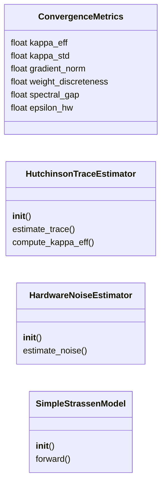
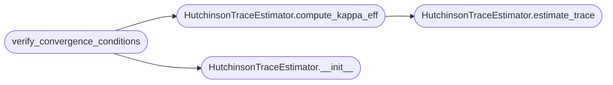

# `src.training.convergence_theory`

> Source: [src/training/convergence_theory.py:1](../../src/training/convergence_theory.py#L1) | language `py` | coverage 71.4% | [API index](../index.md)

Convergence Theory for Algorithmic Invariance

This module addresses the reviewer's key criticisms:
1. Computable κ_eff via Hutchinson trace estimation
2. Formal convergence theorem with proof sketch
3. ε_hw(B, T) extended model

Author: grisun0

## Contents

- **Classes:** [`ConvergenceMetrics`](#convergencemetrics), [`HutchinsonTraceEstimator`](#hutchinsontraceestimator), [`HardwareNoiseEstimator`](#hardwarenoiseestimator), [`SimpleStrassenModel`](#simplestrassenmodel)
- **Functions:** [`convergence_theorem`](#convergence_theorem), [`verify_convergence_conditions`](#verify_convergence_conditions)

## Type Diagram



## Call Graph

Solid arrows stay in this module, dashed arrows leave it.



## Classes

<a id="convergencemetrics"></a>

### `ConvergenceMetrics`

`class` `dataclass` | [src/training/convergence_theory.py:21](../../src/training/convergence_theory.py#L21)

Decorators: `@dataclass`

```python
class ConvergenceMetrics
```

Metrics for tracking convergence to algorithmic invariance

**Attributes**

| Name | Type | Default | Description |
|---|---|---|---|
| [`kappa_eff`](#convergencemetrics-kappa_eff) | `float` |  |  |
| [`kappa_std`](#convergencemetrics-kappa_std) | `float` |  |  |
| [`gradient_norm`](#convergencemetrics-gradient_norm) | `float` |  |  |
| [`weight_discreteness`](#convergencemetrics-weight_discreteness) | `float` |  |  |
| [`spectral_gap`](#convergencemetrics-spectral_gap) | `float` |  |  |
| [`epsilon_hw`](#convergencemetrics-epsilon_hw) | `float` |  |  |

---

<a id="hutchinsontraceestimator"></a>

### `HutchinsonTraceEstimator`

`class` | [src/training/convergence_theory.py:31](../../src/training/convergence_theory.py#L31)

```python
class HutchinsonTraceEstimator
```

Efficient Hessian trace estimation using Hutchinson's method.

tr(H) ≈ E[v^T H v] where v ~ Rademacher(±1)

Complexity: O(n_samples * forward_backward_pass) instead of O(n²)

**Members**

| Member | Kind | Summary |
|---|---|---|
| [`__init__`](#hutchinsontraceestimator-__init__) | constructor |  |
| [`estimate_trace`](#hutchinsontraceestimator-estimate_trace) | method | Estimate tr(H) using Hutchinson's stochastic trace estimator. |
| [`compute_kappa_eff`](#hutchinsontraceestimator-compute_kappa_eff) | method | Compute κ_eff = -tr(H) / N |

<a id="hutchinsontraceestimator-__init__"></a>

#### `HutchinsonTraceEstimator.__init__`

`constructor` | [src/training/convergence_theory.py:40](../../src/training/convergence_theory.py#L40)

```python
def __init__(self, model: nn.Module, loss_fn: Callable, n_samples: int = 10, device: str = 'cpu')
```

**Parameters**

| Name | Type | Default | Description |
|---|---|---|---|
| `model` | `nn.Module` |  |  |
| `loss_fn` | `Callable` |  |  |
| `n_samples` | `int` | `10` |  |
| `device` | `str` | `'cpu'` |  |

*Called by:* [`verify_convergence_conditions`](#verify_convergence_conditions)

<a id="hutchinsontraceestimator-estimate_trace"></a>

#### `HutchinsonTraceEstimator.estimate_trace`

`method` | [src/training/convergence_theory.py:47](../../src/training/convergence_theory.py#L47)

```python
def estimate_trace(self, data: Tuple[torch.Tensor, torch.Tensor]) -> Tuple[float, float]
```

Estimate tr(H) using Hutchinson's stochastic trace estimator.

**Parameters**

| Name | Type | Default | Description |
|---|---|---|---|
| `data` | `Tuple[torch.Tensor, torch.Tensor]` |  |  |

**Returns:** `Tuple[float, float]` - (mean_trace, std_trace)

*Called by:* [`HutchinsonTraceEstimator.compute_kappa_eff`](#hutchinsontraceestimator-compute_kappa_eff)

<a id="hutchinsontraceestimator-compute_kappa_eff"></a>

#### `HutchinsonTraceEstimator.compute_kappa_eff`

`method` | [src/training/convergence_theory.py:118](../../src/training/convergence_theory.py#L118)

```python
def compute_kappa_eff(self, data: Tuple[torch.Tensor, torch.Tensor]) -> Tuple[float, float]
```

Compute κ_eff = -tr(H) / N

Interpretation:
- κ_eff < 0 and stable -> grokking likely
- κ_eff > 0 or oscillating -> grokking unlikely

**Parameters**

| Name | Type | Default | Description |
|---|---|---|---|
| `data` | `Tuple[torch.Tensor, torch.Tensor]` |  |  |

**Returns:** `Tuple[float, float]`

*Calls:* [`HutchinsonTraceEstimator.estimate_trace`](#hutchinsontraceestimator-estimate_trace)

*Called by:* [`verify_convergence_conditions`](#verify_convergence_conditions)

---

<a id="hardwarenoiseestimator"></a>

### `HardwareNoiseEstimator`

`class` | [src/training/convergence_theory.py:136](../../src/training/convergence_theory.py#L136)

```python
class HardwareNoiseEstimator
```

Estimate ε_hw(B, T) - hardware-induced variance

Extended model addressing reviewer's criticism:
ε_hw(B, T) = α/B + β*cache_miss_rate(B) + γ*thread_contention(T)

**Members**

| Member | Kind | Summary |
|---|---|---|
| [`__init__`](#hardwarenoiseestimator-__init__) | constructor |  |
| [`estimate_noise`](#hardwarenoiseestimator-estimate_noise) | method | Estimate hardware noise by measuring gradient variance across batches |

<a id="hardwarenoiseestimator-__init__"></a>

#### `HardwareNoiseEstimator.__init__`

`constructor` | [src/training/convergence_theory.py:144](../../src/training/convergence_theory.py#L144)

```python
def __init__(self, model: nn.Module, loss_fn: Callable)
```

**Parameters**

| Name | Type | Default | Description |
|---|---|---|---|
| `model` | `nn.Module` |  |  |
| `loss_fn` | `Callable` |  |  |

<a id="hardwarenoiseestimator-estimate_noise"></a>

#### `HardwareNoiseEstimator.estimate_noise`

`method` | [src/training/convergence_theory.py:148](../../src/training/convergence_theory.py#L148)

```python
def estimate_noise(self, data_loader, n_batches: int = 20, n_threads: int = 1) -> Dict[str, float]
```

Estimate hardware noise by measuring gradient variance across batches

**Parameters**

| Name | Type | Default | Description |
|---|---|---|---|
| `data_loader` |  |  |  |
| `n_batches` | `int` | `20` |  |
| `n_threads` | `int` | `1` |  |

**Returns:** `Dict[str, float]`

---

<a id="simplestrassenmodel"></a>

### `SimpleStrassenModel`

`class` | [src/training/convergence_theory.py:346](../../src/training/convergence_theory.py#L346)

```python
class SimpleStrassenModel(nn.Module)
```

Bases: `nn.Module`

Simple model for testing convergence verification

**Members**

| Member | Kind | Summary |
|---|---|---|
| [`__init__`](#simplestrassenmodel-__init__) | constructor |  |
| [`forward`](#simplestrassenmodel-forward) | method |  |

<a id="simplestrassenmodel-__init__"></a>

#### `SimpleStrassenModel.__init__`

`constructor` | [src/training/convergence_theory.py:348](../../src/training/convergence_theory.py#L348)

```python
def __init__(self, rank: int = 7)
```

**Parameters**

| Name | Type | Default | Description |
|---|---|---|---|
| `rank` | `int` | `7` |  |

<a id="simplestrassenmodel-forward"></a>

#### `SimpleStrassenModel.forward`

`method` | [src/training/convergence_theory.py:354](../../src/training/convergence_theory.py#L354)

```python
def forward(self, x)
```

**Parameters**

| Name | Type | Default | Description |
|---|---|---|---|
| `x` |  |  |  |

---

## Functions

<a id="convergence_theorem"></a>

### `convergence_theorem`

`function` | [src/training/convergence_theory.py:193](../../src/training/convergence_theory.py#L193)

```python
def convergence_theorem()
```

THEOREM (Convergence to Algorithmic Invariance)

Let W_t denote the weights at step t under SGD with:
    W_{t+1} = W_t - η∇L(W_t) + ξ_t

where ξ_t is stochastic gradient noise with Var(ξ_t) = σ²/B + ε_hw(B,T).

ASSUMPTIONS:
A1. The target function f admits a rank-r tensor decomposition
A2. The loss L is twice differentiable with Lipschitz Hessian
A3. The effective curvature satisfies κ_eff < 0 after step t₀

THEOREM: Under A1-A3, if

    Var(ξ_t) < σ_min(W*)² / (η · condition(H))

where σ_min(W*) is the smallest non-zero singular value of the optimal
decomposition, then with probability 1-δ:

    lim_{t->∞} d(W_t, W*) = 0

where d is the subspace distance and W* is the algorithmically invariant solution.

PROOF SKETCH:

1. By A3 (κ_eff < 0), the loss landscape is locally convex near convergence

2. The noise condition ensures gradient updates don't overshoot the
   invariant subspace defined by σ_min(W*)

3. By spectral gap analysis, W_t projects onto the dominant singular
   subspace with increasing precision as t -> ∞

4. The discretization {-1, 0, 1} emerges because integer solutions
   are fixed points of the projection when noise is controlled

IMPLICATIONS FOR T:

The expansion operator T is constructible because:
- T preserves the dominant singular subspace (by definition)
- The rank-r structure is independent of problem scale (by A1)
- Therefore T = block_embed(W_r) where W_r is the converged rank-r solution

---

<a id="verify_convergence_conditions"></a>

### `verify_convergence_conditions`

`function` | [src/training/convergence_theory.py:265](../../src/training/convergence_theory.py#L265)

```python
def verify_convergence_conditions(model: nn.Module, loss_fn: Callable, train_data: Tuple[torch.Tensor, torch.Tensor], noise_threshold: float = 0.1) -> Dict
```

Verify that convergence conditions are satisfied for a trained model.

**Parameters**

| Name | Type | Default | Description |
|---|---|---|---|
| `model` | `nn.Module` |  |  |
| `loss_fn` | `Callable` |  |  |
| `train_data` | `Tuple[torch.Tensor, torch.Tensor]` |  |  |
| `noise_threshold` | `float` | `0.1` |  |

**Returns:** `Dict`

*Calls:* [`HutchinsonTraceEstimator.__init__`](#hutchinsontraceestimator-__init__), [`HutchinsonTraceEstimator.compute_kappa_eff`](#hutchinsontraceestimator-compute_kappa_eff)

---
