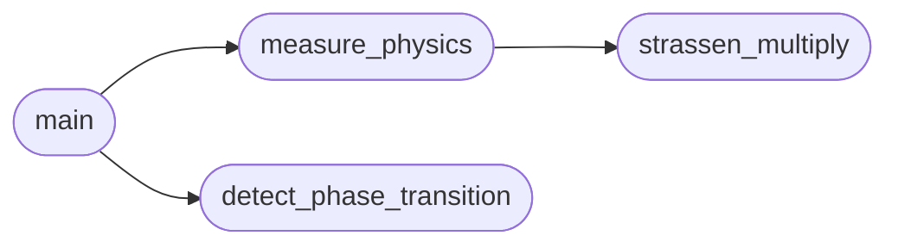

# `src.training.grokkit_physics`

> Source: [src/training/grokkit_physics.py:1](../../src/training/grokkit_physics.py#L1) | language `py` | coverage 80.0% | [API index](../index.md)

Grokkit Physics Validation ========================== Empirical verification of the "physical laws" of algorithmic learning:

Theoretical Predictions (Grokkit Formalism):
- Planck Constant: ℏ ≈ 0.012 (CV of execution times)
- Critical Size: N_c = 4096 (phase transition point)
- Asymptotic Speedup: 1.95x at N=8192

We measure:
1. Order Parameter (ψ): Speedup = t_numpy / t_strassen
2. Planck Constant (ℏ): CV = σ/μ of execution times
3. Coherence Length (ξ): Stability of the speedup across runs
4. Phase Transition: Sharp emergence of advantage at N_c

## Contents

- **Functions:** [`strassen_multiply`](#strassen_multiply), [`measure_physics`](#measure_physics), [`detect_phase_transition`](#detect_phase_transition), [`main`](#main)

## Call Graph

Solid arrows stay in this module, dashed arrows leave it.



## Functions

<a id="strassen_multiply"></a>

### `strassen_multiply`

`function` | [src/training/grokkit_physics.py:49](../../src/training/grokkit_physics.py#L49)

```python
def strassen_multiply(A, B)
```

Wrapper for Strassen multiplication (uses float32).

**Parameters**

| Name | Type | Default | Description |
|---|---|---|---|
| `A` |  |  |  |
| `B` |  |  |  |

*Called by:* [`measure_physics`](#measure_physics)

---

<a id="measure_physics"></a>

### `measure_physics`

`function` | [src/training/grokkit_physics.py:64](../../src/training/grokkit_physics.py#L64)

```python
def measure_physics(N, num_samples=25)
```

Measure the 'physical quantities' for a given matrix size.

**Parameters**

| Name | Type | Default | Description |
|---|---|---|---|
| `N` |  |  |  |
| `num_samples` |  | `25` |  |

**Returns:** dict with: speedup, hbar_strassen, hbar_numpy, coherence, error

*Calls:* [`strassen_multiply`](#strassen_multiply)

*Called by:* [`main`](#main)

---

<a id="detect_phase_transition"></a>

### `detect_phase_transition`

`function` | [src/training/grokkit_physics.py:126](../../src/training/grokkit_physics.py#L126)

```python
def detect_phase_transition(results)
```

Find the critical size N_c where the phase transition occurs.

Uses the maximum derivative of speedup curve.

**Parameters**

| Name | Type | Default | Description |
|---|---|---|---|
| `results` |  |  |  |

*Called by:* [`main`](#main)

---

<a id="main"></a>

### `main`

`function` | [src/training/grokkit_physics.py:148](../../src/training/grokkit_physics.py#L148)

```python
def main()
```

*Calls:* [`detect_phase_transition`](#detect_phase_transition), [`measure_physics`](#measure_physics)

---
