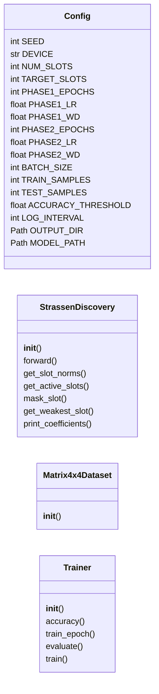
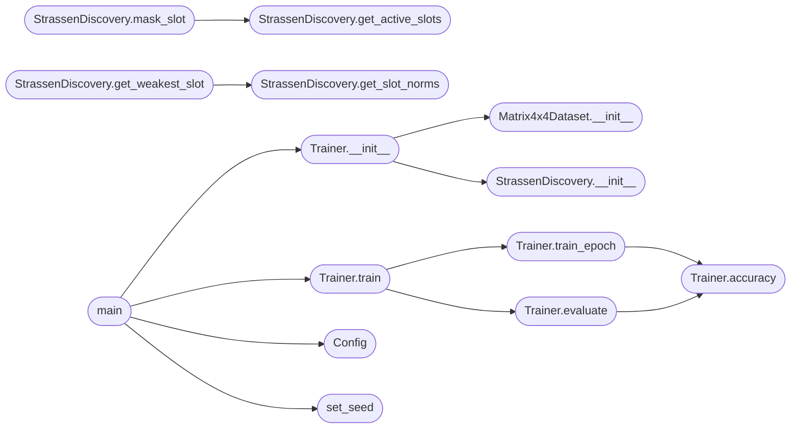

# `src.training.main`

> Source: [src/training/main.py:1](../../src/training/main.py#L1) | language `py` | coverage 60.0% | [API index](../index.md)

STRASSEN DISCOVERY: Descubrimiento de algoritmo de 7 multiplicaciones ====================================================================== Framework GOGF para descubrir algoritmos equivalentes a Strassen mediante enmascaramiento progresivo de slots.

Uso:
    python main.py

Resultados:
    - 7 slots activos (1 eliminado)
    - Loss ~0 (precisión perfecta)
    - 100% accuracy

## Contents

- **Classes:** [`Config`](#config), [`StrassenDiscovery`](#strassendiscovery), [`Matrix4x4Dataset`](#matrix4x4dataset), [`Trainer`](#trainer)
- **Functions:** [`set_seed`](#set_seed), [`main`](#main)
- **Constants:** [`BASE_DIR`](#base_dir)

## Type Diagram



## Call Graph

Solid arrows stay in this module, dashed arrows leave it.



## Classes

<a id="config"></a>

### `Config`

`class` `dataclass` | [src/training/main.py:44](../../src/training/main.py#L44)

Decorators: `@dataclass`

```python
class Config
```

Configuración del experimento.

**Attributes**

| Name | Type | Default | Description |
|---|---|---|---|
| [`SEED`](#config-seed) | `int` | `42` |  |
| [`DEVICE`](#config-device) | `str` | `field(default_factory=lambda: 'cuda' if torch.cuda.is_available() else 'cpu')` |  |
| [`NUM_SLOTS`](#config-num_slots) | `int` | `8` |  |
| [`TARGET_SLOTS`](#config-target_slots) | `int` | `7` |  |
| [`PHASE1_EPOCHS`](#config-phase1_epochs) | `int` | `2000` |  |
| [`PHASE1_LR`](#config-phase1_lr) | `float` | `0.01` |  |
| [`PHASE1_WD`](#config-phase1_wd) | `float` | `0.001` |  |
| [`PHASE2_EPOCHS`](#config-phase2_epochs) | `int` | `5000` |  |
| [`PHASE2_LR`](#config-phase2_lr) | `float` | `0.005` |  |
| [`PHASE2_WD`](#config-phase2_wd) | `float` | `0.01` |  |
| [`BATCH_SIZE`](#config-batch_size) | `int` | `256` |  |
| [`TRAIN_SAMPLES`](#config-train_samples) | `int` | `2000` |  |
| [`TEST_SAMPLES`](#config-test_samples) | `int` | `500` |  |
| [`ACCURACY_THRESHOLD`](#config-accuracy_threshold) | `float` | `0.1` |  |
| [`LOG_INTERVAL`](#config-log_interval) | `int` | `200` |  |
| [`OUTPUT_DIR`](#config-output_dir) | `Path` | `field(default_factory=lambda: BASE_DIR / 'output')` |  |
| [`MODEL_PATH`](#config-model_path) | `Path` | `field(default_factory=lambda: BASE_DIR / 'output' / 'strassen_discovered.pt')` |  |

---

<a id="strassendiscovery"></a>

### `StrassenDiscovery`

`class` | [src/training/main.py:87](../../src/training/main.py#L87)

```python
class StrassenDiscovery(nn.Module)
```

Bases: `nn.Module`

Modelo para descubrir Strassen mediante coeficientes aprendibles.

Arquitectura:
- U_coefs[i]: Combinación de bloques de A para producto M_i
- V_coefs[i]: Combinación de bloques de B para producto M_i
- W_coefs[j,i]: Contribución de M_i al bloque C_j del resultado

**Members**

| Member | Kind | Summary |
|---|---|---|
| [`__init__`](#strassendiscovery-__init__) | constructor |  |
| [`forward`](#strassendiscovery-forward) | method | Forward pass con multiplicación matemática pura. |
| [`get_slot_norms`](#strassendiscovery-get_slot_norms) | method | Norma promedio de cada slot. |
| [`get_active_slots`](#strassendiscovery-get_active_slots) | method | Número de slots activos. |
| [`mask_slot`](#strassendiscovery-mask_slot) | method | Desactiva un slot. |
| [`get_weakest_slot`](#strassendiscovery-get_weakest_slot) | method | Slot con menor norma entre los activos. |
| [`print_coefficients`](#strassendiscovery-print_coefficients) | method | Muestra coeficientes descubiertos. |

<a id="strassendiscovery-__init__"></a>

#### `StrassenDiscovery.__init__`

`constructor` | [src/training/main.py:96](../../src/training/main.py#L96)

```python
def __init__(self, num_slots: int = 8)
```

**Parameters**

| Name | Type | Default | Description |
|---|---|---|---|
| `num_slots` | `int` | `8` |  |

*Called by:* [`Trainer.__init__`](#trainer-__init__)

<a id="strassendiscovery-forward"></a>

#### `StrassenDiscovery.forward`

`method` | [src/training/main.py:108](../../src/training/main.py#L108)

```python
def forward(self, A: torch.Tensor, B: torch.Tensor) -> torch.Tensor
```

Forward pass con multiplicación matemática pura.

A, B: (batch, 4, 4) -> C: (batch, 4, 4)

**Parameters**

| Name | Type | Default | Description |
|---|---|---|---|
| `A` | `torch.Tensor` |  |  |
| `B` | `torch.Tensor` |  |  |

**Returns:** `torch.Tensor`

<a id="strassendiscovery-get_slot_norms"></a>

#### `StrassenDiscovery.get_slot_norms`

`method` | [src/training/main.py:155](../../src/training/main.py#L155)

```python
def get_slot_norms(self) -> List[float]
```

Norma promedio de cada slot.

**Returns:** `List[float]`

*Called by:* [`StrassenDiscovery.get_weakest_slot`](#strassendiscovery-get_weakest_slot)

<a id="strassendiscovery-get_active_slots"></a>

#### `StrassenDiscovery.get_active_slots`

`method` | [src/training/main.py:160](../../src/training/main.py#L160)

```python
def get_active_slots(self) -> int
```

Número de slots activos.

**Returns:** `int`

*Called by:* [`StrassenDiscovery.mask_slot`](#strassendiscovery-mask_slot)

<a id="strassendiscovery-mask_slot"></a>

#### `StrassenDiscovery.mask_slot`

`method` | [src/training/main.py:164](../../src/training/main.py#L164)

```python
def mask_slot(self, slot_idx: int)
```

Desactiva un slot.

**Parameters**

| Name | Type | Default | Description |
|---|---|---|---|
| `slot_idx` | `int` |  |  |

*Calls:* [`StrassenDiscovery.get_active_slots`](#strassendiscovery-get_active_slots)

<a id="strassendiscovery-get_weakest_slot"></a>

#### `StrassenDiscovery.get_weakest_slot`

`method` | [src/training/main.py:169](../../src/training/main.py#L169)

```python
def get_weakest_slot(self) -> int
```

Slot con menor norma entre los activos.

**Returns:** `int`

*Calls:* [`StrassenDiscovery.get_slot_norms`](#strassendiscovery-get_slot_norms)

<a id="strassendiscovery-print_coefficients"></a>

#### `StrassenDiscovery.print_coefficients`

`method` | [src/training/main.py:175](../../src/training/main.py#L175)

```python
def print_coefficients(self)
```

Muestra coeficientes descubiertos.

---

<a id="matrix4x4dataset"></a>

### `Matrix4x4Dataset`

`class` | [src/training/main.py:199](../../src/training/main.py#L199)

```python
class Matrix4x4Dataset(Dataset)
```

Bases: `Dataset`

Dataset de multiplicación de matrices 4x4.

**Members**

| Member | Kind | Summary |
|---|---|---|
| [`__init__`](#matrix4x4dataset-__init__) | constructor |  |

<a id="matrix4x4dataset-__init__"></a>

#### `Matrix4x4Dataset.__init__`

`constructor` | [src/training/main.py:202](../../src/training/main.py#L202)

```python
def __init__(self, num_samples: int, seed: int = 42)
```

**Parameters**

| Name | Type | Default | Description |
|---|---|---|---|
| `num_samples` | `int` |  |  |
| `seed` | `int` | `42` |  |

*Called by:* [`Trainer.__init__`](#trainer-__init__)

---

<a id="trainer"></a>

### `Trainer`

`class` | [src/training/main.py:217](../../src/training/main.py#L217)

```python
class Trainer
```

Entrenador con enmascaramiento progresivo.

**Members**

| Member | Kind | Summary |
|---|---|---|
| [`__init__`](#trainer-__init__) | constructor |  |
| [`accuracy`](#trainer-accuracy) | method |  |
| [`train_epoch`](#trainer-train_epoch) | method |  |
| [`evaluate`](#trainer-evaluate) | method |  |
| [`train`](#trainer-train) | method |  |

<a id="trainer-__init__"></a>

#### `Trainer.__init__`

`constructor` | [src/training/main.py:220](../../src/training/main.py#L220)

```python
def __init__(self, config: Config)
```

**Parameters**

| Name | Type | Default | Description |
|---|---|---|---|
| `config` | `Config` |  |  |

*Calls:* [`Matrix4x4Dataset.__init__`](#matrix4x4dataset-__init__), [`StrassenDiscovery.__init__`](#strassendiscovery-__init__)

*Called by:* [`main`](#main)

<a id="trainer-accuracy"></a>

#### `Trainer.accuracy`

`method` | [src/training/main.py:242](../../src/training/main.py#L242)

```python
def accuracy(self, pred, target)
```

**Parameters**

| Name | Type | Default | Description |
|---|---|---|---|
| `pred` |  |  |  |
| `target` |  |  |  |

*Called by:* [`Trainer.evaluate`](#trainer-evaluate), [`Trainer.train_epoch`](#trainer-train_epoch)

<a id="trainer-train_epoch"></a>

#### `Trainer.train_epoch`

`method` | [src/training/main.py:245](../../src/training/main.py#L245)

```python
def train_epoch(self, optimizer)
```

**Parameters**

| Name | Type | Default | Description |
|---|---|---|---|
| `optimizer` |  |  |  |

*Calls:* [`Trainer.accuracy`](#trainer-accuracy)

*Called by:* [`Trainer.train`](#trainer-train)

<a id="trainer-evaluate"></a>

#### `Trainer.evaluate`

`method` | [src/training/main.py:265](../../src/training/main.py#L265)

```python
def evaluate(self)
```

*Calls:* [`Trainer.accuracy`](#trainer-accuracy)

*Called by:* [`Trainer.train`](#trainer-train)

<a id="trainer-train"></a>

#### `Trainer.train`

`method` | [src/training/main.py:280](../../src/training/main.py#L280)

```python
def train(self)
```

*Calls:* [`Trainer.evaluate`](#trainer-evaluate), [`Trainer.train_epoch`](#trainer-train_epoch)

*Called by:* [`main`](#main), [`Experiment1RicciMBLDuality.run`](unified_hidden_connections_suite.py.md#experiment1riccimblduality-run), [`Experiment4CompressionFrontier.run`](unified_hidden_connections_suite.py.md#experiment4compressionfrontier-run)

---

## Functions

<a id="set_seed"></a>

### `set_seed`

`function` | [src/training/main.py:79](../../src/training/main.py#L79)

```python
def set_seed(seed: int)
```

Fijar semilla para reproducibilidad.

**Parameters**

| Name | Type | Default | Description |
|---|---|---|---|
| `seed` | `int` |  |  |

*Called by:* [`main`](#main)

---

<a id="main"></a>

### `main`

`function` | [src/training/main.py:345](../../src/training/main.py#L345)

```python
def main()
```

*Calls:* [`Config`](#config), [`Trainer.__init__`](#trainer-__init__), [`Trainer.train`](#trainer-train), [`set_seed`](#set_seed)

---

## Constants

<a id="base_dir"></a>

### `BASE_DIR`

`constant` | [src/training/main.py:32](../../src/training/main.py#L32)

```python
BASE_DIR = Path(__file__).parent.resolve()
```

---
