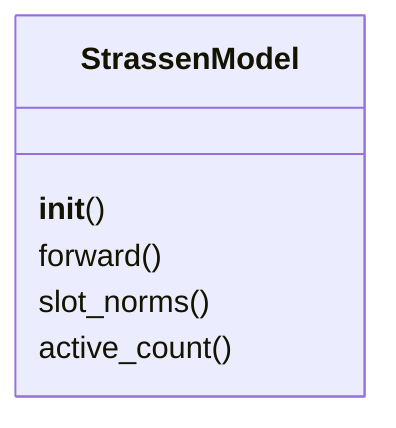
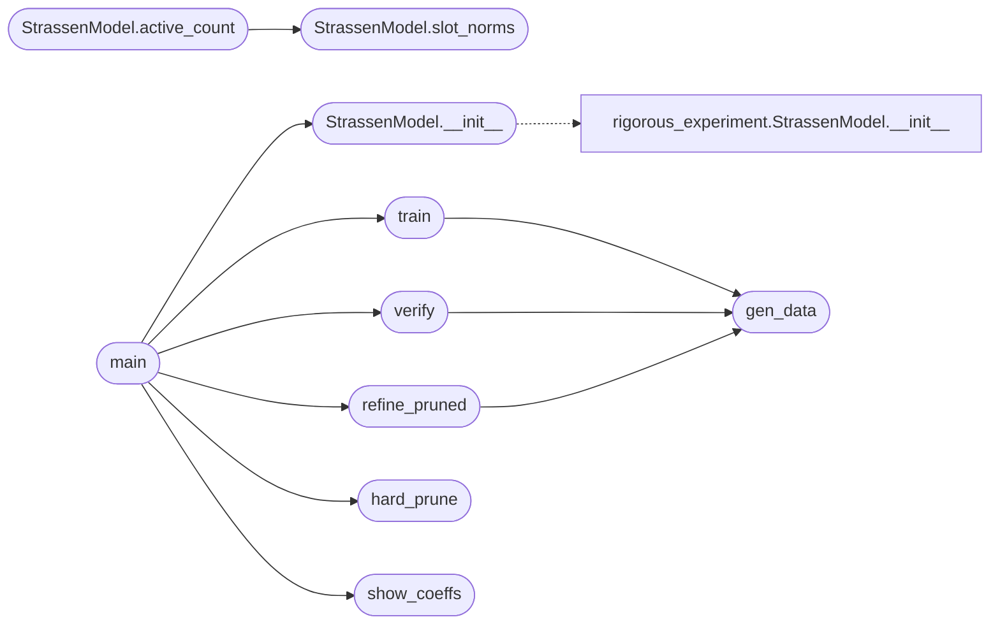

# `src.training.main_pure_math`

> Source: [src/training/main_pure_math.py:1](../../src/training/main_pure_math.py#L1) | language `py` | coverage 38.5% | [API index](../index.md)

Strassen Discovery - Pure Mathematics v2 ========================================= Descubre Strassen (7 multiplicaciones) usando SOLO matemáticas.

Estrategia: L1 progresiva para eliminar un slot naturalmente.

Autor: grisun0

## Contents

- **Classes:** [`StrassenModel`](#strassenmodel)
- **Functions:** [`gen_data`](#gen_data), [`train`](#train), [`verify`](#verify), [`hard_prune`](#hard_prune), [`refine_pruned`](#refine_pruned), [`show_coeffs`](#show_coeffs), [`main`](#main)

## Type Diagram



## Call Graph

Solid arrows stay in this module, dashed arrows leave it.



## Classes

<a id="strassenmodel"></a>

### `StrassenModel`

`class` | [src/training/main_pure_math.py:22](../../src/training/main_pure_math.py#L22)

```python
class StrassenModel(nn.Module)
```

Bases: `nn.Module`

Descomposición de tensor para multiplicación de matrices 2x2.

C_ij = sum_r W[ij,r] * (U[r,:] @ a) * (V[r,:] @ b)

**Members**

| Member | Kind | Summary |
|---|---|---|
| [`__init__`](#strassenmodel-__init__) | constructor |  |
| [`forward`](#strassenmodel-forward) | method |  |
| [`slot_norms`](#strassenmodel-slot_norms) | method | Norma combinada de cada slot. |
| [`active_count`](#strassenmodel-active_count) | method |  |

<a id="strassenmodel-__init__"></a>

#### `StrassenModel.__init__`

`constructor` | [src/training/main_pure_math.py:28](../../src/training/main_pure_math.py#L28)

```python
def __init__(self, rank=8)
```

**Parameters**

| Name | Type | Default | Description |
|---|---|---|---|
| `rank` |  | `8` |  |

*Calls:* [`StrassenModel.__init__`](experiments.statistics.rigorous_experiment.py.md#strassenmodel-__init__)

*Called by:* [`main`](#main)

<a id="strassenmodel-forward"></a>

#### `StrassenModel.forward`

`method` | [src/training/main_pure_math.py:35](../../src/training/main_pure_math.py#L35)

```python
def forward(self, A, B)
```

**Parameters**

| Name | Type | Default | Description |
|---|---|---|---|
| `A` |  |  |  |
| `B` |  |  |  |

<a id="strassenmodel-slot_norms"></a>

#### `StrassenModel.slot_norms`

`method` | [src/training/main_pure_math.py:47](../../src/training/main_pure_math.py#L47)

```python
def slot_norms(self)
```

Norma combinada de cada slot.

*Called by:* [`StrassenModel.active_count`](#strassenmodel-active_count)

<a id="strassenmodel-active_count"></a>

#### `StrassenModel.active_count`

`method` | [src/training/main_pure_math.py:54](../../src/training/main_pure_math.py#L54)

```python
def active_count(self, thresh=0.1)
```

**Parameters**

| Name | Type | Default | Description |
|---|---|---|---|
| `thresh` |  | `0.1` |  |

*Calls:* [`StrassenModel.slot_norms`](#strassenmodel-slot_norms)

---

## Functions

<a id="gen_data"></a>

### `gen_data`

`function` | [src/training/main_pure_math.py:58](../../src/training/main_pure_math.py#L58)

```python
def gen_data(n, scale=1.0)
```

**Parameters**

| Name | Type | Default | Description |
|---|---|---|---|
| `n` |  |  |  |
| `scale` |  | `1.0` |  |

*Called by:* [`refine_pruned`](#refine_pruned), [`train`](#train), [`verify`](#verify)

---

<a id="train"></a>

### `train`

`function` | [src/training/main_pure_math.py:64](../../src/training/main_pure_math.py#L64)

```python
def train(model, epochs, lr, l1=0.0, batch=512, verbose=True)
```

**Parameters**

| Name | Type | Default | Description |
|---|---|---|---|
| `model` |  |  |  |
| `epochs` |  |  |  |
| `lr` |  |  |  |
| `l1` |  | `0.0` |  |
| `batch` |  | `512` |  |
| `verbose` |  | `True` |  |

*Calls:* [`gen_data`](#gen_data)

*Called by:* [`main`](#main)

---

<a id="verify"></a>

### `verify`

`function` | [src/training/main_pure_math.py:88](../../src/training/main_pure_math.py#L88)

```python
def verify(model, n=10000)
```

**Parameters**

| Name | Type | Default | Description |
|---|---|---|---|
| `model` |  |  |  |
| `n` |  | `10000` |  |

*Calls:* [`gen_data`](#gen_data)

*Called by:* [`main`](#main)

---

<a id="hard_prune"></a>

### `hard_prune`

`function` | [src/training/main_pure_math.py:106](../../src/training/main_pure_math.py#L106)

```python
def hard_prune(model, keep=7)
```

Poda los slots más débiles, mantiene top-k.

**Parameters**

| Name | Type | Default | Description |
|---|---|---|---|
| `model` |  |  |  |
| `keep` |  | `7` |  |

*Called by:* [`main`](#main)

---

<a id="refine_pruned"></a>

### `refine_pruned`

`function` | [src/training/main_pure_math.py:122](../../src/training/main_pure_math.py#L122)

```python
def refine_pruned(model, active, epochs=5000, lr=0.01)
```

Refina manteniendo slots podados en cero.

**Parameters**

| Name | Type | Default | Description |
|---|---|---|---|
| `model` |  |  |  |
| `active` |  |  |  |
| `epochs` |  | `5000` |  |
| `lr` |  | `0.01` |  |

*Calls:* [`gen_data`](#gen_data)

*Called by:* [`main`](#main)

---

<a id="show_coeffs"></a>

### `show_coeffs`

`function` | [src/training/main_pure_math.py:159](../../src/training/main_pure_math.py#L159)

```python
def show_coeffs(model, active)
```

**Parameters**

| Name | Type | Default | Description |
|---|---|---|---|
| `model` |  |  |  |
| `active` |  |  |  |

*Called by:* [`main`](#main)

---

<a id="main"></a>

### `main`

`function` | [src/training/main_pure_math.py:186](../../src/training/main_pure_math.py#L186)

```python
def main()
```

*Calls:* [`StrassenModel.__init__`](#strassenmodel-__init__), [`hard_prune`](#hard_prune), [`refine_pruned`](#refine_pruned), [`show_coeffs`](#show_coeffs), [`train`](#train), [`verify`](#verify)

---
