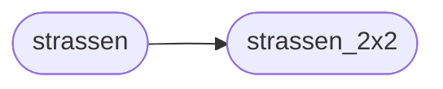

# `src.training.strassen_core`

> Source: [src/training/strassen_core.py:1](../../src/training/strassen_core.py#L1) | language `py` | coverage 20.0% | [API index](../index.md)

Strassen Matrix Multiplication via Grokked Tensor Decomposition Author: grisun0

## Contents

- **Functions:** [`strassen_2x2`](#strassen_2x2), [`strassen`](#strassen), [`get_coefficients`](#get_coefficients), [`multiplication_count`](#multiplication_count)

## Call Graph

Solid arrows stay in this module, dashed arrows leave it.



## Functions

<a id="strassen_2x2"></a>

### `strassen_2x2`

`function` | [src/training/strassen_core.py:21](../../src/training/strassen_core.py#L21)

```python
def strassen_2x2(A, B)
```

**Parameters**

| Name | Type | Default | Description |
|---|---|---|---|
| `A` |  |  |  |
| `B` |  |  |  |

*Called by:* [`strassen`](#strassen)

---

<a id="strassen"></a>

### `strassen`

`function` | [src/training/strassen_core.py:44](../../src/training/strassen_core.py#L44)

```python
def strassen(X, Y)
```

**Parameters**

| Name | Type | Default | Description |
|---|---|---|---|
| `X` |  |  |  |
| `Y` |  |  |  |

*Calls:* [`strassen_2x2`](#strassen_2x2)

*Called by:* [`benchmark_resolution`](src.benchmarks.benchmark_strassen.py.md#benchmark_resolution)

---

<a id="get_coefficients"></a>

### `get_coefficients`

`function` | [src/training/strassen_core.py:77](../../src/training/strassen_core.py#L77)

```python
def get_coefficients()
```

---

<a id="multiplication_count"></a>

### `multiplication_count`

`function` | [src/training/strassen_core.py:82](../../src/training/strassen_core.py#L82)

```python
def multiplication_count(n)
```

**Parameters**

| Name | Type | Default | Description |
|---|---|---|---|
| `n` |  |  |  |

---
