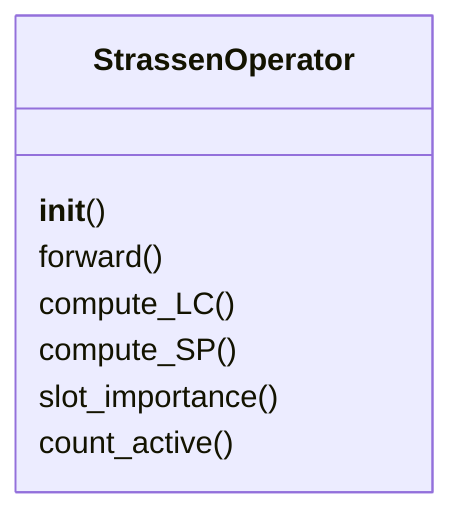
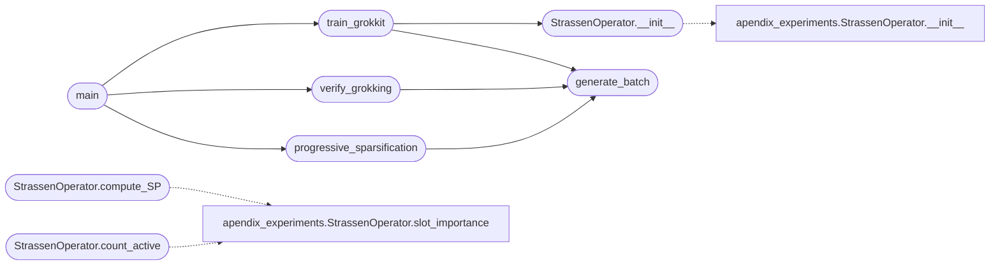

# `src.training.strassen_grokkit`

> Source: [src/training/strassen_grokkit.py:1](../../src/training/strassen_grokkit.py#L1) | language `py` | coverage 92.3% | [API index](../index.md)

Strassen Discovery via Grokkit Framework ========================================= Usa el teorema de Grokkit para descubrir Strassen con: - WD (Weight Decay) como presión del motor térmico - LC (Linear Combination) -> 1 - SP (Sparsity) -> 0 - Accuracy -> 100% - Loss -> 0

El operador grokkeado debe cristalizar en la solución de rango 7.

Autor: Matrix Agent

## Contents

- **Classes:** [`StrassenOperator`](#strassenoperator)
- **Functions:** [`generate_batch`](#generate_batch), [`train_grokkit`](#train_grokkit), [`verify_grokking`](#verify_grokking), [`progressive_sparsification`](#progressive_sparsification), [`main`](#main)

## Type Diagram



## Call Graph

Solid arrows stay in this module, dashed arrows leave it.



## Classes

<a id="strassenoperator"></a>

### `StrassenOperator`

`class` | [src/training/strassen_grokkit.py:27](../../src/training/strassen_grokkit.py#L27)

```python
class StrassenOperator(nn.Module)
```

Bases: `nn.Module`

Operador espectral para multiplicación de matrices 2x2.

Representa el tensor de rango R:
C_ij = Σ_r W[ij,r] * (U[r,:] · a) * (V[r,:] · b)

Donde:
- U, V: Coeficientes de combinación lineal (LC)
- W: Coeficientes de reconstrucción
- Esparsidad (SP): Cuántos slots están activos

**Members**

| Member | Kind | Summary |
|---|---|---|
| [`__init__`](#strassenoperator-__init__) | constructor |  |
| [`forward`](#strassenoperator-forward) | method | Computa A @ B usando la descomposición tensorial. |
| [`compute_LC`](#strassenoperator-compute_lc) | method | Linear Combination metric. |
| [`compute_SP`](#strassenoperator-compute_sp) | method | Sparsity metric. |
| [`slot_importance`](#strassenoperator-slot_importance) | method | Importancia de cada slot basada en normas. |
| [`count_active`](#strassenoperator-count_active) | method | Cuenta slots activos. |

<a id="strassenoperator-__init__"></a>

#### `StrassenOperator.__init__`

`constructor` | [src/training/strassen_grokkit.py:40](../../src/training/strassen_grokkit.py#L40)

```python
def __init__(self, rank=8)
```

**Parameters**

| Name | Type | Default | Description |
|---|---|---|---|
| `rank` |  | `8` |  |

*Calls:* [`StrassenOperator.__init__`](experiments.apendix_experiments.py.md#strassenoperator-__init__)

*Called by:* [`train_grokkit`](#train_grokkit)

<a id="strassenoperator-forward"></a>

#### `StrassenOperator.forward`

`method` | [src/training/strassen_grokkit.py:49](../../src/training/strassen_grokkit.py#L49)

```python
def forward(self, A, B)
```

Computa A @ B usando la descomposición tensorial.

**Parameters**

| Name | Type | Default | Description |
|---|---|---|---|
| `A` |  |  |  |
| `B` |  |  |  |

<a id="strassenoperator-compute_lc"></a>

#### `StrassenOperator.compute_LC`

`method` | [src/training/strassen_grokkit.py:67](../../src/training/strassen_grokkit.py#L67)

```python
def compute_LC(self)
```

Linear Combination metric.

Mide qué tan bien los coeficientes forman combinaciones válidas. LC -> 1 significa combinaciones perfectas.

<a id="strassenoperator-compute_sp"></a>

#### `StrassenOperator.compute_SP`

`method` | [src/training/strassen_grokkit.py:83](../../src/training/strassen_grokkit.py#L83)

```python
def compute_SP(self)
```

Sparsity metric.

SP -> 0 significa máxima esparsidad (menos slots activos). SP = (slots_activos - 7) / rank para normalizar

*Calls:* [`StrassenOperator.slot_importance`](experiments.apendix_experiments.py.md#strassenoperator-slot_importance)

<a id="strassenoperator-slot_importance"></a>

#### `StrassenOperator.slot_importance`

`method` | [src/training/strassen_grokkit.py:101](../../src/training/strassen_grokkit.py#L101)

```python
def slot_importance(self)
```

Importancia de cada slot basada en normas.

<a id="strassenoperator-count_active"></a>

#### `StrassenOperator.count_active`

`method` | [src/training/strassen_grokkit.py:108](../../src/training/strassen_grokkit.py#L108)

```python
def count_active(self, threshold=0.1)
```

Cuenta slots activos.

**Parameters**

| Name | Type | Default | Description |
|---|---|---|---|
| `threshold` |  | `0.1` |  |

*Calls:* [`StrassenOperator.slot_importance`](experiments.apendix_experiments.py.md#strassenoperator-slot_importance)

---

## Functions

<a id="generate_batch"></a>

### `generate_batch`

`function` | [src/training/strassen_grokkit.py:113](../../src/training/strassen_grokkit.py#L113)

```python
def generate_batch(n, scale=1.0)
```

Genera batch de matrices aleatorias.

**Parameters**

| Name | Type | Default | Description |
|---|---|---|---|
| `n` |  |  |  |
| `scale` |  | `1.0` |  |

*Called by:* [`progressive_sparsification`](#progressive_sparsification), [`train_grokkit`](#train_grokkit), [`verify_grokking`](#verify_grokking)

---

<a id="train_grokkit"></a>

### `train_grokkit`

`function` | [src/training/strassen_grokkit.py:120](../../src/training/strassen_grokkit.py#L120)

```python
def train_grokkit(epochs=50000, batch_size=256, lr=0.01, wd=0.0001)
```

Entrena usando el framework Grokkit.

WD (Weight Decay) actúa como presión termodinámica que:
1. Empuja hacia soluciones de menor norma
2. Promueve esparsidad natural (slots débiles -> 0)
3. Cristaliza el operador en el mínimo de energía (rango 7)

**Parameters**

| Name | Type | Default | Description |
|---|---|---|---|
| `epochs` |  | `50000` |  |
| `batch_size` |  | `256` |  |
| `lr` |  | `0.01` |  |
| `wd` |  | `0.0001` |  |

*Calls:* [`StrassenOperator.__init__`](#strassenoperator-__init__), [`generate_batch`](#generate_batch)

*Called by:* [`main`](#main)

---

<a id="verify_grokking"></a>

### `verify_grokking`

`function` | [src/training/strassen_grokkit.py:203](../../src/training/strassen_grokkit.py#L203)

```python
def verify_grokking(model, n_test=10000)
```

Verifica que el operador ha grokkeado correctamente.

**Parameters**

| Name | Type | Default | Description |
|---|---|---|---|
| `model` |  |  |  |
| `n_test` |  | `10000` |  |

*Calls:* [`generate_batch`](#generate_batch)

*Called by:* [`main`](#main)

---

<a id="progressive_sparsification"></a>

### `progressive_sparsification`

`function` | [src/training/strassen_grokkit.py:254](../../src/training/strassen_grokkit.py#L254)

```python
def progressive_sparsification(model, target_slots=7)
```

Fase 2: Esparsificación progresiva.

Reduce gradualmente a 7 slots manteniendo accuracy.

**Parameters**

| Name | Type | Default | Description |
|---|---|---|---|
| `model` |  |  |  |
| `target_slots` |  | `7` |  |

*Calls:* [`generate_batch`](#generate_batch)

*Called by:* [`main`](#main)

---

<a id="main"></a>

### `main`

`function` | [src/training/strassen_grokkit.py:351](../../src/training/strassen_grokkit.py#L351)

```python
def main()
```

Pipeline principal Grokkit para Strassen.

*Calls:* [`progressive_sparsification`](#progressive_sparsification), [`train_grokkit`](#train_grokkit), [`verify_grokking`](#verify_grokking)

---
