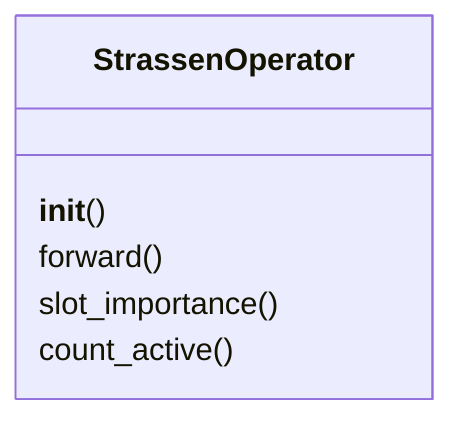
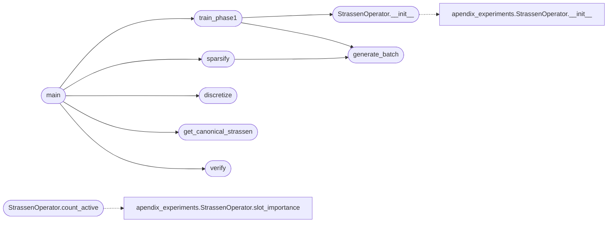

# `src.training.train_strassen`

> Source: [src/training/train_strassen.py:1](../../src/training/train_strassen.py#L1) | language `py` | coverage 61.5% | [API index](../index.md)

Strassen Coefficient Discovery via Thermodynamic Grokking ========================================================== Discovers the rank-7 tensor decomposition for 2x2 matrix multiplication using Weight Decay as thermodynamic pressure.

The operator crystallizes into Strassen's algorithm:
- LC (Linear Combination) -> 1
- SP (Sparsity) -> 0 (7 active slots)
- Accuracy -> 100%
- Loss -> 0

Author: grisun0

## Contents

- **Classes:** [`StrassenOperator`](#strassenoperator)
- **Functions:** [`generate_batch`](#generate_batch), [`train_phase1`](#train_phase1), [`sparsify`](#sparsify), [`discretize`](#discretize), [`get_canonical_strassen`](#get_canonical_strassen), [`verify`](#verify), [`main`](#main)
- **Constants:** [`DEVICE`](#device)

## Type Diagram



## Call Graph

Solid arrows stay in this module, dashed arrows leave it.



## Classes

<a id="strassenoperator"></a>

### `StrassenOperator`

`class` | [src/training/train_strassen.py:26](../../src/training/train_strassen.py#L26)

```python
class StrassenOperator(nn.Module)
```

Bases: `nn.Module`

Spectral operator for 2x2 matrix multiplication.

Tensor decomposition: C_ij = sum_r W[ij,r] * (U[r,:] . a) * (V[r,:] . b)

**Members**

| Member | Kind | Summary |
|---|---|---|
| [`__init__`](#strassenoperator-__init__) | constructor |  |
| [`forward`](#strassenoperator-forward) | method |  |
| [`slot_importance`](#strassenoperator-slot_importance) | method |  |
| [`count_active`](#strassenoperator-count_active) | method |  |

<a id="strassenoperator-__init__"></a>

#### `StrassenOperator.__init__`

`constructor` | [src/training/train_strassen.py:33](../../src/training/train_strassen.py#L33)

```python
def __init__(self, rank=8)
```

**Parameters**

| Name | Type | Default | Description |
|---|---|---|---|
| `rank` |  | `8` |  |

*Calls:* [`StrassenOperator.__init__`](experiments.apendix_experiments.py.md#strassenoperator-__init__)

*Called by:* [`train_phase1`](#train_phase1)

<a id="strassenoperator-forward"></a>

#### `StrassenOperator.forward`

`method` | [src/training/train_strassen.py:40](../../src/training/train_strassen.py#L40)

```python
def forward(self, A, B)
```

**Parameters**

| Name | Type | Default | Description |
|---|---|---|---|
| `A` |  |  |  |
| `B` |  |  |  |

<a id="strassenoperator-slot_importance"></a>

#### `StrassenOperator.slot_importance`

`method` | [src/training/train_strassen.py:50](../../src/training/train_strassen.py#L50)

```python
def slot_importance(self)
```

<a id="strassenoperator-count_active"></a>

#### `StrassenOperator.count_active`

`method` | [src/training/train_strassen.py:56](../../src/training/train_strassen.py#L56)

```python
def count_active(self, threshold=0.1)
```

**Parameters**

| Name | Type | Default | Description |
|---|---|---|---|
| `threshold` |  | `0.1` |  |

*Calls:* [`StrassenOperator.slot_importance`](experiments.apendix_experiments.py.md#strassenoperator-slot_importance)

---

## Functions

<a id="generate_batch"></a>

### `generate_batch`

`function` | [src/training/train_strassen.py:60](../../src/training/train_strassen.py#L60)

```python
def generate_batch(n, scale=1.0)
```

**Parameters**

| Name | Type | Default | Description |
|---|---|---|---|
| `n` |  |  |  |
| `scale` |  | `1.0` |  |

*Called by:* [`sparsify`](#sparsify), [`train_phase1`](#train_phase1)

---

<a id="train_phase1"></a>

### `train_phase1`

`function` | [src/training/train_strassen.py:66](../../src/training/train_strassen.py#L66)

```python
def train_phase1(epochs=30000, batch_size=256, lr=0.02, wd=0.0001)
```

Phase 1: Grokking with Weight Decay as thermodynamic pressure.

**Parameters**

| Name | Type | Default | Description |
|---|---|---|---|
| `epochs` |  | `30000` |  |
| `batch_size` |  | `256` |  |
| `lr` |  | `0.02` |  |
| `wd` |  | `0.0001` |  |

*Calls:* [`StrassenOperator.__init__`](#strassenoperator-__init__), [`generate_batch`](#generate_batch)

*Called by:* [`main`](#main)

---

<a id="sparsify"></a>

### `sparsify`

`function` | [src/training/train_strassen.py:104](../../src/training/train_strassen.py#L104)

```python
def sparsify(model, target_slots=7)
```

Phase 2: Progressive sparsification to target rank.

**Parameters**

| Name | Type | Default | Description |
|---|---|---|---|
| `model` |  |  |  |
| `target_slots` |  | `7` |  |

*Calls:* [`generate_batch`](#generate_batch)

*Called by:* [`main`](#main)

---

<a id="discretize"></a>

### `discretize`

`function` | [src/training/train_strassen.py:183](../../src/training/train_strassen.py#L183)

```python
def discretize(model, slots_to_prune)
```

Phase 3: Discretize coefficients to {-1, 0, 1}.

**Parameters**

| Name | Type | Default | Description |
|---|---|---|---|
| `model` |  |  |  |
| `slots_to_prune` |  |  |  |

*Called by:* [`main`](#main)

---

<a id="get_canonical_strassen"></a>

### `get_canonical_strassen`

`function` | [src/training/train_strassen.py:211](../../src/training/train_strassen.py#L211)

```python
def get_canonical_strassen()
```

Returns the canonical Strassen coefficients.

Exact discrete coefficients for rank-7 tensor decomposition.

Strassen's 7 products:
M1 = (a11 + a22)(b11 + b22)
M2 = (a21 + a22) * b11
M3 = a11 * (b12 - b22)
M4 = a22 * (b21 - b11)
M5 = (a11 + a12) * b22
M6 = (a21 - a11)(b11 + b12)
M7 = (a12 - a22)(b21 + b22)

Result reconstruction:
c11 = M1 + M4 - M5 + M7
c12 = M3 + M5
c21 = M2 + M4
c22 = M1 - M2 + M3 + M6

*Called by:* [`main`](#main)

---

<a id="verify"></a>

### `verify`

`function` | [src/training/train_strassen.py:260](../../src/training/train_strassen.py#L260)

```python
def verify(U, V, W, n_test=10000)
```

Verify the discretized operator.

**Parameters**

| Name | Type | Default | Description |
|---|---|---|---|
| `U` |  |  |  |
| `V` |  |  |  |
| `W` |  |  |  |
| `n_test` |  | `10000` |  |

*Called by:* [`main`](#main)

---

<a id="main"></a>

### `main`

`function` | [src/training/train_strassen.py:299](../../src/training/train_strassen.py#L299)

```python
def main()
```

Main training pipeline.

*Calls:* [`discretize`](#discretize), [`get_canonical_strassen`](#get_canonical_strassen), [`sparsify`](#sparsify), [`train_phase1`](#train_phase1), [`verify`](#verify)

---

## Constants

<a id="device"></a>

### `DEVICE`

`constant` | [src/training/train_strassen.py:23](../../src/training/train_strassen.py#L23)

```python
DEVICE = torch.device('cuda' if torch.cuda.is_available() else 'cpu')
```

---
