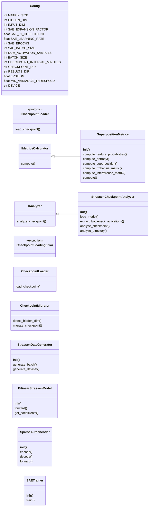

# `superposition`

> Source: [superposition.py:1](../../superposition.py#L1) | language `py` | coverage 57.8% | [API index](../index.md)

## Contents

- **Classes:** [`Config`](#config), [`IMetricsCalculator`](#imetricscalculator), [`IAnalyzer`](#ianalyzer), [`CheckpointLoader`](#checkpointloader), [`CheckpointMigrator`](#checkpointmigrator), [`StrassenDataGenerator`](#strassendatagenerator), [`BilinearStrassenModel`](#bilinearstrassenmodel), [`SparseAutoencoder`](#sparseautoencoder), [`SuperpositionMetrics`](#superpositionmetrics), [`SAETrainer`](#saetrainer), [`StrassenCheckpointAnalyzer`](#strassencheckpointanalyzer)
- **Protocols:** [`ICheckpointLoader`](#icheckpointloader)
- **Exceptions:** [`CheckpointLoadingError`](#checkpointloadingerror)
- **Functions:** [`main`](#main)

## Type Diagram



## Call Graph

Solid arrows stay in this module, dashed arrows leave it.

```mermaid
flowchart LR
    n_superposition_py__CheckpointLoader_load_checkpoint(["CheckpointLoader.load_checkpoint"])
    n_superposition_py__CheckpointLoadingError(["CheckpointLoadingError"])
    n_superposition_py__SparseAutoencoder_forward(["SparseAutoencoder.forward"])
    n_superposition_py__SparseAutoencoder_decode(["SparseAutoencoder.decode"])
    n_superposition_py__SparseAutoencoder_encode(["SparseAutoencoder.encode"])
    n_superposition_py__SuperpositionMetrics_compute_superposition(["SuperpositionMetrics.compute_superposition"])
    n_superposition_py__SuperpositionMetrics_compute_entropy(["SuperpositionMetrics.compute_entropy"])
    n_superposition_py__SuperpositionMetrics_compute_feature_probabilities(["SuperpositionMetrics.compute_feature_probabilities"])
    n_superposition_py__SuperpositionMetrics_compute(["SuperpositionMetrics.compute"])
    n_superposition_py__SuperpositionMetrics_compute_frobenius_metric(["SuperpositionMetrics.compute_frobenius_metric"])
    n_superposition_py__SuperpositionMetrics_compute_interference_matrix(["SuperpositionMetrics.compute_interference_matrix"])
    n_superposition_py__SAETrainer___init__(["SAETrainer.__init__"])
    n_superposition_py__SuperpositionMetrics___init__(["SuperpositionMetrics.__init__"])
    n_superposition_py__SAETrainer_train(["SAETrainer.train"])
    n_superposition_py__StrassenCheckpointAnalyzer___init__(["StrassenCheckpointAnalyzer.__init__"])
    n_superposition_py__CheckpointLoader(["CheckpointLoader"])
    n_superposition_py__CheckpointMigrator(["CheckpointMigrator"])
    n_superposition_py__StrassenDataGenerator___init__(["StrassenDataGenerator.__init__"])
    n_superposition_py__StrassenCheckpointAnalyzer_load_model(["StrassenCheckpointAnalyzer.load_model"])
    n_superposition_py__BilinearStrassenModel___init__(["BilinearStrassenModel.__init__"])
    n_superposition_py__CheckpointMigrator_detect_hidden_dim(["CheckpointMigrator.detect_hidden_dim"])
    n_superposition_py__Config(["Config"])
    n_superposition_py__StrassenCheckpointAnalyzer_extract_bottleneck_activations(["StrassenCheckpointAnalyzer.extract_bottleneck_activations"])
    n_superposition_py__StrassenDataGenerator_generate_dataset(["StrassenDataGenerator.generate_dataset"])
    n_superposition_py__StrassenCheckpointAnalyzer_analyze_checkpoint(["StrassenCheckpointAnalyzer.analyze_checkpoint"])
    n_superposition_py__SparseAutoencoder___init__(["SparseAutoencoder.__init__"])
    n_superposition_py__CheckpointLoader_load_checkpoint --> n_superposition_py__CheckpointLoadingError
    n_superposition_py__SparseAutoencoder_forward --> n_superposition_py__SparseAutoencoder_decode
    n_superposition_py__SparseAutoencoder_forward --> n_superposition_py__SparseAutoencoder_encode
    n_superposition_py__SuperpositionMetrics_compute_superposition --> n_superposition_py__SuperpositionMetrics_compute_entropy
    n_superposition_py__SuperpositionMetrics_compute_superposition --> n_superposition_py__SuperpositionMetrics_compute_feature_probabilities
    n_superposition_py__SuperpositionMetrics_compute --> n_superposition_py__SuperpositionMetrics_compute_frobenius_metric
    n_superposition_py__SuperpositionMetrics_compute --> n_superposition_py__SuperpositionMetrics_compute_interference_matrix
    n_superposition_py__SuperpositionMetrics_compute --> n_superposition_py__SuperpositionMetrics_compute_superposition
    n_superposition_py__SAETrainer___init__ --> n_superposition_py__SuperpositionMetrics___init__
    n_superposition_py__SAETrainer_train --> n_superposition_py__SuperpositionMetrics_compute
    n_superposition_py__StrassenCheckpointAnalyzer___init__ --> n_superposition_py__CheckpointLoader
    n_superposition_py__StrassenCheckpointAnalyzer___init__ --> n_superposition_py__CheckpointMigrator
    n_superposition_py__StrassenCheckpointAnalyzer___init__ --> n_superposition_py__StrassenDataGenerator___init__
    n_superposition_py__StrassenCheckpointAnalyzer___init__ --> n_superposition_py__SuperpositionMetrics___init__
    n_superposition_py__StrassenCheckpointAnalyzer_load_model --> n_superposition_py__BilinearStrassenModel___init__
    n_superposition_py__StrassenCheckpointAnalyzer_load_model --> n_superposition_py__CheckpointMigrator_detect_hidden_dim
    n_superposition_py__StrassenCheckpointAnalyzer_load_model --> n_superposition_py__Config
    n_superposition_py__StrassenCheckpointAnalyzer_extract_bottleneck_activations --> n_superposition_py__StrassenDataGenerator_generate_dataset
    n_superposition_py__StrassenCheckpointAnalyzer_analyze_checkpoint --> n_superposition_py__SAETrainer___init__
    n_superposition_py__StrassenCheckpointAnalyzer_analyze_checkpoint --> n_superposition_py__SAETrainer_train
    n_superposition_py__StrassenCheckpointAnalyzer_analyze_checkpoint --> n_superposition_py__SparseAutoencoder___init__
    n_superposition_py__StrassenCheckpointAnalyzer_analyze_checkpoint --> n_superposition_py__StrassenCheckpointAnalyzer_extract_bottleneck_activations
    n_superposition_py__StrassenCheckpointAnalyzer_analyze_checkpoint --> n_superposition_py__StrassenCheckpointAnalyzer_load_model
    n_superposition_py__StrassenCheckpointAnalyzer_analyze_checkpoint --> n_superposition_py__SuperpositionMetrics___init__
```



## Classes

<a id="config"></a>

### `Config`

`class` `dataclass` | [superposition.py:23](../../superposition.py#L23)

Decorators: `@dataclass(frozen=True)`

```python
class Config
```

Configuration for Superposition Analysis on Strassen Checkpoints.

**Attributes**

| Name | Type | Default | Description |
|---|---|---|---|
| [`MATRIX_SIZE`](#config-matrix_size) | `int` | `2` |  |
| [`HIDDEN_DIM`](#config-hidden_dim) | `int` | `8` |  |
| [`INPUT_DIM`](#config-input_dim) | `int` | `4` |  |
| [`SAE_EXPANSION_FACTOR`](#config-sae_expansion_factor) | `int` | `8` |  |
| [`SAE_L1_COEFFICIENT`](#config-sae_l1_coefficient) | `float` | `0.1` |  |
| [`SAE_LEARNING_RATE`](#config-sae_learning_rate) | `float` | `0.001` |  |
| [`SAE_EPOCHS`](#config-sae_epochs) | `int` | `1000` |  |
| [`SAE_BATCH_SIZE`](#config-sae_batch_size) | `int` | `256` |  |
| [`NUM_ACTIVATION_SAMPLES`](#config-num_activation_samples) | `int` | `10000` |  |
| [`BATCH_SIZE`](#config-batch_size) | `int` | `32` |  |
| [`CHECKPOINT_INTERVAL_MINUTES`](#config-checkpoint_interval_minutes) | `int` | `5` |  |
| [`CHECKPOINT_DIR`](#config-checkpoint_dir) | `str` | `'checkpoints_analysis'` |  |
| [`RESULTS_DIR`](#config-results_dir) | `str` | `'superposition_results'` |  |
| [`EPSILON`](#config-epsilon) | `float` | `1e-10` |  |
| [`MIN_VARIANCE_THRESHOLD`](#config-min_variance_threshold) | `float` | `1e-08` |  |
| [`DEVICE`](#config-device) | `str` | `field(default_factory=lambda: 'cuda' if torch.cuda.is_available() else 'cpu')` |  |

---

<a id="imetricscalculator"></a>

### `IMetricsCalculator`

`class` `abstract` | [superposition.py:62](../../superposition.py#L62)

```python
class IMetricsCalculator(ABC)
```

Bases: `ABC`

Subclasses: [`SuperpositionMetrics`](#superpositionmetrics)

**Members**

| Member | Kind | Summary |
|---|---|---|
| [`compute`](#imetricscalculator-compute) | method |  |

<a id="imetricscalculator-compute"></a>

#### `IMetricsCalculator.compute`

`method` `abstract` | [superposition.py:64](../../superposition.py#L64)

Decorators: `@abstractmethod`

```python
def compute(self, **kwargs) -> Dict[str, float]
```

**Parameters**

| Name | Type | Default | Description |
|---|---|---|---|
| `**kwargs` |  |  |  |

**Returns:** `Dict[str, float]`

---

<a id="ianalyzer"></a>

### `IAnalyzer`

`class` `abstract` | [superposition.py:66](../../superposition.py#L66)

```python
class IAnalyzer(ABC)
```

Bases: `ABC`

Subclasses: [`StrassenCheckpointAnalyzer`](#strassencheckpointanalyzer)

**Members**

| Member | Kind | Summary |
|---|---|---|
| [`analyze_checkpoint`](#ianalyzer-analyze_checkpoint) | method |  |

<a id="ianalyzer-analyze_checkpoint"></a>

#### `IAnalyzer.analyze_checkpoint`

`method` `abstract` | [superposition.py:68](../../superposition.py#L68)

Decorators: `@abstractmethod`

```python
def analyze_checkpoint(self, checkpoint_path: Path) -> Dict[str, Any]
```

**Parameters**

| Name | Type | Default | Description |
|---|---|---|---|
| `checkpoint_path` | `Path` |  |  |

**Returns:** `Dict[str, Any]`

---

<a id="checkpointloader"></a>

### `CheckpointLoader`

`class` | [superposition.py:75](../../superposition.py#L75)

```python
class CheckpointLoader
```

Loads raw checkpoint files.

**Members**

| Member | Kind | Summary |
|---|---|---|
| [`load_checkpoint`](#checkpointloader-load_checkpoint) | method |  |

<a id="checkpointloader-load_checkpoint"></a>

#### `CheckpointLoader.load_checkpoint`

`method` | [superposition.py:78](../../superposition.py#L78)

```python
def load_checkpoint(self, path: str, device: str) -> Any
```

**Parameters**

| Name | Type | Default | Description |
|---|---|---|---|
| `path` | `str` |  |  |
| `device` | `str` |  |  |

**Returns:** `Any`

**Raises**

- [`CheckpointLoadingError`](#checkpointloadingerror): (raised in the body, not documented)

*Calls:* [`CheckpointLoadingError`](#checkpointloadingerror)

---

<a id="checkpointmigrator"></a>

### `CheckpointMigrator`

`class` | [superposition.py:85](../../superposition.py#L85)

```python
class CheckpointMigrator
```

Migrates various checkpoint formats to standard state_dict.

**Members**

| Member | Kind | Summary |
|---|---|---|
| [`detect_hidden_dim`](#checkpointmigrator-detect_hidden_dim) | staticmethod | Detect hidden dimension from checkpoint data structure by inspecting tensor shapes in various known formats. |
| [`migrate_checkpoint`](#checkpointmigrator-migrate_checkpoint) | staticmethod |  |

<a id="checkpointmigrator-detect_hidden_dim"></a>

#### `CheckpointMigrator.detect_hidden_dim`

`staticmethod` | [superposition.py:89](../../superposition.py#L89)

Decorators: `@staticmethod`

```python
def detect_hidden_dim(raw_data: Any) -> Optional[int]
```

Detect hidden dimension from checkpoint data structure by inspecting tensor shapes in various known formats.

Returns None if cannot be determined unambiguously.

**Parameters**

| Name | Type | Default | Description |
|---|---|---|---|
| `raw_data` | `Any` |  |  |

**Returns:** `Optional[int]`

*Called by:* [`StrassenCheckpointAnalyzer.load_model`](#strassencheckpointanalyzer-load_model)

<a id="checkpointmigrator-migrate_checkpoint"></a>

#### `CheckpointMigrator.migrate_checkpoint`

`staticmethod` | [superposition.py:122](../../superposition.py#L122)

Decorators: `@staticmethod`

```python
def migrate_checkpoint(raw_data: Any) -> Optional[Dict[str, torch.Tensor]]
```

**Parameters**

| Name | Type | Default | Description |
|---|---|---|---|
| `raw_data` | `Any` |  |  |

**Returns:** `Optional[Dict[str, torch.Tensor]]`

---

<a id="strassendatagenerator"></a>

### `StrassenDataGenerator`

`class` | [superposition.py:220](../../superposition.py#L220)

```python
class StrassenDataGenerator
```

Generates matrix multiplication data for activation extraction.

**Members**

| Member | Kind | Summary |
|---|---|---|
| [`__init__`](#strassendatagenerator-__init__) | constructor |  |
| [`generate_batch`](#strassendatagenerator-generate_batch) | method | Generate batch of matrix pairs and their product. |
| [`generate_dataset`](#strassendatagenerator-generate_dataset) | method | Generate full dataset. |

<a id="strassendatagenerator-__init__"></a>

#### `StrassenDataGenerator.__init__`

`constructor` | [superposition.py:223](../../superposition.py#L223)

```python
def __init__(self, config: Config)
```

**Parameters**

| Name | Type | Default | Description |
|---|---|---|---|
| `config` | `Config` |  |  |

*Called by:* [`StrassenCheckpointAnalyzer.__init__`](#strassencheckpointanalyzer-__init__)

<a id="strassendatagenerator-generate_batch"></a>

#### `StrassenDataGenerator.generate_batch`

`method` | [superposition.py:226](../../superposition.py#L226)

```python
def generate_batch(self, batch_size: int) -> Tuple[torch.Tensor, torch.Tensor, torch.Tensor]
```

Generate batch of matrix pairs and their product.

**Parameters**

| Name | Type | Default | Description |
|---|---|---|---|
| `batch_size` | `int` |  |  |

**Returns:** `Tuple[torch.Tensor, torch.Tensor, torch.Tensor]`

<a id="strassendatagenerator-generate_dataset"></a>

#### `StrassenDataGenerator.generate_dataset`

`method` | [superposition.py:240](../../superposition.py#L240)

```python
def generate_dataset(self, num_samples: int) -> Tuple[torch.Tensor, torch.Tensor, torch.Tensor]
```

Generate full dataset.

**Parameters**

| Name | Type | Default | Description |
|---|---|---|---|
| `num_samples` | `int` |  |  |

**Returns:** `Tuple[torch.Tensor, torch.Tensor, torch.Tensor]`

*Calls:* [`StrassenDataGenerator.generate_batch`](batch_size.py.md#strassendatagenerator-generate_batch)

*Called by:* [`StrassenCheckpointAnalyzer.extract_bottleneck_activations`](#strassencheckpointanalyzer-extract_bottleneck_activations)

---

<a id="bilinearstrassenmodel"></a>

### `BilinearStrassenModel`

`class` | [superposition.py:258](../../superposition.py#L258)

```python
class BilinearStrassenModel(nn.Module)
```

Bases: `nn.Module`

Your existing Strassen model architecture.

**Members**

| Member | Kind | Summary |
|---|---|---|
| [`__init__`](#bilinearstrassenmodel-__init__) | constructor |  |
| [`forward`](#bilinearstrassenmodel-forward) | method | Forward pass returning output and bottleneck activations. |
| [`get_coefficients`](#bilinearstrassenmodel-get_coefficients) | method |  |

<a id="bilinearstrassenmodel-__init__"></a>

#### `BilinearStrassenModel.__init__`

`constructor` | [superposition.py:261](../../superposition.py#L261)

```python
def __init__(self, config: Config)
```

**Parameters**

| Name | Type | Default | Description |
|---|---|---|---|
| `config` | `Config` |  |  |

*Calls:* [`BilinearStrassenModel.__init__`](batch_size.py.md#bilinearstrassenmodel-__init__)

*Called by:* [`StrassenCheckpointAnalyzer.load_model`](#strassencheckpointanalyzer-load_model)

<a id="bilinearstrassenmodel-forward"></a>

#### `BilinearStrassenModel.forward`

`method` | [superposition.py:276](../../superposition.py#L276)

```python
def forward(self, a: torch.Tensor, b: torch.Tensor) -> torch.Tensor
```

Forward pass returning output and bottleneck activations.

**Parameters**

| Name | Type | Default | Description |
|---|---|---|---|
| `a` | `torch.Tensor` |  |  |
| `b` | `torch.Tensor` |  |  |

**Returns:** `torch.Tensor`

<a id="bilinearstrassenmodel-get_coefficients"></a>

#### `BilinearStrassenModel.get_coefficients`

`method` | [superposition.py:284](../../superposition.py#L284)

```python
def get_coefficients(self) -> Dict[str, torch.Tensor]
```

**Returns:** `Dict[str, torch.Tensor]`

---

<a id="sparseautoencoder"></a>

### `SparseAutoencoder`

`class` | [superposition.py:292](../../superposition.py#L292)

```python
class SparseAutoencoder(nn.Module)
```

Bases: `nn.Module`

SAE with tied weights (W_dec = W_enc^T).

Corrected dimensions: W_enc: [D, N], encode uses W_enc^T, decode uses W_enc.

**Members**

| Member | Kind | Summary |
|---|---|---|
| [`__init__`](#sparseautoencoder-__init__) | constructor |  |
| [`encode`](#sparseautoencoder-encode) | method | Encode bottleneck activations to sparse features. x: [batch, N] W_enc: [D, N] Returns: [batch, D] |
| [`decode`](#sparseautoencoder-decode) | method | Decode sparse features back to bottleneck. z: [batch, D] W_enc: [D, N] Returns: [batch, N] |
| [`forward`](#sparseautoencoder-forward) | method |  |

<a id="sparseautoencoder-__init__"></a>

#### `SparseAutoencoder.__init__`

`constructor` | [superposition.py:298](../../superposition.py#L298)

```python
def __init__(self, config: Config)
```

**Parameters**

| Name | Type | Default | Description |
|---|---|---|---|
| `config` | `Config` |  |  |

*Called by:* [`StrassenCheckpointAnalyzer.analyze_checkpoint`](#strassencheckpointanalyzer-analyze_checkpoint)

<a id="sparseautoencoder-encode"></a>

#### `SparseAutoencoder.encode`

`method` | [superposition.py:310](../../superposition.py#L310)

```python
def encode(self, x: torch.Tensor) -> torch.Tensor
```

Encode bottleneck activations to sparse features. x: [batch, N] W_enc: [D, N] Returns: [batch, D]

**Parameters**

| Name | Type | Default | Description |
|---|---|---|---|
| `x` | `torch.Tensor` |  |  |

**Returns:** `torch.Tensor`

*Called by:* [`SparseAutoencoder.forward`](#sparseautoencoder-forward)

<a id="sparseautoencoder-decode"></a>

#### `SparseAutoencoder.decode`

`method` | [superposition.py:319](../../superposition.py#L319)

```python
def decode(self, z: torch.Tensor) -> torch.Tensor
```

Decode sparse features back to bottleneck. z: [batch, D] W_enc: [D, N] Returns: [batch, N]

**Parameters**

| Name | Type | Default | Description |
|---|---|---|---|
| `z` | `torch.Tensor` |  |  |

**Returns:** `torch.Tensor`

*Called by:* [`SparseAutoencoder.forward`](#sparseautoencoder-forward)

<a id="sparseautoencoder-forward"></a>

#### `SparseAutoencoder.forward`

`method` | [superposition.py:328](../../superposition.py#L328)

```python
def forward(self, x: torch.Tensor) -> Tuple[torch.Tensor, torch.Tensor]
```

**Parameters**

| Name | Type | Default | Description |
|---|---|---|---|
| `x` | `torch.Tensor` |  |  |

**Returns:** `Tuple[torch.Tensor, torch.Tensor]`

*Calls:* [`SparseAutoencoder.decode`](#sparseautoencoder-decode), [`SparseAutoencoder.encode`](#sparseautoencoder-encode)

---

<a id="superpositionmetrics"></a>

### `SuperpositionMetrics`

`class` | [superposition.py:334](../../superposition.py#L334)

```python
class SuperpositionMetrics(IMetricsCalculator)
```

Bases: [`IMetricsCalculator`](#imetricscalculator)

Calculates superposition metrics from Section 4 of the paper.

**Members**

| Member | Kind | Summary |
|---|---|---|
| [`__init__`](#superpositionmetrics-__init__) | constructor |  |
| [`compute_feature_probabilities`](#superpositionmetrics-compute_feature_probabilities) | method | Calculate feature probabilities from SAE activations. p_i = Σ_s \|z_i,s\| / Σ_j Σ_s \|z_j,s\| |
| [`compute_entropy`](#superpositionmetrics-compute_entropy) | method | Shannon entropy H(p) = -Σ p_i log p_i. |
| [`compute_superposition`](#superpositionmetrics-compute_superposition) | method | Main metric: ψ = F/N where F = e^{H(p)}. |
| [`compute_frobenius_metric`](#superpositionmetrics-compute_frobenius_metric) | method | Baseline from Eq 2: ψ_Frob = \|\|W\|\|_F^2 / N. |
| [`compute_interference_matrix`](#superpositionmetrics-compute_interference_matrix) | method | Compute W^T @ W to analyze interference patterns. |
| [`compute`](#superpositionmetrics-compute) | method | Unified interface. |

<a id="superpositionmetrics-__init__"></a>

#### `SuperpositionMetrics.__init__`

`constructor` | [superposition.py:339](../../superposition.py#L339)

```python
def __init__(self, config: Config)
```

**Parameters**

| Name | Type | Default | Description |
|---|---|---|---|
| `config` | `Config` |  |  |

*Called by:* [`SAETrainer.__init__`](#saetrainer-__init__), [`StrassenCheckpointAnalyzer.__init__`](#strassencheckpointanalyzer-__init__), [`StrassenCheckpointAnalyzer.analyze_checkpoint`](#strassencheckpointanalyzer-analyze_checkpoint)

<a id="superpositionmetrics-compute_feature_probabilities"></a>

#### `SuperpositionMetrics.compute_feature_probabilities`

`method` | [superposition.py:342](../../superposition.py#L342)

```python
def compute_feature_probabilities(self, sae_activations: torch.Tensor) -> torch.Tensor
```

Calculate feature probabilities from SAE activations. p_i = Σ_s |z_i,s| / Σ_j Σ_s |z_j,s|

**Parameters**

| Name | Type | Default | Description |
|---|---|---|---|
| `sae_activations` | `torch.Tensor` |  |  |

**Returns:** `torch.Tensor`

*Called by:* [`SuperpositionMetrics.compute_superposition`](#superpositionmetrics-compute_superposition)

<a id="superpositionmetrics-compute_entropy"></a>

#### `SuperpositionMetrics.compute_entropy`

`method` | [superposition.py:352](../../superposition.py#L352)

```python
def compute_entropy(self, probabilities: torch.Tensor) -> torch.Tensor
```

Shannon entropy H(p) = -Σ p_i log p_i.

**Parameters**

| Name | Type | Default | Description |
|---|---|---|---|
| `probabilities` | `torch.Tensor` |  |  |

**Returns:** `torch.Tensor`

*Called by:* [`SuperpositionMetrics.compute_superposition`](#superpositionmetrics-compute_superposition)

<a id="superpositionmetrics-compute_superposition"></a>

#### `SuperpositionMetrics.compute_superposition`

`method` | [superposition.py:359](../../superposition.py#L359)

```python
def compute_superposition(self, sae_activations: torch.Tensor) -> Dict[str, float]
```

Main metric: ψ = F/N where F = e^{H(p)}.

**Parameters**

| Name | Type | Default | Description |
|---|---|---|---|
| `sae_activations` | `torch.Tensor` |  |  |

**Returns:** `Dict[str, float]`

*Calls:* [`SuperpositionMetrics.compute_entropy`](#superpositionmetrics-compute_entropy), [`SuperpositionMetrics.compute_feature_probabilities`](#superpositionmetrics-compute_feature_probabilities)

*Called by:* [`SuperpositionMetrics.compute`](#superpositionmetrics-compute)

<a id="superpositionmetrics-compute_frobenius_metric"></a>

#### `SuperpositionMetrics.compute_frobenius_metric`

`method` | [superposition.py:377](../../superposition.py#L377)

```python
def compute_frobenius_metric(self, weight_matrix: torch.Tensor) -> float
```

Baseline from Eq 2: ψ_Frob = ||W||_F^2 / N.

Applied to the bottleneck transformation (W matrix of Strassen).

**Parameters**

| Name | Type | Default | Description |
|---|---|---|---|
| `weight_matrix` | `torch.Tensor` |  |  |

**Returns:** `float`

*Called by:* [`SuperpositionMetrics.compute`](#superpositionmetrics-compute)

<a id="superpositionmetrics-compute_interference_matrix"></a>

#### `SuperpositionMetrics.compute_interference_matrix`

`method` | [superposition.py:385](../../superposition.py#L385)

```python
def compute_interference_matrix(self, weight_matrix: torch.Tensor) -> torch.Tensor
```

Compute W^T @ W to analyze interference patterns.

**Parameters**

| Name | Type | Default | Description |
|---|---|---|---|
| `weight_matrix` | `torch.Tensor` |  |  |

**Returns:** `torch.Tensor`

*Called by:* [`SuperpositionMetrics.compute`](#superpositionmetrics-compute)

<a id="superpositionmetrics-compute"></a>

#### `SuperpositionMetrics.compute`

`method` | [superposition.py:389](../../superposition.py#L389)

```python
def compute(self, sae_activations: Optional[torch.Tensor] = None, weight_matrix: Optional[torch.Tensor] = None) -> Dict[str, float]
```

Unified interface.

**Parameters**

| Name | Type | Default | Description |
|---|---|---|---|
| `sae_activations` | `Optional[torch.Tensor]` | `None` |  |
| `weight_matrix` | `Optional[torch.Tensor]` | `None` |  |

**Returns:** `Dict[str, float]`

*Calls:* [`SuperpositionMetrics.compute_frobenius_metric`](#superpositionmetrics-compute_frobenius_metric), [`SuperpositionMetrics.compute_interference_matrix`](#superpositionmetrics-compute_interference_matrix), [`SuperpositionMetrics.compute_superposition`](#superpositionmetrics-compute_superposition)

*Called by:* [`SAETrainer.train`](#saetrainer-train), [`StrassenCheckpointAnalyzer.analyze_checkpoint`](#strassencheckpointanalyzer-analyze_checkpoint)

---

<a id="saetrainer"></a>

### `SAETrainer`

`class` | [superposition.py:407](../../superposition.py#L407)

```python
class SAETrainer
```

Trains SAE on bottleneck activations extracted from Strassen model.

**Members**

| Member | Kind | Summary |
|---|---|---|
| [`__init__`](#saetrainer-__init__) | constructor |  |
| [`train`](#saetrainer-train) | method | Train SAE on extracted activations. |

<a id="saetrainer-__init__"></a>

#### `SAETrainer.__init__`

`constructor` | [superposition.py:410](../../superposition.py#L410)

```python
def __init__(self, sae: SparseAutoencoder, config: Config)
```

**Parameters**

| Name | Type | Default | Description |
|---|---|---|---|
| `sae` | `SparseAutoencoder` |  |  |
| `config` | `Config` |  |  |

*Calls:* [`SuperpositionMetrics.__init__`](#superpositionmetrics-__init__)

*Called by:* [`StrassenCheckpointAnalyzer.analyze_checkpoint`](#strassencheckpointanalyzer-analyze_checkpoint)

<a id="saetrainer-train"></a>

#### `SAETrainer.train`

`method` | [superposition.py:421](../../superposition.py#L421)

```python
def train(self, bottleneck_activations: torch.Tensor) -> Dict[str, List[float]]
```

Train SAE on extracted activations.

**Parameters**

| Name | Type | Default | Description |
|---|---|---|---|
| `bottleneck_activations` | `torch.Tensor` |  |  |

**Returns:** `Dict[str, List[float]]`

*Calls:* [`SuperpositionMetrics.compute`](#superpositionmetrics-compute)

*Called by:* [`StrassenCheckpointAnalyzer.analyze_checkpoint`](#strassencheckpointanalyzer-analyze_checkpoint)

---

<a id="strassencheckpointanalyzer"></a>

### `StrassenCheckpointAnalyzer`

`class` | [superposition.py:475](../../superposition.py#L475)

```python
class StrassenCheckpointAnalyzer(IAnalyzer)
```

Bases: [`IAnalyzer`](#ianalyzer)

Analyzes existing Strassen checkpoints for superposition metrics.

**Members**

| Member | Kind | Summary |
|---|---|---|
| [`__init__`](#strassencheckpointanalyzer-__init__) | constructor |  |
| [`load_model`](#strassencheckpointanalyzer-load_model) | method | Load and migrate checkpoint to model. |
| [`extract_bottleneck_activations`](#strassencheckpointanalyzer-extract_bottleneck_activations) | method | Extract bottleneck activations (U(a) * V(b)) from model. |
| [`analyze_checkpoint`](#strassencheckpointanalyzer-analyze_checkpoint) | method | Full analysis pipeline for a single checkpoint: 1. |
| [`analyze_directory`](#strassencheckpointanalyzer-analyze_directory) | method | Analyze all checkpoints in directory. |

<a id="strassencheckpointanalyzer-__init__"></a>

#### `StrassenCheckpointAnalyzer.__init__`

`constructor` | [superposition.py:480](../../superposition.py#L480)

```python
def __init__(self, config: Config)
```

**Parameters**

| Name | Type | Default | Description |
|---|---|---|---|
| `config` | `Config` |  |  |

*Calls:* [`CheckpointLoader`](#checkpointloader), [`CheckpointMigrator`](#checkpointmigrator), [`StrassenDataGenerator.__init__`](#strassendatagenerator-__init__), [`SuperpositionMetrics.__init__`](#superpositionmetrics-__init__)

*Called by:* [`main`](#main)

<a id="strassencheckpointanalyzer-load_model"></a>

#### `StrassenCheckpointAnalyzer.load_model`

`method` | [superposition.py:496](../../superposition.py#L496)

```python
def load_model(self, checkpoint_path: Path) -> Optional[Tuple[BilinearStrassenModel, Config]]
```

Load and migrate checkpoint to model.

Returns tuple of (model, effective_config) where effective_config has the correct HIDDEN_DIM for this specific checkpoint to avoid dimension mismatches.

**Parameters**

| Name | Type | Default | Description |
|---|---|---|---|
| `checkpoint_path` | `Path` |  |  |

**Returns:** `Optional[Tuple[BilinearStrassenModel, Config]]`

*Calls:* [`CheckpointLoader.load_checkpoint`](boltzmann_experiments.py.md#checkpointloader-load_checkpoint), [`CheckpointMigrator.migrate_checkpoint`](boltzmann_experiments.py.md#checkpointmigrator-migrate_checkpoint), [`BilinearStrassenModel.__init__`](#bilinearstrassenmodel-__init__), [`CheckpointMigrator.detect_hidden_dim`](#checkpointmigrator-detect_hidden_dim), [`Config`](#config)

*Called by:* [`StrassenCheckpointAnalyzer.analyze_checkpoint`](#strassencheckpointanalyzer-analyze_checkpoint)

<a id="strassencheckpointanalyzer-extract_bottleneck_activations"></a>

#### `StrassenCheckpointAnalyzer.extract_bottleneck_activations`

`method` | [superposition.py:554](../../superposition.py#L554)

```python
def extract_bottleneck_activations(self, model: BilinearStrassenModel) -> torch.Tensor
```

Extract bottleneck activations (U(a) * V(b)) from model.

**Parameters**

| Name | Type | Default | Description |
|---|---|---|---|
| `model` | `BilinearStrassenModel` |  |  |

**Returns:** `torch.Tensor`

*Calls:* [`StrassenDataGenerator.generate_dataset`](#strassendatagenerator-generate_dataset)

*Called by:* [`StrassenCheckpointAnalyzer.analyze_checkpoint`](#strassencheckpointanalyzer-analyze_checkpoint)

<a id="strassencheckpointanalyzer-analyze_checkpoint"></a>

#### `StrassenCheckpointAnalyzer.analyze_checkpoint`

`method` | [superposition.py:571](../../superposition.py#L571)

```python
def analyze_checkpoint(self, checkpoint_path: Path) -> Dict[str, Any]
```

Full analysis pipeline for a single checkpoint: 1.

Load model with correct dimensions (detecting hidden_dim from checkpoint) 2. Extract bottleneck activations 3. Train SAE with matching dimensions (using effective_config) 4. Calculate superposition metrics with correct normalization (N=hidden_dim) 5. Calculate baseline Frobenius metric on W weights

**Parameters**

| Name | Type | Default | Description |
|---|---|---|---|
| `checkpoint_path` | `Path` |  |  |

**Returns:** `Dict[str, Any]`

*Calls:* [`SAETrainer.__init__`](#saetrainer-__init__), [`SAETrainer.train`](#saetrainer-train), [`SparseAutoencoder.__init__`](#sparseautoencoder-__init__), [`StrassenCheckpointAnalyzer.extract_bottleneck_activations`](#strassencheckpointanalyzer-extract_bottleneck_activations), [`StrassenCheckpointAnalyzer.load_model`](#strassencheckpointanalyzer-load_model), [`SuperpositionMetrics.__init__`](#superpositionmetrics-__init__), [`SuperpositionMetrics.compute`](#superpositionmetrics-compute)

*Called by:* [`StrassenCheckpointAnalyzer.analyze_directory`](#strassencheckpointanalyzer-analyze_directory)

<a id="strassencheckpointanalyzer-analyze_directory"></a>

#### `StrassenCheckpointAnalyzer.analyze_directory`

`method` | [superposition.py:641](../../superposition.py#L641)

```python
def analyze_directory(self, checkpoint_dir: str) -> List[Dict[str, Any]]
```

Analyze all checkpoints in directory.

**Parameters**

| Name | Type | Default | Description |
|---|---|---|---|
| `checkpoint_dir` | `str` |  |  |

**Returns:** `List[Dict[str, Any]]`

**Raises**

- `FileNotFoundError`: (raised in the body, not documented)

*Calls:* [`StrassenCheckpointAnalyzer.analyze_checkpoint`](#strassencheckpointanalyzer-analyze_checkpoint)

*Called by:* [`main`](#main)

---

## Protocols

<a id="icheckpointloader"></a>

### `ICheckpointLoader`

`protocol` | [superposition.py:59](../../superposition.py#L59)

```python
class ICheckpointLoader(Protocol)
```

Bases: `Protocol`

**Members**

| Member | Kind | Summary |
|---|---|---|
| [`load_checkpoint`](#icheckpointloader-load_checkpoint) | method |  |

<a id="icheckpointloader-load_checkpoint"></a>

#### `ICheckpointLoader.load_checkpoint`

`method` | [superposition.py:60](../../superposition.py#L60)

```python
def load_checkpoint(self, path: str, device: str) -> Any
```

**Parameters**

| Name | Type | Default | Description |
|---|---|---|---|
| `path` | `str` |  |  |
| `device` | `str` |  |  |

**Returns:** `Any`

---

## Exceptions

<a id="checkpointloadingerror"></a>

### `CheckpointLoadingError`

`exception` | [superposition.py:71](../../superposition.py#L71)

```python
class CheckpointLoadingError(Exception)
```

Bases: `Exception`

---

## Functions

<a id="main"></a>

### `main`

`function` | [superposition.py:765](../../superposition.py#L765)

```python
def main()
```

*Calls:* [`Config`](#config), [`StrassenCheckpointAnalyzer.__init__`](#strassencheckpointanalyzer-__init__), [`StrassenCheckpointAnalyzer.analyze_directory`](#strassencheckpointanalyzer-analyze_directory)

---
