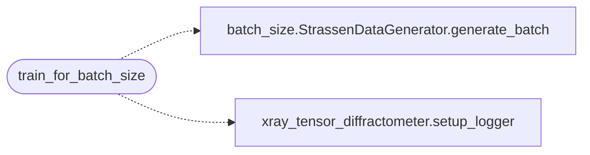

# `train_batch_sweep`

> Source: [train_batch_sweep.py:1](../../train_batch_sweep.py#L1) | language `py` | coverage 50.0% | [API index](../index.md)

train_batch_sweep.py

## Contents

- **Functions:** [`train_for_batch_size`](#train_for_batch_size)

## Call Graph

Solid arrows stay in this module, dashed arrows leave it.



## Functions

<a id="train_for_batch_size"></a>

### `train_for_batch_size`

`function` | [train_batch_sweep.py:11](../../train_batch_sweep.py#L11)

```python
def train_for_batch_size(B: int, seed: int, output_dir: str)
```

**Parameters**

| Name | Type | Default | Description |
|---|---|---|---|
| `B` | `int` |  |  |
| `seed` | `int` |  |  |
| `output_dir` | `str` |  |  |

*Calls:* [`StrassenDataGenerator.generate_batch`](batch_size.py.md#strassendatagenerator-generate_batch), [`setup_logger`](xray_tensor_diffractometer.py.md#setup_logger)

---
