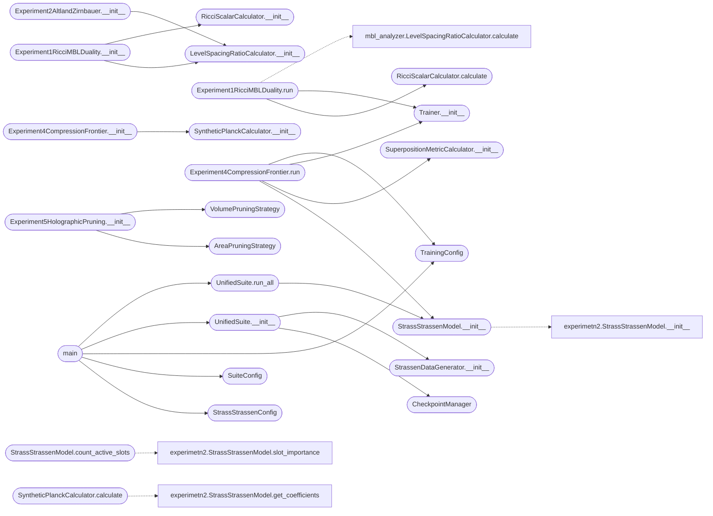

# `unified_hidden_connections_suite`

> Source: [unified_hidden_connections_suite.py:1](../../unified_hidden_connections_suite.py#L1) | language `py` | coverage 39.2% | [API index](../index.md)

Unified Hidden Connections Suite ================================ A single-file experimental framework designed to test five theoretically motivated hidden connections in the Strassen-Strassen neural network architecture.

The suite implements exact reproduction of the original bilinear model and subjects it to rigorous falsification protocols.

Experiments:
    1. Ricci-MBL Duality: Links geometric curvature smoothing to spectral
       integrability transitions.
    2. Altland-Zirnbauer Symmetry Dial: Maps the imaginary-weight control
       parameter to random matrix universality classes.
    3. Conformal Isomorphism: Stress-tests Moebius invariance to probe
       whether the network learns the underlying conformal operator.
    4. Compression Frontier: Tests the thermodynamic uncertainty relation
       between effective Planck constant and superposition metric.
    5. Holographic Pruning: Distinguishes area-law (crystal) from volume-law
       (glass) information encoding via structured ablation.

Architecture: SOLID principles, configuration-driven, no hardcoded magic
numbers, production-grade error handling, fully autonomous execution.

## Contents

- **Classes:** [`StrassStrassenConfig`](#strassstrassenconfig), [`TrainingConfig`](#trainingconfig), [`Experiment1Config`](#experiment1config), [`Experiment2Config`](#experiment2config), [`Experiment3Config`](#experiment3config), [`Experiment4Config`](#experiment4config), [`Experiment5Config`](#experiment5config), [`SuiteConfig`](#suiteconfig), [`StrassStrassenModel`](#strassstrassenmodel), [`StrassenDataGenerator`](#strassendatagenerator), [`CheckpointManager`](#checkpointmanager), [`Trainer`](#trainer), [`IMetricCalculator`](#imetriccalculator), [`LevelSpacingRatioCalculator`](#levelspacingratiocalculator), [`RicciScalarCalculator`](#ricciscalarcalculator), [`SyntheticPlanckCalculator`](#syntheticplanckcalculator), [`SuperpositionMetricCalculator`](#superpositionmetriccalculator), [`IExperiment`](#iexperiment), [`Experiment1RicciMBLDuality`](#experiment1riccimblduality), [`Experiment2AltlandZirnbauer`](#experiment2altlandzirnbauer), [`Experiment3ConformalIsomorphism`](#experiment3conformalisomorphism), [`Experiment4CompressionFrontier`](#experiment4compressionfrontier), [`IPruningStrategy`](#ipruningstrategy), [`VolumePruningStrategy`](#volumepruningstrategy), [`AreaPruningStrategy`](#areapruningstrategy), [`Experiment5HolographicPruning`](#experiment5holographicpruning), [`UnifiedSuite`](#unifiedsuite)
- **Protocols:** [`IDataGenerator`](#idatagenerator), [`ICheckpointManager`](#icheckpointmanager), [`ITrainer`](#itrainer)
- **Functions:** [`main`](#main)
- **Constants:** [`T`](#t)

## Type Diagram

```mermaid
classDiagram
    direction LR
    class StrassStrassenConfig
    StrassStrassenConfig : int matrix_size
    StrassStrassenConfig : int input_dim
    StrassStrassenConfig : int output_dim
    StrassStrassenConfig : int rank
    StrassStrassenConfig : int target_rank
    StrassStrassenConfig : str device
    StrassStrassenConfig : torchdtype dtype
    class TrainingConfig
    TrainingConfig : int epochs
    TrainingConfig : int batch_size
    TrainingConfig : float learning_rate
    TrainingConfig : float weight_decay
    TrainingConfig : int scheduler_t0
    TrainingConfig : float grad_clip_norm
    TrainingConfig : float accuracy_threshold
    TrainingConfig : int log_interval
    TrainingConfig : int seed
    class Experiment1Config
    Experiment1Config : Tuple[int, ] checkpoint_epochs
    Experiment1Config : int hessian_samples
    Experiment1Config : float spectral_regularization
    Experiment1Config : float singularity_eigenvalue_ratio
    Experiment1Config : Tuple[float, ] heat_kernel_times
    Experiment1Config : str output_dir
    class Experiment2Config
    Experiment2Config : Tuple[float, ] gamma_values
    Experiment2Config : int epochs_per_gamma
    Experiment2Config : int batch_size
    Experiment2Config : float learning_rate
    Experiment2Config : float weight_decay
    Experiment2Config : float level_spacing_tolerance
    Experiment2Config : float wigner_dyson_theoretical
    Experiment2Config : float poisson_theoretical
    Experiment2Config : str output_dir
    class Experiment3Config
    Experiment3Config : int num_test_samples
    Experiment3Config : int num_transformations
    Experiment3Config : float tolerance_threshold
    Experiment3Config : str output_dir
    class Experiment4Config
    Experiment4Config : Tuple[int, ] batch_sizes
    Experiment4Config : Tuple[float, ] weight_decays
    Experiment4Config : int epochs_per_config
    Experiment4Config : int sae_expansion_factor
    Experiment4Config : float sae_l1_coefficient
    Experiment4Config : float sae_learning_rate
    Experiment4Config : int sae_epochs
    Experiment4Config : int sae_batch_size
    Experiment4Config : int num_activation_samples
    Experiment4Config : float epsilon
    Experiment4Config : str output_dir
    class Experiment5Config
    Experiment5Config : int num_trials
    Experiment5Config : float prune_fraction
    Experiment5Config : float accuracy_threshold
    Experiment5Config : int num_test_samples
    Experiment5Config : str output_dir
    class SuiteConfig
    SuiteConfig : StrassStrassenConfig model_config
    SuiteConfig : TrainingConfig training_config
    SuiteConfig : Experiment1Config experiment_1
    SuiteConfig : Experiment2Config experiment_2
    SuiteConfig : Experiment3Config experiment_3
    SuiteConfig : Experiment4Config experiment_4
    SuiteConfig : Experiment5Config experiment_5
    SuiteConfig : str global_output_dir
    SuiteConfig : bool save_checkpoints
    class StrassStrassenModel
    StrassStrassenModel : __init__()
    StrassStrassenModel : forward()
    StrassStrassenModel : get_coefficients()
    StrassStrassenModel : get_flat_parameters()
    StrassStrassenModel : slot_importance()
    StrassStrassenModel : count_active_slots()
    class IDataGenerator
    <<protocol>> IDataGenerator
    IDataGenerator : generate_batch()
    class StrassenDataGenerator
    StrassenDataGenerator : __init__()
    StrassenDataGenerator : generate_batch()
    class ICheckpointManager
    <<protocol>> ICheckpointManager
    ICheckpointManager : save()
    ICheckpointManager : load()
    class CheckpointManager
    CheckpointManager : save()
    CheckpointManager : load()
    class ITrainer
    <<protocol>> ITrainer
    ITrainer : train()
    class Trainer
    Trainer : __init__()
    Trainer : train()
    class IMetricCalculator
    IMetricCalculator : calculate()
    class LevelSpacingRatioCalculator
    LevelSpacingRatioCalculator : __init__()
    LevelSpacingRatioCalculator : calculate()
    class RicciScalarCalculator
    RicciScalarCalculator : __init__()
    RicciScalarCalculator : calculate()
    class SyntheticPlanckCalculator
    SyntheticPlanckCalculator : __init__()
    SyntheticPlanckCalculator : calculate()
    class SuperpositionMetricCalculator
    SuperpositionMetricCalculator : __init__()
    SuperpositionMetricCalculator : calculate()
    class IExperiment
    IExperiment : run()
    IExperiment : get_name()
    class Experiment1RicciMBLDuality
    Experiment1RicciMBLDuality : __init__()
    Experiment1RicciMBLDuality : get_name()
    Experiment1RicciMBLDuality : run()
    class Experiment2AltlandZirnbauer
    Experiment2AltlandZirnbauer : __init__()
    Experiment2AltlandZirnbauer : get_name()
    Experiment2AltlandZirnbauer : run()
    class Experiment3ConformalIsomorphism
    Experiment3ConformalIsomorphism : __init__()
    Experiment3ConformalIsomorphism : get_name()
    Experiment3ConformalIsomorphism : run()
    IMetricCalculator <|-- LevelSpacingRatioCalculator
    IMetricCalculator <|-- RicciScalarCalculator
    IMetricCalculator <|-- SyntheticPlanckCalculator
    IExperiment <|-- Experiment1RicciMBLDuality
    IExperiment <|-- Experiment2AltlandZirnbauer
    IExperiment <|-- Experiment3ConformalIsomorphism
```



## Call Graph

Solid arrows stay in this module, dashed arrows leave it.



## Classes

<a id="strassstrassenconfig"></a>

### `StrassStrassenConfig`

`class` `dataclass` | [unified_hidden_connections_suite.py:65](../../unified_hidden_connections_suite.py#L65)

Decorators: `@dataclass(frozen=True)`

```python
class StrassStrassenConfig
```

Immutable canonical configuration for the Strassen bilinear model.

**Attributes**

| Name | Type | Default | Description |
|---|---|---|---|
| [`matrix_size`](#strassstrassenconfig-matrix_size) | `int` | `2` |  |
| [`input_dim`](#strassstrassenconfig-input_dim) | `int` | `4` |  |
| [`output_dim`](#strassstrassenconfig-output_dim) | `int` | `4` |  |
| [`rank`](#strassstrassenconfig-rank) | `int` | `8` |  |
| [`target_rank`](#strassstrassenconfig-target_rank) | `int` | `7` |  |
| [`device`](#strassstrassenconfig-device) | `str` | `field(default_factory=lambda: 'cuda' if torch.cuda.is_available() else 'cpu')` |  |
| [`dtype`](#strassstrassenconfig-dtype) | `torch.dtype` | `torch.float32` |  |

---

<a id="trainingconfig"></a>

### `TrainingConfig`

`class` `dataclass` | [unified_hidden_connections_suite.py:84](../../unified_hidden_connections_suite.py#L84)

Decorators: `@dataclass(frozen=True)`

```python
class TrainingConfig
```

Immutable training hyperparameters.

**Attributes**

| Name | Type | Default | Description |
|---|---|---|---|
| [`epochs`](#trainingconfig-epochs) | `int` | `30000` |  |
| [`batch_size`](#trainingconfig-batch_size) | `int` | `256` |  |
| [`learning_rate`](#trainingconfig-learning_rate) | `float` | `0.02` |  |
| [`weight_decay`](#trainingconfig-weight_decay) | `float` | `0.0001` |  |
| [`scheduler_t0`](#trainingconfig-scheduler_t0) | `int` | `10000` |  |
| [`grad_clip_norm`](#trainingconfig-grad_clip_norm) | `float` | `1.0` |  |
| [`accuracy_threshold`](#trainingconfig-accuracy_threshold) | `float` | `0.001` |  |
| [`log_interval`](#trainingconfig-log_interval) | `int` | `5000` |  |
| [`seed`](#trainingconfig-seed) | `int` | `42` |  |

---

<a id="experiment1config"></a>

### `Experiment1Config`

`class` `dataclass` | [unified_hidden_connections_suite.py:99](../../unified_hidden_connections_suite.py#L99)

Decorators: `@dataclass(frozen=True)`

```python
class Experiment1Config
```

Configuration for Experiment 1: Ricci-MBL Duality.

**Attributes**

| Name | Type | Default | Description |
|---|---|---|---|
| [`checkpoint_epochs`](#experiment1config-checkpoint_epochs) | `Tuple[int, ...]` | `(100, 500, 1000, 2000, 3000, 5000, 7500, 10000, 12500, 15000, 17500, 20000, 22500, 25000, 27500, 30000)` |  |
| [`hessian_samples`](#experiment1config-hessian_samples) | `int` | `1` |  |
| [`spectral_regularization`](#experiment1config-spectral_regularization) | `float` | `1e-06` |  |
| [`singularity_eigenvalue_ratio`](#experiment1config-singularity_eigenvalue_ratio) | `float` | `100.0` |  |
| [`heat_kernel_times`](#experiment1config-heat_kernel_times) | `Tuple[float, ...]` | `(0.1, 1.0, 10.0)` |  |
| [`output_dir`](#experiment1config-output_dir) | `str` | `'experiment_1_ricci_mbl'` |  |

---

<a id="experiment2config"></a>

### `Experiment2Config`

`class` `dataclass` | [unified_hidden_connections_suite.py:114](../../unified_hidden_connections_suite.py#L114)

Decorators: `@dataclass(frozen=True)`

```python
class Experiment2Config
```

Configuration for Experiment 2: Altland-Zirnbauer Symmetry Dial.

**Attributes**

| Name | Type | Default | Description |
|---|---|---|---|
| [`gamma_values`](#experiment2config-gamma_values) | `Tuple[float, ...]` | `(0.0, 0.1, 0.2, 0.3, 0.4, 0.5, 0.6, 0.7, 0.8, 0.9, 1.0)` |  |
| [`epochs_per_gamma`](#experiment2config-epochs_per_gamma) | `int` | `5000` |  |
| [`batch_size`](#experiment2config-batch_size) | `int` | `256` |  |
| [`learning_rate`](#experiment2config-learning_rate) | `float` | `0.02` |  |
| [`weight_decay`](#experiment2config-weight_decay) | `float` | `0.0001` |  |
| [`level_spacing_tolerance`](#experiment2config-level_spacing_tolerance) | `float` | `0.05` |  |
| [`wigner_dyson_theoretical`](#experiment2config-wigner_dyson_theoretical) | `float` | `0.5307` |  |
| [`poisson_theoretical`](#experiment2config-poisson_theoretical) | `float` | `0.3863` |  |
| [`output_dir`](#experiment2config-output_dir) | `str` | `'experiment_2_altland_zirnbauer'` |  |

---

<a id="experiment3config"></a>

### `Experiment3Config`

`class` `dataclass` | [unified_hidden_connections_suite.py:131](../../unified_hidden_connections_suite.py#L131)

Decorators: `@dataclass(frozen=True)`

```python
class Experiment3Config
```

Configuration for Experiment 3: Conformal Isomorphism.

**Attributes**

| Name | Type | Default | Description |
|---|---|---|---|
| [`num_test_samples`](#experiment3config-num_test_samples) | `int` | `1000` |  |
| [`num_transformations`](#experiment3config-num_transformations) | `int` | `50` |  |
| [`tolerance_threshold`](#experiment3config-tolerance_threshold) | `float` | `0.001` |  |
| [`output_dir`](#experiment3config-output_dir) | `str` | `'experiment_3_conformal_isomorphism'` |  |

---

<a id="experiment4config"></a>

### `Experiment4Config`

`class` `dataclass` | [unified_hidden_connections_suite.py:141](../../unified_hidden_connections_suite.py#L141)

Decorators: `@dataclass(frozen=True)`

```python
class Experiment4Config
```

Configuration for Experiment 4: Compression Frontier.

**Attributes**

| Name | Type | Default | Description |
|---|---|---|---|
| [`batch_sizes`](#experiment4config-batch_sizes) | `Tuple[int, ...]` | `(8, 16, 32, 64, 128, 256, 512)` |  |
| [`weight_decays`](#experiment4config-weight_decays) | `Tuple[float, ...]` | `(1e-05, 5e-05, 0.0001, 0.0005, 0.001, 0.005)` |  |
| [`epochs_per_config`](#experiment4config-epochs_per_config) | `int` | `15000` |  |
| [`sae_expansion_factor`](#experiment4config-sae_expansion_factor) | `int` | `8` |  |
| [`sae_l1_coefficient`](#experiment4config-sae_l1_coefficient) | `float` | `0.1` |  |
| [`sae_learning_rate`](#experiment4config-sae_learning_rate) | `float` | `0.001` |  |
| [`sae_epochs`](#experiment4config-sae_epochs) | `int` | `1000` |  |
| [`sae_batch_size`](#experiment4config-sae_batch_size) | `int` | `256` |  |
| [`num_activation_samples`](#experiment4config-num_activation_samples) | `int` | `10000` |  |
| [`epsilon`](#experiment4config-epsilon) | `float` | `1e-10` |  |
| [`output_dir`](#experiment4config-output_dir) | `str` | `'experiment_4_compression_frontier'` |  |

---

<a id="experiment5config"></a>

### `Experiment5Config`

`class` `dataclass` | [unified_hidden_connections_suite.py:158](../../unified_hidden_connections_suite.py#L158)

Decorators: `@dataclass(frozen=True)`

```python
class Experiment5Config
```

Configuration for Experiment 5: Holographic Pruning.

**Attributes**

| Name | Type | Default | Description |
|---|---|---|---|
| [`num_trials`](#experiment5config-num_trials) | `int` | `10` |  |
| [`prune_fraction`](#experiment5config-prune_fraction) | `float` | `0.1` |  |
| [`accuracy_threshold`](#experiment5config-accuracy_threshold) | `float` | `0.001` |  |
| [`num_test_samples`](#experiment5config-num_test_samples) | `int` | `1000` |  |
| [`output_dir`](#experiment5config-output_dir) | `str` | `'experiment_5_holographic_pruning'` |  |

---

<a id="suiteconfig"></a>

### `SuiteConfig`

`class` `dataclass` | [unified_hidden_connections_suite.py:169](../../unified_hidden_connections_suite.py#L169)

Decorators: `@dataclass(frozen=True)`

```python
class SuiteConfig
```

Top-level suite orchestration configuration.

**Attributes**

| Name | Type | Default | Description |
|---|---|---|---|
| [`model_config`](#suiteconfig-model_config) | `StrassStrassenConfig` | `field(default_factory=StrassStrassenConfig)` |  |
| [`training_config`](#suiteconfig-training_config) | `TrainingConfig` | `field(default_factory=TrainingConfig)` |  |
| [`experiment_1`](#suiteconfig-experiment_1) | `Experiment1Config` | `field(default_factory=Experiment1Config)` |  |
| [`experiment_2`](#suiteconfig-experiment_2) | `Experiment2Config` | `field(default_factory=Experiment2Config)` |  |
| [`experiment_3`](#suiteconfig-experiment_3) | `Experiment3Config` | `field(default_factory=Experiment3Config)` |  |
| [`experiment_4`](#suiteconfig-experiment_4) | `Experiment4Config` | `field(default_factory=Experiment4Config)` |  |
| [`experiment_5`](#suiteconfig-experiment_5) | `Experiment5Config` | `field(default_factory=Experiment5Config)` |  |
| [`global_output_dir`](#suiteconfig-global_output_dir) | `str` | `'unified_hidden_connections_results'` |  |
| [`save_checkpoints`](#suiteconfig-save_checkpoints) | `bool` | `True` |  |

---

<a id="strassstrassenmodel"></a>

### `StrassStrassenModel`

`class` | [unified_hidden_connections_suite.py:183](../../unified_hidden_connections_suite.py#L183)

```python
class StrassStrassenModel(nn.Module)
```

Bases: `nn.Module`

Exact bilinear tensor-decomposition model for 2x2 matrix multiplication.

Implements C = W((U * A) ⊙ (V * B)) where ⊙ denotes element-wise product. U, V ∈ R^{rank x input_dim}, W ∈ R^{output_dim x rank}.

**Members**

| Member | Kind | Summary |
|---|---|---|
| [`__init__`](#strassstrassenmodel-__init__) | constructor |  |
| [`forward`](#strassstrassenmodel-forward) | method |  |
| [`get_coefficients`](#strassstrassenmodel-get_coefficients) | method |  |
| [`get_flat_parameters`](#strassstrassenmodel-get_flat_parameters) | method |  |
| [`slot_importance`](#strassstrassenmodel-slot_importance) | method |  |
| [`count_active_slots`](#strassstrassenmodel-count_active_slots) | method |  |

<a id="strassstrassenmodel-__init__"></a>

#### `StrassStrassenModel.__init__`

`constructor` | [unified_hidden_connections_suite.py:190](../../unified_hidden_connections_suite.py#L190)

```python
def __init__(self, config: StrassStrassenConfig) -> None
```

**Parameters**

| Name | Type | Default | Description |
|---|---|---|---|
| `config` | `StrassStrassenConfig` |  |  |

*Calls:* [`StrassStrassenModel.__init__`](experimetn2.py.md#strassstrassenmodel-__init__)

*Called by:* [`Experiment4CompressionFrontier.run`](#experiment4compressionfrontier-run), [`UnifiedSuite.run_all`](#unifiedsuite-run_all)

<a id="strassstrassenmodel-forward"></a>

#### `StrassStrassenModel.forward`

`method` | [unified_hidden_connections_suite.py:203](../../unified_hidden_connections_suite.py#L203)

```python
def forward(self, A: torch.Tensor, B: torch.Tensor) -> torch.Tensor
```

**Parameters**

| Name | Type | Default | Description |
|---|---|---|---|
| `A` | `torch.Tensor` |  |  |
| `B` | `torch.Tensor` |  |  |

**Returns:** `torch.Tensor`

<a id="strassstrassenmodel-get_coefficients"></a>

#### `StrassStrassenModel.get_coefficients`

`method` | [unified_hidden_connections_suite.py:213](../../unified_hidden_connections_suite.py#L213)

```python
def get_coefficients(self) -> Dict[str, torch.Tensor]
```

**Returns:** `Dict[str, torch.Tensor]`

<a id="strassstrassenmodel-get_flat_parameters"></a>

#### `StrassStrassenModel.get_flat_parameters`

`method` | [unified_hidden_connections_suite.py:216](../../unified_hidden_connections_suite.py#L216)

```python
def get_flat_parameters(self) -> torch.Tensor
```

**Returns:** `torch.Tensor`

<a id="strassstrassenmodel-slot_importance"></a>

#### `StrassStrassenModel.slot_importance`

`method` | [unified_hidden_connections_suite.py:219](../../unified_hidden_connections_suite.py#L219)

```python
def slot_importance(self) -> torch.Tensor
```

**Returns:** `torch.Tensor`

<a id="strassstrassenmodel-count_active_slots"></a>

#### `StrassStrassenModel.count_active_slots`

`method` | [unified_hidden_connections_suite.py:225](../../unified_hidden_connections_suite.py#L225)

```python
def count_active_slots(self, threshold: float = 0.1) -> int
```

**Parameters**

| Name | Type | Default | Description |
|---|---|---|---|
| `threshold` | `float` | `0.1` |  |

**Returns:** `int`

*Calls:* [`StrassStrassenModel.slot_importance`](experimetn2.py.md#strassstrassenmodel-slot_importance)

---

<a id="strassendatagenerator"></a>

### `StrassenDataGenerator`

`class` | [unified_hidden_connections_suite.py:235](../../unified_hidden_connections_suite.py#L235)

```python
class StrassenDataGenerator
```

Generates random 2x2 matrix pairs and their exact products.

**Members**

| Member | Kind | Summary |
|---|---|---|
| [`__init__`](#strassendatagenerator-__init__) | constructor |  |
| [`generate_batch`](#strassendatagenerator-generate_batch) | method |  |

<a id="strassendatagenerator-__init__"></a>

#### `StrassenDataGenerator.__init__`

`constructor` | [unified_hidden_connections_suite.py:238](../../unified_hidden_connections_suite.py#L238)

```python
def __init__(self, config: StrassStrassenConfig) -> None
```

**Parameters**

| Name | Type | Default | Description |
|---|---|---|---|
| `config` | `StrassStrassenConfig` |  |  |

*Called by:* [`UnifiedSuite.__init__`](#unifiedsuite-__init__)

<a id="strassendatagenerator-generate_batch"></a>

#### `StrassenDataGenerator.generate_batch`

`method` | [unified_hidden_connections_suite.py:241](../../unified_hidden_connections_suite.py#L241)

```python
def generate_batch(self, batch_size: int) -> Tuple[torch.Tensor, torch.Tensor, torch.Tensor]
```

**Parameters**

| Name | Type | Default | Description |
|---|---|---|---|
| `batch_size` | `int` |  |  |

**Returns:** `Tuple[torch.Tensor, torch.Tensor, torch.Tensor]`

---

<a id="checkpointmanager"></a>

### `CheckpointManager`

`class` | [unified_hidden_connections_suite.py:269](../../unified_hidden_connections_suite.py#L269)

```python
class CheckpointManager
```

Handles safe serialization and deserialization of model checkpoints.

**Members**

| Member | Kind | Summary |
|---|---|---|
| [`save`](#checkpointmanager-save) | method |  |
| [`load`](#checkpointmanager-load) | method |  |

<a id="checkpointmanager-save"></a>

#### `CheckpointManager.save`

`method` | [unified_hidden_connections_suite.py:272](../../unified_hidden_connections_suite.py#L272)

```python
def save(self, model: nn.Module, epoch: int, metrics: Dict[str, Any], path: Path) -> None
```

**Parameters**

| Name | Type | Default | Description |
|---|---|---|---|
| `model` | `nn.Module` |  |  |
| `epoch` | `int` |  |  |
| `metrics` | `Dict[str, Any]` |  |  |
| `path` | `Path` |  |  |

<a id="checkpointmanager-load"></a>

#### `CheckpointManager.load`

`method` | [unified_hidden_connections_suite.py:284](../../unified_hidden_connections_suite.py#L284)

```python
def load(self, path: Path, model: nn.Module) -> Dict[str, Any]
```

**Parameters**

| Name | Type | Default | Description |
|---|---|---|---|
| `path` | `Path` |  |  |
| `model` | `nn.Module` |  |  |

**Returns:** `Dict[str, Any]`

**Raises**

- `FileNotFoundError`: (raised in the body, not documented)

---

<a id="trainer"></a>

### `Trainer`

`class` | [unified_hidden_connections_suite.py:301](../../unified_hidden_connections_suite.py#L301)

```python
class Trainer
```

Standard trainer with AdamW, cosine annealing, and gradient clipping.

**Members**

| Member | Kind | Summary |
|---|---|---|
| [`__init__`](#trainer-__init__) | constructor |  |
| [`train`](#trainer-train) | method |  |

<a id="trainer-__init__"></a>

#### `Trainer.__init__`

`constructor` | [unified_hidden_connections_suite.py:304](../../unified_hidden_connections_suite.py#L304)

```python
def __init__(self, model_config: StrassStrassenConfig, training_config: TrainingConfig, data_generator: IDataGenerator) -> None
```

**Parameters**

| Name | Type | Default | Description |
|---|---|---|---|
| `model_config` | `StrassStrassenConfig` |  |  |
| `training_config` | `TrainingConfig` |  |  |
| `data_generator` | `IDataGenerator` |  |  |

*Called by:* [`Experiment1RicciMBLDuality.run`](#experiment1riccimblduality-run), [`Experiment4CompressionFrontier.run`](#experiment4compressionfrontier-run)

<a id="trainer-train"></a>

#### `Trainer.train`

`method` | [unified_hidden_connections_suite.py:314](../../unified_hidden_connections_suite.py#L314)

```python
def train(self, model: StrassStrassenModel, epochs: int, callback: Optional[Callable[[int, StrassStrassenModel, float, float], None]] = None) -> Dict[str, Any]
```

**Parameters**

| Name | Type | Default | Description |
|---|---|---|---|
| `model` | `StrassStrassenModel` |  |  |
| `epochs` | `int` |  |  |
| `callback` | `Optional[Callable[[int, StrassStrassenModel, float, float], None]]` | `None` |  |

**Returns:** `Dict[str, Any]`

---

<a id="imetriccalculator"></a>

### `IMetricCalculator`

`class` `abstract` | [unified_hidden_connections_suite.py:357](../../unified_hidden_connections_suite.py#L357)

```python
class IMetricCalculator(ABC, Generic[T])
```

Bases: `ABC`, `Generic[T]`

Subclasses: [`LevelSpacingRatioCalculator`](#levelspacingratiocalculator), [`RicciScalarCalculator`](#ricciscalarcalculator), [`SyntheticPlanckCalculator`](#syntheticplanckcalculator)

Abstract base for all metric calculators.

**Members**

| Member | Kind | Summary |
|---|---|---|
| [`calculate`](#imetriccalculator-calculate) | method |  |

<a id="imetriccalculator-calculate"></a>

#### `IMetricCalculator.calculate`

`method` `abstract` | [unified_hidden_connections_suite.py:361](../../unified_hidden_connections_suite.py#L361)

Decorators: `@abstractmethod`

```python
def calculate(self, model: StrassStrassenModel) -> T
```

**Parameters**

| Name | Type | Default | Description |
|---|---|---|---|
| `model` | `StrassStrassenModel` |  |  |

**Returns:** `T`

**Raises**

- `NotImplementedError`: (raised in the body, not documented)

---

<a id="levelspacingratiocalculator"></a>

### `LevelSpacingRatioCalculator`

`class` | [unified_hidden_connections_suite.py:365](../../unified_hidden_connections_suite.py#L365)

```python
class LevelSpacingRatioCalculator(IMetricCalculator[Dict[str, float]])
```

Bases: [`IMetricCalculator[Dict[str, float]]`](#imetriccalculator)

Computes the adjacent gap ratio r for Hessian eigenvalue spectra.

**Members**

| Member | Kind | Summary |
|---|---|---|
| [`__init__`](#levelspacingratiocalculator-__init__) | constructor |  |
| [`calculate`](#levelspacingratiocalculator-calculate) | method |  |

<a id="levelspacingratiocalculator-__init__"></a>

#### `LevelSpacingRatioCalculator.__init__`

`constructor` | [unified_hidden_connections_suite.py:368](../../unified_hidden_connections_suite.py#L368)

```python
def __init__(self, config: StrassStrassenConfig, tolerance: float = 0.05) -> None
```

**Parameters**

| Name | Type | Default | Description |
|---|---|---|---|
| `config` | `StrassStrassenConfig` |  |  |
| `tolerance` | `float` | `0.05` |  |

*Called by:* [`Experiment1RicciMBLDuality.__init__`](#experiment1riccimblduality-__init__), [`Experiment2AltlandZirnbauer.__init__`](#experiment2altlandzirnbauer-__init__)

<a id="levelspacingratiocalculator-calculate"></a>

#### `LevelSpacingRatioCalculator.calculate`

`method` | [unified_hidden_connections_suite.py:384](../../unified_hidden_connections_suite.py#L384)

```python
def calculate(self, model: StrassStrassenModel) -> Dict[str, float]
```

**Parameters**

| Name | Type | Default | Description |
|---|---|---|---|
| `model` | `StrassStrassenModel` |  |  |

**Returns:** `Dict[str, float]`

---

<a id="ricciscalarcalculator"></a>

### `RicciScalarCalculator`

`class` | [unified_hidden_connections_suite.py:415](../../unified_hidden_connections_suite.py#L415)

```python
class RicciScalarCalculator(IMetricCalculator[Dict[str, float]])
```

Bases: [`IMetricCalculator[Dict[str, float]]`](#imetriccalculator)

Computes Ricci scalar and geometric curvature metrics from Hessian.

**Members**

| Member | Kind | Summary |
|---|---|---|
| [`__init__`](#ricciscalarcalculator-__init__) | constructor |  |
| [`calculate`](#ricciscalarcalculator-calculate) | method |  |

<a id="ricciscalarcalculator-__init__"></a>

#### `RicciScalarCalculator.__init__`

`constructor` | [unified_hidden_connections_suite.py:418](../../unified_hidden_connections_suite.py#L418)

```python
def __init__(self, config: StrassStrassenConfig, regularization: float = 1e-06) -> None
```

**Parameters**

| Name | Type | Default | Description |
|---|---|---|---|
| `config` | `StrassStrassenConfig` |  |  |
| `regularization` | `float` | `1e-06` |  |

*Called by:* [`Experiment1RicciMBLDuality.__init__`](#experiment1riccimblduality-__init__)

<a id="ricciscalarcalculator-calculate"></a>

#### `RicciScalarCalculator.calculate`

`method` | [unified_hidden_connections_suite.py:470](../../unified_hidden_connections_suite.py#L470)

```python
def calculate(self, model: StrassStrassenModel) -> Dict[str, float]
```

**Parameters**

| Name | Type | Default | Description |
|---|---|---|---|
| `model` | `StrassStrassenModel` |  |  |

**Returns:** `Dict[str, float]`

*Called by:* [`Experiment1RicciMBLDuality.run`](#experiment1riccimblduality-run)

---

<a id="syntheticplanckcalculator"></a>

### `SyntheticPlanckCalculator`

`class` | [unified_hidden_connections_suite.py:492](../../unified_hidden_connections_suite.py#L492)

```python
class SyntheticPlanckCalculator(IMetricCalculator[Dict[str, float]])
```

Bases: [`IMetricCalculator[Dict[str, float]]`](#imetriccalculator)

Estimates the synthetic Planck constant from model weight statistics.

**Members**

| Member | Kind | Summary |
|---|---|---|
| [`__init__`](#syntheticplanckcalculator-__init__) | constructor |  |
| [`calculate`](#syntheticplanckcalculator-calculate) | method |  |

<a id="syntheticplanckcalculator-__init__"></a>

#### `SyntheticPlanckCalculator.__init__`

`constructor` | [unified_hidden_connections_suite.py:495](../../unified_hidden_connections_suite.py#L495)

```python
def __init__(self, config: StrassStrassenConfig, noise_floor: float = 1e-07) -> None
```

**Parameters**

| Name | Type | Default | Description |
|---|---|---|---|
| `config` | `StrassStrassenConfig` |  |  |
| `noise_floor` | `float` | `1e-07` |  |

*Called by:* [`Experiment4CompressionFrontier.__init__`](#experiment4compressionfrontier-__init__)

<a id="syntheticplanckcalculator-calculate"></a>

#### `SyntheticPlanckCalculator.calculate`

`method` | [unified_hidden_connections_suite.py:499](../../unified_hidden_connections_suite.py#L499)

```python
def calculate(self, model: StrassStrassenModel) -> Dict[str, float]
```

**Parameters**

| Name | Type | Default | Description |
|---|---|---|---|
| `model` | `StrassStrassenModel` |  |  |

**Returns:** `Dict[str, float]`

*Calls:* [`StrassStrassenModel.get_coefficients`](experimetn2.py.md#strassstrassenmodel-get_coefficients)

---

<a id="superpositionmetriccalculator"></a>

### `SuperpositionMetricCalculator`

`class` | [unified_hidden_connections_suite.py:552](../../unified_hidden_connections_suite.py#L552)

```python
class SuperpositionMetricCalculator
```

Measures superposition via sparse autoencoder bottleneck analysis.

**Members**

| Member | Kind | Summary |
|---|---|---|
| [`__init__`](#superpositionmetriccalculator-__init__) | constructor |  |
| [`calculate`](#superpositionmetriccalculator-calculate) | method |  |

<a id="superpositionmetriccalculator-__init__"></a>

#### `SuperpositionMetricCalculator.__init__`

`constructor` | [unified_hidden_connections_suite.py:555](../../unified_hidden_connections_suite.py#L555)

```python
def __init__(self, model_config: StrassStrassenConfig, expansion_factor: int = 8, l1_coefficient: float = 0.1, sae_lr: float = 0.001, sae_epochs: int = 1000, sae_batch_size: int = 256, num_samples: int = 10000, epsilon: float = 1e-10) -> None
```

**Parameters**

| Name | Type | Default | Description |
|---|---|---|---|
| `model_config` | `StrassStrassenConfig` |  |  |
| `expansion_factor` | `int` | `8` |  |
| `l1_coefficient` | `float` | `0.1` |  |
| `sae_lr` | `float` | `0.001` |  |
| `sae_epochs` | `int` | `1000` |  |
| `sae_batch_size` | `int` | `256` |  |
| `num_samples` | `int` | `10000` |  |
| `epsilon` | `float` | `1e-10` |  |

*Called by:* [`Experiment4CompressionFrontier.run`](#experiment4compressionfrontier-run)

<a id="superpositionmetriccalculator-calculate"></a>

#### `SuperpositionMetricCalculator.calculate`

`method` | [unified_hidden_connections_suite.py:623](../../unified_hidden_connections_suite.py#L623)

```python
def calculate(self, model: StrassStrassenModel) -> Dict[str, float]
```

**Parameters**

| Name | Type | Default | Description |
|---|---|---|---|
| `model` | `StrassStrassenModel` |  |  |

**Returns:** `Dict[str, float]`

---

<a id="iexperiment"></a>

### `IExperiment`

`class` `abstract` | [unified_hidden_connections_suite.py:645](../../unified_hidden_connections_suite.py#L645)

```python
class IExperiment(ABC)
```

Bases: `ABC`

Subclasses: [`Experiment1RicciMBLDuality`](#experiment1riccimblduality), [`Experiment2AltlandZirnbauer`](#experiment2altlandzirnbauer), [`Experiment3ConformalIsomorphism`](#experiment3conformalisomorphism), [`Experiment4CompressionFrontier`](#experiment4compressionfrontier), [`Experiment5HolographicPruning`](#experiment5holographicpruning)

Abstract base for all experiments in the suite.

**Members**

| Member | Kind | Summary |
|---|---|---|
| [`run`](#iexperiment-run) | method |  |
| [`get_name`](#iexperiment-get_name) | method |  |

<a id="iexperiment-run"></a>

#### `IExperiment.run`

`method` `abstract` | [unified_hidden_connections_suite.py:649](../../unified_hidden_connections_suite.py#L649)

Decorators: `@abstractmethod`

```python
def run(self, model: StrassStrassenModel) -> Dict[str, Any]
```

**Parameters**

| Name | Type | Default | Description |
|---|---|---|---|
| `model` | `StrassStrassenModel` |  |  |

**Returns:** `Dict[str, Any]`

**Raises**

- `NotImplementedError`: (raised in the body, not documented)

<a id="iexperiment-get_name"></a>

#### `IExperiment.get_name`

`method` `abstract` | [unified_hidden_connections_suite.py:653](../../unified_hidden_connections_suite.py#L653)

Decorators: `@abstractmethod`

```python
def get_name(self) -> str
```

**Returns:** `str`

**Raises**

- `NotImplementedError`: (raised in the body, not documented)

---

<a id="experiment1riccimblduality"></a>

### `Experiment1RicciMBLDuality`

`class` | [unified_hidden_connections_suite.py:657](../../unified_hidden_connections_suite.py#L657)

```python
class Experiment1RicciMBLDuality(IExperiment)
```

Bases: [`IExperiment`](#iexperiment)

Tests the claim that Ricci curvature smoothing is the geometric mechanism driving the Wigner-Dyson to Poisson/MBL spectral transition.

**Members**

| Member | Kind | Summary |
|---|---|---|
| [`__init__`](#experiment1riccimblduality-__init__) | constructor |  |
| [`get_name`](#experiment1riccimblduality-get_name) | method |  |
| [`run`](#experiment1riccimblduality-run) | method |  |

<a id="experiment1riccimblduality-__init__"></a>

#### `Experiment1RicciMBLDuality.__init__`

`constructor` | [unified_hidden_connections_suite.py:663](../../unified_hidden_connections_suite.py#L663)

```python
def __init__(self, config: Experiment1Config, model_config: StrassStrassenConfig, training_config: TrainingConfig, data_generator: IDataGenerator, checkpoint_manager: CheckpointManager) -> None
```

**Parameters**

| Name | Type | Default | Description |
|---|---|---|---|
| `config` | `Experiment1Config` |  |  |
| `model_config` | `StrassStrassenConfig` |  |  |
| `training_config` | `TrainingConfig` |  |  |
| `data_generator` | `IDataGenerator` |  |  |
| `checkpoint_manager` | `CheckpointManager` |  |  |

*Calls:* [`LevelSpacingRatioCalculator.__init__`](#levelspacingratiocalculator-__init__), [`RicciScalarCalculator.__init__`](#ricciscalarcalculator-__init__)

<a id="experiment1riccimblduality-get_name"></a>

#### `Experiment1RicciMBLDuality.get_name`

`method` | [unified_hidden_connections_suite.py:679](../../unified_hidden_connections_suite.py#L679)

```python
def get_name(self) -> str
```

**Returns:** `str`

<a id="experiment1riccimblduality-run"></a>

#### `Experiment1RicciMBLDuality.run`

`method` | [unified_hidden_connections_suite.py:682](../../unified_hidden_connections_suite.py#L682)

```python
def run(self, model: StrassStrassenModel) -> Dict[str, Any]
```

**Parameters**

| Name | Type | Default | Description |
|---|---|---|---|
| `model` | `StrassStrassenModel` |  |  |

**Returns:** `Dict[str, Any]`

*Calls:* [`LevelSpacingRatioCalculator.calculate`](mbl_analyzer.py.md#levelspacingratiocalculator-calculate), [`Trainer.train`](src.training.main.py.md#trainer-train), [`RicciScalarCalculator.calculate`](#ricciscalarcalculator-calculate), [`Trainer.__init__`](#trainer-__init__)

---

<a id="experiment2altlandzirnbauer"></a>

### `Experiment2AltlandZirnbauer`

`class` | [unified_hidden_connections_suite.py:735](../../unified_hidden_connections_suite.py#L735)

```python
class Experiment2AltlandZirnbauer(IExperiment)
```

Bases: [`IExperiment`](#iexperiment)

Tests the claim that the imaginary-weight control parameter gamma drives the system between GOE (orthogonal) and GUE (unitary) random matrix classes.

**Members**

| Member | Kind | Summary |
|---|---|---|
| [`__init__`](#experiment2altlandzirnbauer-__init__) | constructor |  |
| [`get_name`](#experiment2altlandzirnbauer-get_name) | method |  |
| [`run`](#experiment2altlandzirnbauer-run) | method |  |

<a id="experiment2altlandzirnbauer-__init__"></a>

#### `Experiment2AltlandZirnbauer.__init__`

`constructor` | [unified_hidden_connections_suite.py:741](../../unified_hidden_connections_suite.py#L741)

```python
def __init__(self, config: Experiment2Config, model_config: StrassStrassenConfig, data_generator: IDataGenerator) -> None
```

**Parameters**

| Name | Type | Default | Description |
|---|---|---|---|
| `config` | `Experiment2Config` |  |  |
| `model_config` | `StrassStrassenConfig` |  |  |
| `data_generator` | `IDataGenerator` |  |  |

*Calls:* [`LevelSpacingRatioCalculator.__init__`](#levelspacingratiocalculator-__init__)

<a id="experiment2altlandzirnbauer-get_name"></a>

#### `Experiment2AltlandZirnbauer.get_name`

`method` | [unified_hidden_connections_suite.py:752](../../unified_hidden_connections_suite.py#L752)

```python
def get_name(self) -> str
```

**Returns:** `str`

<a id="experiment2altlandzirnbauer-run"></a>

#### `Experiment2AltlandZirnbauer.run`

`method` | [unified_hidden_connections_suite.py:755](../../unified_hidden_connections_suite.py#L755)

```python
def run(self, model: StrassStrassenModel) -> Dict[str, Any]
```

**Parameters**

| Name | Type | Default | Description |
|---|---|---|---|
| `model` | `StrassStrassenModel` |  |  |

**Returns:** `Dict[str, Any]`

*Calls:* [`LevelSpacingRatioCalculator.calculate`](mbl_analyzer.py.md#levelspacingratiocalculator-calculate)

---

<a id="experiment3conformalisomorphism"></a>

### `Experiment3ConformalIsomorphism`

`class` | [unified_hidden_connections_suite.py:820](../../unified_hidden_connections_suite.py#L820)

```python
class Experiment3ConformalIsomorphism(IExperiment)
```

Bases: [`IExperiment`](#iexperiment)

Tests the claim that the network learns the underlying conformal operator by applying Moebius transformations to inputs and measuring equivariance.

**Members**

| Member | Kind | Summary |
|---|---|---|
| [`__init__`](#experiment3conformalisomorphism-__init__) | constructor |  |
| [`get_name`](#experiment3conformalisomorphism-get_name) | method |  |
| [`run`](#experiment3conformalisomorphism-run) | method |  |

<a id="experiment3conformalisomorphism-__init__"></a>

#### `Experiment3ConformalIsomorphism.__init__`

`constructor` | [unified_hidden_connections_suite.py:826](../../unified_hidden_connections_suite.py#L826)

```python
def __init__(self, config: Experiment3Config, model_config: StrassStrassenConfig, data_generator: IDataGenerator) -> None
```

**Parameters**

| Name | Type | Default | Description |
|---|---|---|---|
| `config` | `Experiment3Config` |  |  |
| `model_config` | `StrassStrassenConfig` |  |  |
| `data_generator` | `IDataGenerator` |  |  |

<a id="experiment3conformalisomorphism-get_name"></a>

#### `Experiment3ConformalIsomorphism.get_name`

`method` | [unified_hidden_connections_suite.py:836](../../unified_hidden_connections_suite.py#L836)

```python
def get_name(self) -> str
```

**Returns:** `str`

<a id="experiment3conformalisomorphism-run"></a>

#### `Experiment3ConformalIsomorphism.run`

`method` | [unified_hidden_connections_suite.py:839](../../unified_hidden_connections_suite.py#L839)

```python
def run(self, model: StrassStrassenModel) -> Dict[str, Any]
```

**Parameters**

| Name | Type | Default | Description |
|---|---|---|---|
| `model` | `StrassStrassenModel` |  |  |

**Returns:** `Dict[str, Any]`

---

<a id="experiment4compressionfrontier"></a>

### `Experiment4CompressionFrontier`

`class` | [unified_hidden_connections_suite.py:886](../../unified_hidden_connections_suite.py#L886)

```python
class Experiment4CompressionFrontier(IExperiment)
```

Bases: [`IExperiment`](#iexperiment)

Tests the thermodynamic uncertainty relation between synthetic Planck constant and superposition metric across a sweep of batch sizes and weight decay values.

**Members**

| Member | Kind | Summary |
|---|---|---|
| [`__init__`](#experiment4compressionfrontier-__init__) | constructor |  |
| [`get_name`](#experiment4compressionfrontier-get_name) | method |  |
| [`run`](#experiment4compressionfrontier-run) | method |  |

<a id="experiment4compressionfrontier-__init__"></a>

#### `Experiment4CompressionFrontier.__init__`

`constructor` | [unified_hidden_connections_suite.py:893](../../unified_hidden_connections_suite.py#L893)

```python
def __init__(self, config: Experiment4Config, model_config: StrassStrassenConfig, data_generator: IDataGenerator) -> None
```

**Parameters**

| Name | Type | Default | Description |
|---|---|---|---|
| `config` | `Experiment4Config` |  |  |
| `model_config` | `StrassStrassenConfig` |  |  |
| `data_generator` | `IDataGenerator` |  |  |

*Calls:* [`SyntheticPlanckCalculator.__init__`](#syntheticplanckcalculator-__init__)

<a id="experiment4compressionfrontier-get_name"></a>

#### `Experiment4CompressionFrontier.get_name`

`method` | [unified_hidden_connections_suite.py:904](../../unified_hidden_connections_suite.py#L904)

```python
def get_name(self) -> str
```

**Returns:** `str`

<a id="experiment4compressionfrontier-run"></a>

#### `Experiment4CompressionFrontier.run`

`method` | [unified_hidden_connections_suite.py:907](../../unified_hidden_connections_suite.py#L907)

```python
def run(self, model: StrassStrassenModel) -> Dict[str, Any]
```

**Parameters**

| Name | Type | Default | Description |
|---|---|---|---|
| `model` | `StrassStrassenModel` |  |  |

**Returns:** `Dict[str, Any]`

*Calls:* [`SuperpositionMetricCalculator.calculate`](experimetn2.py.md#superpositionmetriccalculator-calculate), [`SyntheticPlanckCalculator.calculate`](experimetn2.py.md#syntheticplanckcalculator-calculate), [`Trainer.train`](src.training.main.py.md#trainer-train), [`StrassStrassenModel.__init__`](#strassstrassenmodel-__init__), [`SuperpositionMetricCalculator.__init__`](#superpositionmetriccalculator-__init__), [`Trainer.__init__`](#trainer-__init__), [`TrainingConfig`](#trainingconfig)

---

<a id="ipruningstrategy"></a>

### `IPruningStrategy`

`class` `abstract` | [unified_hidden_connections_suite.py:965](../../unified_hidden_connections_suite.py#L965)

```python
class IPruningStrategy(ABC)
```

Bases: `ABC`

Subclasses: [`AreaPruningStrategy`](#areapruningstrategy), [`VolumePruningStrategy`](#volumepruningstrategy)

Abstract base for structured pruning strategies.

**Members**

| Member | Kind | Summary |
|---|---|---|
| [`prune`](#ipruningstrategy-prune) | method |  |

<a id="ipruningstrategy-prune"></a>

#### `IPruningStrategy.prune`

`method` `abstract` | [unified_hidden_connections_suite.py:969](../../unified_hidden_connections_suite.py#L969)

Decorators: `@abstractmethod`

```python
def prune(self, model: StrassStrassenModel, fraction: float) -> None
```

**Parameters**

| Name | Type | Default | Description |
|---|---|---|---|
| `model` | `StrassStrassenModel` |  |  |
| `fraction` | `float` |  |  |

**Raises**

- `NotImplementedError`: (raised in the body, not documented)

---

<a id="volumepruningstrategy"></a>

### `VolumePruningStrategy`

`class` | [unified_hidden_connections_suite.py:973](../../unified_hidden_connections_suite.py#L973)

```python
class VolumePruningStrategy(IPruningStrategy)
```

Bases: [`IPruningStrategy`](#ipruningstrategy)

Prunes weights uniformly at random across all layers.

**Members**

| Member | Kind | Summary |
|---|---|---|
| [`prune`](#volumepruningstrategy-prune) | method |  |

<a id="volumepruningstrategy-prune"></a>

#### `VolumePruningStrategy.prune`

`method` | [unified_hidden_connections_suite.py:976](../../unified_hidden_connections_suite.py#L976)

```python
def prune(self, model: StrassStrassenModel, fraction: float) -> None
```

**Parameters**

| Name | Type | Default | Description |
|---|---|---|---|
| `model` | `StrassStrassenModel` |  |  |
| `fraction` | `float` |  |  |

---

<a id="areapruningstrategy"></a>

### `AreaPruningStrategy`

`class` | [unified_hidden_connections_suite.py:988](../../unified_hidden_connections_suite.py#L988)

```python
class AreaPruningStrategy(IPruningStrategy)
```

Bases: [`IPruningStrategy`](#ipruningstrategy)

Prunes weights only from tensor boundaries (slot edges).

**Members**

| Member | Kind | Summary |
|---|---|---|
| [`prune`](#areapruningstrategy-prune) | method |  |

<a id="areapruningstrategy-prune"></a>

#### `AreaPruningStrategy.prune`

`method` | [unified_hidden_connections_suite.py:991](../../unified_hidden_connections_suite.py#L991)

```python
def prune(self, model: StrassStrassenModel, fraction: float) -> None
```

**Parameters**

| Name | Type | Default | Description |
|---|---|---|---|
| `model` | `StrassStrassenModel` |  |  |
| `fraction` | `float` |  |  |

---

<a id="experiment5holographicpruning"></a>

### `Experiment5HolographicPruning`

`class` | [unified_hidden_connections_suite.py:1004](../../unified_hidden_connections_suite.py#L1004)

```python
class Experiment5HolographicPruning(IExperiment)
```

Bases: [`IExperiment`](#iexperiment)

Tests whether the crystal phase encodes information on boundaries (area law) versus the glass phase encoding it volumetrically.

**Members**

| Member | Kind | Summary |
|---|---|---|
| [`__init__`](#experiment5holographicpruning-__init__) | constructor |  |
| [`get_name`](#experiment5holographicpruning-get_name) | method |  |
| [`run`](#experiment5holographicpruning-run) | method |  |

<a id="experiment5holographicpruning-__init__"></a>

#### `Experiment5HolographicPruning.__init__`

`constructor` | [unified_hidden_connections_suite.py:1010](../../unified_hidden_connections_suite.py#L1010)

```python
def __init__(self, config: Experiment5Config, model_config: StrassStrassenConfig, data_generator: IDataGenerator) -> None
```

**Parameters**

| Name | Type | Default | Description |
|---|---|---|---|
| `config` | `Experiment5Config` |  |  |
| `model_config` | `StrassStrassenConfig` |  |  |
| `data_generator` | `IDataGenerator` |  |  |

*Calls:* [`AreaPruningStrategy`](#areapruningstrategy), [`VolumePruningStrategy`](#volumepruningstrategy)

<a id="experiment5holographicpruning-get_name"></a>

#### `Experiment5HolographicPruning.get_name`

`method` | [unified_hidden_connections_suite.py:1022](../../unified_hidden_connections_suite.py#L1022)

```python
def get_name(self) -> str
```

**Returns:** `str`

<a id="experiment5holographicpruning-run"></a>

#### `Experiment5HolographicPruning.run`

`method` | [unified_hidden_connections_suite.py:1025](../../unified_hidden_connections_suite.py#L1025)

```python
def run(self, model: StrassStrassenModel) -> Dict[str, Any]
```

**Parameters**

| Name | Type | Default | Description |
|---|---|---|---|
| `model` | `StrassStrassenModel` |  |  |

**Returns:** `Dict[str, Any]`

---

<a id="unifiedsuite"></a>

### `UnifiedSuite`

`class` | [unified_hidden_connections_suite.py:1078](../../unified_hidden_connections_suite.py#L1078)

```python
class UnifiedSuite
```

Orchestrates the execution of all five hidden-connection experiments.

**Members**

| Member | Kind | Summary |
|---|---|---|
| [`__init__`](#unifiedsuite-__init__) | constructor |  |
| [`run_all`](#unifiedsuite-run_all) | method |  |

<a id="unifiedsuite-__init__"></a>

#### `UnifiedSuite.__init__`

`constructor` | [unified_hidden_connections_suite.py:1081](../../unified_hidden_connections_suite.py#L1081)

```python
def __init__(self, config: SuiteConfig) -> None
```

**Parameters**

| Name | Type | Default | Description |
|---|---|---|---|
| `config` | `SuiteConfig` |  |  |

*Calls:* [`CheckpointManager`](#checkpointmanager), [`StrassenDataGenerator.__init__`](#strassendatagenerator-__init__)

*Called by:* [`main`](#main)

<a id="unifiedsuite-run_all"></a>

#### `UnifiedSuite.run_all`

`method` | [unified_hidden_connections_suite.py:1127](../../unified_hidden_connections_suite.py#L1127)

```python
def run_all(self) -> Dict[str, Any]
```

**Returns:** `Dict[str, Any]`

*Calls:* [`StrassStrassenModel.__init__`](#strassstrassenmodel-__init__)

*Called by:* [`main`](#main)

---

## Protocols

<a id="idatagenerator"></a>

### `IDataGenerator`

`protocol` | [unified_hidden_connections_suite.py:229](../../unified_hidden_connections_suite.py#L229)

```python
class IDataGenerator(Protocol)
```

Bases: `Protocol`

Protocol for deterministic data generation.

**Members**

| Member | Kind | Summary |
|---|---|---|
| [`generate_batch`](#idatagenerator-generate_batch) | method |  |

<a id="idatagenerator-generate_batch"></a>

#### `IDataGenerator.generate_batch`

`method` | [unified_hidden_connections_suite.py:232](../../unified_hidden_connections_suite.py#L232)

```python
def generate_batch(self, batch_size: int) -> Tuple[torch.Tensor, torch.Tensor, torch.Tensor]
```

**Parameters**

| Name | Type | Default | Description |
|---|---|---|---|
| `batch_size` | `int` |  |  |

**Returns:** `Tuple[torch.Tensor, torch.Tensor, torch.Tensor]`

---

<a id="icheckpointmanager"></a>

### `ICheckpointManager`

`protocol` | [unified_hidden_connections_suite.py:262](../../unified_hidden_connections_suite.py#L262)

```python
class ICheckpointManager(Protocol)
```

Bases: `Protocol`

Protocol for checkpoint persistence.

**Members**

| Member | Kind | Summary |
|---|---|---|
| [`save`](#icheckpointmanager-save) | method |  |
| [`load`](#icheckpointmanager-load) | method |  |

<a id="icheckpointmanager-save"></a>

#### `ICheckpointManager.save`

`method` | [unified_hidden_connections_suite.py:265](../../unified_hidden_connections_suite.py#L265)

```python
def save(self, model: nn.Module, epoch: int, metrics: Dict[str, Any], path: Path) -> None
```

**Parameters**

| Name | Type | Default | Description |
|---|---|---|---|
| `model` | `nn.Module` |  |  |
| `epoch` | `int` |  |  |
| `metrics` | `Dict[str, Any]` |  |  |
| `path` | `Path` |  |  |

<a id="icheckpointmanager-load"></a>

#### `ICheckpointManager.load`

`method` | [unified_hidden_connections_suite.py:266](../../unified_hidden_connections_suite.py#L266)

```python
def load(self, path: Path, model: nn.Module) -> Dict[str, Any]
```

**Parameters**

| Name | Type | Default | Description |
|---|---|---|---|
| `path` | `Path` |  |  |
| `model` | `nn.Module` |  |  |

**Returns:** `Dict[str, Any]`

---

<a id="itrainer"></a>

### `ITrainer`

`protocol` | [unified_hidden_connections_suite.py:293](../../unified_hidden_connections_suite.py#L293)

```python
class ITrainer(Protocol)
```

Bases: `Protocol`

Protocol for training routines.

**Members**

| Member | Kind | Summary |
|---|---|---|
| [`train`](#itrainer-train) | method |  |

<a id="itrainer-train"></a>

#### `ITrainer.train`

`method` | [unified_hidden_connections_suite.py:296](../../unified_hidden_connections_suite.py#L296)

```python
def train(self, model: StrassStrassenModel, epochs: int, callback: Optional[Callable[[int, StrassStrassenModel, float, float], None]] = None) -> Dict[str, Any]
```

**Parameters**

| Name | Type | Default | Description |
|---|---|---|---|
| `model` | `StrassStrassenModel` |  |  |
| `epochs` | `int` |  |  |
| `callback` | `Optional[Callable[[int, StrassStrassenModel, float, float], None]]` | `None` |  |

**Returns:** `Dict[str, Any]`

---

## Functions

<a id="main"></a>

### `main`

`function` | [unified_hidden_connections_suite.py:1182](../../unified_hidden_connections_suite.py#L1182)

```python
def main() -> int
```

**Returns:** `int`

*Calls:* [`StrassStrassenConfig`](#strassstrassenconfig), [`SuiteConfig`](#suiteconfig), [`TrainingConfig`](#trainingconfig), [`UnifiedSuite.__init__`](#unifiedsuite-__init__), [`UnifiedSuite.run_all`](#unifiedsuite-run_all)

---

## Constants

<a id="t"></a>

### `T`

`constant` | [unified_hidden_connections_suite.py:61](../../unified_hidden_connections_suite.py#L61)

```python
T = TypeVar('T')
```

---
