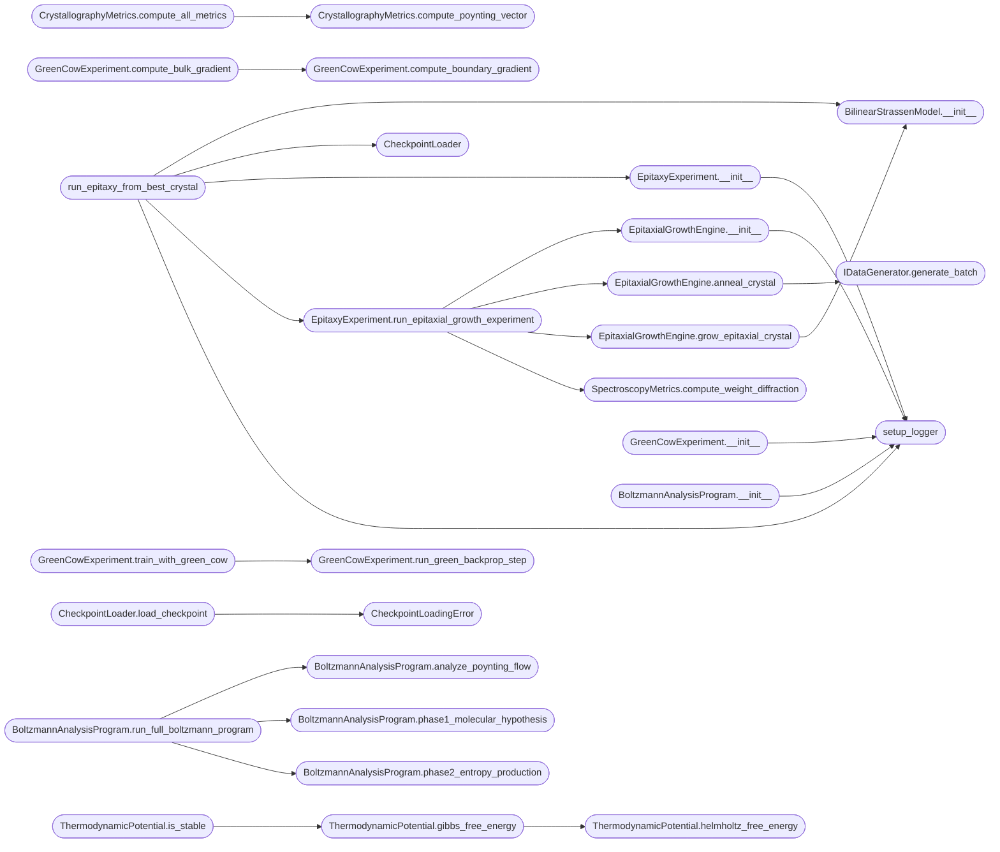

# `xray_tensor_diffractometer`

> Source: [xray_tensor_diffractometer.py:1](../../xray_tensor_diffractometer.py#L1) | language `py` | coverage 25.9% | [API index](../index.md)

## Contents

- **Classes:** [`Config`](#config), [`StrassenDataGenerator`](#strassendatagenerator), [`BilinearStrassenModel`](#bilinearstrassenmodel), [`EpitaxialGrowthEngine`](#epitaxialgrowthengine), [`EpitaxyExperiment`](#epitaxyexperiment), [`ThermodynamicPotential`](#thermodynamicpotential), [`SpectroscopyMetrics`](#spectroscopymetrics), [`ThermodynamicMetrics`](#thermodynamicmetrics), [`CrystallographyMetrics`](#crystallographymetrics), [`GreenCowExperiment`](#greencowexperiment), [`CheckpointLoader`](#checkpointloader), [`CheckpointMigrator`](#checkpointmigrator), [`BoltzmannAnalysisProgram`](#boltzmannanalysisprogram), [`StrassenCrystallographer`](#strassencrystallographer)
- **Protocols:** [`ICheckpointLoader`](#icheckpointloader), [`IMetricsCalculator`](#imetricscalculator), [`IDataGenerator`](#idatagenerator)
- **Exceptions:** [`CheckpointLoadingError`](#checkpointloadingerror), [`MetricsComputationError`](#metricscomputationerror), [`TrainingError`](#trainingerror)
- **Functions:** [`set_seed`](#set_seed), [`setup_logger`](#setup_logger), [`run_epitaxy_from_best_crystal`](#run_epitaxy_from_best_crystal), [`main`](#main)

## Type Diagram

```mermaid
classDiagram
    direction LR
    class Config
    Config : int BATCH_SIZE
    Config : int HIDDEN_DIM
    Config : int TARGET_SLOTS
    Config : int MATRIX_SIZE
    Config : float WEIGHT_DECAY
    Config : float LEARNING_RATE
    Config : int EPOCHS
    Config : float DISCRETIZATION_MARGIN
    Config : float HBAR
    Config : float POYNTING_THRESHOLD
    Config : float ENERGY_FLOW_SCALE
    Config : int RANDOM_SEED
    Config : str DEVICE
    Config : int CHECKPOINT_INTERVAL_MINUTES
    Config : int MAX_CHECKPOINTS
    Config : str KDE_BANDWIDTH
    Config : float MIN_VARIANCE_THRESHOLD
    Config : int PCA_COMPONENTS
    Config : int ENTROPY_BINS
    Config : str ENTROPY_METHOD
    Config : float ENTROPY_EPS
    Config : str LOG_LEVEL
    Config : str RESULTS_DIR
    class ICheckpointLoader
    <<protocol>> ICheckpointLoader
    ICheckpointLoader : load_checkpoint()
    class IMetricsCalculator
    <<protocol>> IMetricsCalculator
    IMetricsCalculator : compute()
    class IDataGenerator
    <<protocol>> IDataGenerator
    IDataGenerator : generate_batch()
    class CheckpointLoadingError
    <<exception>> CheckpointLoadingError
    class MetricsComputationError
    <<exception>> MetricsComputationError
    class TrainingError
    <<exception>> TrainingError
    class StrassenDataGenerator
    StrassenDataGenerator : generate_batch()
    StrassenDataGenerator : verify_structure()
    class BilinearStrassenModel
    BilinearStrassenModel : __init__()
    BilinearStrassenModel : forward()
    BilinearStrassenModel : get_coefficients()
    class EpitaxialGrowthEngine
    EpitaxialGrowthEngine : __init__()
    EpitaxialGrowthEngine : grow_epitaxial_crystal()
    EpitaxialGrowthEngine : anneal_crystal()
    class EpitaxyExperiment
    EpitaxyExperiment : __init__()
    EpitaxyExperiment : run_epitaxial_growth_experiment()
    class ThermodynamicPotential
    ThermodynamicPotential : float internal_energy
    ThermodynamicPotential : float temperature
    ThermodynamicPotential : float entropy
    ThermodynamicPotential : float chemical_potential
    ThermodynamicPotential : float crystallinity
    ThermodynamicPotential : float particle_number
    ThermodynamicPotential : helmholtz_free_energy()
    ThermodynamicPotential : gibbs_free_energy()
    ThermodynamicPotential : is_stable()
    class SpectroscopyMetrics
    SpectroscopyMetrics : compute_weight_diffraction()
    SpectroscopyMetrics : extract_lattice_parameters()
    SpectroscopyMetrics : compute_gibbs_free_energy()
    SpectroscopyMetrics : extract_canonical_decomposition()
    SpectroscopyMetrics : create_superlattice_seed()
    class ThermodynamicMetrics
    ThermodynamicMetrics : compute_effective_temperature()
    ThermodynamicMetrics : compute_critical_exponents()
    ThermodynamicMetrics : compute_equation_of_state()
    ThermodynamicMetrics : compute_specific_heat()
    ThermodynamicMetrics : estimate_hbar_algorithmic()
    ThermodynamicMetrics : compute_mutual_information()
    ThermodynamicMetrics : check_extensivity()
    ThermodynamicMetrics : compute_fisher_information_matrix()
    ThermodynamicMetrics : compute_ricci_curvature()
    ThermodynamicMetrics : calculate_carnot_efficiency()
    class CrystallographyMetrics
    CrystallographyMetrics : compute_kappa()
    CrystallographyMetrics : compute_discretization_margin()
    CrystallographyMetrics : compute_local_complexity()
    CrystallographyMetrics : compute_alpha_purity()
    CrystallographyMetrics : compute_kappa_quantum()
    CrystallographyMetrics : compute_poynting_vector()
    CrystallographyMetrics : compute_all_metrics()
    class GreenCowExperiment
    GreenCowExperiment : __init__()
    GreenCowExperiment : compute_boundary_gradient()
    GreenCowExperiment : compute_bulk_gradient()
    GreenCowExperiment : run_green_backprop_step()
    GreenCowExperiment : train_with_green_cow()
    class CheckpointLoader
    CheckpointLoader : load_checkpoint()
    class CheckpointMigrator
    CheckpointMigrator : migrate_checkpoint()
    class BoltzmannAnalysisProgram
    BoltzmannAnalysisProgram : __init__()
    BoltzmannAnalysisProgram : run_full_boltzmann_program()
    BoltzmannAnalysisProgram : phase1_molecular_hypothesis()
    BoltzmannAnalysisProgram : phase2_entropy_production()
    BoltzmannAnalysisProgram : phase3_extensivity_law()
    BoltzmannAnalysisProgram : phase4_quantum_basis_transform()
    BoltzmannAnalysisProgram : analyze_poynting_flow()
    BoltzmannAnalysisProgram : phase5_thermodynamic_analysis()
    BoltzmannAnalysisProgram : phase6_spectroscopic_analysis()
    class StrassenCrystallographer
    StrassenCrystallographer : __init__()
    StrassenCrystallographer : run_full_analysis()
```



## Call Graph

Solid arrows stay in this module, dashed arrows leave it.



## Classes

<a id="config"></a>

### `Config`

`class` `dataclass` | [xray_tensor_diffractometer.py:27](../../xray_tensor_diffractometer.py#L27)

Decorators: `@dataclass`

```python
class Config
```

**Attributes**

| Name | Type | Default | Description |
|---|---|---|---|
| [`BATCH_SIZE`](#config-batch_size) | `int` | `32` |  |
| [`HIDDEN_DIM`](#config-hidden_dim) | `int` | `8` |  |
| [`TARGET_SLOTS`](#config-target_slots) | `int` | `7` |  |
| [`MATRIX_SIZE`](#config-matrix_size) | `int` | `2` |  |
| [`WEIGHT_DECAY`](#config-weight_decay) | `float` | `0.0001` |  |
| [`LEARNING_RATE`](#config-learning_rate) | `float` | `0.001` |  |
| [`EPOCHS`](#config-epochs) | `int` | `3000` |  |
| [`DISCRETIZATION_MARGIN`](#config-discretization_margin) | `float` | `0.1` |  |
| [`HBAR`](#config-hbar) | `float` | `1e-06` |  |
| [`POYNTING_THRESHOLD`](#config-poynting_threshold) | `float` | `1.0` |  |
| [`ENERGY_FLOW_SCALE`](#config-energy_flow_scale) | `float` | `0.1` |  |
| [`RANDOM_SEED`](#config-random_seed) | `int` | `42` |  |
| [`DEVICE`](#config-device) | `str` | `'cuda' if torch.cuda.is_available() else 'cpu'` |  |
| [`CHECKPOINT_INTERVAL_MINUTES`](#config-checkpoint_interval_minutes) | `int` | `5` |  |
| [`MAX_CHECKPOINTS`](#config-max_checkpoints) | `int` | `10` |  |
| [`KDE_BANDWIDTH`](#config-kde_bandwidth) | `str` | `'scott'` |  |
| [`MIN_VARIANCE_THRESHOLD`](#config-min_variance_threshold) | `float` | `1e-08` |  |
| [`PCA_COMPONENTS`](#config-pca_components) | `int` | `2` |  |
| [`ENTROPY_BINS`](#config-entropy_bins) | `int` | `50` |  |
| [`ENTROPY_METHOD`](#config-entropy_method) | `str` | `'shannon'` |  |
| [`ENTROPY_EPS`](#config-entropy_eps) | `float` | `1e-10` |  |
| [`LOG_LEVEL`](#config-log_level) | `str` | `'INFO'` |  |
| [`RESULTS_DIR`](#config-results_dir) | `str` | `'boltzmann_results'` |  |

---

<a id="strassendatagenerator"></a>

### `StrassenDataGenerator`

`class` | [xray_tensor_diffractometer.py:166](../../xray_tensor_diffractometer.py#L166)

```python
class StrassenDataGenerator
```

**Members**

| Member | Kind | Summary |
|---|---|---|
| [`generate_batch`](#strassendatagenerator-generate_batch) | staticmethod |  |
| [`verify_structure`](#strassendatagenerator-verify_structure) | staticmethod |  |

<a id="strassendatagenerator-generate_batch"></a>

#### `StrassenDataGenerator.generate_batch`

`staticmethod` | [xray_tensor_diffractometer.py:168](../../xray_tensor_diffractometer.py#L168)

Decorators: `@staticmethod`

```python
def generate_batch(batch_size: int = Config.BATCH_SIZE) -> Tuple[torch.Tensor, torch.Tensor, torch.Tensor]
```

**Parameters**

| Name | Type | Default | Description |
|---|---|---|---|
| `batch_size` | `int` | `Config.BATCH_SIZE` |  |

**Returns:** `Tuple[torch.Tensor, torch.Tensor, torch.Tensor]`

<a id="strassendatagenerator-verify_structure"></a>

#### `StrassenDataGenerator.verify_structure`

`staticmethod` | [xray_tensor_diffractometer.py:179](../../xray_tensor_diffractometer.py#L179)

Decorators: `@staticmethod`

```python
def verify_structure(coeffs: Dict[str, torch.Tensor]) -> Dict[str, Any]
```

**Parameters**

| Name | Type | Default | Description |
|---|---|---|---|
| `coeffs` | `Dict[str, torch.Tensor]` |  |  |

**Returns:** `Dict[str, Any]`

*Calls:* [`CrystallographyMetrics.compute_discretization_margin`](batch_size.py.md#crystallographymetrics-compute_discretization_margin)

---

<a id="bilinearstrassenmodel"></a>

### `BilinearStrassenModel`

`class` | [xray_tensor_diffractometer.py:187](../../xray_tensor_diffractometer.py#L187)

```python
class BilinearStrassenModel(nn.Module)
```

Bases: `nn.Module`

**Members**

| Member | Kind | Summary |
|---|---|---|
| [`__init__`](#bilinearstrassenmodel-__init__) | constructor |  |
| [`forward`](#bilinearstrassenmodel-forward) | method |  |
| [`get_coefficients`](#bilinearstrassenmodel-get_coefficients) | method |  |

<a id="bilinearstrassenmodel-__init__"></a>

#### `BilinearStrassenModel.__init__`

`constructor` | [xray_tensor_diffractometer.py:188](../../xray_tensor_diffractometer.py#L188)

```python
def __init__(self, hidden_dim: int = Config.HIDDEN_DIM, matrix_size: int = Config.MATRIX_SIZE)
```

**Parameters**

| Name | Type | Default | Description |
|---|---|---|---|
| `hidden_dim` | `int` | `Config.HIDDEN_DIM` |  |
| `matrix_size` | `int` | `Config.MATRIX_SIZE` |  |

*Calls:* [`BilinearStrassenModel.__init__`](batch_size.py.md#bilinearstrassenmodel-__init__)

*Called by:* [`EpitaxialGrowthEngine.grow_epitaxial_crystal`](#epitaxialgrowthengine-grow_epitaxial_crystal), [`main`](#main), [`run_epitaxy_from_best_crystal`](#run_epitaxy_from_best_crystal)

<a id="bilinearstrassenmodel-forward"></a>

#### `BilinearStrassenModel.forward`

`method` | [xray_tensor_diffractometer.py:204](../../xray_tensor_diffractometer.py#L204)

```python
def forward(self, a: torch.Tensor, b: torch.Tensor) -> torch.Tensor
```

**Parameters**

| Name | Type | Default | Description |
|---|---|---|---|
| `a` | `torch.Tensor` |  |  |
| `b` | `torch.Tensor` |  |  |

**Returns:** `torch.Tensor`

<a id="bilinearstrassenmodel-get_coefficients"></a>

#### `BilinearStrassenModel.get_coefficients`

`method` | [xray_tensor_diffractometer.py:207](../../xray_tensor_diffractometer.py#L207)

```python
def get_coefficients(self) -> Dict[str, torch.Tensor]
```

**Returns:** `Dict[str, torch.Tensor]`

---

<a id="epitaxialgrowthengine"></a>

### `EpitaxialGrowthEngine`

`class` | [xray_tensor_diffractometer.py:216](../../xray_tensor_diffractometer.py#L216)

```python
class EpitaxialGrowthEngine
```

Motor de crecimiento epitaxial para cristales algorítmicos.

FÍSICA: Imita el crecimiento de cristales en sustratos donde la estructura
atómica del sustrato guía la formación del nuevo cristal.

**Members**

| Member | Kind | Summary |
|---|---|---|
| [`__init__`](#epitaxialgrowthengine-__init__) | constructor |  |
| [`grow_epitaxial_crystal`](#epitaxialgrowthengine-grow_epitaxial_crystal) | method | Crece un cristal epitaxial desde la semilla. |
| [`anneal_crystal`](#epitaxialgrowthengine-anneal_crystal) | method | Recocido térmico del cristal epitaxial. |

<a id="epitaxialgrowthengine-__init__"></a>

#### `EpitaxialGrowthEngine.__init__`

`constructor` | [xray_tensor_diffractometer.py:224](../../xray_tensor_diffractometer.py#L224)

```python
def __init__(self, seed_checkpoint_path: str, target_matrix_size: int, device: str = Config.DEVICE)
```

**Parameters**

| Name | Type | Default | Description |
|---|---|---|---|
| `seed_checkpoint_path` | `str` |  |  |
| `target_matrix_size` | `int` |  |  |
| `device` | `str` | `Config.DEVICE` |  |

*Calls:* [`setup_logger`](#setup_logger)

*Called by:* [`EpitaxyExperiment.run_epitaxial_growth_experiment`](#epitaxyexperiment-run_epitaxial_growth_experiment)

<a id="epitaxialgrowthengine-grow_epitaxial_crystal"></a>

#### `EpitaxialGrowthEngine.grow_epitaxial_crystal`

`method` | [xray_tensor_diffractometer.py:265](../../xray_tensor_diffractometer.py#L265)

```python
def grow_epitaxial_crystal(self) -> BilinearStrassenModel
```

Crece un cristal epitaxial desde la semilla.

MÉTODO: Kronecker product preserva la estructura periódica:
Si A es cristal Strassen de 2x2, entonces A ⊗ I_n es cristal de (2n)x(2n)

**Returns:** `BilinearStrassenModel`

*Calls:* [`BilinearStrassenModel.__init__`](#bilinearstrassenmodel-__init__)

*Called by:* [`EpitaxyExperiment.run_epitaxial_growth_experiment`](#epitaxyexperiment-run_epitaxial_growth_experiment)

<a id="epitaxialgrowthengine-anneal_crystal"></a>

#### `EpitaxialGrowthEngine.anneal_crystal`

`method` | [xray_tensor_diffractometer.py:360](../../xray_tensor_diffractometer.py#L360)

```python
def anneal_crystal(self, model: BilinearStrassenModel, max_epochs: int = 50, early_stop_threshold: float = 0.0001) -> Dict[str, Any]
```

Recocido térmico del cristal epitaxial.

FÍSICA: En lugar de "entrenar desde cero", aplicamos temperatura decreciente
para que el cristal se auto-organice alrededor de la semilla.

**Parameters**

| Name | Type | Default | Description |
|---|---|---|---|
| `model` | `BilinearStrassenModel` |  |  |
| `max_epochs` | `int` | `50` |  |
| `early_stop_threshold` | `float` | `0.0001` |  |

**Returns:** `Dict[str, Any]`

*Calls:* [`BilinearStrassenModel.get_coefficients`](batch_size.py.md#bilinearstrassenmodel-get_coefficients), [`CrystallographyMetrics.compute_discretization_margin`](batch_size.py.md#crystallographymetrics-compute_discretization_margin), [`CrystallographyMetrics.compute_alpha_purity`](boltzmann_experiments.py.md#crystallographymetrics-compute_alpha_purity), [`IDataGenerator.generate_batch`](#idatagenerator-generate_batch)

*Called by:* [`EpitaxyExperiment.run_epitaxial_growth_experiment`](#epitaxyexperiment-run_epitaxial_growth_experiment)

---

<a id="epitaxyexperiment"></a>

### `EpitaxyExperiment`

`class` | [xray_tensor_diffractometer.py:469](../../xray_tensor_diffractometer.py#L469)

```python
class EpitaxyExperiment
```

Experimento completo de epitaxia: sembrar, crecer, analizar.

**Members**

| Member | Kind | Summary |
|---|---|---|
| [`__init__`](#epitaxyexperiment-__init__) | constructor |  |
| [`run_epitaxial_growth_experiment`](#epitaxyexperiment-run_epitaxial_growth_experiment) | method | Experimento completo: cultiva cristales de múltiples tamaños desde una semilla. |

<a id="epitaxyexperiment-__init__"></a>

#### `EpitaxyExperiment.__init__`

`constructor` | [xray_tensor_diffractometer.py:474](../../xray_tensor_diffractometer.py#L474)

```python
def __init__(self, results_dir: str = 'epitaxy_results')
```

**Parameters**

| Name | Type | Default | Description |
|---|---|---|---|
| `results_dir` | `str` | `'epitaxy_results'` |  |

*Calls:* [`setup_logger`](#setup_logger)

*Called by:* [`main`](#main), [`run_epitaxy_from_best_crystal`](#run_epitaxy_from_best_crystal)

<a id="epitaxyexperiment-run_epitaxial_growth_experiment"></a>

#### `EpitaxyExperiment.run_epitaxial_growth_experiment`

`method` | [xray_tensor_diffractometer.py:479](../../xray_tensor_diffractometer.py#L479)

```python
def run_epitaxial_growth_experiment(self, seed_checkpoint: str, target_sizes: List[int] = [4, 8, 16]) -> Dict[str, Any]
```

Experimento completo: cultiva cristales de múltiples tamaños desde una semilla.

**Parameters**

| Name | Type | Default | Description |
|---|---|---|---|
| `seed_checkpoint` | `str` |  |  |
| `target_sizes` | `List[int]` | `[4, 8, 16]` |  |

**Returns:** `Dict[str, Any]`

**Raises**

- `FileNotFoundError`: (raised in the body, not documented)

*Calls:* [`StrassenDataGenerator.verify_structure`](crystallography.py.md#strassendatagenerator-verify_structure), [`EpitaxialGrowthEngine.__init__`](#epitaxialgrowthengine-__init__), [`EpitaxialGrowthEngine.anneal_crystal`](#epitaxialgrowthengine-anneal_crystal), [`EpitaxialGrowthEngine.grow_epitaxial_crystal`](#epitaxialgrowthengine-grow_epitaxial_crystal), [`SpectroscopyMetrics.compute_weight_diffraction`](#spectroscopymetrics-compute_weight_diffraction)

*Called by:* [`main`](#main), [`run_epitaxy_from_best_crystal`](#run_epitaxy_from_best_crystal)

---

<a id="thermodynamicpotential"></a>

### `ThermodynamicPotential`

`class` `dataclass` | [xray_tensor_diffractometer.py:671](../../xray_tensor_diffractometer.py#L671)

Decorators: `@dataclass`

```python
class ThermodynamicPotential
```

Potencial de Helmholtz: F = U - T*S + μ*N + α_term*C

**Attributes**

| Name | Type | Default | Description |
|---|---|---|---|
| [`internal_energy`](#thermodynamicpotential-internal_energy) | `float` |  |  |
| [`temperature`](#thermodynamicpotential-temperature) | `float` |  |  |
| [`entropy`](#thermodynamicpotential-entropy) | `float` |  |  |
| [`chemical_potential`](#thermodynamicpotential-chemical_potential) | `float` |  |  |
| [`crystallinity`](#thermodynamicpotential-crystallinity) | `float` |  |  |
| [`particle_number`](#thermodynamicpotential-particle_number) | `float` |  |  |

**Members**

| Member | Kind | Summary |
|---|---|---|
| [`helmholtz_free_energy`](#thermodynamicpotential-helmholtz_free_energy) | method | F = U - T*S (a μ y N constantes) |
| [`gibbs_free_energy`](#thermodynamicpotential-gibbs_free_energy) | method | G = F + μ*N + P*V (presión algorítmica) |
| [`is_stable`](#thermodynamicpotential-is_stable) | method | Criterio de estabilidad: dG < 0 |

<a id="thermodynamicpotential-helmholtz_free_energy"></a>

#### `ThermodynamicPotential.helmholtz_free_energy`

`method` | [xray_tensor_diffractometer.py:680](../../xray_tensor_diffractometer.py#L680)

```python
def helmholtz_free_energy(self) -> float
```

F = U - T*S (a μ y N constantes)

**Returns:** `float`

*Called by:* [`BoltzmannAnalysisProgram.phase5_thermodynamic_analysis`](#boltzmannanalysisprogram-phase5_thermodynamic_analysis), [`ThermodynamicPotential.gibbs_free_energy`](#thermodynamicpotential-gibbs_free_energy)

<a id="thermodynamicpotential-gibbs_free_energy"></a>

#### `ThermodynamicPotential.gibbs_free_energy`

`method` | [xray_tensor_diffractometer.py:684](../../xray_tensor_diffractometer.py#L684)

```python
def gibbs_free_energy(self) -> float
```

G = F + μ*N + P*V (presión algorítmica)

**Returns:** `float`

*Calls:* [`ThermodynamicPotential.helmholtz_free_energy`](#thermodynamicpotential-helmholtz_free_energy)

*Called by:* [`BoltzmannAnalysisProgram.phase5_thermodynamic_analysis`](#boltzmannanalysisprogram-phase5_thermodynamic_analysis), [`ThermodynamicPotential.is_stable`](#thermodynamicpotential-is_stable)

<a id="thermodynamicpotential-is_stable"></a>

#### `ThermodynamicPotential.is_stable`

`method` | [xray_tensor_diffractometer.py:689](../../xray_tensor_diffractometer.py#L689)

```python
def is_stable(self) -> bool
```

Criterio de estabilidad: dG < 0

**Returns:** `bool`

*Calls:* [`ThermodynamicPotential.gibbs_free_energy`](#thermodynamicpotential-gibbs_free_energy)

*Called by:* [`BoltzmannAnalysisProgram.phase5_thermodynamic_analysis`](#boltzmannanalysisprogram-phase5_thermodynamic_analysis)

---

<a id="spectroscopymetrics"></a>

### `SpectroscopyMetrics`

`class` | [xray_tensor_diffractometer.py:693](../../xray_tensor_diffractometer.py#L693)

```python
class SpectroscopyMetrics
```

**Members**

| Member | Kind | Summary |
|---|---|---|
| [`compute_weight_diffraction`](#spectroscopymetrics-compute_weight_diffraction) | staticmethod |  |
| [`extract_lattice_parameters`](#spectroscopymetrics-extract_lattice_parameters) | staticmethod | Extrae parámetros de red preservando la geometría física del tensor. |
| [`compute_gibbs_free_energy`](#spectroscopymetrics-compute_gibbs_free_energy) | staticmethod |  |
| [`extract_canonical_decomposition`](#spectroscopymetrics-extract_canonical_decomposition) | staticmethod | Descomposición Canónica del tensor tripartito (U, V, W). |
| [`create_superlattice_seed`](#spectroscopymetrics-create_superlattice_seed) | staticmethod |  |

<a id="spectroscopymetrics-compute_weight_diffraction"></a>

#### `SpectroscopyMetrics.compute_weight_diffraction`

`staticmethod` | [xray_tensor_diffractometer.py:696](../../xray_tensor_diffractometer.py#L696)

Decorators: `@staticmethod`

```python
def compute_weight_diffraction(coeffs: Dict[str, torch.Tensor]) -> Dict[str, Any]
```

**Parameters**

| Name | Type | Default | Description |
|---|---|---|---|
| `coeffs` | `Dict[str, torch.Tensor]` |  |  |

**Returns:** `Dict[str, Any]`

*Called by:* [`BoltzmannAnalysisProgram.phase6_spectroscopic_analysis`](#boltzmannanalysisprogram-phase6_spectroscopic_analysis), [`EpitaxyExperiment.run_epitaxial_growth_experiment`](#epitaxyexperiment-run_epitaxial_growth_experiment)

<a id="spectroscopymetrics-extract_lattice_parameters"></a>

#### `SpectroscopyMetrics.extract_lattice_parameters`

`staticmethod` | [xray_tensor_diffractometer.py:726](../../xray_tensor_diffractometer.py#L726)

Decorators: `@staticmethod`

```python
def extract_lattice_parameters(weight_tensor: torch.Tensor, rank: int = 7) -> Dict[str, Any]
```

Extrae parámetros de red preservando la geometría física del tensor.

FIX: En lugar de reshape arbitrario, aplicamos SVD sobre la matriz
de covarianza que preserva la estructura de correlaciones.

**Parameters**

| Name | Type | Default | Description |
|---|---|---|---|
| `weight_tensor` | `torch.Tensor` |  |  |
| `rank` | `int` | `7` |  |

**Returns:** `Dict[str, Any]`

*Called by:* [`BoltzmannAnalysisProgram.phase6_spectroscopic_analysis`](#boltzmannanalysisprogram-phase6_spectroscopic_analysis)

<a id="spectroscopymetrics-compute_gibbs_free_energy"></a>

#### `SpectroscopyMetrics.compute_gibbs_free_energy`

`staticmethod` | [xray_tensor_diffractometer.py:785](../../xray_tensor_diffractometer.py#L785)

Decorators: `@staticmethod`

```python
def compute_gibbs_free_energy(loss: float, temp: float, entropy: float) -> float
```

**Parameters**

| Name | Type | Default | Description |
|---|---|---|---|
| `loss` | `float` |  |  |
| `temp` | `float` |  |  |
| `entropy` | `float` |  |  |

**Returns:** `float`

*Called by:* [`BoltzmannAnalysisProgram.phase6_spectroscopic_analysis`](#boltzmannanalysisprogram-phase6_spectroscopic_analysis)

<a id="spectroscopymetrics-extract_canonical_decomposition"></a>

#### `SpectroscopyMetrics.extract_canonical_decomposition`

`staticmethod` | [xray_tensor_diffractometer.py:791](../../xray_tensor_diffractometer.py#L791)

Decorators: `@staticmethod`

```python
def extract_canonical_decomposition(coeffs: Dict[str, torch.Tensor], rank: int = 7) -> Dict[str, Any]
```

Descomposición Canónica del tensor tripartito (U, V, W).

FIX: Preserva la estructura bilineal en lugar de tratar como matriz plana.
Aplicamos HOSVD (Higher-Order SVD) para tensores de orden 3.

**Parameters**

| Name | Type | Default | Description |
|---|---|---|---|
| `coeffs` | `Dict[str, torch.Tensor]` |  |  |
| `rank` | `int` | `7` |  |

**Returns:** `Dict[str, Any]`

*Called by:* [`BoltzmannAnalysisProgram.phase6_spectroscopic_analysis`](#boltzmannanalysisprogram-phase6_spectroscopic_analysis)

<a id="spectroscopymetrics-create_superlattice_seed"></a>

#### `SpectroscopyMetrics.create_superlattice_seed`

`staticmethod` | [xray_tensor_diffractometer.py:892](../../xray_tensor_diffractometer.py#L892)

Decorators: `@staticmethod`

```python
def create_superlattice_seed(base_tensor: Dict[str, torch.Tensor], scale_factor: int = 2) -> Dict[str, torch.Tensor]
```

**Parameters**

| Name | Type | Default | Description |
|---|---|---|---|
| `base_tensor` | `Dict[str, torch.Tensor]` |  |  |
| `scale_factor` | `int` | `2` |  |

**Returns:** `Dict[str, torch.Tensor]`

*Called by:* [`BoltzmannAnalysisProgram.phase6_spectroscopic_analysis`](#boltzmannanalysisprogram-phase6_spectroscopic_analysis)

---

<a id="thermodynamicmetrics"></a>

### `ThermodynamicMetrics`

`class` | [xray_tensor_diffractometer.py:913](../../xray_tensor_diffractometer.py#L913)

```python
class ThermodynamicMetrics
```

**Members**

| Member | Kind | Summary |
|---|---|---|
| [`compute_effective_temperature`](#thermodynamicmetrics-compute_effective_temperature) | staticmethod |  |
| [`compute_critical_exponents`](#thermodynamicmetrics-compute_critical_exponents) | staticmethod | Calcula exponentes críticos cerca de transiciones de fase. |
| [`compute_equation_of_state`](#thermodynamicmetrics-compute_equation_of_state) | staticmethod | Ecuación de estado: T_c(α) = T_0 * exp(-c*α) |
| [`compute_specific_heat`](#thermodynamicmetrics-compute_specific_heat) | staticmethod |  |
| [`estimate_hbar_algorithmic`](#thermodynamicmetrics-estimate_hbar_algorithmic) | staticmethod |  |
| [`compute_mutual_information`](#thermodynamicmetrics-compute_mutual_information) | staticmethod |  |
| [`check_extensivity`](#thermodynamicmetrics-check_extensivity) | staticmethod |  |
| [`compute_fisher_information_matrix`](#thermodynamicmetrics-compute_fisher_information_matrix) | staticmethod |  |
| [`compute_ricci_curvature`](#thermodynamicmetrics-compute_ricci_curvature) | staticmethod |  |
| [`calculate_carnot_efficiency`](#thermodynamicmetrics-calculate_carnot_efficiency) | staticmethod |  |

<a id="thermodynamicmetrics-compute_effective_temperature"></a>

#### `ThermodynamicMetrics.compute_effective_temperature`

`staticmethod` | [xray_tensor_diffractometer.py:916](../../xray_tensor_diffractometer.py#L916)

Decorators: `@staticmethod`

```python
def compute_effective_temperature(gradient_buffer: List[torch.Tensor], learning_rate: float) -> float
```

**Parameters**

| Name | Type | Default | Description |
|---|---|---|---|
| `gradient_buffer` | `List[torch.Tensor]` |  |  |
| `learning_rate` | `float` |  |  |

**Returns:** `float`

*Called by:* [`BoltzmannAnalysisProgram.phase5_thermodynamic_analysis`](#boltzmannanalysisprogram-phase5_thermodynamic_analysis)

<a id="thermodynamicmetrics-compute_critical_exponents"></a>

#### `ThermodynamicMetrics.compute_critical_exponents`

`staticmethod` | [xray_tensor_diffractometer.py:930](../../xray_tensor_diffractometer.py#L930)

Decorators: `@staticmethod`

```python
def compute_critical_exponents(temp_history: List[float], cv_history: List[float], alpha_history: List[float]) -> Dict[str, float]
```

Calcula exponentes críticos cerca de transiciones de fase.

Leyes de escala:
- C_v ~ |T - T_c|^{-α_exp}  (calor específico)
- ξ ~ |T - T_c|^{-ν}        (longitud de correlación)
- τ ~ |T - T_c|^{-z}        (tiempo de grokking)

**Parameters**

| Name | Type | Default | Description |
|---|---|---|---|
| `temp_history` | `List[float]` |  |  |
| `cv_history` | `List[float]` |  |  |
| `alpha_history` | `List[float]` |  |  |

**Returns:** `Dict[str, float]`

*Called by:* [`BoltzmannAnalysisProgram.phase5_thermodynamic_analysis`](#boltzmannanalysisprogram-phase5_thermodynamic_analysis)

<a id="thermodynamicmetrics-compute_equation_of_state"></a>

#### `ThermodynamicMetrics.compute_equation_of_state`

`staticmethod` | [xray_tensor_diffractometer.py:1009](../../xray_tensor_diffractometer.py#L1009)

Decorators: `@staticmethod`

```python
def compute_equation_of_state(temp_eff: float, alpha: float, kappa: float) -> Dict[str, Any]
```

Ecuación de estado: T_c(α) = T_0 * exp(-c*α)

FIX: Relación constitutiva que describe la curva de coexistencia cristal-vidrio.

**Parameters**

| Name | Type | Default | Description |
|---|---|---|---|
| `temp_eff` | `float` |  |  |
| `alpha` | `float` |  |  |
| `kappa` | `float` |  |  |

**Returns:** `Dict[str, Any]`

*Called by:* [`BoltzmannAnalysisProgram.phase5_thermodynamic_analysis`](#boltzmannanalysisprogram-phase5_thermodynamic_analysis)

<a id="thermodynamicmetrics-compute_specific_heat"></a>

#### `ThermodynamicMetrics.compute_specific_heat`

`staticmethod` | [xray_tensor_diffractometer.py:1048](../../xray_tensor_diffractometer.py#L1048)

Decorators: `@staticmethod`

```python
def compute_specific_heat(loss_history: List[float], temp_history: List[float], cv_threshold: float = 1.0) -> Tuple[float, bool]
```

**Parameters**

| Name | Type | Default | Description |
|---|---|---|---|
| `loss_history` | `List[float]` |  |  |
| `temp_history` | `List[float]` |  |  |
| `cv_threshold` | `float` | `1.0` |  |

**Returns:** `Tuple[float, bool]`

*Called by:* [`BoltzmannAnalysisProgram.phase5_thermodynamic_analysis`](#boltzmannanalysisprogram-phase5_thermodynamic_analysis)

<a id="thermodynamicmetrics-estimate_hbar_algorithmic"></a>

#### `ThermodynamicMetrics.estimate_hbar_algorithmic`

`staticmethod` | [xray_tensor_diffractometer.py:1061](../../xray_tensor_diffractometer.py#L1061)

Decorators: `@staticmethod`

```python
def estimate_hbar_algorithmic(model_complexity: float, weight_dim: int, mutual_information: float) -> float
```

**Parameters**

| Name | Type | Default | Description |
|---|---|---|---|
| `model_complexity` | `float` |  |  |
| `weight_dim` | `int` |  |  |
| `mutual_information` | `float` |  |  |

**Returns:** `float`

*Called by:* [`BoltzmannAnalysisProgram.phase5_thermodynamic_analysis`](#boltzmannanalysisprogram-phase5_thermodynamic_analysis)

<a id="thermodynamicmetrics-compute_mutual_information"></a>

#### `ThermodynamicMetrics.compute_mutual_information`

`staticmethod` | [xray_tensor_diffractometer.py:1069](../../xray_tensor_diffractometer.py#L1069)

Decorators: `@staticmethod`

```python
def compute_mutual_information(weights: torch.Tensor, gradients: torch.Tensor) -> float
```

**Parameters**

| Name | Type | Default | Description |
|---|---|---|---|
| `weights` | `torch.Tensor` |  |  |
| `gradients` | `torch.Tensor` |  |  |

**Returns:** `float`

*Called by:* [`BoltzmannAnalysisProgram.phase5_thermodynamic_analysis`](#boltzmannanalysisprogram-phase5_thermodynamic_analysis)

<a id="thermodynamicmetrics-check_extensivity"></a>

#### `ThermodynamicMetrics.check_extensivity`

`staticmethod` | [xray_tensor_diffractometer.py:1083](../../xray_tensor_diffractometer.py#L1083)

Decorators: `@staticmethod`

```python
def check_extensivity(entropy_list: List[float], scale_factors: List[float]) -> Dict[str, Any]
```

**Parameters**

| Name | Type | Default | Description |
|---|---|---|---|
| `entropy_list` | `List[float]` |  |  |
| `scale_factors` | `List[float]` |  |  |

**Returns:** `Dict[str, Any]`

<a id="thermodynamicmetrics-compute_fisher_information_matrix"></a>

#### `ThermodynamicMetrics.compute_fisher_information_matrix`

`staticmethod` | [xray_tensor_diffractometer.py:1107](../../xray_tensor_diffractometer.py#L1107)

Decorators: `@staticmethod`

```python
def compute_fisher_information_matrix(model: nn.Module, samples: List[Tuple[torch.Tensor, torch.Tensor, torch.Tensor]]) -> torch.Tensor
```

**Parameters**

| Name | Type | Default | Description |
|---|---|---|---|
| `model` | `nn.Module` |  |  |
| `samples` | `List[Tuple[torch.Tensor, torch.Tensor, torch.Tensor]]` |  |  |

**Returns:** `torch.Tensor`

*Called by:* [`BoltzmannAnalysisProgram.phase5_thermodynamic_analysis`](#boltzmannanalysisprogram-phase5_thermodynamic_analysis)

<a id="thermodynamicmetrics-compute_ricci_curvature"></a>

#### `ThermodynamicMetrics.compute_ricci_curvature`

`staticmethod` | [xray_tensor_diffractometer.py:1126](../../xray_tensor_diffractometer.py#L1126)

Decorators: `@staticmethod`

```python
def compute_ricci_curvature(fisher_matrix: torch.Tensor) -> float
```

**Parameters**

| Name | Type | Default | Description |
|---|---|---|---|
| `fisher_matrix` | `torch.Tensor` |  |  |

**Returns:** `float`

*Called by:* [`BoltzmannAnalysisProgram.phase5_thermodynamic_analysis`](#boltzmannanalysisprogram-phase5_thermodynamic_analysis)

<a id="thermodynamicmetrics-calculate_carnot_efficiency"></a>

#### `ThermodynamicMetrics.calculate_carnot_efficiency`

`staticmethod` | [xray_tensor_diffractometer.py:1137](../../xray_tensor_diffractometer.py#L1137)

Decorators: `@staticmethod`

```python
def calculate_carnot_efficiency(delta_alpha: float, total_flops: float, initial_alpha: float = 0.0) -> Dict[str, Any]
```

**Parameters**

| Name | Type | Default | Description |
|---|---|---|---|
| `delta_alpha` | `float` |  |  |
| `total_flops` | `float` |  |  |
| `initial_alpha` | `float` | `0.0` |  |

**Returns:** `Dict[str, Any]`

*Called by:* [`BoltzmannAnalysisProgram.phase5_thermodynamic_analysis`](#boltzmannanalysisprogram-phase5_thermodynamic_analysis)

---

<a id="crystallographymetrics"></a>

### `CrystallographyMetrics`

`class` | [xray_tensor_diffractometer.py:1158](../../xray_tensor_diffractometer.py#L1158)

```python
class CrystallographyMetrics
```

**Members**

| Member | Kind | Summary |
|---|---|---|
| [`compute_kappa`](#crystallographymetrics-compute_kappa) | staticmethod |  |
| [`compute_discretization_margin`](#crystallographymetrics-compute_discretization_margin) | staticmethod |  |
| [`compute_local_complexity`](#crystallographymetrics-compute_local_complexity) | staticmethod |  |
| [`compute_alpha_purity`](#crystallographymetrics-compute_alpha_purity) | staticmethod |  |
| [`compute_kappa_quantum`](#crystallographymetrics-compute_kappa_quantum) | staticmethod |  |
| [`compute_poynting_vector`](#crystallographymetrics-compute_poynting_vector) | staticmethod |  |
| [`compute_all_metrics`](#crystallographymetrics-compute_all_metrics) | staticmethod |  |

<a id="crystallographymetrics-compute_kappa"></a>

#### `CrystallographyMetrics.compute_kappa`

`staticmethod` | [xray_tensor_diffractometer.py:1161](../../xray_tensor_diffractometer.py#L1161)

Decorators: `@staticmethod`

```python
def compute_kappa(model: nn.Module, dataloader, num_batches: int = 5) -> float
```

**Parameters**

| Name | Type | Default | Description |
|---|---|---|---|
| `model` | `nn.Module` |  |  |
| `dataloader` |  |  |  |
| `num_batches` | `int` | `5` |  |

**Returns:** `float`

<a id="crystallographymetrics-compute_discretization_margin"></a>

#### `CrystallographyMetrics.compute_discretization_margin`

`staticmethod` | [xray_tensor_diffractometer.py:1187](../../xray_tensor_diffractometer.py#L1187)

Decorators: `@staticmethod`

```python
def compute_discretization_margin(coeffs: Dict[str, torch.Tensor]) -> float
```

**Parameters**

| Name | Type | Default | Description |
|---|---|---|---|
| `coeffs` | `Dict[str, torch.Tensor]` |  |  |

**Returns:** `float`

<a id="crystallographymetrics-compute_local_complexity"></a>

#### `CrystallographyMetrics.compute_local_complexity`

`staticmethod` | [xray_tensor_diffractometer.py:1191](../../xray_tensor_diffractometer.py#L1191)

Decorators: `@staticmethod`

```python
def compute_local_complexity(model: nn.Module) -> float
```

**Parameters**

| Name | Type | Default | Description |
|---|---|---|---|
| `model` | `nn.Module` |  |  |

**Returns:** `float`

<a id="crystallographymetrics-compute_alpha_purity"></a>

#### `CrystallographyMetrics.compute_alpha_purity`

`staticmethod` | [xray_tensor_diffractometer.py:1200](../../xray_tensor_diffractometer.py#L1200)

Decorators: `@staticmethod`

```python
def compute_alpha_purity(coeffs: Dict[str, torch.Tensor]) -> float
```

**Parameters**

| Name | Type | Default | Description |
|---|---|---|---|
| `coeffs` | `Dict[str, torch.Tensor]` |  |  |

**Returns:** `float`

*Calls:* [`CrystallographyMetrics.compute_discretization_margin`](batch_size.py.md#crystallographymetrics-compute_discretization_margin)

<a id="crystallographymetrics-compute_kappa_quantum"></a>

#### `CrystallographyMetrics.compute_kappa_quantum`

`staticmethod` | [xray_tensor_diffractometer.py:1207](../../xray_tensor_diffractometer.py#L1207)

Decorators: `@staticmethod`

```python
def compute_kappa_quantum(coeffs: Dict[str, torch.Tensor], hbar: float = Config.HBAR) -> float
```

**Parameters**

| Name | Type | Default | Description |
|---|---|---|---|
| `coeffs` | `Dict[str, torch.Tensor]` |  |  |
| `hbar` | `float` | `Config.HBAR` |  |

**Returns:** `float`

<a id="crystallographymetrics-compute_poynting_vector"></a>

#### `CrystallographyMetrics.compute_poynting_vector`

`staticmethod` | [xray_tensor_diffractometer.py:1224](../../xray_tensor_diffractometer.py#L1224)

Decorators: `@staticmethod`

```python
def compute_poynting_vector(coeffs: Dict[str, torch.Tensor]) -> Dict[str, Any]
```

**Parameters**

| Name | Type | Default | Description |
|---|---|---|---|
| `coeffs` | `Dict[str, torch.Tensor]` |  |  |

**Returns:** `Dict[str, Any]`

*Called by:* [`CrystallographyMetrics.compute_all_metrics`](#crystallographymetrics-compute_all_metrics)

<a id="crystallographymetrics-compute_all_metrics"></a>

#### `CrystallographyMetrics.compute_all_metrics`

`staticmethod` | [xray_tensor_diffractometer.py:1246](../../xray_tensor_diffractometer.py#L1246)

Decorators: `@staticmethod`

```python
def compute_all_metrics(model: nn.Module, dataloader) -> Dict[str, Any]
```

**Parameters**

| Name | Type | Default | Description |
|---|---|---|---|
| `model` | `nn.Module` |  |  |
| `dataloader` |  |  |  |

**Returns:** `Dict[str, Any]`

*Calls:* [`CrystallographyMetrics.compute_discretization_margin`](batch_size.py.md#crystallographymetrics-compute_discretization_margin), [`CrystallographyMetrics.compute_kappa`](batch_size.py.md#crystallographymetrics-compute_kappa), [`CrystallographyMetrics.compute_local_complexity`](batch_size.py.md#crystallographymetrics-compute_local_complexity), [`CrystallographyMetrics.compute_alpha_purity`](boltzmann_experiments.py.md#crystallographymetrics-compute_alpha_purity), [`CrystallographyMetrics.compute_kappa_quantum`](boltzmann_experiments.py.md#crystallographymetrics-compute_kappa_quantum), [`CrystallographyMetrics.compute_poynting_vector`](#crystallographymetrics-compute_poynting_vector)

---

<a id="greencowexperiment"></a>

### `GreenCowExperiment`

`class` | [xray_tensor_diffractometer.py:1264](../../xray_tensor_diffractometer.py#L1264)

```python
class GreenCowExperiment
```

🐄 Green's Cow: Uses integration-by-parts analogy to split gradient into bulk and boundary terms.

Inspired by Green's identities: ∫_Ω ∇u·v = ∫_∂Ω u(v·n) - ∫_Ω u∇·v Applied to weight tensors as discrete manifolds.

**Members**

| Member | Kind | Summary |
|---|---|---|
| [`__init__`](#greencowexperiment-__init__) | constructor |  |
| [`compute_boundary_gradient`](#greencowexperiment-compute_boundary_gradient) | method | Approximate surface term: gradient concentrated on tensor boundaries. |
| [`compute_bulk_gradient`](#greencowexperiment-compute_bulk_gradient) | method | Interior (volume) term: everything except boundary. |
| [`run_green_backprop_step`](#greencowexperiment-run_green_backprop_step) | method | Custom backward pass using Green-inspired decomposition. |
| [`train_with_green_cow`](#greencowexperiment-train_with_green_cow) | method |  |

<a id="greencowexperiment-__init__"></a>

#### `GreenCowExperiment.__init__`

`constructor` | [xray_tensor_diffractometer.py:1270](../../xray_tensor_diffractometer.py#L1270)

```python
def __init__(self, model: BilinearStrassenModel, device: str = Config.DEVICE)
```

**Parameters**

| Name | Type | Default | Description |
|---|---|---|---|
| `model` | `BilinearStrassenModel` |  |  |
| `device` | `str` | `Config.DEVICE` |  |

*Calls:* [`setup_logger`](#setup_logger)

*Called by:* [`main`](#main)

<a id="greencowexperiment-compute_boundary_gradient"></a>

#### `GreenCowExperiment.compute_boundary_gradient`

`method` | [xray_tensor_diffractometer.py:1275](../../xray_tensor_diffractometer.py#L1275)

```python
def compute_boundary_gradient(self, weight: torch.Tensor) -> torch.Tensor
```

Approximate surface term: gradient concentrated on tensor boundaries.

For a matrix W ∈ ℝ^{m×n}, boundary = first/last row + first/last column.

**Parameters**

| Name | Type | Default | Description |
|---|---|---|---|
| `weight` | `torch.Tensor` |  |  |

**Returns:** `torch.Tensor`

*Called by:* [`GreenCowExperiment.compute_bulk_gradient`](#greencowexperiment-compute_bulk_gradient)

<a id="greencowexperiment-compute_bulk_gradient"></a>

#### `GreenCowExperiment.compute_bulk_gradient`

`method` | [xray_tensor_diffractometer.py:1290](../../xray_tensor_diffractometer.py#L1290)

```python
def compute_bulk_gradient(self, weight: torch.Tensor) -> torch.Tensor
```

Interior (volume) term: everything except boundary.

**Parameters**

| Name | Type | Default | Description |
|---|---|---|---|
| `weight` | `torch.Tensor` |  |  |

**Returns:** `torch.Tensor`

*Calls:* [`GreenCowExperiment.compute_boundary_gradient`](#greencowexperiment-compute_boundary_gradient)

<a id="greencowexperiment-run_green_backprop_step"></a>

#### `GreenCowExperiment.run_green_backprop_step`

`method` | [xray_tensor_diffractometer.py:1296](../../xray_tensor_diffractometer.py#L1296)

```python
def run_green_backprop_step(self, A: torch.Tensor, B: torch.Tensor, C_true: torch.Tensor, lambda_boundary: float = 0.1) -> Dict[str, float]
```

Custom backward pass using Green-inspired decomposition.

Loss = MSE + λ_boundary * ||boundary_grad||²

**Parameters**

| Name | Type | Default | Description |
|---|---|---|---|
| `A` | `torch.Tensor` |  |  |
| `B` | `torch.Tensor` |  |  |
| `C_true` | `torch.Tensor` |  |  |
| `lambda_boundary` | `float` | `0.1` |  |

**Returns:** `Dict[str, float]`

*Called by:* [`GreenCowExperiment.train_with_green_cow`](#greencowexperiment-train_with_green_cow)

<a id="greencowexperiment-train_with_green_cow"></a>

#### `GreenCowExperiment.train_with_green_cow`

`method` | [xray_tensor_diffractometer.py:1341](../../xray_tensor_diffractometer.py#L1341)

```python
def train_with_green_cow(self, epochs: int = 100, lr: float = 0.001, lambda_boundary: float = 0.05)
```

**Parameters**

| Name | Type | Default | Description |
|---|---|---|---|
| `epochs` | `int` | `100` |  |
| `lr` | `float` | `0.001` |  |
| `lambda_boundary` | `float` | `0.05` |  |

*Calls:* [`StrassenDataGenerator.generate_batch`](batch_size.py.md#strassendatagenerator-generate_batch), [`CrystallographyMetrics.compute_alpha_purity`](boltzmann_experiments.py.md#crystallographymetrics-compute_alpha_purity), [`GreenCowExperiment.run_green_backprop_step`](#greencowexperiment-run_green_backprop_step)

*Called by:* [`main`](#main)

---

<a id="checkpointloader"></a>

### `CheckpointLoader`

`class` | [xray_tensor_diffractometer.py:1371](../../xray_tensor_diffractometer.py#L1371)

```python
class CheckpointLoader
```

**Members**

| Member | Kind | Summary |
|---|---|---|
| [`load_checkpoint`](#checkpointloader-load_checkpoint) | method | Load checkpoint with robust deserialization handling. |

<a id="checkpointloader-load_checkpoint"></a>

#### `CheckpointLoader.load_checkpoint`

`method` | [xray_tensor_diffractometer.py:1372](../../xray_tensor_diffractometer.py#L1372)

```python
def load_checkpoint(self, path: str, device: str) -> Any
```

Load checkpoint with robust deserialization handling.

Injects Config as UnifiedConfig alias to handle cross-script compatibility.

**Parameters**

| Name | Type | Default | Description |
|---|---|---|---|
| `path` | `str` |  |  |
| `device` | `str` |  |  |

**Returns:** `Any`

**Raises**

- [`CheckpointLoadingError`](#checkpointloadingerror): (raised in the body, not documented)

*Calls:* [`CheckpointLoadingError`](#checkpointloadingerror)

---

<a id="checkpointmigrator"></a>

### `CheckpointMigrator`

`class` | [xray_tensor_diffractometer.py:1405](../../xray_tensor_diffractometer.py#L1405)

```python
class CheckpointMigrator
```

**Members**

| Member | Kind | Summary |
|---|---|---|
| [`migrate_checkpoint`](#checkpointmigrator-migrate_checkpoint) | staticmethod | Migrate checkpoint to standard format, extracting config if present. |

<a id="checkpointmigrator-migrate_checkpoint"></a>

#### `CheckpointMigrator.migrate_checkpoint`

`staticmethod` | [xray_tensor_diffractometer.py:1407](../../xray_tensor_diffractometer.py#L1407)

Decorators: `@staticmethod`

```python
def migrate_checkpoint(raw_data: Any) -> Optional[Dict[str, torch.Tensor]]
```

Migrate checkpoint to standard format, extracting config if present.

Returns migrated state_dict compatible with BilinearStrassenModel.

**Parameters**

| Name | Type | Default | Description |
|---|---|---|---|
| `raw_data` | `Any` |  |  |

**Returns:** `Optional[Dict[str, torch.Tensor]]`

---

<a id="boltzmannanalysisprogram"></a>

### `BoltzmannAnalysisProgram`

`class` | [xray_tensor_diffractometer.py:1490](../../xray_tensor_diffractometer.py#L1490)

```python
class BoltzmannAnalysisProgram
```

**Members**

| Member | Kind | Summary |
|---|---|---|
| [`__init__`](#boltzmannanalysisprogram-__init__) | constructor |  |
| [`run_full_boltzmann_program`](#boltzmannanalysisprogram-run_full_boltzmann_program) | method |  |
| [`phase1_molecular_hypothesis`](#boltzmannanalysisprogram-phase1_molecular_hypothesis) | method |  |
| [`phase2_entropy_production`](#boltzmannanalysisprogram-phase2_entropy_production) | method |  |
| [`phase3_extensivity_law`](#boltzmannanalysisprogram-phase3_extensivity_law) | method |  |
| [`phase4_quantum_basis_transform`](#boltzmannanalysisprogram-phase4_quantum_basis_transform) | method |  |
| [`analyze_poynting_flow`](#boltzmannanalysisprogram-analyze_poynting_flow) | method |  |
| [`phase5_thermodynamic_analysis`](#boltzmannanalysisprogram-phase5_thermodynamic_analysis) | method | PHASE 5: THERMODYNAMIC ANALYSIS con exponentes críticos y ecuación de estado. |
| [`phase6_spectroscopic_analysis`](#boltzmannanalysisprogram-phase6_spectroscopic_analysis) | method |  |

<a id="boltzmannanalysisprogram-__init__"></a>

#### `BoltzmannAnalysisProgram.__init__`

`constructor` | [xray_tensor_diffractometer.py:1491](../../xray_tensor_diffractometer.py#L1491)

```python
def __init__(self, checkpoint_dir: str, results_dir: str = Config.RESULTS_DIR)
```

**Parameters**

| Name | Type | Default | Description |
|---|---|---|---|
| `checkpoint_dir` | `str` |  |  |
| `results_dir` | `str` | `Config.RESULTS_DIR` |  |

*Calls:* [`setup_logger`](#setup_logger)

*Called by:* [`main`](#main)

<a id="boltzmannanalysisprogram-run_full_boltzmann_program"></a>

#### `BoltzmannAnalysisProgram.run_full_boltzmann_program`

`method` | [xray_tensor_diffractometer.py:1548](../../xray_tensor_diffractometer.py#L1548)

```python
def run_full_boltzmann_program(self)
```

*Calls:* [`BoltzmannAnalysisProgram.analyze_poynting_flow`](#boltzmannanalysisprogram-analyze_poynting_flow), [`BoltzmannAnalysisProgram.phase1_molecular_hypothesis`](#boltzmannanalysisprogram-phase1_molecular_hypothesis), [`BoltzmannAnalysisProgram.phase2_entropy_production`](#boltzmannanalysisprogram-phase2_entropy_production), [`BoltzmannAnalysisProgram.phase3_extensivity_law`](#boltzmannanalysisprogram-phase3_extensivity_law), [`BoltzmannAnalysisProgram.phase4_quantum_basis_transform`](#boltzmannanalysisprogram-phase4_quantum_basis_transform), [`BoltzmannAnalysisProgram.phase5_thermodynamic_analysis`](#boltzmannanalysisprogram-phase5_thermodynamic_analysis), [`BoltzmannAnalysisProgram.phase6_spectroscopic_analysis`](#boltzmannanalysisprogram-phase6_spectroscopic_analysis)

*Called by:* [`main`](#main)

<a id="boltzmannanalysisprogram-phase1_molecular_hypothesis"></a>

#### `BoltzmannAnalysisProgram.phase1_molecular_hypothesis`

`method` | [xray_tensor_diffractometer.py:1575](../../xray_tensor_diffractometer.py#L1575)

```python
def phase1_molecular_hypothesis(self) -> Dict[str, Any]
```

**Returns:** `Dict[str, Any]`

*Called by:* [`BoltzmannAnalysisProgram.run_full_boltzmann_program`](#boltzmannanalysisprogram-run_full_boltzmann_program)

<a id="boltzmannanalysisprogram-phase2_entropy_production"></a>

#### `BoltzmannAnalysisProgram.phase2_entropy_production`

`method` | [xray_tensor_diffractometer.py:1660](../../xray_tensor_diffractometer.py#L1660)

```python
def phase2_entropy_production(self) -> Dict[str, Any]
```

**Returns:** `Dict[str, Any]`

*Called by:* [`BoltzmannAnalysisProgram.run_full_boltzmann_program`](#boltzmannanalysisprogram-run_full_boltzmann_program)

<a id="boltzmannanalysisprogram-phase3_extensivity_law"></a>

#### `BoltzmannAnalysisProgram.phase3_extensivity_law`

`method` | [xray_tensor_diffractometer.py:1742](../../xray_tensor_diffractometer.py#L1742)

```python
def phase3_extensivity_law(self) -> Dict[str, Any]
```

**Returns:** `Dict[str, Any]`

*Called by:* [`BoltzmannAnalysisProgram.run_full_boltzmann_program`](#boltzmannanalysisprogram-run_full_boltzmann_program)

<a id="boltzmannanalysisprogram-phase4_quantum_basis_transform"></a>

#### `BoltzmannAnalysisProgram.phase4_quantum_basis_transform`

`method` | [xray_tensor_diffractometer.py:1796](../../xray_tensor_diffractometer.py#L1796)

```python
def phase4_quantum_basis_transform(self) -> Dict[str, Any]
```

**Returns:** `Dict[str, Any]`

*Called by:* [`BoltzmannAnalysisProgram.run_full_boltzmann_program`](#boltzmannanalysisprogram-run_full_boltzmann_program)

<a id="boltzmannanalysisprogram-analyze_poynting_flow"></a>

#### `BoltzmannAnalysisProgram.analyze_poynting_flow`

`method` | [xray_tensor_diffractometer.py:1849](../../xray_tensor_diffractometer.py#L1849)

```python
def analyze_poynting_flow(self) -> Dict[str, Any]
```

**Returns:** `Dict[str, Any]`

*Called by:* [`BoltzmannAnalysisProgram.run_full_boltzmann_program`](#boltzmannanalysisprogram-run_full_boltzmann_program)

<a id="boltzmannanalysisprogram-phase5_thermodynamic_analysis"></a>

#### `BoltzmannAnalysisProgram.phase5_thermodynamic_analysis`

`method` | [xray_tensor_diffractometer.py:1882](../../xray_tensor_diffractometer.py#L1882)

```python
def phase5_thermodynamic_analysis(self) -> Dict[str, Any]
```

PHASE 5: THERMODYNAMIC ANALYSIS con exponentes críticos y ecuación de estado.

FIX: Ahora calcula exponentes críticos y ecuación de estado para cada checkpoint.

**Returns:** `Dict[str, Any]`

*Calls:* [`StrassenDataGenerator.generate_batch`](batch_size.py.md#strassendatagenerator-generate_batch), [`ThermodynamicMetrics.calculate_carnot_efficiency`](#thermodynamicmetrics-calculate_carnot_efficiency), [`ThermodynamicMetrics.compute_critical_exponents`](#thermodynamicmetrics-compute_critical_exponents), [`ThermodynamicMetrics.compute_effective_temperature`](#thermodynamicmetrics-compute_effective_temperature), [`ThermodynamicMetrics.compute_equation_of_state`](#thermodynamicmetrics-compute_equation_of_state), [`ThermodynamicMetrics.compute_fisher_information_matrix`](#thermodynamicmetrics-compute_fisher_information_matrix), [`ThermodynamicMetrics.compute_mutual_information`](#thermodynamicmetrics-compute_mutual_information), [`ThermodynamicMetrics.compute_ricci_curvature`](#thermodynamicmetrics-compute_ricci_curvature), [`ThermodynamicMetrics.compute_specific_heat`](#thermodynamicmetrics-compute_specific_heat), [`ThermodynamicMetrics.estimate_hbar_algorithmic`](#thermodynamicmetrics-estimate_hbar_algorithmic), [`ThermodynamicPotential`](#thermodynamicpotential), [`ThermodynamicPotential.gibbs_free_energy`](#thermodynamicpotential-gibbs_free_energy) and 2 more

*Called by:* [`BoltzmannAnalysisProgram.run_full_boltzmann_program`](#boltzmannanalysisprogram-run_full_boltzmann_program)

<a id="boltzmannanalysisprogram-phase6_spectroscopic_analysis"></a>

#### `BoltzmannAnalysisProgram.phase6_spectroscopic_analysis`

`method` | [xray_tensor_diffractometer.py:2011](../../xray_tensor_diffractometer.py#L2011)

```python
def phase6_spectroscopic_analysis(self) -> Dict[str, Any]
```

**Returns:** `Dict[str, Any]`

*Calls:* [`StrassenDataGenerator.generate_batch`](batch_size.py.md#strassendatagenerator-generate_batch), [`SpectroscopyMetrics.compute_gibbs_free_energy`](#spectroscopymetrics-compute_gibbs_free_energy), [`SpectroscopyMetrics.compute_weight_diffraction`](#spectroscopymetrics-compute_weight_diffraction), [`SpectroscopyMetrics.create_superlattice_seed`](#spectroscopymetrics-create_superlattice_seed), [`SpectroscopyMetrics.extract_canonical_decomposition`](#spectroscopymetrics-extract_canonical_decomposition), [`SpectroscopyMetrics.extract_lattice_parameters`](#spectroscopymetrics-extract_lattice_parameters)

*Called by:* [`BoltzmannAnalysisProgram.run_full_boltzmann_program`](#boltzmannanalysisprogram-run_full_boltzmann_program)

---

<a id="strassencrystallographer"></a>

### `StrassenCrystallographer`

`class` | [xray_tensor_diffractometer.py:2610](../../xray_tensor_diffractometer.py#L2610)

```python
class StrassenCrystallographer
```

**Members**

| Member | Kind | Summary |
|---|---|---|
| [`__init__`](#strassencrystallographer-__init__) | constructor |  |
| [`run_full_analysis`](#strassencrystallographer-run_full_analysis) | method |  |

<a id="strassencrystallographer-__init__"></a>

#### `StrassenCrystallographer.__init__`

`constructor` | [xray_tensor_diffractometer.py:2611](../../xray_tensor_diffractometer.py#L2611)

```python
def __init__(self, checkpoint_path: str, device: str = Config.DEVICE)
```

**Parameters**

| Name | Type | Default | Description |
|---|---|---|---|
| `checkpoint_path` | `str` |  |  |
| `device` | `str` | `Config.DEVICE` |  |

*Calls:* [`setup_logger`](#setup_logger)

*Called by:* [`main`](#main)

<a id="strassencrystallographer-run_full_analysis"></a>

#### `StrassenCrystallographer.run_full_analysis`

`method` | [xray_tensor_diffractometer.py:2634](../../xray_tensor_diffractometer.py#L2634)

```python
def run_full_analysis(self) -> Dict[str, Any]
```

**Returns:** `Dict[str, Any]`

*Calls:* [`StrassenDataGenerator.generate_batch`](batch_size.py.md#strassendatagenerator-generate_batch), [`StrassenDataGenerator.verify_structure`](crystallography.py.md#strassendatagenerator-verify_structure), [`CrystallographyMetrics.compute_all_metrics`](plank.py.md#crystallographymetrics-compute_all_metrics)

---

## Protocols

<a id="icheckpointloader"></a>

### `ICheckpointLoader`

`protocol` | [xray_tensor_diffractometer.py:146](../../xray_tensor_diffractometer.py#L146)

```python
class ICheckpointLoader(Protocol)
```

Bases: `Protocol`

**Members**

| Member | Kind | Summary |
|---|---|---|
| [`load_checkpoint`](#icheckpointloader-load_checkpoint) | method |  |

<a id="icheckpointloader-load_checkpoint"></a>

#### `ICheckpointLoader.load_checkpoint`

`method` | [xray_tensor_diffractometer.py:147](../../xray_tensor_diffractometer.py#L147)

```python
def load_checkpoint(self, path: str, device: str) -> Any
```

**Parameters**

| Name | Type | Default | Description |
|---|---|---|---|
| `path` | `str` |  |  |
| `device` | `str` |  |  |

**Returns:** `Any`

---

<a id="imetricscalculator"></a>

### `IMetricsCalculator`

`protocol` | [xray_tensor_diffractometer.py:149](../../xray_tensor_diffractometer.py#L149)

```python
class IMetricsCalculator(Protocol)
```

Bases: `Protocol`

**Members**

| Member | Kind | Summary |
|---|---|---|
| [`compute`](#imetricscalculator-compute) | method |  |

<a id="imetricscalculator-compute"></a>

#### `IMetricsCalculator.compute`

`method` | [xray_tensor_diffractometer.py:150](../../xray_tensor_diffractometer.py#L150)

```python
def compute(self, model: nn.Module) -> Dict[str, Any]
```

**Parameters**

| Name | Type | Default | Description |
|---|---|---|---|
| `model` | `nn.Module` |  |  |

**Returns:** `Dict[str, Any]`

---

<a id="idatagenerator"></a>

### `IDataGenerator`

`protocol` | [xray_tensor_diffractometer.py:152](../../xray_tensor_diffractometer.py#L152)

```python
class IDataGenerator(Protocol)
```

Bases: `Protocol`

**Members**

| Member | Kind | Summary |
|---|---|---|
| [`generate_batch`](#idatagenerator-generate_batch) | method |  |

<a id="idatagenerator-generate_batch"></a>

#### `IDataGenerator.generate_batch`

`method` | [xray_tensor_diffractometer.py:153](../../xray_tensor_diffractometer.py#L153)

```python
def generate_batch(self, batch_size: int) -> Tuple[torch.Tensor, ...]
```

**Parameters**

| Name | Type | Default | Description |
|---|---|---|---|
| `batch_size` | `int` |  |  |

**Returns:** `Tuple[torch.Tensor, ...]`

*Called by:* [`EpitaxialGrowthEngine.anneal_crystal`](#epitaxialgrowthengine-anneal_crystal)

---

## Exceptions

<a id="checkpointloadingerror"></a>

### `CheckpointLoadingError`

`exception` | [xray_tensor_diffractometer.py:155](../../xray_tensor_diffractometer.py#L155)

```python
class CheckpointLoadingError(Exception)
```

Bases: `Exception`

---

<a id="metricscomputationerror"></a>

### `MetricsComputationError`

`exception` | [xray_tensor_diffractometer.py:158](../../xray_tensor_diffractometer.py#L158)

```python
class MetricsComputationError(Exception)
```

Bases: `Exception`

---

<a id="trainingerror"></a>

### `TrainingError`

`exception` | [xray_tensor_diffractometer.py:161](../../xray_tensor_diffractometer.py#L161)

```python
class TrainingError(Exception)
```

Bases: `Exception`

---

## Functions

<a id="set_seed"></a>

### `set_seed`

`function` | [xray_tensor_diffractometer.py:64](../../xray_tensor_diffractometer.py#L64)

```python
def set_seed(seed: int = Config.RANDOM_SEED)
```

**Parameters**

| Name | Type | Default | Description |
|---|---|---|---|
| `seed` | `int` | `Config.RANDOM_SEED` |  |

*Called by:* [`main`](#main)

---

<a id="setup_logger"></a>

### `setup_logger`

`function` | [xray_tensor_diffractometer.py:72](../../xray_tensor_diffractometer.py#L72)

```python
def setup_logger(name: str, level: str = Config.LOG_LEVEL) -> logging.Logger
```

**Parameters**

| Name | Type | Default | Description |
|---|---|---|---|
| `name` | `str` |  |  |
| `level` | `str` | `Config.LOG_LEVEL` |  |

**Returns:** `logging.Logger`

*Called by:* [`train_for_batch_size`](train_batch_sweep.py.md#train_for_batch_size), [`BoltzmannAnalysisProgram.__init__`](#boltzmannanalysisprogram-__init__), [`EpitaxialGrowthEngine.__init__`](#epitaxialgrowthengine-__init__), [`EpitaxyExperiment.__init__`](#epitaxyexperiment-__init__), [`GreenCowExperiment.__init__`](#greencowexperiment-__init__), [`StrassenCrystallographer.__init__`](#strassencrystallographer-__init__), [`run_epitaxy_from_best_crystal`](#run_epitaxy_from_best_crystal)

---

<a id="run_epitaxy_from_best_crystal"></a>

### `run_epitaxy_from_best_crystal`

`function` | [xray_tensor_diffractometer.py:86](../../xray_tensor_diffractometer.py#L86)

```python
def run_epitaxy_from_best_crystal(checkpoint_dir: str, target_sizes: List[int] = [4, 8]) -> Dict[str, Any]
```

Pipeline automático: encuentra el mejor cristal y lo usa como semilla.

**Parameters**

| Name | Type | Default | Description |
|---|---|---|---|
| `checkpoint_dir` | `str` |  |  |
| `target_sizes` | `List[int]` | `[4, 8]` |  |

**Returns:** `Dict[str, Any]`

**Raises**

- `FileNotFoundError`: (raised in the body, not documented)
- `ValueError`: (raised in the body, not documented)

*Calls:* [`CrystallographyMetrics.compute_discretization_margin`](batch_size.py.md#crystallographymetrics-compute_discretization_margin), [`CheckpointLoader.load_checkpoint`](boltzmann_experiments.py.md#checkpointloader-load_checkpoint), [`CheckpointMigrator.migrate_checkpoint`](boltzmann_experiments.py.md#checkpointmigrator-migrate_checkpoint), [`CrystallographyMetrics.compute_alpha_purity`](boltzmann_experiments.py.md#crystallographymetrics-compute_alpha_purity), [`BilinearStrassenModel.__init__`](#bilinearstrassenmodel-__init__), [`CheckpointLoader`](#checkpointloader), [`EpitaxyExperiment.__init__`](#epitaxyexperiment-__init__), [`EpitaxyExperiment.run_epitaxial_growth_experiment`](#epitaxyexperiment-run_epitaxial_growth_experiment), [`setup_logger`](#setup_logger)

*Called by:* [`main`](#main)

---

<a id="main"></a>

### `main`

`function` | [xray_tensor_diffractometer.py:2683](../../xray_tensor_diffractometer.py#L2683)

```python
def main()
```

*Calls:* [`StrassenCrystallographer.run_full_analysis`](crystallography.py.md#strassencrystallographer-run_full_analysis), [`BilinearStrassenModel.__init__`](#bilinearstrassenmodel-__init__), [`BoltzmannAnalysisProgram.__init__`](#boltzmannanalysisprogram-__init__), [`BoltzmannAnalysisProgram.run_full_boltzmann_program`](#boltzmannanalysisprogram-run_full_boltzmann_program), [`EpitaxyExperiment.__init__`](#epitaxyexperiment-__init__), [`EpitaxyExperiment.run_epitaxial_growth_experiment`](#epitaxyexperiment-run_epitaxial_growth_experiment), [`GreenCowExperiment.__init__`](#greencowexperiment-__init__), [`GreenCowExperiment.train_with_green_cow`](#greencowexperiment-train_with_green_cow), [`StrassenCrystallographer.__init__`](#strassencrystallographer-__init__), [`run_epitaxy_from_best_crystal`](#run_epitaxy_from_best_crystal), [`set_seed`](#set_seed)

---
