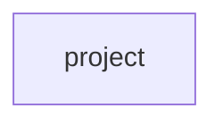

## Details

Static architecture map of 60 files (c, py, sh) in 1 components: project. Structure is extracted statically without LLM calls; component prose may be enriched locally.

### project (1)

project groups 60 files (c, py, sh) around StrassenNet, __init__, forward, Configuration, set_random_seed. Autor: Gris Iscomeback Correo electrónico: grisiscomeback[at]gmail[dot]com Fecha de...

**Related Classes/Methods**:

- <a href="../app.py">app.py::StrassenNet</a>
- <a href="../app.py#L25-L30">app.py::__init__</a>
- <a href="../app.py#L31-L104">app.py::forward</a>
- <a href="../batch_size.py#L31-L70">batch_size.py::Configuration</a>
- <a href="../batch_size.py#L71-L76">batch_size.py::set_random_seed</a>
- <a href="../batch_size.py">batch_size.py::BilinearStrassenModel</a>
- <a href="../batch_size.py#L78-L87">batch_size.py::__init__</a>
- <a href="../batch_size.py#L88-L90">batch_size.py::forward</a>
