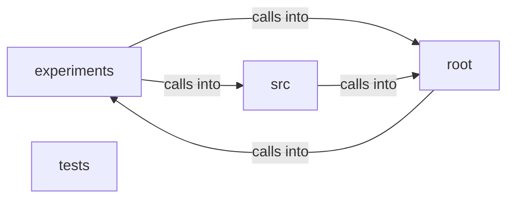

# project

project groups 60 files (c, py, sh) around StrassenNet, __init__, forward, Configuration, set_random_seed. Autor: Gris Iscomeback Correo electrónico: grisiscomeback[at]gmail[dot]com Fecha de...

## experiments (1.1)

experiments groups 18 files (py) around BenchmarkResult, mean_time, std_time, min_time, max_time. ABLACIÓN RIGUROSA - Strassen vs OpenBLAS

## root (1.2)

root groups 26 files (py, sh) around StrassenNet, __init__, forward, Configuration, set_random_seed. Autor: Gris Iscomeback Correo electrónico: grisiscomeback[at]gmail[dot]com Fecha de...

## src (1.3)

src groups 15 files (c, py) around strassen_hybrid_multiply, numpy_multiply, benchmark, main, strassen_multiply. BENCHMARK FINAL: Strassen Hybrid vs NumPy BLAS

## tests (1.4)

tests groups 1 files (py) around obtener_texto, test_test. Función auxiliar (sin prefijo test_)

**Files**:

- app.py
- batch_size.py
- boltzmann_experiments.py
- compute_gns_checkpoints.py
- crystallography.py
- dirac_polos_zeros.py
- experiments/ablation/ablation_8192.py
- experiments/ablation/ablation_study.py
- experiments/apendix_experiments.py
- experiments/cache_analysis_v2.py
- experiments/extended_experiments/all_test_extended.py
- experiments/extended_experiments/exp1_covariance_spectrometry.py
- experiments/extended_experiments/exp2_noise_ablation.py
- experiments/extended_experiments/exp3_prospective_prediction.py
- experiments/extended_experiments/exp4_trajectory_perturbation.py
- experiments/extended_experiments/exp5_discreteness_attractors.py
- experiments/extended_experiments/run_all_experiments.py
- experiments/extended_experiments/validate2.py
- experiments/generate_figures.py
- experiments/statistics/coherence_analysis.py
- experiments/statistics/rigorous_experiment.py
- experiments/validation/benchmark.py
- experiments/validation_experiments.py
- experiments/verify_checkpoints.py
- experimetn2.py
- fermi.py
- full_seed_prospector.py
- grain.py
- gravity.py
- grigori_perelmans_ricci_flow.py
- hawking_radiation.py
- install.sh
- maxwell_strassen_analysis.py
- mbl_analyzer.py
- measure_strassen.py
- menu.py
- percolation_analysis.py
- plank.py
- purity_index.py
- scrodingger.py
- src/benchmarks/benchmark_final.py
- src/benchmarks/benchmark_scientific.py
- src/benchmarks/benchmark_strassen.py
- src/benchmarks/strassen_numpy.py
- src/discovery/auto_T_discovery.py
- src/native/strassen_c.c
- src/native/strassen_optimal.c
- src/native/strassen_turbo.c
- src/training/convergence_theory.py
- src/training/grokkit_physics.py
- src/training/main.py
- src/training/main_pure_math.py
- src/training/strassen_core.py
- src/training/strassen_grokkit.py
- src/training/train_strassen.py
- superposition.py
- tests/test_main.py
- train_batch_sweep.py
- unified_hidden_connections_suite.py
- xray_tensor_diffractometer.py
